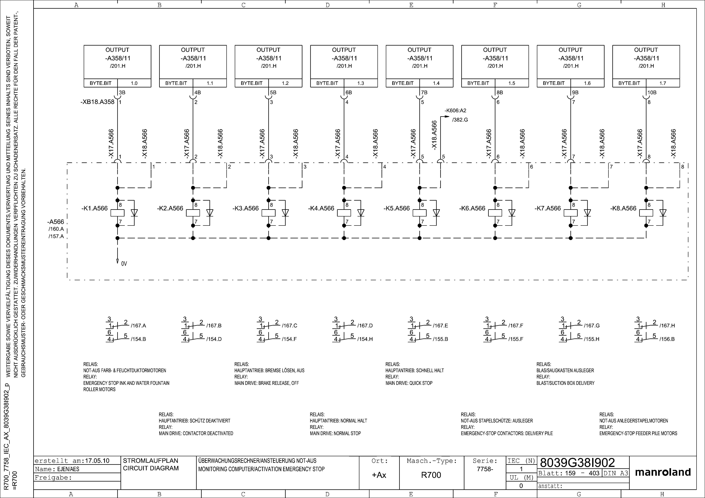

# +Ax — Sheet 159 of 403 — ÜBERWACHUNGSRECHNER/ANSTEUERUNG NOT AUS

**MONITORING COMPUTER/ACTIVATION EMERGENCY STOP**

> Part of the manroland **R700** printing press IEC/UL circuit diagrams.
> Drawing class: **Stromlaufplan / Circuit diagram** (DIN A3).
> Document `+Ax` covers the **Central control console** machine section.

## At a glance

| Field | Value |
|---|---|
| Document | `+Ax`  (8039G38I902) |
| Sheet | **159** of 403 |
| Section (DE) | ÜBERWACHUNGSRECHNER/ANSTEUERUNG NOT AUS |
| Section (EN) | MONITORING COMPUTER/ACTIVATION EMERGENCY STOP |
| Section type | CIRCUIT — Circuit diagram |
| Machine type | `R700` |
| Series | `7758` |
| Created | 17.05.10 |
| Replaces | — |
| Columns used | A, B, C, D, E, F, G, H |
| Path numbers | — |
| Labels on sheet | 216 |
| Cross-refs out | 27 |
| Cross-refs in | 51 |

**Previous:** [+Ax sheet 158](SHEET_0158.md) · **Next:** [+Ax sheet 160](SHEET_0160.md) · **Document TOC:** [_TOC.md](_TOC.md)  (+Ax) · **Master TOC:** [all sheets](../_MASTER_TOC.md)

## Sheet image (300 DPI, exact vector render)



_Rendered directly from the PDF vector layer at 300 DPI (1-bit), no OCR and no resampling. Use it to confirm anything ambiguous in the text below._

## Cross-references on this sheet

Each entry is a wire leaving this sheet. The printed token is `/sheet.column`; the link resolves to that sheet inside the same document.

| Ref | Target sheet | Col | Path | Destination on target | Target section | From col |
|---|---|---|---|---|---|---|
| `/201.H` | [+Ax sheet 201](SHEET_0201.md) | H | — | — | REFERENZMODUL | A |
| `/201.H` | [+Ax sheet 201](SHEET_0201.md) | H | — | — | REFERENZMODUL | B |
| `/201.H` | [+Ax sheet 201](SHEET_0201.md) | H | — | — | REFERENZMODUL | C |
| `/201.H` | [+Ax sheet 201](SHEET_0201.md) | H | — | — | REFERENZMODUL | D |
| `/201.H` | [+Ax sheet 201](SHEET_0201.md) | H | — | — | REFERENZMODUL | E |
| `/201.H` | [+Ax sheet 201](SHEET_0201.md) | H | — | — | REFERENZMODUL | F |
| `/201.H` | [+Ax sheet 201](SHEET_0201.md) | H | — | — | REFERENZMODUL | G |
| `/201.H` | [+Ax sheet 201](SHEET_0201.md) | H | — | — | REFERENZMODUL | H |
| `/382.G` | [+Ax sheet 382](SHEET_0382.md) | G | — | — | OPTION: INLINEFOILER PRINDOR | F |
| `/160.A` | [+Ax sheet 160](SHEET_0160.md) | A | — | — | ÜBERWACHUNGSRECHNER/ANSTEUERUNG NOT AUS | A |
| `/157.A` | [+Ax sheet 157](SHEET_0157.md) | A | — | — | ÜBERWACHUNGSRECHNER/ANSTEUERUNG NOT AUS | A |
| `/167.A` | [+Ax sheet 167](SHEET_0167.md) | A | — | — | ÜBERWACHUNGSRECHNER/RÜCKMELDUNG NOT AUS | B |
| `/167.B` | [+Ax sheet 167](SHEET_0167.md) | B | — | — | ÜBERWACHUNGSRECHNER/RÜCKMELDUNG NOT AUS | C |
| `/167.E` | [+Ax sheet 167](SHEET_0167.md) | E | — | — | ÜBERWACHUNGSRECHNER/RÜCKMELDUNG NOT AUS | E |
| `/167.F` | [+Ax sheet 167](SHEET_0167.md) | F | — | — | ÜBERWACHUNGSRECHNER/RÜCKMELDUNG NOT AUS | F |
| `/167.G` | [+Ax sheet 167](SHEET_0167.md) | G | — | — | ÜBERWACHUNGSRECHNER/RÜCKMELDUNG NOT AUS | G |
| `/167.C` | [+Ax sheet 167](SHEET_0167.md) | C | — | — | ÜBERWACHUNGSRECHNER/RÜCKMELDUNG NOT AUS | D |
| `/167.D` | [+Ax sheet 167](SHEET_0167.md) | D | — | — | ÜBERWACHUNGSRECHNER/RÜCKMELDUNG NOT AUS | D |
| `/167.H` | [+Ax sheet 167](SHEET_0167.md) | H | — | — | ÜBERWACHUNGSRECHNER/RÜCKMELDUNG NOT AUS | H |
| `/154.B` | [+Ax sheet 154](SHEET_0154.md) | B | — | — | ÜBERWACHUNGSRECHNER/ANSTEUERUNG NOT AUS | B |
| `/155.B` | [+Ax sheet 155](SHEET_0155.md) | B | — | — | ÜBERWACHUNGSRECHNER/ANSTEUERUNG NOT AUS | E |
| `/156.B` | [+Ax sheet 156](SHEET_0156.md) | B | — | — | ÜBERWACHUNGSRECHNER/ANSTEUERUNG NOT AUS | H |
| `/154.F` | [+Ax sheet 154](SHEET_0154.md) | F | — | — | ÜBERWACHUNGSRECHNER/ANSTEUERUNG NOT AUS | D |
| `/155.F` | [+Ax sheet 155](SHEET_0155.md) | F | — | — | ÜBERWACHUNGSRECHNER/ANSTEUERUNG NOT AUS | F |
| `/154.D` | [+Ax sheet 154](SHEET_0154.md) | D | — | — | ÜBERWACHUNGSRECHNER/ANSTEUERUNG NOT AUS | C |
| `/154.H` | [+Ax sheet 154](SHEET_0154.md) | H | — | — | ÜBERWACHUNGSRECHNER/ANSTEUERUNG NOT AUS | D |
| `/155.H` | [+Ax sheet 155](SHEET_0155.md) | H | — | — | ÜBERWACHUNGSRECHNER/ANSTEUERUNG NOT AUS | G |

### Incoming references (sheets that point here)

Every other sheet that sends a wire to this one. `Back-ref` is the token printed on *that* sheet; `Path` is its line number.

| From sheet | Cols | Back-ref | Path | Refs | What continues there |
|---|---|---|---|---|---|
| [+Ax#154](SHEET_0154.md) | B, D, F, H | `/154.B`, `/154.D`, `/154.F`, `/154.H` | — | 4 | — |
| [+Ax#155](SHEET_0155.md) | B, F, G | `/155.B`, `/155.F`, `/155.G` | — | 3 | — |
| [+Ax#156](SHEET_0156.md) | B | `/156.B` | — | 1 | — |
| [+Ax#157](SHEET_0157.md) | A | `/157.A` | — | 1 | — |
| [+Ax#160](SHEET_0160.md) | A | `/160.A` | — | 1 | — |
| [+Ax#167](SHEET_0167.md) | A, B, C, D, E, F, G | `/167.A`, `/167.B`, `/167.C`, `/167.D`, `/167.E`, `/167.F`, `/167.G` | — | 8 | — |
| [+Ax#201](SHEET_0201.md) | G, H | `/201.G`, `/201.H` | — | 8 | — |
| [+Ax#255](SHEET_0255.md) | H | `/255.H` | — | 8 | — |
| [+Ax#257](SHEET_0257.md) | A, C | `/257.A`, `/257.C` | — | 16 | — |
| [+Ax#382](SHEET_0382.md) | F | `/382.F` | — | 1 | K606:A2 |


## Devices on this sheet

| Tag | Class | Class meaning (IEC) | Col | Sub | Terminal | Sign |
|---|---|---|---|---|---|---|
| `A566` | A | Baugruppe / assembly, module, PC board | A | — | — | — |
| `A358/11` | A | Baugruppe / assembly, module, PC board | B | 11 | — | — |
| `A358/11` | A | Baugruppe / assembly, module, PC board | B | 11 | — | — |
| `A358/11` | A | Baugruppe / assembly, module, PC board | C | 11 | — | — |
| `A358/11` | A | Baugruppe / assembly, module, PC board | D | 11 | — | — |
| `A358/11` | A | Baugruppe / assembly, module, PC board | E | 11 | — | — |
| `A358/11` | A | Baugruppe / assembly, module, PC board | F | 11 | — | — |
| `A358/11` | A | Baugruppe / assembly, module, PC board | G | 11 | — | — |
| `A358/11` | A | Baugruppe / assembly, module, PC board | H | 11 | — | — |
| `K606:A2` | K | Relais / relay, contactor | F | — | A2 | — |
| `1.0` | — | cross-device reference | B | — | — | — |
| `1.1` | — | cross-device reference | C | — | — | — |
| `1.2` | — | cross-device reference | C | — | — | — |
| `1.3` | — | cross-device reference | D | — | — | — |
| `1.4` | — | cross-device reference | E | — | — | — |
| `1.5` | — | cross-device reference | F | — | — | — |
| `1.6` | — | cross-device reference | G | — | — | — |
| `1.7` | — | cross-device reference | H | — | — | — |
| `XB18.A358` | — | cross-device reference | A | — | — | — |
| `X17.A566` | — | cross-device reference | A | — | — | — |
| `K1.A566` | — | cross-device reference | A | — | — | — |
| `K2.A566` | — | cross-device reference | B | — | — | — |
| `K3.A566` | — | cross-device reference | C | — | — | — |
| `K4.A566` | — | cross-device reference | D | — | — | — |
| `K5.A566` | — | cross-device reference | E | — | — | — |
| `K6.A566` | — | cross-device reference | F | — | — | — |
| `K7.A566` | — | cross-device reference | G | — | — | — |
| `K8.A566` | — | cross-device reference | H | — | — | — |
| `X17.A566` | — | cross-device reference | B | — | — | — |
| `X17.A566` | — | cross-device reference | C | — | — | — |
| `X17.A566` | — | cross-device reference | D | — | — | — |
| `X17.A566` | — | cross-device reference | E | — | — | — |
| `X17.A566` | — | cross-device reference | F | — | — | — |
| `X17.A566` | — | cross-device reference | G | — | — | — |
| `X17.A566` | — | cross-device reference | H | — | — | — |
| `X18.A566` | — | cross-device reference | E | — | — | — |
| `X18.A566` | — | cross-device reference | B | — | — | — |
| `X18.A566` | — | cross-device reference | C | — | — | — |
| `X18.A566` | — | cross-device reference | D | — | — | — |
| `X18.A566` | — | cross-device reference | E | — | — | — |
| `X18.A566` | — | cross-device reference | F | — | — | — |
| `X18.A566` | — | cross-device reference | G | — | — | — |
| `X18.A566` | — | cross-device reference | H | — | — | — |

## Potentials / nets

| Potential | Count | Columns | Attached devices | Terminals |
|---|---|---|---|---|
| `0V` | 1 | B | — | — |


A potential such as `L24+/4` or `M24+` is a named supply/return rail; every place it appears on this sheet is electrically common.

## Wire-end annotations (grouped as printed)

A wire that continues elsewhere is annotated with a small cluster: the destination description, the path/line number `#NN`, and the `/sheet.column` cross reference. Each row below is one such cluster exactly as it is grouped on the drawing.

| Col | Y | Path | Cross-ref | Text on the wire |
|---|---|---|---|---|
| A | 80.0 | — | — | `OUTPUT` |
| B | 80.0 | — | — | `OUTPUT` |
| C | 80.0 | — | — | `OUTPUT` |
| D | 80.0 | — | — | `OUTPUT` |
| E | 80.0 | — | — | `OUTPUT` |
| F | 80.0 | — | — | `OUTPUT` |
| G | 80.0 | — | — | `OUTPUT` |
| H | 80.0 | — | — | `OUTPUT` |
| B | 93.8 | — | — | `A358/11` |
| B | 93.8 | — | — | `A358/11` |
| C | 93.8 | — | — | `A358/11` |
| D | 93.8 | — | — | `A358/11` |
| E | 93.8 | — | — | `A358/11` |
| F | 93.8 | — | — | `A358/11` |
| G | 93.8 | — | — | `A358/11` |
| H | 93.8 | — | — | `A358/11` |
| A | 107.7 | — | `/201.H` | — |
| B | 107.7 | — | `/201.H` | — |
| C | 107.7 | — | `/201.H` | — |
| D | 107.7 | — | `/201.H` | — |
| E | 107.7 | — | `/201.H` | — |
| F | 107.7 | — | `/201.H` | — |
| G | 107.7 | — | `/201.H` | — |
| H | 107.7 | — | `/201.H` | — |
| A | 137.3 | — | — | `BYTE.BIT 1.0` |
| B | 137.3 | — | — | `BYTE.BIT 1.1` |
| C | 137.3 | — | — | `BYTE.BIT 1.2` |
| D | 137.3 | — | — | `BYTE.BIT 1.3` |
| E | 137.3 | — | — | `BYTE.BIT 1.4` |
| F | 137.3 | — | — | `BYTE.BIT 1.5` |
| G | 137.3 | — | — | `BYTE.BIT 1.6` |
| H | 137.3 | — | — | `BYTE.BIT 1.7` |
| B | 152.6 | — | — | `3B` |
| B | 152.6 | — | — | `4B` |
| C | 152.6 | — | — | `5B` |
| D | 152.6 | — | — | `6B` |
| E | 152.6 | — | — | `7B` |
| F | 152.6 | — | — | `8B` |
| G | 152.6 | — | — | `9B` |
| H | 152.7 | — | — | `10B` |
| D | 167.6 | — | — | `XB18.A358 1 2 3 4 5 6 7 8` |
| F | 183.1 | — | — | `K606:A2` |
| F | 198.7 | — | `/382.G` | — |
| E | 203.5 | — | — | `X18.A566` |
| A | 218.0 | — | — | `X17.A566` |
| B | 218.0 | — | — | `X18.A566` |
| B | 218.0 | — | — | `X17.A566` |
| C | 218.0 | — | — | `X18.A566` |
| C | 218.0 | — | — | `X17.A566` |
| D | 218.0 | — | — | `X18.A566` |
| D | 218.0 | — | — | `X17.A566` |
| E | 218.0 | — | — | `X18.A566` |
| E | 218.0 | — | — | `X17.A566` |
| F | 218.0 | — | — | `X17.A566` |
| F | 218.0 | — | — | `X18.A566` |
| G | 218.0 | — | — | `X17.A566` |
| G | 218.0 | — | — | `X18.A566` |
| H | 218.0 | — | — | `X17.A566` |
| H | 218.0 | — | — | `X18.A566` |
| B | 261.1 | — | — | `1` |
| B | 261.1 | — | — | `2` |
| C | 261.1 | — | — | `3` |
| D | 261.1 | — | — | `4` |
| E | 261.1 | — | — | `5` |
| E | 261.1 | — | — | `5` |
| F | 261.1 | — | — | `6` |
| G | 261.1 | — | — | `7` |
| H | 261.1 | — | — | `8` |
| E | 278.1 | — | — | `1 2 3 4 6 7 8` |
| B | 342.6 | — | — | `8` |
| B | 342.6 | — | — | `8` |
| C | 342.6 | — | — | `8` |
| D | 342.6 | — | — | `8` |
| E | 342.6 | — | — | `8` |
| F | 342.6 | — | — | `8` |
| G | 342.6 | — | — | `8` |
| H | 342.6 | — | — | `8` |
| A | 347.6 | — | — | `K1.A566` |
| B | 347.6 | — | — | `K2.A566` |
| C | 347.6 | — | — | `K3.A566` |
| D | 347.6 | — | — | `K4.A566` |
| E | 347.6 | — | — | `K5.A566` |
| F | 347.6 | — | — | `K6.A566` |
| G | 347.6 | — | — | `K7.A566` |
| H | 347.6 | — | — | `K8.A566` |
| A | 370.2 | — | — | `A566` |
| B | 370.9 | — | — | `7` |
| B | 370.9 | — | — | `7` |
| C | 370.9 | — | — | `7` |
| D | 370.9 | — | — | `7` |
| E | 370.9 | — | — | `7` |
| F | 370.9 | — | — | `7` |
| G | 370.9 | — | — | `7` |
| H | 370.9 | — | — | `7` |
| A | 383.3 | — | `/160.A`, `/157.A` | — |
| B | 442.3 | — | — | `0V` |
| A | 534.6 | — | — | `3 6 4 1` |
| B | 534.6 | — | — | `3 6 4 1` |
| C | 534.6 | — | — | `3 6 4 1` |
| D | 534.6 | — | — | `3 6 4 1` |
| E | 534.6 | — | — | `3 6 4 1` |
| F | 534.6 | — | — | `3 6 4 1` |
| G | 534.6 | — | — | `3 6 4 1` |
| H | 534.6 | — | — | `3 6 4 1` |
| B | 540.3 | — | — | `2` |
| B | 540.3 | — | — | `2` |
| C | 540.3 | — | — | `2` |
| D | 540.3 | — | — | `2` |
| E | 540.3 | — | — | `2` |
| F | 540.3 | — | — | `2` |
| G | 540.3 | — | — | `2` |
| H | 540.3 | — | — | `2` |
| B | 546.6 | — | `/167.A` | — |
| C | 546.6 | — | `/167.B` | — |
| E | 546.6 | — | `/167.E` | — |
| F | 546.6 | — | `/167.F` | — |
| D | 546.7 | — | `/167.C` | — |
| D | 546.7 | — | `/167.D` | — |
| G | 546.7 | — | `/167.G` | — |
| H | 546.7 | — | `/167.H` | — |
| B | 563.0 | — | — | `5` |
| B | 563.0 | — | — | `5` |
| C | 563.0 | — | — | `5` |
| D | 563.0 | — | — | `5` |
| E | 563.0 | — | — | `5` |
| F | 563.0 | — | — | `5` |
| G | 563.0 | — | — | `5` |
| H | 563.0 | — | — | `5` |
| B | 569.3 | — | `/154.B` | — |
| D | 569.3 | — | `/154.F` | — |
| E | 569.3 | — | `/155.B` | — |
| F | 569.3 | — | `/155.F` | — |
| H | 569.3 | — | `/156.B` | — |
| C | 569.4 | — | `/154.D` | — |
| D | 569.4 | — | `/154.H` | — |
| G | 569.4 | — | `/155.H` | — |
| B | 612.8 | — | — | `RELAIS: NOT AUS FARB & FEUCHTDUKTORMOTOREN RELAY: EMERGENCY STOP INK AND WATER FOUNTAIN ROLLER MOTORS` |
| C | 612.8 | — | — | `RELAIS: HAUPTANTRIEB: BREMSE LÖSEN, AUS RELAY: MAIN DRIVE: BRAKE RELEASE, OFF` |
| E | 612.8 | — | — | `RELAIS: HAUPTANTRIEB: SCHNELL HALT RELAY: MAIN DRIVE: QUICK STOP` |
| G | 612.8 | — | — | `RELAIS: BLAS/SAUGKASTEN AUSLEGER RELAY: BLAST/SUCTION BOX DELIVERY` |
| B | 697.9 | — | — | `RELAIS: HAUPTANTRIEB: SCHÜTZ DEAKTIVIERT RELAY: MAIN DRIVE: CONTACTOR DEACTIVATED` |
| D | 697.9 | — | — | `RELAIS: HAUPTANTRIEB: NORMAL HALT RELAY: MAIN DRIVE: NORMAL STOP` |
| F | 697.9 | — | — | `RELAIS: NOT AUS STAPELSCHÜTZE: AUSLEGER RELAY: EMERGENCY STOP CONTACTORS: DELIVERY PILE` |
| H | 697.9 | — | — | `RELAIS: NOT AUS ANLEGERSTAPELMOTOREN RELAY: EMERGENCY STOP FEEDER PILE MOTORS` |


## Reconstructed tables

This sheet carries tabular content (pin map / terminal assignment / index). The grid below was rebuilt from the drawing's own rule lines, so each row is exactly one physical row of the table.

### Table 1 — 3 data rows × 15 columns (at x=141.7, y=76.5)

| OUTPUT | A358/11 /201.H |  |  | OUTPUT | A358/11 /201.H |  |  | OUTPUT | A358/11 /201.H |  |  | OUTPUT | A358/11 /201.H |  |
|---|---|---|---|---|---|---|---|---|---|---|---|---|---|---|
| `BYTE.BIT` | `1.0` |  |  | `BYTE.BIT` |  | `1.1` |  | `BYTE.BIT` | `1.2` |  |  | `BYTE.BIT` | `1.3` |  |
| `XB18.A358 X17.A566` | `3B 1 1` | `X18.A566` | `1` | `X17.A566` | `4B 2 2` | `X18.A566` | `2` | `X17.A566` | `5B 3 3` | `X18.A566` | `3` | `X17.A566` | `6B 4 4` | `X18.A566` |
| `K1.A566` | `8 7` |  |  | `K2.A566` | `8 7` |  |  | `K3.A566` | `8 7` |  |  | `K4.A566` | `8 7` |  |


### Table 2 — 3 data rows × 3 columns (at x=644.9, y=76.5)

|  | OUTPUT | A358/11 /201.H |
|---|---|---|
|  | `BYTE.BIT` | `1.4` |
| `4` | `X17.A566` | `7B 5 X18.A566 5` |
|  | `K5.A566` | `8 7` |


### Table 3 — 3 data rows × 9 columns (at x=744.1, y=76.5)

|  |  | OUTPUT | A358/11 /201.H |  |  | OUTPUT | A358/11 /201.H |  |
|---|---|---|---|---|---|---|---|---|
|  |  | `BYTE.BIT` | `1.5` |  |  | `BYTE.BIT` | `1.6` |  |
| `5` | `K606:A2 /382.G` | `X17.A566` | `8B 6 6` | `X18.A566` | `6` | `X17.A566` | `9B 7 7` | `X18.A566` |
|  |  | `K6.A566` | `8 7` |  |  | `K7.A566` | `8 7` |  |


### Table 4 — 3 data rows × 4 columns (at x=1027.6, y=76.5)

|  | OUTPUT | A358/11 /201.H |  |
|---|---|---|---|
|  | `BYTE.BIT` | `1.7` |  |
| `7` | `X17.A566` | `10B 8 8` | `X18.A566` |
|  | `K8.A566` | `8 7` |  |


## Notes and free text on this sheet

| Text | Col | Y (pt) |
|---|---|---|
| `3B` | B | 152.63 |
| `OUTPUT` | A | 79.98 |
| `BYTE.BIT` | A | 137.26 |
| `RELAIS:` | A | 612.84 |
| `NOT AUS FARB & FEUCHTDUKTORMOTOREN` | B | 623.56 |
| `RELAY:` | A | 634.11 |
| `EMERGENCY STOP INK AND WATER FOUNTAIN` | B | 644.8 |
| `ROLLER MOTORS` | A | 655.45 |
| `4B` | B | 152.63 |
| `OUTPUT` | B | 79.98 |
| `BYTE.BIT` | B | 137.26 |
| `RELAIS:` | B | 697.88 |
| `HAUPTANTRIEB: SCHÜTZ DEAKTIVIERT` | B | 708.57 |
| `RELAY:` | B | 719.15 |
| `MAIN DRIVE: CONTACTOR DEACTIVATED` | B | 729.85 |
| `5B` | C | 152.63 |
| `OUTPUT` | C | 79.98 |
| `BYTE.BIT` | C | 137.26 |
| `RELAIS:` | C | 612.84 |
| `HAUPTANTRIEB: BREMSE LÖSEN, AUS` | C | 623.53 |
| `RELAY:` | C | 634.11 |
| `MAIN DRIVE: BRAKE RELEASE, OFF` | C | 644.79 |
| `6B` | D | 152.63 |
| `OUTPUT` | D | 79.98 |
| `BYTE.BIT` | D | 137.26 |
| `RELAIS:` | D | 697.88 |
| `HAUPTANTRIEB: NORMAL HALT` | D | 708.59 |
| `RELAY:` | D | 719.15 |
| `MAIN DRIVE: NORMAL STOP` | D | 729.85 |
| `7B` | E | 152.63 |
| `OUTPUT` | E | 79.98 |
| `BYTE.BIT` | E | 137.26 |
| `RELAIS:` | E | 612.84 |
| `HAUPTANTRIEB: SCHNELL HALT` | E | 623.54 |
| `RELAY:` | E | 634.11 |
| `MAIN DRIVE: QUICK STOP` | E | 644.8 |
| `8B` | F | 152.63 |
| `OUTPUT` | F | 79.98 |
| `BYTE.BIT` | F | 137.26 |
| `RELAIS:` | F | 697.88 |
| `NOT AUS STAPELSCHÜTZE: AUSLEGER` | F | 708.58 |
| `RELAY:` | F | 719.15 |
| `EMERGENCY STOP CONTACTORS: DELIVERY PILE` | F | 729.85 |
| `9B` | G | 152.63 |
| `OUTPUT` | G | 79.98 |
| `BYTE.BIT` | G | 137.26 |
| `RELAIS:` | G | 612.84 |
| `BLAS/SAUGKASTEN AUSLEGER` | G | 623.53 |
| `RELAY:` | G | 634.11 |
| `BLAST/SUCTION BOX DELIVERY` | G | 644.8 |
| `10B` | H | 152.65 |
| `OUTPUT` | H | 79.98 |
| `BYTE.BIT` | H | 137.26 |
| `NOT AUS ANLEGERSTAPELMOTOREN` | H | 708.59 |
| `EMERGENCY STOP FEEDER PILE MOTORS` | H | 729.85 |

## Complete label inventory (exact text from the drawing)

Every text object inside the drawing area of this sheet, in DIN reading order (column A→H, then top→bottom). This is the authoritative list: if a string is not here it is not printed on this sheet.

| Col | Y | X | Dir | Type | Text |
|---|---|---|---|---|---|
| A | 80.0 | 178.2 | → | text | `OUTPUT` |
| A | 107.7 | 186.0 | → | cross-reference | `/201.H` |
| A | 137.3 | 151.7 | → | text | `BYTE.BIT` |
| A | 167.5 | 136.1 | → | device ref | `XB18.A358` |
| A | 218.0 | 183.1 | ↕ | device ref | `X17.A566` |
| A | 347.6 | 137.8 | → | device ref | `K1.A566` |
| A | 370.2 | 79.9 | → | device tag | `A566` |
| A | 383.3 | 82.2 | → | cross-reference | `/160.A` |
| A | 395.7 | 82.2 | → | cross-reference | `/157.A` |
| A | 534.6 | 181.7 | → | number | `3` |
| A | 545.9 | 183.1 | → | number | `1` |
| A | 557.3 | 181.7 | → | number | `6` |
| A | 568.6 | 181.7 | → | number | `4` |
| A | 612.8 | 140.9 | → | text | `RELAIS:` |
| A | 634.1 | 140.9 | → | text | `RELAY:` |
| A | 655.5 | 140.9 | → | text | `ROLLER MOTORS` |
| B | 80.0 | 305.7 | → | text | `OUTPUT` |
| B | 93.8 | 177.7 | → | device tag | `A358/11` |
| B | 93.8 | 305.3 | → | device tag | `A358/11` |
| B | 107.7 | 313.5 | → | cross-reference | `/201.H` |
| B | 137.3 | 220.8 | → | device ref | `1.0` |
| B | 137.3 | 279.2 | → | text | `BYTE.BIT` |
| B | 152.6 | 201.0 | → | text | `3B` |
| B | 152.6 | 328.5 | → | text | `4B` |
| B | 169.0 | 200.4 | → | number | `1` |
| B | 169.0 | 328.5 | → | number | `2` |
| B | 218.0 | 239.8 | ↕ | device ref | `X18.A566` |
| B | 218.0 | 310.7 | ↕ | device ref | `X17.A566` |
| B | 261.1 | 200.4 | → | number | `1` |
| B | 261.1 | 328.5 | → | number | `2` |
| B | 278.1 | 257.1 | → | number | `1` |
| B | 342.6 | 201.0 | → | number | `8` |
| B | 342.6 | 328.5 | → | number | `8` |
| B | 347.6 | 265.3 | → | device ref | `K2.A566` |
| B | 371.0 | 201.0 | → | number | `7` |
| B | 371.0 | 328.5 | → | number | `7` |
| B | 442.3 | 204.9 | → | potential | `0V` |
| B | 534.6 | 309.3 | → | number | `3` |
| B | 540.3 | 209.5 | → | number | `2` |
| B | 540.3 | 337.0 | → | number | `2` |
| B | 545.9 | 310.7 | → | number | `1` |
| B | 546.6 | 221.1 | → | cross-reference | `/167.A` |
| B | 557.3 | 309.3 | → | number | `6` |
| B | 562.9 | 209.2 | → | number | `5` |
| B | 562.9 | 336.8 | → | number | `5` |
| B | 568.6 | 309.3 | → | number | `4` |
| B | 569.3 | 221.1 | → | cross-reference | `/154.B` |
| B | 623.6 | 140.9 | → | text | `NOT AUS FARB & FEUCHTDUKTORMOTOREN` |
| B | 644.8 | 140.9 | → | text | `EMERGENCY STOP INK AND WATER FOUNTAIN` |
| B | 697.9 | 268.4 | → | text | `RELAIS:` |
| B | 708.6 | 268.4 | → | text | `HAUPTANTRIEB: SCHÜTZ DEAKTIVIERT` |
| B | 719.1 | 268.4 | → | text | `RELAY:` |
| B | 729.9 | 268.7 | → | text | `MAIN DRIVE: CONTACTOR DEACTIVATED` |
| C | 80.0 | 433.3 | → | text | `OUTPUT` |
| C | 93.8 | 432.9 | → | device tag | `A358/11` |
| C | 107.7 | 441.1 | → | cross-reference | `/201.H` |
| C | 137.3 | 348.9 | → | device ref | `1.1` |
| C | 137.3 | 406.8 | → | text | `BYTE.BIT` |
| C | 137.3 | 476.1 | → | device ref | `1.2` |
| C | 152.6 | 456.1 | → | text | `5B` |
| C | 169.0 | 456.1 | → | number | `3` |
| C | 218.0 | 367.4 | ↕ | device ref | `X18.A566` |
| C | 218.0 | 438.3 | ↕ | device ref | `X17.A566` |
| C | 261.1 | 456.1 | → | number | `3` |
| C | 278.1 | 385.2 | → | number | `2` |
| C | 342.6 | 456.1 | → | number | `8` |
| C | 347.6 | 392.9 | → | device ref | `K3.A566` |
| C | 371.0 | 456.1 | → | number | `7` |
| C | 534.6 | 436.8 | → | number | `3` |
| C | 540.3 | 464.6 | → | number | `2` |
| C | 545.9 | 438.2 | → | number | `1` |
| C | 546.6 | 348.7 | → | cross-reference | `/167.B` |
| C | 557.3 | 436.8 | → | number | `6` |
| C | 562.9 | 464.3 | → | number | `5` |
| C | 568.6 | 436.8 | → | number | `4` |
| C | 569.3 | 348.7 | → | cross-reference | `/154.D` |
| C | 612.8 | 396.0 | → | text | `RELAIS:` |
| C | 623.5 | 396.0 | → | text | `HAUPTANTRIEB: BREMSE LÖSEN, AUS` |
| C | 634.1 | 396.0 | → | text | `RELAY:` |
| C | 644.8 | 396.3 | → | text | `MAIN DRIVE: BRAKE RELEASE, OFF` |
| D | 80.0 | 560.8 | → | text | `OUTPUT` |
| D | 93.8 | 560.4 | → | device tag | `A358/11` |
| D | 107.7 | 568.6 | → | cross-reference | `/201.H` |
| D | 137.3 | 534.3 | → | text | `BYTE.BIT` |
| D | 137.3 | 603.5 | → | device ref | `1.3` |
| D | 152.6 | 583.7 | → | text | `6B` |
| D | 169.0 | 583.7 | → | number | `4` |
| D | 218.0 | 495.0 | ↕ | device ref | `X18.A566` |
| D | 218.0 | 565.8 | ↕ | device ref | `X17.A566` |
| D | 261.1 | 583.7 | → | number | `4` |
| D | 278.1 | 512.8 | → | number | `3` |
| D | 342.6 | 583.7 | → | number | `8` |
| D | 347.6 | 520.4 | → | device ref | `K4.A566` |
| D | 371.0 | 583.7 | → | number | `7` |
| D | 534.6 | 564.4 | → | number | `3` |
| D | 540.3 | 592.2 | → | number | `2` |
| D | 545.9 | 565.8 | → | number | `1` |
| D | 546.7 | 476.2 | → | cross-reference | `/167.C` |
| D | 546.7 | 603.8 | → | cross-reference | `/167.D` |
| D | 557.3 | 564.4 | → | number | `6` |
| D | 562.9 | 591.9 | → | number | `5` |
| D | 568.6 | 564.4 | → | number | `4` |
| D | 569.3 | 476.2 | → | cross-reference | `/154.F` |
| D | 569.3 | 603.8 | → | cross-reference | `/154.H` |
| D | 697.9 | 523.6 | → | text | `RELAIS:` |
| D | 708.6 | 523.6 | → | text | `HAUPTANTRIEB: NORMAL HALT` |
| D | 719.1 | 523.6 | → | text | `RELAY:` |
| D | 729.9 | 523.8 | → | text | `MAIN DRIVE: NORMAL STOP` |
| E | 80.0 | 688.4 | → | text | `OUTPUT` |
| E | 93.8 | 688.0 | → | device tag | `A358/11` |
| E | 107.7 | 696.2 | → | cross-reference | `/201.H` |
| E | 137.3 | 661.9 | → | text | `BYTE.BIT` |
| E | 137.3 | 731.1 | → | device ref | `1.4` |
| E | 152.6 | 711.2 | → | text | `7B` |
| E | 169.0 | 711.2 | → | number | `5` |
| E | 203.5 | 728.8 | ↕ | device ref | `X18.A566` |
| E | 218.0 | 629.6 | ↕ | device ref | `X18.A566` |
| E | 218.0 | 693.4 | ↕ | device ref | `X17.A566` |
| E | 261.1 | 711.2 | → | number | `5` |
| E | 261.1 | 746.6 | → | number | `5` |
| E | 278.1 | 647.4 | → | number | `4` |
| E | 342.6 | 711.2 | → | number | `8` |
| E | 347.6 | 648.0 | → | device ref | `K5.A566` |
| E | 371.0 | 711.2 | → | number | `7` |
| E | 534.6 | 691.9 | → | number | `3` |
| E | 540.3 | 719.7 | → | number | `2` |
| E | 545.9 | 693.4 | → | number | `1` |
| E | 546.6 | 731.3 | → | cross-reference | `/167.E` |
| E | 557.3 | 691.9 | → | number | `6` |
| E | 562.9 | 719.4 | → | number | `5` |
| E | 568.6 | 691.9 | → | number | `4` |
| E | 569.3 | 731.3 | → | cross-reference | `/155.B` |
| E | 612.8 | 651.1 | → | text | `RELAIS:` |
| E | 623.5 | 651.1 | → | text | `HAUPTANTRIEB: SCHNELL HALT` |
| E | 634.1 | 651.1 | → | text | `RELAY:` |
| E | 644.8 | 651.4 | → | text | `MAIN DRIVE: QUICK STOP` |
| F | 80.0 | 816.0 | → | text | `OUTPUT` |
| F | 93.8 | 815.5 | → | device tag | `A358/11` |
| F | 107.7 | 823.7 | → | cross-reference | `/201.H` |
| F | 137.3 | 789.4 | → | text | `BYTE.BIT` |
| F | 137.3 | 858.6 | → | device ref | `1.5` |
| F | 152.6 | 838.8 | → | text | `8B` |
| F | 169.0 | 838.8 | → | number | `6` |
| F | 183.1 | 750.9 | → | device tag | `K606:A2` |
| F | 198.7 | 763.9 | → | cross-reference | `/382.G` |
| F | 218.0 | 820.9 | ↕ | device ref | `X17.A566` |
| F | 218.0 | 877.6 | ↕ | device ref | `X18.A566` |
| F | 261.1 | 838.8 | → | number | `6` |
| F | 278.1 | 895.5 | → | number | `6` |
| F | 342.6 | 838.8 | → | number | `8` |
| F | 347.6 | 775.6 | → | device ref | `K6.A566` |
| F | 371.0 | 838.8 | → | number | `7` |
| F | 534.6 | 819.5 | → | number | `3` |
| F | 540.3 | 847.3 | → | number | `2` |
| F | 545.9 | 820.9 | → | number | `1` |
| F | 546.7 | 858.9 | → | cross-reference | `/167.F` |
| F | 557.3 | 819.5 | → | number | `6` |
| F | 562.9 | 847.0 | → | number | `5` |
| F | 568.6 | 819.5 | → | number | `4` |
| F | 569.3 | 858.9 | → | cross-reference | `/155.F` |
| F | 697.9 | 778.7 | → | text | `RELAIS:` |
| F | 708.6 | 778.7 | → | text | `NOT AUS STAPELSCHÜTZE: AUSLEGER` |
| F | 719.1 | 778.7 | → | text | `RELAY:` |
| F | 729.8 | 778.7 | → | text | `EMERGENCY STOP CONTACTORS: DELIVERY PILE` |
| G | 80.0 | 943.5 | → | text | `OUTPUT` |
| G | 93.8 | 943.1 | → | device tag | `A358/11` |
| G | 107.7 | 951.3 | → | cross-reference | `/201.H` |
| G | 137.3 | 917.0 | → | text | `BYTE.BIT` |
| G | 137.3 | 986.2 | → | device ref | `1.6` |
| G | 152.6 | 966.3 | → | text | `9B` |
| G | 169.0 | 966.3 | → | number | `7` |
| G | 218.0 | 948.5 | ↕ | device ref | `X17.A566` |
| G | 218.0 | 1012.3 | ↕ | device ref | `X18.A566` |
| G | 261.1 | 966.3 | → | number | `7` |
| G | 278.1 | 1030.1 | → | number | `7` |
| G | 342.6 | 966.3 | → | number | `8` |
| G | 347.6 | 903.1 | → | device ref | `K7.A566` |
| G | 371.0 | 966.3 | → | number | `7` |
| G | 534.6 | 947.1 | → | number | `3` |
| G | 540.3 | 974.8 | → | number | `2` |
| G | 545.9 | 948.5 | → | number | `1` |
| G | 546.7 | 986.5 | → | cross-reference | `/167.G` |
| G | 557.3 | 947.1 | → | number | `6` |
| G | 562.9 | 974.6 | → | number | `5` |
| G | 568.6 | 947.1 | → | number | `4` |
| G | 569.3 | 986.5 | → | cross-reference | `/155.H` |
| G | 612.8 | 906.2 | → | text | `RELAIS:` |
| G | 623.5 | 906.2 | → | text | `BLAS/SAUGKASTEN AUSLEGER` |
| G | 634.1 | 906.2 | → | text | `RELAY:` |
| G | 644.8 | 906.2 | → | text | `BLAST/SUCTION BOX DELIVERY` |
| G | 697.9 | 1012.5 | → | text | `RELAIS:` |
| G | 719.1 | 1012.5 | → | text | `RELAY:` |
| H | 80.0 | 1071.1 | → | text | `OUTPUT` |
| H | 93.8 | 1070.6 | → | device tag | `A358/11` |
| H | 107.7 | 1078.9 | → | cross-reference | `/201.H` |
| H | 137.3 | 1044.6 | → | text | `BYTE.BIT` |
| H | 137.3 | 1113.7 | → | device ref | `1.7` |
| H | 152.6 | 1093.3 | → | text | `10B` |
| H | 169.0 | 1093.9 | → | number | `8` |
| H | 218.0 | 1076.1 | ↕ | device ref | `X17.A566` |
| H | 218.0 | 1132.7 | ↕ | device ref | `X18.A566` |
| H | 261.1 | 1093.9 | → | number | `8` |
| H | 278.1 | 1150.6 | → | number | `8` |
| H | 342.6 | 1093.9 | → | number | `8` |
| H | 347.6 | 1030.7 | → | device ref | `K8.A566` |
| H | 371.0 | 1093.9 | → | number | `7` |
| H | 534.6 | 1074.6 | → | number | `3` |
| H | 540.3 | 1102.4 | → | number | `2` |
| H | 545.9 | 1076.0 | → | number | `1` |
| H | 546.7 | 1114.0 | → | cross-reference | `/167.H` |
| H | 557.3 | 1074.6 | → | number | `6` |
| H | 562.9 | 1102.1 | → | number | `5` |
| H | 568.6 | 1074.6 | → | number | `4` |
| H | 569.3 | 1114.0 | → | cross-reference | `/156.B` |
| H | 708.6 | 1012.5 | → | text | `NOT AUS ANLEGERSTAPELMOTOREN` |
| H | 729.8 | 1012.5 | → | text | `EMERGENCY STOP FEEDER PILE MOTORS` |

## Reading-order text block

The same content as a plain block, grouped by DIN column — convenient to paste or to match against a visual description.

```text
=== Column A ===
  80.0  178.2  text         OUTPUT
 107.7  186.0  xref         /201.H
 137.3  151.7  text         BYTE.BIT
 167.5  136.1  devref       XB18.A358
 218.0  183.1  devref       X17.A566
 347.6  137.8  devref       K1.A566
 370.2   79.9  devtag       A566
 383.3   82.2  xref         /160.A
 395.7   82.2  xref         /157.A
 534.6  181.7  numeric      3
 545.9  183.1  numeric      1
 557.3  181.7  numeric      6
 568.6  181.7  numeric      4
 612.8  140.9  text         RELAIS:
 634.1  140.9  text         RELAY:
 655.5  140.9  text         ROLLER MOTORS
=== Column B ===
  80.0  305.7  text         OUTPUT
  93.8  177.7  devtag       A358/11
  93.8  305.3  devtag       A358/11
 107.7  313.5  xref         /201.H
 137.3  220.8  devref       1.0
 137.3  279.2  text         BYTE.BIT
 152.6  201.0  text         3B
 152.6  328.5  text         4B
 169.0  200.4  numeric      1
 169.0  328.5  numeric      2
 218.0  239.8  devref       X18.A566
 218.0  310.7  devref       X17.A566
 261.1  200.4  numeric      1
 261.1  328.5  numeric      2
 278.1  257.1  numeric      1
 342.6  201.0  numeric      8
 342.6  328.5  numeric      8
 347.6  265.3  devref       K2.A566
 371.0  201.0  numeric      7
 371.0  328.5  numeric      7
 442.3  204.9  net          0V
 534.6  309.3  numeric      3
 540.3  209.5  numeric      2
 540.3  337.0  numeric      2
 545.9  310.7  numeric      1
 546.6  221.1  xref         /167.A
 557.3  309.3  numeric      6
 562.9  209.2  numeric      5
 562.9  336.8  numeric      5
 568.6  309.3  numeric      4
 569.3  221.1  xref         /154.B
 623.6  140.9  text         NOT AUS FARB & FEUCHTDUKTORMOTOREN
 644.8  140.9  text         EMERGENCY STOP INK AND WATER FOUNTAIN
 697.9  268.4  text         RELAIS:
 708.6  268.4  text         HAUPTANTRIEB: SCHÜTZ DEAKTIVIERT
 719.1  268.4  text         RELAY:
 729.9  268.7  text         MAIN DRIVE: CONTACTOR DEACTIVATED
=== Column C ===
  80.0  433.3  text         OUTPUT
  93.8  432.9  devtag       A358/11
 107.7  441.1  xref         /201.H
 137.3  348.9  devref       1.1
 137.3  406.8  text         BYTE.BIT
 137.3  476.1  devref       1.2
 152.6  456.1  text         5B
 169.0  456.1  numeric      3
 218.0  367.4  devref       X18.A566
 218.0  438.3  devref       X17.A566
 261.1  456.1  numeric      3
 278.1  385.2  numeric      2
 342.6  456.1  numeric      8
 347.6  392.9  devref       K3.A566
 371.0  456.1  numeric      7
 534.6  436.8  numeric      3
 540.3  464.6  numeric      2
 545.9  438.2  numeric      1
 546.6  348.7  xref         /167.B
 557.3  436.8  numeric      6
 562.9  464.3  numeric      5
 568.6  436.8  numeric      4
 569.3  348.7  xref         /154.D
 612.8  396.0  text         RELAIS:
 623.5  396.0  text         HAUPTANTRIEB: BREMSE LÖSEN, AUS
 634.1  396.0  text         RELAY:
 644.8  396.3  text         MAIN DRIVE: BRAKE RELEASE, OFF
=== Column D ===
  80.0  560.8  text         OUTPUT
  93.8  560.4  devtag       A358/11
 107.7  568.6  xref         /201.H
 137.3  534.3  text         BYTE.BIT
 137.3  603.5  devref       1.3
 152.6  583.7  text         6B
 169.0  583.7  numeric      4
 218.0  495.0  devref       X18.A566
 218.0  565.8  devref       X17.A566
 261.1  583.7  numeric      4
 278.1  512.8  numeric      3
 342.6  583.7  numeric      8
 347.6  520.4  devref       K4.A566
 371.0  583.7  numeric      7
 534.6  564.4  numeric      3
 540.3  592.2  numeric      2
 545.9  565.8  numeric      1
 546.7  476.2  xref         /167.C
 546.7  603.8  xref         /167.D
 557.3  564.4  numeric      6
 562.9  591.9  numeric      5
 568.6  564.4  numeric      4
 569.3  476.2  xref         /154.F
 569.3  603.8  xref         /154.H
 697.9  523.6  text         RELAIS:
 708.6  523.6  text         HAUPTANTRIEB: NORMAL HALT
 719.1  523.6  text         RELAY:
 729.9  523.8  text         MAIN DRIVE: NORMAL STOP
=== Column E ===
  80.0  688.4  text         OUTPUT
  93.8  688.0  devtag       A358/11
 107.7  696.2  xref         /201.H
 137.3  661.9  text         BYTE.BIT
 137.3  731.1  devref       1.4
 152.6  711.2  text         7B
 169.0  711.2  numeric      5
 203.5  728.8  devref       X18.A566
 218.0  629.6  devref       X18.A566
 218.0  693.4  devref       X17.A566
 261.1  711.2  numeric      5
 261.1  746.6  numeric      5
 278.1  647.4  numeric      4
 342.6  711.2  numeric      8
 347.6  648.0  devref       K5.A566
 371.0  711.2  numeric      7
 534.6  691.9  numeric      3
 540.3  719.7  numeric      2
 545.9  693.4  numeric      1
 546.6  731.3  xref         /167.E
 557.3  691.9  numeric      6
 562.9  719.4  numeric      5
 568.6  691.9  numeric      4
 569.3  731.3  xref         /155.B
 612.8  651.1  text         RELAIS:
 623.5  651.1  text         HAUPTANTRIEB: SCHNELL HALT
 634.1  651.1  text         RELAY:
 644.8  651.4  text         MAIN DRIVE: QUICK STOP
=== Column F ===
  80.0  816.0  text         OUTPUT
  93.8  815.5  devtag       A358/11
 107.7  823.7  xref         /201.H
 137.3  789.4  text         BYTE.BIT
 137.3  858.6  devref       1.5
 152.6  838.8  text         8B
 169.0  838.8  numeric      6
 183.1  750.9  devtag       K606:A2
 198.7  763.9  xref         /382.G
 218.0  820.9  devref       X17.A566
 218.0  877.6  devref       X18.A566
 261.1  838.8  numeric      6
 278.1  895.5  numeric      6
 342.6  838.8  numeric      8
 347.6  775.6  devref       K6.A566
 371.0  838.8  numeric      7
 534.6  819.5  numeric      3
 540.3  847.3  numeric      2
 545.9  820.9  numeric      1
 546.7  858.9  xref         /167.F
 557.3  819.5  numeric      6
 562.9  847.0  numeric      5
 568.6  819.5  numeric      4
 569.3  858.9  xref         /155.F
 697.9  778.7  text         RELAIS:
 708.6  778.7  text         NOT AUS STAPELSCHÜTZE: AUSLEGER
 719.1  778.7  text         RELAY:
 729.8  778.7  text         EMERGENCY STOP CONTACTORS: DELIVERY PILE
=== Column G ===
  80.0  943.5  text         OUTPUT
  93.8  943.1  devtag       A358/11
 107.7  951.3  xref         /201.H
 137.3  917.0  text         BYTE.BIT
 137.3  986.2  devref       1.6
 152.6  966.3  text         9B
 169.0  966.3  numeric      7
 218.0  948.5  devref       X17.A566
 218.0 1012.3  devref       X18.A566
 261.1  966.3  numeric      7
 278.1 1030.1  numeric      7
 342.6  966.3  numeric      8
 347.6  903.1  devref       K7.A566
 371.0  966.3  numeric      7
 534.6  947.1  numeric      3
 540.3  974.8  numeric      2
 545.9  948.5  numeric      1
 546.7  986.5  xref         /167.G
 557.3  947.1  numeric      6
 562.9  974.6  numeric      5
 568.6  947.1  numeric      4
 569.3  986.5  xref         /155.H
 612.8  906.2  text         RELAIS:
 623.5  906.2  text         BLAS/SAUGKASTEN AUSLEGER
 634.1  906.2  text         RELAY:
 644.8  906.2  text         BLAST/SUCTION BOX DELIVERY
 697.9 1012.5  text         RELAIS:
 719.1 1012.5  text         RELAY:
=== Column H ===
  80.0 1071.1  text         OUTPUT
  93.8 1070.6  devtag       A358/11
 107.7 1078.9  xref         /201.H
 137.3 1044.6  text         BYTE.BIT
 137.3 1113.7  devref       1.7
 152.6 1093.3  text         10B
 169.0 1093.9  numeric      8
 218.0 1076.1  devref       X17.A566
 218.0 1132.7  devref       X18.A566
 261.1 1093.9  numeric      8
 278.1 1150.6  numeric      8
 342.6 1093.9  numeric      8
 347.6 1030.7  devref       K8.A566
 371.0 1093.9  numeric      7
 534.6 1074.6  numeric      3
 540.3 1102.4  numeric      2
 545.9 1076.0  numeric      1
 546.7 1114.0  xref         /167.H
 557.3 1074.6  numeric      6
 562.9 1102.1  numeric      5
 568.6 1074.6  numeric      4
 569.3 1114.0  xref         /156.B
 708.6 1012.5  text         NOT AUS ANLEGERSTAPELMOTOREN
 729.8 1012.5  text         EMERGENCY STOP FEEDER PILE MOTORS
```

---
_Generated from the PDF vector text layer; no OCR. Source: `R700_7758_IEC_AX_8039G38I902_p`, sheet 159._
