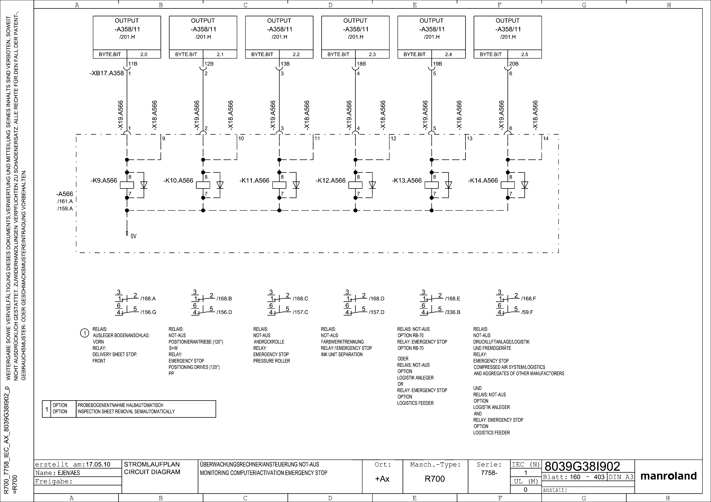

# +Ax — Sheet 160 of 403 — ÜBERWACHUNGSRECHNER/ANSTEUERUNG NOT AUS

**MONITORING COMPUTER/ACTIVATION EMERGENCY STOP**

> Part of the manroland **R700** printing press IEC/UL circuit diagrams.
> Drawing class: **Stromlaufplan / Circuit diagram** (DIN A3).
> Document `+Ax` covers the **Central control console** machine section.

## At a glance

| Field | Value |
|---|---|
| Document | `+Ax`  (8039G38I902) |
| Sheet | **160** of 403 |
| Section (DE) | ÜBERWACHUNGSRECHNER/ANSTEUERUNG NOT AUS |
| Section (EN) | MONITORING COMPUTER/ACTIVATION EMERGENCY STOP |
| Section type | CIRCUIT — Circuit diagram |
| Machine type | `R700` |
| Series | `7758` |
| Created | 17.05.10 |
| Replaces | — |
| Columns used | A, B, C, D, E, F, G |
| Path numbers | — |
| Labels on sheet | 196 |
| Cross-refs out | 20 |
| Cross-refs in | 38 |

**Previous:** [+Ax sheet 159](SHEET_0159.md) · **Next:** [+Ax sheet 161](SHEET_0161.md) · **Document TOC:** [_TOC.md](_TOC.md)  (+Ax) · **Master TOC:** [all sheets](../_MASTER_TOC.md)

## Sheet image (300 DPI, exact vector render)



_Rendered directly from the PDF vector layer at 300 DPI (1-bit), no OCR and no resampling. Use it to confirm anything ambiguous in the text below._

## Cross-references on this sheet

Each entry is a wire leaving this sheet. The printed token is `/sheet.column`; the link resolves to that sheet inside the same document.

| Ref | Target sheet | Col | Path | Destination on target | Target section | From col |
|---|---|---|---|---|---|---|
| `/201.H` | [+Ax sheet 201](SHEET_0201.md) | H | — | — | REFERENZMODUL | B |
| `/201.H` | [+Ax sheet 201](SHEET_0201.md) | H | — | — | REFERENZMODUL | C |
| `/201.H` | [+Ax sheet 201](SHEET_0201.md) | H | — | — | REFERENZMODUL | C |
| `/201.H` | [+Ax sheet 201](SHEET_0201.md) | H | — | — | REFERENZMODUL | D |
| `/201.H` | [+Ax sheet 201](SHEET_0201.md) | H | — | — | REFERENZMODUL | E |
| `/201.H` | [+Ax sheet 201](SHEET_0201.md) | H | — | — | REFERENZMODUL | F |
| `/161.A` | [+Ax sheet 161](SHEET_0161.md) | A | — | — | ÜBERWACHUNGSRECHNER/ANSTEUERUNG NOT AUS | A |
| `/159.A` | [+Ax sheet 159](SHEET_0159.md) | A | — | — | ÜBERWACHUNGSRECHNER/ANSTEUERUNG NOT AUS | A |
| `/168.A` | [+Ax sheet 168](SHEET_0168.md) | A | — | — | ÜBERWACHUNGSRECHNER/RÜCKMELDUNG NOT AUS | B |
| `/168.B` | [+Ax sheet 168](SHEET_0168.md) | B | — | — | ÜBERWACHUNGSRECHNER/RÜCKMELDUNG NOT AUS | C |
| `/168.E` | [+Ax sheet 168](SHEET_0168.md) | E | — | — | ÜBERWACHUNGSRECHNER/RÜCKMELDUNG NOT AUS | E |
| `/168.F` | [+Ax sheet 168](SHEET_0168.md) | F | — | — | ÜBERWACHUNGSRECHNER/RÜCKMELDUNG NOT AUS | F |
| `/168.C` | [+Ax sheet 168](SHEET_0168.md) | C | — | — | ÜBERWACHUNGSRECHNER/RÜCKMELDUNG NOT AUS | D |
| `/168.D` | [+Ax sheet 168](SHEET_0168.md) | D | — | — | ÜBERWACHUNGSRECHNER/RÜCKMELDUNG NOT AUS | E |
| `/336.B` | [+Ax sheet 336](SHEET_0336.md) | B | — | — | OPTION: LOGISTIK ANLEGER / | E |
| `/59.F` | [+Ax sheet 59](SHEET_0059.md) | F | — | — | DRUCKLUFTANLAGE | F |
| `/156.G` | [+Ax sheet 156](SHEET_0156.md) | G | — | — | ÜBERWACHUNGSRECHNER/ANSTEUERUNG NOT AUS | B |
| `/156.D` | [+Ax sheet 156](SHEET_0156.md) | D | — | — | ÜBERWACHUNGSRECHNER/ANSTEUERUNG NOT AUS | C |
| `/157.C` | [+Ax sheet 157](SHEET_0157.md) | C | — | — | ÜBERWACHUNGSRECHNER/ANSTEUERUNG NOT AUS | D |
| `/157.D` | [+Ax sheet 157](SHEET_0157.md) | D | — | — | ÜBERWACHUNGSRECHNER/ANSTEUERUNG NOT AUS | E |

### Incoming references (sheets that point here)

Every other sheet that sends a wire to this one. `Back-ref` is the token printed on *that* sheet; `Path` is its line number.

| From sheet | Cols | Back-ref | Path | Refs | What continues there |
|---|---|---|---|---|---|
| [+Ax#59](SHEET_0059.md) | F | `/59.F` | — | 1 | — |
| [+Ax#156](SHEET_0156.md) | D, G | `/156.D`, `/156.G` | — | 2 | — |
| [+Ax#157](SHEET_0157.md) | B, D | `/157.B`, `/157.D` | — | 2 | — |
| [+Ax#159](SHEET_0159.md) | A | `/159.A` | — | 1 | — |
| [+Ax#161](SHEET_0161.md) | A | `/161.A` | — | 1 | — |
| [+Ax#168](SHEET_0168.md) | A, B, C, D, E, F | `/168.A`, `/168.B`, `/168.C`, `/168.D`, `/168.E`, `/168.F` | — | 6 | — |
| [+Ax#201](SHEET_0201.md) | G, H | `/201.G`, `/201.H` | — | 6 | — |
| [+Ax#255](SHEET_0255.md) | C | `/255.C` | — | 6 | — |
| [+Ax#257](SHEET_0257.md) | C | `/257.C` | — | 6 | — |
| [+Ax#259](SHEET_0259.md) | E | `/259.E` | — | 6 | — |
| [+Ax#336](SHEET_0336.md) | B | `/336.B` | — | 1 | — |


## Devices on this sheet

| Tag | Class | Class meaning (IEC) | Col | Sub | Terminal | Sign |
|---|---|---|---|---|---|---|
| `A358/11` | A | Baugruppe / assembly, module, PC board | B | 11 | — | — |
| `A358/11` | A | Baugruppe / assembly, module, PC board | C | 11 | — | — |
| `A358/11` | A | Baugruppe / assembly, module, PC board | C | 11 | — | — |
| `A358/11` | A | Baugruppe / assembly, module, PC board | D | 11 | — | — |
| `A358/11` | A | Baugruppe / assembly, module, PC board | E | 11 | — | — |
| `A358/11` | A | Baugruppe / assembly, module, PC board | F | 11 | — | — |
| `A566` | A | Baugruppe / assembly, module, PC board | A | — | — | — |
| `2.0` | — | cross-device reference | B | — | — | — |
| `2.1` | — | cross-device reference | C | — | — | — |
| `2.2` | — | cross-device reference | D | — | — | — |
| `2.3` | — | cross-device reference | D | — | — | — |
| `2.4` | — | cross-device reference | E | — | — | — |
| `2.5` | — | cross-device reference | F | — | — | — |
| `XB17.A358` | — | cross-device reference | A | — | — | — |
| `X19.A566` | — | cross-device reference | B | — | — | — |
| `K9.A566` | — | cross-device reference | A | — | — | — |
| `K10.A566` | — | cross-device reference | B | — | — | — |
| `K11.A566` | — | cross-device reference | C | — | — | — |
| `K12.A566` | — | cross-device reference | D | — | — | — |
| `K13.A566` | — | cross-device reference | E | — | — | — |
| `K14.A566` | — | cross-device reference | F | — | — | — |
| `X19.A566` | — | cross-device reference | B | — | — | — |
| `X19.A566` | — | cross-device reference | C | — | — | — |
| `X19.A566` | — | cross-device reference | D | — | — | — |
| `X19.A566` | — | cross-device reference | E | — | — | — |
| `X19.A566` | — | cross-device reference | F | — | — | — |
| `X18.A566` | — | cross-device reference | B | — | — | — |
| `X18.A566` | — | cross-device reference | C | — | — | — |
| `X18.A566` | — | cross-device reference | D | — | — | — |
| `X18.A566` | — | cross-device reference | E | — | — | — |
| `X18.A566` | — | cross-device reference | F | — | — | — |
| `X18.A566` | — | cross-device reference | F | — | — | — |

## Potentials / nets

| Potential | Count | Columns | Attached devices | Terminals |
|---|---|---|---|---|
| `0V` | 1 | B | — | — |


A potential such as `L24+/4` or `M24+` is a named supply/return rail; every place it appears on this sheet is electrically common.

## Wire-end annotations (grouped as printed)

A wire that continues elsewhere is annotated with a small cluster: the destination description, the path/line number `#NN`, and the `/sheet.column` cross reference. Each row below is one such cluster exactly as it is grouped on the drawing.

| Col | Y | Path | Cross-ref | Text on the wire |
|---|---|---|---|---|
| B | 30.4 | — | — | `OUTPUT` |
| B | 30.4 | — | — | `OUTPUT` |
| C | 30.4 | — | — | `OUTPUT` |
| D | 30.4 | — | — | `OUTPUT` |
| E | 30.4 | — | — | `OUTPUT` |
| F | 30.4 | — | — | `OUTPUT` |
| B | 44.2 | — | — | `A358/11` |
| C | 44.2 | — | — | `A358/11` |
| C | 44.2 | — | — | `A358/11` |
| D | 44.2 | — | — | `A358/11` |
| E | 44.2 | — | — | `A358/11` |
| F | 44.2 | — | — | `A358/11` |
| B | 58.0 | — | `/201.H` | — |
| C | 58.0 | — | `/201.H` | — |
| C | 58.0 | — | `/201.H` | — |
| D | 58.0 | — | `/201.H` | — |
| E | 58.0 | — | `/201.H` | — |
| F | 58.0 | — | `/201.H` | — |
| B | 87.7 | — | — | `BYTE.BIT 2.0` |
| B | 87.7 | — | — | `BYTE.BIT 2.1` |
| C | 87.7 | — | — | `BYTE.BIT 2.2` |
| D | 87.7 | — | — | `BYTE.BIT 2.3` |
| E | 87.7 | — | — | `BYTE.BIT 2.4` |
| F | 87.7 | — | — | `BYTE.BIT 2.5` |
| B | 103.0 | — | — | `11B` |
| C | 103.0 | — | — | `12B` |
| C | 103.0 | — | — | `13B` |
| D | 103.0 | — | — | `18B` |
| E | 103.0 | — | — | `19B` |
| F | 103.0 | — | — | `20B` |
| D | 117.9 | — | — | `XB17.A358 1 2 3 4 5 6` |
| B | 168.4 | — | — | `X19.A566` |
| B | 168.4 | — | — | `X18.A566` |
| B | 168.4 | — | — | `X19.A566` |
| C | 168.4 | — | — | `X18.A566` |
| C | 168.4 | — | — | `X19.A566` |
| D | 168.4 | — | — | `X18.A566` |
| D | 168.4 | — | — | `X19.A566` |
| E | 168.4 | — | — | `X18.A566` |
| E | 168.4 | — | — | `X19.A566` |
| F | 168.4 | — | — | `X18.A566` |
| F | 168.4 | — | — | `X19.A566` |
| F | 168.4 | — | — | `X18.A566` |
| B | 211.5 | — | — | `1` |
| C | 211.5 | — | — | `2` |
| C | 211.5 | — | — | `3` |
| D | 211.5 | — | — | `4` |
| E | 211.5 | — | — | `5` |
| F | 211.5 | — | — | `6` |
| B | 228.5 | — | — | `9` |
| E | 228.5 | — | — | `10 11 12 13 14` |
| B | 293.0 | — | — | `8` |
| C | 293.0 | — | — | `8` |
| C | 293.0 | — | — | `8` |
| D | 293.0 | — | — | `8` |
| E | 293.0 | — | — | `8` |
| F | 293.0 | — | — | `8` |
| A | 297.9 | — | — | `K9.A566` |
| B | 297.9 | — | — | `K10.A566` |
| C | 297.9 | — | — | `K11.A566` |
| D | 297.9 | — | — | `K12.A566` |
| E | 297.9 | — | — | `K13.A566` |
| F | 297.9 | — | — | `K14.A566` |
| A | 320.6 | — | — | `A566` |
| B | 321.4 | — | — | `7` |
| C | 321.4 | — | — | `7` |
| C | 321.4 | — | — | `7` |
| D | 321.4 | — | — | `7` |
| E | 321.4 | — | — | `7` |
| F | 321.4 | — | — | `7` |
| A | 333.7 | — | `/161.A`, `/159.A` | — |
| B | 392.7 | — | — | `0V` |
| B | 485.0 | — | — | `3 6 4 1` |
| B | 485.0 | — | — | `3 6 4 1` |
| C | 485.0 | — | — | `3 6 4 1` |
| D | 485.0 | — | — | `3 6 4 1` |
| E | 485.0 | — | — | `3 6 4 1` |
| F | 485.0 | — | — | `3 6 4 1` |
| B | 490.7 | — | — | `2` |
| C | 490.7 | — | — | `2` |
| C | 490.7 | — | — | `2` |
| D | 490.7 | — | — | `2` |
| E | 490.7 | — | — | `2` |
| F | 490.7 | — | — | `2` |
| B | 497.0 | — | `/168.A` | — |
| C | 497.0 | — | `/168.B` | — |
| E | 497.0 | — | `/168.E` | — |
| F | 497.0 | — | `/168.F` | — |
| D | 497.1 | — | `/168.C` | — |
| E | 497.1 | — | `/168.D` | — |
| B | 513.3 | — | — | `5` |
| C | 513.3 | — | — | `5` |
| C | 513.3 | — | — | `5` |
| D | 513.3 | — | — | `5` |
| E | 513.3 | — | — | `5` |
| F | 513.3 | — | — | `5` |
| B | 519.7 | — | `/156.G` | — |
| C | 519.7 | — | `/156.D` | — |
| D | 519.7 | — | `/157.C` | — |
| E | 519.7 | — | `/157.D` | — |
| E | 519.7 | — | `/336.B` | — |
| F | 519.7 | — | `/59.F` | — |
| A | 549.1 | — | — | `RELAIS:` |
| B | 549.1 | — | — | `RELAIS: NOT AUS POSITIONIERANTRIEBE (120°)` |
| C | 549.1 | — | — | `RELAIS: NOT AUS` |
| D | 549.1 | — | — | `RELAIS: NOT AUS FARBWERKTRENNUNG RELAY:1EMERGENCY STOP INK UNIT SEPARATION` |
| E | 549.1 | — | — | `RELAIS: NOT AUS` |
| F | 549.1 | — | — | `RELAIS: NOT AUS DRUCKLUFTANLAGE/LOGISTIK UND FREMDGERÄTE RELAY: EMERGENCY STOP` |
| A | 555.4 | — | — | `1` |
| B | 559.8 | — | — | `RELAY: DELIVERY SHEET STOP: FRONT AUSLEGER BOGENANSCHLAG: VORN` |
| E | 559.8 | — | — | `RELAY: EMERGENCY STOP OPTION RB 70` |
| C | 570.4 | — | — | `RELAY: EMERGENCY STOP PRESSURE ROLLER ANDRÜCKROLLE` |
| B | 580.9 | — | — | `RELAY: EMERGENCY STOP POSITIONING DRIVES (120°) PP S+W` |
| E | 581.0 | — | — | `OPTION RB 70` |
| E | 598.7 | — | — | `RELAIS: NOT AUS ODER` |
| F | 612.9 | — | — | `COMPRESSED AIR SYSTEM/LOGISTICS AND AGGREGATES OF OTHER MANUFACTORERS` |
| E | 620.0 | — | — | `LOGISTIK ANLEGER OPTION` |
| E | 641.3 | — | — | `RELAY: EMERGENCY STOP OR` |
| F | 648.3 | — | — | `UND RELAIS: NOT AUS` |
| E | 662.5 | — | — | `LOGISTICS FEEDER OPTION` |
| F | 669.6 | — | — | `LOGISTIK ANLEGER OPTION` |
| A | 676.7 | — | — | `1 PROBEBOGENENTNAHME HALBAUTOMATISCH INSPECTION SHEET REMOVAL SEMIAUTOMATICALLY` |
| A | 676.7 | — | — | `OPTION OPTION` |
| F | 690.9 | — | — | `RELAY: EMERGENCY STOP AND` |
| F | 712.1 | — | — | `LOGISTICS FEEDER OPTION` |


## Reconstructed tables

This sheet carries tabular content (pin map / terminal assignment / index). The grid below was rebuilt from the drawing's own rule lines, so each row is exactly one physical row of the table.

### Table 1 — 3 data rows × 23 columns (at x=155.9, y=26.9)

| OUTPUT | A358/11 /201.H |  |  | OUTPUT | A358/11 /201.H |  |  | OUTPUT | A358/11 /201.H |  |  | OUTPUT | A358/11 /201.H |  |  | OUTPUT | A358/11 /201.H |  |  | OUTPUT | A358/11 /201.H |  |
|---|---|---|---|---|---|---|---|---|---|---|---|---|---|---|---|---|---|---|---|---|---|---|
| `BYTE.BIT` |  | `2.0` |  | `BYTE.BIT` |  | `2.1` |  | `BYTE.BIT` |  | `2.2` |  | `BYTE.BIT` |  | `2.3` |  | `BYTE.BIT` | `2.4` |  |  | `BYTE.BIT` |  | `2.5` |
| `XB17.A358 X19.A566` | `11B 1 1` | `X18.A566` | `9` | `X19.A566` | `12B 2 2` | `X18.A566` | `10` | `X19.A566` | `13B 3 3` | `X18.A566` | `11` | `X19.A566` | `18B 4 4` | `X18.A566` | `12` | `X19.A566` | `19B 5 5` | `X18.A566` | `13` | `X19.A566` | `20B 6 6` | `X18.A566` |
| `K9.A566` | `8 7` |  |  | `K10.A566` | `8 7` |  |  | `K11.A566` | `8 7` |  |  | `K12.A566` | `8 7` |  |  | `K13.A566` | `8 7` |  |  | `K14.A566` | `8 7` |  |


## Notes and free text on this sheet

| Text | Col | Y (pt) |
|---|---|---|
| `11B` | B | 103.04 |
| `OUTPUT` | B | 30.38 |
| `BYTE.BIT` | A | 87.65 |
| `RELAIS:` | A | 549.06 |
| `AUSLEGER BOGENANSCHLAG:` | B | 559.77 |
| `VORN` | A | 570.39 |
| `RELAY:` | A | 580.96 |
| `DELIVERY SHEET STOP:` | A | 591.63 |
| `FRONT` | A | 602.28 |
| `12B` | C | 103.04 |
| `BYTE.BIT` | B | 87.65 |
| `RELAIS:` | B | 549.06 |
| `NOT AUS` | B | 559.75 |
| `POSITIONIERANTRIEBE (120°)` | B | 570.39 |
| `S+W` | B | 580.89 |
| `RELAY:` | B | 591.59 |
| `EMERGENCY STOP` | B | 602.29 |
| `POSITIONING DRIVES (120°)` | B | 612.93 |
| `PP` | B | 623.42 |
| `13B` | C | 103.04 |
| `OUTPUT` | C | 30.38 |
| `BYTE.BIT` | C | 87.65 |
| `RELAIS:` | C | 549.06 |
| `NOT AUS` | C | 559.75 |
| `ANDRÜCKROLLE` | C | 570.42 |
| `RELAY:` | C | 580.96 |
| `EMERGENCY STOP` | C | 591.66 |
| `PRESSURE ROLLER` | C | 602.29 |
| `18B` | D | 103.04 |
| `OUTPUT` | D | 30.38 |
| `BYTE.BIT` | D | 87.65 |
| `RELAIS:` | D | 549.06 |
| `NOT AUS` | D | 559.75 |
| `FARBWERKTRENNUNG` | D | 570.38 |
| `RELAY:1EMERGENCY STOP` | D | 581.03 |
| `INK UNIT SEPARATION` | D | 591.64 |
| `19B` | E | 103.04 |
| `OUTPUT` | E | 30.38 |
| `BYTE.BIT` | E | 87.65 |
| `RELAIS: NOT AUS` | E | 549.11 |
| `OPTION RB 70` | E | 559.77 |
| `RELAY: EMERGENCY STOP` | E | 570.39 |
| `20B` | F | 103.04 |
| `OUTPUT` | F | 30.38 |
| `BYTE.BIT` | F | 87.65 |
| `RELAIS:` | F | 549.06 |
| `NOT AUS` | F | 559.75 |
| `DRUCKLUFTANLAGE/LOGISTIK` | F | 570.4 |
| `UND FREMDGERÄTE` | F | 581.04 |
| `RELAY:` | F | 591.59 |
| `EMERGENCY STOP` | F | 602.29 |
| `COMPRESSED AIR SYSTEM/LOGISTICS` | F | 612.92 |
| `AND AGGREGATES OF OTHER MANUFACTORERS` | F | 623.57 |
| `ODER` | E | 598.74 |
| `OPTION` | E | 619.97 |
| `LOGISTIK ANLEGER` | E | 630.62 |
| `OR` | E | 641.26 |
| `LOGISTICS FEEDER` | E | 673.15 |
| `UND` | F | 648.34 |
| `RELAIS: NOT AUS` | F | 658.96 |
| `OPTION` | F | 669.58 |
| `LOGISTIK ANLEGER` | F | 680.23 |
| `AND` | F | 690.89 |
| `RELAY: EMERGENCY STOP` | F | 701.5 |
| `LOGISTICS FEEDER` | F | 722.76 |
| `OPTION` | A | 676.66 |
| `PROBEBOGENENTNAHME HALBAUTOMATISCH` | B | 676.7 |
| `INSPECTION SHEET REMOVAL SEMIAUTOMATICALLY` | B | 687.33 |

## Complete label inventory (exact text from the drawing)

Every text object inside the drawing area of this sheet, in DIN reading order (column A→H, then top→bottom). This is the authoritative list: if a string is not here it is not printed on this sheet.

| Col | Y | X | Dir | Type | Text |
|---|---|---|---|---|---|
| A | 87.7 | 165.8 | → | text | `BYTE.BIT` |
| A | 117.9 | 150.2 | → | device ref | `XB17.A358` |
| A | 297.9 | 151.9 | → | device ref | `K9.A566` |
| A | 320.6 | 94.1 | → | device tag | `A566` |
| A | 333.7 | 96.4 | → | cross-reference | `/161.A` |
| A | 346.1 | 96.4 | → | cross-reference | `/159.A` |
| A | 485.0 | 195.9 | → | number | `3` |
| A | 507.7 | 195.9 | → | number | `6` |
| A | 519.0 | 195.9 | → | number | `4` |
| A | 549.1 | 155.1 | → | text | `RELAIS:` |
| A | 555.4 | 140.0 | → | number | `1` |
| A | 570.4 | 155.9 | → | text | `VORN` |
| A | 581.0 | 155.1 | → | text | `RELAY:` |
| A | 591.6 | 155.1 | → | text | `DELIVERY SHEET STOP:` |
| A | 602.3 | 155.1 | → | text | `FRONT` |
| A | 676.7 | 88.3 | → | text | `OPTION` |
| A | 682.0 | 75.4 | → | number | `1` |
| A | 687.3 | 88.3 | → | text | `OPTION` |
| B | 30.4 | 192.3 | → | text | `OUTPUT` |
| B | 30.4 | 319.9 | → | text | `OUTPUT` |
| B | 44.2 | 191.9 | → | device tag | `A358/11` |
| B | 58.0 | 200.1 | → | cross-reference | `/201.H` |
| B | 87.7 | 235.3 | → | device ref | `2.0` |
| B | 87.7 | 293.4 | → | text | `BYTE.BIT` |
| B | 103.0 | 214.6 | → | text | `11B` |
| B | 119.4 | 214.6 | → | number | `1` |
| B | 168.4 | 197.3 | ↕ | device ref | `X19.A566` |
| B | 168.4 | 254.0 | ↕ | device ref | `X18.A566` |
| B | 168.4 | 324.9 | ↕ | device ref | `X19.A566` |
| B | 211.5 | 214.6 | → | number | `1` |
| B | 228.5 | 271.8 | → | number | `9` |
| B | 293.0 | 215.1 | → | number | `8` |
| B | 297.9 | 273.5 | → | device ref | `K10.A566` |
| B | 321.3 | 215.1 | → | number | `7` |
| B | 392.7 | 219.1 | → | potential | `0V` |
| B | 485.0 | 323.4 | → | number | `3` |
| B | 490.7 | 223.7 | → | number | `2` |
| B | 496.3 | 197.3 | → | number | `1` |
| B | 496.3 | 324.9 | → | number | `1` |
| B | 497.0 | 235.3 | → | cross-reference | `/168.A` |
| B | 507.7 | 323.4 | → | number | `6` |
| B | 513.3 | 223.4 | → | number | `5` |
| B | 519.0 | 323.4 | → | number | `4` |
| B | 519.7 | 235.3 | → | cross-reference | `/156.G` |
| B | 549.1 | 282.6 | → | text | `RELAIS:` |
| B | 559.7 | 282.6 | → | text | `NOT AUS` |
| B | 559.8 | 155.9 | → | text | `AUSLEGER BOGENANSCHLAG:` |
| B | 570.4 | 282.6 | → | text | `POSITIONIERANTRIEBE (120°)` |
| B | 580.9 | 283.2 | → | text | `S+W` |
| B | 591.6 | 282.6 | → | text | `RELAY:` |
| B | 602.3 | 282.6 | → | text | `EMERGENCY STOP` |
| B | 612.9 | 282.6 | → | text | `POSITIONING DRIVES (120°)` |
| B | 623.4 | 282.6 | → | text | `PP` |
| B | 676.7 | 130.3 | → | text | `PROBEBOGENENTNAHME HALBAUTOMATISCH` |
| B | 687.3 | 130.3 | → | text | `INSPECTION SHEET REMOVAL SEMIAUTOMATICALLY` |
| C | 30.4 | 447.4 | → | text | `OUTPUT` |
| C | 44.2 | 319.5 | → | device tag | `A358/11` |
| C | 44.2 | 447.0 | → | device tag | `A358/11` |
| C | 58.0 | 327.7 | → | cross-reference | `/201.H` |
| C | 58.0 | 455.2 | → | cross-reference | `/201.H` |
| C | 87.7 | 363.4 | → | device ref | `2.1` |
| C | 87.7 | 420.9 | → | text | `BYTE.BIT` |
| C | 103.0 | 342.1 | → | text | `12B` |
| C | 103.0 | 469.7 | → | text | `13B` |
| C | 119.4 | 342.7 | → | number | `2` |
| C | 119.4 | 470.3 | → | number | `3` |
| C | 168.4 | 381.6 | ↕ | device ref | `X18.A566` |
| C | 168.4 | 452.4 | ↕ | device ref | `X19.A566` |
| C | 211.5 | 342.7 | → | number | `2` |
| C | 211.5 | 470.3 | → | number | `3` |
| C | 228.5 | 398.8 | → | number | `10` |
| C | 293.0 | 342.7 | → | number | `8` |
| C | 293.0 | 470.3 | → | number | `8` |
| C | 297.9 | 401.1 | → | device ref | `K11.A566` |
| C | 321.3 | 342.7 | → | number | `7` |
| C | 321.3 | 470.3 | → | number | `7` |
| C | 485.0 | 451.0 | → | number | `3` |
| C | 490.7 | 351.2 | → | number | `2` |
| C | 490.7 | 478.8 | → | number | `2` |
| C | 496.3 | 452.4 | → | number | `1` |
| C | 497.0 | 362.8 | → | cross-reference | `/168.B` |
| C | 507.7 | 451.0 | → | number | `6` |
| C | 513.3 | 350.9 | → | number | `5` |
| C | 513.3 | 478.5 | → | number | `5` |
| C | 519.0 | 451.0 | → | number | `4` |
| C | 519.7 | 362.8 | → | cross-reference | `/156.D` |
| C | 549.1 | 424.3 | → | text | `RELAIS:` |
| C | 559.7 | 424.3 | → | text | `NOT AUS` |
| C | 570.4 | 425.2 | → | text | `ANDRÜCKROLLE` |
| C | 581.0 | 424.3 | → | text | `RELAY:` |
| C | 591.7 | 424.3 | → | text | `EMERGENCY STOP` |
| C | 602.3 | 424.3 | → | text | `PRESSURE ROLLER` |
| D | 30.4 | 575.0 | → | text | `OUTPUT` |
| D | 44.2 | 574.6 | → | device tag | `A358/11` |
| D | 58.0 | 582.8 | → | cross-reference | `/201.H` |
| D | 87.7 | 490.5 | → | device ref | `2.2` |
| D | 87.7 | 548.5 | → | text | `BYTE.BIT` |
| D | 87.7 | 618.0 | → | device ref | `2.3` |
| D | 103.0 | 597.3 | → | text | `18B` |
| D | 119.4 | 597.8 | → | number | `4` |
| D | 168.4 | 509.1 | ↕ | device ref | `X18.A566` |
| D | 168.4 | 580.0 | ↕ | device ref | `X19.A566` |
| D | 211.5 | 597.8 | → | number | `4` |
| D | 228.5 | 526.4 | → | number | `11` |
| D | 293.0 | 597.8 | → | number | `8` |
| D | 297.9 | 528.7 | → | device ref | `K12.A566` |
| D | 321.3 | 597.8 | → | number | `7` |
| D | 485.0 | 578.6 | → | number | `3` |
| D | 490.7 | 606.3 | → | number | `2` |
| D | 496.3 | 580.0 | → | number | `1` |
| D | 497.1 | 490.4 | → | cross-reference | `/168.C` |
| D | 507.7 | 578.6 | → | number | `6` |
| D | 513.3 | 606.0 | → | number | `5` |
| D | 519.0 | 578.6 | → | number | `4` |
| D | 519.7 | 490.4 | → | cross-reference | `/157.C` |
| D | 549.1 | 537.7 | → | text | `RELAIS:` |
| D | 559.7 | 537.7 | → | text | `NOT AUS` |
| D | 570.4 | 537.7 | → | text | `FARBWERKTRENNUNG` |
| D | 581.0 | 537.7 | → | text | `RELAY:1EMERGENCY STOP` |
| D | 591.6 | 537.7 | → | text | `INK UNIT SEPARATION` |
| E | 30.4 | 702.6 | → | text | `OUTPUT` |
| E | 44.2 | 702.1 | → | device tag | `A358/11` |
| E | 58.0 | 710.4 | → | cross-reference | `/201.H` |
| E | 87.7 | 676.1 | → | text | `BYTE.BIT` |
| E | 87.7 | 745.5 | → | device ref | `2.4` |
| E | 103.0 | 724.8 | → | text | `19B` |
| E | 119.4 | 725.4 | → | number | `5` |
| E | 168.4 | 636.7 | ↕ | device ref | `X18.A566` |
| E | 168.4 | 707.5 | ↕ | device ref | `X19.A566` |
| E | 211.5 | 725.4 | → | number | `5` |
| E | 228.5 | 654.0 | → | number | `12` |
| E | 293.0 | 725.4 | → | number | `8` |
| E | 297.9 | 656.2 | → | device ref | `K13.A566` |
| E | 321.3 | 725.4 | → | number | `7` |
| E | 485.0 | 706.1 | → | number | `3` |
| E | 490.7 | 733.9 | → | number | `2` |
| E | 496.3 | 707.5 | → | number | `1` |
| E | 497.0 | 745.5 | → | cross-reference | `/168.E` |
| E | 497.1 | 618.0 | → | cross-reference | `/168.D` |
| E | 507.7 | 706.1 | → | number | `6` |
| E | 513.3 | 733.6 | → | number | `5` |
| E | 519.0 | 706.1 | → | number | `4` |
| E | 519.7 | 618.0 | → | cross-reference | `/157.D` |
| E | 519.7 | 745.5 | → | cross-reference | `/336.B` |
| E | 549.1 | 665.3 | → | text | `RELAIS: NOT AUS` |
| E | 559.8 | 665.9 | → | text | `OPTION RB 70` |
| E | 570.4 | 665.3 | → | text | `RELAY: EMERGENCY STOP` |
| E | 581.0 | 665.9 | → | text | `OPTION RB 70` |
| E | 598.7 | 665.9 | → | text | `ODER` |
| E | 609.4 | 665.3 | → | text | `RELAIS: NOT AUS` |
| E | 620.0 | 665.9 | → | text | `OPTION` |
| E | 630.6 | 665.3 | → | text | `LOGISTIK ANLEGER` |
| E | 641.3 | 665.9 | → | text | `OR` |
| E | 651.9 | 665.3 | → | text | `RELAY: EMERGENCY STOP` |
| E | 662.5 | 665.9 | → | text | `OPTION` |
| E | 673.2 | 665.3 | → | text | `LOGISTICS FEEDER` |
| F | 30.4 | 830.1 | → | text | `OUTPUT` |
| F | 44.2 | 829.7 | → | device tag | `A358/11` |
| F | 58.0 | 837.9 | → | cross-reference | `/201.H` |
| F | 87.7 | 803.6 | → | text | `BYTE.BIT` |
| F | 87.7 | 873.1 | → | device ref | `2.5` |
| F | 103.0 | 852.9 | → | text | `20B` |
| F | 119.4 | 852.9 | → | number | `6` |
| F | 168.4 | 764.2 | ↕ | device ref | `X18.A566` |
| F | 168.4 | 835.1 | ↕ | device ref | `X19.A566` |
| F | 168.4 | 891.8 | ↕ | device ref | `X18.A566` |
| F | 211.5 | 852.9 | → | number | `6` |
| F | 228.5 | 781.5 | → | number | `13` |
| F | 293.0 | 852.9 | → | number | `8` |
| F | 297.9 | 783.8 | → | device ref | `K14.A566` |
| F | 321.3 | 852.9 | → | number | `7` |
| F | 485.0 | 833.7 | → | number | `3` |
| F | 490.7 | 861.4 | → | number | `2` |
| F | 496.3 | 835.1 | → | number | `1` |
| F | 497.0 | 873.1 | → | cross-reference | `/168.F` |
| F | 507.7 | 833.7 | → | number | `6` |
| F | 513.3 | 861.2 | → | number | `5` |
| F | 519.0 | 833.7 | → | number | `4` |
| F | 519.7 | 873.1 | → | cross-reference | `/59.F` |
| F | 549.1 | 792.9 | → | text | `RELAIS:` |
| F | 559.7 | 792.9 | → | text | `NOT AUS` |
| F | 570.4 | 792.9 | → | text | `DRUCKLUFTANLAGE/LOGISTIK` |
| F | 581.0 | 792.9 | → | text | `UND FREMDGERÄTE` |
| F | 591.6 | 792.9 | → | text | `RELAY:` |
| F | 602.3 | 792.9 | → | text | `EMERGENCY STOP` |
| F | 612.9 | 793.4 | → | text | `COMPRESSED AIR SYSTEM/LOGISTICS` |
| F | 623.6 | 793.7 | → | text | `AND AGGREGATES OF OTHER MANUFACTORERS` |
| F | 648.3 | 792.9 | → | text | `UND` |
| F | 659.0 | 792.9 | → | text | `RELAIS: NOT AUS` |
| F | 669.6 | 793.4 | → | text | `OPTION` |
| F | 680.2 | 792.9 | → | text | `LOGISTIK ANLEGER` |
| F | 690.9 | 793.7 | → | text | `AND` |
| F | 701.5 | 792.9 | → | text | `RELAY: EMERGENCY STOP` |
| F | 712.1 | 793.4 | → | text | `OPTION` |
| F | 722.8 | 792.9 | → | text | `LOGISTICS FEEDER` |
| G | 228.5 | 909.1 | → | number | `14` |

## Reading-order text block

The same content as a plain block, grouped by DIN column — convenient to paste or to match against a visual description.

```text
=== Column A ===
  87.7  165.8  text         BYTE.BIT
 117.9  150.2  devref       XB17.A358
 297.9  151.9  devref       K9.A566
 320.6   94.1  devtag       A566
 333.7   96.4  xref         /161.A
 346.1   96.4  xref         /159.A
 485.0  195.9  numeric      3
 507.7  195.9  numeric      6
 519.0  195.9  numeric      4
 549.1  155.1  text         RELAIS:
 555.4  140.0  numeric      1
 570.4  155.9  text         VORN
 581.0  155.1  text         RELAY:
 591.6  155.1  text         DELIVERY SHEET STOP:
 602.3  155.1  text         FRONT
 676.7   88.3  text         OPTION
 682.0   75.4  numeric      1
 687.3   88.3  text         OPTION
=== Column B ===
  30.4  192.3  text         OUTPUT
  30.4  319.9  text         OUTPUT
  44.2  191.9  devtag       A358/11
  58.0  200.1  xref         /201.H
  87.7  235.3  devref       2.0
  87.7  293.4  text         BYTE.BIT
 103.0  214.6  text         11B
 119.4  214.6  numeric      1
 168.4  197.3  devref       X19.A566
 168.4  254.0  devref       X18.A566
 168.4  324.9  devref       X19.A566
 211.5  214.6  numeric      1
 228.5  271.8  numeric      9
 293.0  215.1  numeric      8
 297.9  273.5  devref       K10.A566
 321.3  215.1  numeric      7
 392.7  219.1  net          0V
 485.0  323.4  numeric      3
 490.7  223.7  numeric      2
 496.3  197.3  numeric      1
 496.3  324.9  numeric      1
 497.0  235.3  xref         /168.A
 507.7  323.4  numeric      6
 513.3  223.4  numeric      5
 519.0  323.4  numeric      4
 519.7  235.3  xref         /156.G
 549.1  282.6  text         RELAIS:
 559.7  282.6  text         NOT AUS
 559.8  155.9  text         AUSLEGER BOGENANSCHLAG:
 570.4  282.6  text         POSITIONIERANTRIEBE (120°)
 580.9  283.2  text         S+W
 591.6  282.6  text         RELAY:
 602.3  282.6  text         EMERGENCY STOP
 612.9  282.6  text         POSITIONING DRIVES (120°)
 623.4  282.6  text         PP
 676.7  130.3  text         PROBEBOGENENTNAHME HALBAUTOMATISCH
 687.3  130.3  text         INSPECTION SHEET REMOVAL SEMIAUTOMATICALLY
=== Column C ===
  30.4  447.4  text         OUTPUT
  44.2  319.5  devtag       A358/11
  44.2  447.0  devtag       A358/11
  58.0  327.7  xref         /201.H
  58.0  455.2  xref         /201.H
  87.7  363.4  devref       2.1
  87.7  420.9  text         BYTE.BIT
 103.0  342.1  text         12B
 103.0  469.7  text         13B
 119.4  342.7  numeric      2
 119.4  470.3  numeric      3
 168.4  381.6  devref       X18.A566
 168.4  452.4  devref       X19.A566
 211.5  342.7  numeric      2
 211.5  470.3  numeric      3
 228.5  398.8  numeric      10
 293.0  342.7  numeric      8
 293.0  470.3  numeric      8
 297.9  401.1  devref       K11.A566
 321.3  342.7  numeric      7
 321.3  470.3  numeric      7
 485.0  451.0  numeric      3
 490.7  351.2  numeric      2
 490.7  478.8  numeric      2
 496.3  452.4  numeric      1
 497.0  362.8  xref         /168.B
 507.7  451.0  numeric      6
 513.3  350.9  numeric      5
 513.3  478.5  numeric      5
 519.0  451.0  numeric      4
 519.7  362.8  xref         /156.D
 549.1  424.3  text         RELAIS:
 559.7  424.3  text         NOT AUS
 570.4  425.2  text         ANDRÜCKROLLE
 581.0  424.3  text         RELAY:
 591.7  424.3  text         EMERGENCY STOP
 602.3  424.3  text         PRESSURE ROLLER
=== Column D ===
  30.4  575.0  text         OUTPUT
  44.2  574.6  devtag       A358/11
  58.0  582.8  xref         /201.H
  87.7  490.5  devref       2.2
  87.7  548.5  text         BYTE.BIT
  87.7  618.0  devref       2.3
 103.0  597.3  text         18B
 119.4  597.8  numeric      4
 168.4  509.1  devref       X18.A566
 168.4  580.0  devref       X19.A566
 211.5  597.8  numeric      4
 228.5  526.4  numeric      11
 293.0  597.8  numeric      8
 297.9  528.7  devref       K12.A566
 321.3  597.8  numeric      7
 485.0  578.6  numeric      3
 490.7  606.3  numeric      2
 496.3  580.0  numeric      1
 497.1  490.4  xref         /168.C
 507.7  578.6  numeric      6
 513.3  606.0  numeric      5
 519.0  578.6  numeric      4
 519.7  490.4  xref         /157.C
 549.1  537.7  text         RELAIS:
 559.7  537.7  text         NOT AUS
 570.4  537.7  text         FARBWERKTRENNUNG
 581.0  537.7  text         RELAY:1EMERGENCY STOP
 591.6  537.7  text         INK UNIT SEPARATION
=== Column E ===
  30.4  702.6  text         OUTPUT
  44.2  702.1  devtag       A358/11
  58.0  710.4  xref         /201.H
  87.7  676.1  text         BYTE.BIT
  87.7  745.5  devref       2.4
 103.0  724.8  text         19B
 119.4  725.4  numeric      5
 168.4  636.7  devref       X18.A566
 168.4  707.5  devref       X19.A566
 211.5  725.4  numeric      5
 228.5  654.0  numeric      12
 293.0  725.4  numeric      8
 297.9  656.2  devref       K13.A566
 321.3  725.4  numeric      7
 485.0  706.1  numeric      3
 490.7  733.9  numeric      2
 496.3  707.5  numeric      1
 497.0  745.5  xref         /168.E
 497.1  618.0  xref         /168.D
 507.7  706.1  numeric      6
 513.3  733.6  numeric      5
 519.0  706.1  numeric      4
 519.7  618.0  xref         /157.D
 519.7  745.5  xref         /336.B
 549.1  665.3  text         RELAIS: NOT AUS
 559.8  665.9  text         OPTION RB 70
 570.4  665.3  text         RELAY: EMERGENCY STOP
 581.0  665.9  text         OPTION RB 70
 598.7  665.9  text         ODER
 609.4  665.3  text         RELAIS: NOT AUS
 620.0  665.9  text         OPTION
 630.6  665.3  text         LOGISTIK ANLEGER
 641.3  665.9  text         OR
 651.9  665.3  text         RELAY: EMERGENCY STOP
 662.5  665.9  text         OPTION
 673.2  665.3  text         LOGISTICS FEEDER
=== Column F ===
  30.4  830.1  text         OUTPUT
  44.2  829.7  devtag       A358/11
  58.0  837.9  xref         /201.H
  87.7  803.6  text         BYTE.BIT
  87.7  873.1  devref       2.5
 103.0  852.9  text         20B
 119.4  852.9  numeric      6
 168.4  764.2  devref       X18.A566
 168.4  835.1  devref       X19.A566
 168.4  891.8  devref       X18.A566
 211.5  852.9  numeric      6
 228.5  781.5  numeric      13
 293.0  852.9  numeric      8
 297.9  783.8  devref       K14.A566
 321.3  852.9  numeric      7
 485.0  833.7  numeric      3
 490.7  861.4  numeric      2
 496.3  835.1  numeric      1
 497.0  873.1  xref         /168.F
 507.7  833.7  numeric      6
 513.3  861.2  numeric      5
 519.0  833.7  numeric      4
 519.7  873.1  xref         /59.F
 549.1  792.9  text         RELAIS:
 559.7  792.9  text         NOT AUS
 570.4  792.9  text         DRUCKLUFTANLAGE/LOGISTIK
 581.0  792.9  text         UND FREMDGERÄTE
 591.6  792.9  text         RELAY:
 602.3  792.9  text         EMERGENCY STOP
 612.9  793.4  text         COMPRESSED AIR SYSTEM/LOGISTICS
 623.6  793.7  text         AND AGGREGATES OF OTHER MANUFACTORERS
 648.3  792.9  text         UND
 659.0  792.9  text         RELAIS: NOT AUS
 669.6  793.4  text         OPTION
 680.2  792.9  text         LOGISTIK ANLEGER
 690.9  793.7  text         AND
 701.5  792.9  text         RELAY: EMERGENCY STOP
 712.1  793.4  text         OPTION
 722.8  792.9  text         LOGISTICS FEEDER
=== Column G ===
 228.5  909.1  numeric      14
```

---
_Generated from the PDF vector text layer; no OCR. Source: `R700_7758_IEC_AX_8039G38I902_p`, sheet 160._
