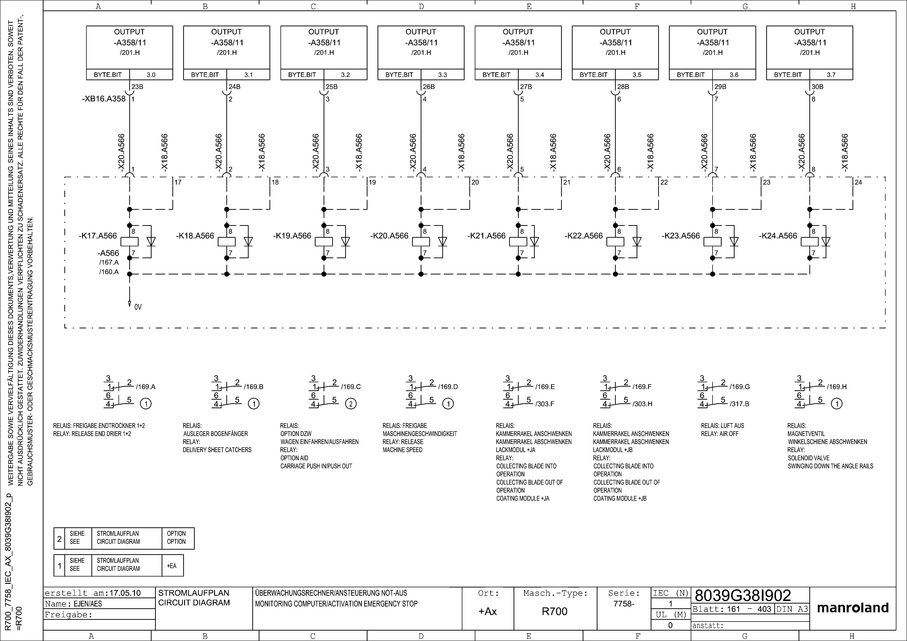

# +Ax — Sheet 161 of 403 — ÜBERWACHUNGSRECHNER/ANSTEUERUNG NOT AUS

**MONITORING COMPUTER/ACTIVATION EMERGENCY STOP**

> Part of the manroland **R700** printing press IEC/UL circuit diagrams.
> Drawing class: **Stromlaufplan / Circuit diagram** (DIN A3).
> Document `+Ax` covers the **Central control console** machine section.

## At a glance

| Field | Value |
|---|---|
| Document | `+Ax`  (8039G38I902) |
| Sheet | **161** of 403 |
| Section (DE) | ÜBERWACHUNGSRECHNER/ANSTEUERUNG NOT AUS |
| Section (EN) | MONITORING COMPUTER/ACTIVATION EMERGENCY STOP |
| Section type | CIRCUIT — Circuit diagram |
| Machine type | `R700` |
| Series | `7758` |
| Created | 17.05.10 |
| Replaces | — |
| Columns used | A, B, C, D, E, F, G, H |
| Path numbers | — |
| Labels on sheet | 238 |
| Cross-refs out | 21 |
| Cross-refs in | 45 |

**Previous:** [+Ax sheet 160](SHEET_0160.md) · **Next:** [+Ax sheet 162](SHEET_0162.md) · **Document TOC:** [_TOC.md](_TOC.md)  (+Ax) · **Master TOC:** [all sheets](../_MASTER_TOC.md)

## Sheet image (300 DPI, exact vector render)



_Rendered directly from the PDF vector layer at 300 DPI (1-bit), no OCR and no resampling. Use it to confirm anything ambiguous in the text below._

## Cross-references on this sheet

Each entry is a wire leaving this sheet. The printed token is `/sheet.column`; the link resolves to that sheet inside the same document.

| Ref | Target sheet | Col | Path | Destination on target | Target section | From col |
|---|---|---|---|---|---|---|
| `/201.H` | [+Ax sheet 201](SHEET_0201.md) | H | — | — | REFERENZMODUL | A |
| `/201.H` | [+Ax sheet 201](SHEET_0201.md) | H | — | — | REFERENZMODUL | B |
| `/201.H` | [+Ax sheet 201](SHEET_0201.md) | H | — | — | REFERENZMODUL | C |
| `/201.H` | [+Ax sheet 201](SHEET_0201.md) | H | — | — | REFERENZMODUL | D |
| `/201.H` | [+Ax sheet 201](SHEET_0201.md) | H | — | — | REFERENZMODUL | E |
| `/201.H` | [+Ax sheet 201](SHEET_0201.md) | H | — | — | REFERENZMODUL | F |
| `/201.H` | [+Ax sheet 201](SHEET_0201.md) | H | — | — | REFERENZMODUL | G |
| `/201.H` | [+Ax sheet 201](SHEET_0201.md) | H | — | — | REFERENZMODUL | H |
| `/167.A` | [+Ax sheet 167](SHEET_0167.md) | A | — | — | ÜBERWACHUNGSRECHNER/RÜCKMELDUNG NOT AUS | A |
| `/160.A` | [+Ax sheet 160](SHEET_0160.md) | A | — | — | ÜBERWACHUNGSRECHNER/ANSTEUERUNG NOT AUS | A |
| `/169.A` | [+Ax sheet 169](SHEET_0169.md) | A | — | — | ÜBERWACHUNGSRECHNER/RÜCKMELDUNG NOT AUS | A |
| `/169.B` | [+Ax sheet 169](SHEET_0169.md) | B | — | — | ÜBERWACHUNGSRECHNER/RÜCKMELDUNG NOT AUS | B |
| `/169.E` | [+Ax sheet 169](SHEET_0169.md) | E | — | — | ÜBERWACHUNGSRECHNER/RÜCKMELDUNG NOT AUS | E |
| `/169.F` | [+Ax sheet 169](SHEET_0169.md) | F | — | — | ÜBERWACHUNGSRECHNER/RÜCKMELDUNG NOT AUS | F |
| `/169.G` | [+Ax sheet 169](SHEET_0169.md) | G | — | — | ÜBERWACHUNGSRECHNER/RÜCKMELDUNG NOT AUS | G |
| `/169.C` | [+Ax sheet 169](SHEET_0169.md) | C | — | — | ÜBERWACHUNGSRECHNER/RÜCKMELDUNG NOT AUS | C |
| `/169.D` | [+Ax sheet 169](SHEET_0169.md) | D | — | — | ÜBERWACHUNGSRECHNER/RÜCKMELDUNG NOT AUS | D |
| `/169.H` | [+Ax sheet 169](SHEET_0169.md) | H | — | — | ÜBERWACHUNGSRECHNER/RÜCKMELDUNG NOT AUS | H |
| `/317.B` | [+Ax sheet 317](SHEET_0317.md) | B | — | — | OPTION: "EJEKTOR" ANLAGE / SELECT AIRSTATION / | G |
| `/303.F` | [+Ax sheet 303](SHEET_0303.md) | F | — | — | SPANNUNGSVERSORGUNG: LACKMODUL | E |
| `/303.H` | [+Ax sheet 303](SHEET_0303.md) | H | — | — | SPANNUNGSVERSORGUNG: LACKMODUL | F |

### Incoming references (sheets that point here)

Every other sheet that sends a wire to this one. `Back-ref` is the token printed on *that* sheet; `Path` is its line number.

| From sheet | Cols | Back-ref | Path | Refs | What continues there |
|---|---|---|---|---|---|
| [+Ax#160](SHEET_0160.md) | A | `/160.A` | — | 1 | — |
| [+Ax#167](SHEET_0167.md) | A | `/167.A` | — | 1 | — |
| [+Ax#169](SHEET_0169.md) | A, B, C, D, E, F, G, H | `/169.A`, `/169.B`, `/169.C`, `/169.D`, `/169.E`, `/169.F`, `/169.G`, `/169.H` | — | 8 | — |
| [+Ax#201](SHEET_0201.md) | G, H | `/201.G`, `/201.H` | — | 8 | — |
| [+Ax#254](SHEET_0254.md) | B | `/254.B` | — | 8 | — |
| [+Ax#257](SHEET_0257.md) | C | `/257.C` | — | 8 | — |
| [+Ax#260](SHEET_0260.md) | H | `/260.H` | — | 8 | — |
| [+Ax#303](SHEET_0303.md) | F, G | `/303.F`, `/303.G` | — | 2 | — |
| [+Ax#317](SHEET_0317.md) | B | `/317.B` | — | 1 | — |


## Devices on this sheet

| Tag | Class | Class meaning (IEC) | Col | Sub | Terminal | Sign |
|---|---|---|---|---|---|---|
| `A358/11` | A | Baugruppe / assembly, module, PC board | A | 11 | — | — |
| `A358/11` | A | Baugruppe / assembly, module, PC board | B | 11 | — | — |
| `A358/11` | A | Baugruppe / assembly, module, PC board | C | 11 | — | — |
| `A358/11` | A | Baugruppe / assembly, module, PC board | D | 11 | — | — |
| `A358/11` | A | Baugruppe / assembly, module, PC board | E | 11 | — | — |
| `A358/11` | A | Baugruppe / assembly, module, PC board | F | 11 | — | — |
| `A358/11` | A | Baugruppe / assembly, module, PC board | G | 11 | — | — |
| `A566` | A | Baugruppe / assembly, module, PC board | A | — | — | — |
| `A358/11` | A | Baugruppe / assembly, module, PC board | H | 11 | — | — |
| `3.0` | — | cross-device reference | A | — | — | — |
| `3.1` | — | cross-device reference | B | — | — | — |
| `3.2` | — | cross-device reference | C | — | — | — |
| `3.3` | — | cross-device reference | D | — | — | — |
| `3.4` | — | cross-device reference | E | — | — | — |
| `3.5` | — | cross-device reference | F | — | — | — |
| `3.6` | — | cross-device reference | G | — | — | — |
| `XB16.A358` | — | cross-device reference | A | — | — | — |
| `X20.A566` | — | cross-device reference | A | — | — | — |
| `K17.A566` | — | cross-device reference | A | — | — | — |
| `K18.A566` | — | cross-device reference | B | — | — | — |
| `K19.A566` | — | cross-device reference | C | — | — | — |
| `K20.A566` | — | cross-device reference | D | — | — | — |
| `K21.A566` | — | cross-device reference | E | — | — | — |
| `K22.A566` | — | cross-device reference | F | — | — | — |
| `K23.A566` | — | cross-device reference | F | — | — | — |
| `3.7` | — | cross-device reference | H | — | — | — |
| `K24.A566` | — | cross-device reference | G | — | — | — |
| `X20.A566` | — | cross-device reference | B | — | — | — |
| `X20.A566` | — | cross-device reference | C | — | — | — |
| `X20.A566` | — | cross-device reference | D | — | — | — |
| `X20.A566` | — | cross-device reference | E | — | — | — |
| `X20.A566` | — | cross-device reference | F | — | — | — |
| `X20.A566` | — | cross-device reference | G | — | — | — |
| `X20.A566` | — | cross-device reference | H | — | — | — |
| `X18.A566` | — | cross-device reference | B | — | — | — |
| `X18.A566` | — | cross-device reference | C | — | — | — |
| `X18.A566` | — | cross-device reference | C | — | — | — |
| `X18.A566` | — | cross-device reference | D | — | — | — |
| `X18.A566` | — | cross-device reference | E | — | — | — |
| `X18.A566` | — | cross-device reference | F | — | — | — |
| `X18.A566` | — | cross-device reference | G | — | — | — |
| `X18.A566` | — | cross-device reference | H | — | — | — |

## Potentials / nets

| Potential | Count | Columns | Attached devices | Terminals |
|---|---|---|---|---|
| `0V` | 1 | A | — | — |


A potential such as `L24+/4` or `M24+` is a named supply/return rail; every place it appears on this sheet is electrically common.

## Wire-end annotations (grouped as printed)

A wire that continues elsewhere is annotated with a small cluster: the destination description, the path/line number `#NN`, and the `/sheet.column` cross reference. Each row below is one such cluster exactly as it is grouped on the drawing.

| Col | Y | Path | Cross-ref | Text on the wire |
|---|---|---|---|---|
| A | 37.5 | — | — | `OUTPUT` |
| B | 37.5 | — | — | `OUTPUT` |
| C | 37.5 | — | — | `OUTPUT` |
| D | 37.5 | — | — | `OUTPUT` |
| E | 37.5 | — | — | `OUTPUT` |
| F | 37.5 | — | — | `OUTPUT` |
| G | 37.5 | — | — | `OUTPUT` |
| H | 37.5 | — | — | `OUTPUT` |
| A | 51.3 | — | — | `A358/11` |
| B | 51.3 | — | — | `A358/11` |
| C | 51.3 | — | — | `A358/11` |
| D | 51.3 | — | — | `A358/11` |
| E | 51.3 | — | — | `A358/11` |
| F | 51.3 | — | — | `A358/11` |
| G | 51.3 | — | — | `A358/11` |
| H | 51.3 | — | — | `A358/11` |
| A | 65.1 | — | `/201.H` | — |
| B | 65.1 | — | `/201.H` | — |
| C | 65.1 | — | `/201.H` | — |
| D | 65.1 | — | `/201.H` | — |
| E | 65.1 | — | `/201.H` | — |
| F | 65.1 | — | `/201.H` | — |
| G | 65.1 | — | `/201.H` | — |
| H | 65.1 | — | `/201.H` | — |
| A | 94.7 | — | — | `BYTE.BIT 3.0` |
| B | 94.7 | — | — | `BYTE.BIT 3.1` |
| C | 94.7 | — | — | `BYTE.BIT 3.2` |
| D | 94.7 | — | — | `BYTE.BIT 3.3` |
| E | 94.7 | — | — | `BYTE.BIT 3.4` |
| F | 94.7 | — | — | `BYTE.BIT 3.5` |
| G | 94.7 | — | — | `BYTE.BIT 3.6` |
| H | 94.7 | — | — | `BYTE.BIT 3.7` |
| A | 110.1 | — | — | `23B` |
| B | 110.1 | — | — | `24B` |
| C | 110.1 | — | — | `25B` |
| D | 110.1 | — | — | `26B` |
| E | 110.1 | — | — | `27B` |
| F | 110.1 | — | — | `28B` |
| G | 110.1 | — | — | `29B` |
| H | 110.1 | — | — | `30B` |
| D | 125.0 | — | — | `XB16.A358 1 2 3 4 5 6 7` |
| H | 126.5 | — | — | `8` |
| A | 175.5 | — | — | `X20.A566` |
| B | 175.5 | — | — | `X18.A566` |
| B | 175.5 | — | — | `X20.A566` |
| C | 175.5 | — | — | `X18.A566` |
| C | 175.5 | — | — | `X20.A566` |
| C | 175.5 | — | — | `X18.A566` |
| D | 175.5 | — | — | `X20.A566` |
| D | 175.5 | — | — | `X18.A566` |
| E | 175.5 | — | — | `X20.A566` |
| E | 175.5 | — | — | `X18.A566` |
| F | 175.5 | — | — | `X20.A566` |
| F | 175.5 | — | — | `X18.A566` |
| G | 175.5 | — | — | `X20.A566` |
| G | 175.5 | — | — | `X18.A566` |
| H | 175.5 | — | — | `X20.A566` |
| H | 175.5 | — | — | `X18.A566` |
| A | 218.6 | — | — | `1` |
| B | 218.6 | — | — | `2` |
| C | 218.6 | — | — | `3` |
| D | 218.6 | — | — | `4` |
| E | 218.6 | — | — | `5` |
| F | 218.6 | — | — | `6` |
| G | 218.6 | — | — | `7` |
| H | 218.6 | — | — | `8` |
| E | 235.6 | — | — | `17 18 19 20 21 22 23 24` |
| A | 300.1 | — | — | `8` |
| B | 300.1 | — | — | `8` |
| C | 300.1 | — | — | `8` |
| D | 300.1 | — | — | `8` |
| E | 300.1 | — | — | `8` |
| F | 300.1 | — | — | `8` |
| G | 300.1 | — | — | `8` |
| H | 300.1 | — | — | `8` |
| A | 305.0 | — | — | `K17.A566` |
| B | 305.0 | — | — | `K18.A566` |
| C | 305.0 | — | — | `K19.A566` |
| D | 305.0 | — | — | `K20.A566` |
| E | 305.0 | — | — | `K21.A566` |
| F | 305.0 | — | — | `K22.A566` |
| F | 305.0 | — | — | `K23.A566` |
| G | 305.0 | — | — | `K24.A566` |
| A | 327.7 | — | — | `A566` |
| A | 328.4 | — | — | `7` |
| B | 328.4 | — | — | `7` |
| C | 328.4 | — | — | `7` |
| D | 328.4 | — | — | `7` |
| E | 328.4 | — | — | `7` |
| F | 328.4 | — | — | `7` |
| G | 328.4 | — | — | `7` |
| H | 328.4 | — | — | `7` |
| A | 340.8 | — | `/167.A`, `/160.A` | — |
| A | 399.8 | — | — | `0V` |
| A | 492.1 | — | — | `3 6 4 1` |
| B | 492.1 | — | — | `3 6 4 1` |
| C | 492.1 | — | — | `3 6 4 1` |
| D | 492.1 | — | — | `3 6 4 1` |
| E | 492.1 | — | — | `3 6 4 1` |
| F | 492.1 | — | — | `3 6 4 1` |
| G | 492.1 | — | — | `3 6 4 1` |
| H | 492.1 | — | — | `3 6 4 1` |
| A | 497.8 | — | — | `2` |
| B | 497.8 | — | — | `2` |
| C | 497.8 | — | — | `2` |
| D | 497.8 | — | — | `2` |
| E | 497.8 | — | — | `2` |
| F | 497.8 | — | — | `2` |
| G | 497.8 | — | — | `2` |
| H | 497.8 | — | — | `2` |
| A | 504.1 | — | `/169.A` | — |
| B | 504.1 | — | `/169.B` | — |
| C | 504.1 | — | `/169.C` | — |
| D | 504.1 | — | `/169.D` | — |
| E | 504.1 | — | `/169.E` | — |
| F | 504.1 | — | `/169.F` | — |
| G | 504.1 | — | `/169.G` | — |
| H | 504.1 | — | `/169.H` | — |
| A | 520.4 | — | — | `5` |
| B | 520.4 | — | — | `5` |
| C | 520.4 | — | — | `5` |
| D | 520.4 | — | — | `5` |
| E | 520.4 | — | — | `5` |
| F | 520.4 | — | — | `5` |
| G | 520.4 | — | — | `5` |
| H | 520.4 | — | — | `5` |
| E | 526.8 | — | `/303.F` | — |
| F | 526.8 | — | `/303.H` | — |
| G | 526.8 | — | `/317.B` | — |
| C | 527.0 | — | — | `1 1 2 1` |
| H | 527.0 | — | — | `1` |
| B | 556.1 | — | — | `RELAIS:` |
| C | 556.1 | — | — | `RELAIS:` |
| E | 556.1 | — | — | `RELAIS: KAMMERRAKEL ANSCHWENKEN KAMMERRAKEL ABSCHWENKEN LACKMODUL +JA RELAY:` |
| F | 556.1 | — | — | `RELAIS: KAMMERRAKEL ANSCHWENKEN KAMMERRAKEL ABSCHWENKEN LACKMODUL +JB RELAY:` |
| H | 556.1 | — | — | `RELAIS: MAGNETVENTIL` |
| A | 556.2 | — | — | `RELAIS: FREIGABE ENDTROCKNER 1+2 RELAY: RELEASE END DRIER 1+2` |
| D | 556.2 | — | — | `RELAIS: FREIGABE RELAY: RELEASE MASCHINENGESCHWINDIGKEIT MACHINE SPEED` |
| G | 556.2 | — | — | `RELAIS: LUFT AUS RELAY: AIR OFF` |
| C | 566.8 | — | — | `RELAY: OPTION DZW WAGEN EINFAHREN/AUSFAHREN` |
| B | 566.9 | — | — | `RELAY: DELIVERY SHEET CATCHERS AUSLEGER BOGENFÄNGER` |
| H | 577.5 | — | — | `RELAY: WINKELSCHIENE ABSCHWENKEN` |
| C | 598.7 | — | — | `OPTION AID CARRIAGE PUSH IN/PUSH OUT` |
| H | 598.7 | — | — | `SOLENOID VALVE SWINGING DOWN THE ANGLE RAILS` |
| E | 609.4 | — | — | `COLLECTING BLADE INTO OPERATION COLLECTING BLADE OUT OF OPERATION COATING MODULE +JA` |
| F | 609.4 | — | — | `COLLECTING BLADE INTO OPERATION COLLECTING BLADE OUT OF OPERATION COATING MODULE +JB` |
| A | 697.9 | — | — | `2 OPTION OPTION` |
| A | 697.9 | — | — | `SIEHE SEE` |
| A | 698.0 | — | — | `STROMLAUFPLAN CIRCUIT DIAGRAM` |
| A | 733.3 | — | — | `SIEHE SEE` |
| A | 733.4 | — | — | `1 STROMLAUFPLAN CIRCUIT DIAGRAM +EA` |


## Reconstructed tables

This sheet carries tabular content (pin map / terminal assignment / index). The grid below was rebuilt from the drawing's own rule lines, so each row is exactly one physical row of the table.

### Table 1 — 3 data rows × 16 columns (at x=113.4, y=34.0)

|  | OUTPUT | A358/11 /201.H |  |  | OUTPUT | A358/11 /201.H |  |  | OUTPUT | A358/11 /201.H |  |  | OUTPUT | A358/11 /201.H |  |
|---|---|---|---|---|---|---|---|---|---|---|---|---|---|---|---|
| `BYTE.BIT` |  |  | `3.0` |  | `BYTE.BIT` |  | `3.1` |  | `BYTE.BIT` |  | `3.2` |  | `BYTE.BIT` |  | `3.3` |
| `XB16.A358` | `X20.A566` | `23B 1 1` | `X18.A566` | `17` | `X20.A566` | `24B 2 2` | `X18.A566` | `18` | `X20.A566` | `25B 3 3` | `X18.A566` | `19` | `X20.A566` | `26B 4 4` | `X18.A566` |
| `K17.A566 A566 /167.A /160.A` |  | `8 7` |  |  | `K18.A566` | `8 7` |  |  | `K19.A566` | `8 7` |  |  | `K20.A566` | `8 7` |  |


### Table 2 — 3 data rows × 11 columns (at x=623.6, y=34.0)

| OUTPUT | A358/11 /201.H |  |  | OUTPUT | A358/11 /201.H |  |  | OUTPUT | A358/11 /201.H |  |
|---|---|---|---|---|---|---|---|---|---|---|
| `BYTE.BIT` |  | `3.4` |  | `BYTE.BIT` |  | `3.5` |  | `BYTE.BIT` | `3.6` |  |
| `X20.A566 20` | `27B 5 5` | `X18.A566` | `21` | `X20.A566` | `28B 6 6` | `X18.A566` | `22` | `X20.A566` | `29B 7 7` | `X18.A566` |
| `K21.A566` | `8 7` |  |  | `K22.A566` | `8 7` |  |  | `K23.A566` | `8 7` |  |


### Table 3 — 3 data rows × 3 columns (at x=1006.3, y=34.0)

| OUTPUT | A358/11 /201.H |  |
|---|---|---|
| `BYTE.BIT` |  | `3.7` |
| `X20.A566 23` | `30B 8 8` | `X18.A566` |
| `K24.A566` | `8 7` |  |


## Notes and free text on this sheet

| Text | Col | Y (pt) |
|---|---|---|
| `23B` | A | 110.13 |
| `OUTPUT` | A | 37.46 |
| `BYTE.BIT` | A | 94.74 |
| `RELAIS: FREIGABE ENDTROCKNER 1+2` | A | 556.21 |
| `RELAY: RELEASE END DRIER 1+2` | A | 566.84 |
| `24B` | B | 110.13 |
| `OUTPUT` | B | 37.46 |
| `BYTE.BIT` | B | 94.74 |
| `RELAIS:` | B | 556.15 |
| `AUSLEGER BOGENFÄNGER` | B | 566.86 |
| `RELAY:` | B | 577.41 |
| `DELIVERY SHEET CATCHERS` | B | 588.11 |
| `25B` | C | 110.13 |
| `OUTPUT` | C | 37.46 |
| `BYTE.BIT` | C | 94.74 |
| `RELAIS:` | C | 556.15 |
| `OPTION DZW` | C | 566.81 |
| `WAGEN EINFAHREN/AUSFAHREN` | C | 577.47 |
| `RELAY:` | C | 588.05 |
| `OPTION AID` | C | 598.74 |
| `CARRIAGE PUSH IN/PUSH OUT` | C | 609.38 |
| `26B` | D | 110.13 |
| `OUTPUT` | D | 37.46 |
| `BYTE.BIT` | D | 94.74 |
| `RELAIS: FREIGABE` | D | 556.18 |
| `MASCHINENGESCHWINDIGKEIT` | D | 566.84 |
| `RELAY: RELEASE` | D | 577.45 |
| `MACHINE SPEED` | D | 588.11 |
| `27B` | E | 110.13 |
| `OUTPUT` | E | 37.46 |
| `BYTE.BIT` | E | 94.74 |
| `RELAIS:` | E | 556.15 |
| `KAMMERRAKEL ANSCHWENKEN` | E | 566.84 |
| `KAMMERRAKEL ABSCHWENKEN` | E | 577.47 |
| `LACKMODUL +JA` | E | 588.12 |
| `RELAY:` | E | 598.68 |
| `COLLECTING BLADE INTO` | E | 609.39 |
| `OPERATION` | E | 620 |
| `COLLECTING BLADE OUT OF` | E | 630.66 |
| `COATING MODULE +JA` | E | 651.93 |
| `28B` | F | 110.13 |
| `OUTPUT` | F | 37.46 |
| `BYTE.BIT` | F | 94.74 |
| `RELAIS:` | F | 556.15 |
| `KAMMERRAKEL ANSCHWENKEN` | F | 566.84 |
| `KAMMERRAKEL ABSCHWENKEN` | F | 577.47 |
| `LACKMODUL +JB` | F | 588.12 |
| `RELAY:` | F | 598.68 |
| `COLLECTING BLADE INTO` | F | 609.39 |
| `OPERATION` | F | 620 |
| `COLLECTING BLADE OUT OF` | F | 630.66 |
| `COATING MODULE +JB` | F | 651.92 |
| `29B` | G | 110.13 |
| `OUTPUT` | G | 37.46 |
| `RELAIS: LUFT AUS` | G | 556.19 |
| `RELAY: AIR OFF` | G | 566.82 |
| `30B` | H | 110.13 |
| `OUTPUT` | H | 37.46 |
| `BYTE.BIT` | G | 94.74 |
| `RELAIS:` | G | 556.15 |
| `MAGNETVENTIL` | H | 566.85 |
| `WINKELSCHIENE ABSCHWENKEN` | H | 577.45 |
| `RELAY:` | G | 588.05 |
| `SOLENOID VALVE` | H | 598.74 |
| `SWINGING DOWN THE ANGLE RAILS` | H | 609.35 |
| `SIEHE` | A | 697.9 |
| `SEE` | A | 708.5 |
| `STROMLAUFPLAN` | A | 697.96 |
| `CIRCUIT DIAGRAM` | A | 708.59 |
| `OPTION` | B | 697.92 |
| `+EA` | B | 740.44 |

## Complete label inventory (exact text from the drawing)

Every text object inside the drawing area of this sheet, in DIN reading order (column A→H, then top→bottom). This is the authoritative list: if a string is not here it is not printed on this sheet.

| Col | Y | X | Dir | Type | Text |
|---|---|---|---|---|---|
| A | 37.5 | 149.8 | → | text | `OUTPUT` |
| A | 51.3 | 149.4 | → | device tag | `A358/11` |
| A | 65.1 | 157.6 | → | cross-reference | `/201.H` |
| A | 94.7 | 123.3 | → | text | `BYTE.BIT` |
| A | 94.8 | 192.8 | → | device ref | `3.0` |
| A | 110.1 | 172.6 | → | text | `23B` |
| A | 125.0 | 107.7 | → | device ref | `XB16.A358` |
| A | 126.5 | 172.1 | → | number | `1` |
| A | 175.5 | 154.8 | ↕ | device ref | `X20.A566` |
| A | 218.6 | 172.1 | → | number | `1` |
| A | 300.1 | 172.6 | → | number | `8` |
| A | 305.0 | 103.5 | → | device ref | `K17.A566` |
| A | 327.7 | 128.1 | → | device tag | `A566` |
| A | 328.4 | 172.6 | → | number | `7` |
| A | 340.8 | 130.4 | → | cross-reference | `/167.A` |
| A | 353.2 | 130.4 | → | cross-reference | `/160.A` |
| A | 399.8 | 176.6 | → | potential | `0V` |
| A | 492.1 | 139.2 | → | number | `3` |
| A | 497.8 | 167.0 | → | number | `2` |
| A | 503.4 | 140.6 | → | number | `1` |
| A | 504.1 | 178.6 | → | cross-reference | `/169.A` |
| A | 514.8 | 139.2 | → | number | `6` |
| A | 520.4 | 166.7 | → | number | `5` |
| A | 526.1 | 139.2 | → | number | `4` |
| A | 527.0 | 189.6 | → | number | `1` |
| A | 556.2 | 70.0 | → | text | `RELAIS: FREIGABE ENDTROCKNER 1+2` |
| A | 566.8 | 70.0 | → | text | `RELAY: RELEASE END DRIER 1+2` |
| A | 697.9 | 91.8 | → | text | `SIEHE` |
| A | 698.0 | 127.3 | → | text | `STROMLAUFPLAN` |
| A | 703.3 | 75.1 | → | number | `2` |
| A | 708.5 | 91.8 | → | text | `SEE` |
| A | 708.6 | 127.3 | → | text | `CIRCUIT DIAGRAM` |
| A | 733.3 | 91.8 | → | text | `SIEHE` |
| A | 733.4 | 127.3 | → | text | `STROMLAUFPLAN` |
| A | 738.7 | 75.4 | → | number | `1` |
| A | 743.9 | 91.8 | → | text | `SEE` |
| A | 744.0 | 127.3 | → | text | `CIRCUIT DIAGRAM` |
| B | 37.5 | 277.4 | → | text | `OUTPUT` |
| B | 51.3 | 276.9 | → | device tag | `A358/11` |
| B | 65.1 | 285.2 | → | cross-reference | `/201.H` |
| B | 94.7 | 250.9 | → | text | `BYTE.BIT` |
| B | 94.8 | 320.9 | → | device ref | `3.1` |
| B | 110.1 | 300.2 | → | text | `24B` |
| B | 126.5 | 300.2 | → | number | `2` |
| B | 175.5 | 211.5 | ↕ | device ref | `X18.A566` |
| B | 175.5 | 282.4 | ↕ | device ref | `X20.A566` |
| B | 218.6 | 300.2 | → | number | `2` |
| B | 235.6 | 228.8 | → | number | `17` |
| B | 300.1 | 300.2 | → | number | `8` |
| B | 305.0 | 231.0 | → | device ref | `K18.A566` |
| B | 328.4 | 300.2 | → | number | `7` |
| B | 492.1 | 280.9 | → | number | `3` |
| B | 497.8 | 308.7 | → | number | `2` |
| B | 503.4 | 282.3 | → | number | `1` |
| B | 504.1 | 320.3 | → | cross-reference | `/169.B` |
| B | 514.8 | 280.9 | → | number | `6` |
| B | 520.4 | 308.4 | → | number | `5` |
| B | 526.1 | 280.9 | → | number | `4` |
| B | 527.0 | 331.3 | → | number | `1` |
| B | 556.1 | 240.1 | → | text | `RELAIS:` |
| B | 566.9 | 240.9 | → | text | `AUSLEGER BOGENFÄNGER` |
| B | 577.4 | 240.1 | → | text | `RELAY:` |
| B | 588.1 | 240.1 | → | text | `DELIVERY SHEET CATCHERS` |
| B | 697.9 | 219.4 | → | text | `OPTION` |
| B | 708.6 | 219.4 | → | text | `OPTION` |
| B | 740.4 | 219.4 | → | text | `+EA` |
| C | 37.5 | 404.9 | → | text | `OUTPUT` |
| C | 51.3 | 404.5 | → | device tag | `A358/11` |
| C | 65.1 | 412.7 | → | cross-reference | `/201.H` |
| C | 94.7 | 378.4 | → | text | `BYTE.BIT` |
| C | 94.8 | 448.0 | → | device ref | `3.2` |
| C | 110.1 | 427.7 | → | text | `25B` |
| C | 126.5 | 427.7 | → | number | `3` |
| C | 175.5 | 339.0 | ↕ | device ref | `X18.A566` |
| C | 175.5 | 409.9 | ↕ | device ref | `X20.A566` |
| C | 175.5 | 466.6 | ↕ | device ref | `X18.A566` |
| C | 218.6 | 427.7 | → | number | `3` |
| C | 235.6 | 356.3 | → | number | `18` |
| C | 300.1 | 427.7 | → | number | `8` |
| C | 305.0 | 358.6 | → | device ref | `K19.A566` |
| C | 328.4 | 427.7 | → | number | `7` |
| C | 492.1 | 408.5 | → | number | `3` |
| C | 497.8 | 436.3 | → | number | `2` |
| C | 503.4 | 409.9 | → | number | `1` |
| C | 504.1 | 447.9 | → | cross-reference | `/169.C` |
| C | 514.8 | 408.5 | → | number | `6` |
| C | 520.4 | 436.0 | → | number | `5` |
| C | 526.1 | 408.5 | → | number | `4` |
| C | 527.5 | 458.6 | → | number | `2` |
| C | 556.1 | 367.7 | → | text | `RELAIS:` |
| C | 566.8 | 368.2 | → | text | `OPTION DZW` |
| C | 577.5 | 368.5 | → | text | `WAGEN EINFAHREN/AUSFAHREN` |
| C | 588.0 | 367.7 | → | text | `RELAY:` |
| C | 598.7 | 368.2 | → | text | `OPTION AID` |
| C | 609.4 | 368.2 | → | text | `CARRIAGE PUSH IN/PUSH OUT` |
| D | 37.5 | 532.5 | → | text | `OUTPUT` |
| D | 51.3 | 532.1 | → | device tag | `A358/11` |
| D | 65.1 | 540.3 | → | cross-reference | `/201.H` |
| D | 94.7 | 506.0 | → | text | `BYTE.BIT` |
| D | 94.8 | 575.4 | → | device ref | `3.3` |
| D | 110.1 | 555.3 | → | text | `26B` |
| D | 126.5 | 555.3 | → | number | `4` |
| D | 175.5 | 537.5 | ↕ | device ref | `X20.A566` |
| D | 175.5 | 601.2 | ↕ | device ref | `X18.A566` |
| D | 218.6 | 555.3 | → | number | `4` |
| D | 235.6 | 483.9 | → | number | `19` |
| D | 300.1 | 555.3 | → | number | `8` |
| D | 305.0 | 486.1 | → | device ref | `K20.A566` |
| D | 328.4 | 555.3 | → | number | `7` |
| D | 492.1 | 536.0 | → | number | `3` |
| D | 497.8 | 563.8 | → | number | `2` |
| D | 503.4 | 537.4 | → | number | `1` |
| D | 504.1 | 575.4 | → | cross-reference | `/169.D` |
| D | 514.8 | 536.0 | → | number | `6` |
| D | 520.4 | 563.5 | → | number | `5` |
| D | 526.1 | 536.0 | → | number | `4` |
| D | 527.0 | 586.4 | → | number | `1` |
| D | 556.2 | 502.3 | → | text | `RELAIS: FREIGABE` |
| D | 566.8 | 502.6 | → | text | `MASCHINENGESCHWINDIGKEIT` |
| D | 577.5 | 502.3 | → | text | `RELAY: RELEASE` |
| D | 588.1 | 502.6 | → | text | `MACHINE SPEED` |
| E | 37.5 | 660.0 | → | text | `OUTPUT` |
| E | 51.3 | 659.6 | → | device tag | `A358/11` |
| E | 65.1 | 667.8 | → | cross-reference | `/201.H` |
| E | 94.7 | 633.5 | → | text | `BYTE.BIT` |
| E | 94.8 | 703.0 | → | device ref | `3.4` |
| E | 110.1 | 682.9 | → | text | `27B` |
| E | 126.5 | 682.9 | → | number | `5` |
| E | 175.5 | 665.0 | ↕ | device ref | `X20.A566` |
| E | 175.5 | 721.7 | ↕ | device ref | `X18.A566` |
| E | 218.6 | 682.9 | → | number | `5` |
| E | 235.6 | 619.1 | → | number | `20` |
| E | 235.6 | 739.6 | → | number | `21` |
| E | 300.1 | 682.9 | → | number | `8` |
| E | 305.0 | 613.7 | → | device ref | `K21.A566` |
| E | 328.4 | 682.9 | → | number | `7` |
| E | 492.1 | 663.6 | → | number | `3` |
| E | 497.8 | 691.4 | → | number | `2` |
| E | 503.4 | 665.0 | → | number | `1` |
| E | 504.1 | 703.0 | → | cross-reference | `/169.E` |
| E | 514.8 | 663.6 | → | number | `6` |
| E | 520.4 | 691.1 | → | number | `5` |
| E | 526.1 | 663.6 | → | number | `4` |
| E | 526.8 | 703.0 | → | cross-reference | `/303.F` |
| E | 556.1 | 651.1 | → | text | `RELAIS:` |
| E | 566.8 | 651.1 | → | text | `KAMMERRAKEL ANSCHWENKEN` |
| E | 577.5 | 651.1 | → | text | `KAMMERRAKEL ABSCHWENKEN` |
| E | 588.1 | 651.1 | → | text | `LACKMODUL +JA` |
| E | 598.7 | 651.1 | → | text | `RELAY:` |
| E | 609.4 | 651.7 | → | text | `COLLECTING BLADE INTO` |
| E | 620.0 | 651.7 | → | text | `OPERATION` |
| E | 630.7 | 651.7 | → | text | `COLLECTING BLADE OUT OF` |
| E | 641.3 | 651.7 | → | text | `OPERATION` |
| E | 651.9 | 651.7 | → | text | `COATING MODULE +JA` |
| F | 37.5 | 787.6 | → | text | `OUTPUT` |
| F | 51.3 | 787.2 | → | device tag | `A358/11` |
| F | 65.1 | 795.4 | → | cross-reference | `/201.H` |
| F | 94.7 | 761.1 | → | text | `BYTE.BIT` |
| F | 94.7 | 888.7 | → | text | `BYTE.BIT` |
| F | 94.8 | 830.6 | → | device ref | `3.5` |
| F | 110.1 | 810.4 | → | text | `28B` |
| F | 126.5 | 810.4 | → | number | `6` |
| F | 175.5 | 792.6 | ↕ | device ref | `X20.A566` |
| F | 175.5 | 849.3 | ↕ | device ref | `X18.A566` |
| F | 218.6 | 810.4 | → | number | `6` |
| F | 235.6 | 867.1 | → | number | `22` |
| F | 300.1 | 810.4 | → | number | `8` |
| F | 305.0 | 741.3 | → | device ref | `K22.A566` |
| F | 305.0 | 868.8 | → | device ref | `K23.A566` |
| F | 328.4 | 810.4 | → | number | `7` |
| F | 492.1 | 791.1 | → | number | `3` |
| F | 497.8 | 818.9 | → | number | `2` |
| F | 503.4 | 792.6 | → | number | `1` |
| F | 504.1 | 830.6 | → | cross-reference | `/169.F` |
| F | 514.8 | 791.1 | → | number | `6` |
| F | 520.4 | 818.6 | → | number | `5` |
| F | 526.1 | 791.1 | → | number | `4` |
| F | 526.8 | 830.6 | → | cross-reference | `/303.H` |
| F | 556.1 | 778.7 | → | text | `RELAIS:` |
| F | 566.8 | 778.7 | → | text | `KAMMERRAKEL ANSCHWENKEN` |
| F | 577.5 | 778.7 | → | text | `KAMMERRAKEL ABSCHWENKEN` |
| F | 588.1 | 778.7 | → | text | `LACKMODUL +JB` |
| F | 598.7 | 778.7 | → | text | `RELAY:` |
| F | 609.4 | 779.2 | → | text | `COLLECTING BLADE INTO` |
| F | 620.0 | 779.2 | → | text | `OPERATION` |
| F | 630.7 | 779.2 | → | text | `COLLECTING BLADE OUT OF` |
| F | 641.3 | 779.2 | → | text | `OPERATION` |
| F | 651.9 | 779.2 | → | text | `COATING MODULE +JB` |
| G | 37.5 | 915.2 | → | text | `OUTPUT` |
| G | 51.3 | 914.7 | → | device tag | `A358/11` |
| G | 65.1 | 923.0 | → | cross-reference | `/201.H` |
| G | 94.7 | 1016.2 | → | text | `BYTE.BIT` |
| G | 94.8 | 958.1 | → | device ref | `3.6` |
| G | 110.1 | 938.0 | → | text | `29B` |
| G | 126.5 | 938.0 | → | number | `7` |
| G | 175.5 | 920.1 | ↕ | device ref | `X20.A566` |
| G | 175.5 | 983.9 | ↕ | device ref | `X18.A566` |
| G | 218.6 | 938.0 | → | number | `7` |
| G | 235.6 | 1001.8 | → | number | `23` |
| G | 300.1 | 938.0 | → | number | `8` |
| G | 305.0 | 996.4 | → | device ref | `K24.A566` |
| G | 328.4 | 938.0 | → | number | `7` |
| G | 492.1 | 918.7 | → | number | `3` |
| G | 497.8 | 946.5 | → | number | `2` |
| G | 503.4 | 920.1 | → | number | `1` |
| G | 504.1 | 958.1 | → | cross-reference | `/169.G` |
| G | 514.8 | 918.7 | → | number | `6` |
| G | 520.4 | 946.2 | → | number | `5` |
| G | 526.1 | 918.7 | → | number | `4` |
| G | 526.8 | 958.1 | → | cross-reference | `/317.B` |
| G | 556.1 | 1033.8 | → | text | `RELAIS:` |
| G | 556.2 | 920.4 | → | text | `RELAIS: LUFT AUS` |
| G | 566.8 | 920.4 | → | text | `RELAY: AIR OFF` |
| G | 588.0 | 1033.8 | → | text | `RELAY:` |
| H | 37.5 | 1042.7 | → | text | `OUTPUT` |
| H | 51.3 | 1042.3 | → | device tag | `A358/11` |
| H | 65.1 | 1050.5 | → | cross-reference | `/201.H` |
| H | 94.8 | 1085.7 | → | device ref | `3.7` |
| H | 110.1 | 1065.5 | → | text | `30B` |
| H | 126.5 | 1065.5 | → | number | `8` |
| H | 175.5 | 1047.7 | ↕ | device ref | `X20.A566` |
| H | 175.5 | 1104.4 | ↕ | device ref | `X18.A566` |
| H | 218.6 | 1065.5 | → | number | `8` |
| H | 235.6 | 1122.2 | → | number | `24` |
| H | 300.1 | 1065.5 | → | number | `8` |
| H | 328.4 | 1065.5 | → | number | `7` |
| H | 492.1 | 1046.3 | → | number | `3` |
| H | 497.8 | 1074.0 | → | number | `2` |
| H | 503.4 | 1047.7 | → | number | `1` |
| H | 504.1 | 1085.7 | → | cross-reference | `/169.H` |
| H | 514.8 | 1046.3 | → | number | `6` |
| H | 520.4 | 1073.8 | → | number | `5` |
| H | 526.1 | 1046.3 | → | number | `4` |
| H | 527.0 | 1096.7 | → | number | `1` |
| H | 566.9 | 1034.1 | → | text | `MAGNETVENTIL` |
| H | 577.5 | 1034.6 | → | text | `WINKELSCHIENE ABSCHWENKEN` |
| H | 598.7 | 1034.4 | → | text | `SOLENOID VALVE` |
| H | 609.4 | 1034.4 | → | text | `SWINGING DOWN THE ANGLE RAILS` |

## Reading-order text block

The same content as a plain block, grouped by DIN column — convenient to paste or to match against a visual description.

```text
=== Column A ===
  37.5  149.8  text         OUTPUT
  51.3  149.4  devtag       A358/11
  65.1  157.6  xref         /201.H
  94.7  123.3  text         BYTE.BIT
  94.8  192.8  devref       3.0
 110.1  172.6  text         23B
 125.0  107.7  devref       XB16.A358
 126.5  172.1  numeric      1
 175.5  154.8  devref       X20.A566
 218.6  172.1  numeric      1
 300.1  172.6  numeric      8
 305.0  103.5  devref       K17.A566
 327.7  128.1  devtag       A566
 328.4  172.6  numeric      7
 340.8  130.4  xref         /167.A
 353.2  130.4  xref         /160.A
 399.8  176.6  net          0V
 492.1  139.2  numeric      3
 497.8  167.0  numeric      2
 503.4  140.6  numeric      1
 504.1  178.6  xref         /169.A
 514.8  139.2  numeric      6
 520.4  166.7  numeric      5
 526.1  139.2  numeric      4
 527.0  189.6  numeric      1
 556.2   70.0  text         RELAIS: FREIGABE ENDTROCKNER 1+2
 566.8   70.0  text         RELAY: RELEASE END DRIER 1+2
 697.9   91.8  text         SIEHE
 698.0  127.3  text         STROMLAUFPLAN
 703.3   75.1  numeric      2
 708.5   91.8  text         SEE
 708.6  127.3  text         CIRCUIT DIAGRAM
 733.3   91.8  text         SIEHE
 733.4  127.3  text         STROMLAUFPLAN
 738.7   75.4  numeric      1
 743.9   91.8  text         SEE
 744.0  127.3  text         CIRCUIT DIAGRAM
=== Column B ===
  37.5  277.4  text         OUTPUT
  51.3  276.9  devtag       A358/11
  65.1  285.2  xref         /201.H
  94.7  250.9  text         BYTE.BIT
  94.8  320.9  devref       3.1
 110.1  300.2  text         24B
 126.5  300.2  numeric      2
 175.5  211.5  devref       X18.A566
 175.5  282.4  devref       X20.A566
 218.6  300.2  numeric      2
 235.6  228.8  numeric      17
 300.1  300.2  numeric      8
 305.0  231.0  devref       K18.A566
 328.4  300.2  numeric      7
 492.1  280.9  numeric      3
 497.8  308.7  numeric      2
 503.4  282.3  numeric      1
 504.1  320.3  xref         /169.B
 514.8  280.9  numeric      6
 520.4  308.4  numeric      5
 526.1  280.9  numeric      4
 527.0  331.3  numeric      1
 556.1  240.1  text         RELAIS:
 566.9  240.9  text         AUSLEGER BOGENFÄNGER
 577.4  240.1  text         RELAY:
 588.1  240.1  text         DELIVERY SHEET CATCHERS
 697.9  219.4  text         OPTION
 708.6  219.4  text         OPTION
 740.4  219.4  text         +EA
=== Column C ===
  37.5  404.9  text         OUTPUT
  51.3  404.5  devtag       A358/11
  65.1  412.7  xref         /201.H
  94.7  378.4  text         BYTE.BIT
  94.8  448.0  devref       3.2
 110.1  427.7  text         25B
 126.5  427.7  numeric      3
 175.5  339.0  devref       X18.A566
 175.5  409.9  devref       X20.A566
 175.5  466.6  devref       X18.A566
 218.6  427.7  numeric      3
 235.6  356.3  numeric      18
 300.1  427.7  numeric      8
 305.0  358.6  devref       K19.A566
 328.4  427.7  numeric      7
 492.1  408.5  numeric      3
 497.8  436.3  numeric      2
 503.4  409.9  numeric      1
 504.1  447.9  xref         /169.C
 514.8  408.5  numeric      6
 520.4  436.0  numeric      5
 526.1  408.5  numeric      4
 527.5  458.6  numeric      2
 556.1  367.7  text         RELAIS:
 566.8  368.2  text         OPTION DZW
 577.5  368.5  text         WAGEN EINFAHREN/AUSFAHREN
 588.0  367.7  text         RELAY:
 598.7  368.2  text         OPTION AID
 609.4  368.2  text         CARRIAGE PUSH IN/PUSH OUT
=== Column D ===
  37.5  532.5  text         OUTPUT
  51.3  532.1  devtag       A358/11
  65.1  540.3  xref         /201.H
  94.7  506.0  text         BYTE.BIT
  94.8  575.4  devref       3.3
 110.1  555.3  text         26B
 126.5  555.3  numeric      4
 175.5  537.5  devref       X20.A566
 175.5  601.2  devref       X18.A566
 218.6  555.3  numeric      4
 235.6  483.9  numeric      19
 300.1  555.3  numeric      8
 305.0  486.1  devref       K20.A566
 328.4  555.3  numeric      7
 492.1  536.0  numeric      3
 497.8  563.8  numeric      2
 503.4  537.4  numeric      1
 504.1  575.4  xref         /169.D
 514.8  536.0  numeric      6
 520.4  563.5  numeric      5
 526.1  536.0  numeric      4
 527.0  586.4  numeric      1
 556.2  502.3  text         RELAIS: FREIGABE
 566.8  502.6  text         MASCHINENGESCHWINDIGKEIT
 577.5  502.3  text         RELAY: RELEASE
 588.1  502.6  text         MACHINE SPEED
=== Column E ===
  37.5  660.0  text         OUTPUT
  51.3  659.6  devtag       A358/11
  65.1  667.8  xref         /201.H
  94.7  633.5  text         BYTE.BIT
  94.8  703.0  devref       3.4
 110.1  682.9  text         27B
 126.5  682.9  numeric      5
 175.5  665.0  devref       X20.A566
 175.5  721.7  devref       X18.A566
 218.6  682.9  numeric      5
 235.6  619.1  numeric      20
 235.6  739.6  numeric      21
 300.1  682.9  numeric      8
 305.0  613.7  devref       K21.A566
 328.4  682.9  numeric      7
 492.1  663.6  numeric      3
 497.8  691.4  numeric      2
 503.4  665.0  numeric      1
 504.1  703.0  xref         /169.E
 514.8  663.6  numeric      6
 520.4  691.1  numeric      5
 526.1  663.6  numeric      4
 526.8  703.0  xref         /303.F
 556.1  651.1  text         RELAIS:
 566.8  651.1  text         KAMMERRAKEL ANSCHWENKEN
 577.5  651.1  text         KAMMERRAKEL ABSCHWENKEN
 588.1  651.1  text         LACKMODUL +JA
 598.7  651.1  text         RELAY:
 609.4  651.7  text         COLLECTING BLADE INTO
 620.0  651.7  text         OPERATION
 630.7  651.7  text         COLLECTING BLADE OUT OF
 641.3  651.7  text         OPERATION
 651.9  651.7  text         COATING MODULE +JA
=== Column F ===
  37.5  787.6  text         OUTPUT
  51.3  787.2  devtag       A358/11
  65.1  795.4  xref         /201.H
  94.7  761.1  text         BYTE.BIT
  94.7  888.7  text         BYTE.BIT
  94.8  830.6  devref       3.5
 110.1  810.4  text         28B
 126.5  810.4  numeric      6
 175.5  792.6  devref       X20.A566
 175.5  849.3  devref       X18.A566
 218.6  810.4  numeric      6
 235.6  867.1  numeric      22
 300.1  810.4  numeric      8
 305.0  741.3  devref       K22.A566
 305.0  868.8  devref       K23.A566
 328.4  810.4  numeric      7
 492.1  791.1  numeric      3
 497.8  818.9  numeric      2
 503.4  792.6  numeric      1
 504.1  830.6  xref         /169.F
 514.8  791.1  numeric      6
 520.4  818.6  numeric      5
 526.1  791.1  numeric      4
 526.8  830.6  xref         /303.H
 556.1  778.7  text         RELAIS:
 566.8  778.7  text         KAMMERRAKEL ANSCHWENKEN
 577.5  778.7  text         KAMMERRAKEL ABSCHWENKEN
 588.1  778.7  text         LACKMODUL +JB
 598.7  778.7  text         RELAY:
 609.4  779.2  text         COLLECTING BLADE INTO
 620.0  779.2  text         OPERATION
 630.7  779.2  text         COLLECTING BLADE OUT OF
 641.3  779.2  text         OPERATION
 651.9  779.2  text         COATING MODULE +JB
=== Column G ===
  37.5  915.2  text         OUTPUT
  51.3  914.7  devtag       A358/11
  65.1  923.0  xref         /201.H
  94.7 1016.2  text         BYTE.BIT
  94.8  958.1  devref       3.6
 110.1  938.0  text         29B
 126.5  938.0  numeric      7
 175.5  920.1  devref       X20.A566
 175.5  983.9  devref       X18.A566
 218.6  938.0  numeric      7
 235.6 1001.8  numeric      23
 300.1  938.0  numeric      8
 305.0  996.4  devref       K24.A566
 328.4  938.0  numeric      7
 492.1  918.7  numeric      3
 497.8  946.5  numeric      2
 503.4  920.1  numeric      1
 504.1  958.1  xref         /169.G
 514.8  918.7  numeric      6
 520.4  946.2  numeric      5
 526.1  918.7  numeric      4
 526.8  958.1  xref         /317.B
 556.1 1033.8  text         RELAIS:
 556.2  920.4  text         RELAIS: LUFT AUS
 566.8  920.4  text         RELAY: AIR OFF
 588.0 1033.8  text         RELAY:
=== Column H ===
  37.5 1042.7  text         OUTPUT
  51.3 1042.3  devtag       A358/11
  65.1 1050.5  xref         /201.H
  94.8 1085.7  devref       3.7
 110.1 1065.5  text         30B
 126.5 1065.5  numeric      8
 175.5 1047.7  devref       X20.A566
 175.5 1104.4  devref       X18.A566
 218.6 1065.5  numeric      8
 235.6 1122.2  numeric      24
 300.1 1065.5  numeric      8
 328.4 1065.5  numeric      7
 492.1 1046.3  numeric      3
 497.8 1074.0  numeric      2
 503.4 1047.7  numeric      1
 504.1 1085.7  xref         /169.H
 514.8 1046.3  numeric      6
 520.4 1073.8  numeric      5
 526.1 1046.3  numeric      4
 527.0 1096.7  numeric      1
 566.9 1034.1  text         MAGNETVENTIL
 577.5 1034.6  text         WINKELSCHIENE ABSCHWENKEN
 598.7 1034.4  text         SOLENOID VALVE
 609.4 1034.4  text         SWINGING DOWN THE ANGLE RAILS
```

---
_Generated from the PDF vector text layer; no OCR. Source: `R700_7758_IEC_AX_8039G38I902_p`, sheet 161._
