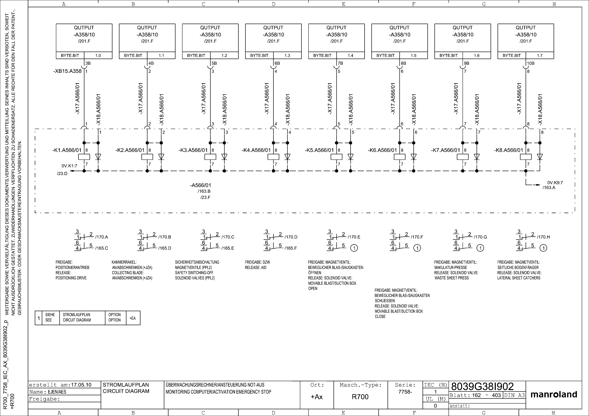

# +Ax — Sheet 162 of 403 — ÜBERWACHUNGSRECHNER/ANSTEUERUNG NOT AUS

**MONITORING COMPUTER/ACTIVATION EMERGENCY STOP**

> Part of the manroland **R700** printing press IEC/UL circuit diagrams.
> Drawing class: **Stromlaufplan / Circuit diagram** (DIN A3).
> Document `+Ax` covers the **Central control console** machine section.

## At a glance

| Field | Value |
|---|---|
| Document | `+Ax`  (8039G38I902) |
| Sheet | **162** of 403 |
| Section (DE) | ÜBERWACHUNGSRECHNER/ANSTEUERUNG NOT AUS |
| Section (EN) | MONITORING COMPUTER/ACTIVATION EMERGENCY STOP |
| Section type | CIRCUIT — Circuit diagram |
| Machine type | `R700` |
| Series | `7758` |
| Created | 17.05.10 |
| Replaces | — |
| Columns used | A, B, C, D, E, F, G, H |
| Path numbers | — |
| Labels on sheet | 226 |
| Cross-refs out | 24 |
| Cross-refs in | 40 |

**Previous:** [+Ax sheet 161](SHEET_0161.md) · **Next:** [+Ax sheet 163](SHEET_0163.md) · **Document TOC:** [_TOC.md](_TOC.md)  (+Ax) · **Master TOC:** [all sheets](../_MASTER_TOC.md)

## Sheet image (300 DPI, exact vector render)



_Rendered directly from the PDF vector layer at 300 DPI (1-bit), no OCR and no resampling. Use it to confirm anything ambiguous in the text below._

## Cross-references on this sheet

Each entry is a wire leaving this sheet. The printed token is `/sheet.column`; the link resolves to that sheet inside the same document.

| Ref | Target sheet | Col | Path | Destination on target | Target section | From col |
|---|---|---|---|---|---|---|
| `/201.F` | [+Ax sheet 201](SHEET_0201.md) | F | — | — | REFERENZMODUL | A |
| `/201.F` | [+Ax sheet 201](SHEET_0201.md) | F | — | — | REFERENZMODUL | B |
| `/201.F` | [+Ax sheet 201](SHEET_0201.md) | F | — | — | REFERENZMODUL | C |
| `/201.F` | [+Ax sheet 201](SHEET_0201.md) | F | — | — | REFERENZMODUL | D |
| `/201.F` | [+Ax sheet 201](SHEET_0201.md) | F | — | — | REFERENZMODUL | E |
| `/201.F` | [+Ax sheet 201](SHEET_0201.md) | F | — | — | REFERENZMODUL | F |
| `/201.F` | [+Ax sheet 201](SHEET_0201.md) | F | — | — | REFERENZMODUL | G |
| `/201.F` | [+Ax sheet 201](SHEET_0201.md) | F | — | — | REFERENZMODUL | H |
| `/23.D` | [+Ax sheet 23](SHEET_0023.md) | D | — | — | SPANNUNGSVERSORGUNG, SCHALTSCHRANKBELÜFTUNG | A |
| `/163.A` | [+Ax sheet 163](SHEET_0163.md) | A | — | — | ÜBERWACHUNGSRECHNER/ANSTEUERUNG NOT AUS | H |
| `/163.B` | [+Ax sheet 163](SHEET_0163.md) | B | — | — | ÜBERWACHUNGSRECHNER/ANSTEUERUNG NOT AUS | C |
| `/23.F` | [+Ax sheet 23](SHEET_0023.md) | F | — | — | SPANNUNGSVERSORGUNG, SCHALTSCHRANKBELÜFTUNG | C |
| `/170.A` | [+Ax sheet 170](SHEET_0170.md) | A | — | — | ÜBERWACHUNGSRECHNER/RÜCKMELDUNG NOT AUS | B |
| `/170.B` | [+Ax sheet 170](SHEET_0170.md) | B | — | — | ÜBERWACHUNGSRECHNER/RÜCKMELDUNG NOT AUS | B |
| `/170.E` | [+Ax sheet 170](SHEET_0170.md) | E | — | — | ÜBERWACHUNGSRECHNER/RÜCKMELDUNG NOT AUS | E |
| `/170.F` | [+Ax sheet 170](SHEET_0170.md) | F | — | — | ÜBERWACHUNGSRECHNER/RÜCKMELDUNG NOT AUS | F |
| `/170.G` | [+Ax sheet 170](SHEET_0170.md) | G | — | — | ÜBERWACHUNGSRECHNER/RÜCKMELDUNG NOT AUS | G |
| `/170.C` | [+Ax sheet 170](SHEET_0170.md) | C | — | — | ÜBERWACHUNGSRECHNER/RÜCKMELDUNG NOT AUS | C |
| `/170.D` | [+Ax sheet 170](SHEET_0170.md) | D | — | — | ÜBERWACHUNGSRECHNER/RÜCKMELDUNG NOT AUS | D |
| `/170.H` | [+Ax sheet 170](SHEET_0170.md) | H | — | — | ÜBERWACHUNGSRECHNER/RÜCKMELDUNG NOT AUS | H |
| `/165.E` | [+Ax sheet 165](SHEET_0165.md) | E | — | — | ÜBERWACHUNGSRECHNER/ANSTEUERUNG NOT AUS | C |
| `/165.F` | [+Ax sheet 165](SHEET_0165.md) | F | — | — | ÜBERWACHUNGSRECHNER/ANSTEUERUNG NOT AUS | D |
| `/165.C` | [+Ax sheet 165](SHEET_0165.md) | C | — | — | ÜBERWACHUNGSRECHNER/ANSTEUERUNG NOT AUS | B |
| `/165.D` | [+Ax sheet 165](SHEET_0165.md) | D | — | — | ÜBERWACHUNGSRECHNER/ANSTEUERUNG NOT AUS | B |

### Incoming references (sheets that point here)

Every other sheet that sends a wire to this one. `Back-ref` is the token printed on *that* sheet; `Path` is its line number.

| From sheet | Cols | Back-ref | Path | Refs | What continues there |
|---|---|---|---|---|---|
| [+Ax#23](SHEET_0023.md) | D, F | `/23.D`, `/23.F` | — | 2 | — |
| [+Ax#163](SHEET_0163.md) | A, B | `/163.A`, `/163.B` | — | 2 | 0V.K9:7 |
| [+Ax#165](SHEET_0165.md) | C, D, E, F | `/165.C`, `/165.D`, `/165.E`, `/165.F` | — | 4 | — |
| [+Ax#170](SHEET_0170.md) | A, B, C, D, E, F, G | `/170.A`, `/170.B`, `/170.C`, `/170.D`, `/170.E`, `/170.F`, `/170.G` | — | 8 | — |
| [+Ax#201](SHEET_0201.md) | F | `/201.F` | — | 8 | — |
| [+Ax#252](SHEET_0252.md) | H | `/252.H` | — | 8 | — |
| [+Ax#255](SHEET_0255.md) | H | `/255.H` | — | 8 | — |


## Devices on this sheet

| Tag | Class | Class meaning (IEC) | Col | Sub | Terminal | Sign |
|---|---|---|---|---|---|---|
| `A358/10` | A | Baugruppe / assembly, module, PC board | A | 10 | — | — |
| `A358/10` | A | Baugruppe / assembly, module, PC board | B | 10 | — | — |
| `A358/10` | A | Baugruppe / assembly, module, PC board | C | 10 | — | — |
| `A358/10` | A | Baugruppe / assembly, module, PC board | D | 10 | — | — |
| `A358/10` | A | Baugruppe / assembly, module, PC board | E | 10 | — | — |
| `A358/10` | A | Baugruppe / assembly, module, PC board | F | 10 | — | — |
| `A358/10` | A | Baugruppe / assembly, module, PC board | G | 10 | — | — |
| `A566/01` | A | Baugruppe / assembly, module, PC board | C | 01 | — | — |
| `A358/10` | A | Baugruppe / assembly, module, PC board | H | 10 | — | — |
| `1.0` | — | cross-device reference | A | — | — | — |
| `XB15.A358` | — | cross-device reference | A | — | — | — |
| `1.1` | — | cross-device reference | B | — | — | — |
| `1.2` | — | cross-device reference | C | — | — | — |
| `1.3` | — | cross-device reference | D | — | — | — |
| `1.4` | — | cross-device reference | E | — | — | — |
| `1.5` | — | cross-device reference | F | — | — | — |
| `1.6` | — | cross-device reference | G | — | — | — |
| `1.7` | — | cross-device reference | H | — | — | — |

## Potentials / nets

| Potential | Count | Columns | Attached devices | Terminals |
|---|---|---|---|---|
| `0V` | 2 | A, H | `K1`, `K9` | `7` |


A potential such as `L24+/4` or `M24+` is a named supply/return rail; every place it appears on this sheet is electrically common.

## Wire-end annotations (grouped as printed)

A wire that continues elsewhere is annotated with a small cluster: the destination description, the path/line number `#NN`, and the `/sheet.column` cross reference. Each row below is one such cluster exactly as it is grouped on the drawing.

| Col | Y | Path | Cross-ref | Text on the wire |
|---|---|---|---|---|
| A | 51.6 | — | — | `QUTPUT` |
| B | 51.6 | — | — | `QUTPUT` |
| C | 51.6 | — | — | `QUTPUT` |
| D | 51.6 | — | — | `QUTPUT` |
| E | 51.6 | — | — | `QUTPUT` |
| F | 51.6 | — | — | `QUTPUT` |
| G | 51.6 | — | — | `QUTPUT` |
| H | 51.6 | — | — | `QUTPUT` |
| A | 65.5 | — | — | `A358/10` |
| B | 65.5 | — | — | `A358/10` |
| C | 65.5 | — | — | `A358/10` |
| D | 65.5 | — | — | `A358/10` |
| E | 65.5 | — | — | `A358/10` |
| F | 65.5 | — | — | `A358/10` |
| G | 65.5 | — | — | `A358/10` |
| H | 65.5 | — | — | `A358/10` |
| A | 79.3 | — | `/201.F` | — |
| B | 79.3 | — | `/201.F` | — |
| C | 79.3 | — | `/201.F` | — |
| D | 79.3 | — | `/201.F` | — |
| E | 79.3 | — | `/201.F` | — |
| F | 79.3 | — | `/201.F` | — |
| G | 79.3 | — | `/201.F` | — |
| H | 79.3 | — | `/201.F` | — |
| A | 108.9 | — | — | `BYTE.BIT 1.0` |
| B | 108.9 | — | — | `BYTE.BIT 1.1` |
| C | 108.9 | — | — | `BYTE.BIT 1.2` |
| D | 108.9 | — | — | `BYTE.BIT 1.3` |
| E | 108.9 | — | — | `BYTE.BIT 1.4` |
| F | 108.9 | — | — | `BYTE.BIT 1.5` |
| G | 108.9 | — | — | `BYTE.BIT 1.6` |
| H | 108.9 | — | — | `BYTE.BIT 1.7` |
| A | 124.3 | — | — | `3B` |
| B | 124.3 | — | — | `4B` |
| C | 124.3 | — | — | `5B` |
| D | 124.3 | — | — | `6B` |
| E | 124.3 | — | — | `7B` |
| F | 124.3 | — | — | `8B` |
| G | 124.3 | — | — | `9B` |
| H | 124.3 | — | — | `10B` |
| A | 139.2 | — | — | `XB15.A358 1` |
| B | 140.6 | — | — | `2` |
| C | 140.6 | — | — | `3` |
| D | 140.6 | — | — | `4` |
| E | 140.6 | — | — | `5` |
| F | 140.6 | — | — | `6` |
| G | 140.6 | — | — | `7` |
| H | 140.6 | — | — | `8` |
| A | 166.7 | — | — | `X17.A566/01` |
| B | 166.7 | — | — | `X17.A566/01` |
| C | 166.7 | — | — | `X17.A566/01` |
| D | 166.7 | — | — | `X17.A566/01` |
| E | 166.7 | — | — | `X17.A566/01` |
| F | 166.7 | — | — | `X17.A566/01` |
| G | 166.7 | — | — | `X17.A566/01` |
| H | 166.7 | — | — | `X17.A566/01` |
| B | 189.1 | — | — | `X18.A566/01` |
| B | 189.1 | — | — | `X18.A566/01` |
| C | 189.1 | — | — | `X18.A566/01` |
| D | 189.1 | — | — | `X18.A566/01` |
| E | 189.1 | — | — | `X18.A566/01` |
| F | 189.1 | — | — | `X18.A566/01` |
| G | 189.1 | — | — | `X18.A566/01` |
| H | 189.1 | — | — | `X18.A566/01` |
| A | 246.9 | — | — | `1` |
| B | 246.9 | — | — | `2` |
| C | 246.9 | — | — | `3` |
| D | 246.9 | — | — | `4` |
| E | 246.9 | — | — | `5` |
| F | 246.9 | — | — | `6` |
| G | 246.9 | — | — | `7` |
| H | 246.9 | — | — | `8` |
| D | 263.9 | — | — | `1 2 3 4 5 6 7` |
| H | 263.9 | — | — | `8` |
| A | 299.4 | — | — | `K1.A566/01` |
| B | 299.4 | — | — | `K2.A566/01` |
| C | 299.4 | — | — | `K3.A566/01` |
| D | 299.4 | — | — | `K4.A566/01` |
| E | 299.4 | — | — | `K5.A566/01` |
| F | 299.4 | — | — | `K6.A566/01` |
| F | 299.4 | — | — | `K7.A566/01` |
| G | 299.4 | — | — | `K8.A566/01` |
| A | 300.1 | — | — | `8` |
| B | 300.1 | — | — | `8` |
| C | 300.1 | — | — | `8` |
| D | 300.1 | — | — | `8` |
| E | 300.1 | — | — | `8` |
| F | 300.1 | — | — | `8` |
| G | 300.1 | — | — | `8` |
| H | 300.1 | — | — | `8` |
| A | 328.4 | — | — | `7` |
| B | 328.4 | — | — | `7` |
| C | 328.4 | — | — | `7` |
| D | 328.4 | — | — | `7` |
| E | 328.4 | — | — | `7` |
| F | 328.4 | — | — | `7` |
| G | 328.4 | — | — | `7` |
| H | 328.4 | — | — | `7` |
| A | 331.9 | — | — | `0V.K1:7` |
| A | 347.5 | — | `/23.D` | — |
| H | 365.9 | — | — | `0V.K9:7` |
| C | 370.2 | — | — | `A566/01` |
| H | 375.9 | — | `/163.A` | — |
| C | 383.3 | — | `/163.B` | — |
| C | 395.7 | — | `/23.F` | — |
| A | 463.7 | — | — | `3 6 4 1` |
| B | 463.7 | — | — | `3 6 4 1` |
| C | 463.7 | — | — | `3 6 4 1` |
| D | 463.7 | — | — | `3 6 4 1` |
| E | 463.7 | — | — | `3 6 4 1` |
| F | 463.7 | — | — | `3 6 4 1` |
| G | 463.7 | — | — | `3 6 4 1` |
| H | 463.7 | — | — | `3 6 4 1` |
| A | 469.4 | — | — | `2` |
| B | 469.4 | — | — | `2` |
| C | 469.4 | — | — | `2` |
| D | 469.4 | — | — | `2` |
| E | 469.4 | — | — | `2` |
| F | 469.4 | — | — | `2` |
| G | 469.4 | — | — | `2` |
| H | 469.4 | — | — | `2` |
| B | 475.8 | — | `/170.A` | — |
| B | 475.8 | — | `/170.B` | — |
| C | 475.8 | — | `/170.C` | — |
| D | 475.8 | — | `/170.D` | — |
| E | 475.8 | — | `/170.E` | — |
| F | 475.8 | — | `/170.F` | — |
| G | 475.8 | — | `/170.G` | — |
| H | 475.8 | — | `/170.H` | — |
| A | 492.1 | — | — | `5` |
| B | 492.1 | — | — | `5` |
| C | 492.1 | — | — | `5` |
| D | 492.1 | — | — | `5` |
| E | 492.1 | — | — | `5` |
| F | 492.1 | — | — | `5` |
| G | 492.1 | — | — | `5` |
| H | 492.1 | — | — | `5` |
| C | 498.4 | — | `/165.E` | — |
| B | 498.5 | — | `/165.C` | — |
| B | 498.5 | — | `/165.D` | — |
| D | 498.5 | — | `/165.F` | — |
| G | 498.7 | — | — | `1 1 1 1` |
| A | 527.8 | — | — | `FREIGABE: POSITIONIERANTRIEB RELEASE: POSITIONING DRIVE` |
| D | 527.8 | — | — | `FREIGABE: DZW RELEASE: AID` |
| B | 527.9 | — | — | `KAMMERRAKEL:` |
| C | 527.9 | — | — | `MAGNETVENTILE (PPL2) SICHERHEITSABSCHALTUNG SAFETY SWITCHING OFF SOLENOID VALVES (PPL2)` |
| E | 527.9 | — | — | `FREIGABE: MAGNETVENTIL: BEWEGLICHER BLAS /SAUGKASTEN` |
| G | 527.9 | — | — | `FREIGABE: MAGNETVENTIL: RELEASE: SOLENOID VALVE: MAKULATUR PRESSE` |
| G | 527.9 | — | — | `FREIGABE: MAGNETVENTIL:` |
| B | 538.5 | — | — | `COLLECTING BLADE: AN/ABSCHWENKEN (+JZA) AN/ABSCHWENKEN (+JZA)` |
| H | 538.5 | — | — | `RELEASE: SOLENOID VALVE: LATERAL SHEET CATCHERS SEITLICHE BOGENFÄNGER` |
| E | 549.1 | — | — | `RELEASE: SOLENOID VALVE: MOVABLE BLAST/SUCTION BOX ÖFFNEN OPEN` |
| G | 559.7 | — | — | `WASTE SHEET PRESS` |
| F | 584.5 | — | — | `FREIGABE: MAGNETVENTIL: BEWEGLICHER BLAS /SAUGKASTEN` |
| F | 605.8 | — | — | `RELEASE: SOLENOID VALVE: MOVABLE BLAST/SUCTION BOX SCHLIESSEN CLOSE` |
| A | 634.1 | — | — | `1 SIEHE SEE` |
| B | 634.1 | — | — | `OPTION OPTION +EA` |
| A | 634.2 | — | — | `STROMLAUFPLAN CIRCUIT DIAGRAM` |


## Reconstructed tables

This sheet carries tabular content (pin map / terminal assignment / index). The grid below was rebuilt from the drawing's own rule lines, so each row is exactly one physical row of the table.

### Table 1 — 2 data rows × 3 columns (at x=113.4, y=48.2)

| QUTPUT | A358/10 /201.F |  |
|---|---|---|
| `BYTE.BIT` | `1.0` |  |
| `XB15.A358 X17.A566/01 K1.A566/01 0V.K1:7` | `3B 1 1 8 7` | `X18.A566/01 1` |


### Table 2 — 2 data rows × 3 columns (at x=240.9, y=48.2)

| QUTPUT | A358/10 /201.F |  |
|---|---|---|
| `BYTE.BIT` |  | `1.1` |
| `X17.A566/01 K2.A566/01` | `4B 2 2 8 7` | `X18.A566/01 2` |


### Table 3 — 2 data rows × 3 columns (at x=368.5, y=48.2)

| QUTPUT | A358/10 /201.F |  |
|---|---|---|
| `BYTE.BIT` | `1.2` |  |
| `X17.A566/01 K3.A566/01` | `5B 3 3 8 7` | `X18.A566/01 3` |


### Table 4 — 2 data rows × 3 columns (at x=496.1, y=48.2)

| QUTPUT | A358/10 /201.F |  |
|---|---|---|
| `BYTE.BIT` | `1.3` |  |
| `X17.A566/01 K4.A566/01` | `6B 4 4 8 7` | `X18.A566/01 4` |


### Table 5 — 2 data rows × 3 columns (at x=623.6, y=48.2)

| QUTPUT | A358/10 /201.F |  |
|---|---|---|
| `BYTE.BIT` | `1.4` |  |
| `X17.A566/01 K5.A566/01` | `7B 5 5 8 7` | `X18.A566/01 5` |


### Table 6 — 2 data rows × 3 columns (at x=751.2, y=48.2)

| QUTPUT | A358/10 /201.F |  |
|---|---|---|
| `BYTE.BIT` | `1.5` |  |
| `X17.A566/01 K6.A566/01` | `8B 6 6 8 7` | `X18.A566/01 6` |


### Table 7 — 2 data rows × 3 columns (at x=878.7, y=48.2)

| QUTPUT | A358/10 /201.F |  |
|---|---|---|
| `BYTE.BIT` | `1.6` |  |
| `X17.A566/01 K7.A566/01` | `9B 7 7 8 7` | `X18.A566/01 7` |


### Table 8 — 2 data rows × 3 columns (at x=1006.3, y=48.2)

| QUTPUT | A358/10 /201.F |  |
|---|---|---|
| `BYTE.BIT` | `1.7` |  |
| `X17.A566/01 K8.A566/01` | `10B 8 8 8 7` | `X18.A566/01 8` |


## Notes and free text on this sheet

| Text | Col | Y (pt) |
|---|---|---|
| `K1.A566/01` | A | 299.36 |
| `K2.A566/01` | B | 299.36 |
| `K3.A566/01` | C | 299.36 |
| `K4.A566/01` | D | 299.36 |
| `K5.A566/01` | E | 299.36 |
| `K6.A566/01` | F | 299.36 |
| `K7.A566/01` | F | 299.36 |
| `X17.A566/01` | A | 166.68 |
| `3B` | A | 124.29 |
| `QUTPUT` | A | 51.64 |
| `BYTE.BIT` | A | 108.91 |
| `FREIGABE:` | A | 527.81 |
| `POSITIONIERANTRIEB` | A | 538.49 |
| `RELEASE:` | A | 549.08 |
| `POSITIONING DRIVE` | A | 559.75 |
| `X17.A566/01` | B | 166.68 |
| `4B` | B | 124.29 |
| `QUTPUT` | B | 51.64 |
| `BYTE.BIT` | B | 108.91 |
| `KAMMERRAKEL:` | B | 527.86 |
| `AN/ABSCHWENKEN (+JZA)` | B | 538.48 |
| `COLLECTING BLADE:` | B | 549.14 |
| `X17.A566/01` | C | 166.68 |
| `5B` | C | 124.29 |
| `QUTPUT` | C | 51.64 |
| `BYTE.BIT` | C | 108.91 |
| `SICHERHEITSABSCHALTUNG` | C | 527.88 |
| `MAGNETVENTILE (PPL2)` | C | 538.5 |
| `SAFETY SWITCHING OFF` | C | 549.11 |
| `SOLENOID VALVES (PPL2)` | C | 559.76 |
| `X17.A566/01` | D | 166.68 |
| `6B` | D | 124.29 |
| `QUTPUT` | D | 51.64 |
| `BYTE.BIT` | D | 108.91 |
| `FREIGABE: DZW` | D | 527.81 |
| `RELEASE: AID` | D | 538.47 |
| `X17.A566/01` | E | 166.68 |
| `7B` | E | 124.29 |
| `QUTPUT` | E | 51.64 |
| `BYTE.BIT` | E | 108.91 |
| `FREIGABE: MAGNETVENTIL:` | E | 527.85 |
| `BEWEGLICHER BLAS /SAUGKASTEN` | E | 538.48 |
| `ÖFFNEN` | E | 549.12 |
| `RELEASE: SOLENOID VALVE:` | E | 559.74 |
| `MOVABLE BLAST/SUCTION BOX` | E | 570.4 |
| `OPEN` | E | 580.99 |
| `X17.A566/01` | F | 166.68 |
| `8B` | F | 124.29 |
| `QUTPUT` | F | 51.64 |
| `BYTE.BIT` | F | 108.91 |
| `FREIGABE: MAGNETVENTIL:` | F | 584.55 |
| `BEWEGLICHER BLAS /SAUGKASTEN` | F | 595.17 |
| `SCHLIESSEN` | F | 605.81 |
| `RELEASE: SOLENOID VALVE:` | F | 616.44 |
| `MOVABLE BLAST/SUCTION BOX` | F | 627.09 |
| `CLOSE` | F | 637.71 |
| `X17.A566/01` | G | 166.68 |
| `9B` | G | 124.29 |
| `QUTPUT` | G | 51.64 |
| `FREIGABE: MAGNETVENTIL:` | G | 527.85 |
| `MAKULATUR PRESSE` | G | 538.51 |
| `RELEASE: SOLENOID VALVE:` | G | 549.11 |
| `WASTE SHEET PRESS` | G | 559.72 |
| `K8.A566/01` | G | 299.36 |
| `X17.A566/01` | H | 166.68 |
| `10B` | H | 124.3 |
| `QUTPUT` | H | 51.64 |
| `BYTE.BIT` | G | 108.91 |
| `SEITLICHE BOGENFÄNGER` | G | 538.5 |
| `RELEASE: SOLENOID VALVE:` | H | 549.11 |
| `LATERAL SHEET CATCHERS` | G | 559.76 |
| `X18.A566/01` | B | 189.07 |
| `X18.A566/01` | C | 189.07 |
| `X18.A566/01` | D | 189.07 |
| `X18.A566/01` | E | 189.07 |
| `X18.A566/01` | F | 189.07 |
| `X18.A566/01` | G | 189.07 |
| `X18.A566/01` | H | 189.07 |
| `SIEHE` | A | 634.12 |
| `SEE` | A | 644.72 |
| `STROMLAUFPLAN` | A | 634.18 |
| `CIRCUIT DIAGRAM` | A | 644.81 |
| `OPTION` | B | 634.14 |
| `+EA` | B | 641.22 |

## Complete label inventory (exact text from the drawing)

Every text object inside the drawing area of this sheet, in DIN reading order (column A→H, then top→bottom). This is the authoritative list: if a string is not here it is not printed on this sheet.

| Col | Y | X | Dir | Type | Text |
|---|---|---|---|---|---|
| A | 51.6 | 149.8 | → | text | `QUTPUT` |
| A | 65.5 | 148.7 | → | device tag | `A358/10` |
| A | 79.3 | 157.7 | → | cross-reference | `/201.F` |
| A | 108.9 | 123.3 | → | text | `BYTE.BIT` |
| A | 108.9 | 192.5 | → | device ref | `1.0` |
| A | 124.3 | 172.6 | → | text | `3B` |
| A | 139.2 | 107.7 | → | device ref | `XB15.A358` |
| A | 140.6 | 172.1 | → | number | `1` |
| A | 166.7 | 152.0 | ↕ | text | `X17.A566/01` |
| A | 246.9 | 172.1 | → | number | `1` |
| A | 299.4 | 106.0 | → | text | `K1.A566/01` |
| A | 300.1 | 172.6 | → | number | `8` |
| A | 328.4 | 172.6 | → | number | `7` |
| A | 331.9 | 124.7 | → | potential | `0V.K1:7` |
| A | 347.5 | 115.4 | → | cross-reference | `/23.D` |
| A | 463.7 | 153.4 | → | number | `3` |
| A | 469.4 | 181.1 | → | number | `2` |
| A | 475.1 | 154.8 | → | number | `1` |
| A | 486.4 | 153.4 | → | number | `6` |
| A | 492.1 | 180.9 | → | number | `5` |
| A | 497.8 | 153.4 | → | number | `4` |
| A | 527.8 | 112.5 | → | text | `FREIGABE:` |
| A | 538.5 | 112.5 | → | text | `POSITIONIERANTRIEB` |
| A | 549.1 | 112.5 | → | text | `RELEASE:` |
| A | 559.8 | 112.5 | → | text | `POSITIONING DRIVE` |
| A | 634.1 | 91.8 | → | text | `SIEHE` |
| A | 634.2 | 127.3 | → | text | `STROMLAUFPLAN` |
| A | 639.5 | 75.4 | → | number | `1` |
| A | 644.7 | 91.8 | → | text | `SEE` |
| A | 644.8 | 127.3 | → | text | `CIRCUIT DIAGRAM` |
| B | 51.6 | 277.4 | → | text | `QUTPUT` |
| B | 65.5 | 276.2 | → | device tag | `A358/10` |
| B | 79.3 | 285.3 | → | cross-reference | `/201.F` |
| B | 108.9 | 250.9 | → | text | `BYTE.BIT` |
| B | 108.9 | 320.6 | → | device ref | `1.1` |
| B | 124.3 | 300.2 | → | text | `4B` |
| B | 140.6 | 300.2 | → | number | `2` |
| B | 166.7 | 279.5 | ↕ | text | `X17.A566/01` |
| B | 189.1 | 194.5 | ↕ | text | `X18.A566/01` |
| B | 189.1 | 322.0 | ↕ | text | `X18.A566/01` |
| B | 246.9 | 300.2 | → | number | `2` |
| B | 263.9 | 200.4 | → | number | `1` |
| B | 263.9 | 328.5 | → | number | `2` |
| B | 299.4 | 233.6 | → | text | `K2.A566/01` |
| B | 300.1 | 300.2 | → | number | `8` |
| B | 328.4 | 300.2 | → | number | `7` |
| B | 463.7 | 280.9 | → | number | `3` |
| B | 469.4 | 308.7 | → | number | `2` |
| B | 475.1 | 282.3 | → | number | `1` |
| B | 475.8 | 192.8 | → | cross-reference | `/170.A` |
| B | 475.8 | 320.3 | → | cross-reference | `/170.B` |
| B | 486.4 | 280.9 | → | number | `6` |
| B | 492.1 | 308.4 | → | number | `5` |
| B | 497.8 | 280.9 | → | number | `4` |
| B | 498.5 | 192.8 | → | cross-reference | `/165.C` |
| B | 498.5 | 320.3 | → | cross-reference | `/165.D` |
| B | 527.9 | 225.9 | → | text | `KAMMERRAKEL:` |
| B | 538.5 | 226.8 | → | text | `AN/ABSCHWENKEN (+JZA)` |
| B | 549.1 | 226.5 | → | text | `COLLECTING BLADE:` |
| B | 559.7 | 226.8 | → | text | `AN/ABSCHWENKEN (+JZA)` |
| B | 634.1 | 219.4 | → | text | `OPTION` |
| B | 641.2 | 261.9 | → | text | `+EA` |
| B | 644.8 | 219.4 | → | text | `OPTION` |
| C | 51.6 | 404.9 | → | text | `QUTPUT` |
| C | 65.5 | 403.8 | → | device tag | `A358/10` |
| C | 79.3 | 412.9 | → | cross-reference | `/201.F` |
| C | 108.9 | 378.4 | → | text | `BYTE.BIT` |
| C | 108.9 | 447.7 | → | device ref | `1.2` |
| C | 124.3 | 427.7 | → | text | `5B` |
| C | 140.6 | 427.7 | → | number | `3` |
| C | 166.7 | 407.1 | ↕ | text | `X17.A566/01` |
| C | 189.1 | 449.6 | ↕ | text | `X18.A566/01` |
| C | 246.9 | 427.7 | → | number | `3` |
| C | 263.9 | 456.1 | → | number | `3` |
| C | 299.4 | 361.1 | → | text | `K3.A566/01` |
| C | 300.1 | 427.7 | → | number | `8` |
| C | 328.4 | 427.7 | → | number | `7` |
| C | 370.2 | 384.1 | → | device tag | `A566/01` |
| C | 383.3 | 400.0 | → | cross-reference | `/163.B` |
| C | 395.7 | 405.4 | → | cross-reference | `/23.F` |
| C | 463.7 | 408.5 | → | number | `3` |
| C | 469.4 | 436.3 | → | number | `2` |
| C | 475.1 | 409.9 | → | number | `1` |
| C | 475.8 | 447.9 | → | cross-reference | `/170.C` |
| C | 486.4 | 408.5 | → | number | `6` |
| C | 492.1 | 436.0 | → | number | `5` |
| C | 497.8 | 408.5 | → | number | `4` |
| C | 498.5 | 447.9 | → | cross-reference | `/165.E` |
| C | 527.9 | 354.0 | → | text | `SICHERHEITSABSCHALTUNG` |
| C | 538.5 | 353.8 | → | text | `MAGNETVENTILE (PPL2)` |
| C | 549.1 | 354.0 | → | text | `SAFETY SWITCHING OFF` |
| C | 559.8 | 354.0 | → | text | `SOLENOID VALVES (PPL2)` |
| D | 51.6 | 532.5 | → | text | `QUTPUT` |
| D | 65.5 | 531.4 | → | device tag | `A358/10` |
| D | 79.3 | 540.4 | → | cross-reference | `/201.F` |
| D | 108.9 | 506.0 | → | text | `BYTE.BIT` |
| D | 108.9 | 575.1 | → | device ref | `1.3` |
| D | 124.3 | 555.3 | → | text | `6B` |
| D | 140.6 | 555.3 | → | number | `4` |
| D | 166.7 | 534.6 | ↕ | text | `X17.A566/01` |
| D | 189.1 | 577.2 | ↕ | text | `X18.A566/01` |
| D | 246.9 | 555.3 | → | number | `4` |
| D | 263.9 | 583.7 | → | number | `4` |
| D | 299.4 | 488.7 | → | text | `K4.A566/01` |
| D | 300.1 | 555.3 | → | number | `8` |
| D | 328.4 | 555.3 | → | number | `7` |
| D | 463.7 | 536.0 | → | number | `3` |
| D | 469.4 | 563.8 | → | number | `2` |
| D | 475.1 | 537.4 | → | number | `1` |
| D | 475.8 | 575.4 | → | cross-reference | `/170.D` |
| D | 486.4 | 536.0 | → | number | `6` |
| D | 492.1 | 563.5 | → | number | `5` |
| D | 497.8 | 536.0 | → | number | `4` |
| D | 498.5 | 575.4 | → | cross-reference | `/165.F` |
| D | 527.8 | 495.2 | → | text | `FREIGABE: DZW` |
| D | 538.5 | 495.2 | → | text | `RELEASE: AID` |
| E | 51.6 | 660.0 | → | text | `QUTPUT` |
| E | 65.5 | 658.9 | → | device tag | `A358/10` |
| E | 79.3 | 668.0 | → | cross-reference | `/201.F` |
| E | 108.9 | 633.5 | → | text | `BYTE.BIT` |
| E | 108.9 | 702.7 | → | device ref | `1.4` |
| E | 124.3 | 682.9 | → | text | `7B` |
| E | 140.6 | 682.9 | → | number | `5` |
| E | 166.7 | 662.2 | ↕ | text | `X17.A566/01` |
| E | 189.1 | 704.7 | ↕ | text | `X18.A566/01` |
| E | 246.9 | 682.9 | → | number | `5` |
| E | 263.9 | 711.2 | → | number | `5` |
| E | 299.4 | 616.3 | → | text | `K5.A566/01` |
| E | 300.1 | 682.9 | → | number | `8` |
| E | 328.4 | 682.9 | → | number | `7` |
| E | 463.7 | 663.6 | → | number | `3` |
| E | 469.4 | 691.4 | → | number | `2` |
| E | 475.1 | 665.0 | → | number | `1` |
| E | 475.8 | 703.0 | → | cross-reference | `/170.E` |
| E | 486.4 | 663.6 | → | number | `6` |
| E | 492.1 | 691.1 | → | number | `5` |
| E | 497.8 | 663.6 | → | number | `4` |
| E | 498.7 | 714.0 | → | number | `1` |
| E | 527.9 | 622.8 | → | text | `FREIGABE: MAGNETVENTIL:` |
| E | 538.5 | 622.8 | → | text | `BEWEGLICHER BLAS /SAUGKASTEN` |
| E | 549.1 | 623.3 | → | text | `ÖFFNEN` |
| E | 559.7 | 622.8 | → | text | `RELEASE: SOLENOID VALVE:` |
| E | 570.4 | 623.1 | → | text | `MOVABLE BLAST/SUCTION BOX` |
| E | 581.0 | 623.3 | → | text | `OPEN` |
| F | 51.6 | 787.6 | → | text | `QUTPUT` |
| F | 65.5 | 786.5 | → | device tag | `A358/10` |
| F | 79.3 | 795.5 | → | cross-reference | `/201.F` |
| F | 108.9 | 761.1 | → | text | `BYTE.BIT` |
| F | 108.9 | 830.3 | → | device ref | `1.5` |
| F | 108.9 | 888.7 | → | text | `BYTE.BIT` |
| F | 124.3 | 810.4 | → | text | `8B` |
| F | 140.6 | 810.4 | → | number | `6` |
| F | 166.7 | 789.8 | ↕ | text | `X17.A566/01` |
| F | 189.1 | 832.3 | ↕ | text | `X18.A566/01` |
| F | 246.9 | 810.4 | → | number | `6` |
| F | 263.9 | 838.8 | → | number | `6` |
| F | 299.4 | 743.8 | → | text | `K6.A566/01` |
| F | 299.4 | 871.4 | → | text | `K7.A566/01` |
| F | 300.1 | 810.4 | → | number | `8` |
| F | 328.4 | 810.4 | → | number | `7` |
| F | 463.7 | 791.1 | → | number | `3` |
| F | 469.4 | 818.9 | → | number | `2` |
| F | 475.1 | 792.6 | → | number | `1` |
| F | 475.8 | 830.6 | → | cross-reference | `/170.F` |
| F | 486.4 | 791.1 | → | number | `6` |
| F | 492.1 | 818.6 | → | number | `5` |
| F | 497.8 | 791.1 | → | number | `4` |
| F | 498.7 | 841.6 | → | number | `1` |
| F | 584.5 | 757.4 | → | text | `FREIGABE: MAGNETVENTIL:` |
| F | 595.2 | 757.4 | → | text | `BEWEGLICHER BLAS /SAUGKASTEN` |
| F | 605.8 | 758.0 | → | text | `SCHLIESSEN` |
| F | 616.4 | 757.4 | → | text | `RELEASE: SOLENOID VALVE:` |
| F | 627.1 | 757.7 | → | text | `MOVABLE BLAST/SUCTION BOX` |
| F | 637.7 | 758.0 | → | text | `CLOSE` |
| G | 51.6 | 915.2 | → | text | `QUTPUT` |
| G | 65.5 | 914.0 | → | device tag | `A358/10` |
| G | 79.3 | 923.1 | → | cross-reference | `/201.F` |
| G | 108.9 | 957.8 | → | device ref | `1.6` |
| G | 108.9 | 1016.2 | → | text | `BYTE.BIT` |
| G | 124.3 | 938.0 | → | text | `9B` |
| G | 140.6 | 938.0 | → | number | `7` |
| G | 166.7 | 917.3 | ↕ | text | `X17.A566/01` |
| G | 189.1 | 959.8 | ↕ | text | `X18.A566/01` |
| G | 246.9 | 938.0 | → | number | `7` |
| G | 263.9 | 966.3 | → | number | `7` |
| G | 299.4 | 998.9 | → | text | `K8.A566/01` |
| G | 300.1 | 938.0 | → | number | `8` |
| G | 328.4 | 938.0 | → | number | `7` |
| G | 463.7 | 918.7 | → | number | `3` |
| G | 469.4 | 946.5 | → | number | `2` |
| G | 475.1 | 920.1 | → | number | `1` |
| G | 475.8 | 958.1 | → | cross-reference | `/170.G` |
| G | 486.4 | 918.7 | → | number | `6` |
| G | 492.1 | 946.2 | → | number | `5` |
| G | 497.8 | 918.7 | → | number | `4` |
| G | 498.7 | 969.1 | → | number | `1` |
| G | 527.9 | 877.9 | → | text | `FREIGABE: MAGNETVENTIL:` |
| G | 527.9 | 1005.4 | → | text | `FREIGABE: MAGNETVENTIL:` |
| G | 538.5 | 878.2 | → | text | `MAKULATUR PRESSE` |
| G | 538.5 | 1006.0 | → | text | `SEITLICHE BOGENFÄNGER` |
| G | 549.1 | 877.9 | → | text | `RELEASE: SOLENOID VALVE:` |
| G | 559.7 | 878.7 | → | text | `WASTE SHEET PRESS` |
| G | 559.8 | 1005.4 | → | text | `LATERAL SHEET CATCHERS` |
| H | 51.6 | 1042.7 | → | text | `QUTPUT` |
| H | 65.5 | 1041.6 | → | device tag | `A358/10` |
| H | 79.3 | 1050.7 | → | cross-reference | `/201.F` |
| H | 108.9 | 1085.4 | → | device ref | `1.7` |
| H | 124.3 | 1065.0 | → | text | `10B` |
| H | 140.6 | 1065.5 | → | number | `8` |
| H | 166.7 | 1044.9 | ↕ | text | `X17.A566/01` |
| H | 189.1 | 1087.4 | ↕ | text | `X18.A566/01` |
| H | 246.9 | 1065.5 | → | number | `8` |
| H | 263.9 | 1093.9 | → | number | `8` |
| H | 300.1 | 1065.5 | → | number | `8` |
| H | 328.4 | 1065.5 | → | number | `7` |
| H | 365.9 | 1106.6 | → | potential | `0V.K9:7` |
| H | 375.9 | 1097.0 | → | cross-reference | `/163.A` |
| H | 463.7 | 1046.3 | → | number | `3` |
| H | 469.4 | 1074.0 | → | number | `2` |
| H | 475.1 | 1047.7 | → | number | `1` |
| H | 475.8 | 1085.7 | → | cross-reference | `/170.H` |
| H | 486.4 | 1046.3 | → | number | `6` |
| H | 492.1 | 1073.8 | → | number | `5` |
| H | 497.8 | 1046.3 | → | number | `4` |
| H | 498.7 | 1096.7 | → | number | `1` |
| H | 549.1 | 1005.4 | → | text | `RELEASE: SOLENOID VALVE:` |

## Reading-order text block

The same content as a plain block, grouped by DIN column — convenient to paste or to match against a visual description.

```text
=== Column A ===
  51.6  149.8  text         QUTPUT
  65.5  148.7  devtag       A358/10
  79.3  157.7  xref         /201.F
 108.9  123.3  text         BYTE.BIT
 108.9  192.5  devref       1.0
 124.3  172.6  text         3B
 139.2  107.7  devref       XB15.A358
 140.6  172.1  numeric      1
 166.7  152.0  text         X17.A566/01
 246.9  172.1  numeric      1
 299.4  106.0  text         K1.A566/01
 300.1  172.6  numeric      8
 328.4  172.6  numeric      7
 331.9  124.7  net          0V.K1:7
 347.5  115.4  xref         /23.D
 463.7  153.4  numeric      3
 469.4  181.1  numeric      2
 475.1  154.8  numeric      1
 486.4  153.4  numeric      6
 492.1  180.9  numeric      5
 497.8  153.4  numeric      4
 527.8  112.5  text         FREIGABE:
 538.5  112.5  text         POSITIONIERANTRIEB
 549.1  112.5  text         RELEASE:
 559.8  112.5  text         POSITIONING DRIVE
 634.1   91.8  text         SIEHE
 634.2  127.3  text         STROMLAUFPLAN
 639.5   75.4  numeric      1
 644.7   91.8  text         SEE
 644.8  127.3  text         CIRCUIT DIAGRAM
=== Column B ===
  51.6  277.4  text         QUTPUT
  65.5  276.2  devtag       A358/10
  79.3  285.3  xref         /201.F
 108.9  250.9  text         BYTE.BIT
 108.9  320.6  devref       1.1
 124.3  300.2  text         4B
 140.6  300.2  numeric      2
 166.7  279.5  text         X17.A566/01
 189.1  194.5  text         X18.A566/01
 189.1  322.0  text         X18.A566/01
 246.9  300.2  numeric      2
 263.9  200.4  numeric      1
 263.9  328.5  numeric      2
 299.4  233.6  text         K2.A566/01
 300.1  300.2  numeric      8
 328.4  300.2  numeric      7
 463.7  280.9  numeric      3
 469.4  308.7  numeric      2
 475.1  282.3  numeric      1
 475.8  192.8  xref         /170.A
 475.8  320.3  xref         /170.B
 486.4  280.9  numeric      6
 492.1  308.4  numeric      5
 497.8  280.9  numeric      4
 498.5  192.8  xref         /165.C
 498.5  320.3  xref         /165.D
 527.9  225.9  text         KAMMERRAKEL:
 538.5  226.8  text         AN/ABSCHWENKEN (+JZA)
 549.1  226.5  text         COLLECTING BLADE:
 559.7  226.8  text         AN/ABSCHWENKEN (+JZA)
 634.1  219.4  text         OPTION
 641.2  261.9  text         +EA
 644.8  219.4  text         OPTION
=== Column C ===
  51.6  404.9  text         QUTPUT
  65.5  403.8  devtag       A358/10
  79.3  412.9  xref         /201.F
 108.9  378.4  text         BYTE.BIT
 108.9  447.7  devref       1.2
 124.3  427.7  text         5B
 140.6  427.7  numeric      3
 166.7  407.1  text         X17.A566/01
 189.1  449.6  text         X18.A566/01
 246.9  427.7  numeric      3
 263.9  456.1  numeric      3
 299.4  361.1  text         K3.A566/01
 300.1  427.7  numeric      8
 328.4  427.7  numeric      7
 370.2  384.1  devtag       A566/01
 383.3  400.0  xref         /163.B
 395.7  405.4  xref         /23.F
 463.7  408.5  numeric      3
 469.4  436.3  numeric      2
 475.1  409.9  numeric      1
 475.8  447.9  xref         /170.C
 486.4  408.5  numeric      6
 492.1  436.0  numeric      5
 497.8  408.5  numeric      4
 498.5  447.9  xref         /165.E
 527.9  354.0  text         SICHERHEITSABSCHALTUNG
 538.5  353.8  text         MAGNETVENTILE (PPL2)
 549.1  354.0  text         SAFETY SWITCHING OFF
 559.8  354.0  text         SOLENOID VALVES (PPL2)
=== Column D ===
  51.6  532.5  text         QUTPUT
  65.5  531.4  devtag       A358/10
  79.3  540.4  xref         /201.F
 108.9  506.0  text         BYTE.BIT
 108.9  575.1  devref       1.3
 124.3  555.3  text         6B
 140.6  555.3  numeric      4
 166.7  534.6  text         X17.A566/01
 189.1  577.2  text         X18.A566/01
 246.9  555.3  numeric      4
 263.9  583.7  numeric      4
 299.4  488.7  text         K4.A566/01
 300.1  555.3  numeric      8
 328.4  555.3  numeric      7
 463.7  536.0  numeric      3
 469.4  563.8  numeric      2
 475.1  537.4  numeric      1
 475.8  575.4  xref         /170.D
 486.4  536.0  numeric      6
 492.1  563.5  numeric      5
 497.8  536.0  numeric      4
 498.5  575.4  xref         /165.F
 527.8  495.2  text         FREIGABE: DZW
 538.5  495.2  text         RELEASE: AID
=== Column E ===
  51.6  660.0  text         QUTPUT
  65.5  658.9  devtag       A358/10
  79.3  668.0  xref         /201.F
 108.9  633.5  text         BYTE.BIT
 108.9  702.7  devref       1.4
 124.3  682.9  text         7B
 140.6  682.9  numeric      5
 166.7  662.2  text         X17.A566/01
 189.1  704.7  text         X18.A566/01
 246.9  682.9  numeric      5
 263.9  711.2  numeric      5
 299.4  616.3  text         K5.A566/01
 300.1  682.9  numeric      8
 328.4  682.9  numeric      7
 463.7  663.6  numeric      3
 469.4  691.4  numeric      2
 475.1  665.0  numeric      1
 475.8  703.0  xref         /170.E
 486.4  663.6  numeric      6
 492.1  691.1  numeric      5
 497.8  663.6  numeric      4
 498.7  714.0  numeric      1
 527.9  622.8  text         FREIGABE: MAGNETVENTIL:
 538.5  622.8  text         BEWEGLICHER BLAS /SAUGKASTEN
 549.1  623.3  text         ÖFFNEN
 559.7  622.8  text         RELEASE: SOLENOID VALVE:
 570.4  623.1  text         MOVABLE BLAST/SUCTION BOX
 581.0  623.3  text         OPEN
=== Column F ===
  51.6  787.6  text         QUTPUT
  65.5  786.5  devtag       A358/10
  79.3  795.5  xref         /201.F
 108.9  761.1  text         BYTE.BIT
 108.9  830.3  devref       1.5
 108.9  888.7  text         BYTE.BIT
 124.3  810.4  text         8B
 140.6  810.4  numeric      6
 166.7  789.8  text         X17.A566/01
 189.1  832.3  text         X18.A566/01
 246.9  810.4  numeric      6
 263.9  838.8  numeric      6
 299.4  743.8  text         K6.A566/01
 299.4  871.4  text         K7.A566/01
 300.1  810.4  numeric      8
 328.4  810.4  numeric      7
 463.7  791.1  numeric      3
 469.4  818.9  numeric      2
 475.1  792.6  numeric      1
 475.8  830.6  xref         /170.F
 486.4  791.1  numeric      6
 492.1  818.6  numeric      5
 497.8  791.1  numeric      4
 498.7  841.6  numeric      1
 584.5  757.4  text         FREIGABE: MAGNETVENTIL:
 595.2  757.4  text         BEWEGLICHER BLAS /SAUGKASTEN
 605.8  758.0  text         SCHLIESSEN
 616.4  757.4  text         RELEASE: SOLENOID VALVE:
 627.1  757.7  text         MOVABLE BLAST/SUCTION BOX
 637.7  758.0  text         CLOSE
=== Column G ===
  51.6  915.2  text         QUTPUT
  65.5  914.0  devtag       A358/10
  79.3  923.1  xref         /201.F
 108.9  957.8  devref       1.6
 108.9 1016.2  text         BYTE.BIT
 124.3  938.0  text         9B
 140.6  938.0  numeric      7
 166.7  917.3  text         X17.A566/01
 189.1  959.8  text         X18.A566/01
 246.9  938.0  numeric      7
 263.9  966.3  numeric      7
 299.4  998.9  text         K8.A566/01
 300.1  938.0  numeric      8
 328.4  938.0  numeric      7
 463.7  918.7  numeric      3
 469.4  946.5  numeric      2
 475.1  920.1  numeric      1
 475.8  958.1  xref         /170.G
 486.4  918.7  numeric      6
 492.1  946.2  numeric      5
 497.8  918.7  numeric      4
 498.7  969.1  numeric      1
 527.9  877.9  text         FREIGABE: MAGNETVENTIL:
 527.9 1005.4  text         FREIGABE: MAGNETVENTIL:
 538.5  878.2  text         MAKULATUR PRESSE
 538.5 1006.0  text         SEITLICHE BOGENFÄNGER
 549.1  877.9  text         RELEASE: SOLENOID VALVE:
 559.7  878.7  text         WASTE SHEET PRESS
 559.8 1005.4  text         LATERAL SHEET CATCHERS
=== Column H ===
  51.6 1042.7  text         QUTPUT
  65.5 1041.6  devtag       A358/10
  79.3 1050.7  xref         /201.F
 108.9 1085.4  devref       1.7
 124.3 1065.0  text         10B
 140.6 1065.5  numeric      8
 166.7 1044.9  text         X17.A566/01
 189.1 1087.4  text         X18.A566/01
 246.9 1065.5  numeric      8
 263.9 1093.9  numeric      8
 300.1 1065.5  numeric      8
 328.4 1065.5  numeric      7
 365.9 1106.6  net          0V.K9:7
 375.9 1097.0  xref         /163.A
 463.7 1046.3  numeric      3
 469.4 1074.0  numeric      2
 475.1 1047.7  numeric      1
 475.8 1085.7  xref         /170.H
 486.4 1046.3  numeric      6
 492.1 1073.8  numeric      5
 497.8 1046.3  numeric      4
 498.7 1096.7  numeric      1
 549.1 1005.4  text         RELEASE: SOLENOID VALVE:
```

---
_Generated from the PDF vector text layer; no OCR. Source: `R700_7758_IEC_AX_8039G38I902_p`, sheet 162._
