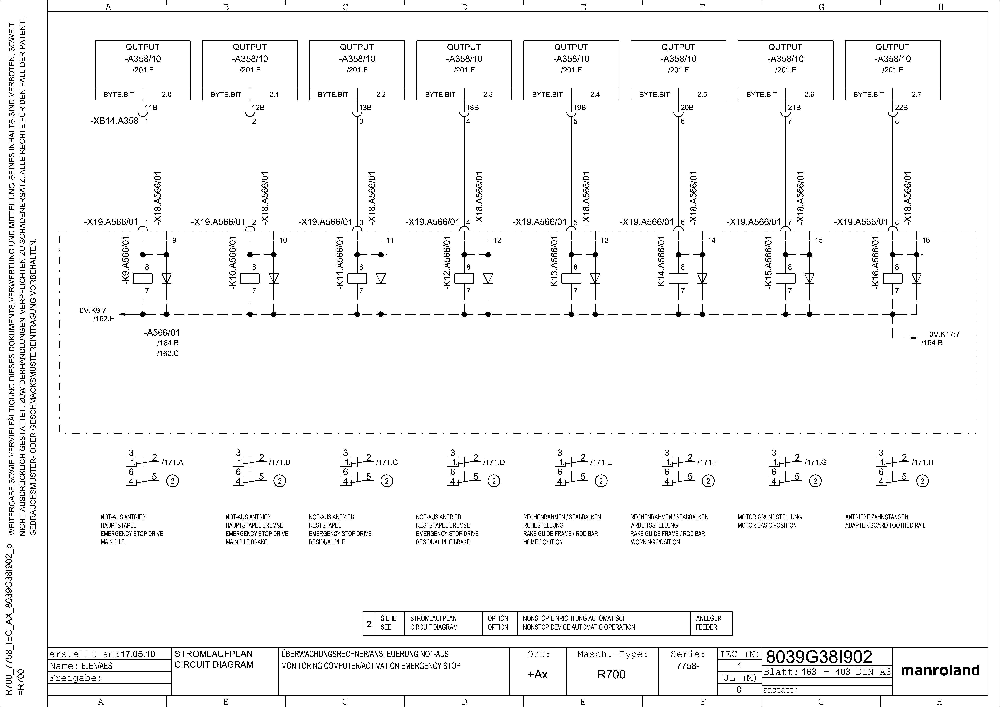

# +Ax — Sheet 163 of 403 — ÜBERWACHUNGSRECHNER/ANSTEUERUNG NOT AUS

**MONITORING COMPUTER/ACTIVATION EMERGENCY STOP**

> Part of the manroland **R700** printing press IEC/UL circuit diagrams.
> Drawing class: **Stromlaufplan / Circuit diagram** (DIN A3).
> Document `+Ax` covers the **Central control console** machine section.

## At a glance

| Field | Value |
|---|---|
| Document | `+Ax`  (8039G38I902) |
| Sheet | **163** of 403 |
| Section (DE) | ÜBERWACHUNGSRECHNER/ANSTEUERUNG NOT AUS |
| Section (EN) | MONITORING COMPUTER/ACTIVATION EMERGENCY STOP |
| Section type | CIRCUIT — Circuit diagram |
| Machine type | `R700` |
| Series | `7758` |
| Created | 17.05.10 |
| Replaces | — |
| Columns used | A, B, C, D, E, F, G, H |
| Path numbers | — |
| Labels on sheet | 223 |
| Cross-refs out | 20 |
| Cross-refs in | 44 |

**Previous:** [+Ax sheet 162](SHEET_0162.md) · **Next:** [+Ax sheet 164](SHEET_0164.md) · **Document TOC:** [_TOC.md](_TOC.md)  (+Ax) · **Master TOC:** [all sheets](../_MASTER_TOC.md)

## Sheet image (300 DPI, exact vector render)



_Rendered directly from the PDF vector layer at 300 DPI (1-bit), no OCR and no resampling. Use it to confirm anything ambiguous in the text below._

## Cross-references on this sheet

Each entry is a wire leaving this sheet. The printed token is `/sheet.column`; the link resolves to that sheet inside the same document.

| Ref | Target sheet | Col | Path | Destination on target | Target section | From col |
|---|---|---|---|---|---|---|
| `/201.F` | [+Ax sheet 201](SHEET_0201.md) | F | — | — | REFERENZMODUL | A |
| `/201.F` | [+Ax sheet 201](SHEET_0201.md) | F | — | — | REFERENZMODUL | B |
| `/201.F` | [+Ax sheet 201](SHEET_0201.md) | F | — | — | REFERENZMODUL | C |
| `/201.F` | [+Ax sheet 201](SHEET_0201.md) | F | — | — | REFERENZMODUL | D |
| `/201.F` | [+Ax sheet 201](SHEET_0201.md) | F | — | — | REFERENZMODUL | E |
| `/201.F` | [+Ax sheet 201](SHEET_0201.md) | F | — | — | REFERENZMODUL | F |
| `/201.F` | [+Ax sheet 201](SHEET_0201.md) | F | — | — | REFERENZMODUL | G |
| `/201.F` | [+Ax sheet 201](SHEET_0201.md) | F | — | — | REFERENZMODUL | H |
| `/162.H` | [+Ax sheet 162](SHEET_0162.md) | H | — | 0V.K9:7 | ÜBERWACHUNGSRECHNER/ANSTEUERUNG NOT AUS | A |
| `/164.B` | [+Ax sheet 164](SHEET_0164.md) | B | — | — | ÜBERWACHUNGSRECHNER/ANSTEUERUNG NOT AUS | H |
| `/164.B` | [+Ax sheet 164](SHEET_0164.md) | B | — | — | ÜBERWACHUNGSRECHNER/ANSTEUERUNG NOT AUS | B |
| `/162.C` | [+Ax sheet 162](SHEET_0162.md) | C | — | — | ÜBERWACHUNGSRECHNER/ANSTEUERUNG NOT AUS | B |
| `/171.A` | [+Ax sheet 171](SHEET_0171.md) | A | — | — | ÜBERWACHUNGSRECHNER/RÜCKMELDUNG NOT AUS | B |
| `/171.B` | [+Ax sheet 171](SHEET_0171.md) | B | — | — | ÜBERWACHUNGSRECHNER/RÜCKMELDUNG NOT AUS | B |
| `/171.E` | [+Ax sheet 171](SHEET_0171.md) | E | — | — | ÜBERWACHUNGSRECHNER/RÜCKMELDUNG NOT AUS | E |
| `/171.F` | [+Ax sheet 171](SHEET_0171.md) | F | — | — | ÜBERWACHUNGSRECHNER/RÜCKMELDUNG NOT AUS | F |
| `/171.G` | [+Ax sheet 171](SHEET_0171.md) | G | — | — | ÜBERWACHUNGSRECHNER/RÜCKMELDUNG NOT AUS | G |
| `/171.C` | [+Ax sheet 171](SHEET_0171.md) | C | — | — | ÜBERWACHUNGSRECHNER/RÜCKMELDUNG NOT AUS | C |
| `/171.D` | [+Ax sheet 171](SHEET_0171.md) | D | — | — | ÜBERWACHUNGSRECHNER/RÜCKMELDUNG NOT AUS | D |
| `/171.H` | [+Ax sheet 171](SHEET_0171.md) | H | — | — | ÜBERWACHUNGSRECHNER/RÜCKMELDUNG NOT AUS | H |

### Incoming references (sheets that point here)

Every other sheet that sends a wire to this one. `Back-ref` is the token printed on *that* sheet; `Path` is its line number.

| From sheet | Cols | Back-ref | Path | Refs | What continues there |
|---|---|---|---|---|---|
| [+Ax#162](SHEET_0162.md) | C, H | `/162.C`, `/162.H` | — | 2 | — |
| [+Ax#164](SHEET_0164.md) | A, B | `/164.A`, `/164.B` | — | 2 | 0V.K17:7 |
| [+Ax#171](SHEET_0171.md) | A, B, C, D, E, F, G | `/171.A`, `/171.B`, `/171.C`, `/171.D`, `/171.E`, `/171.F`, `/171.G` | — | 8 | — |
| [+Ax#201](SHEET_0201.md) | F | `/201.F` | — | 8 | — |
| [+Ax#251](SHEET_0251.md) | D, E | `/251.D`, `/251.E` | — | 8 | — |
| [+Ax#257](SHEET_0257.md) | E | `/257.E` | — | 8 | — |
| [+Ax#259](SHEET_0259.md) | D, E | `/259.D`, `/259.E` | — | 8 | — |


## Devices on this sheet

| Tag | Class | Class meaning (IEC) | Col | Sub | Terminal | Sign |
|---|---|---|---|---|---|---|
| `A358/10` | A | Baugruppe / assembly, module, PC board | A | 10 | — | — |
| `A358/10` | A | Baugruppe / assembly, module, PC board | B | 10 | — | — |
| `A358/10` | A | Baugruppe / assembly, module, PC board | C | 10 | — | — |
| `A358/10` | A | Baugruppe / assembly, module, PC board | D | 10 | — | — |
| `A358/10` | A | Baugruppe / assembly, module, PC board | E | 10 | — | — |
| `A358/10` | A | Baugruppe / assembly, module, PC board | F | 10 | — | — |
| `A358/10` | A | Baugruppe / assembly, module, PC board | G | 10 | — | — |
| `A358/10` | A | Baugruppe / assembly, module, PC board | H | 10 | — | — |
| `A566/01` | A | Baugruppe / assembly, module, PC board | A | 01 | — | — |
| `2.0` | — | cross-device reference | A | — | — | — |
| `2.1` | — | cross-device reference | B | — | — | — |
| `2.2` | — | cross-device reference | C | — | — | — |
| `2.3` | — | cross-device reference | D | — | — | — |
| `2.4` | — | cross-device reference | E | — | — | — |
| `2.5` | — | cross-device reference | F | — | — | — |
| `2.6` | — | cross-device reference | G | — | — | — |
| `2.7` | — | cross-device reference | H | — | — | — |
| `XB14.A358` | — | cross-device reference | A | — | — | — |

## Potentials / nets

| Potential | Count | Columns | Attached devices | Terminals |
|---|---|---|---|---|
| `0V` | 2 | A, H | `K17`, `K9` | `7` |


A potential such as `L24+/4` or `M24+` is a named supply/return rail; every place it appears on this sheet is electrically common.

## Wire-end annotations (grouped as printed)

A wire that continues elsewhere is annotated with a small cluster: the destination description, the path/line number `#NN`, and the `/sheet.column` cross reference. Each row below is one such cluster exactly as it is grouped on the drawing.

| Col | Y | Path | Cross-ref | Text on the wire |
|---|---|---|---|---|
| A | 51.6 | — | — | `QUTPUT` |
| B | 51.6 | — | — | `QUTPUT` |
| C | 51.6 | — | — | `QUTPUT` |
| D | 51.6 | — | — | `QUTPUT` |
| E | 51.6 | — | — | `QUTPUT` |
| F | 51.6 | — | — | `QUTPUT` |
| G | 51.6 | — | — | `QUTPUT` |
| H | 51.6 | — | — | `QUTPUT` |
| A | 65.5 | — | — | `A358/10` |
| B | 65.5 | — | — | `A358/10` |
| C | 65.5 | — | — | `A358/10` |
| D | 65.5 | — | — | `A358/10` |
| E | 65.5 | — | — | `A358/10` |
| F | 65.5 | — | — | `A358/10` |
| G | 65.5 | — | — | `A358/10` |
| H | 65.5 | — | — | `A358/10` |
| A | 79.3 | — | `/201.F` | — |
| B | 79.3 | — | `/201.F` | — |
| C | 79.3 | — | `/201.F` | — |
| D | 79.3 | — | `/201.F` | — |
| E | 79.3 | — | `/201.F` | — |
| F | 79.3 | — | `/201.F` | — |
| G | 79.3 | — | `/201.F` | — |
| H | 79.3 | — | `/201.F` | — |
| A | 108.9 | — | — | `BYTE.BIT 2.0` |
| B | 108.9 | — | — | `BYTE.BIT 2.1` |
| C | 108.9 | — | — | `BYTE.BIT 2.2` |
| D | 108.9 | — | — | `BYTE.BIT 2.3` |
| E | 108.9 | — | — | `BYTE.BIT 2.4` |
| F | 108.9 | — | — | `BYTE.BIT 2.5` |
| G | 108.9 | — | — | `BYTE.BIT 2.6` |
| H | 108.9 | — | — | `BYTE.BIT 2.7` |
| A | 124.3 | — | — | `11B` |
| B | 124.3 | — | — | `12B` |
| C | 124.3 | — | — | `13B` |
| D | 124.3 | — | — | `18B` |
| E | 124.3 | — | — | `19B` |
| F | 124.3 | — | — | `20B` |
| G | 124.3 | — | — | `21B` |
| H | 124.3 | — | — | `22B` |
| D | 139.2 | — | — | `XB14.A358 1 2 3 4 5 6 7 8` |
| A | 203.2 | — | — | `X18.A566/01` |
| B | 203.2 | — | — | `X18.A566/01` |
| C | 203.2 | — | — | `X18.A566/01` |
| D | 203.2 | — | — | `X18.A566/01` |
| E | 203.2 | — | — | `X18.A566/01` |
| F | 203.2 | — | — | `X18.A566/01` |
| G | 203.2 | — | — | `X18.A566/01` |
| H | 203.2 | — | — | `X18.A566/01` |
| D | 259.7 | — | — | `X19.A566/01 1 X19.A566/01 2 X19.A566/01 3 X19.A566/01 4 X19.A566/01 5 X19.A566/01 6 X19.A566/01 7 X19.A566/01 8` |
| A | 280.1 | — | — | `K9.A566/01` |
| B | 280.1 | — | — | `K10.A566/01` |
| C | 280.1 | — | — | `K11.A566/01` |
| D | 280.1 | — | — | `K12.A566/01` |
| E | 280.1 | — | — | `K13.A566/01` |
| F | 280.1 | — | — | `K14.A566/01` |
| G | 280.1 | — | — | `K15.A566/01` |
| G | 280.1 | — | — | `K16.A566/01` |
| E | 282.4 | — | — | `9 10 11 12 13 14 15 16` |
| A | 314.3 | — | — | `8` |
| B | 314.3 | — | — | `8` |
| C | 314.3 | — | — | `8` |
| D | 314.3 | — | — | `8` |
| E | 314.3 | — | — | `8` |
| F | 314.3 | — | — | `8` |
| G | 314.3 | — | — | `8` |
| H | 314.3 | — | — | `8` |
| A | 342.6 | — | — | `7` |
| B | 342.6 | — | — | `7` |
| C | 342.6 | — | — | `7` |
| D | 342.6 | — | — | `7` |
| E | 342.6 | — | — | `7` |
| F | 342.6 | — | — | `7` |
| G | 342.6 | — | — | `7` |
| H | 342.6 | — | — | `7` |
| A | 365.9 | — | `/162.H` | `0V.K9:7` |
| A | 391.5 | — | — | `A566/01` |
| H | 394.3 | — | — | `0V.K17:7` |
| H | 404.2 | — | `/164.B` | — |
| B | 404.6 | — | `/164.B`, `/162.C` | — |
| A | 534.6 | — | — | `3 6 4 1` |
| B | 534.6 | — | — | `3 6 4 1` |
| C | 534.6 | — | — | `3 6 4 1` |
| D | 534.6 | — | — | `3 6 4 1` |
| E | 534.6 | — | — | `3 6 4 1` |
| F | 534.6 | — | — | `3 6 4 1` |
| G | 534.6 | — | — | `3 6 4 1` |
| H | 534.6 | — | — | `3 6 4 1` |
| A | 540.3 | — | — | `2` |
| B | 540.3 | — | — | `2` |
| C | 540.3 | — | — | `2` |
| D | 540.3 | — | — | `2` |
| E | 540.3 | — | — | `2` |
| F | 540.3 | — | — | `2` |
| G | 540.3 | — | — | `2` |
| H | 540.3 | — | — | `2` |
| B | 546.6 | — | `/171.A` | — |
| B | 546.6 | — | `/171.B` | — |
| E | 546.6 | — | `/171.E` | — |
| F | 546.6 | — | `/171.F` | — |
| C | 546.7 | — | `/171.C` | — |
| D | 546.7 | — | `/171.D` | — |
| G | 546.7 | — | `/171.G` | — |
| H | 546.7 | — | `/171.H` | — |
| A | 563.0 | — | — | `5` |
| B | 563.0 | — | — | `5` |
| C | 563.0 | — | — | `5` |
| D | 563.0 | — | — | `5` |
| E | 563.0 | — | — | `5` |
| F | 563.0 | — | — | `5` |
| G | 563.0 | — | — | `5` |
| H | 563.0 | — | — | `5` |
| E | 570.1 | — | — | `2 2 2 2 2 2 2 2` |
| A | 613.0 | — | — | `NOT AUS ANTRIEB HAUPTSTAPEL EMERGENCY STOP DRIVE MAIN PILE` |
| B | 613.0 | — | — | `NOT AUS ANTRIEB HAUPTSTAPEL BREMSE EMERGENCY STOP DRIVE MAIN PILE BRAKE` |
| C | 613.0 | — | — | `NOT AUS ANTRIEB RESTSTAPEL EMERGENCY STOP DRIVE RESIDUAL PILE` |
| D | 613.0 | — | — | `NOT AUS ANTRIEB RESTSTAPEL BREMSE EMERGENCY STOP DRIVE RESIDUAL PILE BRAKE` |
| G | 613.0 | — | — | `MOTOR GRUNDSTELLUNG MOTOR BASIC POSITION` |
| E | 613.1 | — | — | `RECHENRAHMEN / STABBALKEN RUHESTELLUNG RAKE GUIDE FRAME / ROD BAR HOME POSITION` |
| F | 613.1 | — | — | `RECHENRAHMEN / STABBALKEN` |
| H | 613.1 | — | — | `ANTRIEBE ZAHNSTANGEN ADAPTER BOARD TOOTHED RAIL` |
| F | 623.0 | — | — | `RAKE GUIDE FRAME / ROD BAR ARBEITSSTELLUNG` |
| F | 642.9 | — | — | `WORKING POSITION` |
| C | 733.3 | — | — | `2 SIEHE SEE` |
| D | 733.4 | — | — | `STROMLAUFPLAN CIRCUIT DIAGRAM` |
| D | 733.4 | — | — | `OPTION OPTION` |
| E | 733.4 | — | — | `NONSTOP EINRICHTUNG AUTOMATISCH NONSTOP DEVICE AUTOMATIC OPERATION` |
| F | 733.4 | — | — | `FEEDER ANLEGER` |


## Reconstructed tables

This sheet carries tabular content (pin map / terminal assignment / index). The grid below was rebuilt from the drawing's own rule lines, so each row is exactly one physical row of the table.

### Table 1 — 2 data rows × 3 columns (at x=113.4, y=48.2)

| QUTPUT | A358/10 /201.F |  |
|---|---|---|
| `BYTE.BIT` |  | `2.0` |
| `XB14.A358 X19.A566/01 K9.A566/01` | `11B 1 X18.A566/01 1 8 7` | `9` |


### Table 2 — 2 data rows × 3 columns (at x=240.9, y=48.2)

| QUTPUT | A358/10 /201.F |  |
|---|---|---|
| `BYTE.BIT` |  | `2.1` |
| `X19.A566/01 K10.A566/01` | `12B 2 X18.A566/01 2 8 7` | `10` |


### Table 3 — 2 data rows × 3 columns (at x=368.5, y=48.2)

| QUTPUT | A358/10 /201.F |  |
|---|---|---|
| `BYTE.BIT` |  | `2.2` |
| `X19.A566/01 K11.A566/01` | `13B 3 X18.A566/01 3 8 7` | `11` |


### Table 4 — 2 data rows × 3 columns (at x=496.1, y=48.2)

| QUTPUT | A358/10 /201.F |  |
|---|---|---|
| `BYTE.BIT` |  | `2.3` |
| `X19.A566/01 K12.A566/01` | `18B 4 X18.A566/01 4 8 7` | `12` |


### Table 5 — 2 data rows × 3 columns (at x=623.6, y=48.2)

| QUTPUT | A358/10 /201.F |  |
|---|---|---|
| `BYTE.BIT` | `2.4` |  |
| `X19.A566/01 K13.A566/01` | `19B 5 X18.A566/01 5 8 7` | `13` |


### Table 6 — 2 data rows × 3 columns (at x=751.2, y=48.2)

| QUTPUT | A358/10 /201.F |  |
|---|---|---|
| `BYTE.BIT` |  | `2.5` |
| `X19.A566/01 K14.A566/01` | `20B 6 X18.A566/01 6 8 7` | `14` |


### Table 7 — 2 data rows × 3 columns (at x=878.7, y=48.2)

| QUTPUT | A358/10 /201.F |  |
|---|---|---|
| `BYTE.BIT` | `2.6` |  |
| `X19.A566/01 K15.A566/01` | `21B 7 X18.A566/01 7 8 7` | `15` |


### Table 8 — 2 data rows × 3 columns (at x=1006.3, y=48.2)

| QUTPUT | A358/10 /201.F |  |
|---|---|---|
| `BYTE.BIT` |  | `2.7` |
| `X19.A566/01 K16.A566/01` | `22B 8 X18.A566/01 8 8 7` | `16` |


## Notes and free text on this sheet

| Text | Col | Y (pt) |
|---|---|---|
| `11B` | A | 124.3 |
| `QUTPUT` | A | 51.64 |
| `BYTE.BIT` | A | 108.91 |
| `NOT AUS ANTRIEB` | A | 613.04 |
| `HAUPTSTAPEL` | A | 622.99 |
| `EMERGENCY STOP DRIVE` | A | 632.96 |
| `MAIN PILE` | A | 642.96 |
| `12B` | B | 124.3 |
| `QUTPUT` | B | 51.64 |
| `BYTE.BIT` | B | 108.91 |
| `NOT AUS ANTRIEB` | B | 613.04 |
| `HAUPTSTAPEL BREMSE` | B | 623.01 |
| `EMERGENCY STOP DRIVE` | B | 632.96 |
| `MAIN PILE BRAKE` | B | 642.95 |
| `13B` | C | 124.3 |
| `QUTPUT` | C | 51.64 |
| `BYTE.BIT` | C | 108.91 |
| `NOT AUS ANTRIEB` | C | 613.04 |
| `RESTSTAPEL` | C | 622.99 |
| `EMERGENCY STOP DRIVE` | C | 632.96 |
| `RESIDUAL PILE` | C | 642.93 |
| `18B` | D | 124.3 |
| `QUTPUT` | D | 51.64 |
| `BYTE.BIT` | D | 108.91 |
| `NOT AUS ANTRIEB` | D | 613.04 |
| `RESTSTAPEL BREMSE` | D | 623.01 |
| `EMERGENCY STOP DRIVE` | D | 632.96 |
| `RESIDUAL PILE BRAKE` | D | 642.94 |
| `19B` | E | 124.3 |
| `QUTPUT` | E | 51.64 |
| `BYTE.BIT` | E | 108.91 |
| `RECHENRAHMEN / STABBALKEN` | E | 613.07 |
| `RUHESTELLUNG` | E | 622.98 |
| `RAKE GUIDE FRAME / ROD BAR` | E | 632.98 |
| `HOME POSITION` | E | 642.9 |
| `20B` | F | 124.3 |
| `QUTPUT` | F | 51.64 |
| `BYTE.BIT` | F | 108.91 |
| `RECHENRAHMEN / STABBALKEN` | F | 613.07 |
| `ARBEITSSTELLUNG` | F | 623.01 |
| `RAKE GUIDE FRAME / ROD BAR` | F | 632.98 |
| `WORKING POSITION` | F | 642.88 |
| `21B` | G | 124.3 |
| `QUTPUT` | G | 51.64 |
| `MOTOR GRUNDSTELLUNG` | G | 613.04 |
| `MOTOR BASIC POSITION` | G | 623.01 |
| `22B` | H | 124.3 |
| `QUTPUT` | H | 51.64 |
| `BYTE.BIT` | G | 108.91 |
| `ANTRIEBE ZAHNSTANGEN` | G | 613.06 |
| `ADAPTER BOARD TOOTHED RAIL` | H | 623 |
| `X19.A566/01` | A | 259.68 |
| `X19.A566/01` | B | 259.68 |
| `X19.A566/01` | C | 259.68 |
| `X19.A566/01` | D | 259.68 |
| `X19.A566/01` | E | 259.68 |
| `X19.A566/01` | F | 259.68 |
| `X19.A566/01` | G | 259.68 |
| `K9.A566/01` | A | 280.07 |
| `K10.A566/01` | B | 280.06 |
| `K11.A566/01` | C | 280.06 |
| `K12.A566/01` | D | 280.06 |
| `K13.A566/01` | E | 280.06 |
| `K14.A566/01` | F | 280.06 |
| `K15.A566/01` | G | 280.06 |
| `K16.A566/01` | G | 280.06 |
| `X18.A566/01` | A | 203.24 |
| `X18.A566/01` | B | 203.24 |
| `X18.A566/01` | C | 203.24 |
| `X18.A566/01` | D | 203.24 |
| `X18.A566/01` | E | 203.24 |
| `X18.A566/01` | F | 203.24 |
| `X18.A566/01` | G | 203.24 |
| `X18.A566/01` | H | 203.24 |
| `SIEHE` | C | 733.33 |
| `SEE` | C | 743.93 |
| `STROMLAUFPLAN` | D | 733.39 |
| `CIRCUIT DIAGRAM` | D | 744.03 |
| `OPTION` | D | 733.35 |
| `NONSTOP EINRICHTUNG AUTOMATISCH` | E | 733.39 |
| `NONSTOP DEVICE AUTOMATIC OPERATION` | E | 744.01 |
| `ANLEGER` | F | 733.39 |
| `FEEDER` | F | 743.99 |

## Complete label inventory (exact text from the drawing)

Every text object inside the drawing area of this sheet, in DIN reading order (column A→H, then top→bottom). This is the authoritative list: if a string is not here it is not printed on this sheet.

| Col | Y | X | Dir | Type | Text |
|---|---|---|---|---|---|
| A | 51.6 | 149.8 | → | text | `QUTPUT` |
| A | 65.5 | 148.7 | → | device tag | `A358/10` |
| A | 79.3 | 157.7 | → | cross-reference | `/201.F` |
| A | 108.9 | 123.3 | → | text | `BYTE.BIT` |
| A | 108.9 | 192.8 | → | device ref | `2.0` |
| A | 124.3 | 172.1 | → | text | `11B` |
| A | 139.2 | 107.7 | → | device ref | `XB14.A358` |
| A | 140.6 | 172.1 | → | number | `1` |
| A | 203.2 | 183.1 | ↕ | text | `X18.A566/01` |
| A | 259.7 | 100.1 | → | text | `X19.A566/01` |
| A | 261.1 | 172.1 | → | number | `1` |
| A | 280.1 | 144.9 | ↕ | text | `K9.A566/01` |
| A | 314.3 | 172.6 | → | number | `8` |
| A | 342.6 | 172.6 | → | number | `7` |
| A | 365.9 | 95.0 | → | potential | `0V.K9:7` |
| A | 375.9 | 111.1 | → | cross-reference | `/162.H` |
| A | 391.5 | 171.5 | → | device tag | `A566/01` |
| A | 534.6 | 153.4 | → | number | `3` |
| A | 540.3 | 181.1 | → | number | `2` |
| A | 545.9 | 154.8 | → | number | `1` |
| A | 557.3 | 153.4 | → | number | `6` |
| A | 562.9 | 180.9 | → | number | `5` |
| A | 568.6 | 153.4 | → | number | `4` |
| A | 613.0 | 119.9 | → | text | `NOT AUS ANTRIEB` |
| A | 623.0 | 119.9 | → | text | `HAUPTSTAPEL` |
| A | 633.0 | 119.9 | → | text | `EMERGENCY STOP DRIVE` |
| A | 643.0 | 120.2 | → | text | `MAIN PILE` |
| B | 51.6 | 277.4 | → | text | `QUTPUT` |
| B | 65.5 | 276.2 | → | device tag | `A358/10` |
| B | 79.3 | 285.3 | → | cross-reference | `/201.F` |
| B | 108.9 | 250.9 | → | text | `BYTE.BIT` |
| B | 108.9 | 320.9 | → | device ref | `2.1` |
| B | 124.3 | 299.6 | → | text | `12B` |
| B | 140.6 | 300.2 | → | number | `2` |
| B | 203.2 | 310.7 | ↕ | text | `X18.A566/01` |
| B | 259.7 | 227.6 | → | text | `X19.A566/01` |
| B | 261.1 | 300.2 | → | number | `2` |
| B | 280.1 | 272.4 | ↕ | text | `K10.A566/01` |
| B | 282.4 | 205.2 | → | number | `9` |
| B | 282.4 | 332.2 | → | number | `10` |
| B | 314.3 | 300.2 | → | number | `8` |
| B | 342.6 | 300.2 | → | number | `7` |
| B | 404.6 | 187.4 | → | cross-reference | `/164.B` |
| B | 417.0 | 187.1 | → | cross-reference | `/162.C` |
| B | 534.6 | 280.9 | → | number | `3` |
| B | 540.3 | 308.7 | → | number | `2` |
| B | 545.9 | 282.3 | → | number | `1` |
| B | 546.6 | 192.8 | → | cross-reference | `/171.A` |
| B | 546.6 | 320.3 | → | cross-reference | `/171.B` |
| B | 557.3 | 280.9 | → | number | `6` |
| B | 562.9 | 308.4 | → | number | `5` |
| B | 568.6 | 280.9 | → | number | `4` |
| B | 570.1 | 203.5 | → | number | `2` |
| B | 570.1 | 331.1 | → | number | `2` |
| B | 613.0 | 268.7 | → | text | `NOT AUS ANTRIEB` |
| B | 623.0 | 268.7 | → | text | `HAUPTSTAPEL BREMSE` |
| B | 633.0 | 268.7 | → | text | `EMERGENCY STOP DRIVE` |
| B | 643.0 | 269.0 | → | text | `MAIN PILE BRAKE` |
| C | 51.6 | 404.9 | → | text | `QUTPUT` |
| C | 65.5 | 403.8 | → | device tag | `A358/10` |
| C | 79.3 | 412.9 | → | cross-reference | `/201.F` |
| C | 108.9 | 378.4 | → | text | `BYTE.BIT` |
| C | 108.9 | 448.0 | → | device ref | `2.2` |
| C | 124.3 | 427.2 | → | text | `13B` |
| C | 140.6 | 427.7 | → | number | `3` |
| C | 203.2 | 438.3 | ↕ | text | `X18.A566/01` |
| C | 259.7 | 355.2 | → | text | `X19.A566/01` |
| C | 261.1 | 427.7 | → | number | `3` |
| C | 280.1 | 400.0 | ↕ | text | `K11.A566/01` |
| C | 282.4 | 459.8 | → | number | `11` |
| C | 314.3 | 427.7 | → | number | `8` |
| C | 342.6 | 427.7 | → | number | `7` |
| C | 534.6 | 408.5 | → | number | `3` |
| C | 540.3 | 436.3 | → | number | `2` |
| C | 545.9 | 409.9 | → | number | `1` |
| C | 546.7 | 447.9 | → | cross-reference | `/171.C` |
| C | 557.3 | 408.5 | → | number | `6` |
| C | 562.9 | 436.0 | → | number | `5` |
| C | 568.6 | 408.5 | → | number | `4` |
| C | 570.1 | 458.6 | → | number | `2` |
| C | 613.0 | 367.9 | → | text | `NOT AUS ANTRIEB` |
| C | 623.0 | 367.9 | → | text | `RESTSTAPEL` |
| C | 633.0 | 367.9 | → | text | `EMERGENCY STOP DRIVE` |
| C | 642.9 | 367.9 | → | text | `RESIDUAL PILE` |
| C | 733.3 | 453.3 | → | text | `SIEHE` |
| C | 738.7 | 436.5 | → | number | `2` |
| C | 743.9 | 453.3 | → | text | `SEE` |
| D | 51.6 | 532.5 | → | text | `QUTPUT` |
| D | 65.5 | 531.4 | → | device tag | `A358/10` |
| D | 79.3 | 540.4 | → | cross-reference | `/201.F` |
| D | 108.9 | 506.0 | → | text | `BYTE.BIT` |
| D | 108.9 | 575.4 | → | device ref | `2.3` |
| D | 124.3 | 554.7 | → | text | `18B` |
| D | 140.6 | 555.3 | → | number | `4` |
| D | 203.2 | 565.8 | ↕ | text | `X18.A566/01` |
| D | 259.7 | 482.7 | → | text | `X19.A566/01` |
| D | 261.1 | 555.3 | → | number | `4` |
| D | 280.1 | 527.5 | ↕ | text | `K12.A566/01` |
| D | 282.4 | 587.3 | → | number | `12` |
| D | 314.3 | 555.3 | → | number | `8` |
| D | 342.6 | 555.3 | → | number | `7` |
| D | 534.6 | 536.0 | → | number | `3` |
| D | 540.3 | 563.8 | → | number | `2` |
| D | 545.9 | 537.4 | → | number | `1` |
| D | 546.7 | 575.4 | → | cross-reference | `/171.D` |
| D | 557.3 | 536.0 | → | number | `6` |
| D | 562.9 | 563.5 | → | number | `5` |
| D | 568.6 | 536.0 | → | number | `4` |
| D | 570.1 | 586.2 | → | number | `2` |
| D | 613.0 | 495.5 | → | text | `NOT AUS ANTRIEB` |
| D | 623.0 | 495.5 | → | text | `RESTSTAPEL BREMSE` |
| D | 633.0 | 495.5 | → | text | `EMERGENCY STOP DRIVE` |
| D | 642.9 | 495.5 | → | text | `RESIDUAL PILE BRAKE` |
| D | 733.4 | 488.7 | → | text | `STROMLAUFPLAN` |
| D | 733.4 | 580.8 | → | text | `OPTION` |
| D | 744.0 | 488.7 | → | text | `CIRCUIT DIAGRAM` |
| D | 744.0 | 580.8 | → | text | `OPTION` |
| E | 51.6 | 660.0 | → | text | `QUTPUT` |
| E | 65.5 | 658.9 | → | device tag | `A358/10` |
| E | 79.3 | 668.0 | → | cross-reference | `/201.F` |
| E | 108.9 | 633.5 | → | text | `BYTE.BIT` |
| E | 108.9 | 703.0 | → | device ref | `2.4` |
| E | 124.3 | 682.3 | → | text | `19B` |
| E | 140.6 | 682.9 | → | number | `5` |
| E | 203.2 | 693.4 | ↕ | text | `X18.A566/01` |
| E | 259.7 | 610.3 | → | text | `X19.A566/01` |
| E | 261.1 | 682.9 | → | number | `5` |
| E | 280.1 | 655.1 | ↕ | text | `K13.A566/01` |
| E | 282.4 | 714.9 | → | number | `13` |
| E | 314.3 | 682.9 | → | number | `8` |
| E | 342.6 | 682.9 | → | number | `7` |
| E | 534.6 | 663.6 | → | number | `3` |
| E | 540.3 | 691.4 | → | number | `2` |
| E | 545.9 | 665.0 | → | number | `1` |
| E | 546.6 | 703.0 | → | cross-reference | `/171.E` |
| E | 557.3 | 663.6 | → | number | `6` |
| E | 562.9 | 691.1 | → | number | `5` |
| E | 568.6 | 663.6 | → | number | `4` |
| E | 570.1 | 713.8 | → | number | `2` |
| E | 613.1 | 623.1 | → | text | `RECHENRAHMEN / STABBALKEN` |
| E | 623.0 | 623.1 | → | text | `RUHESTELLUNG` |
| E | 633.0 | 623.1 | → | text | `RAKE GUIDE FRAME / ROD BAR` |
| E | 642.9 | 623.1 | → | text | `HOME POSITION` |
| E | 733.4 | 622.8 | → | text | `NONSTOP EINRICHTUNG AUTOMATISCH` |
| E | 744.0 | 622.8 | → | text | `NONSTOP DEVICE AUTOMATIC OPERATION` |
| F | 51.6 | 787.6 | → | text | `QUTPUT` |
| F | 65.5 | 786.5 | → | device tag | `A358/10` |
| F | 79.3 | 795.5 | → | cross-reference | `/201.F` |
| F | 108.9 | 761.1 | → | text | `BYTE.BIT` |
| F | 108.9 | 830.6 | → | device ref | `2.5` |
| F | 108.9 | 888.7 | → | text | `BYTE.BIT` |
| F | 124.3 | 810.4 | → | text | `20B` |
| F | 140.6 | 810.4 | → | number | `6` |
| F | 203.2 | 820.9 | ↕ | text | `X18.A566/01` |
| F | 259.7 | 737.9 | → | text | `X19.A566/01` |
| F | 259.7 | 865.4 | → | text | `X19.A566/01` |
| F | 261.1 | 810.4 | → | number | `6` |
| F | 280.1 | 782.7 | ↕ | text | `K14.A566/01` |
| F | 282.4 | 842.5 | → | number | `14` |
| F | 314.3 | 810.4 | → | number | `8` |
| F | 342.6 | 810.4 | → | number | `7` |
| F | 534.6 | 791.1 | → | number | `3` |
| F | 540.3 | 818.9 | → | number | `2` |
| F | 545.9 | 792.6 | → | number | `1` |
| F | 546.7 | 830.6 | → | cross-reference | `/171.F` |
| F | 557.3 | 791.1 | → | number | `6` |
| F | 562.9 | 818.6 | → | number | `5` |
| F | 568.6 | 791.1 | → | number | `4` |
| F | 570.1 | 841.3 | → | number | `2` |
| F | 613.1 | 750.6 | → | text | `RECHENRAHMEN / STABBALKEN` |
| F | 623.0 | 751.5 | → | text | `ARBEITSSTELLUNG` |
| F | 633.0 | 750.6 | → | text | `RAKE GUIDE FRAME / ROD BAR` |
| F | 642.9 | 751.2 | → | text | `WORKING POSITION` |
| F | 733.4 | 829.1 | → | text | `ANLEGER` |
| F | 744.0 | 828.3 | → | text | `FEEDER` |
| G | 51.6 | 915.2 | → | text | `QUTPUT` |
| G | 65.5 | 914.0 | → | device tag | `A358/10` |
| G | 79.3 | 923.1 | → | cross-reference | `/201.F` |
| G | 108.9 | 958.1 | → | device ref | `2.6` |
| G | 108.9 | 1016.2 | → | text | `BYTE.BIT` |
| G | 124.3 | 938.0 | → | text | `21B` |
| G | 140.6 | 938.0 | → | number | `7` |
| G | 203.2 | 948.5 | ↕ | text | `X18.A566/01` |
| G | 259.7 | 993.0 | → | text | `X19.A566/01` |
| G | 261.1 | 938.0 | → | number | `7` |
| G | 280.1 | 910.2 | ↕ | text | `K15.A566/01` |
| G | 280.1 | 1037.8 | ↕ | text | `K16.A566/01` |
| G | 282.4 | 970.0 | → | number | `15` |
| G | 314.3 | 938.0 | → | number | `8` |
| G | 342.6 | 938.0 | → | number | `7` |
| G | 534.6 | 918.7 | → | number | `3` |
| G | 540.3 | 946.5 | → | number | `2` |
| G | 545.9 | 920.1 | → | number | `1` |
| G | 546.7 | 958.1 | → | cross-reference | `/171.G` |
| G | 557.3 | 918.7 | → | number | `6` |
| G | 562.9 | 946.2 | → | number | `5` |
| G | 568.6 | 918.7 | → | number | `4` |
| G | 570.1 | 968.9 | → | number | `2` |
| G | 613.0 | 878.5 | → | text | `MOTOR GRUNDSTELLUNG` |
| G | 613.1 | 1006.6 | → | text | `ANTRIEBE ZAHNSTANGEN` |
| G | 623.0 | 878.5 | → | text | `MOTOR BASIC POSITION` |
| H | 51.6 | 1042.7 | → | text | `QUTPUT` |
| H | 65.5 | 1041.6 | → | device tag | `A358/10` |
| H | 79.3 | 1050.7 | → | cross-reference | `/201.F` |
| H | 108.9 | 1085.7 | → | device ref | `2.7` |
| H | 124.3 | 1065.5 | → | text | `22B` |
| H | 140.6 | 1065.5 | → | number | `8` |
| H | 203.2 | 1076.1 | ↕ | text | `X18.A566/01` |
| H | 261.1 | 1065.5 | → | number | `8` |
| H | 282.4 | 1097.6 | → | number | `16` |
| H | 314.3 | 1065.5 | → | number | `8` |
| H | 342.6 | 1065.5 | → | number | `7` |
| H | 394.3 | 1106.6 | → | potential | `0V.K17:7` |
| H | 404.2 | 1097.0 | → | cross-reference | `/164.B` |
| H | 534.6 | 1046.3 | → | number | `3` |
| H | 540.3 | 1074.0 | → | number | `2` |
| H | 545.9 | 1047.7 | → | number | `1` |
| H | 546.7 | 1085.7 | → | cross-reference | `/171.H` |
| H | 557.3 | 1046.3 | → | number | `6` |
| H | 562.9 | 1073.8 | → | number | `5` |
| H | 568.6 | 1046.3 | → | number | `4` |
| H | 570.1 | 1096.4 | → | number | `2` |
| H | 623.0 | 1006.6 | → | text | `ADAPTER BOARD TOOTHED RAIL` |

## Reading-order text block

The same content as a plain block, grouped by DIN column — convenient to paste or to match against a visual description.

```text
=== Column A ===
  51.6  149.8  text         QUTPUT
  65.5  148.7  devtag       A358/10
  79.3  157.7  xref         /201.F
 108.9  123.3  text         BYTE.BIT
 108.9  192.8  devref       2.0
 124.3  172.1  text         11B
 139.2  107.7  devref       XB14.A358
 140.6  172.1  numeric      1
 203.2  183.1  text         X18.A566/01
 259.7  100.1  text         X19.A566/01
 261.1  172.1  numeric      1
 280.1  144.9  text         K9.A566/01
 314.3  172.6  numeric      8
 342.6  172.6  numeric      7
 365.9   95.0  net          0V.K9:7
 375.9  111.1  xref         /162.H
 391.5  171.5  devtag       A566/01
 534.6  153.4  numeric      3
 540.3  181.1  numeric      2
 545.9  154.8  numeric      1
 557.3  153.4  numeric      6
 562.9  180.9  numeric      5
 568.6  153.4  numeric      4
 613.0  119.9  text         NOT AUS ANTRIEB
 623.0  119.9  text         HAUPTSTAPEL
 633.0  119.9  text         EMERGENCY STOP DRIVE
 643.0  120.2  text         MAIN PILE
=== Column B ===
  51.6  277.4  text         QUTPUT
  65.5  276.2  devtag       A358/10
  79.3  285.3  xref         /201.F
 108.9  250.9  text         BYTE.BIT
 108.9  320.9  devref       2.1
 124.3  299.6  text         12B
 140.6  300.2  numeric      2
 203.2  310.7  text         X18.A566/01
 259.7  227.6  text         X19.A566/01
 261.1  300.2  numeric      2
 280.1  272.4  text         K10.A566/01
 282.4  205.2  numeric      9
 282.4  332.2  numeric      10
 314.3  300.2  numeric      8
 342.6  300.2  numeric      7
 404.6  187.4  xref         /164.B
 417.0  187.1  xref         /162.C
 534.6  280.9  numeric      3
 540.3  308.7  numeric      2
 545.9  282.3  numeric      1
 546.6  192.8  xref         /171.A
 546.6  320.3  xref         /171.B
 557.3  280.9  numeric      6
 562.9  308.4  numeric      5
 568.6  280.9  numeric      4
 570.1  203.5  numeric      2
 570.1  331.1  numeric      2
 613.0  268.7  text         NOT AUS ANTRIEB
 623.0  268.7  text         HAUPTSTAPEL BREMSE
 633.0  268.7  text         EMERGENCY STOP DRIVE
 643.0  269.0  text         MAIN PILE BRAKE
=== Column C ===
  51.6  404.9  text         QUTPUT
  65.5  403.8  devtag       A358/10
  79.3  412.9  xref         /201.F
 108.9  378.4  text         BYTE.BIT
 108.9  448.0  devref       2.2
 124.3  427.2  text         13B
 140.6  427.7  numeric      3
 203.2  438.3  text         X18.A566/01
 259.7  355.2  text         X19.A566/01
 261.1  427.7  numeric      3
 280.1  400.0  text         K11.A566/01
 282.4  459.8  numeric      11
 314.3  427.7  numeric      8
 342.6  427.7  numeric      7
 534.6  408.5  numeric      3
 540.3  436.3  numeric      2
 545.9  409.9  numeric      1
 546.7  447.9  xref         /171.C
 557.3  408.5  numeric      6
 562.9  436.0  numeric      5
 568.6  408.5  numeric      4
 570.1  458.6  numeric      2
 613.0  367.9  text         NOT AUS ANTRIEB
 623.0  367.9  text         RESTSTAPEL
 633.0  367.9  text         EMERGENCY STOP DRIVE
 642.9  367.9  text         RESIDUAL PILE
 733.3  453.3  text         SIEHE
 738.7  436.5  numeric      2
 743.9  453.3  text         SEE
=== Column D ===
  51.6  532.5  text         QUTPUT
  65.5  531.4  devtag       A358/10
  79.3  540.4  xref         /201.F
 108.9  506.0  text         BYTE.BIT
 108.9  575.4  devref       2.3
 124.3  554.7  text         18B
 140.6  555.3  numeric      4
 203.2  565.8  text         X18.A566/01
 259.7  482.7  text         X19.A566/01
 261.1  555.3  numeric      4
 280.1  527.5  text         K12.A566/01
 282.4  587.3  numeric      12
 314.3  555.3  numeric      8
 342.6  555.3  numeric      7
 534.6  536.0  numeric      3
 540.3  563.8  numeric      2
 545.9  537.4  numeric      1
 546.7  575.4  xref         /171.D
 557.3  536.0  numeric      6
 562.9  563.5  numeric      5
 568.6  536.0  numeric      4
 570.1  586.2  numeric      2
 613.0  495.5  text         NOT AUS ANTRIEB
 623.0  495.5  text         RESTSTAPEL BREMSE
 633.0  495.5  text         EMERGENCY STOP DRIVE
 642.9  495.5  text         RESIDUAL PILE BRAKE
 733.4  488.7  text         STROMLAUFPLAN
 733.4  580.8  text         OPTION
 744.0  488.7  text         CIRCUIT DIAGRAM
 744.0  580.8  text         OPTION
=== Column E ===
  51.6  660.0  text         QUTPUT
  65.5  658.9  devtag       A358/10
  79.3  668.0  xref         /201.F
 108.9  633.5  text         BYTE.BIT
 108.9  703.0  devref       2.4
 124.3  682.3  text         19B
 140.6  682.9  numeric      5
 203.2  693.4  text         X18.A566/01
 259.7  610.3  text         X19.A566/01
 261.1  682.9  numeric      5
 280.1  655.1  text         K13.A566/01
 282.4  714.9  numeric      13
 314.3  682.9  numeric      8
 342.6  682.9  numeric      7
 534.6  663.6  numeric      3
 540.3  691.4  numeric      2
 545.9  665.0  numeric      1
 546.6  703.0  xref         /171.E
 557.3  663.6  numeric      6
 562.9  691.1  numeric      5
 568.6  663.6  numeric      4
 570.1  713.8  numeric      2
 613.1  623.1  text         RECHENRAHMEN / STABBALKEN
 623.0  623.1  text         RUHESTELLUNG
 633.0  623.1  text         RAKE GUIDE FRAME / ROD BAR
 642.9  623.1  text         HOME POSITION
 733.4  622.8  text         NONSTOP EINRICHTUNG AUTOMATISCH
 744.0  622.8  text         NONSTOP DEVICE AUTOMATIC OPERATION
=== Column F ===
  51.6  787.6  text         QUTPUT
  65.5  786.5  devtag       A358/10
  79.3  795.5  xref         /201.F
 108.9  761.1  text         BYTE.BIT
 108.9  830.6  devref       2.5
 108.9  888.7  text         BYTE.BIT
 124.3  810.4  text         20B
 140.6  810.4  numeric      6
 203.2  820.9  text         X18.A566/01
 259.7  737.9  text         X19.A566/01
 259.7  865.4  text         X19.A566/01
 261.1  810.4  numeric      6
 280.1  782.7  text         K14.A566/01
 282.4  842.5  numeric      14
 314.3  810.4  numeric      8
 342.6  810.4  numeric      7
 534.6  791.1  numeric      3
 540.3  818.9  numeric      2
 545.9  792.6  numeric      1
 546.7  830.6  xref         /171.F
 557.3  791.1  numeric      6
 562.9  818.6  numeric      5
 568.6  791.1  numeric      4
 570.1  841.3  numeric      2
 613.1  750.6  text         RECHENRAHMEN / STABBALKEN
 623.0  751.5  text         ARBEITSSTELLUNG
 633.0  750.6  text         RAKE GUIDE FRAME / ROD BAR
 642.9  751.2  text         WORKING POSITION
 733.4  829.1  text         ANLEGER
 744.0  828.3  text         FEEDER
=== Column G ===
  51.6  915.2  text         QUTPUT
  65.5  914.0  devtag       A358/10
  79.3  923.1  xref         /201.F
 108.9  958.1  devref       2.6
 108.9 1016.2  text         BYTE.BIT
 124.3  938.0  text         21B
 140.6  938.0  numeric      7
 203.2  948.5  text         X18.A566/01
 259.7  993.0  text         X19.A566/01
 261.1  938.0  numeric      7
 280.1  910.2  text         K15.A566/01
 280.1 1037.8  text         K16.A566/01
 282.4  970.0  numeric      15
 314.3  938.0  numeric      8
 342.6  938.0  numeric      7
 534.6  918.7  numeric      3
 540.3  946.5  numeric      2
 545.9  920.1  numeric      1
 546.7  958.1  xref         /171.G
 557.3  918.7  numeric      6
 562.9  946.2  numeric      5
 568.6  918.7  numeric      4
 570.1  968.9  numeric      2
 613.0  878.5  text         MOTOR GRUNDSTELLUNG
 613.1 1006.6  text         ANTRIEBE ZAHNSTANGEN
 623.0  878.5  text         MOTOR BASIC POSITION
=== Column H ===
  51.6 1042.7  text         QUTPUT
  65.5 1041.6  devtag       A358/10
  79.3 1050.7  xref         /201.F
 108.9 1085.7  devref       2.7
 124.3 1065.5  text         22B
 140.6 1065.5  numeric      8
 203.2 1076.1  text         X18.A566/01
 261.1 1065.5  numeric      8
 282.4 1097.6  numeric      16
 314.3 1065.5  numeric      8
 342.6 1065.5  numeric      7
 394.3 1106.6  net          0V.K17:7
 404.2 1097.0  xref         /164.B
 534.6 1046.3  numeric      3
 540.3 1074.0  numeric      2
 545.9 1047.7  numeric      1
 546.7 1085.7  xref         /171.H
 557.3 1046.3  numeric      6
 562.9 1073.8  numeric      5
 568.6 1046.3  numeric      4
 570.1 1096.4  numeric      2
 623.0 1006.6  text         ADAPTER BOARD TOOTHED RAIL
```

---
_Generated from the PDF vector text layer; no OCR. Source: `R700_7758_IEC_AX_8039G38I902_p`, sheet 163._
