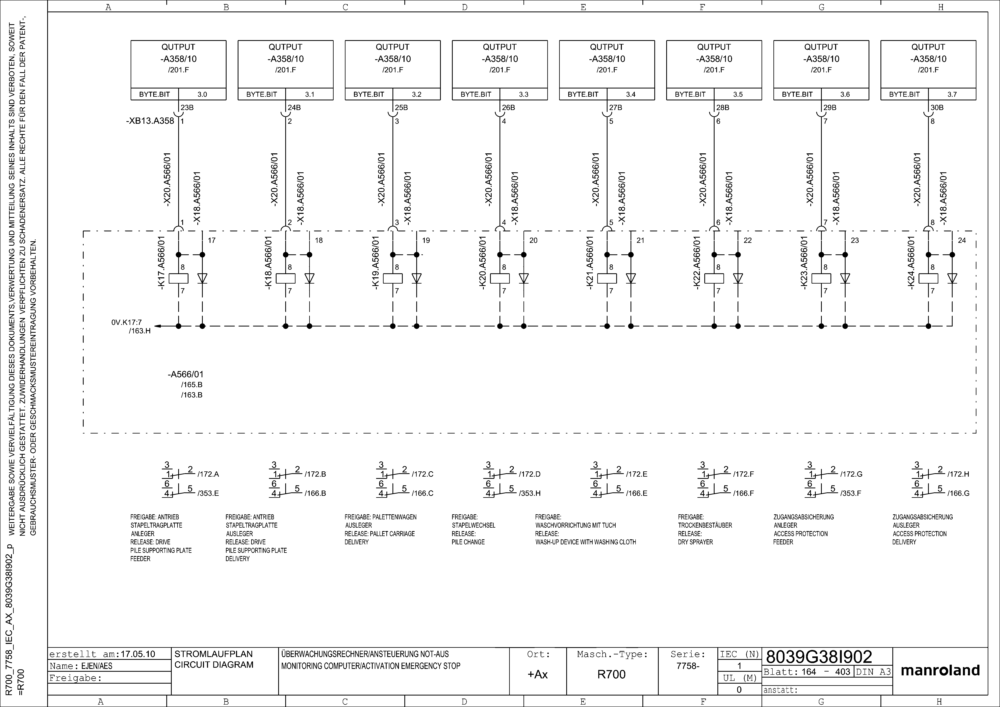

# +Ax — Sheet 164 of 403 — ÜBERWACHUNGSRECHNER/ANSTEUERUNG NOT AUS

**MONITORING COMPUTER/ACTIVATION EMERGENCY STOP**

> Part of the manroland **R700** printing press IEC/UL circuit diagrams.
> Drawing class: **Stromlaufplan / Circuit diagram** (DIN A3).
> Document `+Ax` covers the **Central control console** machine section.

## At a glance

| Field | Value |
|---|---|
| Document | `+Ax`  (8039G38I902) |
| Sheet | **164** of 403 |
| Section (DE) | ÜBERWACHUNGSRECHNER/ANSTEUERUNG NOT AUS |
| Section (EN) | MONITORING COMPUTER/ACTIVATION EMERGENCY STOP |
| Section type | CIRCUIT — Circuit diagram |
| Machine type | `R700` |
| Series | `7758` |
| Created | 17.05.10 |
| Replaces | — |
| Columns used | A, B, C, D, E, F, G, H |
| Path numbers | — |
| Labels on sheet | 218 |
| Cross-refs out | 27 |
| Cross-refs in | 51 |

**Previous:** [+Ax sheet 163](SHEET_0163.md) · **Next:** [+Ax sheet 165](SHEET_0165.md) · **Document TOC:** [_TOC.md](_TOC.md)  (+Ax) · **Master TOC:** [all sheets](../_MASTER_TOC.md)

## Sheet image (300 DPI, exact vector render)



_Rendered directly from the PDF vector layer at 300 DPI (1-bit), no OCR and no resampling. Use it to confirm anything ambiguous in the text below._

## Cross-references on this sheet

Each entry is a wire leaving this sheet. The printed token is `/sheet.column`; the link resolves to that sheet inside the same document.

| Ref | Target sheet | Col | Path | Destination on target | Target section | From col |
|---|---|---|---|---|---|---|
| `/201.F` | [+Ax sheet 201](SHEET_0201.md) | F | — | — | REFERENZMODUL | B |
| `/201.F` | [+Ax sheet 201](SHEET_0201.md) | F | — | — | REFERENZMODUL | B |
| `/201.F` | [+Ax sheet 201](SHEET_0201.md) | F | — | — | REFERENZMODUL | C |
| `/201.F` | [+Ax sheet 201](SHEET_0201.md) | F | — | — | REFERENZMODUL | D |
| `/201.F` | [+Ax sheet 201](SHEET_0201.md) | F | — | — | REFERENZMODUL | E |
| `/201.F` | [+Ax sheet 201](SHEET_0201.md) | F | — | — | REFERENZMODUL | F |
| `/201.F` | [+Ax sheet 201](SHEET_0201.md) | F | — | — | REFERENZMODUL | G |
| `/201.F` | [+Ax sheet 201](SHEET_0201.md) | F | — | — | REFERENZMODUL | H |
| `/163.H` | [+Ax sheet 163](SHEET_0163.md) | H | — | 0V.K17:7 | ÜBERWACHUNGSRECHNER/ANSTEUERUNG NOT AUS | A |
| `/165.B` | [+Ax sheet 165](SHEET_0165.md) | B | — | — | ÜBERWACHUNGSRECHNER/ANSTEUERUNG NOT AUS | B |
| `/163.B` | [+Ax sheet 163](SHEET_0163.md) | B | — | — | ÜBERWACHUNGSRECHNER/ANSTEUERUNG NOT AUS | B |
| `/172.A` | [+Ax sheet 172](SHEET_0172.md) | A | — | — | ÜBERWACHUNGSRECHNER/RÜCKMELDUNG NOT AUS | B |
| `/172.B` | [+Ax sheet 172](SHEET_0172.md) | B | — | — | ÜBERWACHUNGSRECHNER/RÜCKMELDUNG NOT AUS | C |
| `/172.E` | [+Ax sheet 172](SHEET_0172.md) | E | — | — | ÜBERWACHUNGSRECHNER/RÜCKMELDUNG NOT AUS | E |
| `/172.F` | [+Ax sheet 172](SHEET_0172.md) | F | — | — | ÜBERWACHUNGSRECHNER/RÜCKMELDUNG NOT AUS | F |
| `/172.G` | [+Ax sheet 172](SHEET_0172.md) | G | — | — | ÜBERWACHUNGSRECHNER/RÜCKMELDUNG NOT AUS | G |
| `/172.C` | [+Ax sheet 172](SHEET_0172.md) | C | — | — | ÜBERWACHUNGSRECHNER/RÜCKMELDUNG NOT AUS | D |
| `/172.D` | [+Ax sheet 172](SHEET_0172.md) | D | — | — | ÜBERWACHUNGSRECHNER/RÜCKMELDUNG NOT AUS | E |
| `/172.H` | [+Ax sheet 172](SHEET_0172.md) | H | — | — | ÜBERWACHUNGSRECHNER/RÜCKMELDUNG NOT AUS | H |
| `/353.E` | [+Ax sheet 353](SHEET_0353.md) | E | — | — | OPTION: LOGISTIK ANLEGER | B |
| `/166.B` | [+Ax sheet 166](SHEET_0166.md) | B | — | — | ÜBERWACHUNGSRECHNER/ANSTEUERUNG NOT AUS | C |
| `/166.E` | [+Ax sheet 166](SHEET_0166.md) | E | — | — | ÜBERWACHUNGSRECHNER/ANSTEUERUNG NOT AUS | E |
| `/166.F` | [+Ax sheet 166](SHEET_0166.md) | F | — | — | ÜBERWACHUNGSRECHNER/ANSTEUERUNG NOT AUS | F |
| `/353.F` | [+Ax sheet 353](SHEET_0353.md) | F | — | — | OPTION: LOGISTIK ANLEGER | G |
| `/166.G` | [+Ax sheet 166](SHEET_0166.md) | G | — | — | ÜBERWACHUNGSRECHNER/ANSTEUERUNG NOT AUS | H |
| `/166.C` | [+Ax sheet 166](SHEET_0166.md) | C | — | — | ÜBERWACHUNGSRECHNER/ANSTEUERUNG NOT AUS | D |
| `/353.H` | [+Ax sheet 353](SHEET_0353.md) | H | — | — | OPTION: LOGISTIK ANLEGER | E |

### Incoming references (sheets that point here)

Every other sheet that sends a wire to this one. `Back-ref` is the token printed on *that* sheet; `Path` is its line number.

| From sheet | Cols | Back-ref | Path | Refs | What continues there |
|---|---|---|---|---|---|
| [+Ax#163](SHEET_0163.md) | B, H | `/163.B`, `/163.H` | — | 2 | — |
| [+Ax#165](SHEET_0165.md) | B | `/165.B` | — | 1 | — |
| [+Ax#166](SHEET_0166.md) | B, C, D, F, G | `/166.B`, `/166.C`, `/166.D`, `/166.F`, `/166.G` | — | 5 | — |
| [+Ax#172](SHEET_0172.md) | A, B, C, D, E, F, G, H | `/172.A`, `/172.B`, `/172.C`, `/172.D`, `/172.E`, `/172.F`, `/172.G`, `/172.H` | — | 8 | — |
| [+Ax#201](SHEET_0201.md) | F | `/201.F` | — | 8 | — |
| [+Ax#250](SHEET_0250.md) | B | `/250.B` | — | 8 | — |
| [+Ax#257](SHEET_0257.md) | E | `/257.E` | — | 8 | — |
| [+Ax#260](SHEET_0260.md) | H | `/260.H` | — | 8 | — |
| [+Ax#353](SHEET_0353.md) | E, F, H | `/353.E`, `/353.F`, `/353.H` | — | 3 | — |


## Devices on this sheet

| Tag | Class | Class meaning (IEC) | Col | Sub | Terminal | Sign |
|---|---|---|---|---|---|---|
| `A358/10` | A | Baugruppe / assembly, module, PC board | B | 10 | — | — |
| `A358/10` | A | Baugruppe / assembly, module, PC board | B | 10 | — | — |
| `A358/10` | A | Baugruppe / assembly, module, PC board | C | 10 | — | — |
| `A358/10` | A | Baugruppe / assembly, module, PC board | D | 10 | — | — |
| `A358/10` | A | Baugruppe / assembly, module, PC board | E | 10 | — | — |
| `A358/10` | A | Baugruppe / assembly, module, PC board | F | 10 | — | — |
| `A358/10` | A | Baugruppe / assembly, module, PC board | G | 10 | — | — |
| `A358/10` | A | Baugruppe / assembly, module, PC board | H | 10 | — | — |
| `A566/01` | A | Baugruppe / assembly, module, PC board | B | 01 | — | — |
| `3.0` | — | cross-device reference | B | — | — | — |
| `XB13.A358` | — | cross-device reference | A | — | — | — |
| `3.1` | — | cross-device reference | C | — | — | — |
| `3.2` | — | cross-device reference | D | — | — | — |
| `3.3` | — | cross-device reference | D | — | — | — |
| `3.4` | — | cross-device reference | E | — | — | — |
| `3.5` | — | cross-device reference | F | — | — | — |
| `3.6` | — | cross-device reference | G | — | — | — |
| `3.7` | — | cross-device reference | H | — | — | — |

## Potentials / nets

| Potential | Count | Columns | Attached devices | Terminals |
|---|---|---|---|---|
| `0V` | 1 | A | `K17` | `7` |


A potential such as `L24+/4` or `M24+` is a named supply/return rail; every place it appears on this sheet is electrically common.

## Wire-end annotations (grouped as printed)

A wire that continues elsewhere is annotated with a small cluster: the destination description, the path/line number `#NN`, and the `/sheet.column` cross reference. Each row below is one such cluster exactly as it is grouped on the drawing.

| Col | Y | Path | Cross-ref | Text on the wire |
|---|---|---|---|---|
| B | 51.6 | — | — | `QUTPUT` |
| B | 51.6 | — | — | `QUTPUT` |
| C | 51.6 | — | — | `QUTPUT` |
| D | 51.6 | — | — | `QUTPUT` |
| E | 51.6 | — | — | `QUTPUT` |
| F | 51.6 | — | — | `QUTPUT` |
| G | 51.6 | — | — | `QUTPUT` |
| H | 51.6 | — | — | `QUTPUT` |
| B | 65.5 | — | — | `A358/10` |
| B | 65.5 | — | — | `A358/10` |
| C | 65.5 | — | — | `A358/10` |
| D | 65.5 | — | — | `A358/10` |
| E | 65.5 | — | — | `A358/10` |
| F | 65.5 | — | — | `A358/10` |
| G | 65.5 | — | — | `A358/10` |
| H | 65.5 | — | — | `A358/10` |
| B | 79.3 | — | `/201.F` | — |
| B | 79.3 | — | `/201.F` | — |
| C | 79.3 | — | `/201.F` | — |
| D | 79.3 | — | `/201.F` | — |
| E | 79.3 | — | `/201.F` | — |
| F | 79.3 | — | `/201.F` | — |
| G | 79.3 | — | `/201.F` | — |
| H | 79.3 | — | `/201.F` | — |
| B | 108.9 | — | — | `BYTE.BIT 3.0` |
| B | 108.9 | — | — | `BYTE.BIT 3.1` |
| C | 108.9 | — | — | `BYTE.BIT 3.2` |
| D | 108.9 | — | — | `BYTE.BIT 3.3` |
| E | 108.9 | — | — | `BYTE.BIT 3.4` |
| F | 108.9 | — | — | `BYTE.BIT 3.5` |
| G | 108.9 | — | — | `BYTE.BIT 3.6` |
| H | 108.9 | — | — | `BYTE.BIT 3.7` |
| B | 124.3 | — | — | `23B` |
| C | 124.3 | — | — | `24B` |
| C | 124.3 | — | — | `25B` |
| D | 124.3 | — | — | `26B` |
| E | 124.3 | — | — | `27B` |
| F | 124.3 | — | — | `28B` |
| G | 124.3 | — | — | `29B` |
| H | 124.3 | — | — | `30B` |
| A | 139.2 | — | — | `XB13.A358 1` |
| C | 140.6 | — | — | `2` |
| C | 140.6 | — | — | `3` |
| D | 140.6 | — | — | `4` |
| E | 140.6 | — | — | `5` |
| F | 140.6 | — | — | `6` |
| G | 140.6 | — | — | `7` |
| H | 140.6 | — | — | `8` |
| B | 180.8 | — | — | `X20.A566/01` |
| B | 180.8 | — | — | `X20.A566/01` |
| C | 180.8 | — | — | `X20.A566/01` |
| D | 180.8 | — | — | `X20.A566/01` |
| E | 180.8 | — | — | `X20.A566/01` |
| F | 180.8 | — | — | `X20.A566/01` |
| G | 180.8 | — | — | `X20.A566/01` |
| H | 180.8 | — | — | `X20.A566/01` |
| B | 203.2 | — | — | `X18.A566/01` |
| C | 203.2 | — | — | `X18.A566/01` |
| D | 203.2 | — | — | `X18.A566/01` |
| D | 203.2 | — | — | `X18.A566/01` |
| E | 203.2 | — | — | `X18.A566/01` |
| F | 203.2 | — | — | `X18.A566/01` |
| G | 203.2 | — | — | `X18.A566/01` |
| H | 203.2 | — | — | `X18.A566/01` |
| B | 261.1 | — | — | `1` |
| C | 261.1 | — | — | `2` |
| C | 261.1 | — | — | `3` |
| D | 261.1 | — | — | `4` |
| E | 261.1 | — | — | `5` |
| F | 261.1 | — | — | `6` |
| G | 261.1 | — | — | `7` |
| H | 261.1 | — | — | `8` |
| A | 280.1 | — | — | `K17.A566/01` |
| B | 280.1 | — | — | `K18.A566/01` |
| C | 280.1 | — | — | `K19.A566/01` |
| D | 280.1 | — | — | `K20.A566/01` |
| E | 280.1 | — | — | `K21.A566/01` |
| F | 280.1 | — | — | `K22.A566/01` |
| G | 280.1 | — | — | `K23.A566/01` |
| H | 280.1 | — | — | `K24.A566/01` |
| E | 282.4 | — | — | `17 18 19 20 21 22 23 24` |
| B | 314.3 | — | — | `8` |
| C | 314.3 | — | — | `8` |
| C | 314.3 | — | — | `8` |
| D | 314.3 | — | — | `8` |
| E | 314.3 | — | — | `8` |
| F | 314.3 | — | — | `8` |
| G | 314.3 | — | — | `8` |
| H | 314.3 | — | — | `8` |
| B | 342.6 | — | — | `7` |
| C | 342.6 | — | — | `7` |
| C | 342.6 | — | — | `7` |
| D | 342.6 | — | — | `7` |
| E | 342.6 | — | — | `7` |
| F | 342.6 | — | — | `7` |
| G | 342.6 | — | — | `7` |
| H | 342.6 | — | — | `7` |
| A | 380.1 | — | `/163.H` | `0V.K17:7` |
| B | 441.1 | — | — | `A566/01` |
| B | 454.2 | — | `/165.B`, `/163.B` | — |
| B | 548.8 | — | — | `3 6 4 1` |
| B | 548.8 | — | — | `3 6 4 1` |
| C | 548.8 | — | — | `3 6 4 1` |
| D | 548.8 | — | — | `3 6 4 1` |
| E | 548.8 | — | — | `3 6 4 1` |
| F | 548.8 | — | — | `3 6 4 1` |
| G | 548.8 | — | — | `3 6 4 1` |
| H | 548.8 | — | — | `3 6 4 1` |
| B | 554.4 | — | — | `2` |
| C | 554.4 | — | — | `2` |
| C | 554.4 | — | — | `2` |
| D | 554.4 | — | — | `2` |
| E | 554.4 | — | — | `2` |
| F | 554.4 | — | — | `2` |
| G | 554.4 | — | — | `2` |
| H | 554.4 | — | — | `2` |
| B | 560.8 | — | `/172.A` | — |
| C | 560.8 | — | `/172.B` | — |
| D | 560.8 | — | `/172.C` | — |
| E | 560.8 | — | `/172.D` | — |
| E | 560.8 | — | `/172.E` | — |
| F | 560.8 | — | `/172.F` | — |
| G | 560.8 | — | `/172.G` | — |
| H | 560.8 | — | `/172.H` | — |
| B | 577.1 | — | — | `5` |
| C | 577.1 | — | — | `5` |
| C | 577.1 | — | — | `5` |
| D | 577.1 | — | — | `5` |
| E | 577.1 | — | — | `5` |
| F | 577.1 | — | — | `5` |
| G | 577.1 | — | — | `5` |
| H | 577.1 | — | — | `5` |
| B | 583.5 | — | `/353.E` | — |
| C | 583.5 | — | `/166.B` | — |
| D | 583.5 | — | `/166.C` | — |
| E | 583.5 | — | `/353.H` | — |
| E | 583.5 | — | `/166.E` | — |
| F | 583.5 | — | `/166.F` | — |
| G | 583.5 | — | `/353.F` | — |
| H | 583.5 | — | `/166.G` | — |
| C | 613.0 | — | — | `FREIGABE: PALETTENWAGEN` |
| A | 613.1 | — | — | `FREIGABE: ANTRIEB STAPELTRAGPLATTE` |
| B | 613.1 | — | — | `FREIGABE: ANTRIEB STAPELTRAGPLATTE` |
| D | 613.1 | — | — | `FREIGABE: RELEASE: PILE CHANGE STAPELWECHSEL` |
| E | 613.1 | — | — | `FREIGABE:` |
| F | 613.1 | — | — | `FREIGABE: RELEASE: DRY SPRAYER TROCKENBESTÄUBER` |
| G | 613.1 | — | — | `FEEDER ZUGANGSABSICHERUNG ANLEGER ACCESS PROTECTION` |
| H | 613.1 | — | — | `DELIVERY ZUGANGSABSICHERUNG AUSLEGER ACCESS PROTECTION` |
| C | 623.0 | — | — | `RELEASE: PALLET CARRIAGE DELIVERY AUSLEGER` |
| E | 623.0 | — | — | `RELEASE: WASCHVORRICHTUNG MIT TUCH` |
| A | 633.0 | — | — | `RELEASE: DRIVE PILE SUPPORTING PLATE FEEDER ANLEGER` |
| B | 633.0 | — | — | `RELEASE: DRIVE PILE SUPPORTING PLATE DELIVERY AUSLEGER` |
| E | 642.9 | — | — | `WASH UP DEVICE WITH WASHING CLOTH` |


## Reconstructed tables

This sheet carries tabular content (pin map / terminal assignment / index). The grid below was rebuilt from the drawing's own rule lines, so each row is exactly one physical row of the table.

### Table 1 — 2 data rows × 3 columns (at x=155.9, y=48.2)

| QUTPUT | A358/10 /201.F |  |
|---|---|---|
| `BYTE.BIT` |  | `3.0` |
| `XB13.A358 X20.A566/01 K17.A566/01` | `23B 1 X18.A566/01 1 8 7` | `17` |


### Table 2 — 2 data rows × 3 columns (at x=283.5, y=48.2)

| QUTPUT | A358/10 /201.F |  |
|---|---|---|
| `BYTE.BIT` |  | `3.1` |
| `X20.A566/01 K18.A566/01` | `24B 2 X18.A566/01 2 8 7` | `18` |


### Table 3 — 2 data rows × 3 columns (at x=411.0, y=48.2)

| QUTPUT | A358/10 /201.F |  |
|---|---|---|
| `BYTE.BIT` |  | `3.2` |
| `X20.A566/01 K19.A566/01` | `25B 3 X18.A566/01 3 8 7` | `19` |


### Table 4 — 2 data rows × 3 columns (at x=538.6, y=48.2)

| QUTPUT | A358/10 /201.F |  |
|---|---|---|
| `BYTE.BIT` |  | `3.3` |
| `X20.A566/01 K20.A566/01` | `26B 4 X18.A566/01 4 8 7` | `20` |


### Table 5 — 2 data rows × 3 columns (at x=666.1, y=48.2)

| QUTPUT | A358/10 /201.F |  |
|---|---|---|
| `BYTE.BIT` | `3.4` |  |
| `X20.A566/01 K21.A566/01` | `27B 5 X18.A566/01 5 8 7` | `21` |


### Table 6 — 2 data rows × 3 columns (at x=793.7, y=48.2)

| QUTPUT | A358/10 /201.F |  |
|---|---|---|
| `BYTE.BIT` |  | `3.5` |
| `X20.A566/01 K22.A566/01` | `28B 6 X18.A566/01 6 8 7` | `22` |


### Table 7 — 2 data rows × 3 columns (at x=921.3, y=48.2)

| QUTPUT | A358/10 /201.F |  |
|---|---|---|
| `BYTE.BIT` | `3.6` |  |
| `X20.A566/01 K23.A566/01` | `29B 7 X18.A566/01 7 8 7` | `23` |


### Table 8 — 2 data rows × 3 columns (at x=1048.8, y=48.2)

| QUTPUT | A358/10 /201.F |  |
|---|---|---|
| `BYTE.BIT` | `3.7` |  |
| `X20.A566/01 K24.A566/01` | `30B 8 X18.A566/01 8 8 7` | `24` |


## Notes and free text on this sheet

| Text | Col | Y (pt) |
|---|---|---|
| `23B` | B | 124.3 |
| `QUTPUT` | B | 51.64 |
| `BYTE.BIT` | A | 108.91 |
| `FREIGABE: ANTRIEB` | A | 613.08 |
| `STAPELTRAGPLATTE` | A | 622.98 |
| `ANLEGER` | A | 632.98 |
| `RELEASE: DRIVE` | A | 642.93 |
| `PILE SUPPORTING PLATE` | A | 652.85 |
| `FEEDER` | A | 662.79 |
| `24B` | C | 124.3 |
| `BYTE.BIT` | B | 108.91 |
| `FREIGABE: ANTRIEB` | B | 613.08 |
| `STAPELTRAGPLATTE` | B | 622.98 |
| `AUSLEGER` | B | 632.98 |
| `RELEASE: DRIVE` | B | 642.93 |
| `PILE SUPPORTING PLATE` | B | 652.85 |
| `DELIVERY` | B | 662.83 |
| `25B` | C | 124.3 |
| `QUTPUT` | C | 51.64 |
| `BYTE.BIT` | C | 108.91 |
| `FREIGABE: PALETTENWAGEN` | C | 613.04 |
| `AUSLEGER` | C | 623.03 |
| `RELEASE: PALLET CARRIAGE` | C | 632.97 |
| `DELIVERY` | C | 642.93 |
| `26B` | D | 124.3 |
| `QUTPUT` | D | 51.64 |
| `BYTE.BIT` | D | 108.91 |
| `FREIGABE:` | D | 613.07 |
| `STAPELWECHSEL` | D | 622.99 |
| `RELEASE:` | D | 632.96 |
| `PILE CHANGE` | D | 642.91 |
| `27B` | E | 124.3 |
| `QUTPUT` | E | 51.64 |
| `BYTE.BIT` | E | 108.91 |
| `FREIGABE:` | E | 613.07 |
| `WASCHVORRICHTUNG MIT TUCH` | E | 622.99 |
| `RELEASE:` | E | 632.96 |
| `WASH UP DEVICE WITH WASHING CLOTH` | E | 642.87 |
| `28B` | F | 124.3 |
| `QUTPUT` | F | 51.64 |
| `BYTE.BIT` | F | 108.91 |
| `FREIGABE:` | F | 613.07 |
| `TROCKENBESTÄUBER` | F | 623 |
| `RELEASE:` | F | 632.96 |
| `DRY SPRAYER` | F | 642.92 |
| `29B` | G | 124.3 |
| `QUTPUT` | G | 51.64 |
| `BYTE.BIT` | G | 108.91 |
| `ZUGANGSABSICHERUNG` | G | 613.07 |
| `ANLEGER` | G | 623.03 |
| `ACCESS PROTECTION` | G | 632.95 |
| `FEEDER` | G | 642.9 |
| `30B` | H | 124.3 |
| `QUTPUT` | H | 51.64 |
| `BYTE.BIT` | H | 108.91 |
| `ZUGANGSABSICHERUNG` | H | 613.07 |
| `AUSLEGER` | H | 623.03 |
| `ACCESS PROTECTION` | H | 632.95 |
| `DELIVERY` | H | 642.93 |
| `K18.A566/01` | B | 280.06 |
| `K19.A566/01` | C | 280.06 |
| `K20.A566/01` | D | 280.06 |
| `K21.A566/01` | E | 280.06 |
| `K22.A566/01` | F | 280.06 |
| `K23.A566/01` | G | 280.06 |
| `K24.A566/01` | H | 280.06 |
| `X20.A566/01` | B | 180.85 |
| `X20.A566/01` | C | 180.85 |
| `X20.A566/01` | D | 180.85 |
| `X20.A566/01` | E | 180.85 |
| `X20.A566/01` | F | 180.85 |
| `X20.A566/01` | G | 180.85 |
| `X20.A566/01` | H | 180.85 |
| `K17.A566/01` | A | 280.06 |
| `X18.A566/01` | B | 203.24 |
| `X18.A566/01` | C | 203.24 |
| `X18.A566/01` | D | 203.24 |
| `X18.A566/01` | E | 203.24 |
| `X18.A566/01` | F | 203.24 |
| `X18.A566/01` | G | 203.24 |
| `X18.A566/01` | H | 203.24 |

## Complete label inventory (exact text from the drawing)

Every text object inside the drawing area of this sheet, in DIN reading order (column A→H, then top→bottom). This is the authoritative list: if a string is not here it is not printed on this sheet.

| Col | Y | X | Dir | Type | Text |
|---|---|---|---|---|---|
| A | 108.9 | 165.8 | → | text | `BYTE.BIT` |
| A | 139.2 | 150.2 | → | device ref | `XB13.A358` |
| A | 280.1 | 187.4 | ↕ | text | `K17.A566/01` |
| A | 380.1 | 132.7 | → | potential | `0V.K17:7` |
| A | 390.1 | 153.6 | → | cross-reference | `/163.H` |
| A | 548.8 | 195.9 | → | number | `3` |
| A | 571.5 | 195.9 | → | number | `6` |
| A | 582.8 | 195.9 | → | number | `4` |
| A | 613.1 | 155.3 | → | text | `FREIGABE: ANTRIEB` |
| A | 623.0 | 155.6 | → | text | `STAPELTRAGPLATTE` |
| A | 633.0 | 156.2 | → | text | `ANLEGER` |
| A | 642.9 | 155.3 | → | text | `RELEASE: DRIVE` |
| A | 652.9 | 155.3 | → | text | `PILE SUPPORTING PLATE` |
| A | 662.8 | 155.3 | → | text | `FEEDER` |
| B | 51.6 | 192.3 | → | text | `QUTPUT` |
| B | 51.6 | 319.9 | → | text | `QUTPUT` |
| B | 65.5 | 191.2 | → | device tag | `A358/10` |
| B | 65.5 | 318.8 | → | device tag | `A358/10` |
| B | 79.3 | 200.3 | → | cross-reference | `/201.F` |
| B | 79.3 | 327.8 | → | cross-reference | `/201.F` |
| B | 108.9 | 235.3 | → | device ref | `3.0` |
| B | 108.9 | 293.4 | → | text | `BYTE.BIT` |
| B | 124.3 | 215.1 | → | text | `23B` |
| B | 140.6 | 214.6 | → | number | `1` |
| B | 180.9 | 194.5 | ↕ | text | `X20.A566/01` |
| B | 180.9 | 322.0 | ↕ | text | `X20.A566/01` |
| B | 203.2 | 229.9 | ↕ | text | `X18.A566/01` |
| B | 261.1 | 214.6 | → | number | `1` |
| B | 280.1 | 315.0 | ↕ | text | `K18.A566/01` |
| B | 282.4 | 247.2 | → | number | `17` |
| B | 314.3 | 215.1 | → | number | `8` |
| B | 342.6 | 215.1 | → | number | `7` |
| B | 441.1 | 199.8 | → | device tag | `A566/01` |
| B | 454.2 | 215.7 | → | cross-reference | `/165.B` |
| B | 466.6 | 215.7 | → | cross-reference | `/163.B` |
| B | 548.8 | 323.4 | → | number | `3` |
| B | 554.4 | 223.7 | → | number | `2` |
| B | 560.1 | 197.3 | → | number | `1` |
| B | 560.1 | 324.9 | → | number | `1` |
| B | 560.8 | 235.3 | → | cross-reference | `/172.A` |
| B | 571.5 | 323.4 | → | number | `6` |
| B | 577.1 | 223.4 | → | number | `5` |
| B | 582.8 | 323.4 | → | number | `4` |
| B | 583.5 | 235.3 | → | cross-reference | `/353.E` |
| B | 613.1 | 268.7 | → | text | `FREIGABE: ANTRIEB` |
| B | 623.0 | 269.0 | → | text | `STAPELTRAGPLATTE` |
| B | 633.0 | 269.6 | → | text | `AUSLEGER` |
| B | 642.9 | 268.7 | → | text | `RELEASE: DRIVE` |
| B | 652.9 | 268.7 | → | text | `PILE SUPPORTING PLATE` |
| B | 662.8 | 268.7 | → | text | `DELIVERY` |
| C | 51.6 | 447.4 | → | text | `QUTPUT` |
| C | 65.5 | 446.3 | → | device tag | `A358/10` |
| C | 79.3 | 455.4 | → | cross-reference | `/201.F` |
| C | 108.9 | 363.4 | → | device ref | `3.1` |
| C | 108.9 | 420.9 | → | text | `BYTE.BIT` |
| C | 124.3 | 342.7 | → | text | `24B` |
| C | 124.3 | 470.3 | → | text | `25B` |
| C | 140.6 | 342.7 | → | number | `2` |
| C | 140.6 | 470.3 | → | number | `3` |
| C | 180.9 | 449.6 | ↕ | text | `X20.A566/01` |
| C | 203.2 | 353.2 | ↕ | text | `X18.A566/01` |
| C | 261.1 | 342.7 | → | number | `2` |
| C | 261.1 | 470.3 | → | number | `3` |
| C | 280.1 | 442.5 | ↕ | text | `K19.A566/01` |
| C | 282.4 | 374.7 | → | number | `18` |
| C | 314.3 | 342.7 | → | number | `8` |
| C | 314.3 | 470.3 | → | number | `8` |
| C | 342.6 | 342.7 | → | number | `7` |
| C | 342.6 | 470.3 | → | number | `7` |
| C | 548.8 | 451.0 | → | number | `3` |
| C | 554.4 | 351.2 | → | number | `2` |
| C | 554.4 | 478.8 | → | number | `2` |
| C | 560.1 | 452.4 | → | number | `1` |
| C | 560.8 | 362.8 | → | cross-reference | `/172.B` |
| C | 571.5 | 451.0 | → | number | `6` |
| C | 577.1 | 350.9 | → | number | `5` |
| C | 577.1 | 478.5 | → | number | `5` |
| C | 582.8 | 451.0 | → | number | `4` |
| C | 583.5 | 362.8 | → | cross-reference | `/166.B` |
| C | 613.0 | 410.5 | → | text | `FREIGABE: PALETTENWAGEN` |
| C | 623.0 | 411.3 | → | text | `AUSLEGER` |
| C | 633.0 | 410.5 | → | text | `RELEASE: PALLET CARRIAGE` |
| C | 642.9 | 410.5 | → | text | `DELIVERY` |
| D | 51.6 | 575.0 | → | text | `QUTPUT` |
| D | 65.5 | 573.9 | → | device tag | `A358/10` |
| D | 79.3 | 582.9 | → | cross-reference | `/201.F` |
| D | 108.9 | 490.5 | → | device ref | `3.2` |
| D | 108.9 | 548.5 | → | text | `BYTE.BIT` |
| D | 108.9 | 618.0 | → | device ref | `3.3` |
| D | 124.3 | 597.8 | → | text | `26B` |
| D | 140.6 | 597.8 | → | number | `4` |
| D | 180.9 | 577.2 | ↕ | text | `X20.A566/01` |
| D | 203.2 | 480.8 | ↕ | text | `X18.A566/01` |
| D | 203.2 | 608.3 | ↕ | text | `X18.A566/01` |
| D | 261.1 | 597.8 | → | number | `4` |
| D | 280.1 | 570.1 | ↕ | text | `K20.A566/01` |
| D | 282.4 | 502.3 | → | number | `19` |
| D | 314.3 | 597.8 | → | number | `8` |
| D | 342.6 | 597.8 | → | number | `7` |
| D | 548.8 | 578.6 | → | number | `3` |
| D | 554.4 | 606.3 | → | number | `2` |
| D | 560.1 | 580.0 | → | number | `1` |
| D | 560.8 | 490.4 | → | cross-reference | `/172.C` |
| D | 571.5 | 578.6 | → | number | `6` |
| D | 577.1 | 606.0 | → | number | `5` |
| D | 582.8 | 578.6 | → | number | `4` |
| D | 583.5 | 490.4 | → | cross-reference | `/166.C` |
| D | 613.1 | 538.0 | → | text | `FREIGABE:` |
| D | 623.0 | 538.3 | → | text | `STAPELWECHSEL` |
| D | 633.0 | 538.0 | → | text | `RELEASE:` |
| D | 642.9 | 538.0 | → | text | `PILE CHANGE` |
| E | 51.6 | 702.6 | → | text | `QUTPUT` |
| E | 65.5 | 701.4 | → | device tag | `A358/10` |
| E | 79.3 | 710.5 | → | cross-reference | `/201.F` |
| E | 108.9 | 676.1 | → | text | `BYTE.BIT` |
| E | 108.9 | 745.5 | → | device ref | `3.4` |
| E | 124.3 | 725.4 | → | text | `27B` |
| E | 140.6 | 725.4 | → | number | `5` |
| E | 180.9 | 704.7 | ↕ | text | `X20.A566/01` |
| E | 203.2 | 735.9 | ↕ | text | `X18.A566/01` |
| E | 261.1 | 725.4 | → | number | `5` |
| E | 280.1 | 697.6 | ↕ | text | `K21.A566/01` |
| E | 282.4 | 630.4 | → | number | `20` |
| E | 282.4 | 758.0 | → | number | `21` |
| E | 314.3 | 725.4 | → | number | `8` |
| E | 342.6 | 725.4 | → | number | `7` |
| E | 548.8 | 706.1 | → | number | `3` |
| E | 554.4 | 733.9 | → | number | `2` |
| E | 560.1 | 707.5 | → | number | `1` |
| E | 560.8 | 618.0 | → | cross-reference | `/172.D` |
| E | 560.8 | 745.5 | → | cross-reference | `/172.E` |
| E | 571.5 | 706.1 | → | number | `6` |
| E | 577.1 | 733.6 | → | number | `5` |
| E | 582.8 | 706.1 | → | number | `4` |
| E | 583.5 | 618.0 | → | cross-reference | `/353.H` |
| E | 583.5 | 745.5 | → | cross-reference | `/166.E` |
| E | 613.1 | 637.2 | → | text | `FREIGABE:` |
| E | 623.0 | 637.8 | → | text | `WASCHVORRICHTUNG MIT TUCH` |
| E | 633.0 | 637.2 | → | text | `RELEASE:` |
| E | 642.9 | 637.8 | → | text | `WASH UP DEVICE WITH WASHING CLOTH` |
| F | 51.6 | 830.1 | → | text | `QUTPUT` |
| F | 65.5 | 829.0 | → | device tag | `A358/10` |
| F | 79.3 | 838.1 | → | cross-reference | `/201.F` |
| F | 108.9 | 803.6 | → | text | `BYTE.BIT` |
| F | 108.9 | 873.1 | → | device ref | `3.5` |
| F | 124.3 | 852.9 | → | text | `28B` |
| F | 140.6 | 852.9 | → | number | `6` |
| F | 180.9 | 832.3 | ↕ | text | `X20.A566/01` |
| F | 203.2 | 863.5 | ↕ | text | `X18.A566/01` |
| F | 261.1 | 852.9 | → | number | `6` |
| F | 280.1 | 825.2 | ↕ | text | `K22.A566/01` |
| F | 282.4 | 885.5 | → | number | `22` |
| F | 314.3 | 852.9 | → | number | `8` |
| F | 342.6 | 852.9 | → | number | `7` |
| F | 548.8 | 833.7 | → | number | `3` |
| F | 554.4 | 861.4 | → | number | `2` |
| F | 560.1 | 835.1 | → | number | `1` |
| F | 560.8 | 873.1 | → | cross-reference | `/172.F` |
| F | 571.5 | 833.7 | → | number | `6` |
| F | 577.1 | 861.2 | → | number | `5` |
| F | 582.8 | 833.7 | → | number | `4` |
| F | 583.5 | 873.1 | → | cross-reference | `/166.F` |
| F | 613.1 | 807.3 | → | text | `FREIGABE:` |
| F | 623.0 | 807.6 | → | text | `TROCKENBESTÄUBER` |
| F | 633.0 | 807.3 | → | text | `RELEASE:` |
| F | 642.9 | 807.3 | → | text | `DRY SPRAYER` |
| G | 51.6 | 957.7 | → | text | `QUTPUT` |
| G | 65.5 | 956.6 | → | device tag | `A358/10` |
| G | 79.3 | 965.6 | → | cross-reference | `/201.F` |
| G | 108.9 | 931.2 | → | text | `BYTE.BIT` |
| G | 108.9 | 1000.6 | → | device ref | `3.6` |
| G | 124.3 | 980.5 | → | text | `29B` |
| G | 140.6 | 980.5 | → | number | `7` |
| G | 180.9 | 959.8 | ↕ | text | `X20.A566/01` |
| G | 203.2 | 991.0 | ↕ | text | `X18.A566/01` |
| G | 261.1 | 980.5 | → | number | `7` |
| G | 280.1 | 952.7 | ↕ | text | `K23.A566/01` |
| G | 282.4 | 1013.1 | → | number | `23` |
| G | 314.3 | 980.5 | → | number | `8` |
| G | 342.6 | 980.5 | → | number | `7` |
| G | 548.8 | 961.2 | → | number | `3` |
| G | 554.4 | 989.0 | → | number | `2` |
| G | 560.1 | 962.6 | → | number | `1` |
| G | 560.8 | 1000.6 | → | cross-reference | `/172.G` |
| G | 571.5 | 961.2 | → | number | `6` |
| G | 577.1 | 988.7 | → | number | `5` |
| G | 582.8 | 961.2 | → | number | `4` |
| G | 583.5 | 1000.6 | → | cross-reference | `/353.F` |
| G | 613.1 | 921.3 | → | text | `ZUGANGSABSICHERUNG` |
| G | 623.0 | 921.5 | → | text | `ANLEGER` |
| G | 632.9 | 921.5 | → | text | `ACCESS PROTECTION` |
| G | 642.9 | 920.7 | → | text | `FEEDER` |
| H | 51.6 | 1085.2 | → | text | `QUTPUT` |
| H | 65.5 | 1084.1 | → | device tag | `A358/10` |
| H | 79.3 | 1093.2 | → | cross-reference | `/201.F` |
| H | 108.9 | 1058.7 | → | text | `BYTE.BIT` |
| H | 108.9 | 1128.2 | → | device ref | `3.7` |
| H | 124.3 | 1108.1 | → | text | `30B` |
| H | 140.6 | 1108.1 | → | number | `8` |
| H | 180.9 | 1087.4 | ↕ | text | `X20.A566/01` |
| H | 203.2 | 1118.6 | ↕ | text | `X18.A566/01` |
| H | 261.1 | 1108.1 | → | number | `8` |
| H | 280.1 | 1080.3 | ↕ | text | `K24.A566/01` |
| H | 282.4 | 1140.7 | → | number | `24` |
| H | 314.3 | 1108.1 | → | number | `8` |
| H | 342.6 | 1108.1 | → | number | `7` |
| H | 548.8 | 1088.8 | → | number | `3` |
| H | 554.4 | 1116.6 | → | number | `2` |
| H | 560.1 | 1090.2 | → | number | `1` |
| H | 560.8 | 1128.2 | → | cross-reference | `/172.H` |
| H | 571.5 | 1088.8 | → | number | `6` |
| H | 577.1 | 1116.3 | → | number | `5` |
| H | 582.8 | 1088.8 | → | number | `4` |
| H | 583.5 | 1128.2 | → | cross-reference | `/166.G` |
| H | 613.1 | 1063.0 | → | text | `ZUGANGSABSICHERUNG` |
| H | 623.0 | 1063.3 | → | text | `AUSLEGER` |
| H | 632.9 | 1063.3 | → | text | `ACCESS PROTECTION` |
| H | 642.9 | 1062.4 | → | text | `DELIVERY` |

## Reading-order text block

The same content as a plain block, grouped by DIN column — convenient to paste or to match against a visual description.

```text
=== Column A ===
 108.9  165.8  text         BYTE.BIT
 139.2  150.2  devref       XB13.A358
 280.1  187.4  text         K17.A566/01
 380.1  132.7  net          0V.K17:7
 390.1  153.6  xref         /163.H
 548.8  195.9  numeric      3
 571.5  195.9  numeric      6
 582.8  195.9  numeric      4
 613.1  155.3  text         FREIGABE: ANTRIEB
 623.0  155.6  text         STAPELTRAGPLATTE
 633.0  156.2  text         ANLEGER
 642.9  155.3  text         RELEASE: DRIVE
 652.9  155.3  text         PILE SUPPORTING PLATE
 662.8  155.3  text         FEEDER
=== Column B ===
  51.6  192.3  text         QUTPUT
  51.6  319.9  text         QUTPUT
  65.5  191.2  devtag       A358/10
  65.5  318.8  devtag       A358/10
  79.3  200.3  xref         /201.F
  79.3  327.8  xref         /201.F
 108.9  235.3  devref       3.0
 108.9  293.4  text         BYTE.BIT
 124.3  215.1  text         23B
 140.6  214.6  numeric      1
 180.9  194.5  text         X20.A566/01
 180.9  322.0  text         X20.A566/01
 203.2  229.9  text         X18.A566/01
 261.1  214.6  numeric      1
 280.1  315.0  text         K18.A566/01
 282.4  247.2  numeric      17
 314.3  215.1  numeric      8
 342.6  215.1  numeric      7
 441.1  199.8  devtag       A566/01
 454.2  215.7  xref         /165.B
 466.6  215.7  xref         /163.B
 548.8  323.4  numeric      3
 554.4  223.7  numeric      2
 560.1  197.3  numeric      1
 560.1  324.9  numeric      1
 560.8  235.3  xref         /172.A
 571.5  323.4  numeric      6
 577.1  223.4  numeric      5
 582.8  323.4  numeric      4
 583.5  235.3  xref         /353.E
 613.1  268.7  text         FREIGABE: ANTRIEB
 623.0  269.0  text         STAPELTRAGPLATTE
 633.0  269.6  text         AUSLEGER
 642.9  268.7  text         RELEASE: DRIVE
 652.9  268.7  text         PILE SUPPORTING PLATE
 662.8  268.7  text         DELIVERY
=== Column C ===
  51.6  447.4  text         QUTPUT
  65.5  446.3  devtag       A358/10
  79.3  455.4  xref         /201.F
 108.9  363.4  devref       3.1
 108.9  420.9  text         BYTE.BIT
 124.3  342.7  text         24B
 124.3  470.3  text         25B
 140.6  342.7  numeric      2
 140.6  470.3  numeric      3
 180.9  449.6  text         X20.A566/01
 203.2  353.2  text         X18.A566/01
 261.1  342.7  numeric      2
 261.1  470.3  numeric      3
 280.1  442.5  text         K19.A566/01
 282.4  374.7  numeric      18
 314.3  342.7  numeric      8
 314.3  470.3  numeric      8
 342.6  342.7  numeric      7
 342.6  470.3  numeric      7
 548.8  451.0  numeric      3
 554.4  351.2  numeric      2
 554.4  478.8  numeric      2
 560.1  452.4  numeric      1
 560.8  362.8  xref         /172.B
 571.5  451.0  numeric      6
 577.1  350.9  numeric      5
 577.1  478.5  numeric      5
 582.8  451.0  numeric      4
 583.5  362.8  xref         /166.B
 613.0  410.5  text         FREIGABE: PALETTENWAGEN
 623.0  411.3  text         AUSLEGER
 633.0  410.5  text         RELEASE: PALLET CARRIAGE
 642.9  410.5  text         DELIVERY
=== Column D ===
  51.6  575.0  text         QUTPUT
  65.5  573.9  devtag       A358/10
  79.3  582.9  xref         /201.F
 108.9  490.5  devref       3.2
 108.9  548.5  text         BYTE.BIT
 108.9  618.0  devref       3.3
 124.3  597.8  text         26B
 140.6  597.8  numeric      4
 180.9  577.2  text         X20.A566/01
 203.2  480.8  text         X18.A566/01
 203.2  608.3  text         X18.A566/01
 261.1  597.8  numeric      4
 280.1  570.1  text         K20.A566/01
 282.4  502.3  numeric      19
 314.3  597.8  numeric      8
 342.6  597.8  numeric      7
 548.8  578.6  numeric      3
 554.4  606.3  numeric      2
 560.1  580.0  numeric      1
 560.8  490.4  xref         /172.C
 571.5  578.6  numeric      6
 577.1  606.0  numeric      5
 582.8  578.6  numeric      4
 583.5  490.4  xref         /166.C
 613.1  538.0  text         FREIGABE:
 623.0  538.3  text         STAPELWECHSEL
 633.0  538.0  text         RELEASE:
 642.9  538.0  text         PILE CHANGE
=== Column E ===
  51.6  702.6  text         QUTPUT
  65.5  701.4  devtag       A358/10
  79.3  710.5  xref         /201.F
 108.9  676.1  text         BYTE.BIT
 108.9  745.5  devref       3.4
 124.3  725.4  text         27B
 140.6  725.4  numeric      5
 180.9  704.7  text         X20.A566/01
 203.2  735.9  text         X18.A566/01
 261.1  725.4  numeric      5
 280.1  697.6  text         K21.A566/01
 282.4  630.4  numeric      20
 282.4  758.0  numeric      21
 314.3  725.4  numeric      8
 342.6  725.4  numeric      7
 548.8  706.1  numeric      3
 554.4  733.9  numeric      2
 560.1  707.5  numeric      1
 560.8  618.0  xref         /172.D
 560.8  745.5  xref         /172.E
 571.5  706.1  numeric      6
 577.1  733.6  numeric      5
 582.8  706.1  numeric      4
 583.5  618.0  xref         /353.H
 583.5  745.5  xref         /166.E
 613.1  637.2  text         FREIGABE:
 623.0  637.8  text         WASCHVORRICHTUNG MIT TUCH
 633.0  637.2  text         RELEASE:
 642.9  637.8  text         WASH UP DEVICE WITH WASHING CLOTH
=== Column F ===
  51.6  830.1  text         QUTPUT
  65.5  829.0  devtag       A358/10
  79.3  838.1  xref         /201.F
 108.9  803.6  text         BYTE.BIT
 108.9  873.1  devref       3.5
 124.3  852.9  text         28B
 140.6  852.9  numeric      6
 180.9  832.3  text         X20.A566/01
 203.2  863.5  text         X18.A566/01
 261.1  852.9  numeric      6
 280.1  825.2  text         K22.A566/01
 282.4  885.5  numeric      22
 314.3  852.9  numeric      8
 342.6  852.9  numeric      7
 548.8  833.7  numeric      3
 554.4  861.4  numeric      2
 560.1  835.1  numeric      1
 560.8  873.1  xref         /172.F
 571.5  833.7  numeric      6
 577.1  861.2  numeric      5
 582.8  833.7  numeric      4
 583.5  873.1  xref         /166.F
 613.1  807.3  text         FREIGABE:
 623.0  807.6  text         TROCKENBESTÄUBER
 633.0  807.3  text         RELEASE:
 642.9  807.3  text         DRY SPRAYER
=== Column G ===
  51.6  957.7  text         QUTPUT
  65.5  956.6  devtag       A358/10
  79.3  965.6  xref         /201.F
 108.9  931.2  text         BYTE.BIT
 108.9 1000.6  devref       3.6
 124.3  980.5  text         29B
 140.6  980.5  numeric      7
 180.9  959.8  text         X20.A566/01
 203.2  991.0  text         X18.A566/01
 261.1  980.5  numeric      7
 280.1  952.7  text         K23.A566/01
 282.4 1013.1  numeric      23
 314.3  980.5  numeric      8
 342.6  980.5  numeric      7
 548.8  961.2  numeric      3
 554.4  989.0  numeric      2
 560.1  962.6  numeric      1
 560.8 1000.6  xref         /172.G
 571.5  961.2  numeric      6
 577.1  988.7  numeric      5
 582.8  961.2  numeric      4
 583.5 1000.6  xref         /353.F
 613.1  921.3  text         ZUGANGSABSICHERUNG
 623.0  921.5  text         ANLEGER
 632.9  921.5  text         ACCESS PROTECTION
 642.9  920.7  text         FEEDER
=== Column H ===
  51.6 1085.2  text         QUTPUT
  65.5 1084.1  devtag       A358/10
  79.3 1093.2  xref         /201.F
 108.9 1058.7  text         BYTE.BIT
 108.9 1128.2  devref       3.7
 124.3 1108.1  text         30B
 140.6 1108.1  numeric      8
 180.9 1087.4  text         X20.A566/01
 203.2 1118.6  text         X18.A566/01
 261.1 1108.1  numeric      8
 280.1 1080.3  text         K24.A566/01
 282.4 1140.7  numeric      24
 314.3 1108.1  numeric      8
 342.6 1108.1  numeric      7
 548.8 1088.8  numeric      3
 554.4 1116.6  numeric      2
 560.1 1090.2  numeric      1
 560.8 1128.2  xref         /172.H
 571.5 1088.8  numeric      6
 577.1 1116.3  numeric      5
 582.8 1088.8  numeric      4
 583.5 1128.2  xref         /166.G
 613.1 1063.0  text         ZUGANGSABSICHERUNG
 623.0 1063.3  text         AUSLEGER
 632.9 1063.3  text         ACCESS PROTECTION
 642.9 1062.4  text         DELIVERY
```

---
_Generated from the PDF vector text layer; no OCR. Source: `R700_7758_IEC_AX_8039G38I902_p`, sheet 164._
