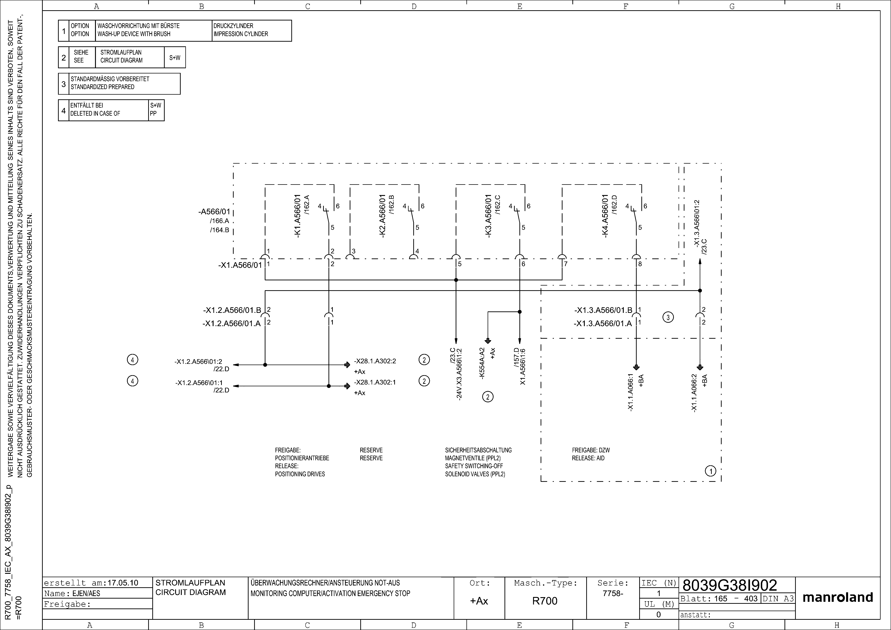

# +Ax — Sheet 165 of 403 — ÜBERWACHUNGSRECHNER/ANSTEUERUNG NOT AUS

**MONITORING COMPUTER/ACTIVATION EMERGENCY STOP**

> Part of the manroland **R700** printing press IEC/UL circuit diagrams.
> Drawing class: **Stromlaufplan / Circuit diagram** (DIN A3).
> Document `+Ax` covers the **Central control console** machine section.

## At a glance

| Field | Value |
|---|---|
| Document | `+Ax`  (8039G38I902) |
| Sheet | **165** of 403 |
| Section (DE) | ÜBERWACHUNGSRECHNER/ANSTEUERUNG NOT AUS |
| Section (EN) | MONITORING COMPUTER/ACTIVATION EMERGENCY STOP |
| Section type | CIRCUIT — Circuit diagram |
| Machine type | `R700` |
| Series | `7758` |
| Created | 17.05.10 |
| Replaces | — |
| Columns used | A, B, C, D, E, F, G |
| Path numbers | — |
| Labels on sheet | 106 |
| Cross-refs out | 11 |
| Cross-refs in | 27 |

**Previous:** [+Ax sheet 164](SHEET_0164.md) · **Next:** [+Ax sheet 166](SHEET_0166.md) · **Document TOC:** [_TOC.md](_TOC.md)  (+Ax) · **Master TOC:** [all sheets](../_MASTER_TOC.md)

## Sheet image (300 DPI, exact vector render)



_Rendered directly from the PDF vector layer at 300 DPI (1-bit), no OCR and no resampling. Use it to confirm anything ambiguous in the text below._

## Cross-references on this sheet

Each entry is a wire leaving this sheet. The printed token is `/sheet.column`; the link resolves to that sheet inside the same document.

| Ref | Target sheet | Col | Path | Destination on target | Target section | From col |
|---|---|---|---|---|---|---|
| `/162.B` | [+Ax sheet 162](SHEET_0162.md) | B | — | — | ÜBERWACHUNGSRECHNER/ANSTEUERUNG NOT AUS | D |
| `/162.C` | [+Ax sheet 162](SHEET_0162.md) | C | — | — | ÜBERWACHUNGSRECHNER/ANSTEUERUNG NOT AUS | E |
| `/162.D` | [+Ax sheet 162](SHEET_0162.md) | D | — | — | ÜBERWACHUNGSRECHNER/ANSTEUERUNG NOT AUS | F |
| `/162.A` | [+Ax sheet 162](SHEET_0162.md) | A | — | — | ÜBERWACHUNGSRECHNER/ANSTEUERUNG NOT AUS | C |
| `/23.C` | [+Ax sheet 23](SHEET_0023.md) | C | — | X1.3.A566\01:2 | SPANNUNGSVERSORGUNG, SCHALTSCHRANKBELÜFTUNG | G |
| `/166.A` | [+Ax sheet 166](SHEET_0166.md) | A | — | — | ÜBERWACHUNGSRECHNER/ANSTEUERUNG NOT AUS | B |
| `/164.B` | [+Ax sheet 164](SHEET_0164.md) | B | — | — | ÜBERWACHUNGSRECHNER/ANSTEUERUNG NOT AUS | B |
| `/23.C` | [+Ax sheet 23](SHEET_0023.md) | C | — | — | SPANNUNGSVERSORGUNG, SCHALTSCHRANKBELÜFTUNG | D |
| `/157.D` | [+Ax sheet 157](SHEET_0157.md) | D | — | — | ÜBERWACHUNGSRECHNER/ANSTEUERUNG NOT AUS | E |
| `/22.D` | [+Ax sheet 22](SHEET_0022.md) | D | — | X1.2.A566\01:2 | SPANNUNGSVERSORGUNG, SCHALTSCHRANKBELÜFTUNG | B |
| `/22.D` | [+Ax sheet 22](SHEET_0022.md) | D | — | X1.2.A566\01:1 | SPANNUNGSVERSORGUNG, SCHALTSCHRANKBELÜFTUNG | B |

### Incoming references (sheets that point here)

Every other sheet that sends a wire to this one. `Back-ref` is the token printed on *that* sheet; `Path` is its line number.

| From sheet | Cols | Back-ref | Path | Refs | What continues there |
|---|---|---|---|---|---|
| [+Ax#22](SHEET_0022.md) | D | `/22.D` | — | 2 | — |
| [+Ax#23](SHEET_0023.md) | C | `/23.C` | — | 2 | 24V.X3.A566\1:2 |
| [+Ax#157](SHEET_0157.md) | D | `/157.D` | — | 1 | — |
| [+Ax#162](SHEET_0162.md) | B, C, D | `/162.B`, `/162.C`, `/162.D` | — | 4 | — |
| [+Ax#164](SHEET_0164.md) | B | `/164.B` | — | 1 | — |
| [+Ax#166](SHEET_0166.md) | A | `/166.A` | — | 1 | — |
| [+Ax#209](SHEET_0209.md) | F, G, H | `/209.F`, `/209.G`, `/209.H` | — | 16 | — |


## Devices on this sheet

| Tag | Class | Class meaning (IEC) | Col | Sub | Terminal | Sign |
|---|---|---|---|---|---|---|
| `A566/01` | A | Baugruppe / assembly, module, PC board | B | 01 | — | — |
| `X28.1.A302:2` | — | cross-device reference | D | — | 2 | — |
| `X28.1.A302:1` | — | cross-device reference | D | — | 1 | — |
| `X1.1.A066:2` | — | cross-device reference | G | — | 2 | — |
| `X1.1.A066:1` | — | cross-device reference | F | — | 1 | — |
| `X1.3.A566\01:2` | — | cross-device reference | G | — | 2 | — |
| `X1.2.A566\01:1` | — | cross-device reference | B | — | 1 | — |
| `X1.2.A566\01:2` | — | cross-device reference | B | — | 2 | — |
| `X1.A566\1:6` | — | cross-device reference | E | — | 6 | — |

## Potentials / nets

| Potential | Count | Columns | Attached devices | Terminals |
|---|---|---|---|---|
| `24V` | 1 | D | `A566\1`, `X3` | `2` |


A potential such as `L24+/4` or `M24+` is a named supply/return rail; every place it appears on this sheet is electrically common.

## Wire-end annotations (grouped as printed)

A wire that continues elsewhere is annotated with a small cluster: the destination description, the path/line number `#NN`, and the `/sheet.column` cross reference. Each row below is one such cluster exactly as it is grouped on the drawing.

| Col | Y | Path | Cross-ref | Text on the wire |
|---|---|---|---|---|
| B | 31.8 | — | — | `1 OPTION OPTION WASCHVORRICHTUNG MIT BÜRSTE WASH UP DEVICE WITH BRUSH DRUCKZYLINDER IMPRESSION CYLINDER` |
| A | 67.2 | — | — | `2 SIEHE SEE STROMLAUFPLAN CIRCUIT DIAGRAM S+W` |
| A | 102.7 | — | — | `3 STANDARDMÄSSIG VORBEREITET STANDARDIZED PREPARED` |
| B | 138.0 | — | — | `PP S+W` |
| A | 138.1 | — | — | `4 ENTFÄLLT BEI DELETED IN CASE OF` |
| C | 258.8 | — | — | `K1.A566/01` |
| D | 258.8 | — | — | `K2.A566/01` |
| E | 258.8 | — | — | `K3.A566/01` |
| F | 258.8 | — | — | `K4.A566/01` |
| D | 260.5 | — | `/162.B` | — |
| E | 260.5 | — | `/162.C` | — |
| F | 260.5 | — | `/162.D` | — |
| C | 260.8 | — | `/162.A` | — |
| G | 267.0 | — | `/23.C` | `X1.3.A566\01:2` |
| C | 271.7 | — | — | `4` |
| C | 271.7 | — | — | `6` |
| D | 271.7 | — | — | `4` |
| D | 271.7 | — | — | `6` |
| E | 271.7 | — | — | `4` |
| E | 271.7 | — | — | `6` |
| F | 271.7 | — | — | `4` |
| F | 271.7 | — | — | `6` |
| B | 278.1 | — | — | `A566/01` |
| B | 291.2 | — | `/166.A`, `/164.B` | — |
| C | 300.1 | — | — | `5` |
| D | 300.1 | — | — | `5` |
| E | 300.1 | — | — | `5` |
| F | 300.1 | — | — | `5` |
| C | 332.0 | — | — | `1` |
| C | 332.0 | — | — | `2` |
| D | 332.0 | — | — | `3 4` |
| C | 349.0 | — | — | `X1.A566/01 1 2` |
| E | 349.0 | — | — | `5 6` |
| E | 349.0 | — | — | `7` |
| F | 349.0 | — | — | `8` |
| B | 409.9 | — | — | `X1.2.A566/01.B 2` |
| C | 409.9 | — | — | `1` |
| F | 409.9 | — | — | `X1.3.A566/01.B 1` |
| G | 409.9 | — | — | `2` |
| F | 421.2 | — | — | `3` |
| B | 426.9 | — | — | `X1.2.A566/01.A 2` |
| C | 426.9 | — | — | `1` |
| F | 426.9 | — | — | `X1.3.A566/01.A 1` |
| G | 426.9 | — | — | `2` |
| E | 464.3 | — | — | `K554A:A2` |
| D | 464.6 | — | `/23.C` | — |
| E | 464.6 | — | `/157.D` | — |
| E | 464.9 | — | — | `+Ax` |
| D | 465.7 | — | — | `24V.X3.A566\1:2` |
| E | 466.0 | — | — | `X1.A566\1:6` |
| A | 477.9 | — | — | `4` |
| D | 477.9 | — | — | `2` |
| D | 478.6 | — | — | `X28.1.A302:2` |
| B | 479.3 | — | `/22.D` | `X1.2.A566\01:2` |
| C | 492.9 | — | — | `+Ax` |
| F | 498.6 | — | — | `X1.1.A066:1` |
| G | 499.8 | — | — | `X1.1.A066:2` |
| F | 500.3 | — | — | `+BA` |
| G | 500.3 | — | — | `+BA` |
| A | 506.3 | — | — | `4` |
| D | 506.3 | — | — | `2` |
| D | 507.0 | — | — | `X28.1.A302:1` |
| B | 507.7 | — | `/22.D` | `X1.2.A566\01:1` |
| C | 521.2 | — | — | `+Ax` |
| E | 527.5 | — | — | `2` |
| C | 598.7 | — | — | `FREIGABE: POSITIONIERANTRIEBE RELEASE: POSITIONING DRIVES` |
| D | 598.7 | — | — | `RESERVE RESERVE` |
| E | 598.7 | — | — | `MAGNETVENTILE (PPL2) SICHERHEITSABSCHALTUNG SAFETY SWITCHING OFF SOLENOID VALVES (PPL2)` |
| F | 598.7 | — | — | `FREIGABE: DZW RELEASE: AID` |
| G | 626.2 | — | — | `1` |


## Reconstructed tables

This sheet carries tabular content (pin map / terminal assignment / index). The grid below was rebuilt from the drawing's own rule lines, so each row is exactly one physical row of the table.

### Table 1 — 5 data rows × 10 columns (at x=354.3, y=218.3)

| K1.A566/01 /162.A 4 1 1 | 5 2 2 | 6 | K2.A566/01 /162.B 4 3 | 5 4 | 6 | 5 | K3.A566/01 /162.C 4 | 5 6 | 6 |
|---|---|---|---|---|---|---|---|---|---|
| `2` | `1` |  |  |  |  |  |  |  |  |
| `2` | `1` |  |  |  |  |  |  |  |  |
|  |  |  | `X28.1.A302:2` |  | `/23.C 2` | `K554A:A2` | `/157.D +Ax` |  |  |
|  |  |  | `+Ax X28.1.A302:1` |  | `2` | `24V.X3.A566\1:2` |  | `X1.A566\1:6` |  |
| `FREIGABE: POSITIONIERANTRIEBE RELEASE: POSITIONING DRIVES` |  |  | `+Ax RESERVE RESERVE` |  | `SAFETY` | `2 SICHERHEITSABSCHALTUNG MAGNETVENTILE SWITCHING OFF SOLENOID VALVES` | `(PPL2) (PPL2)` |  |  |


### Table 2 — 4 data rows × 5 columns (at x=751.2, y=218.3)

| K4.A566/01 /162.D 4 7 | 5 8 | 6 | X1.3.A566\01:2 | /23.C |
|---|---|---|---|---|
| `X1.3.A566/01.B` | `1` |  |  | `2` |
| `X1.3.A566/01.A` | `1` | `3` |  | `2` |
|  | `+BA` |  |  | `+BA` |
| `X1.1.A066:1 FREIGABE: DZW RELEASE: AID` |  |  | `X1.1.A066:2` | `1` |


## Notes and free text on this sheet

| Text | Col | Y (pt) |
|---|---|---|
| `K3.A566/01` | E | 258.81 |
| `K1.A566/01` | C | 258.81 |
| `K2.A566/01` | D | 258.81 |
| `X1.A566/01` | B | 349.68 |
| `K554A:A2` | E | 464.31 |
| `+Ax` | E | 464.88 |
| `+Ax` | C | 492.88 |
| `X1.2.A566/01.B` | B | 409.92 |
| `X1.2.A566/01.A` | B | 427.64 |
| `K4.A566/01` | F | 258.81 |
| `X1.3.A566/01.B` | F | 409.92 |
| `X1.3.A566/01.A` | F | 427.64 |
| `+BA` | G | 500.32 |
| `+BA` | F | 500.32 |
| `SICHERHEITSABSCHALTUNG` | E | 598.74 |
| `MAGNETVENTILE (PPL2)` | E | 609.37 |
| `SAFETY SWITCHING OFF` | E | 619.98 |
| `SOLENOID VALVES (PPL2)` | E | 630.63 |
| `RESERVE` | D | 598.69 |
| `FREIGABE:` | C | 598.68 |
| `POSITIONIERANTRIEBE` | C | 609.35 |
| `RELEASE:` | C | 619.94 |
| `POSITIONING DRIVES` | C | 630.62 |
| `FREIGABE: DZW` | F | 598.68 |
| `RELEASE: AID` | F | 609.33 |
| `DRUCKZYLINDER` | B | 31.82 |
| `IMPRESSION CYLINDER` | B | 42.44 |
| `OPTION` | A | 31.78 |
| `WASCHVORRICHTUNG MIT BÜRSTE` | A | 31.81 |
| `WASH UP DEVICE WITH BRUSH` | A | 42.41 |
| `SIEHE` | A | 67.19 |
| `SEE` | A | 77.79 |
| `STROMLAUFPLAN` | A | 67.25 |
| `CIRCUIT DIAGRAM` | A | 77.89 |
| `S+W` | B | 74.18 |
| `ENTFÄLLT BEI` | A | 138.07 |
| `DELETED IN CASE OF` | A | 148.72 |
| `PP` | B | 148.6 |
| `STANDARDMÄSSIG VORBEREITET` | A | 102.67 |
| `STANDARDIZED PREPARED` | A | 113.31 |

## Complete label inventory (exact text from the drawing)

Every text object inside the drawing area of this sheet, in DIN reading order (column A→H, then top→bottom). This is the authoritative list: if a string is not here it is not printed on this sheet.

| Col | Y | X | Dir | Type | Text |
|---|---|---|---|---|---|
| A | 31.8 | 94.7 | → | text | `OPTION` |
| A | 31.8 | 130.4 | → | text | `WASCHVORRICHTUNG MIT BÜRSTE` |
| A | 37.1 | 82.5 | → | number | `1` |
| A | 42.4 | 94.7 | → | text | `OPTION` |
| A | 42.4 | 130.4 | → | text | `WASH UP DEVICE WITH BRUSH` |
| A | 67.2 | 98.9 | → | text | `SIEHE` |
| A | 67.2 | 134.4 | → | text | `STROMLAUFPLAN` |
| A | 72.6 | 82.2 | → | number | `2` |
| A | 77.8 | 98.9 | → | text | `SEE` |
| A | 77.9 | 134.4 | → | text | `CIRCUIT DIAGRAM` |
| A | 102.7 | 94.7 | → | text | `STANDARDMÄSSIG VORBEREITET` |
| A | 108.0 | 82.1 | → | number | `3` |
| A | 113.3 | 94.7 | → | text | `STANDARDIZED PREPARED` |
| A | 138.1 | 94.1 | → | text | `ENTFÄLLT BEI` |
| A | 143.4 | 82.2 | → | number | `4` |
| A | 148.7 | 94.1 | → | text | `DELETED IN CASE OF` |
| A | 477.9 | 175.2 | → | number | `4` |
| A | 506.3 | 175.2 | → | number | `4` |
| B | 31.8 | 285.4 | → | text | `DRUCKZYLINDER` |
| B | 42.4 | 285.4 | → | text | `IMPRESSION CYLINDER` |
| B | 74.2 | 226.5 | → | text | `S+W` |
| B | 138.0 | 201.0 | → | text | `S+W` |
| B | 148.6 | 200.4 | → | text | `PP` |
| B | 278.1 | 265.0 | → | device tag | `A566/01` |
| B | 291.2 | 280.6 | → | cross-reference | `/166.A` |
| B | 303.6 | 280.9 | → | cross-reference | `/164.B` |
| B | 349.7 | 291.7 | → | text | `X1.A566/01` |
| B | 409.9 | 271.6 | → | text | `X1.2.A566/01.B` |
| B | 427.6 | 270.7 | → | text | `X1.2.A566/01.A` |
| B | 479.3 | 233.3 | → | device ref | `X1.2.A566\01:2` |
| B | 489.3 | 285.4 | → | cross-reference | `/22.D` |
| B | 507.7 | 234.4 | → | device ref | `X1.2.A566\01:1` |
| B | 517.6 | 285.4 | → | cross-reference | `/22.D` |
| C | 258.8 | 392.9 | ↕ | text | `K1.A566/01` |
| C | 260.8 | 406.0 | ↕ | cross-reference | `/162.A` |
| C | 271.7 | 424.9 | → | number | `4` |
| C | 271.7 | 449.0 | → | number | `6` |
| C | 300.1 | 441.9 | → | number | `5` |
| C | 332.0 | 356.3 | → | number | `1` |
| C | 332.0 | 441.9 | → | number | `2` |
| C | 332.0 | 470.3 | → | number | `3` |
| C | 349.0 | 356.3 | → | number | `1` |
| C | 349.0 | 441.9 | → | number | `2` |
| C | 409.9 | 356.9 | → | number | `2` |
| C | 409.9 | 441.4 | → | number | `1` |
| C | 426.9 | 356.9 | → | number | `2` |
| C | 426.9 | 441.4 | → | number | `1` |
| C | 492.9 | 473.1 | → | text | `+Ax` |
| C | 521.2 | 473.1 | → | text | `+Ax` |
| C | 598.7 | 367.7 | → | text | `FREIGABE:` |
| C | 609.3 | 367.7 | → | text | `POSITIONIERANTRIEBE` |
| C | 619.9 | 367.7 | → | text | `RELEASE:` |
| C | 630.6 | 367.7 | → | text | `POSITIONING DRIVES` |
| D | 258.8 | 506.3 | ↕ | text | `K2.A566/01` |
| D | 260.5 | 519.4 | ↕ | cross-reference | `/162.B` |
| D | 271.7 | 538.3 | → | number | `4` |
| D | 271.7 | 562.4 | → | number | `6` |
| D | 300.1 | 555.3 | → | number | `5` |
| D | 332.0 | 555.3 | → | number | `4` |
| D | 349.0 | 612.0 | → | number | `5` |
| D | 464.6 | 601.2 | ↕ | cross-reference | `/23.C` |
| D | 465.7 | 609.7 | ↕ | potential | `24V.X3.A566\1:2` |
| D | 477.9 | 564.9 | → | number | `2` |
| D | 478.6 | 473.1 | → | device ref | `X28.1.A302:2` |
| D | 506.3 | 564.9 | → | number | `2` |
| D | 507.0 | 473.1 | → | device ref | `X28.1.A302:1` |
| D | 598.7 | 481.0 | → | text | `RESERVE` |
| D | 609.3 | 481.0 | → | text | `RESERVE` |
| E | 258.8 | 648.0 | ↕ | text | `K3.A566/01` |
| E | 260.5 | 661.1 | ↕ | cross-reference | `/162.C` |
| E | 271.7 | 680.0 | → | number | `4` |
| E | 271.7 | 704.1 | → | number | `6` |
| E | 300.1 | 697.0 | → | number | `5` |
| E | 349.0 | 697.0 | → | number | `6` |
| E | 349.0 | 753.7 | → | number | `7` |
| E | 464.3 | 640.2 | ↕ | text | `K554A:A2` |
| E | 464.6 | 686.3 | ↕ | cross-reference | `/157.D` |
| E | 464.9 | 654.5 | ↕ | text | `+Ax` |
| E | 466.0 | 694.8 | ↕ | device ref | `X1.A566\1:6` |
| E | 527.5 | 650.0 | → | number | `2` |
| E | 598.7 | 595.0 | → | text | `SICHERHEITSABSCHALTUNG` |
| E | 609.4 | 594.7 | → | text | `MAGNETVENTILE (PPL2)` |
| E | 620.0 | 595.0 | → | text | `SAFETY SWITCHING OFF` |
| E | 630.6 | 595.0 | → | text | `SOLENOID VALVES (PPL2)` |
| F | 258.8 | 803.9 | ↕ | text | `K4.A566/01` |
| F | 260.5 | 817.0 | ↕ | cross-reference | `/162.D` |
| F | 271.7 | 835.9 | → | number | `4` |
| F | 271.7 | 860.0 | → | number | `6` |
| F | 300.1 | 852.9 | → | number | `5` |
| F | 349.0 | 852.9 | → | number | `8` |
| F | 409.9 | 767.6 | → | text | `X1.3.A566/01.B` |
| F | 409.9 | 852.4 | → | number | `1` |
| F | 421.2 | 890.9 | → | number | `3` |
| F | 426.9 | 852.4 | → | number | `1` |
| F | 427.6 | 766.8 | → | text | `X1.3.A566/01.A` |
| F | 498.6 | 838.6 | ↕ | device ref | `X1.1.A066:1` |
| F | 500.3 | 852.8 | ↕ | text | `+BA` |
| F | 598.7 | 764.5 | → | text | `FREIGABE: DZW` |
| F | 609.3 | 764.5 | → | text | `RELEASE: AID` |
| G | 267.0 | 927.2 | ↕ | device ref | `X1.3.A566\01:2` |
| G | 319.2 | 937.1 | ↕ | cross-reference | `/23.C` |
| G | 409.9 | 938.0 | → | number | `2` |
| G | 426.9 | 938.0 | → | number | `2` |
| G | 499.7 | 923.7 | ↕ | device ref | `X1.1.A066:2` |
| G | 500.3 | 937.8 | ↕ | text | `+BA` |
| G | 626.2 | 947.9 | → | number | `1` |

## Reading-order text block

The same content as a plain block, grouped by DIN column — convenient to paste or to match against a visual description.

```text
=== Column A ===
  31.8   94.7  text         OPTION
  31.8  130.4  text         WASCHVORRICHTUNG MIT BÜRSTE
  37.1   82.5  numeric      1
  42.4   94.7  text         OPTION
  42.4  130.4  text         WASH UP DEVICE WITH BRUSH
  67.2   98.9  text         SIEHE
  67.2  134.4  text         STROMLAUFPLAN
  72.6   82.2  numeric      2
  77.8   98.9  text         SEE
  77.9  134.4  text         CIRCUIT DIAGRAM
 102.7   94.7  text         STANDARDMÄSSIG VORBEREITET
 108.0   82.1  numeric      3
 113.3   94.7  text         STANDARDIZED PREPARED
 138.1   94.1  text         ENTFÄLLT BEI
 143.4   82.2  numeric      4
 148.7   94.1  text         DELETED IN CASE OF
 477.9  175.2  numeric      4
 506.3  175.2  numeric      4
=== Column B ===
  31.8  285.4  text         DRUCKZYLINDER
  42.4  285.4  text         IMPRESSION CYLINDER
  74.2  226.5  text         S+W
 138.0  201.0  text         S+W
 148.6  200.4  text         PP
 278.1  265.0  devtag       A566/01
 291.2  280.6  xref         /166.A
 303.6  280.9  xref         /164.B
 349.7  291.7  text         X1.A566/01
 409.9  271.6  text         X1.2.A566/01.B
 427.6  270.7  text         X1.2.A566/01.A
 479.3  233.3  devref       X1.2.A566\01:2
 489.3  285.4  xref         /22.D
 507.7  234.4  devref       X1.2.A566\01:1
 517.6  285.4  xref         /22.D
=== Column C ===
 258.8  392.9  text         K1.A566/01
 260.8  406.0  xref         /162.A
 271.7  424.9  numeric      4
 271.7  449.0  numeric      6
 300.1  441.9  numeric      5
 332.0  356.3  numeric      1
 332.0  441.9  numeric      2
 332.0  470.3  numeric      3
 349.0  356.3  numeric      1
 349.0  441.9  numeric      2
 409.9  356.9  numeric      2
 409.9  441.4  numeric      1
 426.9  356.9  numeric      2
 426.9  441.4  numeric      1
 492.9  473.1  text         +Ax
 521.2  473.1  text         +Ax
 598.7  367.7  text         FREIGABE:
 609.3  367.7  text         POSITIONIERANTRIEBE
 619.9  367.7  text         RELEASE:
 630.6  367.7  text         POSITIONING DRIVES
=== Column D ===
 258.8  506.3  text         K2.A566/01
 260.5  519.4  xref         /162.B
 271.7  538.3  numeric      4
 271.7  562.4  numeric      6
 300.1  555.3  numeric      5
 332.0  555.3  numeric      4
 349.0  612.0  numeric      5
 464.6  601.2  xref         /23.C
 465.7  609.7  net          24V.X3.A566\1:2
 477.9  564.9  numeric      2
 478.6  473.1  devref       X28.1.A302:2
 506.3  564.9  numeric      2
 507.0  473.1  devref       X28.1.A302:1
 598.7  481.0  text         RESERVE
 609.3  481.0  text         RESERVE
=== Column E ===
 258.8  648.0  text         K3.A566/01
 260.5  661.1  xref         /162.C
 271.7  680.0  numeric      4
 271.7  704.1  numeric      6
 300.1  697.0  numeric      5
 349.0  697.0  numeric      6
 349.0  753.7  numeric      7
 464.3  640.2  text         K554A:A2
 464.6  686.3  xref         /157.D
 464.9  654.5  text         +Ax
 466.0  694.8  devref       X1.A566\1:6
 527.5  650.0  numeric      2
 598.7  595.0  text         SICHERHEITSABSCHALTUNG
 609.4  594.7  text         MAGNETVENTILE (PPL2)
 620.0  595.0  text         SAFETY SWITCHING OFF
 630.6  595.0  text         SOLENOID VALVES (PPL2)
=== Column F ===
 258.8  803.9  text         K4.A566/01
 260.5  817.0  xref         /162.D
 271.7  835.9  numeric      4
 271.7  860.0  numeric      6
 300.1  852.9  numeric      5
 349.0  852.9  numeric      8
 409.9  767.6  text         X1.3.A566/01.B
 409.9  852.4  numeric      1
 421.2  890.9  numeric      3
 426.9  852.4  numeric      1
 427.6  766.8  text         X1.3.A566/01.A
 498.6  838.6  devref       X1.1.A066:1
 500.3  852.8  text         +BA
 598.7  764.5  text         FREIGABE: DZW
 609.3  764.5  text         RELEASE: AID
=== Column G ===
 267.0  927.2  devref       X1.3.A566\01:2
 319.2  937.1  xref         /23.C
 409.9  938.0  numeric      2
 426.9  938.0  numeric      2
 499.7  923.7  devref       X1.1.A066:2
 500.3  937.8  text         +BA
 626.2  947.9  numeric      1
```

---
_Generated from the PDF vector text layer; no OCR. Source: `R700_7758_IEC_AX_8039G38I902_p`, sheet 165._
