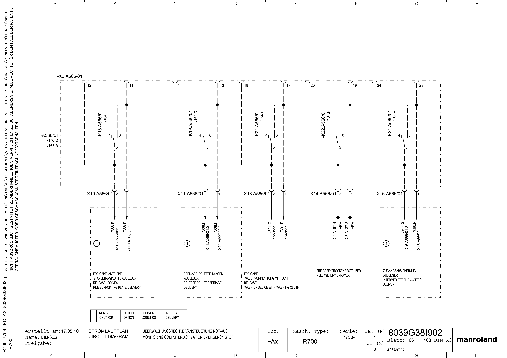

# +Ax — Sheet 166 of 403 — ÜBERWACHUNGSRECHNER/ANSTEUERUNG NOT AUS

**MONITORING COMPUTER/ACTIVATION EMERGENCY STOP**

> Part of the manroland **R700** printing press IEC/UL circuit diagrams.
> Drawing class: **Stromlaufplan / Circuit diagram** (DIN A3).
> Document `+Ax` covers the **Central control console** machine section.

## At a glance

| Field | Value |
|---|---|
| Document | `+Ax`  (8039G38I902) |
| Sheet | **166** of 403 |
| Section (DE) | ÜBERWACHUNGSRECHNER/ANSTEUERUNG NOT AUS |
| Section (EN) | MONITORING COMPUTER/ACTIVATION EMERGENCY STOP |
| Section type | CIRCUIT — Circuit diagram |
| Machine type | `R700` |
| Series | `7758` |
| Created | 17.05.10 |
| Replaces | — |
| Columns used | A, B, C, D, E, F, G |
| Path numbers | — |
| Labels on sheet | 104 |
| Cross-refs out | 15 |
| Cross-refs in | 35 |

**Previous:** [+Ax sheet 165](SHEET_0165.md) · **Next:** [+Ax sheet 167](SHEET_0167.md) · **Document TOC:** [_TOC.md](_TOC.md)  (+Ax) · **Master TOC:** [all sheets](../_MASTER_TOC.md)

## Sheet image (300 DPI, exact vector render)



_Rendered directly from the PDF vector layer at 300 DPI (1-bit), no OCR and no resampling. Use it to confirm anything ambiguous in the text below._

## Cross-references on this sheet

Each entry is a wire leaving this sheet. The printed token is `/sheet.column`; the link resolves to that sheet inside the same document.

| Ref | Target sheet | Col | Path | Destination on target | Target section | From col |
|---|---|---|---|---|---|---|
| `/164.H` | [+Ax sheet 164](SHEET_0164.md) | H | — | — | ÜBERWACHUNGSRECHNER/ANSTEUERUNG NOT AUS | G |
| `/164.E` | [+Ax sheet 164](SHEET_0164.md) | E | — | — | ÜBERWACHUNGSRECHNER/ANSTEUERUNG NOT AUS | D |
| `/164.F` | [+Ax sheet 164](SHEET_0164.md) | F | — | — | ÜBERWACHUNGSRECHNER/ANSTEUERUNG NOT AUS | F |
| `/164.C` | [+Ax sheet 164](SHEET_0164.md) | C | — | — | ÜBERWACHUNGSRECHNER/ANSTEUERUNG NOT AUS | B |
| `/164.D` | [+Ax sheet 164](SHEET_0164.md) | D | — | — | ÜBERWACHUNGSRECHNER/ANSTEUERUNG NOT AUS | C |
| `/170.D` | [+Ax sheet 170](SHEET_0170.md) | D | — | — | ÜBERWACHUNGSRECHNER/RÜCKMELDUNG NOT AUS | A |
| `/165.B` | [+Ax sheet 165](SHEET_0165.md) | B | — | — | ÜBERWACHUNGSRECHNER/ANSTEUERUNG NOT AUS | A |
| `/368.H` | [+Ax sheet 368](SHEET_0368.md) | H | — | — | OPTION: LOGISTIK AUSLEGER | G |
| `/368.E` | [+Ax sheet 368](SHEET_0368.md) | E | — | — | OPTION: LOGISTIK AUSLEGER | B |
| `/368.E` | [+Ax sheet 368](SHEET_0368.md) | E | — | — | OPTION: LOGISTIK AUSLEGER | B |
| `/368.G` | [+Ax sheet 368](SHEET_0368.md) | G | — | — | OPTION: LOGISTIK AUSLEGER | G |
| `/368.F` | [+Ax sheet 368](SHEET_0368.md) | F | — | — | OPTION: LOGISTIK AUSLEGER | C |
| `/368.F` | [+Ax sheet 368](SHEET_0368.md) | F | — | — | OPTION: LOGISTIK AUSLEGER | D |
| `/391.C` | [+Ax sheet 391](SHEET_0391.md) | C | — | — | OPTION: WASCHVORRICHTUNG MIT TUCH | E |
| `/391.F` | [+Ax sheet 391](SHEET_0391.md) | F | — | — | OPTION: WASCHVORRICHTUNG MIT TUCH | E |

### Incoming references (sheets that point here)

Every other sheet that sends a wire to this one. `Back-ref` is the token printed on *that* sheet; `Path` is its line number.

| From sheet | Cols | Back-ref | Path | Refs | What continues there |
|---|---|---|---|---|---|
| [+Ax#164](SHEET_0164.md) | C, D, E, F, H | `/164.C`, `/164.D`, `/164.E`, `/164.F`, `/164.H` | — | 5 | — |
| [+Ax#165](SHEET_0165.md) | B | `/165.B` | — | 1 | — |
| [+Ax#170](SHEET_0170.md) | D | `/170.D` | — | 1 | — |
| [+Ax#221](SHEET_0221.md) | A | `/221.A` | — | 10 | — |
| [+Ax#245](SHEET_0245.md) | H | `/245.H` | — | 2 | — |
| [+Ax#247](SHEET_0247.md) | G | `/247.G` | — | 2 | — |
| [+Ax#250](SHEET_0250.md) | F | `/250.F` | — | 2 | — |
| [+Ax#251](SHEET_0251.md) | H | `/251.H` | — | 2 | — |
| [+Ax#254](SHEET_0254.md) | G | `/254.G` | — | 2 | — |
| [+Ax#368](SHEET_0368.md) | D, F, G | `/368.D`, `/368.F`, `/368.G` | — | 6 | X10.A566\01:1; X10.A566\01:2; X11.A566\01:1; X11.A566\01:2; X16.A566\01:1; X16.A566\01:2 |
| [+Ax#391](SHEET_0391.md) | C, F | `/391.C`, `/391.F` | — | 2 | K548:23; K550:23 |


## Devices on this sheet

| Tag | Class | Class meaning (IEC) | Col | Sub | Terminal | Sign |
|---|---|---|---|---|---|---|
| `A566/01` | A | Baugruppe / assembly, module, PC board | A | 01 | — | — |
| `K550:23` | K | Relais / relay, contactor | E | — | 23 | — |
| `K548:23` | K | Relais / relay, contactor | E | — | 23 | — |
| `X5.A187:3` | — | cross-device reference | F | — | 3 | — |
| `X5.A187:4` | — | cross-device reference | F | — | 4 | — |
| `X11.A566\01:2` | — | cross-device reference | D | — | 2 | — |
| `X10.A566\01:1` | — | cross-device reference | B | — | 1 | — |
| `X10.A566\01:2` | — | cross-device reference | B | — | 2 | — |
| `X11.A566\01:1` | — | cross-device reference | D | — | 1 | — |
| `X16.A566\01:1` | — | cross-device reference | G | — | 1 | — |
| `X16.A566\01:2` | — | cross-device reference | G | — | 2 | — |

## Potentials / nets

_No named potentials on this sheet._

## Wire-end annotations (grouped as printed)

A wire that continues elsewhere is annotated with a small cluster: the destination description, the path/line number `#NN`, and the `/sheet.column` cross reference. Each row below is one such cluster exactly as it is grouped on the drawing.

| Col | Y | Path | Cross-ref | Text on the wire |
|---|---|---|---|---|
| A | 174.6 | — | — | `X2.A566/01` |
| B | 197.3 | — | — | `12` |
| B | 197.3 | — | — | `11` |
| E | 197.3 | — | — | `14 13 18 17 20 19 24 23` |
| B | 258.8 | — | — | `K18.A566/01` |
| C | 258.8 | — | — | `K19.A566/01` |
| D | 258.8 | — | — | `K21.A566/01` |
| E | 258.8 | — | — | `K22.A566/01` |
| G | 258.8 | — | — | `K24.A566/01` |
| G | 259.9 | — | `/164.H` | — |
| D | 260.2 | — | `/164.E` | — |
| B | 260.5 | — | `/164.C` | — |
| C | 260.5 | — | `/164.D` | — |
| F | 260.5 | — | `/164.F` | — |
| A | 313.5 | — | — | `A566/01` |
| B | 314.3 | — | — | `4` |
| B | 314.3 | — | — | `6` |
| C | 314.3 | — | — | `4` |
| D | 314.3 | — | — | `6` |
| E | 314.3 | — | — | `4` |
| E | 314.3 | — | — | `6` |
| F | 314.3 | — | — | `4` |
| F | 314.3 | — | — | `6` |
| G | 314.3 | — | — | `4` |
| G | 314.3 | — | — | `6` |
| A | 326.6 | — | `/170.D`, `/165.B` | — |
| B | 342.6 | — | — | `5` |
| D | 342.6 | — | — | `5` |
| E | 342.6 | — | — | `5` |
| F | 342.6 | — | — | `5` |
| G | 342.6 | — | — | `5` |
| B | 451.0 | — | — | `X10.A566/01 2 1` |
| E | 451.0 | — | — | `X11.A566/01 2 1 X13.A566/01 2 1 X14.A566/01 2 1 2 1` |
| G | 451.0 | — | — | `X16.A566/01` |
| G | 520.7 | — | `/368.H` | — |
| B | 521.0 | — | `/368.E` | — |
| B | 521.0 | — | `/368.E` | — |
| G | 521.0 | — | `/368.G` | — |
| C | 521.3 | — | `/368.F` | — |
| D | 521.3 | — | `/368.F` | — |
| E | 521.3 | — | `/391.C` | — |
| E | 521.3 | — | `/391.F` | — |
| F | 521.3 | — | — | `X5.A187:4` |
| F | 521.3 | — | — | `X5.A187:3` |
| F | 521.6 | — | — | `+EA` |
| F | 521.6 | — | — | `+EA` |
| B | 529.8 | — | — | `X10.A566\01:1` |
| D | 529.8 | — | — | `X11.A566\01:1` |
| G | 529.8 | — | — | `X16.A566\01:1` |
| B | 530.9 | — | — | `X10.A566\01:2` |
| D | 530.9 | — | — | `X11.A566\01:2` |
| G | 530.9 | — | — | `X16.A566\01:2` |
| E | 531.2 | — | — | `K550:23` |
| E | 531.2 | — | — | `K548:23` |
| B | 569.5 | — | — | `1` |
| E | 569.5 | — | — | `1 1` |
| E | 634.2 | — | — | `FREIGABE: FREIGABE: TROCKENBESTÄUBER RELEASE: DRY SPRAYER` |
| G | 634.2 | — | — | `INTERMEDIATE PILE CONTROL DELIVERY ZUGANGSABSICHERUNG AUSLEGER` |
| B | 641.2 | — | — | `FREIGABE: ANTRIEBE` |
| C | 641.2 | — | — | `FREIGABE: PALETTENWAGEN` |
| B | 651.9 | — | — | `RELEASE_ DRIVES PILE SUPPORTING PLATE DELIVERY STAPELTRAGPLATTE AUSLEGER` |
| C | 651.9 | — | — | `RELEASE PALLET CARRIAGE DELIVERY AUSLEGER` |
| E | 651.9 | — | — | `RELEASE: WASCHVORRICHTUNG MIT TUCH` |
| E | 673.1 | — | — | `WASH UP DEVICE WITH WASHING CLOTH` |
| B | 733.3 | — | — | `1 NUR BEI` |
| B | 733.4 | — | — | `OPTION OPTION` |
| C | 733.4 | — | — | `LOGISTIK LOGISTICS` |
| C | 733.4 | — | — | `DELIVERY AUSLEGER` |
| B | 744.0 | — | — | `ONLY FOR` |


## Notes and free text on this sheet

| Text | Col | Y (pt) |
|---|---|---|
| `K18.A566/01` | B | 258.8 |
| `X10.A566/01` | B | 451.01 |
| `K19.A566/01` | C | 258.8 |
| `K21.A566/01` | D | 258.8 |
| `K22.A566/01` | E | 258.8 |
| `K24.A566/01` | G | 258.8 |
| `X11.A566/01` | C | 451.01 |
| `X14.A566/01` | E | 451.01 |
| `X13.A566/01` | D | 451.01 |
| `+EA` | F | 521.58 |
| `X2.A566/01` | A | 174.64 |
| `FREIGABE: ANTRIEBE` | B | 641.23 |
| `STAPELTRAGPLATTE AUSLEGER` | B | 651.88 |
| `RELEASE_ DRIVES` | B | 662.5 |
| `PILE SUPPORTING PLATE DELIVERY` | B | 673.14 |
| `X16.A566/01` | G | 451.01 |
| `FREIGABE: PALETTENWAGEN` | C | 641.22 |
| `AUSLEGER` | C | 651.89 |
| `RELEASE PALLET CARRIAGE` | C | 662.51 |
| `DELIVERY` | C | 673.13 |
| `ZUGANGSABSICHERUNG` | G | 634.18 |
| `AUSLEGER` | G | 644.81 |
| `INTERMEDIATE PILE CONTROL` | G | 655.44 |
| `DELIVERY` | G | 666.05 |
| `NUR BEI` | B | 733.33 |
| `ONLY FOR` | B | 744.02 |
| `OPTION` | B | 733.35 |
| `LOGISTIK` | C | 733.35 |
| `LOGISTICS` | C | 743.98 |
| `FREIGABE: TROCKENBESTÄUBER` | F | 634.16 |
| `RELEASE: DRY SPRAYER` | F | 644.79 |
| `FREIGABE:` | D | 641.2 |
| `WASCHVORRICHTUNG MIT TUCH` | E | 651.9 |
| `RELEASE:` | D | 662.46 |
| `WASH UP DEVICE WITH WASHING CLOTH` | E | 673.12 |

## Complete label inventory (exact text from the drawing)

Every text object inside the drawing area of this sheet, in DIN reading order (column A→H, then top→bottom). This is the authoritative list: if a string is not here it is not printed on this sheet.

| Col | Y | X | Dir | Type | Text |
|---|---|---|---|---|---|
| A | 174.6 | 134.4 | → | text | `X2.A566/01` |
| A | 313.5 | 95.0 | → | device tag | `A566/01` |
| A | 326.6 | 110.6 | → | cross-reference | `/170.D` |
| A | 339.0 | 110.8 | → | cross-reference | `/165.B` |
| B | 197.3 | 204.7 | → | number | `12` |
| B | 197.3 | 303.9 | → | number | `11` |
| B | 258.8 | 229.9 | ↕ | text | `K18.A566/01` |
| B | 260.5 | 243.0 | ↕ | cross-reference | `/164.C` |
| B | 314.3 | 254.8 | → | number | `4` |
| B | 314.3 | 278.9 | → | number | `6` |
| B | 342.6 | 271.8 | → | number | `5` |
| B | 451.0 | 200.7 | → | text | `X10.A566/01` |
| B | 452.5 | 271.8 | → | number | `2` |
| B | 452.5 | 299.6 | → | number | `1` |
| B | 521.0 | 261.1 | ↕ | cross-reference | `/368.E` |
| B | 521.0 | 289.4 | ↕ | cross-reference | `/368.E` |
| B | 529.8 | 299.3 | ↕ | device ref | `X10.A566\01:1` |
| B | 530.9 | 271.0 | ↕ | device ref | `X10.A566\01:2` |
| B | 569.5 | 225.0 | → | number | `1` |
| B | 641.2 | 218.8 | → | text | `FREIGABE: ANTRIEBE` |
| B | 651.9 | 219.4 | → | text | `STAPELTRAGPLATTE AUSLEGER` |
| B | 662.5 | 218.8 | → | text | `RELEASE_ DRIVES` |
| B | 673.1 | 218.8 | → | text | `PILE SUPPORTING PLATE DELIVERY` |
| B | 733.3 | 233.0 | → | text | `NUR BEI` |
| B | 733.4 | 290.3 | → | text | `OPTION` |
| B | 738.7 | 217.1 | → | number | `1` |
| B | 744.0 | 233.6 | → | text | `ONLY FOR` |
| B | 744.0 | 290.3 | → | text | `OPTION` |
| C | 197.3 | 417.3 | → | number | `14` |
| C | 258.8 | 442.5 | ↕ | text | `K19.A566/01` |
| C | 260.5 | 455.6 | ↕ | cross-reference | `/164.D` |
| C | 314.3 | 467.4 | → | number | `4` |
| C | 451.0 | 413.3 | → | text | `X11.A566/01` |
| C | 521.3 | 473.7 | ↕ | cross-reference | `/368.F` |
| C | 569.5 | 437.6 | → | number | `1` |
| C | 641.2 | 431.4 | → | text | `FREIGABE: PALETTENWAGEN` |
| C | 651.9 | 432.3 | → | text | `AUSLEGER` |
| C | 662.5 | 431.4 | → | text | `RELEASE PALLET CARRIAGE` |
| C | 673.1 | 431.4 | → | text | `DELIVERY` |
| C | 733.4 | 332.2 | → | text | `LOGISTIK` |
| C | 733.4 | 389.8 | → | text | `AUSLEGER` |
| C | 744.0 | 332.2 | → | text | `LOGISTICS` |
| C | 744.0 | 388.9 | → | text | `DELIVERY` |
| D | 197.3 | 516.5 | → | number | `13` |
| D | 197.3 | 573.2 | → | number | `18` |
| D | 258.8 | 598.4 | ↕ | text | `K21.A566/01` |
| D | 260.2 | 611.5 | ↕ | cross-reference | `/164.E` |
| D | 314.3 | 491.5 | → | number | `6` |
| D | 342.6 | 484.4 | → | number | `5` |
| D | 451.0 | 569.2 | → | text | `X13.A566/01` |
| D | 452.5 | 484.4 | → | number | `2` |
| D | 452.5 | 512.2 | → | number | `1` |
| D | 521.3 | 502.0 | ↕ | cross-reference | `/368.F` |
| D | 529.8 | 511.9 | ↕ | device ref | `X11.A566\01:1` |
| D | 530.9 | 483.6 | ↕ | device ref | `X11.A566\01:2` |
| D | 641.2 | 573.2 | → | text | `FREIGABE:` |
| D | 662.5 | 573.2 | → | text | `RELEASE:` |
| E | 197.3 | 672.4 | → | number | `17` |
| E | 197.3 | 729.6 | → | number | `20` |
| E | 258.8 | 754.3 | ↕ | text | `K22.A566/01` |
| E | 314.3 | 623.3 | → | number | `4` |
| E | 314.3 | 647.4 | → | number | `6` |
| E | 342.6 | 640.3 | → | number | `5` |
| E | 451.0 | 725.1 | → | text | `X14.A566/01` |
| E | 452.5 | 640.3 | → | number | `2` |
| E | 452.5 | 668.1 | → | number | `1` |
| E | 521.3 | 629.6 | ↕ | cross-reference | `/391.C` |
| E | 521.3 | 657.9 | ↕ | cross-reference | `/391.F` |
| E | 531.2 | 639.5 | ↕ | device tag | `K550:23` |
| E | 531.2 | 667.9 | ↕ | device tag | `K548:23` |
| E | 651.9 | 574.0 | → | text | `WASCHVORRICHTUNG MIT TUCH` |
| E | 673.1 | 574.0 | → | text | `WASH UP DEVICE WITH WASHING CLOTH` |
| F | 197.3 | 828.3 | → | number | `19` |
| F | 197.3 | 885.5 | → | number | `24` |
| F | 260.5 | 767.4 | ↕ | cross-reference | `/164.F` |
| F | 314.3 | 779.2 | → | number | `4` |
| F | 314.3 | 803.3 | → | number | `6` |
| F | 342.6 | 796.3 | → | number | `5` |
| F | 452.5 | 796.3 | → | number | `2` |
| F | 452.5 | 824.0 | → | number | `1` |
| F | 521.3 | 781.9 | ↕ | device ref | `X5.A187:4` |
| F | 521.3 | 810.3 | ↕ | device ref | `X5.A187:3` |
| F | 521.6 | 796.1 | ↕ | text | `+EA` |
| F | 521.6 | 824.4 | ↕ | text | `+EA` |
| F | 634.2 | 743.2 | → | text | `FREIGABE: TROCKENBESTÄUBER` |
| F | 644.8 | 743.2 | → | text | `RELEASE: DRY SPRAYER` |
| G | 197.3 | 984.8 | → | number | `23` |
| G | 258.8 | 910.2 | ↕ | text | `K24.A566/01` |
| G | 259.9 | 923.3 | ↕ | cross-reference | `/164.H` |
| G | 314.3 | 935.1 | → | number | `4` |
| G | 314.3 | 959.2 | → | number | `6` |
| G | 342.6 | 952.2 | → | number | `5` |
| G | 451.0 | 881.0 | → | text | `X16.A566/01` |
| G | 452.5 | 952.2 | → | number | `2` |
| G | 452.5 | 979.9 | → | number | `1` |
| G | 520.7 | 969.7 | ↕ | cross-reference | `/368.H` |
| G | 521.0 | 941.4 | ↕ | cross-reference | `/368.G` |
| G | 529.8 | 979.7 | ↕ | device ref | `X16.A566\01:1` |
| G | 530.9 | 951.3 | ↕ | device ref | `X16.A566\01:2` |
| G | 569.5 | 905.3 | → | number | `1` |
| G | 634.2 | 900.0 | → | text | `ZUGANGSABSICHERUNG` |
| G | 644.8 | 900.0 | → | text | `AUSLEGER` |
| G | 655.4 | 899.1 | → | text | `INTERMEDIATE PILE CONTROL` |
| G | 666.0 | 899.1 | → | text | `DELIVERY` |

## Reading-order text block

The same content as a plain block, grouped by DIN column — convenient to paste or to match against a visual description.

```text
=== Column A ===
 174.6  134.4  text         X2.A566/01
 313.5   95.0  devtag       A566/01
 326.6  110.6  xref         /170.D
 339.0  110.8  xref         /165.B
=== Column B ===
 197.3  204.7  numeric      12
 197.3  303.9  numeric      11
 258.8  229.9  text         K18.A566/01
 260.5  243.0  xref         /164.C
 314.3  254.8  numeric      4
 314.3  278.9  numeric      6
 342.6  271.8  numeric      5
 451.0  200.7  text         X10.A566/01
 452.5  271.8  numeric      2
 452.5  299.6  numeric      1
 521.0  261.1  xref         /368.E
 521.0  289.4  xref         /368.E
 529.8  299.3  devref       X10.A566\01:1
 530.9  271.0  devref       X10.A566\01:2
 569.5  225.0  numeric      1
 641.2  218.8  text         FREIGABE: ANTRIEBE
 651.9  219.4  text         STAPELTRAGPLATTE AUSLEGER
 662.5  218.8  text         RELEASE_ DRIVES
 673.1  218.8  text         PILE SUPPORTING PLATE DELIVERY
 733.3  233.0  text         NUR BEI
 733.4  290.3  text         OPTION
 738.7  217.1  numeric      1
 744.0  233.6  text         ONLY FOR
 744.0  290.3  text         OPTION
=== Column C ===
 197.3  417.3  numeric      14
 258.8  442.5  text         K19.A566/01
 260.5  455.6  xref         /164.D
 314.3  467.4  numeric      4
 451.0  413.3  text         X11.A566/01
 521.3  473.7  xref         /368.F
 569.5  437.6  numeric      1
 641.2  431.4  text         FREIGABE: PALETTENWAGEN
 651.9  432.3  text         AUSLEGER
 662.5  431.4  text         RELEASE PALLET CARRIAGE
 673.1  431.4  text         DELIVERY
 733.4  332.2  text         LOGISTIK
 733.4  389.8  text         AUSLEGER
 744.0  332.2  text         LOGISTICS
 744.0  388.9  text         DELIVERY
=== Column D ===
 197.3  516.5  numeric      13
 197.3  573.2  numeric      18
 258.8  598.4  text         K21.A566/01
 260.2  611.5  xref         /164.E
 314.3  491.5  numeric      6
 342.6  484.4  numeric      5
 451.0  569.2  text         X13.A566/01
 452.5  484.4  numeric      2
 452.5  512.2  numeric      1
 521.3  502.0  xref         /368.F
 529.8  511.9  devref       X11.A566\01:1
 530.9  483.6  devref       X11.A566\01:2
 641.2  573.2  text         FREIGABE:
 662.5  573.2  text         RELEASE:
=== Column E ===
 197.3  672.4  numeric      17
 197.3  729.6  numeric      20
 258.8  754.3  text         K22.A566/01
 314.3  623.3  numeric      4
 314.3  647.4  numeric      6
 342.6  640.3  numeric      5
 451.0  725.1  text         X14.A566/01
 452.5  640.3  numeric      2
 452.5  668.1  numeric      1
 521.3  629.6  xref         /391.C
 521.3  657.9  xref         /391.F
 531.2  639.5  devtag       K550:23
 531.2  667.9  devtag       K548:23
 651.9  574.0  text         WASCHVORRICHTUNG MIT TUCH
 673.1  574.0  text         WASH UP DEVICE WITH WASHING CLOTH
=== Column F ===
 197.3  828.3  numeric      19
 197.3  885.5  numeric      24
 260.5  767.4  xref         /164.F
 314.3  779.2  numeric      4
 314.3  803.3  numeric      6
 342.6  796.3  numeric      5
 452.5  796.3  numeric      2
 452.5  824.0  numeric      1
 521.3  781.9  devref       X5.A187:4
 521.3  810.3  devref       X5.A187:3
 521.6  796.1  text         +EA
 521.6  824.4  text         +EA
 634.2  743.2  text         FREIGABE: TROCKENBESTÄUBER
 644.8  743.2  text         RELEASE: DRY SPRAYER
=== Column G ===
 197.3  984.8  numeric      23
 258.8  910.2  text         K24.A566/01
 259.9  923.3  xref         /164.H
 314.3  935.1  numeric      4
 314.3  959.2  numeric      6
 342.6  952.2  numeric      5
 451.0  881.0  text         X16.A566/01
 452.5  952.2  numeric      2
 452.5  979.9  numeric      1
 520.7  969.7  xref         /368.H
 521.0  941.4  xref         /368.G
 529.8  979.7  devref       X16.A566\01:1
 530.9  951.3  devref       X16.A566\01:2
 569.5  905.3  numeric      1
 634.2  900.0  text         ZUGANGSABSICHERUNG
 644.8  900.0  text         AUSLEGER
 655.4  899.1  text         INTERMEDIATE PILE CONTROL
 666.0  899.1  text         DELIVERY
```

---
_Generated from the PDF vector text layer; no OCR. Source: `R700_7758_IEC_AX_8039G38I902_p`, sheet 166._
