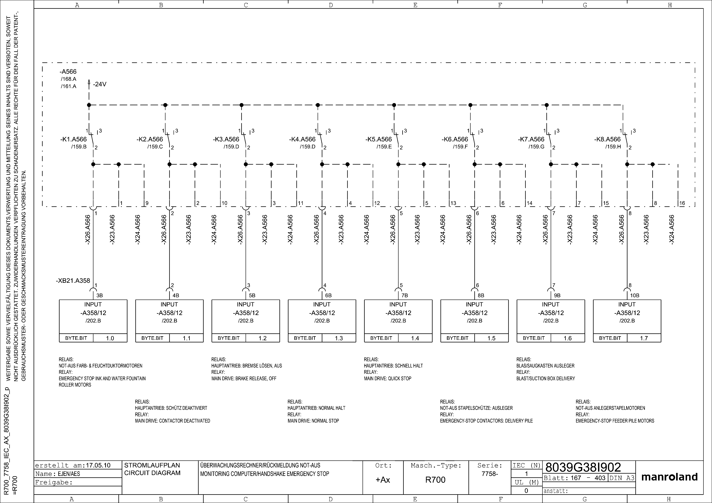

# +Ax — Sheet 167 of 403 — ÜBERWACHUNGSRECHNER/RÜCKMELDUNG NOT AUS

**MONITORING COMPUTER/HANDSHAKE EMERGENCY STOP**

> Part of the manroland **R700** printing press IEC/UL circuit diagrams.
> Drawing class: **Stromlaufplan / Circuit diagram** (DIN A3).
> Document `+Ax` covers the **Central control console** machine section.

## At a glance

| Field | Value |
|---|---|
| Document | `+Ax`  (8039G38I902) |
| Sheet | **167** of 403 |
| Section (DE) | ÜBERWACHUNGSRECHNER/RÜCKMELDUNG NOT AUS |
| Section (EN) | MONITORING COMPUTER/HANDSHAKE EMERGENCY STOP |
| Section type | CIRCUIT — Circuit diagram |
| Machine type | `R700` |
| Series | `7758` |
| Created | 17.05.10 |
| Replaces | — |
| Columns used | A, B, C, D, E, F, G, H |
| Path numbers | — |
| Labels on sheet | 182 |
| Cross-refs out | 18 |
| Cross-refs in | 50 |

**Previous:** [+Ax sheet 166](SHEET_0166.md) · **Next:** [+Ax sheet 168](SHEET_0168.md) · **Document TOC:** [_TOC.md](_TOC.md)  (+Ax) · **Master TOC:** [all sheets](../_MASTER_TOC.md)

## Sheet image (300 DPI, exact vector render)



_Rendered directly from the PDF vector layer at 300 DPI (1-bit), no OCR and no resampling. Use it to confirm anything ambiguous in the text below._

## Cross-references on this sheet

Each entry is a wire leaving this sheet. The printed token is `/sheet.column`; the link resolves to that sheet inside the same document.

| Ref | Target sheet | Col | Path | Destination on target | Target section | From col |
|---|---|---|---|---|---|---|
| `/168.A` | [+Ax sheet 168](SHEET_0168.md) | A | — | — | ÜBERWACHUNGSRECHNER/RÜCKMELDUNG NOT AUS | A |
| `/161.A` | [+Ax sheet 161](SHEET_0161.md) | A | — | — | ÜBERWACHUNGSRECHNER/ANSTEUERUNG NOT AUS | A |
| `/159.B` | [+Ax sheet 159](SHEET_0159.md) | B | — | — | ÜBERWACHUNGSRECHNER/ANSTEUERUNG NOT AUS | A |
| `/159.E` | [+Ax sheet 159](SHEET_0159.md) | E | — | — | ÜBERWACHUNGSRECHNER/ANSTEUERUNG NOT AUS | E |
| `/159.F` | [+Ax sheet 159](SHEET_0159.md) | F | — | — | ÜBERWACHUNGSRECHNER/ANSTEUERUNG NOT AUS | F |
| `/159.G` | [+Ax sheet 159](SHEET_0159.md) | G | — | — | ÜBERWACHUNGSRECHNER/ANSTEUERUNG NOT AUS | F |
| `/159.C` | [+Ax sheet 159](SHEET_0159.md) | C | — | — | ÜBERWACHUNGSRECHNER/ANSTEUERUNG NOT AUS | B |
| `/159.D` | [+Ax sheet 159](SHEET_0159.md) | D | — | — | ÜBERWACHUNGSRECHNER/ANSTEUERUNG NOT AUS | C |
| `/159.D` | [+Ax sheet 159](SHEET_0159.md) | D | — | — | ÜBERWACHUNGSRECHNER/ANSTEUERUNG NOT AUS | D |
| `/159.H` | [+Ax sheet 159](SHEET_0159.md) | H | — | — | ÜBERWACHUNGSRECHNER/ANSTEUERUNG NOT AUS | G |
| `/202.B` | [+Ax sheet 202](SHEET_0202.md) | B | — | — | REFERENZMODUL | A |
| `/202.B` | [+Ax sheet 202](SHEET_0202.md) | B | — | — | REFERENZMODUL | B |
| `/202.B` | [+Ax sheet 202](SHEET_0202.md) | B | — | — | REFERENZMODUL | C |
| `/202.B` | [+Ax sheet 202](SHEET_0202.md) | B | — | — | REFERENZMODUL | D |
| `/202.B` | [+Ax sheet 202](SHEET_0202.md) | B | — | — | REFERENZMODUL | E |
| `/202.B` | [+Ax sheet 202](SHEET_0202.md) | B | — | — | REFERENZMODUL | F |
| `/202.B` | [+Ax sheet 202](SHEET_0202.md) | B | — | — | REFERENZMODUL | G |
| `/202.B` | [+Ax sheet 202](SHEET_0202.md) | B | — | — | REFERENZMODUL | G |

### Incoming references (sheets that point here)

Every other sheet that sends a wire to this one. `Back-ref` is the token printed on *that* sheet; `Path` is its line number.

| From sheet | Cols | Back-ref | Path | Refs | What continues there |
|---|---|---|---|---|---|
| [+Ax#159](SHEET_0159.md) | B, C, D, E, F, G, H | `/159.B`, `/159.C`, `/159.D`, `/159.E`, `/159.F`, `/159.G`, `/159.H` | — | 8 | — |
| [+Ax#161](SHEET_0161.md) | A | `/161.A` | — | 1 | — |
| [+Ax#168](SHEET_0168.md) | A | `/168.A` | — | 1 | — |
| [+Ax#202](SHEET_0202.md) | B | `/202.B` | — | 8 | — |
| [+Ax#261](SHEET_0261.md) | C | `/261.C` | — | 8 | — |
| [+Ax#265](SHEET_0265.md) | B | `/265.B` | — | 8 | — |
| [+Ax#266](SHEET_0266.md) | F | `/266.F` | — | 8 | — |
| [+Ax#269](SHEET_0269.md) | D, E | `/269.D`, `/269.E` | — | 8 | — |


## Devices on this sheet

| Tag | Class | Class meaning (IEC) | Col | Sub | Terminal | Sign |
|---|---|---|---|---|---|---|
| `A358/12` | A | Baugruppe / assembly, module, PC board | A | 12 | — | — |
| `A358/12` | A | Baugruppe / assembly, module, PC board | B | 12 | — | — |
| `A358/12` | A | Baugruppe / assembly, module, PC board | C | 12 | — | — |
| `A358/12` | A | Baugruppe / assembly, module, PC board | D | 12 | — | — |
| `A358/12` | A | Baugruppe / assembly, module, PC board | E | 12 | — | — |
| `A358/12` | A | Baugruppe / assembly, module, PC board | F | 12 | — | — |
| `A358/12` | A | Baugruppe / assembly, module, PC board | G | 12 | — | — |
| `A358/12` | A | Baugruppe / assembly, module, PC board | G | 12 | — | — |
| `A566` | A | Baugruppe / assembly, module, PC board | A | — | — | — |
| `K1.A566` | — | cross-device reference | A | — | — | — |
| `1.0` | — | cross-device reference | A | — | — | — |
| `1.1` | — | cross-device reference | B | — | — | — |
| `1.2` | — | cross-device reference | C | — | — | — |
| `1.3` | — | cross-device reference | D | — | — | — |
| `1.4` | — | cross-device reference | E | — | — | — |
| `1.5` | — | cross-device reference | F | — | — | — |
| `1.6` | — | cross-device reference | G | — | — | — |
| `1.7` | — | cross-device reference | H | — | — | — |
| `K2.A566` | — | cross-device reference | B | — | — | — |
| `K4.A566` | — | cross-device reference | D | — | — | — |
| `K3.A566` | — | cross-device reference | C | — | — | — |
| `K5.A566` | — | cross-device reference | E | — | — | — |
| `K6.A566` | — | cross-device reference | E | — | — | — |
| `K8.A566` | — | cross-device reference | G | — | — | — |
| `K7.A566` | — | cross-device reference | F | — | — | — |
| `X26.A566` | — | cross-device reference | A | — | — | — |
| `X26.A566` | — | cross-device reference | B | — | — | — |
| `X26.A566` | — | cross-device reference | C | — | — | — |
| `X26.A566` | — | cross-device reference | D | — | — | — |
| `X26.A566` | — | cross-device reference | E | — | — | — |
| `X26.A566` | — | cross-device reference | F | — | — | — |
| `X26.A566` | — | cross-device reference | G | — | — | — |
| `X26.A566` | — | cross-device reference | G | — | — | — |
| `XB21.A358` | — | cross-device reference | A | — | — | — |
| `X23.A566` | — | cross-device reference | A | — | — | — |
| `X24.A566` | — | cross-device reference | B | — | — | — |
| `X23.A566` | — | cross-device reference | B | — | — | — |
| `X24.A566` | — | cross-device reference | C | — | — | — |
| `X23.A566` | — | cross-device reference | C | — | — | — |
| `X24.A566` | — | cross-device reference | D | — | — | — |
| `X23.A566` | — | cross-device reference | D | — | — | — |
| `X24.A566` | — | cross-device reference | D | — | — | — |
| `X23.A566` | — | cross-device reference | E | — | — | — |
| `X24.A566` | — | cross-device reference | E | — | — | — |
| `X23.A566` | — | cross-device reference | F | — | — | — |
| `X24.A566` | — | cross-device reference | F | — | — | — |
| `X23.A566` | — | cross-device reference | G | — | — | — |
| `X24.A566` | — | cross-device reference | G | — | — | — |
| `X23.A566` | — | cross-device reference | H | — | — | — |
| `X24.A566` | — | cross-device reference | H | — | — | — |

## Potentials / nets

| Potential | Count | Columns | Attached devices | Terminals |
|---|---|---|---|---|
| `24V` | 1 | A | — | — |


A potential such as `L24+/4` or `M24+` is a named supply/return rail; every place it appears on this sheet is electrically common.

## Wire-end annotations (grouped as printed)

A wire that continues elsewhere is annotated with a small cluster: the destination description, the path/line number `#NN`, and the `/sheet.column` cross reference. Each row below is one such cluster exactly as it is grouped on the drawing.

| Col | Y | Path | Cross-ref | Text on the wire |
|---|---|---|---|---|
| A | 115.1 | — | — | `A566` |
| A | 128.2 | — | `/168.A`, `/161.A` | — |
| A | 136.4 | — | — | `24V` |
| A | 215.1 | — | — | `K1.A566 3` |
| A | 215.1 | — | — | `1` |
| B | 215.1 | — | — | `K2.A566 3` |
| B | 215.1 | — | — | `1` |
| C | 215.1 | — | — | `K3.A566 3` |
| C | 215.1 | — | — | `1` |
| D | 215.1 | — | — | `K4.A566 3` |
| D | 215.1 | — | — | `1` |
| E | 215.1 | — | — | `K5.A566 3` |
| E | 215.1 | — | — | `1` |
| F | 215.1 | — | — | `K6.A566 3` |
| F | 215.1 | — | — | `1` |
| F | 215.1 | — | — | `K7.A566 3` |
| G | 215.1 | — | — | `1` |
| G | 215.1 | — | — | `K8.A566 3` |
| G | 215.1 | — | — | `1` |
| A | 241.6 | — | `/159.B` | — |
| B | 241.6 | — | `/159.C` | — |
| C | 241.6 | — | `/159.D` | — |
| D | 241.6 | — | `/159.D` | — |
| E | 241.6 | — | `/159.E` | — |
| F | 241.6 | — | `/159.F` | — |
| F | 241.6 | — | `/159.G` | — |
| G | 241.6 | — | `/159.H` | — |
| A | 243.4 | — | — | `2` |
| B | 243.4 | — | — | `2` |
| C | 243.4 | — | — | `2` |
| D | 243.4 | — | — | `2` |
| E | 243.4 | — | — | `2` |
| F | 243.4 | — | — | `2` |
| G | 243.4 | — | — | `2` |
| H | 243.4 | — | — | `2` |
| E | 336.2 | — | — | `1 9 2 10 3 11 4 12 5 13 6 14 7 15 8 16` |
| A | 353.2 | — | — | `1` |
| B | 353.2 | — | — | `2` |
| C | 353.2 | — | — | `3` |
| D | 353.2 | — | — | `4` |
| E | 353.2 | — | — | `5` |
| F | 353.2 | — | — | `6` |
| G | 353.2 | — | — | `7` |
| H | 353.2 | — | — | `8` |
| A | 359.4 | — | — | `X26.A566` |
| A | 359.4 | — | — | `X23.A566` |
| B | 359.4 | — | — | `X24.A566` |
| B | 359.4 | — | — | `X26.A566` |
| B | 359.4 | — | — | `X23.A566` |
| C | 359.4 | — | — | `X24.A566` |
| C | 359.4 | — | — | `X26.A566` |
| C | 359.4 | — | — | `X23.A566` |
| D | 359.4 | — | — | `X24.A566` |
| D | 359.4 | — | — | `X26.A566` |
| D | 359.4 | — | — | `X23.A566` |
| D | 359.4 | — | — | `X24.A566` |
| E | 359.4 | — | — | `X26.A566` |
| E | 359.4 | — | — | `X23.A566` |
| E | 359.4 | — | — | `X24.A566` |
| F | 359.4 | — | — | `X26.A566` |
| F | 359.4 | — | — | `X23.A566` |
| F | 359.4 | — | — | `X24.A566` |
| G | 359.4 | — | — | `X26.A566` |
| G | 359.4 | — | — | `X23.A566` |
| G | 359.4 | — | — | `X24.A566` |
| G | 359.4 | — | — | `X26.A566` |
| H | 359.4 | — | — | `X23.A566` |
| H | 359.4 | — | — | `X24.A566` |
| A | 465.2 | — | — | `XB21.A358 1` |
| E | 473.7 | — | — | `2 3 4 5 6 7 8` |
| A | 490.7 | — | — | `3B` |
| B | 490.7 | — | — | `4B` |
| C | 490.7 | — | — | `5B` |
| D | 490.7 | — | — | `6B` |
| E | 490.7 | — | — | `7B` |
| F | 490.7 | — | — | `8B` |
| G | 490.7 | — | — | `9B` |
| H | 490.7 | — | — | `10B` |
| A | 505.2 | — | — | `INPUT` |
| B | 505.2 | — | — | `INPUT` |
| C | 505.2 | — | — | `INPUT` |
| D | 505.2 | — | — | `INPUT` |
| E | 505.2 | — | — | `INPUT` |
| F | 505.2 | — | — | `INPUT` |
| G | 505.2 | — | — | `INPUT` |
| G | 505.2 | — | — | `INPUT` |
| A | 519.0 | — | — | `A358/12` |
| B | 519.0 | — | — | `A358/12` |
| C | 519.0 | — | — | `A358/12` |
| D | 519.0 | — | — | `A358/12` |
| E | 519.0 | — | — | `A358/12` |
| F | 519.0 | — | — | `A358/12` |
| G | 519.0 | — | — | `A358/12` |
| G | 519.0 | — | — | `A358/12` |
| A | 532.8 | — | `/202.B` | — |
| B | 532.8 | — | `/202.B` | — |
| C | 532.8 | — | `/202.B` | — |
| D | 532.8 | — | `/202.B` | — |
| E | 532.8 | — | `/202.B` | — |
| F | 532.8 | — | `/202.B` | — |
| G | 532.8 | — | `/202.B` | — |
| G | 532.8 | — | `/202.B` | — |
| A | 561.9 | — | — | `BYTE.BIT 1.0` |
| B | 561.9 | — | — | `BYTE.BIT 1.1` |
| C | 561.9 | — | — | `BYTE.BIT 1.2` |
| D | 561.9 | — | — | `BYTE.BIT 1.3` |
| E | 561.9 | — | — | `BYTE.BIT 1.4` |
| F | 561.9 | — | — | `BYTE.BIT 1.5` |
| G | 561.9 | — | — | `BYTE.BIT 1.6` |
| G | 561.9 | — | — | `BYTE.BIT 1.7` |
| A | 598.7 | — | — | `RELAIS: NOT AUS FARB & FEUCHTDUKTORMOTOREN RELAY: EMERGENCY STOP INK AND WATER FOUNTAIN ROLLER MOTORS` |
| C | 598.7 | — | — | `RELAIS: HAUPTANTRIEB: BREMSE LÖSEN, AUS RELAY: MAIN DRIVE: BRAKE RELEASE, OFF` |
| E | 598.7 | — | — | `RELAIS: HAUPTANTRIEB: SCHNELL HALT RELAY: MAIN DRIVE: QUICK STOP` |
| G | 598.7 | — | — | `RELAIS: BLAS/SAUGKASTEN AUSLEGER RELAY: BLAST/SUCTION BOX DELIVERY` |
| B | 669.5 | — | — | `RELAIS: HAUPTANTRIEB: SCHÜTZ DEAKTIVIERT RELAY: MAIN DRIVE: CONTACTOR DEACTIVATED` |
| D | 669.5 | — | — | `RELAIS: HAUPTANTRIEB: NORMAL HALT RELAY: MAIN DRIVE: NORMAL STOP` |
| F | 669.5 | — | — | `RELAIS: NOT AUS STAPELSCHÜTZE: AUSLEGER RELAY: EMERGENCY STOP CONTACTORS: DELIVERY PILE` |
| G | 669.5 | — | — | `RELAIS: NOT AUS ANLEGERSTAPELMOTOREN RELAY: EMERGENCY STOP FEEDER PILE MOTORS` |


## Reconstructed tables

This sheet carries tabular content (pin map / terminal assignment / index). The grid below was rebuilt from the drawing's own rule lines, so each row is exactly one physical row of the table.

### Table 1 — 3 data rows × 4 columns (at x=99.2, y=175.7)

| 1 K1.A566 /159.B |  | 3 2 |  |
|---|---|---|---|
| `X26.A566 XB21.A358` |  | `1 X23.A566 1 3B` | `1` |
|  | `INPUT` | `A358/12 /202.B` |  |
| `BYTE.BIT` |  | `1.0` |  |


### Table 2 — 3 data rows × 5 columns (at x=226.8, y=175.7)

|  | 1 K2.A566 /159.C |  | 3 2 |  |
|---|---|---|---|---|
| `X24.A566` | `9 X26.A566` |  | `2 X23.A566 2 4B` | `2` |
|  |  | `INPUT` | `A358/12 /202.B` |  |
|  | `BYTE.BIT` |  | `1.1` |  |


### Table 3 — 3 data rows × 5 columns (at x=354.3, y=175.7)

|  | 1 K3.A566 /159.D |  | 3 2 |  |
|---|---|---|---|---|
| `X24.A566` | `10 X26.A566` |  | `3 X23.A566 3 5B` | `3` |
|  |  | `INPUT` | `A358/12 /202.B` |  |
|  | `BYTE.BIT` |  | `1.2` |  |


### Table 4 — 3 data rows × 5 columns (at x=481.9, y=175.7)

|  | 1 K4.A566 /159.D |  | 3 2 |  |
|---|---|---|---|---|
| `X24.A566` | `11 X26.A566` |  | `4 X23.A566 4 6B` | `4` |
|  |  | `INPUT` | `A358/12 /202.B` |  |
|  | `BYTE.BIT` |  | `1.3` |  |


### Table 5 — 3 data rows × 5 columns (at x=609.4, y=175.7)

|  | 1 K5.A566 /159.E |  | 3 2 |  |
|---|---|---|---|---|
| `X24.A566` | `12 X26.A566` |  | `5 X23.A566 5 7B` | `5` |
|  |  | `INPUT` | `A358/12 /202.B` |  |
|  | `BYTE.BIT` |  | `1.4` |  |


### Table 6 — 3 data rows × 5 columns (at x=737.0, y=175.7)

|  | 1 K6.A566 /159.F |  | 3 2 |  |
|---|---|---|---|---|
| `X24.A566` | `13 X26.A566` |  | `6 X23.A566 6 8B` | `6` |
|  |  | `INPUT` | `A358/12 /202.B` |  |
|  | `BYTE.BIT` |  | `1.5` |  |


### Table 7 — 3 data rows × 5 columns (at x=864.6, y=175.7)

|  | 1 K7.A566 /159.G |  | 3 2 |  |
|---|---|---|---|---|
| `X24.A566` | `14 X26.A566` |  | `7 X23.A566 7 9B` | `7` |
|  |  | `INPUT` | `A358/12 /202.B` |  |
|  | `BYTE.BIT` |  | `1.6` |  |


### Table 8 — 3 data rows × 6 columns (at x=992.1, y=175.7)

|  | 1 K8.A566 /159.H |  | 3 2 |  |  |
|---|---|---|---|---|---|
| `X24.A566` | `15 X26.A566` |  | `8 X23.A566 8 10B` | `8` | `X24.A566` |
|  |  | `INPUT` | `A358/12 /202.B` |  |  |
|  | `BYTE.BIT` |  | `1.7` |  |  |


## Notes and free text on this sheet

| Text | Col | Y (pt) |
|---|---|---|
| `3B` | A | 490.66 |
| `INPUT` | A | 505.2 |
| `BYTE.BIT` | A | 562.45 |
| `4B` | B | 490.66 |
| `INPUT` | B | 505.2 |
| `BYTE.BIT` | B | 562.45 |
| `5B` | C | 490.66 |
| `INPUT` | C | 505.2 |
| `BYTE.BIT` | C | 562.45 |
| `6B` | D | 490.66 |
| `INPUT` | D | 505.2 |
| `BYTE.BIT` | D | 562.45 |
| `7B` | E | 490.66 |
| `INPUT` | E | 505.2 |
| `BYTE.BIT` | E | 562.45 |
| `8B` | F | 490.66 |
| `INPUT` | F | 505.2 |
| `9B` | G | 490.66 |
| `INPUT` | G | 505.2 |
| `BYTE.BIT` | F | 562.45 |
| `10B` | H | 490.68 |
| `BYTE.BIT` | G | 562.45 |
| `RELAIS:` | A | 598.67 |
| `NOT AUS FARB & FEUCHTDUKTORMOTOREN` | A | 609.38 |
| `RELAY:` | A | 619.93 |
| `EMERGENCY STOP INK AND WATER FOUNTAIN` | A | 630.62 |
| `ROLLER MOTORS` | A | 641.28 |
| `RELAIS:` | C | 598.67 |
| `HAUPTANTRIEB: BREMSE LÖSEN, AUS` | C | 609.36 |
| `RELAY:` | C | 619.93 |
| `MAIN DRIVE: BRAKE RELEASE, OFF` | C | 630.62 |
| `RELAIS:` | D | 598.67 |
| `HAUPTANTRIEB: SCHNELL HALT` | E | 609.37 |
| `RELAY:` | D | 619.93 |
| `MAIN DRIVE: QUICK STOP` | E | 630.63 |
| `RELAIS:` | B | 669.53 |
| `HAUPTANTRIEB: SCHÜTZ DEAKTIVIERT` | B | 680.23 |
| `RELAY:` | B | 690.8 |
| `MAIN DRIVE: CONTACTOR DEACTIVATED` | B | 701.51 |
| `HAUPTANTRIEB: NORMAL HALT` | D | 680.24 |
| `MAIN DRIVE: NORMAL STOP` | D | 701.51 |
| `RELAIS:` | E | 669.53 |
| `NOT AUS STAPELSCHÜTZE: AUSLEGER` | F | 680.23 |
| `RELAY:` | E | 690.8 |
| `EMERGENCY STOP CONTACTORS: DELIVERY PILE` | F | 701.5 |
| `RELAIS:` | G | 669.53 |
| `NOT AUS ANLEGERSTAPELMOTOREN` | G | 680.24 |
| `RELAY:` | G | 690.8 |
| `EMERGENCY STOP FEEDER PILE MOTORS` | G | 701.5 |
| `RELAIS:` | F | 598.67 |
| `BLAS/SAUGKASTEN AUSLEGER` | G | 609.36 |
| `RELAY:` | F | 619.93 |
| `BLAST/SUCTION BOX DELIVERY` | G | 630.63 |

## Complete label inventory (exact text from the drawing)

Every text object inside the drawing area of this sheet, in DIN reading order (column A→H, then top→bottom). This is the authoritative list: if a string is not here it is not printed on this sheet.

| Col | Y | X | Dir | Type | Text |
|---|---|---|---|---|---|
| A | 115.1 | 99.8 | → | device tag | `A566` |
| A | 128.2 | 102.0 | → | cross-reference | `/168.A` |
| A | 136.4 | 155.6 | → | potential | `24V` |
| A | 140.6 | 102.0 | → | cross-reference | `/161.A` |
| A | 215.0 | 142.9 | → | number | `1` |
| A | 215.0 | 165.5 | → | number | `3` |
| A | 228.5 | 100.9 | → | device ref | `K1.A566` |
| A | 241.6 | 119.3 | → | cross-reference | `/159.B` |
| A | 243.4 | 158.5 | → | number | `2` |
| A | 353.2 | 157.9 | → | number | `1` |
| A | 359.4 | 142.0 | ↕ | device ref | `X26.A566` |
| A | 359.4 | 183.1 | ↕ | device ref | `X23.A566` |
| A | 465.2 | 93.5 | → | device ref | `XB21.A358` |
| A | 473.7 | 157.9 | → | number | `1` |
| A | 490.7 | 161.3 | → | text | `3B` |
| A | 505.2 | 141.0 | → | text | `INPUT` |
| A | 519.0 | 134.5 | → | device tag | `A358/12` |
| A | 532.8 | 143.3 | → | cross-reference | `/202.B` |
| A | 561.9 | 177.2 | → | device ref | `1.0` |
| A | 562.5 | 109.1 | → | text | `BYTE.BIT` |
| A | 598.7 | 98.4 | → | text | `RELAIS:` |
| A | 609.4 | 98.4 | → | text | `NOT AUS FARB & FEUCHTDUKTORMOTOREN` |
| A | 619.9 | 98.4 | → | text | `RELAY:` |
| A | 630.6 | 98.4 | → | text | `EMERGENCY STOP INK AND WATER FOUNTAIN` |
| A | 641.3 | 98.4 | → | text | `ROLLER MOTORS` |
| B | 215.0 | 270.4 | → | number | `1` |
| B | 215.0 | 293.1 | → | number | `3` |
| B | 228.5 | 228.5 | → | device ref | `K2.A566` |
| B | 241.6 | 246.6 | → | cross-reference | `/159.C` |
| B | 243.4 | 286.0 | → | number | `2` |
| B | 336.2 | 200.4 | → | number | `1` |
| B | 336.2 | 243.5 | → | number | `9` |
| B | 336.2 | 328.5 | → | number | `2` |
| B | 353.2 | 286.0 | → | number | `2` |
| B | 359.4 | 225.7 | ↕ | device ref | `X24.A566` |
| B | 359.4 | 269.6 | ↕ | device ref | `X26.A566` |
| B | 359.4 | 310.7 | ↕ | device ref | `X23.A566` |
| B | 473.7 | 286.0 | → | number | `2` |
| B | 490.7 | 288.9 | → | text | `4B` |
| B | 505.2 | 268.6 | → | text | `INPUT` |
| B | 519.0 | 262.1 | → | device tag | `A358/12` |
| B | 532.8 | 270.9 | → | cross-reference | `/202.B` |
| B | 561.9 | 305.6 | → | device ref | `1.1` |
| B | 562.5 | 236.7 | → | text | `BYTE.BIT` |
| B | 669.5 | 225.9 | → | text | `RELAIS:` |
| B | 680.2 | 225.9 | → | text | `HAUPTANTRIEB: SCHÜTZ DEAKTIVIERT` |
| B | 690.8 | 225.9 | → | text | `RELAY:` |
| B | 701.5 | 226.2 | → | text | `MAIN DRIVE: CONTACTOR DEACTIVATED` |
| C | 215.0 | 398.0 | → | number | `1` |
| C | 215.0 | 420.7 | → | number | `3` |
| C | 228.5 | 356.0 | → | device ref | `K3.A566` |
| C | 241.6 | 374.2 | → | cross-reference | `/159.D` |
| C | 243.4 | 413.6 | → | number | `2` |
| C | 336.2 | 370.5 | → | number | `10` |
| C | 336.2 | 456.1 | → | number | `3` |
| C | 353.2 | 413.6 | → | number | `3` |
| C | 359.4 | 353.2 | ↕ | device ref | `X24.A566` |
| C | 359.4 | 397.2 | ↕ | device ref | `X26.A566` |
| C | 359.4 | 438.3 | ↕ | device ref | `X23.A566` |
| C | 473.7 | 413.6 | → | number | `3` |
| C | 490.7 | 416.4 | → | text | `5B` |
| C | 505.2 | 396.1 | → | text | `INPUT` |
| C | 519.0 | 389.6 | → | device tag | `A358/12` |
| C | 532.8 | 398.4 | → | cross-reference | `/202.B` |
| C | 561.9 | 432.3 | → | device ref | `1.2` |
| C | 562.5 | 364.3 | → | text | `BYTE.BIT` |
| C | 598.7 | 353.5 | → | text | `RELAIS:` |
| C | 609.4 | 353.5 | → | text | `HAUPTANTRIEB: BREMSE LÖSEN, AUS` |
| C | 619.9 | 353.5 | → | text | `RELAY:` |
| C | 630.6 | 353.8 | → | text | `MAIN DRIVE: BRAKE RELEASE, OFF` |
| D | 215.0 | 525.5 | → | number | `1` |
| D | 215.0 | 548.2 | → | number | `3` |
| D | 228.5 | 483.6 | → | device ref | `K4.A566` |
| D | 241.6 | 501.7 | → | cross-reference | `/159.D` |
| D | 243.4 | 541.1 | → | number | `2` |
| D | 336.2 | 498.0 | → | number | `11` |
| D | 336.2 | 583.7 | → | number | `4` |
| D | 353.2 | 541.1 | → | number | `4` |
| D | 359.4 | 480.8 | ↕ | device ref | `X24.A566` |
| D | 359.4 | 524.7 | ↕ | device ref | `X26.A566` |
| D | 359.4 | 565.8 | ↕ | device ref | `X23.A566` |
| D | 359.4 | 608.3 | ↕ | device ref | `X24.A566` |
| D | 473.7 | 541.1 | → | number | `4` |
| D | 490.7 | 544.0 | → | text | `6B` |
| D | 505.2 | 523.7 | → | text | `INPUT` |
| D | 519.0 | 517.2 | → | device tag | `A358/12` |
| D | 532.8 | 526.0 | → | cross-reference | `/202.B` |
| D | 561.9 | 559.8 | → | device ref | `1.3` |
| D | 562.5 | 491.8 | → | text | `BYTE.BIT` |
| D | 598.7 | 608.6 | → | text | `RELAIS:` |
| D | 619.9 | 608.6 | → | text | `RELAY:` |
| D | 669.5 | 481.0 | → | text | `RELAIS:` |
| D | 680.2 | 481.0 | → | text | `HAUPTANTRIEB: NORMAL HALT` |
| D | 690.8 | 481.0 | → | text | `RELAY:` |
| D | 701.5 | 481.3 | → | text | `MAIN DRIVE: NORMAL STOP` |
| E | 215.0 | 653.1 | → | number | `1` |
| E | 215.0 | 675.8 | → | number | `3` |
| E | 228.5 | 611.1 | → | device ref | `K5.A566` |
| E | 228.5 | 738.7 | → | device ref | `K6.A566` |
| E | 241.6 | 629.9 | → | cross-reference | `/159.E` |
| E | 243.4 | 668.7 | → | number | `2` |
| E | 336.2 | 625.6 | → | number | `12` |
| E | 336.2 | 711.2 | → | number | `5` |
| E | 336.2 | 753.2 | → | number | `13` |
| E | 353.2 | 668.7 | → | number | `5` |
| E | 359.4 | 652.3 | ↕ | device ref | `X26.A566` |
| E | 359.4 | 693.4 | ↕ | device ref | `X23.A566` |
| E | 359.4 | 735.9 | ↕ | device ref | `X24.A566` |
| E | 473.7 | 668.7 | → | number | `5` |
| E | 490.7 | 671.5 | → | text | `7B` |
| E | 505.2 | 651.3 | → | text | `INPUT` |
| E | 519.0 | 644.7 | → | device tag | `A358/12` |
| E | 532.8 | 653.5 | → | cross-reference | `/202.B` |
| E | 561.9 | 687.4 | → | device ref | `1.4` |
| E | 562.5 | 619.4 | → | text | `BYTE.BIT` |
| E | 562.5 | 746.9 | → | text | `BYTE.BIT` |
| E | 609.4 | 608.6 | → | text | `HAUPTANTRIEB: SCHNELL HALT` |
| E | 630.6 | 608.9 | → | text | `MAIN DRIVE: QUICK STOP` |
| E | 669.5 | 736.2 | → | text | `RELAIS:` |
| E | 690.8 | 736.2 | → | text | `RELAY:` |
| F | 215.0 | 780.7 | → | number | `1` |
| F | 215.0 | 803.3 | → | number | `3` |
| F | 228.5 | 866.3 | → | device ref | `K7.A566` |
| F | 241.6 | 757.7 | → | cross-reference | `/159.F` |
| F | 241.6 | 884.1 | → | cross-reference | `/159.G` |
| F | 243.4 | 796.3 | → | number | `2` |
| F | 336.2 | 838.8 | → | number | `6` |
| F | 336.2 | 880.7 | → | number | `14` |
| F | 353.2 | 796.3 | → | number | `6` |
| F | 359.4 | 779.8 | ↕ | device ref | `X26.A566` |
| F | 359.4 | 820.9 | ↕ | device ref | `X23.A566` |
| F | 359.4 | 863.5 | ↕ | device ref | `X24.A566` |
| F | 473.7 | 796.3 | → | number | `6` |
| F | 490.7 | 799.1 | → | text | `8B` |
| F | 505.2 | 778.8 | → | text | `INPUT` |
| F | 519.0 | 772.3 | → | device tag | `A358/12` |
| F | 532.8 | 781.1 | → | cross-reference | `/202.B` |
| F | 561.9 | 815.0 | → | device ref | `1.5` |
| F | 562.5 | 874.5 | → | text | `BYTE.BIT` |
| F | 598.7 | 863.7 | → | text | `RELAIS:` |
| F | 619.9 | 863.7 | → | text | `RELAY:` |
| F | 680.2 | 736.2 | → | text | `NOT AUS STAPELSCHÜTZE: AUSLEGER` |
| F | 701.5 | 736.2 | → | text | `EMERGENCY STOP CONTACTORS: DELIVERY PILE` |
| G | 215.0 | 908.2 | → | number | `1` |
| G | 215.0 | 930.9 | → | number | `3` |
| G | 215.0 | 1035.8 | → | number | `1` |
| G | 228.5 | 993.8 | → | device ref | `K8.A566` |
| G | 241.6 | 1012.5 | → | cross-reference | `/159.H` |
| G | 243.4 | 923.8 | → | number | `2` |
| G | 336.2 | 966.3 | → | number | `7` |
| G | 336.2 | 1008.3 | → | number | `15` |
| G | 353.2 | 923.8 | → | number | `7` |
| G | 359.4 | 907.4 | ↕ | device ref | `X26.A566` |
| G | 359.4 | 948.5 | ↕ | device ref | `X23.A566` |
| G | 359.4 | 991.0 | ↕ | device ref | `X24.A566` |
| G | 359.4 | 1035.0 | ↕ | device ref | `X26.A566` |
| G | 473.7 | 923.8 | → | number | `7` |
| G | 490.7 | 926.6 | → | text | `9B` |
| G | 505.2 | 906.4 | → | text | `INPUT` |
| G | 505.2 | 1033.9 | → | text | `INPUT` |
| G | 519.0 | 899.9 | → | device tag | `A358/12` |
| G | 519.0 | 1027.4 | → | device tag | `A358/12` |
| G | 532.8 | 908.6 | → | cross-reference | `/202.B` |
| G | 532.8 | 1036.2 | → | cross-reference | `/202.B` |
| G | 561.9 | 942.5 | → | device ref | `1.6` |
| G | 562.5 | 1002.0 | → | text | `BYTE.BIT` |
| G | 609.4 | 863.7 | → | text | `BLAS/SAUGKASTEN AUSLEGER` |
| G | 630.6 | 863.7 | → | text | `BLAST/SUCTION BOX DELIVERY` |
| G | 669.5 | 962.9 | → | text | `RELAIS:` |
| G | 680.2 | 962.9 | → | text | `NOT AUS ANLEGERSTAPELMOTOREN` |
| G | 690.8 | 962.9 | → | text | `RELAY:` |
| G | 701.5 | 962.9 | → | text | `EMERGENCY STOP FEEDER PILE MOTORS` |
| H | 215.0 | 1058.5 | → | number | `3` |
| H | 243.4 | 1051.4 | → | number | `2` |
| H | 336.2 | 1093.9 | → | number | `8` |
| H | 336.2 | 1135.8 | → | number | `16` |
| H | 353.2 | 1051.4 | → | number | `8` |
| H | 359.4 | 1076.1 | ↕ | device ref | `X23.A566` |
| H | 359.4 | 1118.6 | ↕ | device ref | `X24.A566` |
| H | 473.7 | 1051.4 | → | number | `8` |
| H | 490.7 | 1053.6 | → | text | `10B` |
| H | 561.9 | 1070.1 | → | device ref | `1.7` |

## Reading-order text block

The same content as a plain block, grouped by DIN column — convenient to paste or to match against a visual description.

```text
=== Column A ===
 115.1   99.8  devtag       A566
 128.2  102.0  xref         /168.A
 136.4  155.6  net          24V
 140.6  102.0  xref         /161.A
 215.0  142.9  numeric      1
 215.0  165.5  numeric      3
 228.5  100.9  devref       K1.A566
 241.6  119.3  xref         /159.B
 243.4  158.5  numeric      2
 353.2  157.9  numeric      1
 359.4  142.0  devref       X26.A566
 359.4  183.1  devref       X23.A566
 465.2   93.5  devref       XB21.A358
 473.7  157.9  numeric      1
 490.7  161.3  text         3B
 505.2  141.0  text         INPUT
 519.0  134.5  devtag       A358/12
 532.8  143.3  xref         /202.B
 561.9  177.2  devref       1.0
 562.5  109.1  text         BYTE.BIT
 598.7   98.4  text         RELAIS:
 609.4   98.4  text         NOT AUS FARB & FEUCHTDUKTORMOTOREN
 619.9   98.4  text         RELAY:
 630.6   98.4  text         EMERGENCY STOP INK AND WATER FOUNTAIN
 641.3   98.4  text         ROLLER MOTORS
=== Column B ===
 215.0  270.4  numeric      1
 215.0  293.1  numeric      3
 228.5  228.5  devref       K2.A566
 241.6  246.6  xref         /159.C
 243.4  286.0  numeric      2
 336.2  200.4  numeric      1
 336.2  243.5  numeric      9
 336.2  328.5  numeric      2
 353.2  286.0  numeric      2
 359.4  225.7  devref       X24.A566
 359.4  269.6  devref       X26.A566
 359.4  310.7  devref       X23.A566
 473.7  286.0  numeric      2
 490.7  288.9  text         4B
 505.2  268.6  text         INPUT
 519.0  262.1  devtag       A358/12
 532.8  270.9  xref         /202.B
 561.9  305.6  devref       1.1
 562.5  236.7  text         BYTE.BIT
 669.5  225.9  text         RELAIS:
 680.2  225.9  text         HAUPTANTRIEB: SCHÜTZ DEAKTIVIERT
 690.8  225.9  text         RELAY:
 701.5  226.2  text         MAIN DRIVE: CONTACTOR DEACTIVATED
=== Column C ===
 215.0  398.0  numeric      1
 215.0  420.7  numeric      3
 228.5  356.0  devref       K3.A566
 241.6  374.2  xref         /159.D
 243.4  413.6  numeric      2
 336.2  370.5  numeric      10
 336.2  456.1  numeric      3
 353.2  413.6  numeric      3
 359.4  353.2  devref       X24.A566
 359.4  397.2  devref       X26.A566
 359.4  438.3  devref       X23.A566
 473.7  413.6  numeric      3
 490.7  416.4  text         5B
 505.2  396.1  text         INPUT
 519.0  389.6  devtag       A358/12
 532.8  398.4  xref         /202.B
 561.9  432.3  devref       1.2
 562.5  364.3  text         BYTE.BIT
 598.7  353.5  text         RELAIS:
 609.4  353.5  text         HAUPTANTRIEB: BREMSE LÖSEN, AUS
 619.9  353.5  text         RELAY:
 630.6  353.8  text         MAIN DRIVE: BRAKE RELEASE, OFF
=== Column D ===
 215.0  525.5  numeric      1
 215.0  548.2  numeric      3
 228.5  483.6  devref       K4.A566
 241.6  501.7  xref         /159.D
 243.4  541.1  numeric      2
 336.2  498.0  numeric      11
 336.2  583.7  numeric      4
 353.2  541.1  numeric      4
 359.4  480.8  devref       X24.A566
 359.4  524.7  devref       X26.A566
 359.4  565.8  devref       X23.A566
 359.4  608.3  devref       X24.A566
 473.7  541.1  numeric      4
 490.7  544.0  text         6B
 505.2  523.7  text         INPUT
 519.0  517.2  devtag       A358/12
 532.8  526.0  xref         /202.B
 561.9  559.8  devref       1.3
 562.5  491.8  text         BYTE.BIT
 598.7  608.6  text         RELAIS:
 619.9  608.6  text         RELAY:
 669.5  481.0  text         RELAIS:
 680.2  481.0  text         HAUPTANTRIEB: NORMAL HALT
 690.8  481.0  text         RELAY:
 701.5  481.3  text         MAIN DRIVE: NORMAL STOP
=== Column E ===
 215.0  653.1  numeric      1
 215.0  675.8  numeric      3
 228.5  611.1  devref       K5.A566
 228.5  738.7  devref       K6.A566
 241.6  629.9  xref         /159.E
 243.4  668.7  numeric      2
 336.2  625.6  numeric      12
 336.2  711.2  numeric      5
 336.2  753.2  numeric      13
 353.2  668.7  numeric      5
 359.4  652.3  devref       X26.A566
 359.4  693.4  devref       X23.A566
 359.4  735.9  devref       X24.A566
 473.7  668.7  numeric      5
 490.7  671.5  text         7B
 505.2  651.3  text         INPUT
 519.0  644.7  devtag       A358/12
 532.8  653.5  xref         /202.B
 561.9  687.4  devref       1.4
 562.5  619.4  text         BYTE.BIT
 562.5  746.9  text         BYTE.BIT
 609.4  608.6  text         HAUPTANTRIEB: SCHNELL HALT
 630.6  608.9  text         MAIN DRIVE: QUICK STOP
 669.5  736.2  text         RELAIS:
 690.8  736.2  text         RELAY:
=== Column F ===
 215.0  780.7  numeric      1
 215.0  803.3  numeric      3
 228.5  866.3  devref       K7.A566
 241.6  757.7  xref         /159.F
 241.6  884.1  xref         /159.G
 243.4  796.3  numeric      2
 336.2  838.8  numeric      6
 336.2  880.7  numeric      14
 353.2  796.3  numeric      6
 359.4  779.8  devref       X26.A566
 359.4  820.9  devref       X23.A566
 359.4  863.5  devref       X24.A566
 473.7  796.3  numeric      6
 490.7  799.1  text         8B
 505.2  778.8  text         INPUT
 519.0  772.3  devtag       A358/12
 532.8  781.1  xref         /202.B
 561.9  815.0  devref       1.5
 562.5  874.5  text         BYTE.BIT
 598.7  863.7  text         RELAIS:
 619.9  863.7  text         RELAY:
 680.2  736.2  text         NOT AUS STAPELSCHÜTZE: AUSLEGER
 701.5  736.2  text         EMERGENCY STOP CONTACTORS: DELIVERY PILE
=== Column G ===
 215.0  908.2  numeric      1
 215.0  930.9  numeric      3
 215.0 1035.8  numeric      1
 228.5  993.8  devref       K8.A566
 241.6 1012.5  xref         /159.H
 243.4  923.8  numeric      2
 336.2  966.3  numeric      7
 336.2 1008.3  numeric      15
 353.2  923.8  numeric      7
 359.4  907.4  devref       X26.A566
 359.4  948.5  devref       X23.A566
 359.4  991.0  devref       X24.A566
 359.4 1035.0  devref       X26.A566
 473.7  923.8  numeric      7
 490.7  926.6  text         9B
 505.2  906.4  text         INPUT
 505.2 1033.9  text         INPUT
 519.0  899.9  devtag       A358/12
 519.0 1027.4  devtag       A358/12
 532.8  908.6  xref         /202.B
 532.8 1036.2  xref         /202.B
 561.9  942.5  devref       1.6
 562.5 1002.0  text         BYTE.BIT
 609.4  863.7  text         BLAS/SAUGKASTEN AUSLEGER
 630.6  863.7  text         BLAST/SUCTION BOX DELIVERY
 669.5  962.9  text         RELAIS:
 680.2  962.9  text         NOT AUS ANLEGERSTAPELMOTOREN
 690.8  962.9  text         RELAY:
 701.5  962.9  text         EMERGENCY STOP FEEDER PILE MOTORS
=== Column H ===
 215.0 1058.5  numeric      3
 243.4 1051.4  numeric      2
 336.2 1093.9  numeric      8
 336.2 1135.8  numeric      16
 353.2 1051.4  numeric      8
 359.4 1076.1  devref       X23.A566
 359.4 1118.6  devref       X24.A566
 473.7 1051.4  numeric      8
 490.7 1053.6  text         10B
 561.9 1070.1  devref       1.7
```

---
_Generated from the PDF vector text layer; no OCR. Source: `R700_7758_IEC_AX_8039G38I902_p`, sheet 167._
