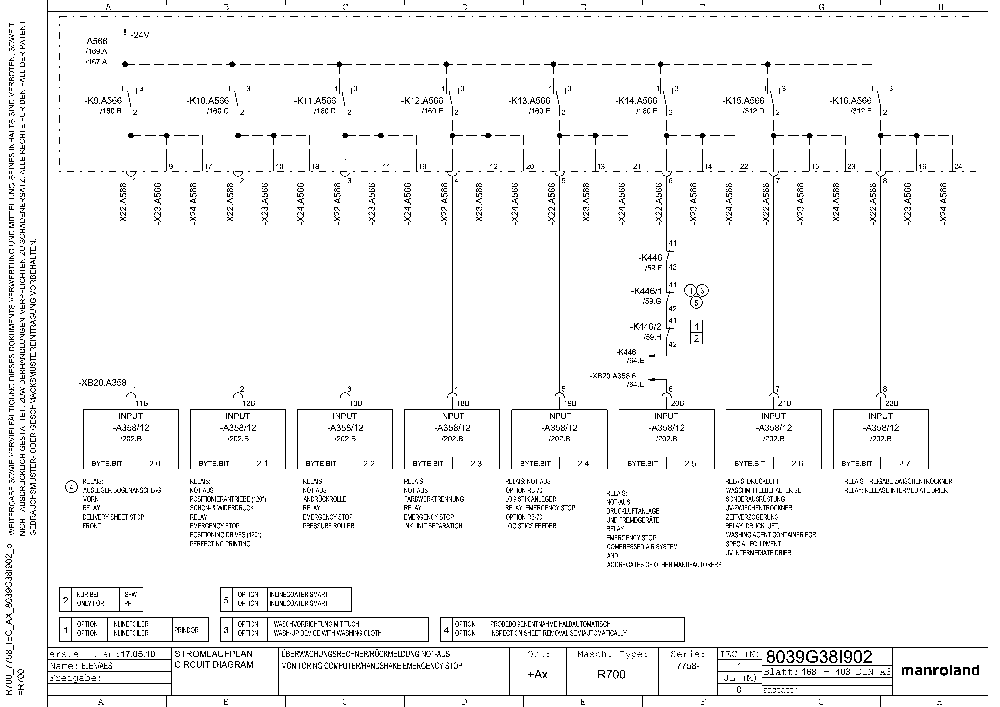

# +Ax — Sheet 168 of 403 — ÜBERWACHUNGSRECHNER/RÜCKMELDUNG NOT AUS

**MONITORING COMPUTER/HANDSHAKE EMERGENCY STOP**

> Part of the manroland **R700** printing press IEC/UL circuit diagrams.
> Drawing class: **Stromlaufplan / Circuit diagram** (DIN A3).
> Document `+Ax` covers the **Central control console** machine section.

## At a glance

| Field | Value |
|---|---|
| Document | `+Ax`  (8039G38I902) |
| Sheet | **168** of 403 |
| Section (DE) | ÜBERWACHUNGSRECHNER/RÜCKMELDUNG NOT AUS |
| Section (EN) | MONITORING COMPUTER/HANDSHAKE EMERGENCY STOP |
| Section type | CIRCUIT — Circuit diagram |
| Machine type | `R700` |
| Series | `7758` |
| Created | 17.05.10 |
| Replaces | — |
| Columns used | A, B, C, D, E, F, G, H |
| Path numbers | — |
| Labels on sheet | 249 |
| Cross-refs out | 23 |
| Cross-refs in | 54 |

**Previous:** [+Ax sheet 167](SHEET_0167.md) · **Next:** [+Ax sheet 169](SHEET_0169.md) · **Document TOC:** [_TOC.md](_TOC.md)  (+Ax) · **Master TOC:** [all sheets](../_MASTER_TOC.md)

## Sheet image (300 DPI, exact vector render)



_Rendered directly from the PDF vector layer at 300 DPI (1-bit), no OCR and no resampling. Use it to confirm anything ambiguous in the text below._

## Cross-references on this sheet

Each entry is a wire leaving this sheet. The printed token is `/sheet.column`; the link resolves to that sheet inside the same document.

| Ref | Target sheet | Col | Path | Destination on target | Target section | From col |
|---|---|---|---|---|---|---|
| `/169.A` | [+Ax sheet 169](SHEET_0169.md) | A | — | — | ÜBERWACHUNGSRECHNER/RÜCKMELDUNG NOT AUS | A |
| `/167.A` | [+Ax sheet 167](SHEET_0167.md) | A | — | — | ÜBERWACHUNGSRECHNER/RÜCKMELDUNG NOT AUS | A |
| `/160.B` | [+Ax sheet 160](SHEET_0160.md) | B | — | — | ÜBERWACHUNGSRECHNER/ANSTEUERUNG NOT AUS | A |
| `/160.E` | [+Ax sheet 160](SHEET_0160.md) | E | — | — | ÜBERWACHUNGSRECHNER/ANSTEUERUNG NOT AUS | D |
| `/160.E` | [+Ax sheet 160](SHEET_0160.md) | E | — | — | ÜBERWACHUNGSRECHNER/ANSTEUERUNG NOT AUS | E |
| `/160.F` | [+Ax sheet 160](SHEET_0160.md) | F | — | — | ÜBERWACHUNGSRECHNER/ANSTEUERUNG NOT AUS | F |
| `/312.F` | [+Ax sheet 312](SHEET_0312.md) | F | — | — | OPTION: IR/UV ZWISCHENTROCKNER | G |
| `/160.C` | [+Ax sheet 160](SHEET_0160.md) | C | — | — | ÜBERWACHUNGSRECHNER/ANSTEUERUNG NOT AUS | B |
| `/160.D` | [+Ax sheet 160](SHEET_0160.md) | D | — | — | ÜBERWACHUNGSRECHNER/ANSTEUERUNG NOT AUS | C |
| `/312.D` | [+Ax sheet 312](SHEET_0312.md) | D | — | — | OPTION: IR/UV ZWISCHENTROCKNER | F |
| `/59.F` | [+Ax sheet 59](SHEET_0059.md) | F | — | — | DRUCKLUFTANLAGE | F |
| `/59.G` | [+Ax sheet 59](SHEET_0059.md) | G | — | — | DRUCKLUFTANLAGE | F |
| `/59.H` | [+Ax sheet 59](SHEET_0059.md) | H | — | — | DRUCKLUFTANLAGE | F |
| `/64.E` | [+Ax sheet 64](SHEET_0064.md) | E | — | K446 | DRUCKLUFTANLAGE | E |
| `/64.E` | [+Ax sheet 64](SHEET_0064.md) | E | — | XB20.A358:6 | DRUCKLUFTANLAGE | E |
| `/202.B` | [+Ax sheet 202](SHEET_0202.md) | B | — | — | REFERENZMODUL | A |
| `/202.B` | [+Ax sheet 202](SHEET_0202.md) | B | — | — | REFERENZMODUL | B |
| `/202.B` | [+Ax sheet 202](SHEET_0202.md) | B | — | — | REFERENZMODUL | C |
| `/202.B` | [+Ax sheet 202](SHEET_0202.md) | B | — | — | REFERENZMODUL | D |
| `/202.B` | [+Ax sheet 202](SHEET_0202.md) | B | — | — | REFERENZMODUL | E |
| `/202.B` | [+Ax sheet 202](SHEET_0202.md) | B | — | — | REFERENZMODUL | F |
| `/202.B` | [+Ax sheet 202](SHEET_0202.md) | B | — | — | REFERENZMODUL | G |
| `/202.B` | [+Ax sheet 202](SHEET_0202.md) | B | — | — | REFERENZMODUL | G |

### Incoming references (sheets that point here)

Every other sheet that sends a wire to this one. `Back-ref` is the token printed on *that* sheet; `Path` is its line number.

| From sheet | Cols | Back-ref | Path | Refs | What continues there |
|---|---|---|---|---|---|
| [+Ax#59](SHEET_0059.md) | F, G | `/59.F`, `/59.G` | — | 2 | — |
| [+Ax#64](SHEET_0064.md) | E | `/64.E` | — | 2 | — |
| [+Ax#160](SHEET_0160.md) | B, C, D, E, F | `/160.B`, `/160.C`, `/160.D`, `/160.E`, `/160.F` | — | 6 | — |
| [+Ax#167](SHEET_0167.md) | A | `/167.A` | — | 1 | — |
| [+Ax#169](SHEET_0169.md) | A | `/169.A` | — | 1 | — |
| [+Ax#202](SHEET_0202.md) | B | `/202.B` | — | 8 | — |
| [+Ax#260](SHEET_0260.md) | C | `/260.C` | — | 8 | — |
| [+Ax#263](SHEET_0263.md) | B | `/263.B` | — | 8 | — |
| [+Ax#265](SHEET_0265.md) | B | `/265.B` | — | 8 | — |
| [+Ax#266](SHEET_0266.md) | F | `/266.F` | — | 8 | — |
| [+Ax#312](SHEET_0312.md) | D, F | `/312.D`, `/312.F` | — | 2 | — |


## Devices on this sheet

| Tag | Class | Class meaning (IEC) | Col | Sub | Terminal | Sign |
|---|---|---|---|---|---|---|
| `A566` | A | Baugruppe / assembly, module, PC board | A | — | — | — |
| `A358/12` | A | Baugruppe / assembly, module, PC board | A | 12 | — | — |
| `A358/12` | A | Baugruppe / assembly, module, PC board | B | 12 | — | — |
| `A358/12` | A | Baugruppe / assembly, module, PC board | C | 12 | — | — |
| `A358/12` | A | Baugruppe / assembly, module, PC board | D | 12 | — | — |
| `A358/12` | A | Baugruppe / assembly, module, PC board | E | 12 | — | — |
| `A358/12` | A | Baugruppe / assembly, module, PC board | F | 12 | — | — |
| `A358/12` | A | Baugruppe / assembly, module, PC board | G | 12 | — | — |
| `A358/12` | A | Baugruppe / assembly, module, PC board | G | 12 | — | — |
| `K446` | K | Relais / relay, contactor | F | — | — | — |
| `K446/1` | K | Relais / relay, contactor | F | 1 | — | — |
| `K446/2` | K | Relais / relay, contactor | F | 2 | — | — |
| `K446` | K | Relais / relay, contactor | E | — | — | — |
| `2.0` | — | cross-device reference | A | — | — | — |
| `2.1` | — | cross-device reference | B | — | — | — |
| `2.2` | — | cross-device reference | C | — | — | — |
| `2.3` | — | cross-device reference | D | — | — | — |
| `2.4` | — | cross-device reference | E | — | — | — |
| `2.5` | — | cross-device reference | F | — | — | — |
| `2.6` | — | cross-device reference | G | — | — | — |
| `2.7` | — | cross-device reference | H | — | — | — |
| `XB20.A358` | — | cross-device reference | A | — | — | — |
| `K9.A566` | — | cross-device reference | A | — | — | — |
| `K10.A566` | — | cross-device reference | B | — | — | — |
| `K12.A566` | — | cross-device reference | D | — | — | — |
| `K11.A566` | — | cross-device reference | C | — | — | — |
| `K13.A566` | — | cross-device reference | E | — | — | — |
| `K14.A566` | — | cross-device reference | E | — | — | — |
| `K16.A566` | — | cross-device reference | G | — | — | — |
| `K15.A566` | — | cross-device reference | F | — | — | — |
| `X22.A566` | — | cross-device reference | A | — | — | — |
| `X22.A566` | — | cross-device reference | B | — | — | — |
| `X22.A566` | — | cross-device reference | C | — | — | — |
| `X22.A566` | — | cross-device reference | D | — | — | — |
| `X22.A566` | — | cross-device reference | E | — | — | — |
| `X22.A566` | — | cross-device reference | F | — | — | — |
| `X22.A566` | — | cross-device reference | G | — | — | — |
| `X22.A566` | — | cross-device reference | G | — | — | — |
| `XB20.A358:6` | — | cross-device reference | E | — | 6 | — |
| `X23.A566` | — | cross-device reference | B | — | — | — |
| `X24.A566` | — | cross-device reference | C | — | — | — |
| `X23.A566` | — | cross-device reference | C | — | — | — |
| `X24.A566` | — | cross-device reference | D | — | — | — |
| `X23.A566` | — | cross-device reference | D | — | — | — |
| `X24.A566` | — | cross-device reference | D | — | — | — |
| `X23.A566` | — | cross-device reference | E | — | — | — |
| `X24.A566` | — | cross-device reference | E | — | — | — |
| `X23.A566` | — | cross-device reference | F | — | — | — |
| `X24.A566` | — | cross-device reference | F | — | — | — |
| `X23.A566` | — | cross-device reference | G | — | — | — |
| `X24.A566` | — | cross-device reference | G | — | — | — |
| `X23.A566` | — | cross-device reference | H | — | — | — |
| `X24.A566` | — | cross-device reference | H | — | — | — |
| `X23.A566` | — | cross-device reference | A | — | — | — |
| `X24.A566` | — | cross-device reference | B | — | — | — |

## Potentials / nets

| Potential | Count | Columns | Attached devices | Terminals |
|---|---|---|---|---|
| `24V` | 1 | A | — | — |


A potential such as `L24+/4` or `M24+` is a named supply/return rail; every place it appears on this sheet is electrically common.

## Wire-end annotations (grouped as printed)

A wire that continues elsewhere is annotated with a small cluster: the destination description, the path/line number `#NN`, and the `/sheet.column` cross reference. Each row below is one such cluster exactly as it is grouped on the drawing.

| Col | Y | Path | Cross-ref | Text on the wire |
|---|---|---|---|---|
| A | 37.2 | — | — | `24V` |
| A | 44.2 | — | — | `A566` |
| A | 57.3 | — | `/169.A`, `/167.A` | — |
| A | 101.7 | — | — | `K9.A566 3` |
| A | 101.7 | — | — | `1` |
| B | 101.7 | — | — | `K10.A566 3` |
| B | 101.7 | — | — | `1` |
| C | 101.7 | — | — | `K11.A566 3` |
| C | 101.7 | — | — | `1` |
| D | 101.7 | — | — | `K12.A566 3` |
| D | 101.7 | — | — | `1` |
| E | 101.7 | — | — | `K13.A566 3` |
| E | 101.7 | — | — | `1` |
| F | 101.7 | — | — | `K14.A566 3` |
| F | 101.7 | — | — | `1` |
| F | 101.7 | — | — | `K15.A566 3` |
| G | 101.7 | — | — | `1` |
| G | 101.7 | — | — | `K16.A566 3` |
| G | 101.7 | — | — | `1` |
| A | 128.2 | — | `/160.B` | — |
| B | 128.2 | — | `/160.C` | — |
| C | 128.2 | — | `/160.D` | — |
| D | 128.2 | — | `/160.E` | — |
| E | 128.2 | — | `/160.E` | — |
| F | 128.2 | — | `/160.F` | — |
| F | 128.2 | — | `/312.D` | — |
| G | 128.2 | — | `/312.F` | — |
| A | 130.0 | — | — | `2` |
| B | 130.0 | — | — | `2` |
| C | 130.0 | — | — | `2` |
| D | 130.0 | — | — | `2` |
| E | 130.0 | — | — | `2` |
| F | 130.0 | — | — | `2` |
| G | 130.0 | — | — | `2` |
| H | 130.0 | — | — | `2` |
| E | 194.5 | — | — | `9 17 10 18 11 19 12 20 13 21 14 22 15 23 16 24` |
| A | 211.5 | — | — | `1` |
| B | 211.5 | — | — | `2` |
| C | 211.5 | — | — | `3` |
| D | 211.5 | — | — | `4` |
| E | 211.5 | — | — | `5` |
| F | 211.5 | — | — | `6` |
| G | 211.5 | — | — | `7` |
| H | 211.5 | — | — | `8` |
| A | 217.7 | — | — | `X22.A566` |
| A | 217.7 | — | — | `X23.A566` |
| B | 217.7 | — | — | `X24.A566` |
| B | 217.7 | — | — | `X22.A566` |
| B | 217.7 | — | — | `X23.A566` |
| C | 217.7 | — | — | `X24.A566` |
| C | 217.7 | — | — | `X22.A566` |
| C | 217.7 | — | — | `X23.A566` |
| D | 217.7 | — | — | `X24.A566` |
| D | 217.7 | — | — | `X22.A566` |
| D | 217.7 | — | — | `X23.A566` |
| D | 217.7 | — | — | `X24.A566` |
| E | 217.7 | — | — | `X22.A566` |
| E | 217.7 | — | — | `X23.A566` |
| E | 217.7 | — | — | `X24.A566` |
| F | 217.7 | — | — | `X22.A566` |
| F | 217.7 | — | — | `X23.A566` |
| F | 217.7 | — | — | `X24.A566` |
| G | 217.7 | — | — | `X22.A566` |
| G | 217.7 | — | — | `X23.A566` |
| G | 217.7 | — | — | `X24.A566` |
| G | 217.7 | — | — | `X22.A566` |
| H | 217.7 | — | — | `X23.A566` |
| H | 217.7 | — | — | `X24.A566` |
| F | 285.9 | — | — | `41` |
| F | 302.2 | — | — | `K446 42` |
| F | 315.3 | — | `/59.F` | — |
| F | 335.5 | — | — | `41` |
| F | 341.9 | — | — | `K446/1` |
| F | 342.8 | — | — | `1 3` |
| F | 354.9 | — | `/59.G` | — |
| F | 357.5 | — | — | `5` |
| F | 363.9 | — | — | `42` |
| F | 378.0 | — | — | `41` |
| F | 384.4 | — | — | `K446/2` |
| F | 384.4 | — | — | `2 1` |
| F | 397.5 | — | `/59.H` | — |
| F | 406.4 | — | — | `42` |
| E | 415.6 | — | `/64.E` | `K446` |
| E | 443.9 | — | `/64.E` | `XB20.A358:6` |
| A | 451.0 | — | — | `XB20.A358 1` |
| E | 459.5 | — | — | `2 3 4 5 6 7 8` |
| A | 476.5 | — | — | `11B` |
| B | 476.5 | — | — | `12B` |
| C | 476.5 | — | — | `13B` |
| D | 476.5 | — | — | `18B` |
| E | 476.5 | — | — | `19B` |
| F | 476.5 | — | — | `20B` |
| G | 476.5 | — | — | `21B` |
| H | 476.5 | — | — | `22B` |
| A | 491.0 | — | — | `INPUT` |
| B | 491.0 | — | — | `INPUT` |
| C | 491.0 | — | — | `INPUT` |
| D | 491.0 | — | — | `INPUT` |
| E | 491.0 | — | — | `INPUT` |
| F | 491.0 | — | — | `INPUT` |
| G | 491.0 | — | — | `INPUT` |
| G | 491.0 | — | — | `INPUT` |
| A | 504.9 | — | — | `A358/12` |
| B | 504.9 | — | — | `A358/12` |
| C | 504.9 | — | — | `A358/12` |
| D | 504.9 | — | — | `A358/12` |
| E | 504.9 | — | — | `A358/12` |
| F | 504.9 | — | — | `A358/12` |
| G | 504.9 | — | — | `A358/12` |
| G | 504.9 | — | — | `A358/12` |
| A | 518.6 | — | `/202.B` | — |
| B | 518.6 | — | `/202.B` | — |
| C | 518.6 | — | `/202.B` | — |
| D | 518.6 | — | `/202.B` | — |
| E | 518.6 | — | `/202.B` | — |
| F | 518.6 | — | `/202.B` | — |
| G | 518.6 | — | `/202.B` | — |
| G | 518.6 | — | `/202.B` | — |
| A | 547.7 | — | — | `BYTE.BIT 2.0` |
| B | 547.7 | — | — | `BYTE.BIT 2.1` |
| C | 547.7 | — | — | `BYTE.BIT 2.2` |
| D | 547.7 | — | — | `BYTE.BIT 2.3` |
| E | 547.7 | — | — | `BYTE.BIT 2.4` |
| F | 547.7 | — | — | `BYTE.BIT 2.5` |
| G | 547.7 | — | — | `BYTE.BIT 2.6` |
| G | 547.7 | — | — | `BYTE.BIT 2.7` |
| D | 570.3 | — | — | `RELAIS: RELAIS: FREIGABE ZWISCHENTROCKNER RELAY: RELEASE INTERMEDIATE DRIER` |
| B | 570.3 | — | — | `RELAIS: NOT AUS POSITIONIERANTRIEBE (120°)` |
| C | 570.3 | — | — | `RELAIS: NOT AUS` |
| D | 570.3 | — | — | `RELAIS: NOT AUS FARBWERKTRENNUNG RELAY: EMERGENCY STOP INK UNIT SEPARATION` |
| E | 570.4 | — | — | `RELAIS: NOT AUS` |
| F | 570.4 | — | — | `RELAIS: DRUCKLUFT,` |
| A | 577.1 | — | — | `4` |
| A | 581.0 | — | — | `RELAY: DELIVERY SHEET STOP: FRONT AUSLEGER BOGENANSCHLAG: VORN` |
| E | 581.0 | — | — | `LOGISTIK ANLEGER RELAY: EMERGENCY STOP OPTION RB 70,` |
| G | 581.0 | — | — | `UV ZWISCHENTROCKNER SONDERAUSRÜSTUNG WASCHMITTELBEHÄLTER BEI` |
| E | 584.5 | — | — | `RELAIS: NOT AUS DRUCKLUFTANLAGE UND FREMDGERÄTE RELAY: EMERGENCY STOP` |
| C | 591.7 | — | — | `RELAY: EMERGENCY STOP PRESSURE ROLLER ANDRÜCKROLLE` |
| B | 602.3 | — | — | `RELAY: EMERGENCY STOP POSITIONING DRIVES (120°) PERFECTING PRINTING SCHÖN & WIDERDRUCK` |
| E | 612.9 | — | — | `LOGISTICS FEEDER OPTION RB 70,` |
| F | 612.9 | — | — | `RELAY: DRUCKLUFT, ZEITVERZÖGERUNG` |
| G | 634.2 | — | — | `UV INTERMEDIATE DRIER SPECIAL EQUIPMENT WASHING AGENT CONTAINER FOR` |
| F | 648.4 | — | — | `COMPRESSED AIR SYSTEM AND AGGREGATES OF OTHER MANUFACTORERS` |
| A | 704.9 | — | — | `2 ONLY FOR PP S+W` |
| A | 705.0 | — | — | `NUR BEI` |
| B | 705.0 | — | — | `5 OPTION OPTION INLINECOATER SMART INLINECOATER SMART` |
| A | 740.4 | — | — | `1 OPTION OPTION INLINEFOILER INLINEFOILER PRINDOR` |
| C | 740.4 | — | — | `3 OPTION OPTION WASCHVORRICHTUNG MIT TUCH WASH UP DEVICE WITH WASHING CLOTH` |
| D | 740.4 | — | — | `OPTION OPTION` |
| E | 740.5 | — | — | `4 PROBEBOGENENTNAHME HALBAUTOMATISCH INSPECTION SHEET REMOVAL SEMIAUTOMATICALLY` |


## Reconstructed tables

This sheet carries tabular content (pin map / terminal assignment / index). The grid below was rebuilt from the drawing's own rule lines, so each row is exactly one physical row of the table.

### Table 1 — 3 data rows × 4 columns (at x=99.2, y=76.5)

| 1 K9.A566 /160.B |  | 3 2 |  |
|---|---|---|---|
| `X22.A566 XB20.A358` |  | `1 X23.A566 1 11B` | `9` |
|  | `INPUT` | `A358/12 /202.B` |  |
| `BYTE.BIT` |  | `2.0` |  |


### Table 2 — 3 data rows × 5 columns (at x=226.8, y=76.5)

|  | 1 K10.A566 /160.C |  | 3 2 |  |
|---|---|---|---|---|
| `X24.A566` | `17 X22.A566` |  | `2 X23.A566 2 12B` | `10` |
|  |  | `INPUT` | `A358/12 /202.B` |  |
|  | `BYTE.BIT` |  | `2.1` |  |


### Table 3 — 3 data rows × 5 columns (at x=354.3, y=76.5)

|  | 1 K11.A566 /160.D |  | 3 2 |  |
|---|---|---|---|---|
| `X24.A566` | `18 X22.A566` |  | `3 X23.A566 3 13B` | `11` |
|  |  | `INPUT` | `A358/12 /202.B` |  |
|  | `BYTE.BIT` |  | `2.2` |  |


### Table 4 — 3 data rows × 5 columns (at x=481.9, y=76.5)

|  | 1 K12.A566 /160.E |  | 3 2 |  |
|---|---|---|---|---|
| `X24.A566` | `19 X22.A566` |  | `4 X23.A566 4 18B` | `12` |
|  |  | `INPUT` | `A358/12 /202.B` |  |
|  | `BYTE.BIT` |  | `2.3` |  |


### Table 5 — 3 data rows × 11 columns (at x=609.4, y=76.5)

|  | 1 K13.A566 /160.E |  | 3 2 |  |  |  | 1 K14.A566 /160.F |  | 3 2 |  |
|---|---|---|---|---|---|---|---|---|---|---|
| `X24.A566` | `20 X22.A566` |  | `5 X23.A566 5 19B` | `13` | `XB20.A358:6` | `X24.A566 K446` | `21 X22.A566 K446 /59.F K446/1 /59.G K446/2 /59.H /64.E /64.E` |  | `6 X23.A566 41 42 41 1 5 42 41 1 2 42 6 20B` | `14 3` |
|  |  | `INPUT` | `A358/12 /202.B` |  |  |  |  | `INPUT` | `A358/12 /202.B` |  |
|  | `BYTE.BIT` |  | `2.4` |  |  |  | `BYTE.BIT` |  | `2.5` |  |


### Table 6 — 3 data rows × 5 columns (at x=864.6, y=76.5)

|  | 1 K15.A566 /312.D |  | 3 2 |  |
|---|---|---|---|---|
| `X24.A566` | `22 X22.A566` |  | `7 X23.A566 7 21B` | `15` |
|  |  | `INPUT` | `A358/12 /202.B` |  |
|  | `BYTE.BIT` |  | `2.6` |  |


### Table 7 — 3 data rows × 6 columns (at x=992.1, y=76.5)

|  | 1 K16.A566 /312.F |  | 3 2 |  |  |
|---|---|---|---|---|---|
| `X24.A566` | `23 X22.A566` |  | `8 X23.A566 8 22B` | `16` | `X24.A566` |
|  |  | `INPUT` | `A358/12 /202.B` |  |  |
|  | `BYTE.BIT` |  | `2.7` |  |  |


## Notes and free text on this sheet

| Text | Col | Y (pt) |
|---|---|---|
| `11B` | A | 476.51 |
| `INPUT` | A | 491.03 |
| `BYTE.BIT` | A | 548.28 |
| `12B` | B | 476.51 |
| `INPUT` | B | 491.03 |
| `BYTE.BIT` | B | 548.28 |
| `13B` | C | 476.51 |
| `INPUT` | C | 491.03 |
| `BYTE.BIT` | C | 548.28 |
| `18B` | D | 476.51 |
| `INPUT` | D | 491.03 |
| `BYTE.BIT` | D | 548.28 |
| `19B` | E | 476.51 |
| `INPUT` | E | 491.03 |
| `BYTE.BIT` | E | 548.28 |
| `20B` | F | 476.51 |
| `INPUT` | F | 491.03 |
| `21B` | G | 476.51 |
| `INPUT` | G | 491.03 |
| `BYTE.BIT` | F | 548.28 |
| `22B` | H | 476.51 |
| `BYTE.BIT` | G | 548.28 |
| `RELAIS:` | B | 570.32 |
| `NOT AUS` | B | 581.01 |
| `POSITIONIERANTRIEBE (120°)` | B | 591.65 |
| `SCHÖN & WIDERDRUCK` | B | 602.29 |
| `RELAY:` | B | 612.85 |
| `EMERGENCY STOP` | B | 623.55 |
| `POSITIONING DRIVES (120°)` | B | 634.18 |
| `PERFECTING PRINTING` | B | 644.81 |
| `RELAIS:` | C | 570.32 |
| `NOT AUS` | C | 581.01 |
| `ANDRÜCKROLLE` | C | 591.68 |
| `RELAY:` | C | 602.22 |
| `EMERGENCY STOP` | C | 612.92 |
| `PRESSURE ROLLER` | C | 623.55 |
| `RELAIS:` | D | 570.32 |
| `NOT AUS` | D | 581.01 |
| `FARBWERKTRENNUNG` | D | 591.64 |
| `RELAY:` | D | 602.22 |
| `EMERGENCY STOP` | D | 612.92 |
| `INK UNIT SEPARATION` | D | 623.53 |
| `RELAIS: FREIGABE ZWISCHENTROCKNER` | H | 570.38 |
| `RELAY: RELEASE INTERMEDIATE DRIER` | H | 581.02 |
| `RELAIS:` | A | 570.32 |
| `AUSLEGER BOGENANSCHLAG:` | A | 581.03 |
| `VORN` | A | 591.65 |
| `RELAY:` | A | 602.22 |
| `DELIVERY SHEET STOP:` | A | 612.89 |
| `FRONT` | A | 623.54 |
| `RELAIS: DRUCKLUFT,` | F | 570.38 |
| `WASCHMITTELBEHÄLTER BEI` | G | 581 |
| `SONDERAUSRÜSTUNG` | F | 591.67 |
| `UV ZWISCHENTROCKNER` | F | 602.28 |
| `ZEITVERZÖGERUNG` | F | 612.93 |
| `RELAY: DRUCKLUFT,` | F | 623.55 |
| `WASHING AGENT CONTAINER FOR` | G | 634.18 |
| `SPECIAL EQUIPMENT` | F | 644.82 |
| `UV INTERMEDIATE DRIER` | F | 655.45 |
| `RELAIS:` | E | 584.49 |
| `NOT AUS` | E | 595.18 |
| `DRUCKLUFTANLAGE` | E | 605.84 |
| `UND FREMDGERÄTE` | E | 616.47 |
| `RELAY:` | E | 627.03 |
| `EMERGENCY STOP` | E | 637.72 |
| `COMPRESSED AIR SYSTEM` | E | 648.36 |
| `AND` | E | 659.01 |
| `AGGREGATES OF OTHER MANUFACTORERS` | F | 669.64 |
| `RELAIS: NOT AUS` | E | 570.37 |
| `OPTION RB 70,` | E | 581.02 |
| `LOGISTIK ANLEGER` | E | 591.64 |
| `RELAY: EMERGENCY STOP` | E | 602.28 |
| `LOGISTICS FEEDER` | E | 623.54 |
| `OPTION` | A | 740.44 |
| `INLINEFOILER` | A | 740.46 |
| `PRINDOR` | B | 747.56 |
| `NUR BEI` | A | 704.99 |
| `ONLY FOR` | A | 715.68 |
| `S+W` | A | 704.89 |
| `PP` | A | 715.53 |
| `OPTION` | B | 740.44 |
| `WASCHVORRICHTUNG MIT TUCH` | C | 740.48 |
| `WASH UP DEVICE WITH WASHING CLOTH` | C | 751.07 |
| `INLINECOATER SMART` | C | 705.04 |
| `OPTION` | D | 740.44 |
| `PROBEBOGENENTNAHME HALBAUTOMATISCH` | E | 740.48 |
| `INSPECTION SHEET REMOVAL SEMIAUTOMATICALLY` | E | 751.11 |

## Complete label inventory (exact text from the drawing)

Every text object inside the drawing area of this sheet, in DIN reading order (column A→H, then top→bottom). This is the authoritative list: if a string is not here it is not printed on this sheet.

| Col | Y | X | Dir | Type | Text |
|---|---|---|---|---|---|
| A | 37.2 | 155.6 | → | potential | `24V` |
| A | 44.2 | 99.8 | → | device tag | `A566` |
| A | 57.3 | 102.0 | → | cross-reference | `/169.A` |
| A | 69.7 | 102.0 | → | cross-reference | `/167.A` |
| A | 101.7 | 142.9 | → | number | `1` |
| A | 101.7 | 165.5 | → | number | `3` |
| A | 115.1 | 100.9 | → | device ref | `K9.A566` |
| A | 128.2 | 119.3 | → | cross-reference | `/160.B` |
| A | 130.0 | 158.5 | → | number | `2` |
| A | 211.5 | 157.9 | → | number | `1` |
| A | 217.7 | 142.0 | ↕ | device ref | `X22.A566` |
| A | 217.7 | 183.1 | ↕ | device ref | `X23.A566` |
| A | 451.0 | 93.5 | → | device ref | `XB20.A358` |
| A | 459.5 | 157.9 | → | number | `1` |
| A | 476.5 | 160.7 | → | text | `11B` |
| A | 491.0 | 141.0 | → | text | `INPUT` |
| A | 504.9 | 134.5 | → | device tag | `A358/12` |
| A | 518.6 | 143.3 | → | cross-reference | `/202.B` |
| A | 547.7 | 177.4 | → | device ref | `2.0` |
| A | 548.3 | 109.1 | → | text | `BYTE.BIT` |
| A | 570.3 | 98.4 | → | text | `RELAIS:` |
| A | 577.1 | 83.0 | → | number | `4` |
| A | 581.0 | 99.2 | → | text | `AUSLEGER BOGENANSCHLAG:` |
| A | 591.6 | 99.2 | → | text | `VORN` |
| A | 602.2 | 98.4 | → | text | `RELAY:` |
| A | 612.9 | 98.4 | → | text | `DELIVERY SHEET STOP:` |
| A | 623.5 | 98.4 | → | text | `FRONT` |
| A | 704.9 | 148.5 | → | text | `S+W` |
| A | 705.0 | 91.3 | → | text | `NUR BEI` |
| A | 710.3 | 75.1 | → | number | `2` |
| A | 715.5 | 148.0 | → | text | `PP` |
| A | 715.7 | 91.8 | → | text | `ONLY FOR` |
| A | 740.4 | 91.8 | → | text | `OPTION` |
| A | 740.5 | 133.8 | → | text | `INLINEFOILER` |
| A | 745.8 | 75.4 | → | number | `1` |
| A | 751.1 | 91.8 | → | text | `OPTION` |
| A | 751.1 | 133.8 | → | text | `INLINEFOILER` |
| B | 101.7 | 270.4 | → | number | `1` |
| B | 101.7 | 293.1 | → | number | `3` |
| B | 115.1 | 222.5 | → | device ref | `K10.A566` |
| B | 128.2 | 246.6 | → | cross-reference | `/160.C` |
| B | 130.0 | 286.0 | → | number | `2` |
| B | 194.5 | 201.0 | → | number | `9` |
| B | 194.5 | 242.9 | → | number | `17` |
| B | 194.5 | 328.0 | → | number | `10` |
| B | 211.5 | 286.0 | → | number | `2` |
| B | 217.7 | 225.7 | ↕ | device ref | `X24.A566` |
| B | 217.7 | 269.6 | ↕ | device ref | `X22.A566` |
| B | 217.7 | 310.7 | ↕ | device ref | `X23.A566` |
| B | 459.5 | 286.0 | → | number | `2` |
| B | 476.5 | 288.3 | → | text | `12B` |
| B | 491.0 | 268.6 | → | text | `INPUT` |
| B | 504.9 | 262.1 | → | device tag | `A358/12` |
| B | 518.6 | 270.9 | → | cross-reference | `/202.B` |
| B | 547.7 | 305.9 | → | device ref | `2.1` |
| B | 548.3 | 236.7 | → | text | `BYTE.BIT` |
| B | 570.3 | 225.9 | → | text | `RELAIS:` |
| B | 581.0 | 225.9 | → | text | `NOT AUS` |
| B | 591.7 | 225.9 | → | text | `POSITIONIERANTRIEBE (120°)` |
| B | 602.3 | 226.5 | → | text | `SCHÖN & WIDERDRUCK` |
| B | 612.9 | 225.9 | → | text | `RELAY:` |
| B | 623.6 | 225.9 | → | text | `EMERGENCY STOP` |
| B | 634.2 | 225.9 | → | text | `POSITIONING DRIVES (120°)` |
| B | 644.8 | 225.9 | → | text | `PERFECTING PRINTING` |
| B | 705.0 | 283.2 | → | text | `OPTION` |
| B | 710.3 | 266.3 | → | number | `5` |
| B | 715.6 | 283.2 | → | text | `OPTION` |
| B | 740.4 | 283.2 | → | text | `OPTION` |
| B | 745.8 | 266.3 | → | number | `3` |
| B | 747.6 | 207.5 | → | text | `PRINDOR` |
| B | 751.1 | 283.2 | → | text | `OPTION` |
| C | 101.7 | 398.0 | → | number | `1` |
| C | 101.7 | 420.7 | → | number | `3` |
| C | 115.1 | 350.1 | → | device ref | `K11.A566` |
| C | 128.2 | 374.2 | → | cross-reference | `/160.D` |
| C | 130.0 | 413.6 | → | number | `2` |
| C | 194.5 | 370.5 | → | number | `18` |
| C | 194.5 | 455.5 | → | number | `11` |
| C | 211.5 | 413.6 | → | number | `3` |
| C | 217.7 | 353.2 | ↕ | device ref | `X24.A566` |
| C | 217.7 | 397.2 | ↕ | device ref | `X22.A566` |
| C | 217.7 | 438.3 | ↕ | device ref | `X23.A566` |
| C | 459.5 | 413.6 | → | number | `3` |
| C | 476.5 | 415.8 | → | text | `13B` |
| C | 491.0 | 396.1 | → | text | `INPUT` |
| C | 504.9 | 389.6 | → | device tag | `A358/12` |
| C | 518.6 | 398.4 | → | cross-reference | `/202.B` |
| C | 547.7 | 432.6 | → | device ref | `2.2` |
| C | 548.3 | 364.3 | → | text | `BYTE.BIT` |
| C | 570.3 | 360.6 | → | text | `RELAIS:` |
| C | 581.0 | 360.6 | → | text | `NOT AUS` |
| C | 591.7 | 361.4 | → | text | `ANDRÜCKROLLE` |
| C | 602.2 | 360.6 | → | text | `RELAY:` |
| C | 612.9 | 360.6 | → | text | `EMERGENCY STOP` |
| C | 623.6 | 360.6 | → | text | `PRESSURE ROLLER` |
| C | 705.0 | 320.9 | → | text | `INLINECOATER SMART` |
| C | 715.7 | 320.9 | → | text | `INLINECOATER SMART` |
| C | 740.5 | 326.0 | → | text | `WASCHVORRICHTUNG MIT TUCH` |
| C | 751.1 | 326.0 | → | text | `WASH UP DEVICE WITH WASHING CLOTH` |
| D | 101.7 | 525.5 | → | number | `1` |
| D | 101.7 | 548.2 | → | number | `3` |
| D | 115.1 | 477.6 | → | device ref | `K12.A566` |
| D | 128.2 | 502.3 | → | cross-reference | `/160.E` |
| D | 130.0 | 541.1 | → | number | `2` |
| D | 194.5 | 498.0 | → | number | `19` |
| D | 194.5 | 583.1 | → | number | `12` |
| D | 211.5 | 541.1 | → | number | `4` |
| D | 217.7 | 480.8 | ↕ | device ref | `X24.A566` |
| D | 217.7 | 524.7 | ↕ | device ref | `X22.A566` |
| D | 217.7 | 565.8 | ↕ | device ref | `X23.A566` |
| D | 217.7 | 608.3 | ↕ | device ref | `X24.A566` |
| D | 459.5 | 541.1 | → | number | `4` |
| D | 476.5 | 543.4 | → | text | `18B` |
| D | 491.0 | 523.7 | → | text | `INPUT` |
| D | 504.9 | 517.2 | → | device tag | `A358/12` |
| D | 518.6 | 526.0 | → | cross-reference | `/202.B` |
| D | 547.7 | 560.1 | → | device ref | `2.3` |
| D | 548.3 | 491.8 | → | text | `BYTE.BIT` |
| D | 570.3 | 481.0 | → | text | `RELAIS:` |
| D | 581.0 | 481.0 | → | text | `NOT AUS` |
| D | 591.6 | 481.0 | → | text | `FARBWERKTRENNUNG` |
| D | 602.2 | 481.0 | → | text | `RELAY:` |
| D | 612.9 | 481.0 | → | text | `EMERGENCY STOP` |
| D | 623.5 | 481.0 | → | text | `INK UNIT SEPARATION` |
| D | 740.4 | 541.8 | → | text | `OPTION` |
| D | 745.8 | 528.7 | → | number | `4` |
| D | 751.1 | 541.8 | → | text | `OPTION` |
| E | 101.7 | 653.1 | → | number | `1` |
| E | 101.7 | 675.8 | → | number | `3` |
| E | 115.1 | 605.2 | → | device ref | `K13.A566` |
| E | 115.1 | 732.8 | → | device ref | `K14.A566` |
| E | 128.2 | 629.9 | → | cross-reference | `/160.E` |
| E | 130.0 | 668.7 | → | number | `2` |
| E | 194.5 | 626.2 | → | number | `20` |
| E | 194.5 | 710.6 | → | number | `13` |
| E | 194.5 | 753.7 | → | number | `21` |
| E | 211.5 | 668.7 | → | number | `5` |
| E | 217.7 | 652.3 | ↕ | device ref | `X22.A566` |
| E | 217.7 | 693.4 | ↕ | device ref | `X23.A566` |
| E | 217.7 | 735.9 | ↕ | device ref | `X24.A566` |
| E | 415.6 | 733.9 | → | device tag | `K446` |
| E | 425.4 | 746.6 | → | cross-reference | `/64.E` |
| E | 443.9 | 702.4 | → | device ref | `XB20.A358:6` |
| E | 453.8 | 746.6 | → | cross-reference | `/64.E` |
| E | 459.5 | 668.7 | → | number | `5` |
| E | 476.5 | 671.0 | → | text | `19B` |
| E | 491.0 | 651.3 | → | text | `INPUT` |
| E | 504.9 | 644.7 | → | device tag | `A358/12` |
| E | 518.6 | 653.5 | → | cross-reference | `/202.B` |
| E | 547.7 | 687.7 | → | device ref | `2.4` |
| E | 548.3 | 619.4 | → | text | `BYTE.BIT` |
| E | 548.3 | 746.9 | → | text | `BYTE.BIT` |
| E | 570.4 | 601.5 | → | text | `RELAIS: NOT AUS` |
| E | 581.0 | 602.1 | → | text | `OPTION RB 70,` |
| E | 584.5 | 722.0 | → | text | `RELAIS:` |
| E | 591.6 | 601.5 | → | text | `LOGISTIK ANLEGER` |
| E | 595.2 | 722.0 | → | text | `NOT AUS` |
| E | 602.3 | 601.5 | → | text | `RELAY: EMERGENCY STOP` |
| E | 605.8 | 722.0 | → | text | `DRUCKLUFTANLAGE` |
| E | 612.9 | 602.1 | → | text | `OPTION RB 70,` |
| E | 616.5 | 722.0 | → | text | `UND FREMDGERÄTE` |
| E | 623.5 | 601.5 | → | text | `LOGISTICS FEEDER` |
| E | 627.0 | 722.0 | → | text | `RELAY:` |
| E | 637.7 | 722.0 | → | text | `EMERGENCY STOP` |
| E | 648.4 | 722.6 | → | text | `COMPRESSED AIR SYSTEM` |
| E | 659.0 | 722.8 | → | text | `AND` |
| E | 740.5 | 583.8 | → | text | `PROBEBOGENENTNAHME HALBAUTOMATISCH` |
| E | 751.1 | 583.8 | → | text | `INSPECTION SHEET REMOVAL SEMIAUTOMATICALLY` |
| F | 101.7 | 780.7 | → | number | `1` |
| F | 101.7 | 803.3 | → | number | `3` |
| F | 115.1 | 860.3 | → | device ref | `K15.A566` |
| F | 128.2 | 757.7 | → | cross-reference | `/160.F` |
| F | 128.2 | 884.4 | → | cross-reference | `/312.D` |
| F | 130.0 | 796.3 | → | number | `2` |
| F | 194.5 | 838.2 | → | number | `14` |
| F | 194.5 | 881.3 | → | number | `22` |
| F | 211.5 | 796.3 | → | number | `6` |
| F | 217.7 | 779.8 | ↕ | device ref | `X22.A566` |
| F | 217.7 | 820.9 | ↕ | device ref | `X23.A566` |
| F | 217.7 | 863.5 | ↕ | device ref | `X24.A566` |
| F | 285.9 | 796.3 | → | number | `41` |
| F | 302.2 | 760.3 | → | device tag | `K446` |
| F | 314.3 | 796.3 | → | number | `42` |
| F | 315.3 | 768.2 | → | cross-reference | `/59.F` |
| F | 335.5 | 796.3 | → | number | `41` |
| F | 341.9 | 751.5 | → | device tag | `K446/1` |
| F | 342.8 | 820.3 | → | number | `1` |
| F | 343.3 | 834.2 | → | number | `3` |
| F | 355.0 | 765.6 | → | cross-reference | `/59.G` |
| F | 357.5 | 827.1 | → | number | `5` |
| F | 363.9 | 796.3 | → | number | `42` |
| F | 378.0 | 796.3 | → | number | `41` |
| F | 384.4 | 750.0 | → | device tag | `K446/2` |
| F | 384.4 | 826.6 | → | number | `1` |
| F | 397.5 | 766.5 | → | cross-reference | `/59.H` |
| F | 398.5 | 826.3 | → | number | `2` |
| F | 406.4 | 796.3 | → | number | `42` |
| F | 459.5 | 796.3 | → | number | `6` |
| F | 476.5 | 799.1 | → | text | `20B` |
| F | 491.0 | 778.8 | → | text | `INPUT` |
| F | 504.9 | 772.3 | → | device tag | `A358/12` |
| F | 518.6 | 781.1 | → | cross-reference | `/202.B` |
| F | 547.7 | 815.2 | → | device ref | `2.5` |
| F | 548.3 | 874.5 | → | text | `BYTE.BIT` |
| F | 570.4 | 863.7 | → | text | `RELAIS: DRUCKLUFT,` |
| F | 591.7 | 864.3 | → | text | `SONDERAUSRÜSTUNG` |
| F | 602.3 | 863.7 | → | text | `UV ZWISCHENTROCKNER` |
| F | 612.9 | 864.6 | → | text | `ZEITVERZÖGERUNG` |
| F | 623.5 | 863.7 | → | text | `RELAY: DRUCKLUFT,` |
| F | 644.8 | 864.3 | → | text | `SPECIAL EQUIPMENT` |
| F | 655.5 | 863.7 | → | text | `UV INTERMEDIATE DRIER` |
| F | 669.6 | 722.8 | → | text | `AGGREGATES OF OTHER MANUFACTORERS` |
| G | 101.7 | 908.2 | → | number | `1` |
| G | 101.7 | 930.9 | → | number | `3` |
| G | 101.7 | 1035.8 | → | number | `1` |
| G | 115.1 | 987.9 | → | device ref | `K16.A566` |
| G | 128.2 | 1012.8 | → | cross-reference | `/312.F` |
| G | 130.0 | 923.8 | → | number | `2` |
| G | 194.5 | 965.8 | → | number | `15` |
| G | 194.5 | 1008.9 | → | number | `23` |
| G | 211.5 | 923.8 | → | number | `7` |
| G | 217.7 | 907.4 | ↕ | device ref | `X22.A566` |
| G | 217.7 | 948.5 | ↕ | device ref | `X23.A566` |
| G | 217.7 | 991.0 | ↕ | device ref | `X24.A566` |
| G | 217.7 | 1035.0 | ↕ | device ref | `X22.A566` |
| G | 459.5 | 923.8 | → | number | `7` |
| G | 476.5 | 926.6 | → | text | `21B` |
| G | 491.0 | 906.4 | → | text | `INPUT` |
| G | 491.0 | 1033.9 | → | text | `INPUT` |
| G | 504.9 | 899.9 | → | device tag | `A358/12` |
| G | 504.9 | 1027.4 | → | device tag | `A358/12` |
| G | 518.6 | 908.6 | → | cross-reference | `/202.B` |
| G | 518.6 | 1036.2 | → | cross-reference | `/202.B` |
| G | 547.7 | 942.8 | → | device ref | `2.6` |
| G | 548.3 | 1002.0 | → | text | `BYTE.BIT` |
| G | 581.0 | 864.6 | → | text | `WASCHMITTELBEHÄLTER BEI` |
| G | 634.2 | 864.6 | → | text | `WASHING AGENT CONTAINER FOR` |
| H | 101.7 | 1058.5 | → | number | `3` |
| H | 130.0 | 1051.4 | → | number | `2` |
| H | 194.5 | 1093.3 | → | number | `16` |
| H | 194.5 | 1136.4 | → | number | `24` |
| H | 211.5 | 1051.4 | → | number | `8` |
| H | 217.7 | 1076.1 | ↕ | device ref | `X23.A566` |
| H | 217.7 | 1118.6 | ↕ | device ref | `X24.A566` |
| H | 459.5 | 1051.4 | → | number | `8` |
| H | 476.5 | 1054.2 | → | text | `22B` |
| H | 547.7 | 1070.4 | → | device ref | `2.7` |
| H | 570.4 | 1005.4 | → | text | `RELAIS: FREIGABE ZWISCHENTROCKNER` |
| H | 581.0 | 1005.4 | → | text | `RELAY: RELEASE INTERMEDIATE DRIER` |

## Reading-order text block

The same content as a plain block, grouped by DIN column — convenient to paste or to match against a visual description.

```text
=== Column A ===
  37.2  155.6  net          24V
  44.2   99.8  devtag       A566
  57.3  102.0  xref         /169.A
  69.7  102.0  xref         /167.A
 101.7  142.9  numeric      1
 101.7  165.5  numeric      3
 115.1  100.9  devref       K9.A566
 128.2  119.3  xref         /160.B
 130.0  158.5  numeric      2
 211.5  157.9  numeric      1
 217.7  142.0  devref       X22.A566
 217.7  183.1  devref       X23.A566
 451.0   93.5  devref       XB20.A358
 459.5  157.9  numeric      1
 476.5  160.7  text         11B
 491.0  141.0  text         INPUT
 504.9  134.5  devtag       A358/12
 518.6  143.3  xref         /202.B
 547.7  177.4  devref       2.0
 548.3  109.1  text         BYTE.BIT
 570.3   98.4  text         RELAIS:
 577.1   83.0  numeric      4
 581.0   99.2  text         AUSLEGER BOGENANSCHLAG:
 591.6   99.2  text         VORN
 602.2   98.4  text         RELAY:
 612.9   98.4  text         DELIVERY SHEET STOP:
 623.5   98.4  text         FRONT
 704.9  148.5  text         S+W
 705.0   91.3  text         NUR BEI
 710.3   75.1  numeric      2
 715.5  148.0  text         PP
 715.7   91.8  text         ONLY FOR
 740.4   91.8  text         OPTION
 740.5  133.8  text         INLINEFOILER
 745.8   75.4  numeric      1
 751.1   91.8  text         OPTION
 751.1  133.8  text         INLINEFOILER
=== Column B ===
 101.7  270.4  numeric      1
 101.7  293.1  numeric      3
 115.1  222.5  devref       K10.A566
 128.2  246.6  xref         /160.C
 130.0  286.0  numeric      2
 194.5  201.0  numeric      9
 194.5  242.9  numeric      17
 194.5  328.0  numeric      10
 211.5  286.0  numeric      2
 217.7  225.7  devref       X24.A566
 217.7  269.6  devref       X22.A566
 217.7  310.7  devref       X23.A566
 459.5  286.0  numeric      2
 476.5  288.3  text         12B
 491.0  268.6  text         INPUT
 504.9  262.1  devtag       A358/12
 518.6  270.9  xref         /202.B
 547.7  305.9  devref       2.1
 548.3  236.7  text         BYTE.BIT
 570.3  225.9  text         RELAIS:
 581.0  225.9  text         NOT AUS
 591.7  225.9  text         POSITIONIERANTRIEBE (120°)
 602.3  226.5  text         SCHÖN & WIDERDRUCK
 612.9  225.9  text         RELAY:
 623.6  225.9  text         EMERGENCY STOP
 634.2  225.9  text         POSITIONING DRIVES (120°)
 644.8  225.9  text         PERFECTING PRINTING
 705.0  283.2  text         OPTION
 710.3  266.3  numeric      5
 715.6  283.2  text         OPTION
 740.4  283.2  text         OPTION
 745.8  266.3  numeric      3
 747.6  207.5  text         PRINDOR
 751.1  283.2  text         OPTION
=== Column C ===
 101.7  398.0  numeric      1
 101.7  420.7  numeric      3
 115.1  350.1  devref       K11.A566
 128.2  374.2  xref         /160.D
 130.0  413.6  numeric      2
 194.5  370.5  numeric      18
 194.5  455.5  numeric      11
 211.5  413.6  numeric      3
 217.7  353.2  devref       X24.A566
 217.7  397.2  devref       X22.A566
 217.7  438.3  devref       X23.A566
 459.5  413.6  numeric      3
 476.5  415.8  text         13B
 491.0  396.1  text         INPUT
 504.9  389.6  devtag       A358/12
 518.6  398.4  xref         /202.B
 547.7  432.6  devref       2.2
 548.3  364.3  text         BYTE.BIT
 570.3  360.6  text         RELAIS:
 581.0  360.6  text         NOT AUS
 591.7  361.4  text         ANDRÜCKROLLE
 602.2  360.6  text         RELAY:
 612.9  360.6  text         EMERGENCY STOP
 623.6  360.6  text         PRESSURE ROLLER
 705.0  320.9  text         INLINECOATER SMART
 715.7  320.9  text         INLINECOATER SMART
 740.5  326.0  text         WASCHVORRICHTUNG MIT TUCH
 751.1  326.0  text         WASH UP DEVICE WITH WASHING CLOTH
=== Column D ===
 101.7  525.5  numeric      1
 101.7  548.2  numeric      3
 115.1  477.6  devref       K12.A566
 128.2  502.3  xref         /160.E
 130.0  541.1  numeric      2
 194.5  498.0  numeric      19
 194.5  583.1  numeric      12
 211.5  541.1  numeric      4
 217.7  480.8  devref       X24.A566
 217.7  524.7  devref       X22.A566
 217.7  565.8  devref       X23.A566
 217.7  608.3  devref       X24.A566
 459.5  541.1  numeric      4
 476.5  543.4  text         18B
 491.0  523.7  text         INPUT
 504.9  517.2  devtag       A358/12
 518.6  526.0  xref         /202.B
 547.7  560.1  devref       2.3
 548.3  491.8  text         BYTE.BIT
 570.3  481.0  text         RELAIS:
 581.0  481.0  text         NOT AUS
 591.6  481.0  text         FARBWERKTRENNUNG
 602.2  481.0  text         RELAY:
 612.9  481.0  text         EMERGENCY STOP
 623.5  481.0  text         INK UNIT SEPARATION
 740.4  541.8  text         OPTION
 745.8  528.7  numeric      4
 751.1  541.8  text         OPTION
=== Column E ===
 101.7  653.1  numeric      1
 101.7  675.8  numeric      3
 115.1  605.2  devref       K13.A566
 115.1  732.8  devref       K14.A566
 128.2  629.9  xref         /160.E
 130.0  668.7  numeric      2
 194.5  626.2  numeric      20
 194.5  710.6  numeric      13
 194.5  753.7  numeric      21
 211.5  668.7  numeric      5
 217.7  652.3  devref       X22.A566
 217.7  693.4  devref       X23.A566
 217.7  735.9  devref       X24.A566
 415.6  733.9  devtag       K446
 425.4  746.6  xref         /64.E
 443.9  702.4  devref       XB20.A358:6
 453.8  746.6  xref         /64.E
 459.5  668.7  numeric      5
 476.5  671.0  text         19B
 491.0  651.3  text         INPUT
 504.9  644.7  devtag       A358/12
 518.6  653.5  xref         /202.B
 547.7  687.7  devref       2.4
 548.3  619.4  text         BYTE.BIT
 548.3  746.9  text         BYTE.BIT
 570.4  601.5  text         RELAIS: NOT AUS
 581.0  602.1  text         OPTION RB 70,
 584.5  722.0  text         RELAIS:
 591.6  601.5  text         LOGISTIK ANLEGER
 595.2  722.0  text         NOT AUS
 602.3  601.5  text         RELAY: EMERGENCY STOP
 605.8  722.0  text         DRUCKLUFTANLAGE
 612.9  602.1  text         OPTION RB 70,
 616.5  722.0  text         UND FREMDGERÄTE
 623.5  601.5  text         LOGISTICS FEEDER
 627.0  722.0  text         RELAY:
 637.7  722.0  text         EMERGENCY STOP
 648.4  722.6  text         COMPRESSED AIR SYSTEM
 659.0  722.8  text         AND
 740.5  583.8  text         PROBEBOGENENTNAHME HALBAUTOMATISCH
 751.1  583.8  text         INSPECTION SHEET REMOVAL SEMIAUTOMATICALLY
=== Column F ===
 101.7  780.7  numeric      1
 101.7  803.3  numeric      3
 115.1  860.3  devref       K15.A566
 128.2  757.7  xref         /160.F
 128.2  884.4  xref         /312.D
 130.0  796.3  numeric      2
 194.5  838.2  numeric      14
 194.5  881.3  numeric      22
 211.5  796.3  numeric      6
 217.7  779.8  devref       X22.A566
 217.7  820.9  devref       X23.A566
 217.7  863.5  devref       X24.A566
 285.9  796.3  numeric      41
 302.2  760.3  devtag       K446
 314.3  796.3  numeric      42
 315.3  768.2  xref         /59.F
 335.5  796.3  numeric      41
 341.9  751.5  devtag       K446/1
 342.8  820.3  numeric      1
 343.3  834.2  numeric      3
 355.0  765.6  xref         /59.G
 357.5  827.1  numeric      5
 363.9  796.3  numeric      42
 378.0  796.3  numeric      41
 384.4  750.0  devtag       K446/2
 384.4  826.6  numeric      1
 397.5  766.5  xref         /59.H
 398.5  826.3  numeric      2
 406.4  796.3  numeric      42
 459.5  796.3  numeric      6
 476.5  799.1  text         20B
 491.0  778.8  text         INPUT
 504.9  772.3  devtag       A358/12
 518.6  781.1  xref         /202.B
 547.7  815.2  devref       2.5
 548.3  874.5  text         BYTE.BIT
 570.4  863.7  text         RELAIS: DRUCKLUFT,
 591.7  864.3  text         SONDERAUSRÜSTUNG
 602.3  863.7  text         UV ZWISCHENTROCKNER
 612.9  864.6  text         ZEITVERZÖGERUNG
 623.5  863.7  text         RELAY: DRUCKLUFT,
 644.8  864.3  text         SPECIAL EQUIPMENT
 655.5  863.7  text         UV INTERMEDIATE DRIER
 669.6  722.8  text         AGGREGATES OF OTHER MANUFACTORERS
=== Column G ===
 101.7  908.2  numeric      1
 101.7  930.9  numeric      3
 101.7 1035.8  numeric      1
 115.1  987.9  devref       K16.A566
 128.2 1012.8  xref         /312.F
 130.0  923.8  numeric      2
 194.5  965.8  numeric      15
 194.5 1008.9  numeric      23
 211.5  923.8  numeric      7
 217.7  907.4  devref       X22.A566
 217.7  948.5  devref       X23.A566
 217.7  991.0  devref       X24.A566
 217.7 1035.0  devref       X22.A566
 459.5  923.8  numeric      7
 476.5  926.6  text         21B
 491.0  906.4  text         INPUT
 491.0 1033.9  text         INPUT
 504.9  899.9  devtag       A358/12
 504.9 1027.4  devtag       A358/12
 518.6  908.6  xref         /202.B
 518.6 1036.2  xref         /202.B
 547.7  942.8  devref       2.6
 548.3 1002.0  text         BYTE.BIT
 581.0  864.6  text         WASCHMITTELBEHÄLTER BEI
 634.2  864.6  text         WASHING AGENT CONTAINER FOR
=== Column H ===
 101.7 1058.5  numeric      3
 130.0 1051.4  numeric      2
 194.5 1093.3  numeric      16
 194.5 1136.4  numeric      24
 211.5 1051.4  numeric      8
 217.7 1076.1  devref       X23.A566
 217.7 1118.6  devref       X24.A566
 459.5 1051.4  numeric      8
 476.5 1054.2  text         22B
 547.7 1070.4  devref       2.7
 570.4 1005.4  text         RELAIS: FREIGABE ZWISCHENTROCKNER
 581.0 1005.4  text         RELAY: RELEASE INTERMEDIATE DRIER
```

---
_Generated from the PDF vector text layer; no OCR. Source: `R700_7758_IEC_AX_8039G38I902_p`, sheet 168._
