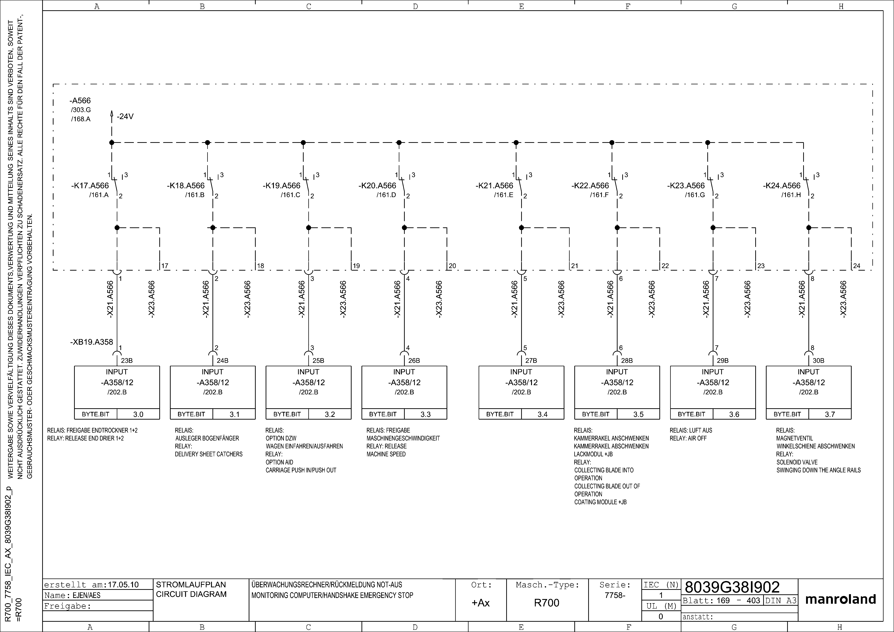

# +Ax — Sheet 169 of 403 — ÜBERWACHUNGSRECHNER/RÜCKMELDUNG NOT AUS

**MONITORING COMPUTER/HANDSHAKE EMERGENCY STOP**

> Part of the manroland **R700** printing press IEC/UL circuit diagrams.
> Drawing class: **Stromlaufplan / Circuit diagram** (DIN A3).
> Document `+Ax` covers the **Central control console** machine section.

## At a glance

| Field | Value |
|---|---|
| Document | `+Ax`  (8039G38I902) |
| Sheet | **169** of 403 |
| Section (DE) | ÜBERWACHUNGSRECHNER/RÜCKMELDUNG NOT AUS |
| Section (EN) | MONITORING COMPUTER/HANDSHAKE EMERGENCY STOP |
| Section type | CIRCUIT — Circuit diagram |
| Machine type | `R700` |
| Series | `7758` |
| Created | 17.05.10 |
| Replaces | — |
| Columns used | A, B, C, D, E, F, G, H |
| Path numbers | — |
| Labels on sheet | 167 |
| Cross-refs out | 18 |
| Cross-refs in | 42 |

**Previous:** [+Ax sheet 168](SHEET_0168.md) · **Next:** [+Ax sheet 170](SHEET_0170.md) · **Document TOC:** [_TOC.md](_TOC.md)  (+Ax) · **Master TOC:** [all sheets](../_MASTER_TOC.md)

## Sheet image (300 DPI, exact vector render)



_Rendered directly from the PDF vector layer at 300 DPI (1-bit), no OCR and no resampling. Use it to confirm anything ambiguous in the text below._

## Cross-references on this sheet

Each entry is a wire leaving this sheet. The printed token is `/sheet.column`; the link resolves to that sheet inside the same document.

| Ref | Target sheet | Col | Path | Destination on target | Target section | From col |
|---|---|---|---|---|---|---|
| `/303.G` | [+Ax sheet 303](SHEET_0303.md) | G | — | — | SPANNUNGSVERSORGUNG: LACKMODUL | A |
| `/168.A` | [+Ax sheet 168](SHEET_0168.md) | A | — | — | ÜBERWACHUNGSRECHNER/RÜCKMELDUNG NOT AUS | A |
| `/161.A` | [+Ax sheet 161](SHEET_0161.md) | A | — | — | ÜBERWACHUNGSRECHNER/ANSTEUERUNG NOT AUS | A |
| `/161.B` | [+Ax sheet 161](SHEET_0161.md) | B | — | — | ÜBERWACHUNGSRECHNER/ANSTEUERUNG NOT AUS | B |
| `/161.E` | [+Ax sheet 161](SHEET_0161.md) | E | — | — | ÜBERWACHUNGSRECHNER/ANSTEUERUNG NOT AUS | E |
| `/161.F` | [+Ax sheet 161](SHEET_0161.md) | F | — | — | ÜBERWACHUNGSRECHNER/ANSTEUERUNG NOT AUS | F |
| `/161.G` | [+Ax sheet 161](SHEET_0161.md) | G | — | — | ÜBERWACHUNGSRECHNER/ANSTEUERUNG NOT AUS | G |
| `/161.C` | [+Ax sheet 161](SHEET_0161.md) | C | — | — | ÜBERWACHUNGSRECHNER/ANSTEUERUNG NOT AUS | C |
| `/161.D` | [+Ax sheet 161](SHEET_0161.md) | D | — | — | ÜBERWACHUNGSRECHNER/ANSTEUERUNG NOT AUS | D |
| `/161.H` | [+Ax sheet 161](SHEET_0161.md) | H | — | — | ÜBERWACHUNGSRECHNER/ANSTEUERUNG NOT AUS | H |
| `/202.B` | [+Ax sheet 202](SHEET_0202.md) | B | — | — | REFERENZMODUL | A |
| `/202.B` | [+Ax sheet 202](SHEET_0202.md) | B | — | — | REFERENZMODUL | B |
| `/202.B` | [+Ax sheet 202](SHEET_0202.md) | B | — | — | REFERENZMODUL | C |
| `/202.B` | [+Ax sheet 202](SHEET_0202.md) | B | — | — | REFERENZMODUL | D |
| `/202.B` | [+Ax sheet 202](SHEET_0202.md) | B | — | — | REFERENZMODUL | E |
| `/202.B` | [+Ax sheet 202](SHEET_0202.md) | B | — | — | REFERENZMODUL | F |
| `/202.B` | [+Ax sheet 202](SHEET_0202.md) | B | — | — | REFERENZMODUL | G |
| `/202.B` | [+Ax sheet 202](SHEET_0202.md) | B | — | — | REFERENZMODUL | H |

### Incoming references (sheets that point here)

Every other sheet that sends a wire to this one. `Back-ref` is the token printed on *that* sheet; `Path` is its line number.

| From sheet | Cols | Back-ref | Path | Refs | What continues there |
|---|---|---|---|---|---|
| [+Ax#161](SHEET_0161.md) | A, B, C, D, E, F, G, H | `/161.A`, `/161.B`, `/161.C`, `/161.D`, `/161.E`, `/161.F`, `/161.G`, `/161.H` | — | 8 | — |
| [+Ax#168](SHEET_0168.md) | A | `/168.A` | — | 1 | — |
| [+Ax#202](SHEET_0202.md) | B | `/202.B` | — | 8 | — |
| [+Ax#259](SHEET_0259.md) | C | `/259.C` | — | 8 | — |
| [+Ax#261](SHEET_0261.md) | F | `/261.F` | — | 8 | — |
| [+Ax#265](SHEET_0265.md) | B | `/265.B` | — | 8 | — |
| [+Ax#303](SHEET_0303.md) | G | `/303.G` | — | 1 | — |


## Devices on this sheet

| Tag | Class | Class meaning (IEC) | Col | Sub | Terminal | Sign |
|---|---|---|---|---|---|---|
| `A358/12` | A | Baugruppe / assembly, module, PC board | E | 12 | — | — |
| `A358/12` | A | Baugruppe / assembly, module, PC board | F | 12 | — | — |
| `A358/12` | A | Baugruppe / assembly, module, PC board | G | 12 | — | — |
| `A358/12` | A | Baugruppe / assembly, module, PC board | H | 12 | — | — |
| `A358/12` | A | Baugruppe / assembly, module, PC board | A | 12 | — | — |
| `A358/12` | A | Baugruppe / assembly, module, PC board | B | 12 | — | — |
| `A358/12` | A | Baugruppe / assembly, module, PC board | C | 12 | — | — |
| `A358/12` | A | Baugruppe / assembly, module, PC board | D | 12 | — | — |
| `A566` | A | Baugruppe / assembly, module, PC board | A | — | — | — |
| `3.4` | — | cross-device reference | E | — | — | — |
| `3.5` | — | cross-device reference | F | — | — | — |
| `3.6` | — | cross-device reference | G | — | — | — |
| `3.7` | — | cross-device reference | H | — | — | — |
| `3.0` | — | cross-device reference | A | — | — | — |
| `3.1` | — | cross-device reference | B | — | — | — |
| `3.2` | — | cross-device reference | C | — | — | — |
| `3.3` | — | cross-device reference | D | — | — | — |
| `XB19.A358` | — | cross-device reference | A | — | — | — |
| `K21.A566` | — | cross-device reference | E | — | — | — |
| `K22.A566` | — | cross-device reference | F | — | — | — |
| `K24.A566` | — | cross-device reference | G | — | — | — |
| `K23.A566` | — | cross-device reference | G | — | — | — |
| `K17.A566` | — | cross-device reference | A | — | — | — |
| `K18.A566` | — | cross-device reference | B | — | — | — |
| `K20.A566` | — | cross-device reference | D | — | — | — |
| `K19.A566` | — | cross-device reference | C | — | — | — |
| `X21.A566` | — | cross-device reference | A | — | — | — |
| `X21.A566` | — | cross-device reference | B | — | — | — |
| `X21.A566` | — | cross-device reference | C | — | — | — |
| `X21.A566` | — | cross-device reference | D | — | — | — |
| `X21.A566` | — | cross-device reference | E | — | — | — |
| `X21.A566` | — | cross-device reference | F | — | — | — |
| `X21.A566` | — | cross-device reference | G | — | — | — |
| `X21.A566` | — | cross-device reference | H | — | — | — |
| `X23.A566` | — | cross-device reference | B | — | — | — |
| `X23.A566` | — | cross-device reference | B | — | — | — |
| `X23.A566` | — | cross-device reference | C | — | — | — |
| `X23.A566` | — | cross-device reference | D | — | — | — |
| `X23.A566` | — | cross-device reference | F | — | — | — |
| `X23.A566` | — | cross-device reference | G | — | — | — |
| `X23.A566` | — | cross-device reference | H | — | — | — |
| `X23.A566` | — | cross-device reference | E | — | — | — |

## Potentials / nets

| Potential | Count | Columns | Attached devices | Terminals |
|---|---|---|---|---|
| `24V` | 1 | A | — | — |


A potential such as `L24+/4` or `M24+` is a named supply/return rail; every place it appears on this sheet is electrically common.

## Wire-end annotations (grouped as printed)

A wire that continues elsewhere is annotated with a small cluster: the destination description, the path/line number `#NN`, and the `/sheet.column` cross reference. Each row below is one such cluster exactly as it is grouped on the drawing.

| Col | Y | Path | Cross-ref | Text on the wire |
|---|---|---|---|---|
| A | 129.3 | — | — | `A566` |
| A | 142.4 | — | `/303.G`, `/168.A` | — |
| A | 150.6 | — | — | `24V` |
| A | 229.2 | — | — | `K17.A566 3` |
| A | 229.2 | — | — | `1` |
| B | 229.2 | — | — | `K18.A566 3` |
| B | 229.2 | — | — | `1` |
| C | 229.2 | — | — | `K19.A566 3` |
| C | 229.2 | — | — | `1` |
| D | 229.2 | — | — | `K20.A566 3` |
| D | 229.2 | — | — | `1` |
| E | 229.2 | — | — | `K21.A566 3` |
| E | 229.2 | — | — | `1` |
| F | 229.2 | — | — | `K22.A566 3` |
| F | 229.2 | — | — | `1` |
| G | 229.2 | — | — | `K23.A566 3` |
| G | 229.2 | — | — | `1` |
| H | 229.2 | — | — | `K24.A566 3` |
| H | 229.2 | — | — | `1` |
| A | 255.7 | — | `/161.A` | — |
| B | 255.7 | — | `/161.B` | — |
| E | 255.7 | — | `/161.E` | — |
| C | 255.8 | — | `/161.C` | — |
| D | 255.8 | — | `/161.D` | — |
| F | 255.8 | — | `/161.F` | — |
| G | 255.8 | — | `/161.G` | — |
| H | 255.8 | — | `/161.H` | — |
| A | 257.6 | — | — | `2` |
| B | 257.6 | — | — | `2` |
| C | 257.6 | — | — | `2` |
| D | 257.6 | — | — | `2` |
| E | 257.6 | — | — | `2` |
| F | 257.6 | — | — | `2` |
| G | 257.6 | — | — | `2` |
| H | 257.6 | — | — | `2` |
| E | 350.4 | — | — | `17 18 19 20 22 23 24` |
| F | 350.4 | — | — | `21` |
| A | 367.4 | — | — | `1` |
| B | 367.4 | — | — | `2` |
| C | 367.4 | — | — | `3` |
| D | 367.4 | — | — | `4` |
| E | 367.4 | — | — | `5` |
| F | 367.4 | — | — | `6` |
| G | 367.4 | — | — | `7` |
| H | 367.4 | — | — | `8` |
| A | 373.6 | — | — | `X21.A566` |
| B | 373.6 | — | — | `X23.A566` |
| B | 373.6 | — | — | `X21.A566` |
| B | 373.6 | — | — | `X23.A566` |
| C | 373.6 | — | — | `X21.A566` |
| C | 373.6 | — | — | `X23.A566` |
| D | 373.6 | — | — | `X21.A566` |
| D | 373.6 | — | — | `X23.A566` |
| E | 373.6 | — | — | `X21.A566` |
| E | 373.6 | — | — | `X23.A566` |
| F | 373.6 | — | — | `X21.A566` |
| F | 373.6 | — | — | `X23.A566` |
| G | 373.6 | — | — | `X21.A566` |
| G | 373.6 | — | — | `X23.A566` |
| H | 373.6 | — | — | `X21.A566` |
| H | 373.6 | — | — | `X23.A566` |
| A | 451.0 | — | — | `XB19.A358 1` |
| C | 459.5 | — | — | `2 3 4` |
| F | 459.5 | — | — | `5 6 7 8` |
| A | 476.5 | — | — | `23B` |
| B | 476.5 | — | — | `24B` |
| C | 476.5 | — | — | `25B` |
| D | 476.5 | — | — | `26B` |
| E | 476.5 | — | — | `27B` |
| F | 476.5 | — | — | `28B` |
| G | 476.5 | — | — | `29B` |
| H | 476.5 | — | — | `30B` |
| A | 491.0 | — | — | `INPUT` |
| B | 491.0 | — | — | `INPUT` |
| C | 491.0 | — | — | `INPUT` |
| D | 491.0 | — | — | `INPUT` |
| E | 491.0 | — | — | `INPUT` |
| F | 491.0 | — | — | `INPUT` |
| G | 491.0 | — | — | `INPUT` |
| H | 491.0 | — | — | `INPUT` |
| A | 504.9 | — | — | `A358/12` |
| B | 504.9 | — | — | `A358/12` |
| C | 504.9 | — | — | `A358/12` |
| D | 504.9 | — | — | `A358/12` |
| E | 504.9 | — | — | `A358/12` |
| F | 504.9 | — | — | `A358/12` |
| G | 504.9 | — | — | `A358/12` |
| H | 504.9 | — | — | `A358/12` |
| A | 518.6 | — | `/202.B` | — |
| B | 518.6 | — | `/202.B` | — |
| C | 518.6 | — | `/202.B` | — |
| D | 518.6 | — | `/202.B` | — |
| E | 518.6 | — | `/202.B` | — |
| F | 518.6 | — | `/202.B` | — |
| G | 518.6 | — | `/202.B` | — |
| H | 518.6 | — | `/202.B` | — |
| A | 547.7 | — | — | `BYTE.BIT 3.0` |
| B | 547.7 | — | — | `BYTE.BIT 3.1` |
| C | 547.7 | — | — | `BYTE.BIT 3.2` |
| D | 547.7 | — | — | `BYTE.BIT 3.3` |
| E | 547.7 | — | — | `BYTE.BIT 3.4` |
| F | 547.7 | — | — | `BYTE.BIT 3.5` |
| G | 547.7 | — | — | `BYTE.BIT 3.6` |
| H | 547.7 | — | — | `BYTE.BIT 3.7` |
| B | 570.3 | — | — | `RELAIS:` |
| C | 570.3 | — | — | `RELAIS:` |
| F | 570.3 | — | — | `RELAIS: KAMMERRAKEL ANSCHWENKEN KAMMERRAKEL ABSCHWENKEN LACKMODUL +JB RELAY:` |
| H | 570.3 | — | — | `RELAIS: MAGNETVENTIL` |
| A | 570.4 | — | — | `RELAIS: FREIGABE ENDTROCKNER 1+2 RELAY: RELEASE END DRIER 1+2` |
| D | 570.4 | — | — | `RELAIS: FREIGABE RELAY: RELEASE MASCHINENGESCHWINDIGKEIT MACHINE SPEED` |
| G | 570.4 | — | — | `RELAIS: LUFT AUS RELAY: AIR OFF` |
| B | 581.0 | — | — | `RELAY: DELIVERY SHEET CATCHERS AUSLEGER BOGENFÄNGER` |
| C | 581.0 | — | — | `RELAY: OPTION DZW WAGEN EINFAHREN/AUSFAHREN` |
| H | 591.6 | — | — | `RELAY: WINKELSCHIENE ABSCHWENKEN` |
| C | 612.9 | — | — | `OPTION AID CARRIAGE PUSH IN/PUSH OUT` |
| H | 612.9 | — | — | `SOLENOID VALVE SWINGING DOWN THE ANGLE RAILS` |
| F | 623.6 | — | — | `COLLECTING BLADE INTO OPERATION COLLECTING BLADE OUT OF OPERATION COATING MODULE +JB` |


## Reconstructed tables

This sheet carries tabular content (pin map / terminal assignment / index). The grid below was rebuilt from the drawing's own rule lines, so each row is exactly one physical row of the table.

### Table 1 — 3 data rows × 19 columns (at x=99.2, y=189.9)

| 1 K17.A566 /161.A |  | 3 2 |  | 1 K18.A566 /161.B |  | 3 2 |  | 1 K19.A566 /161.C |  | 3 2 |  | 1 K20.A566 /161.D |  | 3 2 |  | 1 K21.A566 /161.E |  | 3 2 |
|---|---|---|---|---|---|---|---|---|---|---|---|---|---|---|---|---|---|---|
| `X21.A566 XB19.A358` |  | `1 X23.A566 1 23B` | `17` | `X21.A566` |  | `2 X23.A566 2 24B` | `18` | `X21.A566` |  | `3 X23.A566 3 25B` | `19` | `X21.A566` |  | `4 X23.A566 4 26B` | `20` | `X21.A566` |  | `5 X23.A566 5 27B` |
|  | `INPUT` | `A358/12 /202.B` |  |  | `INPUT` | `A358/12 /202.B` |  |  | `INPUT` | `A358/12 /202.B` |  |  | `INPUT` | `A358/12 /202.B` |  |  | `INPUT` | `A358/12 /202.B` |
| `BYTE.BIT` |  | `3.0` |  | `BYTE.BIT` |  | `3.1` |  | `BYTE.BIT` |  | `3.2` |  | `BYTE.BIT` |  | `3.3` |  | `BYTE.BIT` |  | `3.4` |


### Table 2 — 3 data rows × 11 columns (at x=765.4, y=189.9)

| 1 K22.A566 /161.F |  | 3 2 |  | 1 K23.A566 /161.G |  | 3 2 |  | 1 K24.A566 /161.H |  | 3 2 |
|---|---|---|---|---|---|---|---|---|---|---|
| `21 X21.A566` |  | `6 X23.A566 6 28B` | `22` | `X21.A566` |  | `7 X23.A566 7 29B` | `23` | `X21.A566` |  | `8 X23.A566 8 30B` |
|  | `INPUT` | `A358/12 /202.B` |  |  | `INPUT` | `A358/12 /202.B` |  |  | `INPUT` | `A358/12 /202.B` |
| `BYTE.BIT` |  | `3.5` |  | `BYTE.BIT` |  | `3.6` |  | `BYTE.BIT` |  | `3.7` |


## Notes and free text on this sheet

| Text | Col | Y (pt) |
|---|---|---|
| `27B` | E | 476.51 |
| `INPUT` | E | 491.03 |
| `BYTE.BIT` | E | 548.28 |
| `28B` | F | 476.51 |
| `INPUT` | F | 491.03 |
| `BYTE.BIT` | F | 548.28 |
| `29B` | G | 476.51 |
| `INPUT` | G | 491.03 |
| `BYTE.BIT` | G | 548.28 |
| `30B` | H | 476.51 |
| `INPUT` | H | 491.03 |
| `23B` | A | 476.51 |
| `INPUT` | A | 491.03 |
| `BYTE.BIT` | A | 548.28 |
| `24B` | B | 476.51 |
| `INPUT` | B | 491.03 |
| `BYTE.BIT` | B | 548.28 |
| `25B` | C | 476.51 |
| `INPUT` | C | 491.03 |
| `BYTE.BIT` | C | 548.28 |
| `26B` | D | 476.51 |
| `INPUT` | D | 491.03 |
| `BYTE.BIT` | D | 548.28 |
| `RELAIS:` | F | 570.32 |
| `KAMMERRAKEL ANSCHWENKEN` | F | 581.01 |
| `KAMMERRAKEL ABSCHWENKEN` | F | 591.64 |
| `LACKMODUL +JB` | F | 602.29 |
| `RELAY:` | F | 612.85 |
| `COLLECTING BLADE INTO` | F | 623.56 |
| `OPERATION` | F | 634.17 |
| `COLLECTING BLADE OUT OF` | F | 644.83 |
| `COATING MODULE +JB` | F | 666.1 |
| `RELAIS:` | C | 570.32 |
| `OPTION DZW` | C | 580.98 |
| `WAGEN EINFAHREN/AUSFAHREN` | C | 591.64 |
| `RELAY:` | C | 602.22 |
| `OPTION AID` | C | 612.91 |
| `CARRIAGE PUSH IN/PUSH OUT` | C | 623.56 |
| `RELAIS:` | B | 570.32 |
| `AUSLEGER BOGENFÄNGER` | B | 581.03 |
| `RELAY:` | B | 591.59 |
| `DELIVERY SHEET CATCHERS` | B | 602.28 |
| `RELAIS:` | G | 570.32 |
| `MAGNETVENTIL` | H | 581.02 |
| `WINKELSCHIENE ABSCHWENKEN` | H | 591.62 |
| `RELAY:` | G | 602.22 |
| `SOLENOID VALVE` | H | 612.91 |
| `SWINGING DOWN THE ANGLE RAILS` | H | 623.53 |
| `RELAIS: FREIGABE ENDTROCKNER 1+2` | A | 570.39 |
| `RELAY: RELEASE END DRIER 1+2` | A | 581.02 |
| `RELAIS: FREIGABE` | D | 570.36 |
| `MASCHINENGESCHWINDIGKEIT` | D | 581.01 |
| `RELAY: RELEASE` | D | 591.62 |
| `MACHINE SPEED` | D | 602.28 |
| `RELAIS: LUFT AUS` | G | 570.37 |
| `RELAY: AIR OFF` | G | 581 |

## Complete label inventory (exact text from the drawing)

Every text object inside the drawing area of this sheet, in DIN reading order (column A→H, then top→bottom). This is the authoritative list: if a string is not here it is not printed on this sheet.

| Col | Y | X | Dir | Type | Text |
|---|---|---|---|---|---|
| A | 129.3 | 92.7 | → | device tag | `A566` |
| A | 142.4 | 94.7 | → | cross-reference | `/303.G` |
| A | 150.5 | 155.6 | → | potential | `24V` |
| A | 154.8 | 95.0 | → | cross-reference | `/168.A` |
| A | 229.2 | 142.9 | → | number | `1` |
| A | 229.2 | 165.5 | → | number | `3` |
| A | 242.7 | 95.0 | → | device ref | `K17.A566` |
| A | 255.7 | 119.1 | → | cross-reference | `/161.A` |
| A | 257.6 | 158.5 | → | number | `2` |
| A | 367.4 | 157.9 | → | number | `1` |
| A | 373.6 | 142.0 | ↕ | device ref | `X21.A566` |
| A | 451.0 | 93.5 | → | device ref | `XB19.A358` |
| A | 459.5 | 157.9 | → | number | `1` |
| A | 476.5 | 161.3 | → | text | `23B` |
| A | 491.0 | 141.0 | → | text | `INPUT` |
| A | 504.9 | 134.5 | → | device tag | `A358/12` |
| A | 518.6 | 143.3 | → | cross-reference | `/202.B` |
| A | 547.7 | 177.4 | → | device ref | `3.0` |
| A | 548.3 | 109.1 | → | text | `BYTE.BIT` |
| A | 570.4 | 62.9 | → | text | `RELAIS: FREIGABE ENDTROCKNER 1+2` |
| A | 581.0 | 62.9 | → | text | `RELAY: RELEASE END DRIER 1+2` |
| B | 229.2 | 270.4 | → | number | `1` |
| B | 229.2 | 293.1 | → | number | `3` |
| B | 242.7 | 222.5 | → | device ref | `K18.A566` |
| B | 255.7 | 246.9 | → | cross-reference | `/161.B` |
| B | 257.6 | 286.0 | → | number | `2` |
| B | 350.4 | 214.6 | → | number | `17` |
| B | 367.4 | 286.0 | → | number | `2` |
| B | 373.6 | 197.3 | ↕ | device ref | `X23.A566` |
| B | 373.6 | 269.6 | ↕ | device ref | `X21.A566` |
| B | 373.6 | 324.9 | ↕ | device ref | `X23.A566` |
| B | 459.5 | 286.0 | → | number | `2` |
| B | 476.5 | 288.9 | → | text | `24B` |
| B | 491.0 | 268.6 | → | text | `INPUT` |
| B | 504.9 | 262.1 | → | device tag | `A358/12` |
| B | 518.6 | 270.9 | → | cross-reference | `/202.B` |
| B | 547.7 | 305.9 | → | device ref | `3.1` |
| B | 548.3 | 236.7 | → | text | `BYTE.BIT` |
| B | 570.3 | 233.0 | → | text | `RELAIS:` |
| B | 581.0 | 233.9 | → | text | `AUSLEGER BOGENFÄNGER` |
| B | 591.6 | 233.0 | → | text | `RELAY:` |
| B | 602.3 | 233.0 | → | text | `DELIVERY SHEET CATCHERS` |
| C | 229.2 | 398.0 | → | number | `1` |
| C | 229.2 | 420.7 | → | number | `3` |
| C | 242.7 | 350.1 | → | device ref | `K19.A566` |
| C | 255.8 | 374.2 | → | cross-reference | `/161.C` |
| C | 257.6 | 413.6 | → | number | `2` |
| C | 350.4 | 342.1 | → | number | `18` |
| C | 350.4 | 469.7 | → | number | `19` |
| C | 367.4 | 413.6 | → | number | `3` |
| C | 373.6 | 397.2 | ↕ | device ref | `X21.A566` |
| C | 373.6 | 452.4 | ↕ | device ref | `X23.A566` |
| C | 459.5 | 413.6 | → | number | `3` |
| C | 476.5 | 416.4 | → | text | `25B` |
| C | 491.0 | 396.1 | → | text | `INPUT` |
| C | 504.9 | 389.6 | → | device tag | `A358/12` |
| C | 518.6 | 398.4 | → | cross-reference | `/202.B` |
| C | 547.7 | 432.6 | → | device ref | `3.2` |
| C | 548.3 | 364.3 | → | text | `BYTE.BIT` |
| C | 570.3 | 353.5 | → | text | `RELAIS:` |
| C | 581.0 | 354.0 | → | text | `OPTION DZW` |
| C | 591.6 | 354.3 | → | text | `WAGEN EINFAHREN/AUSFAHREN` |
| C | 602.2 | 353.5 | → | text | `RELAY:` |
| C | 612.9 | 354.0 | → | text | `OPTION AID` |
| C | 623.6 | 354.0 | → | text | `CARRIAGE PUSH IN/PUSH OUT` |
| D | 229.2 | 525.5 | → | number | `1` |
| D | 229.2 | 548.2 | → | number | `3` |
| D | 242.7 | 477.6 | → | device ref | `K20.A566` |
| D | 255.8 | 501.7 | → | cross-reference | `/161.D` |
| D | 257.6 | 541.1 | → | number | `2` |
| D | 350.4 | 597.8 | → | number | `20` |
| D | 367.4 | 541.1 | → | number | `4` |
| D | 373.6 | 524.7 | ↕ | device ref | `X21.A566` |
| D | 373.6 | 580.0 | ↕ | device ref | `X23.A566` |
| D | 459.5 | 541.1 | → | number | `4` |
| D | 476.5 | 544.0 | → | text | `26B` |
| D | 491.0 | 523.7 | → | text | `INPUT` |
| D | 504.9 | 517.2 | → | device tag | `A358/12` |
| D | 518.6 | 526.0 | → | cross-reference | `/202.B` |
| D | 547.7 | 560.1 | → | device ref | `3.3` |
| D | 548.3 | 491.8 | → | text | `BYTE.BIT` |
| D | 570.4 | 488.1 | → | text | `RELAIS: FREIGABE` |
| D | 581.0 | 488.4 | → | text | `MASCHINENGESCHWINDIGKEIT` |
| D | 591.6 | 488.1 | → | text | `RELAY: RELEASE` |
| D | 602.3 | 488.4 | → | text | `MACHINE SPEED` |
| E | 229.2 | 681.4 | → | number | `1` |
| E | 229.2 | 704.1 | → | number | `3` |
| E | 242.7 | 633.5 | → | device ref | `K21.A566` |
| E | 255.7 | 658.2 | → | cross-reference | `/161.E` |
| E | 257.6 | 697.0 | → | number | `2` |
| E | 367.4 | 697.0 | → | number | `5` |
| E | 373.6 | 680.6 | ↕ | device ref | `X21.A566` |
| E | 373.6 | 743.0 | ↕ | device ref | `X23.A566` |
| E | 459.5 | 697.0 | → | number | `5` |
| E | 476.5 | 699.9 | → | text | `27B` |
| E | 491.0 | 679.6 | → | text | `INPUT` |
| E | 504.9 | 673.1 | → | device tag | `A358/12` |
| E | 518.6 | 681.9 | → | cross-reference | `/202.B` |
| E | 547.7 | 716.0 | → | device ref | `3.4` |
| E | 548.3 | 647.7 | → | text | `BYTE.BIT` |
| F | 229.2 | 809.0 | → | number | `1` |
| F | 229.2 | 831.7 | → | number | `3` |
| F | 242.7 | 761.1 | → | device ref | `K22.A566` |
| F | 255.7 | 786.0 | → | cross-reference | `/161.F` |
| F | 257.6 | 824.6 | → | number | `2` |
| F | 350.4 | 760.8 | → | number | `21` |
| F | 350.4 | 881.3 | → | number | `22` |
| F | 367.4 | 824.6 | → | number | `6` |
| F | 373.6 | 808.2 | ↕ | device ref | `X21.A566` |
| F | 373.6 | 863.5 | ↕ | device ref | `X23.A566` |
| F | 459.5 | 824.6 | → | number | `6` |
| F | 476.5 | 827.4 | → | text | `28B` |
| F | 491.0 | 807.2 | → | text | `INPUT` |
| F | 504.9 | 800.6 | → | device tag | `A358/12` |
| F | 518.6 | 809.4 | → | cross-reference | `/202.B` |
| F | 547.7 | 843.6 | → | device ref | `3.5` |
| F | 548.3 | 775.3 | → | text | `BYTE.BIT` |
| F | 570.3 | 764.5 | → | text | `RELAIS:` |
| F | 581.0 | 764.5 | → | text | `KAMMERRAKEL ANSCHWENKEN` |
| F | 591.6 | 764.5 | → | text | `KAMMERRAKEL ABSCHWENKEN` |
| F | 602.3 | 764.5 | → | text | `LACKMODUL +JB` |
| F | 612.9 | 764.5 | → | text | `RELAY:` |
| F | 623.6 | 765.1 | → | text | `COLLECTING BLADE INTO` |
| F | 634.2 | 765.1 | → | text | `OPERATION` |
| F | 644.8 | 765.1 | → | text | `COLLECTING BLADE OUT OF` |
| F | 655.4 | 765.1 | → | text | `OPERATION` |
| F | 666.1 | 765.1 | → | text | `COATING MODULE +JB` |
| G | 229.2 | 936.6 | → | number | `1` |
| G | 229.2 | 959.2 | → | number | `3` |
| G | 242.7 | 888.7 | → | device ref | `K23.A566` |
| G | 242.7 | 1016.2 | → | device ref | `K24.A566` |
| G | 255.8 | 912.5 | → | cross-reference | `/161.G` |
| G | 257.6 | 952.2 | → | number | `2` |
| G | 350.4 | 1008.9 | → | number | `23` |
| G | 367.4 | 952.2 | → | number | `7` |
| G | 373.6 | 935.7 | ↕ | device ref | `X21.A566` |
| G | 373.6 | 991.0 | ↕ | device ref | `X23.A566` |
| G | 459.5 | 952.2 | → | number | `7` |
| G | 476.5 | 955.0 | → | text | `29B` |
| G | 491.0 | 934.7 | → | text | `INPUT` |
| G | 504.9 | 928.2 | → | device tag | `A358/12` |
| G | 518.6 | 937.0 | → | cross-reference | `/202.B` |
| G | 547.7 | 971.1 | → | device ref | `3.6` |
| G | 548.3 | 902.8 | → | text | `BYTE.BIT` |
| G | 548.3 | 1030.4 | → | text | `BYTE.BIT` |
| G | 570.3 | 1033.8 | → | text | `RELAIS:` |
| G | 570.4 | 892.1 | → | text | `RELAIS: LUFT AUS` |
| G | 581.0 | 892.1 | → | text | `RELAY: AIR OFF` |
| G | 602.2 | 1033.8 | → | text | `RELAY:` |
| H | 229.2 | 1064.1 | → | number | `1` |
| H | 229.2 | 1086.8 | → | number | `3` |
| H | 255.8 | 1040.9 | → | cross-reference | `/161.H` |
| H | 257.6 | 1079.7 | → | number | `2` |
| H | 350.4 | 1136.4 | → | number | `24` |
| H | 367.4 | 1079.7 | → | number | `8` |
| H | 373.6 | 1063.3 | ↕ | device ref | `X21.A566` |
| H | 373.6 | 1118.6 | ↕ | device ref | `X23.A566` |
| H | 459.5 | 1079.7 | → | number | `8` |
| H | 476.5 | 1082.6 | → | text | `30B` |
| H | 491.0 | 1062.3 | → | text | `INPUT` |
| H | 504.9 | 1055.8 | → | device tag | `A358/12` |
| H | 518.6 | 1064.6 | → | cross-reference | `/202.B` |
| H | 547.7 | 1098.7 | → | device ref | `3.7` |
| H | 581.0 | 1034.1 | → | text | `MAGNETVENTIL` |
| H | 591.6 | 1034.6 | → | text | `WINKELSCHIENE ABSCHWENKEN` |
| H | 612.9 | 1034.4 | → | text | `SOLENOID VALVE` |
| H | 623.5 | 1034.4 | → | text | `SWINGING DOWN THE ANGLE RAILS` |

## Reading-order text block

The same content as a plain block, grouped by DIN column — convenient to paste or to match against a visual description.

```text
=== Column A ===
 129.3   92.7  devtag       A566
 142.4   94.7  xref         /303.G
 150.5  155.6  net          24V
 154.8   95.0  xref         /168.A
 229.2  142.9  numeric      1
 229.2  165.5  numeric      3
 242.7   95.0  devref       K17.A566
 255.7  119.1  xref         /161.A
 257.6  158.5  numeric      2
 367.4  157.9  numeric      1
 373.6  142.0  devref       X21.A566
 451.0   93.5  devref       XB19.A358
 459.5  157.9  numeric      1
 476.5  161.3  text         23B
 491.0  141.0  text         INPUT
 504.9  134.5  devtag       A358/12
 518.6  143.3  xref         /202.B
 547.7  177.4  devref       3.0
 548.3  109.1  text         BYTE.BIT
 570.4   62.9  text         RELAIS: FREIGABE ENDTROCKNER 1+2
 581.0   62.9  text         RELAY: RELEASE END DRIER 1+2
=== Column B ===
 229.2  270.4  numeric      1
 229.2  293.1  numeric      3
 242.7  222.5  devref       K18.A566
 255.7  246.9  xref         /161.B
 257.6  286.0  numeric      2
 350.4  214.6  numeric      17
 367.4  286.0  numeric      2
 373.6  197.3  devref       X23.A566
 373.6  269.6  devref       X21.A566
 373.6  324.9  devref       X23.A566
 459.5  286.0  numeric      2
 476.5  288.9  text         24B
 491.0  268.6  text         INPUT
 504.9  262.1  devtag       A358/12
 518.6  270.9  xref         /202.B
 547.7  305.9  devref       3.1
 548.3  236.7  text         BYTE.BIT
 570.3  233.0  text         RELAIS:
 581.0  233.9  text         AUSLEGER BOGENFÄNGER
 591.6  233.0  text         RELAY:
 602.3  233.0  text         DELIVERY SHEET CATCHERS
=== Column C ===
 229.2  398.0  numeric      1
 229.2  420.7  numeric      3
 242.7  350.1  devref       K19.A566
 255.8  374.2  xref         /161.C
 257.6  413.6  numeric      2
 350.4  342.1  numeric      18
 350.4  469.7  numeric      19
 367.4  413.6  numeric      3
 373.6  397.2  devref       X21.A566
 373.6  452.4  devref       X23.A566
 459.5  413.6  numeric      3
 476.5  416.4  text         25B
 491.0  396.1  text         INPUT
 504.9  389.6  devtag       A358/12
 518.6  398.4  xref         /202.B
 547.7  432.6  devref       3.2
 548.3  364.3  text         BYTE.BIT
 570.3  353.5  text         RELAIS:
 581.0  354.0  text         OPTION DZW
 591.6  354.3  text         WAGEN EINFAHREN/AUSFAHREN
 602.2  353.5  text         RELAY:
 612.9  354.0  text         OPTION AID
 623.6  354.0  text         CARRIAGE PUSH IN/PUSH OUT
=== Column D ===
 229.2  525.5  numeric      1
 229.2  548.2  numeric      3
 242.7  477.6  devref       K20.A566
 255.8  501.7  xref         /161.D
 257.6  541.1  numeric      2
 350.4  597.8  numeric      20
 367.4  541.1  numeric      4
 373.6  524.7  devref       X21.A566
 373.6  580.0  devref       X23.A566
 459.5  541.1  numeric      4
 476.5  544.0  text         26B
 491.0  523.7  text         INPUT
 504.9  517.2  devtag       A358/12
 518.6  526.0  xref         /202.B
 547.7  560.1  devref       3.3
 548.3  491.8  text         BYTE.BIT
 570.4  488.1  text         RELAIS: FREIGABE
 581.0  488.4  text         MASCHINENGESCHWINDIGKEIT
 591.6  488.1  text         RELAY: RELEASE
 602.3  488.4  text         MACHINE SPEED
=== Column E ===
 229.2  681.4  numeric      1
 229.2  704.1  numeric      3
 242.7  633.5  devref       K21.A566
 255.7  658.2  xref         /161.E
 257.6  697.0  numeric      2
 367.4  697.0  numeric      5
 373.6  680.6  devref       X21.A566
 373.6  743.0  devref       X23.A566
 459.5  697.0  numeric      5
 476.5  699.9  text         27B
 491.0  679.6  text         INPUT
 504.9  673.1  devtag       A358/12
 518.6  681.9  xref         /202.B
 547.7  716.0  devref       3.4
 548.3  647.7  text         BYTE.BIT
=== Column F ===
 229.2  809.0  numeric      1
 229.2  831.7  numeric      3
 242.7  761.1  devref       K22.A566
 255.7  786.0  xref         /161.F
 257.6  824.6  numeric      2
 350.4  760.8  numeric      21
 350.4  881.3  numeric      22
 367.4  824.6  numeric      6
 373.6  808.2  devref       X21.A566
 373.6  863.5  devref       X23.A566
 459.5  824.6  numeric      6
 476.5  827.4  text         28B
 491.0  807.2  text         INPUT
 504.9  800.6  devtag       A358/12
 518.6  809.4  xref         /202.B
 547.7  843.6  devref       3.5
 548.3  775.3  text         BYTE.BIT
 570.3  764.5  text         RELAIS:
 581.0  764.5  text         KAMMERRAKEL ANSCHWENKEN
 591.6  764.5  text         KAMMERRAKEL ABSCHWENKEN
 602.3  764.5  text         LACKMODUL +JB
 612.9  764.5  text         RELAY:
 623.6  765.1  text         COLLECTING BLADE INTO
 634.2  765.1  text         OPERATION
 644.8  765.1  text         COLLECTING BLADE OUT OF
 655.4  765.1  text         OPERATION
 666.1  765.1  text         COATING MODULE +JB
=== Column G ===
 229.2  936.6  numeric      1
 229.2  959.2  numeric      3
 242.7  888.7  devref       K23.A566
 242.7 1016.2  devref       K24.A566
 255.8  912.5  xref         /161.G
 257.6  952.2  numeric      2
 350.4 1008.9  numeric      23
 367.4  952.2  numeric      7
 373.6  935.7  devref       X21.A566
 373.6  991.0  devref       X23.A566
 459.5  952.2  numeric      7
 476.5  955.0  text         29B
 491.0  934.7  text         INPUT
 504.9  928.2  devtag       A358/12
 518.6  937.0  xref         /202.B
 547.7  971.1  devref       3.6
 548.3  902.8  text         BYTE.BIT
 548.3 1030.4  text         BYTE.BIT
 570.3 1033.8  text         RELAIS:
 570.4  892.1  text         RELAIS: LUFT AUS
 581.0  892.1  text         RELAY: AIR OFF
 602.2 1033.8  text         RELAY:
=== Column H ===
 229.2 1064.1  numeric      1
 229.2 1086.8  numeric      3
 255.8 1040.9  xref         /161.H
 257.6 1079.7  numeric      2
 350.4 1136.4  numeric      24
 367.4 1079.7  numeric      8
 373.6 1063.3  devref       X21.A566
 373.6 1118.6  devref       X23.A566
 459.5 1079.7  numeric      8
 476.5 1082.6  text         30B
 491.0 1062.3  text         INPUT
 504.9 1055.8  devtag       A358/12
 518.6 1064.6  xref         /202.B
 547.7 1098.7  devref       3.7
 581.0 1034.1  text         MAGNETVENTIL
 591.6 1034.6  text         WINKELSCHIENE ABSCHWENKEN
 612.9 1034.4  text         SOLENOID VALVE
 623.5 1034.4  text         SWINGING DOWN THE ANGLE RAILS
```

---
_Generated from the PDF vector text layer; no OCR. Source: `R700_7758_IEC_AX_8039G38I902_p`, sheet 169._
