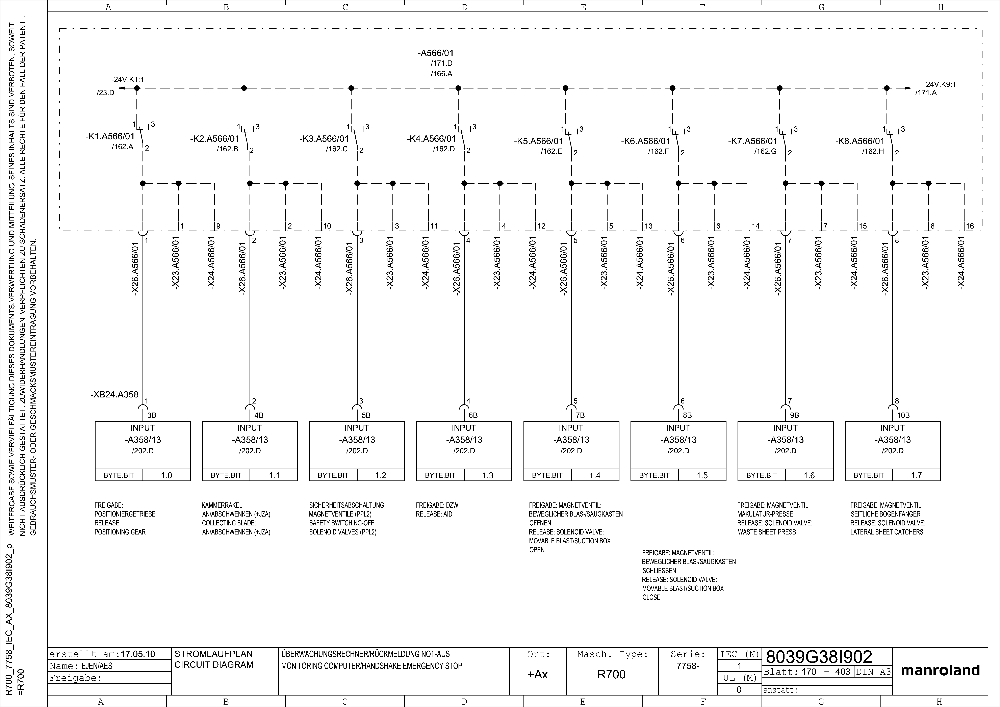

# +Ax — Sheet 170 of 403 — ÜBERWACHUNGSRECHNER/RÜCKMELDUNG NOT AUS

**MONITORING COMPUTER/HANDSHAKE EMERGENCY STOP**

> Part of the manroland **R700** printing press IEC/UL circuit diagrams.
> Drawing class: **Stromlaufplan / Circuit diagram** (DIN A3).
> Document `+Ax` covers the **Central control console** machine section.

## At a glance

| Field | Value |
|---|---|
| Document | `+Ax`  (8039G38I902) |
| Sheet | **170** of 403 |
| Section (DE) | ÜBERWACHUNGSRECHNER/RÜCKMELDUNG NOT AUS |
| Section (EN) | MONITORING COMPUTER/HANDSHAKE EMERGENCY STOP |
| Section type | CIRCUIT — Circuit diagram |
| Machine type | `R700` |
| Series | `7758` |
| Created | 17.05.10 |
| Replaces | — |
| Columns used | A, B, C, D, E, F, G, H |
| Path numbers | — |
| Labels on sheet | 186 |
| Cross-refs out | 20 |
| Cross-refs in | 36 |

**Previous:** [+Ax sheet 169](SHEET_0169.md) · **Next:** [+Ax sheet 171](SHEET_0171.md) · **Document TOC:** [_TOC.md](_TOC.md)  (+Ax) · **Master TOC:** [all sheets](../_MASTER_TOC.md)

## Sheet image (300 DPI, exact vector render)



_Rendered directly from the PDF vector layer at 300 DPI (1-bit), no OCR and no resampling. Use it to confirm anything ambiguous in the text below._

## Cross-references on this sheet

Each entry is a wire leaving this sheet. The printed token is `/sheet.column`; the link resolves to that sheet inside the same document.

| Ref | Target sheet | Col | Path | Destination on target | Target section | From col |
|---|---|---|---|---|---|---|
| `/171.D` | [+Ax sheet 171](SHEET_0171.md) | D | — | — | ÜBERWACHUNGSRECHNER/RÜCKMELDUNG NOT AUS | D |
| `/166.A` | [+Ax sheet 166](SHEET_0166.md) | A | — | — | ÜBERWACHUNGSRECHNER/ANSTEUERUNG NOT AUS | D |
| `/171.A` | [+Ax sheet 171](SHEET_0171.md) | A | — | — | ÜBERWACHUNGSRECHNER/RÜCKMELDUNG NOT AUS | H |
| `/23.D` | [+Ax sheet 23](SHEET_0023.md) | D | — | — | SPANNUNGSVERSORGUNG, SCHALTSCHRANKBELÜFTUNG | A |
| `/162.A` | [+Ax sheet 162](SHEET_0162.md) | A | — | — | ÜBERWACHUNGSRECHNER/ANSTEUERUNG NOT AUS | A |
| `/162.B` | [+Ax sheet 162](SHEET_0162.md) | B | — | — | ÜBERWACHUNGSRECHNER/ANSTEUERUNG NOT AUS | B |
| `/162.C` | [+Ax sheet 162](SHEET_0162.md) | C | — | — | ÜBERWACHUNGSRECHNER/ANSTEUERUNG NOT AUS | C |
| `/162.D` | [+Ax sheet 162](SHEET_0162.md) | D | — | — | ÜBERWACHUNGSRECHNER/ANSTEUERUNG NOT AUS | D |
| `/162.E` | [+Ax sheet 162](SHEET_0162.md) | E | — | — | ÜBERWACHUNGSRECHNER/ANSTEUERUNG NOT AUS | E |
| `/162.F` | [+Ax sheet 162](SHEET_0162.md) | F | — | — | ÜBERWACHUNGSRECHNER/ANSTEUERUNG NOT AUS | F |
| `/162.G` | [+Ax sheet 162](SHEET_0162.md) | G | — | — | ÜBERWACHUNGSRECHNER/ANSTEUERUNG NOT AUS | G |
| `/162.H` | [+Ax sheet 162](SHEET_0162.md) | H | — | — | ÜBERWACHUNGSRECHNER/ANSTEUERUNG NOT AUS | G |
| `/202.D` | [+Ax sheet 202](SHEET_0202.md) | D | — | — | REFERENZMODUL | A |
| `/202.D` | [+Ax sheet 202](SHEET_0202.md) | D | — | — | REFERENZMODUL | B |
| `/202.D` | [+Ax sheet 202](SHEET_0202.md) | D | — | — | REFERENZMODUL | C |
| `/202.D` | [+Ax sheet 202](SHEET_0202.md) | D | — | — | REFERENZMODUL | D |
| `/202.D` | [+Ax sheet 202](SHEET_0202.md) | D | — | — | REFERENZMODUL | E |
| `/202.D` | [+Ax sheet 202](SHEET_0202.md) | D | — | — | REFERENZMODUL | F |
| `/202.D` | [+Ax sheet 202](SHEET_0202.md) | D | — | — | REFERENZMODUL | G |
| `/202.D` | [+Ax sheet 202](SHEET_0202.md) | D | — | — | REFERENZMODUL | H |

### Incoming references (sheets that point here)

Every other sheet that sends a wire to this one. `Back-ref` is the token printed on *that* sheet; `Path` is its line number.

| From sheet | Cols | Back-ref | Path | Refs | What continues there |
|---|---|---|---|---|---|
| [+Ax#23](SHEET_0023.md) | D | `/23.D` | — | 1 | — |
| [+Ax#162](SHEET_0162.md) | B, C, D, E, F, G, H | `/162.B`, `/162.C`, `/162.D`, `/162.E`, `/162.F`, `/162.G`, `/162.H` | — | 8 | — |
| [+Ax#166](SHEET_0166.md) | A | `/166.A` | — | 1 | — |
| [+Ax#171](SHEET_0171.md) | D | `/171.D` | — | 2 | 24V.K9:1 24V.K17:1 |
| [+Ax#202](SHEET_0202.md) | D | `/202.D` | — | 8 | — |
| [+Ax#266](SHEET_0266.md) | B | `/266.B` | — | 8 | — |
| [+Ax#269](SHEET_0269.md) | F | `/269.F` | — | 8 | — |


## Devices on this sheet

| Tag | Class | Class meaning (IEC) | Col | Sub | Terminal | Sign |
|---|---|---|---|---|---|---|
| `A358/13` | A | Baugruppe / assembly, module, PC board | A | 13 | — | — |
| `A358/13` | A | Baugruppe / assembly, module, PC board | B | 13 | — | — |
| `A358/13` | A | Baugruppe / assembly, module, PC board | C | 13 | — | — |
| `A358/13` | A | Baugruppe / assembly, module, PC board | D | 13 | — | — |
| `A358/13` | A | Baugruppe / assembly, module, PC board | E | 13 | — | — |
| `A358/13` | A | Baugruppe / assembly, module, PC board | F | 13 | — | — |
| `A358/13` | A | Baugruppe / assembly, module, PC board | G | 13 | — | — |
| `A566/01` | A | Baugruppe / assembly, module, PC board | D | 01 | — | — |
| `A358/13` | A | Baugruppe / assembly, module, PC board | H | 13 | — | — |
| `1.0` | — | cross-device reference | A | — | — | — |
| `XB24.A358` | — | cross-device reference | A | — | — | — |
| `1.1` | — | cross-device reference | B | — | — | — |
| `1.2` | — | cross-device reference | C | — | — | — |
| `1.3` | — | cross-device reference | D | — | — | — |
| `1.4` | — | cross-device reference | E | — | — | — |
| `1.5` | — | cross-device reference | F | — | — | — |
| `1.6` | — | cross-device reference | G | — | — | — |
| `1.7` | — | cross-device reference | H | — | — | — |

## Potentials / nets

| Potential | Count | Columns | Attached devices | Terminals |
|---|---|---|---|---|
| `24V` | 2 | A, H | `K1`, `K9` | `1` |


A potential such as `L24+/4` or `M24+` is a named supply/return rail; every place it appears on this sheet is electrically common.

## Wire-end annotations (grouped as printed)

A wire that continues elsewhere is annotated with a small cluster: the destination description, the path/line number `#NN`, and the `/sheet.column` cross reference. Each row below is one such cluster exactly as it is grouped on the drawing.

| Col | Y | Path | Cross-ref | Text on the wire |
|---|---|---|---|---|
| D | 58.4 | — | — | `A566/01` |
| D | 71.5 | — | `/171.D`, `/166.A` | — |
| A | 91.0 | — | — | `24V.K1:1` |
| H | 96.7 | — | — | `24V.K9:1` |
| A | 106.6 | — | `/23.D` | — |
| H | 106.6 | — | `/171.A` | — |
| A | 144.2 | — | — | `K1.A566/01 3` |
| A | 144.2 | — | — | `1` |
| B | 147.0 | — | — | `K2.A566/01 3` |
| B | 147.0 | — | — | `1` |
| C | 147.0 | — | — | `K3.A566/01 3` |
| C | 147.0 | — | — | `1` |
| D | 147.0 | — | — | `K4.A566/01 3` |
| D | 147.0 | — | — | `1` |
| E | 149.8 | — | — | `K5.A566/01 3` |
| E | 149.8 | — | — | `1` |
| F | 149.8 | — | — | `K6.A566/01 3` |
| F | 149.8 | — | — | `1` |
| G | 149.8 | — | — | `K7.A566/01 3` |
| G | 149.8 | — | — | `1` |
| G | 149.8 | — | — | `K8.A566/01 3` |
| H | 149.8 | — | — | `1` |
| A | 170.7 | — | `/162.A` | — |
| A | 172.5 | — | — | `2` |
| B | 173.5 | — | `/162.B` | — |
| C | 173.6 | — | `/162.C` | — |
| D | 173.6 | — | `/162.D` | — |
| B | 175.4 | — | — | `2` |
| C | 175.4 | — | — | `2` |
| D | 175.4 | — | — | `2` |
| E | 176.4 | — | `/162.E` | — |
| F | 176.4 | — | `/162.F` | — |
| G | 176.4 | — | `/162.G` | — |
| G | 176.4 | — | `/162.H` | — |
| E | 178.2 | — | — | `2` |
| F | 178.2 | — | — | `2` |
| G | 178.2 | — | — | `2` |
| H | 178.2 | — | — | `2` |
| C | 265.4 | — | — | `1 2 3 4 5` |
| E | 265.4 | — | — | `9 10 11 12 13 14 15 8 16` |
| G | 265.4 | — | — | `6 7` |
| B | 280.1 | — | — | `X23.A566/01` |
| B | 280.1 | — | — | `X24.A566/01` |
| B | 280.1 | — | — | `X23.A566/01` |
| C | 280.1 | — | — | `X24.A566/01` |
| C | 280.1 | — | — | `X23.A566/01` |
| D | 280.1 | — | — | `X24.A566/01` |
| D | 280.1 | — | — | `X23.A566/01` |
| E | 280.1 | — | — | `X24.A566/01` |
| E | 280.1 | — | — | `X23.A566/01` |
| E | 280.1 | — | — | `X24.A566/01` |
| F | 280.1 | — | — | `X23.A566/01` |
| F | 280.1 | — | — | `X24.A566/01` |
| G | 280.1 | — | — | `X23.A566/01` |
| G | 280.1 | — | — | `X24.A566/01` |
| H | 280.1 | — | — | `X23.A566/01` |
| H | 280.1 | — | — | `X24.A566/01` |
| A | 282.4 | — | — | `1` |
| B | 282.4 | — | — | `2` |
| C | 282.4 | — | — | `3` |
| D | 282.4 | — | — | `4` |
| E | 282.4 | — | — | `5` |
| F | 282.4 | — | — | `6` |
| G | 282.4 | — | — | `7` |
| H | 282.4 | — | — | `8` |
| A | 287.1 | — | — | `X26.A566/01` |
| B | 287.1 | — | — | `X26.A566/01` |
| C | 287.1 | — | — | `X26.A566/01` |
| D | 287.1 | — | — | `X26.A566/01` |
| E | 287.1 | — | — | `X26.A566/01` |
| F | 287.1 | — | — | `X26.A566/01` |
| G | 287.1 | — | — | `X26.A566/01` |
| H | 287.1 | — | — | `X26.A566/01` |
| A | 465.2 | — | — | `XB24.A358 1` |
| B | 473.7 | — | — | `2` |
| C | 473.7 | — | — | `3` |
| D | 473.7 | — | — | `4` |
| E | 473.7 | — | — | `5` |
| F | 473.7 | — | — | `6` |
| G | 473.7 | — | — | `7` |
| H | 473.7 | — | — | `8` |
| A | 490.7 | — | — | `3B` |
| B | 490.7 | — | — | `4B` |
| C | 490.7 | — | — | `5B` |
| D | 490.7 | — | — | `6B` |
| E | 490.7 | — | — | `7B` |
| F | 490.7 | — | — | `8B` |
| G | 490.7 | — | — | `9B` |
| H | 490.7 | — | — | `10B` |
| A | 505.2 | — | — | `INPUT` |
| B | 505.2 | — | — | `INPUT` |
| C | 505.2 | — | — | `INPUT` |
| D | 505.2 | — | — | `INPUT` |
| E | 505.2 | — | — | `INPUT` |
| F | 505.2 | — | — | `INPUT` |
| G | 505.2 | — | — | `INPUT` |
| H | 505.2 | — | — | `INPUT` |
| A | 519.0 | — | — | `A358/13` |
| B | 519.0 | — | — | `A358/13` |
| C | 519.0 | — | — | `A358/13` |
| D | 519.0 | — | — | `A358/13` |
| E | 519.0 | — | — | `A358/13` |
| F | 519.0 | — | — | `A358/13` |
| G | 519.0 | — | — | `A358/13` |
| H | 519.0 | — | — | `A358/13` |
| A | 532.9 | — | `/202.D` | — |
| B | 532.9 | — | `/202.D` | — |
| C | 532.9 | — | `/202.D` | — |
| D | 532.9 | — | `/202.D` | — |
| E | 532.9 | — | `/202.D` | — |
| F | 532.9 | — | `/202.D` | — |
| G | 532.9 | — | `/202.D` | — |
| H | 532.9 | — | `/202.D` | — |
| A | 561.9 | — | — | `BYTE.BIT 1.0` |
| B | 561.9 | — | — | `BYTE.BIT 1.1` |
| C | 561.9 | — | — | `BYTE.BIT 1.2` |
| D | 561.9 | — | — | `BYTE.BIT 1.3` |
| E | 561.9 | — | — | `BYTE.BIT 1.4` |
| F | 561.9 | — | — | `BYTE.BIT 1.5` |
| G | 561.9 | — | — | `BYTE.BIT 1.6` |
| H | 561.9 | — | — | `BYTE.BIT 1.7` |
| A | 598.7 | — | — | `FREIGABE: POSITIONIERGETRIEBE RELEASE: POSITIONING GEAR` |
| B | 598.7 | — | — | `KAMMERRAKEL:` |
| C | 598.7 | — | — | `MAGNETVENTILE (PPL2) SICHERHEITSABSCHALTUNG SAFETY SWITCHING OFF SOLENOID VALVES (PPL2)` |
| D | 598.7 | — | — | `FREIGABE: DZW RELEASE: AID` |
| E | 598.7 | — | — | `FREIGABE: MAGNETVENTIL: BEWEGLICHER BLAS /SAUGKASTEN` |
| G | 598.7 | — | — | `FREIGABE: MAGNETVENTIL: RELEASE: SOLENOID VALVE: MAKULATUR PRESSE` |
| H | 598.7 | — | — | `FREIGABE: MAGNETVENTIL:` |
| B | 609.4 | — | — | `COLLECTING BLADE: AN/ABSCHWENKEN (+JZA) AN/ABSCHWENKEN (+JZA)` |
| H | 609.4 | — | — | `RELEASE: SOLENOID VALVE: LATERAL SHEET CATCHERS SEITLICHE BOGENFÄNGER` |
| E | 620.0 | — | — | `RELEASE: SOLENOID VALVE: MOVABLE BLAST/SUCTION BOX ÖFFNEN OPEN` |
| G | 630.6 | — | — | `WASTE SHEET PRESS` |
| F | 655.4 | — | — | `FREIGABE: MAGNETVENTIL: BEWEGLICHER BLAS /SAUGKASTEN` |
| F | 676.7 | — | — | `RELEASE: SOLENOID VALVE: MOVABLE BLAST/SUCTION BOX SCHLIESSEN CLOSE` |


## Reconstructed tables

This sheet carries tabular content (pin map / terminal assignment / index). The grid below was rebuilt from the drawing's own rule lines, so each row is exactly one physical row of the table.

### Table 1 — 3 data rows × 4 columns (at x=113.4, y=104.9)

| /23.D 1 K1.A566/01 /162.A |  | 3 2 |  |
|---|---|---|---|
| `X26.A566/01 XB24.A358` |  | `X23.A566/01 1 1 3B` | `1` |
|  | `INPUT` | `A358/13 /202.D` |  |
| `BYTE.BIT` |  | `1.0` |  |


### Table 2 — 3 data rows × 5 columns (at x=240.9, y=104.9)

|  | 1 K2.A566/01 /162.B |  | 3 2 |  |
|---|---|---|---|---|
| `X24.A566/01` | `9 X26.A566/01` |  | `X23.A566/01 2 2 4B` | `2` |
|  |  | `INPUT` | `A358/13 /202.D` |  |
|  | `BYTE.BIT` |  | `1.1` |  |


### Table 3 — 3 data rows × 5 columns (at x=368.5, y=104.9)

|  | 1 K3.A566/01 /162.C |  | 3 2 |  |
|---|---|---|---|---|
| `X24.A566/01` | `10 X26.A566/01` |  | `X23.A566/01 3 3 5B` | `3` |
|  |  | `INPUT` | `A358/13 /202.D` |  |
|  | `BYTE.BIT` |  | `1.2` |  |


### Table 4 — 3 data rows × 5 columns (at x=496.1, y=104.9)

|  | 1 K4.A566/01 /162.D |  | 3 2 |  |
|---|---|---|---|---|
| `X24.A566/01` | `11 X26.A566/01` |  | `X23.A566/01 4 4 6B` | `4` |
|  |  | `INPUT` | `A358/13 /202.D` |  |
|  | `BYTE.BIT` |  | `1.3` |  |


### Table 5 — 3 data rows × 5 columns (at x=623.6, y=104.9)

|  | 1 K5.A566/01 /162.E |  | 3 2 |  |
|---|---|---|---|---|
| `X24.A566/01` | `12 X26.A566/01` |  | `X23.A566/01 5 5 7B` | `5` |
|  |  | `INPUT` | `A358/13 /202.D` |  |
|  | `BYTE.BIT` |  | `1.4` |  |


### Table 6 — 3 data rows × 5 columns (at x=751.2, y=104.9)

|  | 1 K6.A566/01 /162.F |  | 3 2 |  |
|---|---|---|---|---|
| `X24.A566/01` | `13 X26.A566/01` |  | `X23.A566/01 6 6 8B` | `6` |
|  |  | `INPUT` | `A358/13 /202.D` |  |
|  | `BYTE.BIT` |  | `1.5` |  |


### Table 7 — 3 data rows × 5 columns (at x=878.7, y=104.9)

|  | 1 K7.A566/01 /162.G |  | 3 2 |  |
|---|---|---|---|---|
| `X24.A566/01` | `14 X26.A566/01` |  | `X23.A566/01 7 7 9B` | `7` |
|  |  | `INPUT` | `A358/13 /202.D` |  |
|  | `BYTE.BIT` |  | `1.6` |  |


### Table 8 — 3 data rows × 6 columns (at x=1006.3, y=104.9)

|  | 1 K8.A566/01 /162.H |  | /171.A 3 2 |  |  |
|---|---|---|---|---|---|
| `X24.A566/01` | `15 X26.A566/01` |  | `X23.A566/01 8 8 10B` | `8` | `X24.A566/01` |
|  |  | `INPUT` | `A358/13 /202.D` |  |  |
|  | `BYTE.BIT` |  | `1.7` |  |  |


## Notes and free text on this sheet

| Text | Col | Y (pt) |
|---|---|---|
| `K1.A566/01` | A | 157.63 |
| `K2.A566/01` | B | 160.47 |
| `K3.A566/01` | C | 160.47 |
| `K5.A566/01` | E | 163.3 |
| `K6.A566/01` | F | 163.3 |
| `K7.A566/01` | F | 163.3 |
| `X26.A566/01` | A | 287.15 |
| `X26.A566/01` | B | 287.15 |
| `X26.A566/01` | C | 287.15 |
| `X26.A566/01` | D | 287.15 |
| `X26.A566/01` | E | 287.15 |
| `X26.A566/01` | F | 287.15 |
| `X26.A566/01` | G | 287.15 |
| `3B` | A | 490.66 |
| `INPUT` | A | 505.2 |
| `BYTE.BIT` | A | 562.45 |
| `FREIGABE:` | A | 598.68 |
| `POSITIONIERGETRIEBE` | A | 609.35 |
| `RELEASE:` | A | 619.94 |
| `POSITIONING GEAR` | A | 630.62 |
| `4B` | B | 490.66 |
| `INPUT` | B | 505.2 |
| `BYTE.BIT` | B | 562.45 |
| `KAMMERRAKEL:` | B | 598.73 |
| `AN/ABSCHWENKEN (+JZA)` | B | 609.35 |
| `COLLECTING BLADE:` | B | 620 |
| `5B` | C | 490.66 |
| `INPUT` | C | 505.2 |
| `BYTE.BIT` | C | 562.45 |
| `SICHERHEITSABSCHALTUNG` | C | 598.74 |
| `MAGNETVENTILE (PPL2)` | C | 609.37 |
| `SAFETY SWITCHING OFF` | C | 619.98 |
| `SOLENOID VALVES (PPL2)` | C | 630.63 |
| `6B` | D | 490.66 |
| `INPUT` | D | 505.2 |
| `BYTE.BIT` | D | 562.45 |
| `FREIGABE: DZW` | D | 598.68 |
| `RELEASE: AID` | D | 609.33 |
| `7B` | E | 490.66 |
| `INPUT` | E | 505.2 |
| `BYTE.BIT` | E | 562.45 |
| `FREIGABE: MAGNETVENTIL:` | E | 598.72 |
| `BEWEGLICHER BLAS /SAUGKASTEN` | E | 609.34 |
| `ÖFFNEN` | E | 619.99 |
| `RELEASE: SOLENOID VALVE:` | E | 630.61 |
| `MOVABLE BLAST/SUCTION BOX` | E | 641.26 |
| `OPEN` | E | 651.86 |
| `8B` | F | 490.66 |
| `INPUT` | F | 505.2 |
| `BYTE.BIT` | F | 562.45 |
| `FREIGABE: MAGNETVENTIL:` | F | 655.41 |
| `BEWEGLICHER BLAS /SAUGKASTEN` | F | 666.04 |
| `SCHLIESSEN` | F | 676.68 |
| `RELEASE: SOLENOID VALVE:` | F | 687.3 |
| `MOVABLE BLAST/SUCTION BOX` | F | 697.96 |
| `CLOSE` | F | 708.58 |
| `9B` | G | 490.66 |
| `INPUT` | G | 505.2 |
| `FREIGABE: MAGNETVENTIL:` | G | 598.72 |
| `MAKULATUR PRESSE` | G | 609.37 |
| `RELEASE: SOLENOID VALVE:` | G | 619.98 |
| `WASTE SHEET PRESS` | G | 630.59 |
| `K8.A566/01` | G | 163.3 |
| `X26.A566/01` | H | 287.15 |
| `10B` | H | 490.68 |
| `INPUT` | H | 505.2 |
| `BYTE.BIT` | G | 562.45 |
| `FREIGABE: MAGNETVENTIL:` | H | 598.72 |
| `SEITLICHE BOGENFÄNGER` | H | 609.37 |
| `RELEASE: SOLENOID VALVE:` | H | 619.98 |
| `LATERAL SHEET CATCHERS` | H | 630.63 |
| `K4.A566/01` | D | 160.47 |
| `X23.A566/01` | B | 280.06 |
| `X23.A566/01` | C | 280.06 |
| `X23.A566/01` | D | 280.06 |
| `X23.A566/01` | E | 280.06 |
| `X23.A566/01` | F | 280.06 |
| `X23.A566/01` | G | 280.06 |
| `X24.A566/01` | B | 280.06 |
| `X23.A566/01` | H | 280.06 |
| `X24.A566/01` | C | 280.06 |
| `X24.A566/01` | D | 280.06 |
| `X24.A566/01` | E | 280.06 |
| `X24.A566/01` | F | 280.06 |
| `X24.A566/01` | G | 280.06 |
| `X24.A566/01` | H | 280.06 |

## Complete label inventory (exact text from the drawing)

Every text object inside the drawing area of this sheet, in DIN reading order (column A→H, then top→bottom). This is the authoritative list: if a string is not here it is not printed on this sheet.

| Col | Y | X | Dir | Type | Text |
|---|---|---|---|---|---|
| A | 91.0 | 132.7 | → | potential | `24V.K1:1` |
| A | 106.6 | 115.4 | → | cross-reference | `/23.D` |
| A | 144.2 | 157.0 | → | number | `1` |
| A | 144.2 | 179.7 | → | number | `3` |
| A | 157.6 | 101.8 | → | text | `K1.A566/01` |
| A | 170.7 | 133.2 | → | cross-reference | `/162.A` |
| A | 172.5 | 172.6 | → | number | `2` |
| A | 282.4 | 172.1 | → | number | `1` |
| A | 287.1 | 156.2 | ↕ | text | `X26.A566/01` |
| A | 465.2 | 107.7 | → | device ref | `XB24.A358` |
| A | 473.7 | 172.1 | → | number | `1` |
| A | 490.7 | 175.5 | → | text | `3B` |
| A | 505.2 | 155.2 | → | text | `INPUT` |
| A | 519.0 | 148.7 | → | device tag | `A358/13` |
| A | 532.8 | 157.3 | → | cross-reference | `/202.D` |
| A | 561.9 | 191.3 | → | device ref | `1.0` |
| A | 562.5 | 123.3 | → | text | `BYTE.BIT` |
| A | 598.7 | 112.5 | → | text | `FREIGABE:` |
| A | 609.3 | 112.5 | → | text | `POSITIONIERGETRIEBE` |
| A | 619.9 | 112.5 | → | text | `RELEASE:` |
| A | 630.6 | 112.5 | → | text | `POSITIONING GEAR` |
| B | 147.0 | 281.8 | → | number | `1` |
| B | 147.0 | 304.4 | → | number | `3` |
| B | 160.5 | 226.5 | → | text | `K2.A566/01` |
| B | 173.5 | 258.2 | → | cross-reference | `/162.B` |
| B | 175.4 | 297.4 | → | number | `2` |
| B | 265.4 | 214.6 | → | number | `1` |
| B | 265.4 | 257.7 | → | number | `9` |
| B | 280.1 | 204.4 | ↕ | text | `X23.A566/01` |
| B | 280.1 | 246.9 | ↕ | text | `X24.A566/01` |
| B | 280.1 | 332.0 | ↕ | text | `X23.A566/01` |
| B | 282.4 | 300.2 | → | number | `2` |
| B | 287.1 | 283.8 | ↕ | text | `X26.A566/01` |
| B | 473.7 | 300.2 | → | number | `2` |
| B | 490.7 | 303.0 | → | text | `4B` |
| B | 505.2 | 282.8 | → | text | `INPUT` |
| B | 519.0 | 276.2 | → | device tag | `A358/13` |
| B | 532.8 | 284.9 | → | cross-reference | `/202.D` |
| B | 561.9 | 319.7 | → | device ref | `1.1` |
| B | 562.5 | 250.9 | → | text | `BYTE.BIT` |
| B | 598.7 | 240.1 | → | text | `KAMMERRAKEL:` |
| B | 609.3 | 240.9 | → | text | `AN/ABSCHWENKEN (+JZA)` |
| B | 620.0 | 240.7 | → | text | `COLLECTING BLADE:` |
| B | 630.6 | 240.9 | → | text | `AN/ABSCHWENKEN (+JZA)` |
| C | 147.0 | 412.2 | → | number | `1` |
| C | 147.0 | 434.8 | → | number | `3` |
| C | 160.5 | 356.9 | → | text | `K3.A566/01` |
| C | 173.6 | 388.3 | → | cross-reference | `/162.C` |
| C | 175.4 | 427.7 | → | number | `2` |
| C | 265.4 | 342.7 | → | number | `2` |
| C | 265.4 | 384.7 | → | number | `10` |
| C | 265.4 | 470.3 | → | number | `3` |
| C | 280.1 | 374.5 | ↕ | text | `X24.A566/01` |
| C | 280.1 | 459.5 | ↕ | text | `X23.A566/01` |
| C | 282.4 | 427.7 | → | number | `3` |
| C | 287.1 | 411.3 | ↕ | text | `X26.A566/01` |
| C | 473.7 | 427.7 | → | number | `3` |
| C | 490.7 | 430.6 | → | text | `5B` |
| C | 505.2 | 410.3 | → | text | `INPUT` |
| C | 519.0 | 403.8 | → | device tag | `A358/13` |
| C | 532.8 | 412.4 | → | cross-reference | `/202.D` |
| C | 561.9 | 446.5 | → | device ref | `1.2` |
| C | 562.5 | 378.4 | → | text | `BYTE.BIT` |
| C | 598.7 | 368.2 | → | text | `SICHERHEITSABSCHALTUNG` |
| C | 609.4 | 367.9 | → | text | `MAGNETVENTILE (PPL2)` |
| C | 620.0 | 368.2 | → | text | `SAFETY SWITCHING OFF` |
| C | 630.6 | 368.2 | → | text | `SOLENOID VALVES (PPL2)` |
| D | 58.4 | 497.5 | → | device tag | `A566/01` |
| D | 71.5 | 513.1 | → | cross-reference | `/171.D` |
| D | 83.9 | 513.1 | → | cross-reference | `/166.A` |
| D | 147.0 | 539.7 | → | number | `1` |
| D | 147.0 | 562.4 | → | number | `3` |
| D | 160.5 | 484.4 | → | text | `K4.A566/01` |
| D | 173.6 | 515.9 | → | cross-reference | `/162.D` |
| D | 175.4 | 555.3 | → | number | `2` |
| D | 265.4 | 512.2 | → | number | `11` |
| D | 265.4 | 597.8 | → | number | `4` |
| D | 280.1 | 502.0 | ↕ | text | `X24.A566/01` |
| D | 280.1 | 587.1 | ↕ | text | `X23.A566/01` |
| D | 282.4 | 555.3 | → | number | `4` |
| D | 287.1 | 538.9 | ↕ | text | `X26.A566/01` |
| D | 473.7 | 555.3 | → | number | `4` |
| D | 490.7 | 558.1 | → | text | `6B` |
| D | 505.2 | 537.9 | → | text | `INPUT` |
| D | 519.0 | 531.4 | → | device tag | `A358/13` |
| D | 532.8 | 540.0 | → | cross-reference | `/202.D` |
| D | 561.9 | 574.0 | → | device ref | `1.3` |
| D | 562.5 | 506.0 | → | text | `BYTE.BIT` |
| D | 598.7 | 495.2 | → | text | `FREIGABE: DZW` |
| D | 609.3 | 495.2 | → | text | `RELEASE: AID` |
| E | 149.9 | 667.3 | → | number | `1` |
| E | 149.9 | 690.0 | → | number | `3` |
| E | 163.3 | 612.0 | → | text | `K5.A566/01` |
| E | 176.4 | 644.0 | → | cross-reference | `/162.E` |
| E | 178.2 | 682.9 | → | number | `2` |
| E | 265.4 | 639.8 | → | number | `12` |
| E | 265.4 | 725.4 | → | number | `5` |
| E | 280.1 | 629.6 | ↕ | text | `X24.A566/01` |
| E | 280.1 | 714.6 | ↕ | text | `X23.A566/01` |
| E | 280.1 | 757.2 | ↕ | text | `X24.A566/01` |
| E | 282.4 | 682.9 | → | number | `5` |
| E | 287.1 | 666.4 | ↕ | text | `X26.A566/01` |
| E | 473.7 | 682.9 | → | number | `5` |
| E | 490.7 | 685.7 | → | text | `7B` |
| E | 505.2 | 665.4 | → | text | `INPUT` |
| E | 519.0 | 658.9 | → | device tag | `A358/13` |
| E | 532.8 | 667.6 | → | cross-reference | `/202.D` |
| E | 561.9 | 701.6 | → | device ref | `1.4` |
| E | 562.5 | 633.5 | → | text | `BYTE.BIT` |
| E | 598.7 | 629.9 | → | text | `FREIGABE: MAGNETVENTIL:` |
| E | 609.3 | 629.9 | → | text | `BEWEGLICHER BLAS /SAUGKASTEN` |
| E | 620.0 | 630.4 | → | text | `ÖFFNEN` |
| E | 630.6 | 629.9 | → | text | `RELEASE: SOLENOID VALVE:` |
| E | 641.3 | 630.1 | → | text | `MOVABLE BLAST/SUCTION BOX` |
| E | 651.9 | 630.4 | → | text | `OPEN` |
| F | 149.9 | 794.8 | → | number | `1` |
| F | 149.9 | 817.5 | → | number | `3` |
| F | 163.3 | 739.6 | → | text | `K6.A566/01` |
| F | 163.3 | 867.1 | → | text | `K7.A566/01` |
| F | 176.4 | 771.9 | → | cross-reference | `/162.F` |
| F | 178.2 | 810.4 | → | number | `2` |
| F | 265.4 | 767.3 | → | number | `13` |
| F | 265.4 | 852.9 | → | number | `6` |
| F | 265.4 | 894.9 | → | number | `14` |
| F | 280.1 | 842.2 | ↕ | text | `X23.A566/01` |
| F | 280.1 | 884.7 | ↕ | text | `X24.A566/01` |
| F | 282.4 | 810.4 | → | number | `6` |
| F | 287.1 | 794.0 | ↕ | text | `X26.A566/01` |
| F | 473.7 | 810.4 | → | number | `6` |
| F | 490.7 | 813.3 | → | text | `8B` |
| F | 505.2 | 793.0 | → | text | `INPUT` |
| F | 519.0 | 786.5 | → | device tag | `A358/13` |
| F | 532.8 | 795.1 | → | cross-reference | `/202.D` |
| F | 561.9 | 829.1 | → | device ref | `1.5` |
| F | 562.5 | 761.1 | → | text | `BYTE.BIT` |
| F | 562.5 | 888.7 | → | text | `BYTE.BIT` |
| F | 655.4 | 764.5 | → | text | `FREIGABE: MAGNETVENTIL:` |
| F | 666.0 | 764.5 | → | text | `BEWEGLICHER BLAS /SAUGKASTEN` |
| F | 676.7 | 765.1 | → | text | `SCHLIESSEN` |
| F | 687.3 | 764.5 | → | text | `RELEASE: SOLENOID VALVE:` |
| F | 698.0 | 764.8 | → | text | `MOVABLE BLAST/SUCTION BOX` |
| F | 708.6 | 765.1 | → | text | `CLOSE` |
| G | 149.9 | 922.4 | → | number | `1` |
| G | 149.9 | 945.1 | → | number | `3` |
| G | 163.3 | 994.7 | → | text | `K8.A566/01` |
| G | 176.4 | 898.3 | → | cross-reference | `/162.G` |
| G | 176.4 | 1026.7 | → | cross-reference | `/162.H` |
| G | 178.2 | 938.0 | → | number | `2` |
| G | 265.4 | 980.5 | → | number | `7` |
| G | 265.4 | 1022.5 | → | number | `15` |
| G | 280.1 | 969.8 | ↕ | text | `X23.A566/01` |
| G | 280.1 | 1012.3 | ↕ | text | `X24.A566/01` |
| G | 282.4 | 938.0 | → | number | `7` |
| G | 287.1 | 921.6 | ↕ | text | `X26.A566/01` |
| G | 473.7 | 938.0 | → | number | `7` |
| G | 490.7 | 940.8 | → | text | `9B` |
| G | 505.2 | 920.6 | → | text | `INPUT` |
| G | 519.0 | 914.0 | → | device tag | `A358/13` |
| G | 532.8 | 922.7 | → | cross-reference | `/202.D` |
| G | 561.9 | 956.7 | → | device ref | `1.6` |
| G | 562.5 | 1016.2 | → | text | `BYTE.BIT` |
| G | 598.7 | 877.9 | → | text | `FREIGABE: MAGNETVENTIL:` |
| G | 609.4 | 878.2 | → | text | `MAKULATUR PRESSE` |
| G | 620.0 | 877.9 | → | text | `RELEASE: SOLENOID VALVE:` |
| G | 630.6 | 878.7 | → | text | `WASTE SHEET PRESS` |
| H | 96.7 | 1099.6 | → | potential | `24V.K9:1` |
| H | 106.6 | 1089.9 | → | cross-reference | `/171.A` |
| H | 149.9 | 1050.0 | → | number | `1` |
| H | 149.9 | 1072.6 | → | number | `3` |
| H | 178.2 | 1065.5 | → | number | `2` |
| H | 265.4 | 1108.1 | → | number | `8` |
| H | 265.4 | 1150.0 | → | number | `16` |
| H | 280.1 | 1097.3 | ↕ | text | `X23.A566/01` |
| H | 280.1 | 1139.8 | ↕ | text | `X24.A566/01` |
| H | 282.4 | 1065.5 | → | number | `8` |
| H | 287.1 | 1049.1 | ↕ | text | `X26.A566/01` |
| H | 473.7 | 1065.5 | → | number | `8` |
| H | 490.7 | 1067.8 | → | text | `10B` |
| H | 505.2 | 1048.1 | → | text | `INPUT` |
| H | 519.0 | 1041.6 | → | device tag | `A358/13` |
| H | 532.8 | 1050.2 | → | cross-reference | `/202.D` |
| H | 561.9 | 1084.3 | → | device ref | `1.7` |
| H | 598.7 | 1012.5 | → | text | `FREIGABE: MAGNETVENTIL:` |
| H | 609.4 | 1013.1 | → | text | `SEITLICHE BOGENFÄNGER` |
| H | 620.0 | 1012.5 | → | text | `RELEASE: SOLENOID VALVE:` |
| H | 630.6 | 1012.5 | → | text | `LATERAL SHEET CATCHERS` |

## Reading-order text block

The same content as a plain block, grouped by DIN column — convenient to paste or to match against a visual description.

```text
=== Column A ===
  91.0  132.7  net          24V.K1:1
 106.6  115.4  xref         /23.D
 144.2  157.0  numeric      1
 144.2  179.7  numeric      3
 157.6  101.8  text         K1.A566/01
 170.7  133.2  xref         /162.A
 172.5  172.6  numeric      2
 282.4  172.1  numeric      1
 287.1  156.2  text         X26.A566/01
 465.2  107.7  devref       XB24.A358
 473.7  172.1  numeric      1
 490.7  175.5  text         3B
 505.2  155.2  text         INPUT
 519.0  148.7  devtag       A358/13
 532.8  157.3  xref         /202.D
 561.9  191.3  devref       1.0
 562.5  123.3  text         BYTE.BIT
 598.7  112.5  text         FREIGABE:
 609.3  112.5  text         POSITIONIERGETRIEBE
 619.9  112.5  text         RELEASE:
 630.6  112.5  text         POSITIONING GEAR
=== Column B ===
 147.0  281.8  numeric      1
 147.0  304.4  numeric      3
 160.5  226.5  text         K2.A566/01
 173.5  258.2  xref         /162.B
 175.4  297.4  numeric      2
 265.4  214.6  numeric      1
 265.4  257.7  numeric      9
 280.1  204.4  text         X23.A566/01
 280.1  246.9  text         X24.A566/01
 280.1  332.0  text         X23.A566/01
 282.4  300.2  numeric      2
 287.1  283.8  text         X26.A566/01
 473.7  300.2  numeric      2
 490.7  303.0  text         4B
 505.2  282.8  text         INPUT
 519.0  276.2  devtag       A358/13
 532.8  284.9  xref         /202.D
 561.9  319.7  devref       1.1
 562.5  250.9  text         BYTE.BIT
 598.7  240.1  text         KAMMERRAKEL:
 609.3  240.9  text         AN/ABSCHWENKEN (+JZA)
 620.0  240.7  text         COLLECTING BLADE:
 630.6  240.9  text         AN/ABSCHWENKEN (+JZA)
=== Column C ===
 147.0  412.2  numeric      1
 147.0  434.8  numeric      3
 160.5  356.9  text         K3.A566/01
 173.6  388.3  xref         /162.C
 175.4  427.7  numeric      2
 265.4  342.7  numeric      2
 265.4  384.7  numeric      10
 265.4  470.3  numeric      3
 280.1  374.5  text         X24.A566/01
 280.1  459.5  text         X23.A566/01
 282.4  427.7  numeric      3
 287.1  411.3  text         X26.A566/01
 473.7  427.7  numeric      3
 490.7  430.6  text         5B
 505.2  410.3  text         INPUT
 519.0  403.8  devtag       A358/13
 532.8  412.4  xref         /202.D
 561.9  446.5  devref       1.2
 562.5  378.4  text         BYTE.BIT
 598.7  368.2  text         SICHERHEITSABSCHALTUNG
 609.4  367.9  text         MAGNETVENTILE (PPL2)
 620.0  368.2  text         SAFETY SWITCHING OFF
 630.6  368.2  text         SOLENOID VALVES (PPL2)
=== Column D ===
  58.4  497.5  devtag       A566/01
  71.5  513.1  xref         /171.D
  83.9  513.1  xref         /166.A
 147.0  539.7  numeric      1
 147.0  562.4  numeric      3
 160.5  484.4  text         K4.A566/01
 173.6  515.9  xref         /162.D
 175.4  555.3  numeric      2
 265.4  512.2  numeric      11
 265.4  597.8  numeric      4
 280.1  502.0  text         X24.A566/01
 280.1  587.1  text         X23.A566/01
 282.4  555.3  numeric      4
 287.1  538.9  text         X26.A566/01
 473.7  555.3  numeric      4
 490.7  558.1  text         6B
 505.2  537.9  text         INPUT
 519.0  531.4  devtag       A358/13
 532.8  540.0  xref         /202.D
 561.9  574.0  devref       1.3
 562.5  506.0  text         BYTE.BIT
 598.7  495.2  text         FREIGABE: DZW
 609.3  495.2  text         RELEASE: AID
=== Column E ===
 149.9  667.3  numeric      1
 149.9  690.0  numeric      3
 163.3  612.0  text         K5.A566/01
 176.4  644.0  xref         /162.E
 178.2  682.9  numeric      2
 265.4  639.8  numeric      12
 265.4  725.4  numeric      5
 280.1  629.6  text         X24.A566/01
 280.1  714.6  text         X23.A566/01
 280.1  757.2  text         X24.A566/01
 282.4  682.9  numeric      5
 287.1  666.4  text         X26.A566/01
 473.7  682.9  numeric      5
 490.7  685.7  text         7B
 505.2  665.4  text         INPUT
 519.0  658.9  devtag       A358/13
 532.8  667.6  xref         /202.D
 561.9  701.6  devref       1.4
 562.5  633.5  text         BYTE.BIT
 598.7  629.9  text         FREIGABE: MAGNETVENTIL:
 609.3  629.9  text         BEWEGLICHER BLAS /SAUGKASTEN
 620.0  630.4  text         ÖFFNEN
 630.6  629.9  text         RELEASE: SOLENOID VALVE:
 641.3  630.1  text         MOVABLE BLAST/SUCTION BOX
 651.9  630.4  text         OPEN
=== Column F ===
 149.9  794.8  numeric      1
 149.9  817.5  numeric      3
 163.3  739.6  text         K6.A566/01
 163.3  867.1  text         K7.A566/01
 176.4  771.9  xref         /162.F
 178.2  810.4  numeric      2
 265.4  767.3  numeric      13
 265.4  852.9  numeric      6
 265.4  894.9  numeric      14
 280.1  842.2  text         X23.A566/01
 280.1  884.7  text         X24.A566/01
 282.4  810.4  numeric      6
 287.1  794.0  text         X26.A566/01
 473.7  810.4  numeric      6
 490.7  813.3  text         8B
 505.2  793.0  text         INPUT
 519.0  786.5  devtag       A358/13
 532.8  795.1  xref         /202.D
 561.9  829.1  devref       1.5
 562.5  761.1  text         BYTE.BIT
 562.5  888.7  text         BYTE.BIT
 655.4  764.5  text         FREIGABE: MAGNETVENTIL:
 666.0  764.5  text         BEWEGLICHER BLAS /SAUGKASTEN
 676.7  765.1  text         SCHLIESSEN
 687.3  764.5  text         RELEASE: SOLENOID VALVE:
 698.0  764.8  text         MOVABLE BLAST/SUCTION BOX
 708.6  765.1  text         CLOSE
=== Column G ===
 149.9  922.4  numeric      1
 149.9  945.1  numeric      3
 163.3  994.7  text         K8.A566/01
 176.4  898.3  xref         /162.G
 176.4 1026.7  xref         /162.H
 178.2  938.0  numeric      2
 265.4  980.5  numeric      7
 265.4 1022.5  numeric      15
 280.1  969.8  text         X23.A566/01
 280.1 1012.3  text         X24.A566/01
 282.4  938.0  numeric      7
 287.1  921.6  text         X26.A566/01
 473.7  938.0  numeric      7
 490.7  940.8  text         9B
 505.2  920.6  text         INPUT
 519.0  914.0  devtag       A358/13
 532.8  922.7  xref         /202.D
 561.9  956.7  devref       1.6
 562.5 1016.2  text         BYTE.BIT
 598.7  877.9  text         FREIGABE: MAGNETVENTIL:
 609.4  878.2  text         MAKULATUR PRESSE
 620.0  877.9  text         RELEASE: SOLENOID VALVE:
 630.6  878.7  text         WASTE SHEET PRESS
=== Column H ===
  96.7 1099.6  net          24V.K9:1
 106.6 1089.9  xref         /171.A
 149.9 1050.0  numeric      1
 149.9 1072.6  numeric      3
 178.2 1065.5  numeric      2
 265.4 1108.1  numeric      8
 265.4 1150.0  numeric      16
 280.1 1097.3  text         X23.A566/01
 280.1 1139.8  text         X24.A566/01
 282.4 1065.5  numeric      8
 287.1 1049.1  text         X26.A566/01
 473.7 1065.5  numeric      8
 490.7 1067.8  text         10B
 505.2 1048.1  text         INPUT
 519.0 1041.6  devtag       A358/13
 532.8 1050.2  xref         /202.D
 561.9 1084.3  devref       1.7
 598.7 1012.5  text         FREIGABE: MAGNETVENTIL:
 609.4 1013.1  text         SEITLICHE BOGENFÄNGER
 620.0 1012.5  text         RELEASE: SOLENOID VALVE:
 630.6 1012.5  text         LATERAL SHEET CATCHERS
```

---
_Generated from the PDF vector text layer; no OCR. Source: `R700_7758_IEC_AX_8039G38I902_p`, sheet 170._
