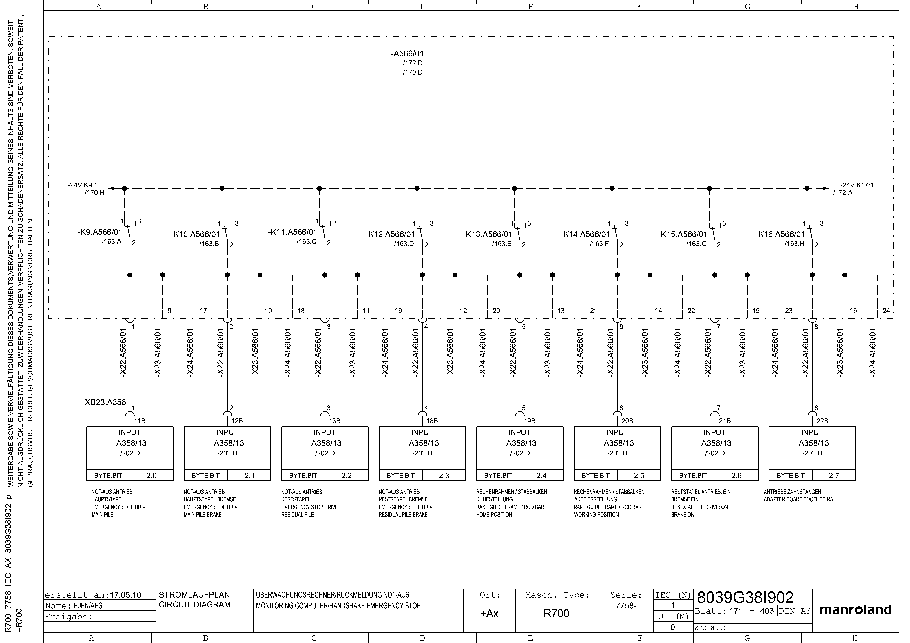

# +Ax — Sheet 171 of 403 — ÜBERWACHUNGSRECHNER/RÜCKMELDUNG NOT AUS

**MONITORING COMPUTER/HANDSHAKE EMERGENCY STOP**

> Part of the manroland **R700** printing press IEC/UL circuit diagrams.
> Drawing class: **Stromlaufplan / Circuit diagram** (DIN A3).
> Document `+Ax` covers the **Central control console** machine section.

## At a glance

| Field | Value |
|---|---|
| Document | `+Ax`  (8039G38I902) |
| Sheet | **171** of 403 |
| Section (DE) | ÜBERWACHUNGSRECHNER/RÜCKMELDUNG NOT AUS |
| Section (EN) | MONITORING COMPUTER/HANDSHAKE EMERGENCY STOP |
| Section type | CIRCUIT — Circuit diagram |
| Machine type | `R700` |
| Series | `7758` |
| Created | 17.05.10 |
| Replaces | — |
| Columns used | A, B, C, D, E, F, G, H |
| Path numbers | — |
| Labels on sheet | 182 |
| Cross-refs out | 20 |
| Cross-refs in | 52 |

**Previous:** [+Ax sheet 170](SHEET_0170.md) · **Next:** [+Ax sheet 172](SHEET_0172.md) · **Document TOC:** [_TOC.md](_TOC.md)  (+Ax) · **Master TOC:** [all sheets](../_MASTER_TOC.md)

## Sheet image (300 DPI, exact vector render)



_Rendered directly from the PDF vector layer at 300 DPI (1-bit), no OCR and no resampling. Use it to confirm anything ambiguous in the text below._

## Cross-references on this sheet

Each entry is a wire leaving this sheet. The printed token is `/sheet.column`; the link resolves to that sheet inside the same document.

| Ref | Target sheet | Col | Path | Destination on target | Target section | From col |
|---|---|---|---|---|---|---|
| `/172.D` | [+Ax sheet 172](SHEET_0172.md) | D | — | — | ÜBERWACHUNGSRECHNER/RÜCKMELDUNG NOT AUS | D |
| `/170.D` | [+Ax sheet 170](SHEET_0170.md) | D | — | — | ÜBERWACHUNGSRECHNER/RÜCKMELDUNG NOT AUS | D |
| `/170.H` | [+Ax sheet 170](SHEET_0170.md) | H | — | 24V.K9:1 24V.K17:1 | ÜBERWACHUNGSRECHNER/RÜCKMELDUNG NOT AUS | D |
| `/172.A` | [+Ax sheet 172](SHEET_0172.md) | A | — | — | ÜBERWACHUNGSRECHNER/RÜCKMELDUNG NOT AUS | H |
| `/163.A` | [+Ax sheet 163](SHEET_0163.md) | A | — | — | ÜBERWACHUNGSRECHNER/ANSTEUERUNG NOT AUS | A |
| `/163.C` | [+Ax sheet 163](SHEET_0163.md) | C | — | — | ÜBERWACHUNGSRECHNER/ANSTEUERUNG NOT AUS | C |
| `/163.B` | [+Ax sheet 163](SHEET_0163.md) | B | — | — | ÜBERWACHUNGSRECHNER/ANSTEUERUNG NOT AUS | B |
| `/163.E` | [+Ax sheet 163](SHEET_0163.md) | E | — | — | ÜBERWACHUNGSRECHNER/ANSTEUERUNG NOT AUS | E |
| `/163.F` | [+Ax sheet 163](SHEET_0163.md) | F | — | — | ÜBERWACHUNGSRECHNER/ANSTEUERUNG NOT AUS | F |
| `/163.G` | [+Ax sheet 163](SHEET_0163.md) | G | — | — | ÜBERWACHUNGSRECHNER/ANSTEUERUNG NOT AUS | G |
| `/163.D` | [+Ax sheet 163](SHEET_0163.md) | D | — | — | ÜBERWACHUNGSRECHNER/ANSTEUERUNG NOT AUS | D |
| `/163.H` | [+Ax sheet 163](SHEET_0163.md) | H | — | — | ÜBERWACHUNGSRECHNER/ANSTEUERUNG NOT AUS | G |
| `/202.D` | [+Ax sheet 202](SHEET_0202.md) | D | — | — | REFERENZMODUL | A |
| `/202.D` | [+Ax sheet 202](SHEET_0202.md) | D | — | — | REFERENZMODUL | B |
| `/202.D` | [+Ax sheet 202](SHEET_0202.md) | D | — | — | REFERENZMODUL | C |
| `/202.D` | [+Ax sheet 202](SHEET_0202.md) | D | — | — | REFERENZMODUL | D |
| `/202.D` | [+Ax sheet 202](SHEET_0202.md) | D | — | — | REFERENZMODUL | E |
| `/202.D` | [+Ax sheet 202](SHEET_0202.md) | D | — | — | REFERENZMODUL | F |
| `/202.D` | [+Ax sheet 202](SHEET_0202.md) | D | — | — | REFERENZMODUL | G |
| `/202.D` | [+Ax sheet 202](SHEET_0202.md) | D | — | — | REFERENZMODUL | H |

### Incoming references (sheets that point here)

Every other sheet that sends a wire to this one. `Back-ref` is the token printed on *that* sheet; `Path` is its line number.

| From sheet | Cols | Back-ref | Path | Refs | What continues there |
|---|---|---|---|---|---|
| [+Ax#163](SHEET_0163.md) | B, C, D, E, F, G, H | `/163.B`, `/163.C`, `/163.D`, `/163.E`, `/163.F`, `/163.G`, `/163.H` | — | 8 | — |
| [+Ax#170](SHEET_0170.md) | D, H | `/170.D`, `/170.H` | — | 2 | — |
| [+Ax#172](SHEET_0172.md) | A, D | `/172.A`, `/172.D` | — | 2 | — |
| [+Ax#202](SHEET_0202.md) | D | `/202.D` | — | 8 | — |
| [+Ax#263](SHEET_0263.md) | C | `/263.C` | — | 8 | — |
| [+Ax#264](SHEET_0264.md) | G | `/264.G` | — | 8 | — |
| [+Ax#265](SHEET_0265.md) | C | `/265.C` | — | 8 | — |
| [+Ax#266](SHEET_0266.md) | G | `/266.G` | — | 8 | — |


## Devices on this sheet

| Tag | Class | Class meaning (IEC) | Col | Sub | Terminal | Sign |
|---|---|---|---|---|---|---|
| `A358/13` | A | Baugruppe / assembly, module, PC board | A | 13 | — | — |
| `A358/13` | A | Baugruppe / assembly, module, PC board | B | 13 | — | — |
| `A358/13` | A | Baugruppe / assembly, module, PC board | C | 13 | — | — |
| `A358/13` | A | Baugruppe / assembly, module, PC board | D | 13 | — | — |
| `A358/13` | A | Baugruppe / assembly, module, PC board | E | 13 | — | — |
| `A358/13` | A | Baugruppe / assembly, module, PC board | F | 13 | — | — |
| `A358/13` | A | Baugruppe / assembly, module, PC board | G | 13 | — | — |
| `A358/13` | A | Baugruppe / assembly, module, PC board | H | 13 | — | — |
| `A566/01` | A | Baugruppe / assembly, module, PC board | D | 01 | — | — |
| `2.0` | — | cross-device reference | A | — | — | — |
| `2.1` | — | cross-device reference | B | — | — | — |
| `2.2` | — | cross-device reference | C | — | — | — |
| `2.3` | — | cross-device reference | D | — | — | — |
| `2.4` | — | cross-device reference | E | — | — | — |
| `2.5` | — | cross-device reference | F | — | — | — |
| `2.6` | — | cross-device reference | G | — | — | — |
| `2.7` | — | cross-device reference | H | — | — | — |
| `XB23.A358` | — | cross-device reference | A | — | — | — |

## Potentials / nets

| Potential | Count | Columns | Attached devices | Terminals |
|---|---|---|---|---|
| `24V` | 2 | A, H | `K17`, `K9` | `1` |


A potential such as `L24+/4` or `M24+` is a named supply/return rail; every place it appears on this sheet is electrically common.

## Wire-end annotations (grouped as printed)

A wire that continues elsewhere is annotated with a small cluster: the destination description, the path/line number `#NN`, and the `/sheet.column` cross reference. Each row below is one such cluster exactly as it is grouped on the drawing.

| Col | Y | Path | Cross-ref | Text on the wire |
|---|---|---|---|---|
| D | 65.5 | — | — | `A566/01` |
| D | 78.6 | — | `/172.D`, `/170.D` | — |
| D | 238.4 | — | `/170.H` | `24V.K9:1 24V.K17:1` |
| H | 248.3 | — | `/172.A` | — |
| A | 285.9 | — | — | `K9.A566/01 3` |
| A | 285.9 | — | — | `1` |
| C | 285.9 | — | — | `K11.A566/01 3` |
| C | 285.9 | — | — | `1` |
| B | 288.8 | — | — | `K10.A566/01 3` |
| B | 288.8 | — | — | `1` |
| D | 288.8 | — | — | `K12.A566/01 3` |
| D | 288.8 | — | — | `1` |
| E | 288.8 | — | — | `K13.A566/01 3` |
| E | 288.8 | — | — | `1` |
| F | 288.8 | — | — | `K14.A566/01 3` |
| F | 288.8 | — | — | `1` |
| F | 288.8 | — | — | `K15.A566/01 3` |
| G | 288.8 | — | — | `1` |
| G | 288.8 | — | — | `K16.A566/01 3` |
| H | 288.8 | — | — | `1` |
| A | 312.4 | — | `/163.A` | — |
| C | 312.5 | — | `/163.C` | — |
| A | 314.3 | — | — | `2` |
| C | 314.3 | — | — | `2` |
| B | 315.3 | — | `/163.B` | — |
| D | 315.3 | — | `/163.D` | — |
| E | 315.3 | — | `/163.E` | — |
| F | 315.3 | — | `/163.F` | — |
| G | 315.3 | — | `/163.G` | — |
| G | 315.3 | — | `/163.H` | — |
| B | 317.1 | — | — | `2` |
| D | 317.1 | — | — | `2` |
| E | 317.1 | — | — | `2` |
| F | 317.1 | — | — | `2` |
| G | 317.1 | — | — | `2` |
| H | 317.1 | — | — | `2` |
| E | 402.8 | — | — | `9 17 10 18 11 19 12 20 13 21 14 22 15 23 16 24` |
| A | 424.1 | — | — | `1` |
| B | 424.1 | — | — | `2` |
| C | 424.1 | — | — | `3` |
| D | 424.1 | — | — | `4` |
| E | 424.1 | — | — | `5` |
| F | 424.1 | — | — | `6` |
| G | 424.1 | — | — | `7` |
| H | 424.1 | — | — | `8` |
| A | 428.9 | — | — | `X22.A566/01` |
| B | 428.9 | — | — | `X23.A566/01` |
| B | 428.9 | — | — | `X24.A566/01` |
| B | 428.9 | — | — | `X22.A566/01` |
| B | 428.9 | — | — | `X23.A566/01` |
| C | 428.9 | — | — | `X24.A566/01` |
| C | 428.9 | — | — | `X22.A566/01` |
| C | 428.9 | — | — | `X23.A566/01` |
| D | 428.9 | — | — | `X24.A566/01` |
| D | 428.9 | — | — | `X22.A566/01` |
| D | 428.9 | — | — | `X23.A566/01` |
| E | 428.9 | — | — | `X24.A566/01` |
| E | 428.9 | — | — | `X22.A566/01` |
| E | 428.9 | — | — | `X23.A566/01` |
| E | 428.9 | — | — | `X24.A566/01` |
| F | 428.9 | — | — | `X22.A566/01` |
| F | 428.9 | — | — | `X23.A566/01` |
| F | 428.9 | — | — | `X24.A566/01` |
| G | 428.9 | — | — | `X22.A566/01` |
| G | 428.9 | — | — | `X23.A566/01` |
| G | 428.9 | — | — | `X24.A566/01` |
| H | 428.9 | — | — | `X22.A566/01` |
| H | 428.9 | — | — | `X23.A566/01` |
| H | 428.9 | — | — | `X24.A566/01` |
| A | 521.9 | — | — | `XB23.A358 1` |
| E | 530.4 | — | — | `2 3 4 5 6 7 8` |
| A | 547.4 | — | — | `11B` |
| B | 547.4 | — | — | `12B` |
| C | 547.4 | — | — | `13B` |
| D | 547.4 | — | — | `18B` |
| E | 547.4 | — | — | `19B` |
| F | 547.4 | — | — | `20B` |
| G | 547.4 | — | — | `21B` |
| H | 547.4 | — | — | `22B` |
| A | 561.9 | — | — | `INPUT` |
| B | 561.9 | — | — | `INPUT` |
| C | 561.9 | — | — | `INPUT` |
| D | 561.9 | — | — | `INPUT` |
| E | 561.9 | — | — | `INPUT` |
| F | 561.9 | — | — | `INPUT` |
| G | 561.9 | — | — | `INPUT` |
| H | 561.9 | — | — | `INPUT` |
| A | 575.7 | — | — | `A358/13` |
| B | 575.7 | — | — | `A358/13` |
| C | 575.7 | — | — | `A358/13` |
| D | 575.7 | — | — | `A358/13` |
| E | 575.7 | — | — | `A358/13` |
| F | 575.7 | — | — | `A358/13` |
| G | 575.7 | — | — | `A358/13` |
| H | 575.7 | — | — | `A358/13` |
| A | 589.5 | — | `/202.D` | — |
| B | 589.5 | — | `/202.D` | — |
| C | 589.5 | — | `/202.D` | — |
| D | 589.5 | — | `/202.D` | — |
| E | 589.5 | — | `/202.D` | — |
| F | 589.5 | — | `/202.D` | — |
| G | 589.5 | — | `/202.D` | — |
| H | 589.5 | — | `/202.D` | — |
| A | 618.6 | — | — | `BYTE.BIT 2.0` |
| B | 618.6 | — | — | `BYTE.BIT 2.1` |
| C | 618.6 | — | — | `BYTE.BIT 2.2` |
| D | 618.6 | — | — | `BYTE.BIT 2.3` |
| E | 618.6 | — | — | `BYTE.BIT 2.4` |
| F | 618.6 | — | — | `BYTE.BIT 2.5` |
| G | 618.6 | — | — | `BYTE.BIT 2.6` |
| H | 618.6 | — | — | `BYTE.BIT 2.7` |
| A | 641.4 | — | — | `NOT AUS ANTRIEB HAUPTSTAPEL EMERGENCY STOP DRIVE MAIN PILE` |
| B | 641.4 | — | — | `NOT AUS ANTRIEB HAUPTSTAPEL BREMSE EMERGENCY STOP DRIVE MAIN PILE BRAKE` |
| C | 641.4 | — | — | `NOT AUS ANTRIEB RESTSTAPEL EMERGENCY STOP DRIVE RESIDUAL PILE` |
| D | 641.4 | — | — | `NOT AUS ANTRIEB RESTSTAPEL BREMSE EMERGENCY STOP DRIVE RESIDUAL PILE BRAKE` |
| E | 641.4 | — | — | `RECHENRAHMEN / STABBALKEN RUHESTELLUNG RAKE GUIDE FRAME / ROD BAR HOME POSITION` |
| F | 641.4 | — | — | `RECHENRAHMEN / STABBALKEN` |
| G | 641.4 | — | — | `RESTSTAPEL ANTRIEB: EIN BREMSE EIN RESIDUAL PILE DRIVE: ON BRAKE ON` |
| G | 641.4 | — | — | `ANTRIEBE ZAHNSTANGEN ADAPTER BOARD TOOTHED RAIL` |
| F | 651.4 | — | — | `RAKE GUIDE FRAME / ROD BAR ARBEITSSTELLUNG` |
| F | 671.2 | — | — | `WORKING POSITION` |


## Reconstructed tables

This sheet carries tabular content (pin map / terminal assignment / index). The grid below was rebuilt from the drawing's own rule lines, so each row is exactly one physical row of the table.

### Table 1 — 3 data rows × 4 columns (at x=113.4, y=246.6)

| /170.H 1 K9.A566/01 /163.A |  | 3 2 |  |
|---|---|---|---|
| `X22.A566/01 XB23.A358` |  | `1 X23.A566/01 1 11B` | `9` |
|  | `INPUT` | `A358/13 /202.D` |  |
| `BYTE.BIT` |  | `2.0` |  |


### Table 2 — 3 data rows × 5 columns (at x=240.9, y=246.6)

|  | 1 K10.A566/01 /163.B |  | 3 2 |  |
|---|---|---|---|---|
| `X24.A566/01` | `17 X22.A566/01` |  | `2 X23.A566/01 2 12B` | `10` |
|  |  | `INPUT` | `A358/13 /202.D` |  |
|  | `BYTE.BIT` |  | `2.1` |  |


### Table 3 — 3 data rows × 5 columns (at x=368.5, y=246.6)

|  | 1 K11.A566/01 /163.C |  | 3 2 |  |
|---|---|---|---|---|
| `X24.A566/01` | `18 X22.A566/01` |  | `3 X23.A566/01 3 13B` | `11` |
|  |  | `INPUT` | `A358/13 /202.D` |  |
|  | `BYTE.BIT` |  | `2.2` |  |


### Table 4 — 3 data rows × 5 columns (at x=496.1, y=246.6)

|  | 1 K12.A566/01 /163.D |  | 3 2 |  |
|---|---|---|---|---|
| `X24.A566/01` | `19 X22.A566/01` |  | `4 X23.A566/01 4 18B` | `12` |
|  |  | `INPUT` | `A358/13 /202.D` |  |
|  | `BYTE.BIT` |  | `2.3` |  |


### Table 5 — 3 data rows × 5 columns (at x=623.6, y=246.6)

|  | 1 K13.A566/01 /163.E |  | 3 2 |  |
|---|---|---|---|---|
| `X24.A566/01` | `20 X22.A566/01` |  | `5 X23.A566/01 5 19B` | `13` |
|  |  | `INPUT` | `A358/13 /202.D` |  |
|  | `BYTE.BIT` |  | `2.4` |  |


### Table 6 — 3 data rows × 5 columns (at x=751.2, y=246.6)

|  | 1 K14.A566/01 /163.F |  | 3 2 |  |
|---|---|---|---|---|
| `X24.A566/01` | `21 X22.A566/01` |  | `6 X23.A566/01 6 20B` | `14` |
|  |  | `INPUT` | `A358/13 /202.D` |  |
|  | `BYTE.BIT` |  | `2.5` |  |


### Table 7 — 3 data rows × 5 columns (at x=878.7, y=246.6)

|  | 1 K15.A566/01 /163.G |  | 3 2 |  |
|---|---|---|---|---|
| `X24.A566/01` | `22 X22.A566/01` |  | `7 X23.A566/01 7 21B` | `15` |
|  |  | `INPUT` | `A358/13 /202.D` |  |
|  | `BYTE.BIT` |  | `2.6` |  |


### Table 8 — 3 data rows × 6 columns (at x=1006.3, y=246.6)

|  | 1 K16.A566/01 /163.H |  | /172.A 3 2 |  |  |
|---|---|---|---|---|---|
| `X24.A566/01` | `23 X22.A566/01` |  | `8 X23.A566/01 8 22B` | `16` | `X24.A566/01` |
|  |  | `INPUT` | `A358/13 /202.D` |  |  |
|  | `BYTE.BIT` |  | `2.7` |  |  |


## Notes and free text on this sheet

| Text | Col | Y (pt) |
|---|---|---|
| `X22.A566/01` | A | 428.88 |
| `X22.A566/01` | B | 428.88 |
| `X22.A566/01` | C | 428.88 |
| `X22.A566/01` | D | 428.88 |
| `X22.A566/01` | E | 428.88 |
| `X22.A566/01` | F | 428.88 |
| `X22.A566/01` | G | 428.88 |
| `X22.A566/01` | H | 428.88 |
| `K9.A566/01` | A | 299.36 |
| `K10.A566/01` | B | 302.2 |
| `K11.A566/01` | C | 299.36 |
| `K12.A566/01` | D | 302.2 |
| `K13.A566/01` | E | 302.2 |
| `K14.A566/01` | F | 302.2 |
| `K15.A566/01` | F | 302.2 |
| `K16.A566/01` | G | 302.2 |
| `11B` | A | 547.37 |
| `INPUT` | A | 561.9 |
| `BYTE.BIT` | A | 619.15 |
| `NOT AUS ANTRIEB` | A | 641.39 |
| `HAUPTSTAPEL` | A | 651.34 |
| `EMERGENCY STOP DRIVE` | A | 661.31 |
| `MAIN PILE` | A | 671.31 |
| `12B` | B | 547.37 |
| `INPUT` | B | 561.9 |
| `BYTE.BIT` | B | 619.15 |
| `NOT AUS ANTRIEB` | B | 641.39 |
| `HAUPTSTAPEL BREMSE` | B | 651.36 |
| `EMERGENCY STOP DRIVE` | B | 661.31 |
| `MAIN PILE BRAKE` | B | 671.3 |
| `13B` | C | 547.37 |
| `INPUT` | C | 561.9 |
| `BYTE.BIT` | C | 619.15 |
| `NOT AUS ANTRIEB` | C | 641.39 |
| `RESTSTAPEL` | C | 651.33 |
| `EMERGENCY STOP DRIVE` | C | 661.31 |
| `RESIDUAL PILE` | C | 671.28 |
| `18B` | D | 547.37 |
| `INPUT` | D | 561.9 |
| `BYTE.BIT` | D | 619.15 |
| `NOT AUS ANTRIEB` | D | 641.39 |
| `RESTSTAPEL BREMSE` | D | 651.36 |
| `EMERGENCY STOP DRIVE` | D | 661.31 |
| `RESIDUAL PILE BRAKE` | D | 671.28 |
| `19B` | E | 547.37 |
| `INPUT` | E | 561.9 |
| `BYTE.BIT` | E | 619.15 |
| `RECHENRAHMEN / STABBALKEN` | E | 641.42 |
| `RUHESTELLUNG` | E | 651.33 |
| `RAKE GUIDE FRAME / ROD BAR` | E | 661.32 |
| `HOME POSITION` | E | 671.25 |
| `20B` | F | 547.37 |
| `INPUT` | F | 561.9 |
| `BYTE.BIT` | F | 619.15 |
| `RECHENRAHMEN / STABBALKEN` | F | 641.42 |
| `ARBEITSSTELLUNG` | F | 651.35 |
| `RAKE GUIDE FRAME / ROD BAR` | F | 661.32 |
| `WORKING POSITION` | F | 671.23 |
| `21B` | G | 547.37 |
| `INPUT` | G | 561.9 |
| `RESTSTAPEL ANTRIEB: EIN` | G | 641.41 |
| `BREMSE EIN` | F | 651.39 |
| `RESIDUAL PILE DRIVE: ON` | G | 661.33 |
| `BRAKE ON` | F | 671.24 |
| `22B` | H | 547.37 |
| `INPUT` | H | 561.9 |
| `BYTE.BIT` | G | 619.15 |
| `ANTRIEBE ZAHNSTANGEN` | G | 641.41 |
| `ADAPTER BOARD TOOTHED RAIL` | G | 651.35 |
| `X23.A566/01` | B | 428.88 |
| `X24.A566/01` | B | 428.88 |
| `X24.A566/01` | C | 428.88 |
| `X23.A566/01` | C | 428.88 |
| `X24.A566/01` | D | 428.88 |
| `X23.A566/01` | D | 428.88 |
| `X24.A566/01` | E | 428.88 |
| `X23.A566/01` | E | 428.88 |
| `X23.A566/01` | F | 428.88 |
| `X24.A566/01` | F | 428.88 |
| `X23.A566/01` | G | 428.88 |
| `X24.A566/01` | G | 428.88 |
| `X23.A566/01` | H | 428.88 |
| `X24.A566/01` | H | 428.88 |

## Complete label inventory (exact text from the drawing)

Every text object inside the drawing area of this sheet, in DIN reading order (column A→H, then top→bottom). This is the authoritative list: if a string is not here it is not printed on this sheet.

| Col | Y | X | Dir | Type | Text |
|---|---|---|---|---|---|
| A | 238.4 | 88.7 | → | potential | `24V.K9:1` |
| A | 248.3 | 111.1 | → | cross-reference | `/170.H` |
| A | 285.9 | 157.0 | → | number | `1` |
| A | 285.9 | 179.7 | → | number | `3` |
| A | 299.4 | 101.8 | → | text | `K9.A566/01` |
| A | 312.4 | 133.2 | → | cross-reference | `/163.A` |
| A | 314.3 | 172.6 | → | number | `2` |
| A | 424.1 | 172.1 | → | number | `1` |
| A | 428.9 | 156.2 | ↕ | text | `X22.A566/01` |
| A | 521.9 | 107.7 | → | device ref | `XB23.A358` |
| A | 530.4 | 172.1 | → | number | `1` |
| A | 547.4 | 174.9 | → | text | `11B` |
| A | 561.9 | 155.2 | → | text | `INPUT` |
| A | 575.7 | 148.7 | → | device tag | `A358/13` |
| A | 589.5 | 157.3 | → | cross-reference | `/202.D` |
| A | 618.6 | 191.6 | → | device ref | `2.0` |
| A | 619.1 | 123.3 | → | text | `BYTE.BIT` |
| A | 641.4 | 119.9 | → | text | `NOT AUS ANTRIEB` |
| A | 651.3 | 119.9 | → | text | `HAUPTSTAPEL` |
| A | 661.3 | 119.9 | → | text | `EMERGENCY STOP DRIVE` |
| A | 671.3 | 120.2 | → | text | `MAIN PILE` |
| B | 288.7 | 284.6 | → | number | `1` |
| B | 288.7 | 307.3 | → | number | `3` |
| B | 302.2 | 223.4 | → | text | `K10.A566/01` |
| B | 315.3 | 261.1 | → | cross-reference | `/163.B` |
| B | 317.1 | 300.2 | → | number | `2` |
| B | 402.8 | 219.4 | → | number | `9` |
| B | 402.8 | 261.4 | → | number | `17` |
| B | 424.1 | 300.2 | → | number | `2` |
| B | 428.9 | 201.6 | ↕ | text | `X23.A566/01` |
| B | 428.9 | 244.1 | ↕ | text | `X24.A566/01` |
| B | 428.9 | 283.8 | ↕ | text | `X22.A566/01` |
| B | 428.9 | 329.1 | ↕ | text | `X23.A566/01` |
| B | 530.4 | 300.2 | → | number | `2` |
| B | 547.4 | 302.5 | → | text | `12B` |
| B | 561.9 | 282.8 | → | text | `INPUT` |
| B | 575.7 | 276.2 | → | device tag | `A358/13` |
| B | 589.5 | 284.9 | → | cross-reference | `/202.D` |
| B | 618.6 | 320.0 | → | device ref | `2.1` |
| B | 619.1 | 250.9 | → | text | `BYTE.BIT` |
| B | 641.4 | 240.4 | → | text | `NOT AUS ANTRIEB` |
| B | 651.4 | 240.4 | → | text | `HAUPTSTAPEL BREMSE` |
| B | 661.3 | 240.4 | → | text | `EMERGENCY STOP DRIVE` |
| B | 671.3 | 240.7 | → | text | `MAIN PILE BRAKE` |
| C | 285.9 | 412.2 | → | number | `1` |
| C | 285.9 | 434.8 | → | number | `3` |
| C | 299.4 | 350.9 | → | text | `K11.A566/01` |
| C | 312.5 | 388.3 | → | cross-reference | `/163.C` |
| C | 314.3 | 427.7 | → | number | `2` |
| C | 402.8 | 346.4 | → | number | `10` |
| C | 402.8 | 388.9 | → | number | `18` |
| C | 402.8 | 474.0 | → | number | `11` |
| C | 424.1 | 427.7 | → | number | `3` |
| C | 428.9 | 371.6 | ↕ | text | `X24.A566/01` |
| C | 428.9 | 411.3 | ↕ | text | `X22.A566/01` |
| C | 428.9 | 456.7 | ↕ | text | `X23.A566/01` |
| C | 530.4 | 427.7 | → | number | `3` |
| C | 547.4 | 430.0 | → | text | `13B` |
| C | 561.9 | 410.3 | → | text | `INPUT` |
| C | 575.7 | 403.8 | → | device tag | `A358/13` |
| C | 589.5 | 412.4 | → | cross-reference | `/202.D` |
| C | 618.6 | 446.7 | → | device ref | `2.2` |
| C | 619.1 | 378.4 | → | text | `BYTE.BIT` |
| C | 641.4 | 367.9 | → | text | `NOT AUS ANTRIEB` |
| C | 651.3 | 367.9 | → | text | `RESTSTAPEL` |
| C | 661.3 | 367.9 | → | text | `EMERGENCY STOP DRIVE` |
| C | 671.3 | 367.9 | → | text | `RESIDUAL PILE` |
| D | 65.5 | 511.7 | → | device tag | `A566/01` |
| D | 78.6 | 527.2 | → | cross-reference | `/172.D` |
| D | 91.0 | 527.2 | → | cross-reference | `/170.D` |
| D | 288.7 | 539.7 | → | number | `1` |
| D | 288.7 | 562.4 | → | number | `3` |
| D | 302.2 | 478.5 | → | text | `K12.A566/01` |
| D | 315.3 | 515.9 | → | cross-reference | `/163.D` |
| D | 317.1 | 555.3 | → | number | `2` |
| D | 402.8 | 516.5 | → | number | `19` |
| D | 402.8 | 601.5 | → | number | `12` |
| D | 424.1 | 555.3 | → | number | `4` |
| D | 428.9 | 499.2 | ↕ | text | `X24.A566/01` |
| D | 428.9 | 538.9 | ↕ | text | `X22.A566/01` |
| D | 428.9 | 584.2 | ↕ | text | `X23.A566/01` |
| D | 530.4 | 555.3 | → | number | `4` |
| D | 547.4 | 557.6 | → | text | `18B` |
| D | 561.9 | 537.9 | → | text | `INPUT` |
| D | 575.7 | 531.4 | → | device tag | `A358/13` |
| D | 589.5 | 540.0 | → | cross-reference | `/202.D` |
| D | 618.6 | 574.3 | → | device ref | `2.3` |
| D | 619.1 | 506.0 | → | text | `BYTE.BIT` |
| D | 641.4 | 495.5 | → | text | `NOT AUS ANTRIEB` |
| D | 651.4 | 495.5 | → | text | `RESTSTAPEL BREMSE` |
| D | 661.3 | 495.5 | → | text | `EMERGENCY STOP DRIVE` |
| D | 671.3 | 495.5 | → | text | `RESIDUAL PILE BRAKE` |
| E | 288.7 | 667.3 | → | number | `1` |
| E | 288.7 | 690.0 | → | number | `3` |
| E | 302.2 | 606.0 | → | text | `K13.A566/01` |
| E | 315.3 | 644.0 | → | cross-reference | `/163.E` |
| E | 317.1 | 682.9 | → | number | `2` |
| E | 402.8 | 644.6 | → | number | `20` |
| E | 402.8 | 729.1 | → | number | `13` |
| E | 424.1 | 682.9 | → | number | `5` |
| E | 428.9 | 626.8 | ↕ | text | `X24.A566/01` |
| E | 428.9 | 666.4 | ↕ | text | `X22.A566/01` |
| E | 428.9 | 711.8 | ↕ | text | `X23.A566/01` |
| E | 428.9 | 754.3 | ↕ | text | `X24.A566/01` |
| E | 530.4 | 682.9 | → | number | `5` |
| E | 547.4 | 685.1 | → | text | `19B` |
| E | 561.9 | 665.4 | → | text | `INPUT` |
| E | 575.7 | 658.9 | → | device tag | `A358/13` |
| E | 589.5 | 667.6 | → | cross-reference | `/202.D` |
| E | 618.6 | 701.9 | → | device ref | `2.4` |
| E | 619.1 | 633.5 | → | text | `BYTE.BIT` |
| E | 641.4 | 623.1 | → | text | `RECHENRAHMEN / STABBALKEN` |
| E | 651.3 | 623.1 | → | text | `RUHESTELLUNG` |
| E | 661.3 | 623.1 | → | text | `RAKE GUIDE FRAME / ROD BAR` |
| E | 671.3 | 623.1 | → | text | `HOME POSITION` |
| F | 288.7 | 794.8 | → | number | `1` |
| F | 288.7 | 817.5 | → | number | `3` |
| F | 302.2 | 733.6 | → | text | `K14.A566/01` |
| F | 302.2 | 861.2 | → | text | `K15.A566/01` |
| F | 315.3 | 771.9 | → | cross-reference | `/163.F` |
| F | 317.1 | 810.4 | → | number | `2` |
| F | 402.8 | 772.2 | → | number | `21` |
| F | 402.8 | 856.6 | → | number | `14` |
| F | 402.8 | 899.7 | → | number | `22` |
| F | 424.1 | 810.4 | → | number | `6` |
| F | 428.9 | 794.0 | ↕ | text | `X22.A566/01` |
| F | 428.9 | 839.4 | ↕ | text | `X23.A566/01` |
| F | 428.9 | 881.9 | ↕ | text | `X24.A566/01` |
| F | 530.4 | 810.4 | → | number | `6` |
| F | 547.4 | 813.3 | → | text | `20B` |
| F | 561.9 | 793.0 | → | text | `INPUT` |
| F | 575.7 | 786.5 | → | device tag | `A358/13` |
| F | 589.5 | 795.1 | → | cross-reference | `/202.D` |
| F | 618.6 | 829.4 | → | device ref | `2.5` |
| F | 619.1 | 761.1 | → | text | `BYTE.BIT` |
| F | 619.1 | 888.7 | → | text | `BYTE.BIT` |
| F | 641.4 | 750.6 | → | text | `RECHENRAHMEN / STABBALKEN` |
| F | 651.4 | 751.5 | → | text | `ARBEITSSTELLUNG` |
| F | 651.4 | 878.2 | → | text | `BREMSE EIN` |
| F | 661.3 | 750.6 | → | text | `RAKE GUIDE FRAME / ROD BAR` |
| F | 671.2 | 751.2 | → | text | `WORKING POSITION` |
| F | 671.2 | 878.2 | → | text | `BRAKE ON` |
| G | 288.7 | 922.4 | → | number | `1` |
| G | 288.7 | 945.1 | → | number | `3` |
| G | 302.2 | 988.7 | → | text | `K16.A566/01` |
| G | 315.3 | 898.3 | → | cross-reference | `/163.G` |
| G | 315.3 | 1026.7 | → | cross-reference | `/163.H` |
| G | 317.1 | 938.0 | → | number | `2` |
| G | 402.8 | 984.2 | → | number | `15` |
| G | 402.8 | 1027.3 | → | number | `23` |
| G | 424.1 | 938.0 | → | number | `7` |
| G | 428.9 | 921.6 | ↕ | text | `X22.A566/01` |
| G | 428.9 | 966.9 | ↕ | text | `X23.A566/01` |
| G | 428.9 | 1009.4 | ↕ | text | `X24.A566/01` |
| G | 530.4 | 938.0 | → | number | `7` |
| G | 547.4 | 940.8 | → | text | `21B` |
| G | 561.9 | 920.6 | → | text | `INPUT` |
| G | 575.7 | 914.0 | → | device tag | `A358/13` |
| G | 589.5 | 922.7 | → | cross-reference | `/202.D` |
| G | 618.6 | 957.0 | → | device ref | `2.6` |
| G | 619.1 | 1016.2 | → | text | `BYTE.BIT` |
| G | 641.4 | 878.2 | → | text | `RESTSTAPEL ANTRIEB: EIN` |
| G | 641.4 | 999.5 | → | text | `ANTRIEBE ZAHNSTANGEN` |
| G | 651.3 | 999.5 | → | text | `ADAPTER BOARD TOOTHED RAIL` |
| G | 661.3 | 878.2 | → | text | `RESIDUAL PILE DRIVE: ON` |
| H | 238.4 | 1099.6 | → | potential | `24V.K17:1` |
| H | 248.3 | 1089.9 | → | cross-reference | `/172.A` |
| H | 288.7 | 1050.0 | → | number | `1` |
| H | 288.7 | 1072.6 | → | number | `3` |
| H | 317.1 | 1065.5 | → | number | `2` |
| H | 402.8 | 1111.7 | → | number | `16` |
| H | 402.8 | 1154.8 | → | number | `24` |
| H | 424.1 | 1065.5 | → | number | `8` |
| H | 428.9 | 1049.1 | ↕ | text | `X22.A566/01` |
| H | 428.9 | 1094.5 | ↕ | text | `X23.A566/01` |
| H | 428.9 | 1137.0 | ↕ | text | `X24.A566/01` |
| H | 530.4 | 1065.5 | → | number | `8` |
| H | 547.4 | 1068.4 | → | text | `22B` |
| H | 561.9 | 1048.1 | → | text | `INPUT` |
| H | 575.7 | 1041.6 | → | device tag | `A358/13` |
| H | 589.5 | 1050.2 | → | cross-reference | `/202.D` |
| H | 618.6 | 1084.5 | → | device ref | `2.7` |

## Reading-order text block

The same content as a plain block, grouped by DIN column — convenient to paste or to match against a visual description.

```text
=== Column A ===
 238.4   88.7  net          24V.K9:1
 248.3  111.1  xref         /170.H
 285.9  157.0  numeric      1
 285.9  179.7  numeric      3
 299.4  101.8  text         K9.A566/01
 312.4  133.2  xref         /163.A
 314.3  172.6  numeric      2
 424.1  172.1  numeric      1
 428.9  156.2  text         X22.A566/01
 521.9  107.7  devref       XB23.A358
 530.4  172.1  numeric      1
 547.4  174.9  text         11B
 561.9  155.2  text         INPUT
 575.7  148.7  devtag       A358/13
 589.5  157.3  xref         /202.D
 618.6  191.6  devref       2.0
 619.1  123.3  text         BYTE.BIT
 641.4  119.9  text         NOT AUS ANTRIEB
 651.3  119.9  text         HAUPTSTAPEL
 661.3  119.9  text         EMERGENCY STOP DRIVE
 671.3  120.2  text         MAIN PILE
=== Column B ===
 288.7  284.6  numeric      1
 288.7  307.3  numeric      3
 302.2  223.4  text         K10.A566/01
 315.3  261.1  xref         /163.B
 317.1  300.2  numeric      2
 402.8  219.4  numeric      9
 402.8  261.4  numeric      17
 424.1  300.2  numeric      2
 428.9  201.6  text         X23.A566/01
 428.9  244.1  text         X24.A566/01
 428.9  283.8  text         X22.A566/01
 428.9  329.1  text         X23.A566/01
 530.4  300.2  numeric      2
 547.4  302.5  text         12B
 561.9  282.8  text         INPUT
 575.7  276.2  devtag       A358/13
 589.5  284.9  xref         /202.D
 618.6  320.0  devref       2.1
 619.1  250.9  text         BYTE.BIT
 641.4  240.4  text         NOT AUS ANTRIEB
 651.4  240.4  text         HAUPTSTAPEL BREMSE
 661.3  240.4  text         EMERGENCY STOP DRIVE
 671.3  240.7  text         MAIN PILE BRAKE
=== Column C ===
 285.9  412.2  numeric      1
 285.9  434.8  numeric      3
 299.4  350.9  text         K11.A566/01
 312.5  388.3  xref         /163.C
 314.3  427.7  numeric      2
 402.8  346.4  numeric      10
 402.8  388.9  numeric      18
 402.8  474.0  numeric      11
 424.1  427.7  numeric      3
 428.9  371.6  text         X24.A566/01
 428.9  411.3  text         X22.A566/01
 428.9  456.7  text         X23.A566/01
 530.4  427.7  numeric      3
 547.4  430.0  text         13B
 561.9  410.3  text         INPUT
 575.7  403.8  devtag       A358/13
 589.5  412.4  xref         /202.D
 618.6  446.7  devref       2.2
 619.1  378.4  text         BYTE.BIT
 641.4  367.9  text         NOT AUS ANTRIEB
 651.3  367.9  text         RESTSTAPEL
 661.3  367.9  text         EMERGENCY STOP DRIVE
 671.3  367.9  text         RESIDUAL PILE
=== Column D ===
  65.5  511.7  devtag       A566/01
  78.6  527.2  xref         /172.D
  91.0  527.2  xref         /170.D
 288.7  539.7  numeric      1
 288.7  562.4  numeric      3
 302.2  478.5  text         K12.A566/01
 315.3  515.9  xref         /163.D
 317.1  555.3  numeric      2
 402.8  516.5  numeric      19
 402.8  601.5  numeric      12
 424.1  555.3  numeric      4
 428.9  499.2  text         X24.A566/01
 428.9  538.9  text         X22.A566/01
 428.9  584.2  text         X23.A566/01
 530.4  555.3  numeric      4
 547.4  557.6  text         18B
 561.9  537.9  text         INPUT
 575.7  531.4  devtag       A358/13
 589.5  540.0  xref         /202.D
 618.6  574.3  devref       2.3
 619.1  506.0  text         BYTE.BIT
 641.4  495.5  text         NOT AUS ANTRIEB
 651.4  495.5  text         RESTSTAPEL BREMSE
 661.3  495.5  text         EMERGENCY STOP DRIVE
 671.3  495.5  text         RESIDUAL PILE BRAKE
=== Column E ===
 288.7  667.3  numeric      1
 288.7  690.0  numeric      3
 302.2  606.0  text         K13.A566/01
 315.3  644.0  xref         /163.E
 317.1  682.9  numeric      2
 402.8  644.6  numeric      20
 402.8  729.1  numeric      13
 424.1  682.9  numeric      5
 428.9  626.8  text         X24.A566/01
 428.9  666.4  text         X22.A566/01
 428.9  711.8  text         X23.A566/01
 428.9  754.3  text         X24.A566/01
 530.4  682.9  numeric      5
 547.4  685.1  text         19B
 561.9  665.4  text         INPUT
 575.7  658.9  devtag       A358/13
 589.5  667.6  xref         /202.D
 618.6  701.9  devref       2.4
 619.1  633.5  text         BYTE.BIT
 641.4  623.1  text         RECHENRAHMEN / STABBALKEN
 651.3  623.1  text         RUHESTELLUNG
 661.3  623.1  text         RAKE GUIDE FRAME / ROD BAR
 671.3  623.1  text         HOME POSITION
=== Column F ===
 288.7  794.8  numeric      1
 288.7  817.5  numeric      3
 302.2  733.6  text         K14.A566/01
 302.2  861.2  text         K15.A566/01
 315.3  771.9  xref         /163.F
 317.1  810.4  numeric      2
 402.8  772.2  numeric      21
 402.8  856.6  numeric      14
 402.8  899.7  numeric      22
 424.1  810.4  numeric      6
 428.9  794.0  text         X22.A566/01
 428.9  839.4  text         X23.A566/01
 428.9  881.9  text         X24.A566/01
 530.4  810.4  numeric      6
 547.4  813.3  text         20B
 561.9  793.0  text         INPUT
 575.7  786.5  devtag       A358/13
 589.5  795.1  xref         /202.D
 618.6  829.4  devref       2.5
 619.1  761.1  text         BYTE.BIT
 619.1  888.7  text         BYTE.BIT
 641.4  750.6  text         RECHENRAHMEN / STABBALKEN
 651.4  751.5  text         ARBEITSSTELLUNG
 651.4  878.2  text         BREMSE EIN
 661.3  750.6  text         RAKE GUIDE FRAME / ROD BAR
 671.2  751.2  text         WORKING POSITION
 671.2  878.2  text         BRAKE ON
=== Column G ===
 288.7  922.4  numeric      1
 288.7  945.1  numeric      3
 302.2  988.7  text         K16.A566/01
 315.3  898.3  xref         /163.G
 315.3 1026.7  xref         /163.H
 317.1  938.0  numeric      2
 402.8  984.2  numeric      15
 402.8 1027.3  numeric      23
 424.1  938.0  numeric      7
 428.9  921.6  text         X22.A566/01
 428.9  966.9  text         X23.A566/01
 428.9 1009.4  text         X24.A566/01
 530.4  938.0  numeric      7
 547.4  940.8  text         21B
 561.9  920.6  text         INPUT
 575.7  914.0  devtag       A358/13
 589.5  922.7  xref         /202.D
 618.6  957.0  devref       2.6
 619.1 1016.2  text         BYTE.BIT
 641.4  878.2  text         RESTSTAPEL ANTRIEB: EIN
 641.4  999.5  text         ANTRIEBE ZAHNSTANGEN
 651.3  999.5  text         ADAPTER BOARD TOOTHED RAIL
 661.3  878.2  text         RESIDUAL PILE DRIVE: ON
=== Column H ===
 238.4 1099.6  net          24V.K17:1
 248.3 1089.9  xref         /172.A
 288.7 1050.0  numeric      1
 288.7 1072.6  numeric      3
 317.1 1065.5  numeric      2
 402.8 1111.7  numeric      16
 402.8 1154.8  numeric      24
 424.1 1065.5  numeric      8
 428.9 1049.1  text         X22.A566/01
 428.9 1094.5  text         X23.A566/01
 428.9 1137.0  text         X24.A566/01
 530.4 1065.5  numeric      8
 547.4 1068.4  text         22B
 561.9 1048.1  text         INPUT
 575.7 1041.6  devtag       A358/13
 589.5 1050.2  xref         /202.D
 618.6 1084.5  devref       2.7
```

---
_Generated from the PDF vector text layer; no OCR. Source: `R700_7758_IEC_AX_8039G38I902_p`, sheet 171._
