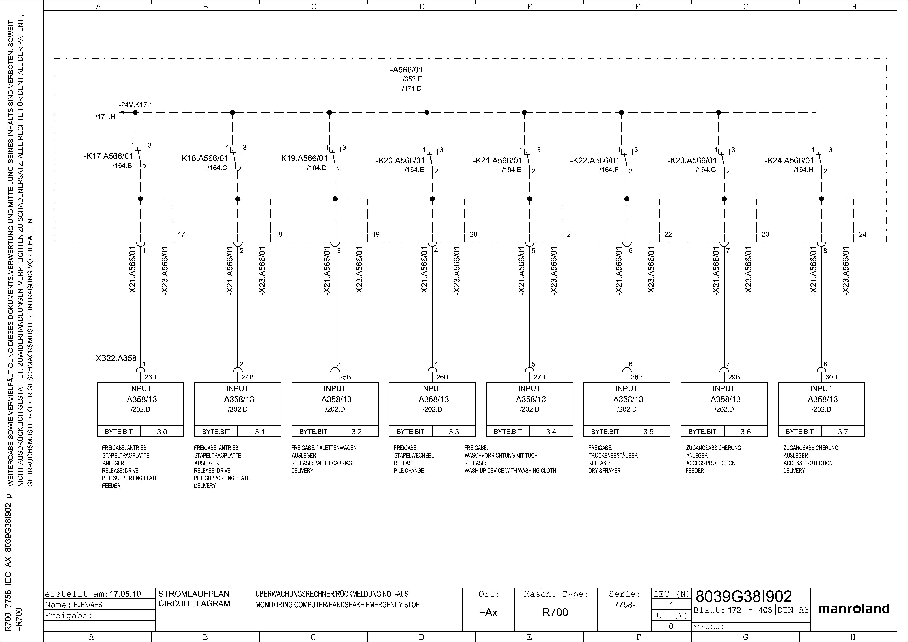

# +Ax — Sheet 172 of 403 — ÜBERWACHUNGSRECHNER/RÜCKMELDUNG NOT AUS

**MONITORING COMPUTER/HANDSHAKE EMERGENCY STOP**

> Part of the manroland **R700** printing press IEC/UL circuit diagrams.
> Drawing class: **Stromlaufplan / Circuit diagram** (DIN A3).
> Document `+Ax` covers the **Central control console** machine section.

## At a glance

| Field | Value |
|---|---|
| Document | `+Ax`  (8039G38I902) |
| Sheet | **172** of 403 |
| Section (DE) | ÜBERWACHUNGSRECHNER/RÜCKMELDUNG NOT AUS |
| Section (EN) | MONITORING COMPUTER/HANDSHAKE EMERGENCY STOP |
| Section type | CIRCUIT — Circuit diagram |
| Machine type | `R700` |
| Series | `7758` |
| Created | 17.05.10 |
| Replaces | — |
| Columns used | A, B, C, D, E, F, G, H |
| Path numbers | — |
| Labels on sheet | 170 |
| Cross-refs out | 19 |
| Cross-refs in | 43 |

**Previous:** [+Ax sheet 171](SHEET_0171.md) · **Next:** [+Ax sheet 173](SHEET_0173.md) · **Document TOC:** [_TOC.md](_TOC.md)  (+Ax) · **Master TOC:** [all sheets](../_MASTER_TOC.md)

## Sheet image (300 DPI, exact vector render)



_Rendered directly from the PDF vector layer at 300 DPI (1-bit), no OCR and no resampling. Use it to confirm anything ambiguous in the text below._

## Cross-references on this sheet

Each entry is a wire leaving this sheet. The printed token is `/sheet.column`; the link resolves to that sheet inside the same document.

| Ref | Target sheet | Col | Path | Destination on target | Target section | From col |
|---|---|---|---|---|---|---|
| `/353.F` | [+Ax sheet 353](SHEET_0353.md) | F | — | — | OPTION: LOGISTIK ANLEGER | D |
| `/171.D` | [+Ax sheet 171](SHEET_0171.md) | D | — | — | ÜBERWACHUNGSRECHNER/RÜCKMELDUNG NOT AUS | D |
| `/171.H` | [+Ax sheet 171](SHEET_0171.md) | H | — | — | ÜBERWACHUNGSRECHNER/RÜCKMELDUNG NOT AUS | A |
| `/164.B` | [+Ax sheet 164](SHEET_0164.md) | B | — | — | ÜBERWACHUNGSRECHNER/ANSTEUERUNG NOT AUS | A |
| `/164.C` | [+Ax sheet 164](SHEET_0164.md) | C | — | — | ÜBERWACHUNGSRECHNER/ANSTEUERUNG NOT AUS | B |
| `/164.D` | [+Ax sheet 164](SHEET_0164.md) | D | — | — | ÜBERWACHUNGSRECHNER/ANSTEUERUNG NOT AUS | C |
| `/164.E` | [+Ax sheet 164](SHEET_0164.md) | E | — | — | ÜBERWACHUNGSRECHNER/ANSTEUERUNG NOT AUS | D |
| `/164.E` | [+Ax sheet 164](SHEET_0164.md) | E | — | — | ÜBERWACHUNGSRECHNER/ANSTEUERUNG NOT AUS | E |
| `/164.F` | [+Ax sheet 164](SHEET_0164.md) | F | — | — | ÜBERWACHUNGSRECHNER/ANSTEUERUNG NOT AUS | F |
| `/164.G` | [+Ax sheet 164](SHEET_0164.md) | G | — | — | ÜBERWACHUNGSRECHNER/ANSTEUERUNG NOT AUS | G |
| `/164.H` | [+Ax sheet 164](SHEET_0164.md) | H | — | — | ÜBERWACHUNGSRECHNER/ANSTEUERUNG NOT AUS | H |
| `/202.D` | [+Ax sheet 202](SHEET_0202.md) | D | — | — | REFERENZMODUL | A |
| `/202.D` | [+Ax sheet 202](SHEET_0202.md) | D | — | — | REFERENZMODUL | B |
| `/202.D` | [+Ax sheet 202](SHEET_0202.md) | D | — | — | REFERENZMODUL | C |
| `/202.D` | [+Ax sheet 202](SHEET_0202.md) | D | — | — | REFERENZMODUL | D |
| `/202.D` | [+Ax sheet 202](SHEET_0202.md) | D | — | — | REFERENZMODUL | E |
| `/202.D` | [+Ax sheet 202](SHEET_0202.md) | D | — | — | REFERENZMODUL | F |
| `/202.D` | [+Ax sheet 202](SHEET_0202.md) | D | — | — | REFERENZMODUL | G |
| `/202.D` | [+Ax sheet 202](SHEET_0202.md) | D | — | — | REFERENZMODUL | H |

### Incoming references (sheets that point here)

Every other sheet that sends a wire to this one. `Back-ref` is the token printed on *that* sheet; `Path` is its line number.

| From sheet | Cols | Back-ref | Path | Refs | What continues there |
|---|---|---|---|---|---|
| [+Ax#164](SHEET_0164.md) | B, C, D, E, F, G, H | `/164.B`, `/164.C`, `/164.D`, `/164.E`, `/164.F`, `/164.G`, `/164.H` | — | 8 | — |
| [+Ax#171](SHEET_0171.md) | D, H | `/171.D`, `/171.H` | — | 2 | — |
| [+Ax#202](SHEET_0202.md) | D | `/202.D` | — | 8 | — |
| [+Ax#261](SHEET_0261.md) | F | `/261.F` | — | 8 | — |
| [+Ax#262](SHEET_0262.md) | G | `/262.G` | — | 8 | — |
| [+Ax#265](SHEET_0265.md) | C | `/265.C` | — | 8 | — |
| [+Ax#353](SHEET_0353.md) | F | `/353.F` | — | 1 | — |


## Devices on this sheet

| Tag | Class | Class meaning (IEC) | Col | Sub | Terminal | Sign |
|---|---|---|---|---|---|---|
| `A566/01` | A | Baugruppe / assembly, module, PC board | D | 01 | — | — |
| `A358/13` | A | Baugruppe / assembly, module, PC board | A | 13 | — | — |
| `A358/13` | A | Baugruppe / assembly, module, PC board | B | 13 | — | — |
| `A358/13` | A | Baugruppe / assembly, module, PC board | C | 13 | — | — |
| `A358/13` | A | Baugruppe / assembly, module, PC board | D | 13 | — | — |
| `A358/13` | A | Baugruppe / assembly, module, PC board | E | 13 | — | — |
| `A358/13` | A | Baugruppe / assembly, module, PC board | F | 13 | — | — |
| `A358/13` | A | Baugruppe / assembly, module, PC board | G | 13 | — | — |
| `A358/13` | A | Baugruppe / assembly, module, PC board | H | 13 | — | — |
| `3.0` | — | cross-device reference | B | — | — | — |
| `XB22.A358` | — | cross-device reference | A | — | — | — |
| `3.1` | — | cross-device reference | C | — | — | — |
| `3.2` | — | cross-device reference | C | — | — | — |
| `3.3` | — | cross-device reference | D | — | — | — |
| `3.4` | — | cross-device reference | E | — | — | — |
| `3.5` | — | cross-device reference | F | — | — | — |
| `3.6` | — | cross-device reference | G | — | — | — |
| `3.7` | — | cross-device reference | H | — | — | — |

## Potentials / nets

| Potential | Count | Columns | Attached devices | Terminals |
|---|---|---|---|---|
| `24V` | 1 | A | `K17` | `1` |


A potential such as `L24+/4` or `M24+` is a named supply/return rail; every place it appears on this sheet is electrically common.

## Wire-end annotations (grouped as printed)

A wire that continues elsewhere is annotated with a small cluster: the destination description, the path/line number `#NN`, and the `/sheet.column` cross reference. Each row below is one such cluster exactly as it is grouped on the drawing.

| Col | Y | Path | Cross-ref | Text on the wire |
|---|---|---|---|---|
| D | 86.8 | — | — | `A566/01` |
| D | 99.8 | — | `/353.F`, `/171.D` | — |
| A | 133.5 | — | — | `24V.K17:1` |
| A | 149.1 | — | `/171.H` | — |
| A | 186.7 | — | — | `K17.A566/01 3` |
| A | 186.7 | — | — | `1` |
| B | 189.5 | — | — | `K18.A566/01 3` |
| B | 189.5 | — | — | `1` |
| C | 189.5 | — | — | `K19.A566/01 3` |
| C | 189.5 | — | — | `1` |
| D | 192.4 | — | — | `K20.A566/01 3` |
| D | 192.4 | — | — | `1` |
| E | 192.4 | — | — | `K21.A566/01 3` |
| E | 192.4 | — | — | `1` |
| F | 192.4 | — | — | `K22.A566/01 3` |
| F | 192.4 | — | — | `1` |
| G | 192.4 | — | — | `K23.A566/01 3` |
| G | 192.4 | — | — | `1` |
| G | 192.4 | — | — | `K24.A566/01 3` |
| H | 192.4 | — | — | `1` |
| A | 213.2 | — | `/164.B` | — |
| A | 215.1 | — | — | `2` |
| B | 216.1 | — | `/164.C` | — |
| C | 216.1 | — | `/164.D` | — |
| B | 217.9 | — | — | `2` |
| C | 217.9 | — | — | `2` |
| D | 218.9 | — | `/164.E` | — |
| E | 218.9 | — | `/164.E` | — |
| F | 218.9 | — | `/164.F` | — |
| G | 218.9 | — | `/164.G` | — |
| H | 218.9 | — | `/164.H` | — |
| D | 220.7 | — | — | `2` |
| E | 220.7 | — | — | `2` |
| F | 220.7 | — | — | `2` |
| G | 220.7 | — | — | `2` |
| H | 220.7 | — | — | `2` |
| E | 303.6 | — | — | `17 18 19 20 21 22 23 24` |
| A | 322.6 | — | — | `X21.A566/01` |
| B | 322.6 | — | — | `X23.A566/01` |
| B | 322.6 | — | — | `X21.A566/01` |
| C | 322.6 | — | — | `X23.A566/01` |
| C | 322.6 | — | — | `X21.A566/01` |
| C | 322.6 | — | — | `X23.A566/01` |
| D | 322.6 | — | — | `X21.A566/01` |
| D | 322.6 | — | — | `X23.A566/01` |
| E | 322.6 | — | — | `X21.A566/01` |
| E | 322.6 | — | — | `X23.A566/01` |
| F | 322.6 | — | — | `X21.A566/01` |
| F | 322.6 | — | — | `X23.A566/01` |
| G | 322.6 | — | — | `X21.A566/01` |
| G | 322.6 | — | — | `X23.A566/01` |
| H | 322.6 | — | — | `X21.A566/01` |
| H | 322.6 | — | — | `X23.A566/01` |
| A | 324.9 | — | — | `1` |
| B | 324.9 | — | — | `2` |
| C | 324.9 | — | — | `3` |
| D | 324.9 | — | — | `4` |
| E | 324.9 | — | — | `5` |
| F | 324.9 | — | — | `6` |
| G | 324.9 | — | — | `7` |
| H | 324.9 | — | — | `8` |
| A | 465.2 | — | — | `XB22.A358 1` |
| B | 473.7 | — | — | `2` |
| C | 473.7 | — | — | `3` |
| D | 473.7 | — | — | `4` |
| E | 473.7 | — | — | `5` |
| F | 473.7 | — | — | `6` |
| G | 473.7 | — | — | `7` |
| H | 473.7 | — | — | `8` |
| A | 490.7 | — | — | `23B` |
| B | 490.7 | — | — | `24B` |
| C | 490.7 | — | — | `25B` |
| D | 490.7 | — | — | `26B` |
| E | 490.7 | — | — | `27B` |
| F | 490.7 | — | — | `28B` |
| G | 490.7 | — | — | `29B` |
| H | 490.7 | — | — | `30B` |
| A | 505.2 | — | — | `INPUT` |
| B | 505.2 | — | — | `INPUT` |
| C | 505.2 | — | — | `INPUT` |
| D | 505.2 | — | — | `INPUT` |
| E | 505.2 | — | — | `INPUT` |
| F | 505.2 | — | — | `INPUT` |
| G | 505.2 | — | — | `INPUT` |
| H | 505.2 | — | — | `INPUT` |
| A | 519.0 | — | — | `A358/13` |
| B | 519.0 | — | — | `A358/13` |
| C | 519.0 | — | — | `A358/13` |
| D | 519.0 | — | — | `A358/13` |
| E | 519.0 | — | — | `A358/13` |
| F | 519.0 | — | — | `A358/13` |
| G | 519.0 | — | — | `A358/13` |
| H | 519.0 | — | — | `A358/13` |
| A | 532.9 | — | `/202.D` | — |
| B | 532.9 | — | `/202.D` | — |
| C | 532.9 | — | `/202.D` | — |
| D | 532.9 | — | `/202.D` | — |
| E | 532.9 | — | `/202.D` | — |
| F | 532.9 | — | `/202.D` | — |
| G | 532.9 | — | `/202.D` | — |
| H | 532.9 | — | `/202.D` | — |
| A | 561.9 | — | — | `BYTE.BIT 3.0` |
| B | 561.9 | — | — | `BYTE.BIT 3.1` |
| C | 561.9 | — | — | `BYTE.BIT 3.2` |
| D | 561.9 | — | — | `BYTE.BIT 3.3` |
| E | 561.9 | — | — | `BYTE.BIT 3.4` |
| F | 561.9 | — | — | `BYTE.BIT 3.5` |
| G | 561.9 | — | — | `BYTE.BIT 3.6` |
| H | 561.9 | — | — | `BYTE.BIT 3.7` |
| A | 584.7 | — | — | `FREIGABE: ANTRIEB STAPELTRAGPLATTE` |
| B | 584.7 | — | — | `FREIGABE: ANTRIEB STAPELTRAGPLATTE` |
| C | 584.7 | — | — | `FREIGABE: PALETTENWAGEN` |
| D | 584.7 | — | — | `FREIGABE: RELEASE: PILE CHANGE STAPELWECHSEL` |
| E | 584.7 | — | — | `FREIGABE:` |
| F | 584.7 | — | — | `FREIGABE: RELEASE: DRY SPRAYER TROCKENBESTÄUBER` |
| G | 584.7 | — | — | `FEEDER ZUGANGSABSICHERUNG ANLEGER ACCESS PROTECTION` |
| H | 584.7 | — | — | `DELIVERY ZUGANGSABSICHERUNG AUSLEGER ACCESS PROTECTION` |
| E | 594.6 | — | — | `RELEASE: WASCHVORRICHTUNG MIT TUCH` |
| C | 594.7 | — | — | `RELEASE: PALLET CARRIAGE DELIVERY AUSLEGER` |
| A | 604.6 | — | — | `RELEASE: DRIVE PILE SUPPORTING PLATE FEEDER ANLEGER` |
| B | 604.6 | — | — | `RELEASE: DRIVE PILE SUPPORTING PLATE DELIVERY AUSLEGER` |
| E | 614.5 | — | — | `WASH UP DEVICE WITH WASHING CLOTH` |


## Reconstructed tables

This sheet carries tabular content (pin map / terminal assignment / index). The grid below was rebuilt from the drawing's own rule lines, so each row is exactly one physical row of the table.

### Table 1 — 3 data rows × 4 columns (at x=127.6, y=147.4)

| /171.H 1 K17.A566/01 /164.B |  | 3 2 |  |
|---|---|---|---|
| `X21.A566/01 XB22.A358` |  | `X23.A566/01 1 1 23B` | `17` |
|  | `INPUT` | `A358/13 /202.D` |  |
| `BYTE.BIT` |  | `3.0` |  |


### Table 2 — 3 data rows × 4 columns (at x=255.1, y=147.4)

| 1 K18.A566/01 /164.C |  | 3 2 |  |
|---|---|---|---|
| `X21.A566/01` |  | `X23.A566/01 2 2 24B` | `18` |
|  | `INPUT` | `A358/13 /202.D` |  |
| `BYTE.BIT` |  | `3.1` |  |


### Table 3 — 3 data rows × 4 columns (at x=382.7, y=147.4)

| 1 K19.A566/01 /164.D |  | 3 2 |  |
|---|---|---|---|
| `X21.A566/01` |  | `X23.A566/01 3 3 25B` | `19` |
|  | `INPUT` | `A358/13 /202.D` |  |
| `BYTE.BIT` |  | `3.2` |  |


### Table 4 — 3 data rows × 4 columns (at x=510.2, y=147.4)

| 1 K20.A566/01 /164.E |  | 3 2 |  |
|---|---|---|---|
| `X21.A566/01` |  | `X23.A566/01 4 4 26B` | `20` |
|  | `INPUT` | `A358/13 /202.D` |  |
| `BYTE.BIT` |  | `3.3` |  |


### Table 5 — 3 data rows × 4 columns (at x=637.8, y=147.4)

| 1 K21.A566/01 /164.E |  | 3 2 |  |
|---|---|---|---|
| `X21.A566/01` |  | `X23.A566/01 5 5 27B` | `21` |
|  | `INPUT` | `A358/13 /202.D` |  |
| `BYTE.BIT` |  | `3.4` |  |


### Table 6 — 3 data rows × 4 columns (at x=765.4, y=147.4)

| 1 K22.A566/01 /164.F |  | 3 2 |  |
|---|---|---|---|
| `X21.A566/01` |  | `X23.A566/01 6 6 28B` | `22` |
|  | `INPUT` | `A358/13 /202.D` |  |
| `BYTE.BIT` |  | `3.5` |  |


### Table 7 — 3 data rows × 4 columns (at x=892.9, y=147.4)

| 1 K23.A566/01 /164.G |  | 3 2 |  |
|---|---|---|---|
| `X21.A566/01` |  | `X23.A566/01 7 7 29B` | `23` |
|  | `INPUT` | `A358/13 /202.D` |  |
| `BYTE.BIT` |  | `3.6` |  |


### Table 8 — 3 data rows × 4 columns (at x=1020.5, y=147.4)

| 1 K24.A566/01 /164.H |  | 3 2 |  |
|---|---|---|---|
| `X21.A566/01` |  | `X23.A566/01 8 8 30B` | `24` |
|  | `INPUT` | `A358/13 /202.D` |  |
| `BYTE.BIT` |  | `3.7` |  |


## Notes and free text on this sheet

| Text | Col | Y (pt) |
|---|---|---|
| `K17.A566/01` | A | 200.15 |
| `K18.A566/01` | B | 202.98 |
| `K19.A566/01` | C | 202.98 |
| `K20.A566/01` | D | 205.82 |
| `K21.A566/01` | E | 205.82 |
| `K22.A566/01` | F | 205.82 |
| `K23.A566/01` | G | 205.82 |
| `K24.A566/01` | G | 205.82 |
| `X21.A566/01` | A | 322.58 |
| `X21.A566/01` | B | 322.58 |
| `X21.A566/01` | C | 322.58 |
| `X21.A566/01` | D | 322.58 |
| `X21.A566/01` | E | 322.58 |
| `X21.A566/01` | F | 322.58 |
| `X21.A566/01` | G | 322.58 |
| `X21.A566/01` | H | 322.58 |
| `23B` | A | 490.68 |
| `INPUT` | A | 505.2 |
| `BYTE.BIT` | A | 562.45 |
| `FREIGABE: ANTRIEB` | A | 584.73 |
| `STAPELTRAGPLATTE` | A | 594.63 |
| `ANLEGER` | A | 604.63 |
| `RELEASE: DRIVE` | A | 614.58 |
| `PILE SUPPORTING PLATE` | A | 624.5 |
| `FEEDER` | A | 634.45 |
| `24B` | B | 490.68 |
| `INPUT` | B | 505.2 |
| `BYTE.BIT` | B | 562.45 |
| `FREIGABE: ANTRIEB` | B | 584.73 |
| `STAPELTRAGPLATTE` | B | 594.63 |
| `AUSLEGER` | B | 604.63 |
| `RELEASE: DRIVE` | B | 614.58 |
| `PILE SUPPORTING PLATE` | B | 624.5 |
| `DELIVERY` | B | 634.48 |
| `25B` | C | 490.68 |
| `INPUT` | C | 505.2 |
| `BYTE.BIT` | C | 562.45 |
| `FREIGABE: PALETTENWAGEN` | C | 584.7 |
| `AUSLEGER` | C | 594.69 |
| `RELEASE: PALLET CARRIAGE` | C | 604.62 |
| `DELIVERY` | C | 614.59 |
| `26B` | D | 490.68 |
| `INPUT` | D | 505.2 |
| `BYTE.BIT` | D | 562.45 |
| `FREIGABE:` | D | 584.72 |
| `STAPELWECHSEL` | D | 594.64 |
| `RELEASE:` | D | 604.61 |
| `PILE CHANGE` | D | 614.56 |
| `27B` | E | 490.68 |
| `INPUT` | E | 505.2 |
| `BYTE.BIT` | E | 562.45 |
| `FREIGABE:` | E | 584.72 |
| `WASCHVORRICHTUNG MIT TUCH` | E | 594.64 |
| `WASH UP DEVICE WITH WASHING CLOTH` | E | 614.53 |
| `28B` | F | 490.68 |
| `INPUT` | F | 505.2 |
| `BYTE.BIT` | F | 562.45 |
| `FREIGABE:` | F | 584.72 |
| `TROCKENBESTÄUBER` | F | 594.66 |
| `RELEASE:` | F | 604.61 |
| `DRY SPRAYER` | F | 614.57 |
| `29B` | G | 490.68 |
| `INPUT` | G | 505.2 |
| `BYTE.BIT` | G | 562.45 |
| `ZUGANGSABSICHERUNG` | G | 584.72 |
| `ANLEGER` | G | 594.68 |
| `ACCESS PROTECTION` | G | 604.6 |
| `FEEDER` | G | 614.55 |
| `30B` | H | 490.68 |
| `INPUT` | H | 505.2 |
| `ZUGANGSABSICHERUNG` | H | 584.72 |
| `AUSLEGER` | G | 594.69 |
| `ACCESS PROTECTION` | H | 604.6 |
| `DELIVERY` | G | 614.59 |
| `X23.A566/01` | B | 322.58 |
| `X23.A566/01` | C | 322.58 |
| `X23.A566/01` | D | 322.58 |
| `X23.A566/01` | E | 322.58 |
| `X23.A566/01` | F | 322.58 |
| `X23.A566/01` | G | 322.58 |
| `X23.A566/01` | H | 322.58 |

## Complete label inventory (exact text from the drawing)

Every text object inside the drawing area of this sheet, in DIN reading order (column A→H, then top→bottom). This is the authoritative list: if a string is not here it is not printed on this sheet.

| Col | Y | X | Dir | Type | Text |
|---|---|---|---|---|---|
| A | 133.5 | 156.2 | → | potential | `24V.K17:1` |
| A | 149.1 | 125.3 | → | cross-reference | `/171.H` |
| A | 186.7 | 171.2 | → | number | `1` |
| A | 186.7 | 193.9 | → | number | `3` |
| A | 200.1 | 110.0 | → | text | `K17.A566/01` |
| A | 213.2 | 147.7 | → | cross-reference | `/164.B` |
| A | 215.0 | 186.8 | → | number | `2` |
| A | 322.6 | 169.0 | ↕ | text | `X21.A566/01` |
| A | 324.9 | 186.2 | → | number | `1` |
| A | 465.2 | 121.9 | → | device ref | `XB22.A358` |
| A | 473.7 | 186.2 | → | number | `1` |
| A | 490.7 | 189.6 | → | text | `23B` |
| A | 505.2 | 169.4 | → | text | `INPUT` |
| A | 519.0 | 162.9 | → | device tag | `A358/13` |
| A | 532.8 | 171.5 | → | cross-reference | `/202.D` |
| A | 562.5 | 137.5 | → | text | `BYTE.BIT` |
| A | 584.7 | 134.1 | → | text | `FREIGABE: ANTRIEB` |
| A | 594.6 | 134.4 | → | text | `STAPELTRAGPLATTE` |
| A | 604.6 | 134.9 | → | text | `ANLEGER` |
| A | 614.6 | 134.1 | → | text | `RELEASE: DRIVE` |
| A | 624.5 | 134.1 | → | text | `PILE SUPPORTING PLATE` |
| A | 634.4 | 134.1 | → | text | `FEEDER` |
| B | 189.5 | 295.9 | → | number | `1` |
| B | 189.5 | 318.6 | → | number | `3` |
| B | 203.0 | 234.7 | → | text | `K18.A566/01` |
| B | 216.1 | 272.1 | → | cross-reference | `/164.C` |
| B | 217.9 | 311.5 | → | number | `2` |
| B | 303.6 | 233.0 | → | number | `17` |
| B | 322.6 | 211.5 | ↕ | text | `X23.A566/01` |
| B | 322.6 | 296.5 | ↕ | text | `X21.A566/01` |
| B | 324.9 | 314.4 | → | number | `2` |
| B | 473.7 | 314.4 | → | number | `2` |
| B | 490.7 | 317.2 | → | text | `24B` |
| B | 505.2 | 296.9 | → | text | `INPUT` |
| B | 519.0 | 290.4 | → | device tag | `A358/13` |
| B | 532.8 | 299.1 | → | cross-reference | `/202.D` |
| B | 561.9 | 205.8 | → | device ref | `3.0` |
| B | 562.5 | 265.0 | → | text | `BYTE.BIT` |
| B | 584.7 | 254.6 | → | text | `FREIGABE: ANTRIEB` |
| B | 594.6 | 254.8 | → | text | `STAPELTRAGPLATTE` |
| B | 604.6 | 255.4 | → | text | `AUSLEGER` |
| B | 614.6 | 254.6 | → | text | `RELEASE: DRIVE` |
| B | 624.5 | 254.6 | → | text | `PILE SUPPORTING PLATE` |
| B | 634.5 | 254.6 | → | text | `DELIVERY` |
| C | 189.5 | 426.3 | → | number | `1` |
| C | 189.5 | 449.0 | → | number | `3` |
| C | 203.0 | 365.1 | → | text | `K19.A566/01` |
| C | 216.1 | 402.5 | → | cross-reference | `/164.D` |
| C | 217.9 | 441.9 | → | number | `2` |
| C | 303.6 | 360.6 | → | number | `18` |
| C | 322.6 | 339.0 | ↕ | text | `X23.A566/01` |
| C | 322.6 | 424.1 | ↕ | text | `X21.A566/01` |
| C | 322.6 | 466.6 | ↕ | text | `X23.A566/01` |
| C | 324.9 | 441.9 | → | number | `3` |
| C | 473.7 | 441.9 | → | number | `3` |
| C | 490.7 | 444.8 | → | text | `25B` |
| C | 505.2 | 424.5 | → | text | `INPUT` |
| C | 519.0 | 418.0 | → | device tag | `A358/13` |
| C | 532.8 | 426.6 | → | cross-reference | `/202.D` |
| C | 561.9 | 334.2 | → | device ref | `3.1` |
| C | 561.9 | 460.9 | → | device ref | `3.2` |
| C | 562.5 | 392.6 | → | text | `BYTE.BIT` |
| C | 584.7 | 382.1 | → | text | `FREIGABE: PALETTENWAGEN` |
| C | 594.7 | 383.0 | → | text | `AUSLEGER` |
| C | 604.6 | 382.1 | → | text | `RELEASE: PALLET CARRIAGE` |
| C | 614.6 | 382.1 | → | text | `DELIVERY` |
| D | 86.8 | 511.7 | → | device tag | `A566/01` |
| D | 99.8 | 528.1 | → | cross-reference | `/353.F` |
| D | 112.3 | 527.2 | → | cross-reference | `/171.D` |
| D | 192.4 | 553.9 | → | number | `1` |
| D | 192.4 | 576.6 | → | number | `3` |
| D | 205.8 | 492.7 | → | text | `K20.A566/01` |
| D | 218.9 | 530.6 | → | cross-reference | `/164.E` |
| D | 220.7 | 569.5 | → | number | `2` |
| D | 303.6 | 488.1 | → | number | `19` |
| D | 303.6 | 616.3 | → | number | `20` |
| D | 322.6 | 551.6 | ↕ | text | `X21.A566/01` |
| D | 322.6 | 594.2 | ↕ | text | `X23.A566/01` |
| D | 324.9 | 569.5 | → | number | `4` |
| D | 473.7 | 569.5 | → | number | `4` |
| D | 490.7 | 572.3 | → | text | `26B` |
| D | 505.2 | 552.0 | → | text | `INPUT` |
| D | 519.0 | 545.5 | → | device tag | `A358/13` |
| D | 532.8 | 554.2 | → | cross-reference | `/202.D` |
| D | 561.9 | 588.5 | → | device ref | `3.3` |
| D | 562.5 | 520.2 | → | text | `BYTE.BIT` |
| D | 584.7 | 516.8 | → | text | `FREIGABE:` |
| D | 594.6 | 517.0 | → | text | `STAPELWECHSEL` |
| D | 604.6 | 516.8 | → | text | `RELEASE:` |
| D | 604.6 | 608.9 | → | text | `RELEASE:` |
| D | 614.6 | 516.8 | → | text | `PILE CHANGE` |
| E | 192.4 | 681.4 | → | number | `1` |
| E | 192.4 | 704.1 | → | number | `3` |
| E | 205.8 | 620.2 | → | text | `K21.A566/01` |
| E | 218.9 | 658.2 | → | cross-reference | `/164.E` |
| E | 220.7 | 697.0 | → | number | `2` |
| E | 303.6 | 743.8 | → | number | `21` |
| E | 322.6 | 679.2 | ↕ | text | `X21.A566/01` |
| E | 322.6 | 721.7 | ↕ | text | `X23.A566/01` |
| E | 324.9 | 697.0 | → | number | `5` |
| E | 473.7 | 697.0 | → | number | `5` |
| E | 490.7 | 699.9 | → | text | `27B` |
| E | 505.2 | 679.6 | → | text | `INPUT` |
| E | 519.0 | 673.1 | → | device tag | `A358/13` |
| E | 532.8 | 681.7 | → | cross-reference | `/202.D` |
| E | 561.9 | 716.0 | → | device ref | `3.4` |
| E | 562.5 | 647.7 | → | text | `BYTE.BIT` |
| E | 584.7 | 608.9 | → | text | `FREIGABE:` |
| E | 594.6 | 609.4 | → | text | `WASCHVORRICHTUNG MIT TUCH` |
| E | 614.5 | 609.4 | → | text | `WASH UP DEVICE WITH WASHING CLOTH` |
| F | 192.4 | 809.0 | → | number | `1` |
| F | 192.4 | 831.7 | → | number | `3` |
| F | 205.8 | 747.8 | → | text | `K22.A566/01` |
| F | 218.9 | 786.0 | → | cross-reference | `/164.F` |
| F | 220.7 | 824.6 | → | number | `2` |
| F | 303.6 | 871.4 | → | number | `22` |
| F | 322.6 | 806.8 | ↕ | text | `X21.A566/01` |
| F | 322.6 | 849.3 | ↕ | text | `X23.A566/01` |
| F | 324.9 | 824.6 | → | number | `6` |
| F | 473.7 | 824.6 | → | number | `6` |
| F | 490.7 | 827.4 | → | text | `28B` |
| F | 505.2 | 807.2 | → | text | `INPUT` |
| F | 519.0 | 800.6 | → | device tag | `A358/13` |
| F | 532.8 | 809.3 | → | cross-reference | `/202.D` |
| F | 561.9 | 843.6 | → | device ref | `3.5` |
| F | 562.5 | 775.3 | → | text | `BYTE.BIT` |
| F | 584.7 | 771.9 | → | text | `FREIGABE:` |
| F | 594.7 | 772.2 | → | text | `TROCKENBESTÄUBER` |
| F | 604.6 | 771.9 | → | text | `RELEASE:` |
| F | 614.6 | 771.9 | → | text | `DRY SPRAYER` |
| G | 192.4 | 936.6 | → | number | `1` |
| G | 192.4 | 959.2 | → | number | `3` |
| G | 205.8 | 875.3 | → | text | `K23.A566/01` |
| G | 205.8 | 1002.9 | → | text | `K24.A566/01` |
| G | 218.9 | 912.5 | → | cross-reference | `/164.G` |
| G | 220.7 | 952.2 | → | number | `2` |
| G | 303.6 | 998.9 | → | number | `23` |
| G | 322.6 | 934.3 | ↕ | text | `X21.A566/01` |
| G | 322.6 | 976.8 | ↕ | text | `X23.A566/01` |
| G | 324.9 | 952.2 | → | number | `7` |
| G | 473.7 | 952.2 | → | number | `7` |
| G | 490.7 | 955.0 | → | text | `29B` |
| G | 505.2 | 934.7 | → | text | `INPUT` |
| G | 519.0 | 928.2 | → | device tag | `A358/13` |
| G | 532.8 | 936.9 | → | cross-reference | `/202.D` |
| G | 561.9 | 971.1 | → | device ref | `3.6` |
| G | 562.5 | 902.8 | → | text | `BYTE.BIT` |
| G | 562.5 | 1030.4 | → | text | `BYTE.BIT` |
| G | 584.7 | 900.0 | → | text | `ZUGANGSABSICHERUNG` |
| G | 594.7 | 900.3 | → | text | `ANLEGER` |
| G | 594.7 | 1027.8 | → | text | `AUSLEGER` |
| G | 604.6 | 900.3 | → | text | `ACCESS PROTECTION` |
| G | 614.6 | 899.4 | → | text | `FEEDER` |
| G | 614.6 | 1027.0 | → | text | `DELIVERY` |
| H | 192.4 | 1064.1 | → | number | `1` |
| H | 192.4 | 1086.8 | → | number | `3` |
| H | 218.9 | 1040.9 | → | cross-reference | `/164.H` |
| H | 220.7 | 1079.7 | → | number | `2` |
| H | 303.6 | 1126.5 | → | number | `24` |
| H | 322.6 | 1061.9 | ↕ | text | `X21.A566/01` |
| H | 322.6 | 1104.4 | ↕ | text | `X23.A566/01` |
| H | 324.9 | 1079.7 | → | number | `8` |
| H | 473.7 | 1079.7 | → | number | `8` |
| H | 490.7 | 1082.6 | → | text | `30B` |
| H | 505.2 | 1062.3 | → | text | `INPUT` |
| H | 519.0 | 1055.8 | → | device tag | `A358/13` |
| H | 532.8 | 1064.4 | → | cross-reference | `/202.D` |
| H | 561.9 | 1098.7 | → | device ref | `3.7` |
| H | 584.7 | 1027.6 | → | text | `ZUGANGSABSICHERUNG` |
| H | 604.6 | 1027.8 | → | text | `ACCESS PROTECTION` |

## Reading-order text block

The same content as a plain block, grouped by DIN column — convenient to paste or to match against a visual description.

```text
=== Column A ===
 133.5  156.2  net          24V.K17:1
 149.1  125.3  xref         /171.H
 186.7  171.2  numeric      1
 186.7  193.9  numeric      3
 200.1  110.0  text         K17.A566/01
 213.2  147.7  xref         /164.B
 215.0  186.8  numeric      2
 322.6  169.0  text         X21.A566/01
 324.9  186.2  numeric      1
 465.2  121.9  devref       XB22.A358
 473.7  186.2  numeric      1
 490.7  189.6  text         23B
 505.2  169.4  text         INPUT
 519.0  162.9  devtag       A358/13
 532.8  171.5  xref         /202.D
 562.5  137.5  text         BYTE.BIT
 584.7  134.1  text         FREIGABE: ANTRIEB
 594.6  134.4  text         STAPELTRAGPLATTE
 604.6  134.9  text         ANLEGER
 614.6  134.1  text         RELEASE: DRIVE
 624.5  134.1  text         PILE SUPPORTING PLATE
 634.4  134.1  text         FEEDER
=== Column B ===
 189.5  295.9  numeric      1
 189.5  318.6  numeric      3
 203.0  234.7  text         K18.A566/01
 216.1  272.1  xref         /164.C
 217.9  311.5  numeric      2
 303.6  233.0  numeric      17
 322.6  211.5  text         X23.A566/01
 322.6  296.5  text         X21.A566/01
 324.9  314.4  numeric      2
 473.7  314.4  numeric      2
 490.7  317.2  text         24B
 505.2  296.9  text         INPUT
 519.0  290.4  devtag       A358/13
 532.8  299.1  xref         /202.D
 561.9  205.8  devref       3.0
 562.5  265.0  text         BYTE.BIT
 584.7  254.6  text         FREIGABE: ANTRIEB
 594.6  254.8  text         STAPELTRAGPLATTE
 604.6  255.4  text         AUSLEGER
 614.6  254.6  text         RELEASE: DRIVE
 624.5  254.6  text         PILE SUPPORTING PLATE
 634.5  254.6  text         DELIVERY
=== Column C ===
 189.5  426.3  numeric      1
 189.5  449.0  numeric      3
 203.0  365.1  text         K19.A566/01
 216.1  402.5  xref         /164.D
 217.9  441.9  numeric      2
 303.6  360.6  numeric      18
 322.6  339.0  text         X23.A566/01
 322.6  424.1  text         X21.A566/01
 322.6  466.6  text         X23.A566/01
 324.9  441.9  numeric      3
 473.7  441.9  numeric      3
 490.7  444.8  text         25B
 505.2  424.5  text         INPUT
 519.0  418.0  devtag       A358/13
 532.8  426.6  xref         /202.D
 561.9  334.2  devref       3.1
 561.9  460.9  devref       3.2
 562.5  392.6  text         BYTE.BIT
 584.7  382.1  text         FREIGABE: PALETTENWAGEN
 594.7  383.0  text         AUSLEGER
 604.6  382.1  text         RELEASE: PALLET CARRIAGE
 614.6  382.1  text         DELIVERY
=== Column D ===
  86.8  511.7  devtag       A566/01
  99.8  528.1  xref         /353.F
 112.3  527.2  xref         /171.D
 192.4  553.9  numeric      1
 192.4  576.6  numeric      3
 205.8  492.7  text         K20.A566/01
 218.9  530.6  xref         /164.E
 220.7  569.5  numeric      2
 303.6  488.1  numeric      19
 303.6  616.3  numeric      20
 322.6  551.6  text         X21.A566/01
 322.6  594.2  text         X23.A566/01
 324.9  569.5  numeric      4
 473.7  569.5  numeric      4
 490.7  572.3  text         26B
 505.2  552.0  text         INPUT
 519.0  545.5  devtag       A358/13
 532.8  554.2  xref         /202.D
 561.9  588.5  devref       3.3
 562.5  520.2  text         BYTE.BIT
 584.7  516.8  text         FREIGABE:
 594.6  517.0  text         STAPELWECHSEL
 604.6  516.8  text         RELEASE:
 604.6  608.9  text         RELEASE:
 614.6  516.8  text         PILE CHANGE
=== Column E ===
 192.4  681.4  numeric      1
 192.4  704.1  numeric      3
 205.8  620.2  text         K21.A566/01
 218.9  658.2  xref         /164.E
 220.7  697.0  numeric      2
 303.6  743.8  numeric      21
 322.6  679.2  text         X21.A566/01
 322.6  721.7  text         X23.A566/01
 324.9  697.0  numeric      5
 473.7  697.0  numeric      5
 490.7  699.9  text         27B
 505.2  679.6  text         INPUT
 519.0  673.1  devtag       A358/13
 532.8  681.7  xref         /202.D
 561.9  716.0  devref       3.4
 562.5  647.7  text         BYTE.BIT
 584.7  608.9  text         FREIGABE:
 594.6  609.4  text         WASCHVORRICHTUNG MIT TUCH
 614.5  609.4  text         WASH UP DEVICE WITH WASHING CLOTH
=== Column F ===
 192.4  809.0  numeric      1
 192.4  831.7  numeric      3
 205.8  747.8  text         K22.A566/01
 218.9  786.0  xref         /164.F
 220.7  824.6  numeric      2
 303.6  871.4  numeric      22
 322.6  806.8  text         X21.A566/01
 322.6  849.3  text         X23.A566/01
 324.9  824.6  numeric      6
 473.7  824.6  numeric      6
 490.7  827.4  text         28B
 505.2  807.2  text         INPUT
 519.0  800.6  devtag       A358/13
 532.8  809.3  xref         /202.D
 561.9  843.6  devref       3.5
 562.5  775.3  text         BYTE.BIT
 584.7  771.9  text         FREIGABE:
 594.7  772.2  text         TROCKENBESTÄUBER
 604.6  771.9  text         RELEASE:
 614.6  771.9  text         DRY SPRAYER
=== Column G ===
 192.4  936.6  numeric      1
 192.4  959.2  numeric      3
 205.8  875.3  text         K23.A566/01
 205.8 1002.9  text         K24.A566/01
 218.9  912.5  xref         /164.G
 220.7  952.2  numeric      2
 303.6  998.9  numeric      23
 322.6  934.3  text         X21.A566/01
 322.6  976.8  text         X23.A566/01
 324.9  952.2  numeric      7
 473.7  952.2  numeric      7
 490.7  955.0  text         29B
 505.2  934.7  text         INPUT
 519.0  928.2  devtag       A358/13
 532.8  936.9  xref         /202.D
 561.9  971.1  devref       3.6
 562.5  902.8  text         BYTE.BIT
 562.5 1030.4  text         BYTE.BIT
 584.7  900.0  text         ZUGANGSABSICHERUNG
 594.7  900.3  text         ANLEGER
 594.7 1027.8  text         AUSLEGER
 604.6  900.3  text         ACCESS PROTECTION
 614.6  899.4  text         FEEDER
 614.6 1027.0  text         DELIVERY
=== Column H ===
 192.4 1064.1  numeric      1
 192.4 1086.8  numeric      3
 218.9 1040.9  xref         /164.H
 220.7 1079.7  numeric      2
 303.6 1126.5  numeric      24
 322.6 1061.9  text         X21.A566/01
 322.6 1104.4  text         X23.A566/01
 324.9 1079.7  numeric      8
 473.7 1079.7  numeric      8
 490.7 1082.6  text         30B
 505.2 1062.3  text         INPUT
 519.0 1055.8  devtag       A358/13
 532.8 1064.4  xref         /202.D
 561.9 1098.7  devref       3.7
 584.7 1027.6  text         ZUGANGSABSICHERUNG
 604.6 1027.8  text         ACCESS PROTECTION
```

---
_Generated from the PDF vector text layer; no OCR. Source: `R700_7758_IEC_AX_8039G38I902_p`, sheet 172._
