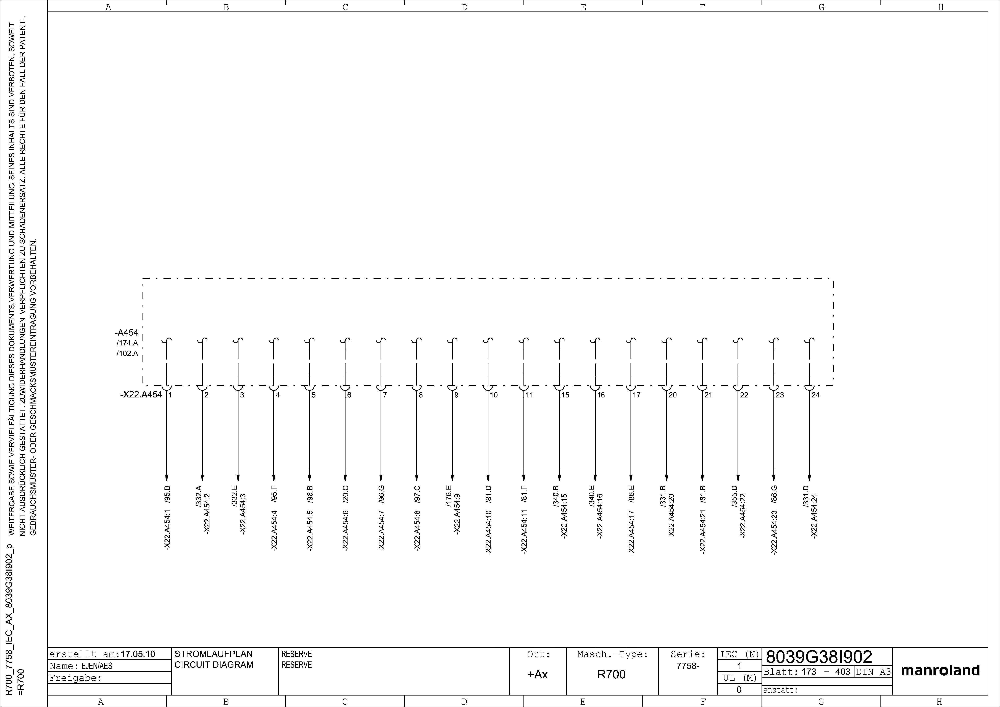

# +Ax — Sheet 173 of 403 — RESERVE

**RESERVE**

> Part of the manroland **R700** printing press IEC/UL circuit diagrams.
> Drawing class: **Stromlaufplan / Circuit diagram** (DIN A3).
> Document `+Ax` covers the **Central control console** machine section.

## At a glance

| Field | Value |
|---|---|
| Document | `+Ax`  (8039G38I902) |
| Sheet | **173** of 403 |
| Section (DE) | RESERVE |
| Section (EN) | RESERVE |
| Section type | CIRCUIT — Circuit diagram |
| Machine type | `R700` |
| Series | `7758` |
| Created | 17.05.10 |
| Replaces | — |
| Columns used | A, B, C, D, E, F, G |
| Path numbers | — |
| Labels on sheet | 61 |
| Cross-refs out | 21 |
| Cross-refs in | 40 |

**Previous:** [+Ax sheet 172](SHEET_0172.md) · **Next:** [+Ax sheet 174](SHEET_0174.md) · **Document TOC:** [_TOC.md](_TOC.md)  (+Ax) · **Master TOC:** [all sheets](../_MASTER_TOC.md)

## Sheet image (300 DPI, exact vector render)



_Rendered directly from the PDF vector layer at 300 DPI (1-bit), no OCR and no resampling. Use it to confirm anything ambiguous in the text below._

## Cross-references on this sheet

Each entry is a wire leaving this sheet. The printed token is `/sheet.column`; the link resolves to that sheet inside the same document.

| Ref | Target sheet | Col | Path | Destination on target | Target section | From col |
|---|---|---|---|---|---|---|
| `/174.A` | [+Ax sheet 174](SHEET_0174.md) | A | — | — | RESERVE | A |
| `/102.A` | [+Ax sheet 102](SHEET_0102.md) | A | — | — | ANLEGER | A |
| `/332.E` | [+Ax sheet 332](SHEET_0332.md) | E | — | — | OPTION: NONSTOP EINRICHTUNG MANUELL, ANLEGER | B |
| `/96.G` | [+Ax sheet 96](SHEET_0096.md) | G | — | X22.A454:7 | ANLEGER | C |
| `/176.E` | [+Ax sheet 176](SHEET_0176.md) | E | — | — | RESERVE | D |
| `/340.E` | [+Ax sheet 340](SHEET_0340.md) | E | — | — | OPTION: INLINESHEETER RS104 S | E |
| `/86.E` | [+Ax sheet 86](SHEET_0086.md) | E | — | X22.A454:17 | ANLEGER | E |
| `/86.G` | [+Ax sheet 86](SHEET_0086.md) | G | — | X22.A454:23 | ANLEGER | G |
| `/95.B` | [+Ax sheet 95](SHEET_0095.md) | B | — | X22.A454:1 | ANLEGER | B |
| `/96.B` | [+Ax sheet 96](SHEET_0096.md) | B | — | X22.A454:5 | ANLEGER | C |
| `/81.B` | [+Ax sheet 81](SHEET_0081.md) | B | — | X22.A454:21 | ANLEGER | F |
| `/95.F` | [+Ax sheet 95](SHEET_0095.md) | F | — | X22.A454:4 | ANLEGER | B |
| `/20.C` | [+Ax sheet 20](SHEET_0020.md) | C | — | X22.A454:6 | SPANNUNGSVERSORGUNG, SCHALTSCHRANKBELÜFTUNG | C |
| `/97.C` | [+Ax sheet 97](SHEET_0097.md) | C | — | X22.A454:8 | ANLEGER | D |
| `/81.D` | [+Ax sheet 81](SHEET_0081.md) | D | — | X22.A454:10 | ANLEGER | D |
| `/81.F` | [+Ax sheet 81](SHEET_0081.md) | F | — | X22.A454:11 | ANLEGER | E |
| `/340.B` | [+Ax sheet 340](SHEET_0340.md) | B | — | — | OPTION: INLINESHEETER RS104 S | E |
| `/331.B` | [+Ax sheet 331](SHEET_0331.md) | B | — | — | OPTION: NONSTOP EINRICHTUNG MANUELL, ANLEGER | F |
| `/355.D` | [+Ax sheet 355](SHEET_0355.md) | D | — | — | OPTION: LOGISTIK ANLEGER | F |
| `/331.D` | [+Ax sheet 331](SHEET_0331.md) | D | — | — | OPTION: NONSTOP EINRICHTUNG MANUELL, ANLEGER | G |
| `/332.A` | [+Ax sheet 332](SHEET_0332.md) | A | — | — | OPTION: NONSTOP EINRICHTUNG MANUELL, ANLEGER | B |

### Incoming references (sheets that point here)

Every other sheet that sends a wire to this one. `Back-ref` is the token printed on *that* sheet; `Path` is its line number.

| From sheet | Cols | Back-ref | Path | Refs | What continues there |
|---|---|---|---|---|---|
| [+Ax#20](SHEET_0020.md) | C | `/20.C` | — | 1 | — |
| [+Ax#81](SHEET_0081.md) | B, E, G | `/81.B`, `/81.E`, `/81.G` | — | 3 | — |
| [+Ax#86](SHEET_0086.md) | G | `/86.G` | — | 2 | X22.A454:23 |
| [+Ax#95](SHEET_0095.md) | B, F | `/95.B`, `/95.F` | — | 2 | — |
| [+Ax#96](SHEET_0096.md) | C, G | `/96.C`, `/96.G` | — | 2 | — |
| [+Ax#97](SHEET_0097.md) | D | `/97.D` | — | 1 | — |
| [+Ax#102](SHEET_0102.md) | A | `/102.A` | — | 1 | — |
| [+Ax#174](SHEET_0174.md) | A | `/174.A` | — | 1 | — |
| [+Ax#176](SHEET_0176.md) | E | `/176.E` | — | 1 | X22.A454:9 X22.A454:14 |
| [+Ax#263](SHEET_0263.md) | A | `/263.A` | — | 19 | — |
| [+Ax#331](SHEET_0331.md) | B | `/331.B` | — | 2 | X22.A454:20 X22.A454:24 |
| [+Ax#332](SHEET_0332.md) | A, E | `/332.A`, `/332.E` | — | 2 | X22.A454:2; X22.A454:3 |
| [+Ax#340](SHEET_0340.md) | B, D | `/340.B`, `/340.D` | — | 2 | X22.A454:15; X22.A454:16 |
| [+Ax#355](SHEET_0355.md) | C | `/355.C` | — | 1 | X22.A454:22 |


## Devices on this sheet

| Tag | Class | Class meaning (IEC) | Col | Sub | Terminal | Sign |
|---|---|---|---|---|---|---|
| `A454` | A | Baugruppe / assembly, module, PC board | A | — | — | — |
| `X22.A454` | — | cross-device reference | A | — | — | — |
| `X22.A454:2` | — | cross-device reference | B | — | 2 | — |
| `X22.A454:3` | — | cross-device reference | B | — | 3 | — |
| `X22.A454:4` | — | cross-device reference | B | — | 4 | — |
| `X22.A454:5` | — | cross-device reference | C | — | 5 | — |
| `X22.A454:1` | — | cross-device reference | B | — | 1 | — |
| `X22.A454:6` | — | cross-device reference | C | — | 6 | — |
| `X22.A454:9` | — | cross-device reference | D | — | 9 | — |
| `X22.A454:10` | — | cross-device reference | D | — | 10 | — |
| `X22.A454:11` | — | cross-device reference | E | — | 11 | — |
| `X22.A454:7` | — | cross-device reference | C | — | 7 | — |
| `X22.A454:8` | — | cross-device reference | D | — | 8 | — |
| `X22.A454:15` | — | cross-device reference | E | — | 15 | — |
| `X22.A454:21` | — | cross-device reference | F | — | 21 | — |
| `X22.A454:22` | — | cross-device reference | F | — | 22 | — |
| `X22.A454:23` | — | cross-device reference | G | — | 23 | — |
| `X22.A454:20` | — | cross-device reference | F | — | 20 | — |
| `X22.A454:16` | — | cross-device reference | E | — | 16 | — |
| `X22.A454:17` | — | cross-device reference | E | — | 17 | — |
| `X22.A454:24` | — | cross-device reference | G | — | 24 | — |

## Potentials / nets

_No named potentials on this sheet._

## Wire-end annotations (grouped as printed)

A wire that continues elsewhere is annotated with a small cluster: the destination description, the path/line number `#NN`, and the `/sheet.column` cross reference. Each row below is one such cluster exactly as it is grouped on the drawing.

| Col | Y | Path | Cross-ref | Text on the wire |
|---|---|---|---|---|
| A | 391.5 | — | — | `A454` |
| A | 404.6 | — | `/174.A`, `/102.A` | — |
| D | 465.2 | — | — | `X22.A454 1 2 3 4 5 6 7 8 9 10 11 15 16 17 20 21 22 23 24` |
| B | 577.7 | — | `/332.E` | — |
| C | 577.7 | — | `/96.G` | `X22.A454:7` |
| D | 577.7 | — | `/176.E` | — |
| E | 577.7 | — | `/340.E` | — |
| E | 577.7 | — | `/86.E` | `X22.A454:17` |
| G | 577.7 | — | `/86.G` | `X22.A454:23` |
| B | 578.0 | — | `/95.B` | `X22.A454:1` |
| B | 578.0 | — | `/95.F` | `X22.A454:4` |
| C | 578.0 | — | `/96.B` | `X22.A454:5` |
| C | 578.0 | — | `/20.C` | `X22.A454:6` |
| D | 578.0 | — | `/97.C` | `X22.A454:8` |
| D | 578.0 | — | `/81.D` | `X22.A454:10` |
| E | 578.0 | — | `/81.F` | `X22.A454:11` |
| E | 578.0 | — | `/340.B` | — |
| F | 578.0 | — | `/331.B` | — |
| F | 578.0 | — | `/81.B` | `X22.A454:21` |
| F | 578.0 | — | `/355.D` | — |
| G | 578.0 | — | `/331.D` | — |
| B | 578.3 | — | `/332.A` | — |
| B | 587.6 | — | — | `X22.A454:2` |
| F | 587.6 | — | — | `X22.A454:22` |
| B | 587.9 | — | — | `X22.A454:3` |
| D | 587.9 | — | — | `X22.A454:9` |
| E | 587.9 | — | — | `X22.A454:15` |
| E | 587.9 | — | — | `X22.A454:16` |
| F | 587.9 | — | — | `X22.A454:20` |
| G | 587.9 | — | — | `X22.A454:24` |


## Complete label inventory (exact text from the drawing)

Every text object inside the drawing area of this sheet, in DIN reading order (column A→H, then top→bottom). This is the authoritative list: if a string is not here it is not printed on this sheet.

| Col | Y | X | Dir | Type | Text |
|---|---|---|---|---|---|
| A | 391.5 | 136.6 | → | device tag | `A454` |
| A | 404.6 | 138.9 | → | cross-reference | `/174.A` |
| A | 417.0 | 138.9 | → | cross-reference | `/102.A` |
| A | 465.2 | 143.1 | → | device ref | `X22.A454` |
| B | 466.6 | 200.4 | → | number | `1` |
| B | 466.6 | 243.5 | → | number | `2` |
| B | 466.6 | 286.0 | → | number | `3` |
| B | 466.6 | 328.5 | → | number | `4` |
| B | 577.7 | 275.2 | ↕ | cross-reference | `/332.E` |
| B | 578.0 | 195.1 | ↕ | cross-reference | `/95.B` |
| B | 578.0 | 322.7 | ↕ | cross-reference | `/95.F` |
| B | 578.3 | 232.7 | ↕ | cross-reference | `/332.A` |
| B | 587.6 | 242.6 | ↕ | device ref | `X22.A454:2` |
| B | 587.9 | 285.2 | ↕ | device ref | `X22.A454:3` |
| B | 606.3 | 195.2 | ↕ | device ref | `X22.A454:1` |
| B | 607.7 | 322.7 | ↕ | device ref | `X22.A454:4` |
| C | 466.6 | 371.1 | → | number | `5` |
| C | 466.6 | 413.6 | → | number | `6` |
| C | 466.6 | 456.1 | → | number | `7` |
| C | 577.7 | 450.3 | ↕ | cross-reference | `/96.G` |
| C | 578.0 | 365.2 | ↕ | cross-reference | `/96.B` |
| C | 578.0 | 407.8 | ↕ | cross-reference | `/20.C` |
| C | 607.7 | 365.2 | ↕ | device ref | `X22.A454:5` |
| C | 607.7 | 407.8 | ↕ | device ref | `X22.A454:6` |
| C | 607.7 | 450.3 | ↕ | device ref | `X22.A454:7` |
| D | 466.6 | 498.6 | → | number | `8` |
| D | 466.6 | 541.1 | → | number | `9` |
| D | 466.6 | 583.1 | → | number | `10` |
| D | 577.7 | 530.3 | ↕ | cross-reference | `/176.E` |
| D | 578.0 | 492.8 | ↕ | cross-reference | `/97.C` |
| D | 578.0 | 577.8 | ↕ | cross-reference | `/81.D` |
| D | 587.9 | 540.3 | ↕ | device ref | `X22.A454:9` |
| D | 607.7 | 492.8 | ↕ | device ref | `X22.A454:8` |
| D | 607.7 | 577.8 | ↕ | device ref | `X22.A454:10` |
| E | 466.6 | 625.6 | → | number | `11` |
| E | 466.6 | 668.1 | → | number | `15` |
| E | 466.6 | 710.6 | → | number | `16` |
| E | 466.6 | 753.2 | → | number | `17` |
| E | 577.7 | 700.4 | ↕ | cross-reference | `/340.E` |
| E | 577.7 | 747.9 | ↕ | cross-reference | `/86.E` |
| E | 578.0 | 620.3 | ↕ | cross-reference | `/81.F` |
| E | 578.0 | 657.9 | ↕ | cross-reference | `/340.B` |
| E | 587.9 | 667.8 | ↕ | device ref | `X22.A454:15` |
| E | 587.9 | 710.4 | ↕ | device ref | `X22.A454:16` |
| E | 606.3 | 620.4 | ↕ | device ref | `X22.A454:11` |
| E | 607.7 | 747.9 | ↕ | device ref | `X22.A454:17` |
| F | 466.6 | 796.3 | → | number | `20` |
| F | 466.6 | 838.8 | → | number | `21` |
| F | 466.6 | 881.3 | → | number | `22` |
| F | 578.0 | 785.5 | ↕ | cross-reference | `/331.B` |
| F | 578.0 | 832.9 | ↕ | cross-reference | `/81.B` |
| F | 578.0 | 870.5 | ↕ | cross-reference | `/355.D` |
| F | 587.6 | 880.4 | ↕ | device ref | `X22.A454:22` |
| F | 587.9 | 795.4 | ↕ | device ref | `X22.A454:20` |
| F | 606.3 | 833.0 | ↕ | device ref | `X22.A454:21` |
| G | 466.6 | 923.8 | → | number | `23` |
| G | 466.6 | 966.3 | → | number | `24` |
| G | 577.7 | 918.0 | ↕ | cross-reference | `/86.G` |
| G | 578.0 | 955.6 | ↕ | cross-reference | `/331.D` |
| G | 587.9 | 965.5 | ↕ | device ref | `X22.A454:24` |
| G | 607.7 | 918.0 | ↕ | device ref | `X22.A454:23` |

## Reading-order text block

The same content as a plain block, grouped by DIN column — convenient to paste or to match against a visual description.

```text
=== Column A ===
 391.5  136.6  devtag       A454
 404.6  138.9  xref         /174.A
 417.0  138.9  xref         /102.A
 465.2  143.1  devref       X22.A454
=== Column B ===
 466.6  200.4  numeric      1
 466.6  243.5  numeric      2
 466.6  286.0  numeric      3
 466.6  328.5  numeric      4
 577.7  275.2  xref         /332.E
 578.0  195.1  xref         /95.B
 578.0  322.7  xref         /95.F
 578.3  232.7  xref         /332.A
 587.6  242.6  devref       X22.A454:2
 587.9  285.2  devref       X22.A454:3
 606.3  195.2  devref       X22.A454:1
 607.7  322.7  devref       X22.A454:4
=== Column C ===
 466.6  371.1  numeric      5
 466.6  413.6  numeric      6
 466.6  456.1  numeric      7
 577.7  450.3  xref         /96.G
 578.0  365.2  xref         /96.B
 578.0  407.8  xref         /20.C
 607.7  365.2  devref       X22.A454:5
 607.7  407.8  devref       X22.A454:6
 607.7  450.3  devref       X22.A454:7
=== Column D ===
 466.6  498.6  numeric      8
 466.6  541.1  numeric      9
 466.6  583.1  numeric      10
 577.7  530.3  xref         /176.E
 578.0  492.8  xref         /97.C
 578.0  577.8  xref         /81.D
 587.9  540.3  devref       X22.A454:9
 607.7  492.8  devref       X22.A454:8
 607.7  577.8  devref       X22.A454:10
=== Column E ===
 466.6  625.6  numeric      11
 466.6  668.1  numeric      15
 466.6  710.6  numeric      16
 466.6  753.2  numeric      17
 577.7  700.4  xref         /340.E
 577.7  747.9  xref         /86.E
 578.0  620.3  xref         /81.F
 578.0  657.9  xref         /340.B
 587.9  667.8  devref       X22.A454:15
 587.9  710.4  devref       X22.A454:16
 606.3  620.4  devref       X22.A454:11
 607.7  747.9  devref       X22.A454:17
=== Column F ===
 466.6  796.3  numeric      20
 466.6  838.8  numeric      21
 466.6  881.3  numeric      22
 578.0  785.5  xref         /331.B
 578.0  832.9  xref         /81.B
 578.0  870.5  xref         /355.D
 587.6  880.4  devref       X22.A454:22
 587.9  795.4  devref       X22.A454:20
 606.3  833.0  devref       X22.A454:21
=== Column G ===
 466.6  923.8  numeric      23
 466.6  966.3  numeric      24
 577.7  918.0  xref         /86.G
 578.0  955.6  xref         /331.D
 587.9  965.5  devref       X22.A454:24
 607.7  918.0  devref       X22.A454:23
```

---
_Generated from the PDF vector text layer; no OCR. Source: `R700_7758_IEC_AX_8039G38I902_p`, sheet 173._
