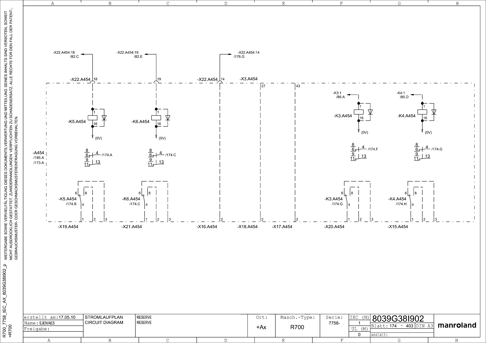

# +Ax — Sheet 174 of 403 — RESERVE

**RESERVE**

> Part of the manroland **R700** printing press IEC/UL circuit diagrams.
> Drawing class: **Stromlaufplan / Circuit diagram** (DIN A3).
> Document `+Ax` covers the **Central control console** machine section.

## At a glance

| Field | Value |
|---|---|
| Document | `+Ax`  (8039G38I902) |
| Sheet | **174** of 403 |
| Section (DE) | RESERVE |
| Section (EN) | RESERVE |
| Section type | CIRCUIT — Circuit diagram |
| Machine type | `R700` |
| Series | `7758` |
| Created | 17.05.10 |
| Replaces | — |
| Columns used | A, B, C, D, E, F, G, H |
| Path numbers | — |
| Labels on sheet | 107 |
| Cross-refs out | 15 |
| Cross-refs in | 35 |

**Previous:** [+Ax sheet 173](SHEET_0173.md) · **Next:** [+Ax sheet 175](SHEET_0175.md) · **Document TOC:** [_TOC.md](_TOC.md)  (+Ax) · **Master TOC:** [all sheets](../_MASTER_TOC.md)

## Sheet image (300 DPI, exact vector render)



_Rendered directly from the PDF vector layer at 300 DPI (1-bit), no OCR and no resampling. Use it to confirm anything ambiguous in the text below._

## Cross-references on this sheet

Each entry is a wire leaving this sheet. The printed token is `/sheet.column`; the link resolves to that sheet inside the same document.

| Ref | Target sheet | Col | Path | Destination on target | Target section | From col |
|---|---|---|---|---|---|---|
| `/82.C` | [+Ax sheet 82](SHEET_0082.md) | C | — | X22.A454:18 X22.A454:14 | ANLEGER | C |
| `/82.E` | [+Ax sheet 82](SHEET_0082.md) | E | — | X22.A454:19 | ANLEGER | B |
| `/176.G` | [+Ax sheet 176](SHEET_0176.md) | G | — | — | RESERVE | D |
| `/86.A` | [+Ax sheet 86](SHEET_0086.md) | A | — | K3:1 | ANLEGER | F |
| `/85.D` | [+Ax sheet 85](SHEET_0085.md) | D | — | K4:1 | ANLEGER | G |
| `/174.F` | [+Ax sheet 174](SHEET_0174.md) | F | — | 4 | RESERVE | F |
| `/174.G` | [+Ax sheet 174](SHEET_0174.md) | G | — | 4 | RESERVE | H |
| `/174.A` | [+Ax sheet 174](SHEET_0174.md) | A | — | 4 | RESERVE | B |
| `/174.C` | [+Ax sheet 174](SHEET_0174.md) | C | — | 4 | RESERVE | C |
| `/185.A` | [+Ax sheet 185](SHEET_0185.md) | A | — | — | RESERVE | A |
| `/173.A` | [+Ax sheet 173](SHEET_0173.md) | A | — | — | RESERVE | A |
| `/174.B` | [+Ax sheet 174](SHEET_0174.md) | B | — | — | RESERVE | A |
| `/174.G` | [+Ax sheet 174](SHEET_0174.md) | G | — | — | RESERVE | F |
| `/174.C` | [+Ax sheet 174](SHEET_0174.md) | C | — | — | RESERVE | B |
| `/174.H` | [+Ax sheet 174](SHEET_0174.md) | H | — | — | RESERVE | G |

### Incoming references (sheets that point here)

Every other sheet that sends a wire to this one. `Back-ref` is the token printed on *that* sheet; `Path` is its line number.

| From sheet | Cols | Back-ref | Path | Refs | What continues there |
|---|---|---|---|---|---|
| [+Ax#82](SHEET_0082.md) | C, E | `/82.C`, `/82.E` | — | 2 | — |
| [+Ax#85](SHEET_0085.md) | D | `/85.D` | — | 1 | — |
| [+Ax#86](SHEET_0086.md) | B | `/86.B` | — | 1 | — |
| [+Ax#173](SHEET_0173.md) | A | `/173.A` | — | 1 | — |
| [+Ax#174](SHEET_0174.md) | A, B, C, F, G, H | `/174.A`, `/174.B`, `/174.C`, `/174.F`, `/174.G`, `/174.H` | — | 8 | 4 |
| [+Ax#176](SHEET_0176.md) | E | `/176.E` | — | 1 | X22.A454:9 X22.A454:14 |
| [+Ax#185](SHEET_0185.md) | A | `/185.A` | — | 1 | — |
| [+Ax#225](SHEET_0225.md) | B | `/225.B` | — | 2 | — |
| [+Ax#253](SHEET_0253.md) | C | `/253.C` | — | 3 | — |
| [+Ax#254](SHEET_0254.md) | G | `/254.G` | — | 1 | — |
| [+Ax#255](SHEET_0255.md) | G | `/255.G` | — | 1 | — |
| [+Ax#256](SHEET_0256.md) | G | `/256.G` | — | 1 | — |
| [+Ax#259](SHEET_0259.md) | B | `/259.B` | — | 3 | — |
| [+Ax#260](SHEET_0260.md) | G | `/260.G` | — | 3 | — |
| [+Ax#261](SHEET_0261.md) | E | `/261.E` | — | 3 | — |
| [+Ax#263](SHEET_0263.md) | A | `/263.A` | — | 3 | — |


## Devices on this sheet

| Tag | Class | Class meaning (IEC) | Col | Sub | Terminal | Sign |
|---|---|---|---|---|---|---|
| `A454` | A | Baugruppe / assembly, module, PC board | A | — | — | — |
| `K3:1` | K | Relais / relay, contactor | F | — | 1 | — |
| `K4:1` | K | Relais / relay, contactor | G | — | 1 | — |
| `X22.A454` | — | cross-device reference | A | — | — | — |
| `K6.A454` | — | cross-device reference | B | — | — | — |
| `X22.A454` | — | cross-device reference | D | — | — | — |
| `K5.A454` | — | cross-device reference | A | — | — | — |
| `K4.A454` | — | cross-device reference | G | — | — | — |
| `K3.A454` | — | cross-device reference | F | — | — | — |
| `K3.A454` | — | cross-device reference | F | — | — | — |
| `K4.A454` | — | cross-device reference | G | — | — | — |
| `K5.A454` | — | cross-device reference | A | — | — | — |
| `K6.A454` | — | cross-device reference | C | — | — | — |
| `X22.A454:14` | — | cross-device reference | D | — | 14 | — |
| `X22.A454:18` | — | cross-device reference | A | — | 18 | — |
| `X22.A454:19` | — | cross-device reference | B | — | 19 | — |
| `X21.A454` | — | cross-device reference | B | — | — | — |
| `X3.A454` | — | cross-device reference | D | — | — | — |
| `X16.A454` | — | cross-device reference | D | — | — | — |
| `X18.A454` | — | cross-device reference | D | — | — | — |
| `X17.A454` | — | cross-device reference | E | — | — | — |
| `X19.A454` | — | cross-device reference | A | — | — | — |
| `X15.A454` | — | cross-device reference | G | — | — | — |
| `X20.A454` | — | cross-device reference | F | — | — | — |

## Potentials / nets

_No named potentials on this sheet._

## Wire-end annotations (grouped as printed)

A wire that continues elsewhere is annotated with a small cluster: the destination description, the path/line number `#NN`, and the `/sheet.column` cross reference. Each row below is one such cluster exactly as it is grouped on the drawing.

| Col | Y | Path | Cross-ref | Text on the wire |
|---|---|---|---|---|
| C | 125.0 | — | `/82.C` | `X22.A454:18 X22.A454:14` |
| B | 125.0 | — | `/82.E` | `X22.A454:19` |
| D | 134.9 | — | `/176.G` | — |
| D | 188.8 | — | — | `X3.A454` |
| B | 190.2 | — | — | `X22.A454 18 19` |
| D | 190.2 | — | — | `X22.A454 14` |
| E | 207.2 | — | — | `27 43` |
| F | 224.2 | — | `/86.A` | `K3:1` |
| G | 224.2 | — | `/85.D` | `K4:1` |
| F | 257.6 | — | — | `1` |
| G | 257.6 | — | — | `1` |
| B | 271.7 | — | — | `1` |
| C | 271.7 | — | — | `1` |
| F | 279.5 | — | — | `K3.A454` |
| G | 279.5 | — | — | `K4.A454` |
| F | 285.9 | — | — | `16` |
| G | 285.9 | — | — | `16` |
| A | 293.7 | — | — | `K5.A454` |
| C | 293.7 | — | — | `K6.A454` |
| B | 300.1 | — | — | `16` |
| C | 300.1 | — | — | `16` |
| G | 321.3 | — | — | `(0V) (0V)` |
| B | 335.5 | — | — | `(0V) (0V)` |
| F | 350.4 | — | — | `11 8 6 9 13` |
| G | 350.4 | — | — | `11 8 6 9 13` |
| F | 356.0 | — | `/174.F` | `4` |
| H | 356.0 | — | `/174.G` | `4` |
| B | 364.5 | — | — | `11 8 6 9 13` |
| C | 364.5 | — | — | `11 8 6 9 13` |
| A | 370.2 | — | — | `A454` |
| B | 370.2 | — | `/174.A` | `4` |
| C | 370.2 | — | `/174.C` | `4` |
| A | 383.3 | — | `/185.A`, `/173.A` | — |
| A | 470.2 | — | — | `K5.A454 8` |
| A | 470.2 | — | — | `6` |
| B | 470.2 | — | — | `K6.A454 8` |
| C | 470.2 | — | — | `6` |
| F | 470.2 | — | — | `K3.A454 8` |
| F | 470.2 | — | — | `6` |
| G | 470.2 | — | — | `K4.A454 8` |
| G | 470.2 | — | — | `6` |
| A | 496.7 | — | `/174.B` | — |
| B | 496.7 | — | `/174.C` | — |
| F | 496.7 | — | `/174.G` | — |
| G | 496.7 | — | `/174.H` | — |
| B | 498.5 | — | — | `4` |
| C | 498.5 | — | — | `4` |
| F | 498.5 | — | — | `4` |
| G | 498.5 | — | — | `4` |
| B | 534.7 | — | — | `1 2 3` |
| C | 534.7 | — | — | `1 2 3` |
| E | 534.7 | — | — | `2 2 2` |
| F | 534.7 | — | — | `1 2 3` |
| G | 534.7 | — | — | `1 2 3` |
| D | 551.6 | — | — | `X19.A454 X16.A454 X18.A454 X17.A454 X20.A454 X15.A454` |
| B | 551.6 | — | — | `X21.A454` |


## Notes and free text on this sheet

| Text | Col | Y (pt) |
|---|---|---|
| `(0V)` | F | 321.33 |
| `(0V)` | H | 321.33 |
| `(0V)` | B | 335.51 |
| `(0V)` | C | 335.51 |

## Complete label inventory (exact text from the drawing)

Every text object inside the drawing area of this sheet, in DIN reading order (column A→H, then top→bottom). This is the authoritative list: if a string is not here it is not printed on this sheet.

| Col | Y | X | Dir | Type | Text |
|---|---|---|---|---|---|
| A | 125.0 | 129.5 | → | device ref | `X22.A454:18` |
| A | 134.9 | 172.1 | → | cross-reference | `/82.C` |
| A | 190.2 | 171.5 | → | device ref | `X22.A454` |
| A | 293.7 | 166.1 | → | device ref | `K5.A454` |
| A | 370.2 | 79.9 | → | device tag | `A454` |
| A | 383.3 | 82.2 | → | cross-reference | `/185.A` |
| A | 395.7 | 82.2 | → | cross-reference | `/173.A` |
| A | 470.2 | 184.0 | → | number | `6` |
| A | 483.6 | 143.4 | → | device ref | `K5.A454` |
| A | 496.7 | 161.9 | → | cross-reference | `/174.B` |
| A | 551.6 | 141.7 | → | device ref | `X19.A454` |
| B | 125.0 | 285.4 | → | device ref | `X22.A454:19` |
| B | 134.9 | 328.5 | → | cross-reference | `/82.E` |
| B | 190.2 | 228.8 | → | number | `18` |
| B | 271.7 | 228.8 | → | number | `1` |
| B | 300.1 | 228.8 | → | number | `16` |
| B | 335.5 | 233.3 | → | text | `(0V)` |
| B | 364.5 | 210.0 | → | number | `8` |
| B | 370.2 | 235.0 | → | number | `4` |
| B | 375.9 | 210.0 | → | number | `6` |
| B | 376.6 | 249.4 | → | cross-reference | `/174.A` |
| B | 387.2 | 210.0 | → | number | `9` |
| B | 392.9 | 233.3 | → | number | `13` |
| B | 398.5 | 205.5 | → | number | `11` |
| B | 470.2 | 208.1 | → | number | `8` |
| B | 483.6 | 299.3 | → | device ref | `K6.A454` |
| B | 496.7 | 317.5 | → | cross-reference | `/174.C` |
| B | 498.5 | 201.0 | → | number | `4` |
| B | 534.7 | 200.4 | → | number | `1` |
| B | 534.7 | 229.3 | → | number | `2` |
| B | 534.7 | 257.7 | → | number | `3` |
| B | 551.6 | 297.6 | → | device ref | `X21.A454` |
| C | 190.2 | 384.7 | → | number | `19` |
| C | 271.7 | 384.7 | → | number | `1` |
| C | 293.7 | 322.0 | → | device ref | `K6.A454` |
| C | 300.1 | 384.7 | → | number | `16` |
| C | 335.5 | 389.2 | → | text | `(0V)` |
| C | 364.5 | 366.0 | → | number | `8` |
| C | 370.2 | 390.9 | → | number | `4` |
| C | 375.9 | 366.0 | → | number | `6` |
| C | 376.6 | 405.4 | → | cross-reference | `/174.C` |
| C | 387.2 | 366.0 | → | number | `9` |
| C | 392.9 | 389.2 | → | number | `13` |
| C | 398.5 | 361.4 | → | number | `11` |
| C | 470.2 | 339.9 | → | number | `6` |
| C | 470.2 | 364.0 | → | number | `8` |
| C | 498.5 | 356.9 | → | number | `4` |
| C | 534.7 | 356.3 | → | number | `1` |
| C | 534.7 | 385.2 | → | number | `2` |
| C | 534.7 | 413.6 | → | number | `3` |
| D | 125.0 | 582.2 | → | device ref | `X22.A454:14` |
| D | 134.9 | 572.6 | → | cross-reference | `/176.G` |
| D | 188.8 | 587.1 | → | device ref | `X3.A454` |
| D | 190.2 | 483.3 | → | device ref | `X22.A454` |
| D | 190.2 | 540.6 | → | number | `14` |
| D | 534.7 | 541.1 | → | number | `2` |
| D | 551.6 | 481.9 | → | device ref | `X16.A454` |
| D | 551.6 | 581.1 | → | device ref | `X18.A454` |
| E | 207.3 | 640.3 | → | number | `27` |
| E | 207.3 | 725.4 | → | number | `43` |
| E | 534.7 | 640.3 | → | number | `2` |
| E | 534.7 | 725.4 | → | number | `2` |
| E | 551.6 | 666.1 | → | device ref | `X17.A454` |
| F | 224.2 | 815.5 | → | device tag | `K3:1` |
| F | 234.1 | 824.0 | → | cross-reference | `/86.A` |
| F | 257.6 | 880.7 | → | number | `1` |
| F | 279.5 | 818.1 | → | device ref | `K3.A454` |
| F | 285.9 | 880.7 | → | number | `16` |
| F | 321.3 | 885.3 | → | text | `(0V)` |
| F | 350.3 | 862.0 | → | number | `8` |
| F | 356.0 | 887.0 | → | number | `4` |
| F | 361.7 | 862.0 | → | number | `6` |
| F | 373.0 | 862.0 | → | number | `9` |
| F | 378.7 | 885.3 | → | number | `13` |
| F | 384.4 | 857.5 | → | number | `11` |
| F | 470.2 | 835.9 | → | number | `6` |
| F | 470.2 | 860.0 | → | number | `8` |
| F | 483.6 | 795.4 | → | device ref | `K3.A454` |
| F | 496.7 | 813.3 | → | cross-reference | `/174.G` |
| F | 498.5 | 852.9 | → | number | `4` |
| F | 534.7 | 852.4 | → | number | `1` |
| F | 534.7 | 881.3 | → | number | `2` |
| F | 551.6 | 793.7 | → | device ref | `X20.A454` |
| G | 224.2 | 971.4 | → | device tag | `K4:1` |
| G | 234.1 | 979.9 | → | cross-reference | `/85.D` |
| G | 257.6 | 1036.6 | → | number | `1` |
| G | 279.5 | 974.0 | → | device ref | `K4.A454` |
| G | 285.9 | 1036.6 | → | number | `16` |
| G | 350.3 | 1017.9 | → | number | `8` |
| G | 356.0 | 1042.9 | → | number | `4` |
| G | 361.7 | 1017.9 | → | number | `6` |
| G | 362.4 | 901.4 | → | cross-reference | `/174.F` |
| G | 373.0 | 1017.9 | → | number | `9` |
| G | 378.7 | 1041.2 | → | number | `13` |
| G | 384.4 | 1013.4 | → | number | `11` |
| G | 470.2 | 991.8 | → | number | `6` |
| G | 470.2 | 1015.9 | → | number | `8` |
| G | 483.6 | 951.3 | → | device ref | `K4.A454` |
| G | 496.7 | 970.0 | → | cross-reference | `/174.H` |
| G | 498.5 | 1008.9 | → | number | `4` |
| G | 534.7 | 909.6 | → | number | `3` |
| G | 534.7 | 1008.3 | → | number | `1` |
| G | 534.7 | 1037.2 | → | number | `2` |
| G | 551.6 | 949.6 | → | device ref | `X15.A454` |
| H | 321.3 | 1041.2 | → | text | `(0V)` |
| H | 362.4 | 1057.3 | → | cross-reference | `/174.G` |
| H | 534.7 | 1065.5 | → | number | `3` |

## Reading-order text block

The same content as a plain block, grouped by DIN column — convenient to paste or to match against a visual description.

```text
=== Column A ===
 125.0  129.5  devref       X22.A454:18
 134.9  172.1  xref         /82.C
 190.2  171.5  devref       X22.A454
 293.7  166.1  devref       K5.A454
 370.2   79.9  devtag       A454
 383.3   82.2  xref         /185.A
 395.7   82.2  xref         /173.A
 470.2  184.0  numeric      6
 483.6  143.4  devref       K5.A454
 496.7  161.9  xref         /174.B
 551.6  141.7  devref       X19.A454
=== Column B ===
 125.0  285.4  devref       X22.A454:19
 134.9  328.5  xref         /82.E
 190.2  228.8  numeric      18
 271.7  228.8  numeric      1
 300.1  228.8  numeric      16
 335.5  233.3  text         (0V)
 364.5  210.0  numeric      8
 370.2  235.0  numeric      4
 375.9  210.0  numeric      6
 376.6  249.4  xref         /174.A
 387.2  210.0  numeric      9
 392.9  233.3  numeric      13
 398.5  205.5  numeric      11
 470.2  208.1  numeric      8
 483.6  299.3  devref       K6.A454
 496.7  317.5  xref         /174.C
 498.5  201.0  numeric      4
 534.7  200.4  numeric      1
 534.7  229.3  numeric      2
 534.7  257.7  numeric      3
 551.6  297.6  devref       X21.A454
=== Column C ===
 190.2  384.7  numeric      19
 271.7  384.7  numeric      1
 293.7  322.0  devref       K6.A454
 300.1  384.7  numeric      16
 335.5  389.2  text         (0V)
 364.5  366.0  numeric      8
 370.2  390.9  numeric      4
 375.9  366.0  numeric      6
 376.6  405.4  xref         /174.C
 387.2  366.0  numeric      9
 392.9  389.2  numeric      13
 398.5  361.4  numeric      11
 470.2  339.9  numeric      6
 470.2  364.0  numeric      8
 498.5  356.9  numeric      4
 534.7  356.3  numeric      1
 534.7  385.2  numeric      2
 534.7  413.6  numeric      3
=== Column D ===
 125.0  582.2  devref       X22.A454:14
 134.9  572.6  xref         /176.G
 188.8  587.1  devref       X3.A454
 190.2  483.3  devref       X22.A454
 190.2  540.6  numeric      14
 534.7  541.1  numeric      2
 551.6  481.9  devref       X16.A454
 551.6  581.1  devref       X18.A454
=== Column E ===
 207.3  640.3  numeric      27
 207.3  725.4  numeric      43
 534.7  640.3  numeric      2
 534.7  725.4  numeric      2
 551.6  666.1  devref       X17.A454
=== Column F ===
 224.2  815.5  devtag       K3:1
 234.1  824.0  xref         /86.A
 257.6  880.7  numeric      1
 279.5  818.1  devref       K3.A454
 285.9  880.7  numeric      16
 321.3  885.3  text         (0V)
 350.3  862.0  numeric      8
 356.0  887.0  numeric      4
 361.7  862.0  numeric      6
 373.0  862.0  numeric      9
 378.7  885.3  numeric      13
 384.4  857.5  numeric      11
 470.2  835.9  numeric      6
 470.2  860.0  numeric      8
 483.6  795.4  devref       K3.A454
 496.7  813.3  xref         /174.G
 498.5  852.9  numeric      4
 534.7  852.4  numeric      1
 534.7  881.3  numeric      2
 551.6  793.7  devref       X20.A454
=== Column G ===
 224.2  971.4  devtag       K4:1
 234.1  979.9  xref         /85.D
 257.6 1036.6  numeric      1
 279.5  974.0  devref       K4.A454
 285.9 1036.6  numeric      16
 350.3 1017.9  numeric      8
 356.0 1042.9  numeric      4
 361.7 1017.9  numeric      6
 362.4  901.4  xref         /174.F
 373.0 1017.9  numeric      9
 378.7 1041.2  numeric      13
 384.4 1013.4  numeric      11
 470.2  991.8  numeric      6
 470.2 1015.9  numeric      8
 483.6  951.3  devref       K4.A454
 496.7  970.0  xref         /174.H
 498.5 1008.9  numeric      4
 534.7  909.6  numeric      3
 534.7 1008.3  numeric      1
 534.7 1037.2  numeric      2
 551.6  949.6  devref       X15.A454
=== Column H ===
 321.3 1041.2  text         (0V)
 362.4 1057.3  xref         /174.G
 534.7 1065.5  numeric      3
```

---
_Generated from the PDF vector text layer; no OCR. Source: `R700_7758_IEC_AX_8039G38I902_p`, sheet 174._
