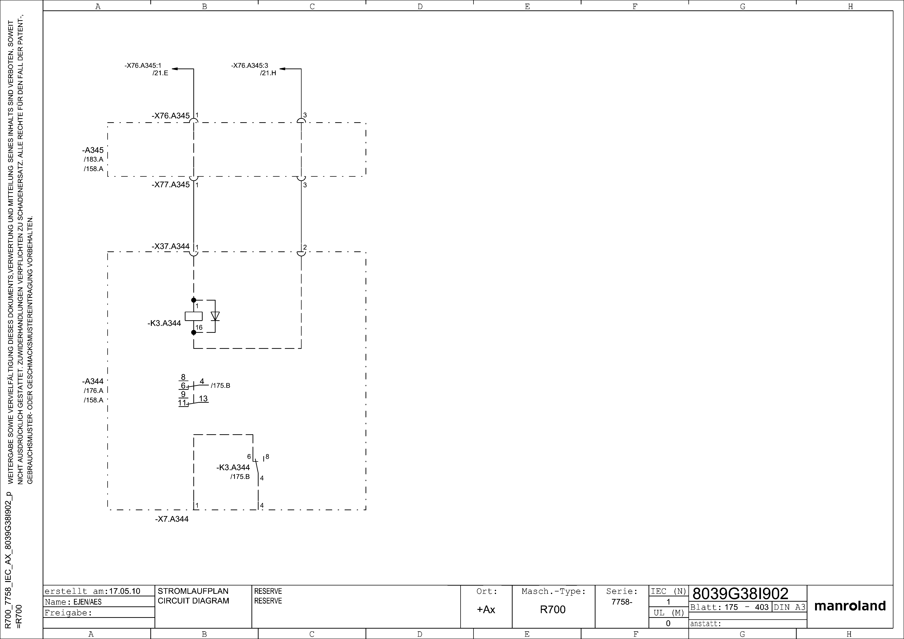

# +Ax — Sheet 175 of 403 — RESERVE

**RESERVE**

> Part of the manroland **R700** printing press IEC/UL circuit diagrams.
> Drawing class: **Stromlaufplan / Circuit diagram** (DIN A3).
> Document `+Ax` covers the **Central control console** machine section.

## At a glance

| Field | Value |
|---|---|
| Document | `+Ax`  (8039G38I902) |
| Sheet | **175** of 403 |
| Section (DE) | RESERVE |
| Section (EN) | RESERVE |
| Section type | CIRCUIT — Circuit diagram |
| Machine type | `R700` |
| Series | `7758` |
| Created | 17.05.10 |
| Replaces | — |
| Columns used | A, B, C |
| Path numbers | — |
| Labels on sheet | 37 |
| Cross-refs out | 8 |
| Cross-refs in | 16 |

**Previous:** [+Ax sheet 174](SHEET_0174.md) · **Next:** [+Ax sheet 176](SHEET_0176.md) · **Document TOC:** [_TOC.md](_TOC.md)  (+Ax) · **Master TOC:** [all sheets](../_MASTER_TOC.md)

## Sheet image (300 DPI, exact vector render)



_Rendered directly from the PDF vector layer at 300 DPI (1-bit), no OCR and no resampling. Use it to confirm anything ambiguous in the text below._

## Cross-references on this sheet

Each entry is a wire leaving this sheet. The printed token is `/sheet.column`; the link resolves to that sheet inside the same document.

| Ref | Target sheet | Col | Path | Destination on target | Target section | From col |
|---|---|---|---|---|---|---|
| `/21.E` | [+Ax sheet 21](SHEET_0021.md) | E | — | X76.A345:1 | SPANNUNGSVERSORGUNG, SCHALTSCHRANKBELÜFTUNG | A |
| `/21.H` | [+Ax sheet 21](SHEET_0021.md) | H | — | X76.A345:3 | SPANNUNGSVERSORGUNG, SCHALTSCHRANKBELÜFTUNG | B |
| `/183.A` | [+Ax sheet 183](SHEET_0183.md) | A | — | — | RESERVE | A |
| `/158.A` | [+Ax sheet 158](SHEET_0158.md) | A | — | — | ÜBERWACHUNGSRECHNER/ANSTEUERUNG NOT AUS | A |
| `/175.B` | [+Ax sheet 175](SHEET_0175.md) | B | — | 4 | RESERVE | B |
| `/176.A` | [+Ax sheet 176](SHEET_0176.md) | A | — | — | RESERVE | A |
| `/158.A` | [+Ax sheet 158](SHEET_0158.md) | A | — | — | ÜBERWACHUNGSRECHNER/ANSTEUERUNG NOT AUS | A |
| `/175.B` | [+Ax sheet 175](SHEET_0175.md) | B | — | — | RESERVE | B |

### Incoming references (sheets that point here)

Every other sheet that sends a wire to this one. `Back-ref` is the token printed on *that* sheet; `Path` is its line number.

| From sheet | Cols | Back-ref | Path | Refs | What continues there |
|---|---|---|---|---|---|
| [+Ax#21](SHEET_0021.md) | D, H | `/21.D`, `/21.H` | — | 2 | X76.A345:3 |
| [+Ax#158](SHEET_0158.md) | A | `/158.A` | — | 2 | — |
| [+Ax#175](SHEET_0175.md) | B | `/175.B` | — | 2 | 4 |
| [+Ax#176](SHEET_0176.md) | A | `/176.A` | — | 1 | — |
| [+Ax#183](SHEET_0183.md) | A | `/183.A` | — | 1 | — |
| [+Ax#235](SHEET_0235.md) | G | `/235.G` | — | 2 | — |
| [+Ax#279](SHEET_0279.md) | F | `/279.F` | — | 2 | — |
| [+Ax#285](SHEET_0285.md) | F, H | `/285.F`, `/285.H` | — | 4 | — |


## Devices on this sheet

| Tag | Class | Class meaning (IEC) | Col | Sub | Terminal | Sign |
|---|---|---|---|---|---|---|
| `A345` | A | Baugruppe / assembly, module, PC board | A | — | — | — |
| `A344` | A | Baugruppe / assembly, module, PC board | A | — | — | — |
| `X76.A345` | — | cross-device reference | B | — | — | — |
| `X77.A345` | — | cross-device reference | B | — | — | — |
| `K3.A344` | — | cross-device reference | B | — | — | — |
| `X37.A344` | — | cross-device reference | B | — | — | — |
| `K3.A344` | — | cross-device reference | B | — | — | — |
| `X76.A345:1` | — | cross-device reference | A | — | 1 | — |
| `X76.A345:3` | — | cross-device reference | B | — | 3 | — |
| `X7.A344` | — | cross-device reference | B | — | — | — |

## Potentials / nets

_No named potentials on this sheet._

## Wire-end annotations (grouped as printed)

A wire that continues elsewhere is annotated with a small cluster: the destination description, the path/line number `#NN`, and the `/sheet.column` cross reference. Each row below is one such cluster exactly as it is grouped on the drawing.

| Col | Y | Path | Cross-ref | Text on the wire |
|---|---|---|---|---|
| A | 82.5 | — | `/21.E` | `X76.A345:1` |
| B | 82.5 | — | `/21.H` | `X76.A345:3` |
| B | 147.7 | — | — | `X76.A345 1` |
| C | 147.7 | — | — | `3` |
| A | 193.1 | — | — | `A345` |
| A | 206.1 | — | `/183.A`, `/158.A` | — |
| B | 238.4 | — | — | `X77.A345 1` |
| C | 239.8 | — | — | `3` |
| B | 319.9 | — | — | `X37.A344 1` |
| C | 322.1 | — | — | `2` |
| B | 399.3 | — | — | `1` |
| B | 421.2 | — | — | `K3.A344` |
| B | 427.6 | — | — | `16` |
| B | 492.1 | — | — | `11 8 6 9 13` |
| A | 497.8 | — | — | `A344` |
| B | 497.8 | — | `/175.B` | `4` |
| A | 510.9 | — | `/176.A`, `/158.A` | — |
| B | 597.7 | — | — | `K3.A344 8` |
| B | 597.7 | — | — | `6` |
| B | 624.2 | — | `/175.B` | — |
| C | 626.1 | — | — | `4` |
| B | 662.2 | — | — | `1 4` |
| B | 679.2 | — | — | `X7.A344` |


## Complete label inventory (exact text from the drawing)

Every text object inside the drawing area of this sheet, in DIN reading order (column A→H, then top→bottom). This is the authoritative list: if a string is not here it is not printed on this sheet.

| Col | Y | X | Dir | Type | Text |
|---|---|---|---|---|---|
| A | 82.5 | 164.1 | → | device ref | `X76.A345:1` |
| A | 193.1 | 108.3 | → | device tag | `A345` |
| A | 206.1 | 110.6 | → | cross-reference | `/183.A` |
| A | 218.5 | 110.6 | → | cross-reference | `/158.A` |
| A | 497.8 | 108.3 | → | device tag | `A344` |
| A | 510.9 | 110.6 | → | cross-reference | `/176.A` |
| A | 523.3 | 110.6 | → | cross-reference | `/158.A` |
| B | 82.5 | 304.4 | → | device ref | `X76.A345:3` |
| B | 92.4 | 201.0 | → | cross-reference | `/21.E` |
| B | 147.7 | 199.8 | → | device ref | `X76.A345` |
| B | 147.7 | 257.1 | → | number | `1` |
| B | 238.4 | 199.8 | → | device ref | `X77.A345` |
| B | 239.9 | 257.1 | → | number | `1` |
| B | 319.9 | 199.8 | → | device ref | `X37.A344` |
| B | 322.1 | 257.1 | → | number | `1` |
| B | 399.3 | 257.1 | → | number | `1` |
| B | 421.3 | 194.5 | → | device ref | `K3.A344` |
| B | 427.6 | 257.1 | → | number | `16` |
| B | 492.1 | 238.4 | → | number | `8` |
| B | 497.8 | 263.3 | → | number | `4` |
| B | 503.4 | 238.4 | → | number | `6` |
| B | 504.1 | 277.8 | → | cross-reference | `/175.B` |
| B | 514.8 | 238.4 | → | number | `9` |
| B | 520.4 | 261.6 | → | number | `13` |
| B | 526.1 | 233.9 | → | number | `11` |
| B | 597.7 | 325.7 | → | number | `6` |
| B | 611.2 | 285.2 | → | device ref | `K3.A344` |
| B | 624.2 | 303.6 | → | cross-reference | `/175.B` |
| B | 662.2 | 257.1 | → | number | `1` |
| B | 679.2 | 204.4 | → | device ref | `X7.A344` |
| C | 92.4 | 342.7 | → | cross-reference | `/21.H` |
| C | 147.7 | 399.4 | → | number | `3` |
| C | 239.9 | 399.4 | → | number | `3` |
| C | 322.1 | 399.4 | → | number | `2` |
| C | 597.7 | 349.8 | → | number | `8` |
| C | 626.1 | 342.7 | → | number | `4` |
| C | 662.2 | 342.7 | → | number | `4` |

## Reading-order text block

The same content as a plain block, grouped by DIN column — convenient to paste or to match against a visual description.

```text
=== Column A ===
  82.5  164.1  devref       X76.A345:1
 193.1  108.3  devtag       A345
 206.1  110.6  xref         /183.A
 218.5  110.6  xref         /158.A
 497.8  108.3  devtag       A344
 510.9  110.6  xref         /176.A
 523.3  110.6  xref         /158.A
=== Column B ===
  82.5  304.4  devref       X76.A345:3
  92.4  201.0  xref         /21.E
 147.7  199.8  devref       X76.A345
 147.7  257.1  numeric      1
 238.4  199.8  devref       X77.A345
 239.9  257.1  numeric      1
 319.9  199.8  devref       X37.A344
 322.1  257.1  numeric      1
 399.3  257.1  numeric      1
 421.3  194.5  devref       K3.A344
 427.6  257.1  numeric      16
 492.1  238.4  numeric      8
 497.8  263.3  numeric      4
 503.4  238.4  numeric      6
 504.1  277.8  xref         /175.B
 514.8  238.4  numeric      9
 520.4  261.6  numeric      13
 526.1  233.9  numeric      11
 597.7  325.7  numeric      6
 611.2  285.2  devref       K3.A344
 624.2  303.6  xref         /175.B
 662.2  257.1  numeric      1
 679.2  204.4  devref       X7.A344
=== Column C ===
  92.4  342.7  xref         /21.H
 147.7  399.4  numeric      3
 239.9  399.4  numeric      3
 322.1  399.4  numeric      2
 597.7  349.8  numeric      8
 626.1  342.7  numeric      4
 662.2  342.7  numeric      4
```

---
_Generated from the PDF vector text layer; no OCR. Source: `R700_7758_IEC_AX_8039G38I902_p`, sheet 175._
