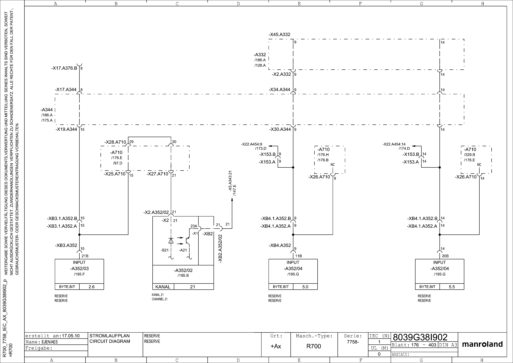

# +Ax — Sheet 176 of 403 — RESERVE

**RESERVE**

> Part of the manroland **R700** printing press IEC/UL circuit diagrams.
> Drawing class: **Stromlaufplan / Circuit diagram** (DIN A3).
> Document `+Ax` covers the **Central control console** machine section.

## At a glance

| Field | Value |
|---|---|
| Document | `+Ax`  (8039G38I902) |
| Sheet | **176** of 403 |
| Section (DE) | RESERVE |
| Section (EN) | RESERVE |
| Section type | CIRCUIT — Circuit diagram |
| Machine type | `R700` |
| Series | `7758` |
| Created | 17.05.10 |
| Replaces | — |
| Columns used | A, B, C, D, E, F, G, H |
| Path numbers | — |
| Labels on sheet | 119 |
| Cross-refs out | 17 |
| Cross-refs in | 49 |

**Previous:** [+Ax sheet 175](SHEET_0175.md) · **Next:** [+Ax sheet 177](SHEET_0177.md) · **Document TOC:** [_TOC.md](_TOC.md)  (+Ax) · **Master TOC:** [all sheets](../_MASTER_TOC.md)

## Sheet image (300 DPI, exact vector render)



_Rendered directly from the PDF vector layer at 300 DPI (1-bit), no OCR and no resampling. Use it to confirm anything ambiguous in the text below._

## Cross-references on this sheet

Each entry is a wire leaving this sheet. The printed token is `/sheet.column`; the link resolves to that sheet inside the same document.

| Ref | Target sheet | Col | Path | Destination on target | Target section | From col |
|---|---|---|---|---|---|---|
| `/186.A` | [+Ax sheet 186](SHEET_0186.md) | A | — | — | RESERVE | D |
| `/128.A` | [+Ax sheet 128](SHEET_0128.md) | A | — | — | REALTIMERECHNER ANLEGER | D |
| `/186.A` | [+Ax sheet 186](SHEET_0186.md) | A | — | — | RESERVE | A |
| `/175.A` | [+Ax sheet 175](SHEET_0175.md) | A | — | — | RESERVE | A |
| `/173.D` | [+Ax sheet 173](SHEET_0173.md) | D | — | X22.A454:9 X22.A454:14 | RESERVE | E |
| `/174.D` | [+Ax sheet 174](SHEET_0174.md) | D | — | X22.A454:9 X22.A454:14 | RESERVE | E |
| `/176.H` | [+Ax sheet 176](SHEET_0176.md) | H | — | A710 | RESERVE | E |
| `/176.B` | [+Ax sheet 176](SHEET_0176.md) | B | — | A710 | RESERVE | E |
| `/329.B` | [+Ax sheet 329](SHEET_0329.md) | B | — | A710 | OPTION: NONSTOP EINRICHTUNG MANUELL, ANLEGER | H |
| `/176.E` | [+Ax sheet 176](SHEET_0176.md) | E | — | A710 | RESERVE | H |
| `/176.E` | [+Ax sheet 176](SHEET_0176.md) | E | — | — | RESERVE | B |
| `/97.D` | [+Ax sheet 97](SHEET_0097.md) | D | — | — | ANLEGER | B |
| `/147.E` | [+Ax sheet 147](SHEET_0147.md) | E | — | X5.A343:21 | ÜBERWACHUNGSRECHNER SICHERHEITSBUS | D |
| `/195.F` | [+Ax sheet 195](SHEET_0195.md) | F | — | — | REFERENZMODUL | A |
| `/195.G` | [+Ax sheet 195](SHEET_0195.md) | G | — | — | REFERENZMODUL | E |
| `/195.G` | [+Ax sheet 195](SHEET_0195.md) | G | — | — | REFERENZMODUL | G |
| `/195.B` | [+Ax sheet 195](SHEET_0195.md) | B | — | — | REFERENZMODUL | C |

### Incoming references (sheets that point here)

Every other sheet that sends a wire to this one. `Back-ref` is the token printed on *that* sheet; `Path` is its line number.

| From sheet | Cols | Back-ref | Path | Refs | What continues there |
|---|---|---|---|---|---|
| [+Ax#97](SHEET_0097.md) | D | `/97.D` | — | 1 | A710 |
| [+Ax#128](SHEET_0128.md) | A | `/128.A` | — | 1 | — |
| [+Ax#147](SHEET_0147.md) | E | `/147.E` | — | 1 | X5.A343:21 |
| [+Ax#173](SHEET_0173.md) | D | `/173.D` | — | 1 | — |
| [+Ax#174](SHEET_0174.md) | D | `/174.D` | — | 1 | — |
| [+Ax#175](SHEET_0175.md) | A | `/175.A` | — | 1 | — |
| [+Ax#176](SHEET_0176.md) | B, E, H | `/176.B`, `/176.E`, `/176.H` | — | 4 | A710 |
| [+Ax#186](SHEET_0186.md) | A | `/186.A` | — | 2 | — |
| [+Ax#195](SHEET_0195.md) | B, F, G | `/195.B`, `/195.F`, `/195.G` | — | 4 | — |
| [+Ax#217](SHEET_0217.md) | F | `/217.F` | — | 2 | — |
| [+Ax#218](SHEET_0218.md) | H | `/218.H` | — | 1 | — |
| [+Ax#219](SHEET_0219.md) | B | `/219.B` | — | 1 | — |
| [+Ax#223](SHEET_0223.md) | E, G, H | `/223.E`, `/223.G`, `/223.H` | — | 3 | — |
| [+Ax#227](SHEET_0227.md) | E, F, G | `/227.E`, `/227.F`, `/227.G` | — | 6 | — |
| [+Ax#255](SHEET_0255.md) | B, F | `/255.B`, `/255.F` | — | 2 | — |
| [+Ax#258](SHEET_0258.md) | G | `/258.G` | — | 1 | — |
| [+Ax#268](SHEET_0268.md) | B | `/268.B` | — | 1 | — |
| [+Ax#269](SHEET_0269.md) | G | `/269.G` | — | 2 | — |
| [+Ax#270](SHEET_0270.md) | H | `/270.H` | — | 1 | — |
| [+Ax#272](SHEET_0272.md) | F | `/272.F` | — | 2 | — |
| [+Ax#274](SHEET_0274.md) | F | `/274.F` | — | 2 | — |
| [+Ax#278](SHEET_0278.md) | A | `/278.A` | — | 2 | — |
| [+Ax#282](SHEET_0282.md) | A | `/282.A` | — | 2 | — |
| [+Ax#290](SHEET_0290.md) | C, E | `/290.C`, `/290.E` | — | 4 | — |
| [+Ax#329](SHEET_0329.md) | B | `/329.B` | — | 1 | — |


## Devices on this sheet

| Tag | Class | Class meaning (IEC) | Col | Sub | Terminal | Sign |
|---|---|---|---|---|---|---|
| `A352/03` | A | Baugruppe / assembly, module, PC board | A | 03 | — | — |
| `A352/04` | A | Baugruppe / assembly, module, PC board | E | 04 | — | — |
| `A352/04` | A | Baugruppe / assembly, module, PC board | G | 04 | — | — |
| `A344` | A | Baugruppe / assembly, module, PC board | A | — | — | — |
| `A332` | A | Baugruppe / assembly, module, PC board | D | — | — | — |
| `A710` | A | Baugruppe / assembly, module, PC board | B | — | — | — |
| `S21` | S | Schalter / switch | C | — | — | — |
| `A21` | A | Baugruppe / assembly, module, PC board | C | — | — | — |
| `X1` | X | Klemme / terminal, plug connector | C | — | — | — |
| `X2` | X | Klemme / terminal, plug connector | C | — | — | — |
| `XB2` | XB |  | C | — | — | — |
| `A352/02` | A | Baugruppe / assembly, module, PC board | C | 02 | — | — |
| `A710` | A | Baugruppe / assembly, module, PC board | E | — | — | — |
| `A710` | A | Baugruppe / assembly, module, PC board | H | — | — | — |
| `2.6` | — | cross-device reference | B | — | — | — |
| `XB3.A352` | — | cross-device reference | A | — | — | — |
| `5.0` | — | cross-device reference | E | — | — | — |
| `XB4.A352` | — | cross-device reference | E | — | — | — |
| `5.5` | — | cross-device reference | G | — | — | — |
| `X17.A376.B` | — | cross-device reference | A | — | — | — |
| `X17.A344` | — | cross-device reference | A | — | — | — |
| `X19.A344` | — | cross-device reference | A | — | — | — |
| `X34.A344` | — | cross-device reference | E | — | — | — |
| `X30.A344` | — | cross-device reference | E | — | — | — |
| `X2.A332` | — | cross-device reference | E | — | — | — |
| `X28.A710` | — | cross-device reference | B | — | — | — |
| `X27.A710` | — | cross-device reference | C | — | — | — |
| `X25.A710` | — | cross-device reference | B | — | — | — |
| `X153.B` | — | cross-device reference | D | — | — | — |
| `X153.A` | — | cross-device reference | D | — | — | — |
| `X153.B` | — | cross-device reference | G | — | — | — |
| `X153.A` | — | cross-device reference | G | — | — | — |
| `XB3.1.A352.B` | — | cross-device reference | A | — | — | — |
| `XB3.1.A352.A` | — | cross-device reference | A | — | — | — |
| `XB4.1.A352.B` | — | cross-device reference | E | — | — | — |
| `XB4.1.A352.A` | — | cross-device reference | E | — | — | — |
| `XB4.1.A352.B` | — | cross-device reference | G | — | — | — |
| `XB4.1.A352.A` | — | cross-device reference | G | — | — | — |
| `X26.A710` | — | cross-device reference | E | — | — | — |
| `X26.A710` | — | cross-device reference | H | — | — | — |
| `X22.A454:14` | — | cross-device reference | G | — | 14 | — |
| `X22.A454:9` | — | cross-device reference | D | — | 9 | — |
| `X5.A343:21` | — | cross-device reference | D | — | 21 | — |
| `X45.A332` | — | cross-device reference | E | — | — | — |

## Potentials / nets

_No named potentials on this sheet._

## Wire-end annotations (grouped as printed)

A wire that continues elsewhere is annotated with a small cluster: the destination description, the path/line number `#NN`, and the `/sheet.column` cross reference. Each row below is one such cluster exactly as it is grouped on the drawing.

| Col | Y | Path | Cross-ref | Text on the wire |
|---|---|---|---|---|
| E | 75.4 | — | — | `X45.A332` |
| E | 93.9 | — | — | `9` |
| G | 94.6 | — | — | `14` |
| D | 122.2 | — | — | `A332` |
| D | 135.3 | — | `/186.A`, `/128.A` | — |
| A | 153.4 | — | — | `X17.A376.B 8` |
| E | 167.6 | — | — | `X2.A332 9` |
| G | 169.0 | — | — | `14` |
| A | 203.0 | — | — | `X17.A344 8` |
| E | 203.0 | — | — | `X34.A344 9` |
| G | 204.4 | — | — | `14` |
| A | 249.8 | — | — | `A344` |
| A | 262.8 | — | `/186.A`, `/175.A` | — |
| A | 295.1 | — | — | `X19.A344 15` |
| E | 295.1 | — | — | `X30.A344 9` |
| G | 296.5 | — | — | `14` |
| B | 324.9 | — | — | `X28.A710 29 30` |
| E | 330.5 | — | `/173.D`, `/174.D` | `X22.A454:9 X22.A454:14` |
| E | 341.9 | — | `/176.H`, `/176.B` | `A710` |
| H | 341.9 | — | `/329.B`, `/176.E` | `A710` |
| B | 349.0 | — | — | `A710` |
| E | 353.2 | — | — | `X153.B 9` |
| G | 353.2 | — | — | `X153.B 14` |
| B | 362.0 | — | `/176.E` | — |
| E | 370.2 | — | — | `X153.A 9` |
| G | 370.2 | — | — | `X153.A 14` |
| B | 374.5 | — | `/97.D` | — |
| G | 379.0 | — | — | `NC NC` |
| D | 395.1 | — | `/147.E` | `X5.A343:21` |
| B | 398.6 | — | — | `X25.A710 15 X27.A710 21` |
| E | 405.7 | — | — | `X26.A710 9` |
| H | 405.7 | — | — | `X26.A710 14` |
| C | 487.9 | — | — | `X2.A352/02 21` |
| A | 502.1 | — | — | `XB3.1.A352.B 15` |
| E | 502.1 | — | — | `XB4.1.A352.B 9` |
| G | 502.1 | — | — | `XB4.1.A352.B 14` |
| C | 506.3 | — | — | `X2` |
| C | 507.7 | — | — | `21 21` |
| D | 516.2 | — | — | `21` |
| A | 519.1 | — | — | `XB3.1.A352.A 15` |
| E | 519.1 | — | — | `XB4.1.A352.A 9` |
| G | 519.1 | — | — | `XB4.1.A352.A 14` |
| C | 520.4 | — | — | `23A` |
| C | 537.5 | — | — | `X1` |
| C | 537.5 | — | — | `XB2` |
| D | 543.7 | — | — | `XB2.A352/02` |
| A | 564.4 | — | — | `XB3.A352 15` |
| E | 564.4 | — | — | `XB4.A352 9` |
| G | 572.9 | — | — | `14` |
| C | 576.4 | — | — | `S21 A21` |
| A | 589.9 | — | — | `21B` |
| E | 589.9 | — | — | `11B` |
| G | 589.9 | — | — | `20B` |
| A | 604.4 | — | — | `INPUT` |
| E | 604.4 | — | — | `INPUT` |
| G | 604.4 | — | — | `INPUT` |
| A | 618.3 | — | — | `A352/03` |
| E | 618.3 | — | — | `A352/04` |
| G | 618.3 | — | — | `A352/04` |
| C | 622.5 | — | — | `A352/02` |
| A | 632.0 | — | `/195.F` | — |
| E | 632.0 | — | `/195.G` | — |
| G | 632.0 | — | `/195.G` | — |
| C | 634.9 | — | `/195.B` | — |
| C | 660.7 | — | — | `KANAL 21` |
| A | 661.1 | — | — | `BYTE.BIT 2.6` |
| E | 661.1 | — | — | `BYTE.BIT 5.0` |
| G | 661.1 | — | — | `BYTE.BIT 5.5` |
| C | 681.1 | — | — | `KANAL 21 CHANNEL 21` |
| A | 683.7 | — | — | `RESERVE RESERVE` |
| E | 683.7 | — | — | `RESERVE RESERVE` |
| G | 683.7 | — | — | `RESERVE RESERVE` |


## Reconstructed tables

This sheet carries tabular content (pin map / terminal assignment / index). The grid below was rebuilt from the drawing's own rule lines, so each row is exactly one physical row of the table.

### Table 1 — 5 data rows × 13 columns (at x=127.6, y=317.5)

|  |  | X28.A710 A710 /176.E /97.D X25.A710 | 29 15 | X27.A710 X2.A352/02 | 30 21 21 |  |  | X5.A343:21 | X22.A454:9 /173.D X153.B X153.A /147.E | 9 9 |  | A710 /176.H /176.B NC X26.A710 |
|---|---|---|---|---|---|---|---|---|---|---|---|---|
| `XB3.1.A352.B XB3.1.A352.A` | `15 15` |  |  | `X2` | `21` | `23A X1` | `XB2` | `21 21` |  | `XB4.1.A352.B XB4.1.A352.A` | `9 9` |  |
| `XB3.A352` | `15 21B` |  |  | `S21` | `A21` |  |  | `XB2.A352/02` |  | `XB4.A352` | `9 11B` |  |
| `INPUT` |  |  |  |  |  |  |  |  |  | `INPUT` |  |  |
|  | `A352/03 /195.F` |  |  |  | `A352/02 /195.B` |  |  |  |  |  | `A352/04 /195.G` |  |
| `BYTE.BIT` | `2.6` |  |  | `KANAL` |  | `21` |  |  |  | `BYTE.BIT` | `5.0` |  |


### Table 2 — 3 data rows × 3 columns (at x=963.8, y=388.3)

| XB4.1.A352.B XB4.1.A352.A | 14 14 | X26.A710 |
|---|---|---|
|  | `14 20B` |  |
| `INPUT` | `A352/04 /195.G` |  |
| `BYTE.BIT` | `5.5` |  |


## Notes and free text on this sheet

| Text | Col | Y (pt) |
|---|---|---|
| `21B` | A | 589.89 |
| `INPUT` | A | 604.42 |
| `BYTE.BIT` | A | 661.67 |
| `RESERVE` | A | 683.73 |
| `11B` | E | 589.89 |
| `INPUT` | E | 604.42 |
| `BYTE.BIT` | E | 661.67 |
| `RESERVE` | E | 683.73 |
| `20B` | G | 589.89 |
| `INPUT` | G | 604.42 |
| `BYTE.BIT` | G | 661.67 |
| `RESERVE` | G | 683.73 |
| `KANAL 21` | C | 681.07 |
| `CHANNEL 21` | C | 691.02 |
| `23A` | C | 520.44 |
| `KANAL` | C | 660.77 |
| `X2.A352/02` | C | 487.87 |
| `XB2.A352/02` | D | 543.69 |
| `NC` | F | 379.01 |
| `NC` | H | 379.01 |

## Complete label inventory (exact text from the drawing)

Every text object inside the drawing area of this sheet, in DIN reading order (column A→H, then top→bottom). This is the authoritative list: if a string is not here it is not printed on this sheet.

| Col | Y | X | Dir | Type | Text |
|---|---|---|---|---|---|
| A | 153.4 | 119.1 | → | device ref | `X17.A376.B` |
| A | 154.8 | 186.8 | → | number | `8` |
| A | 203.0 | 127.6 | → | device ref | `X17.A344` |
| A | 204.4 | 186.8 | → | number | `8` |
| A | 249.8 | 94.1 | → | device tag | `A344` |
| A | 262.8 | 96.4 | → | cross-reference | `/186.A` |
| A | 275.2 | 96.4 | → | cross-reference | `/175.A` |
| A | 295.1 | 129.0 | → | device ref | `X19.A344` |
| A | 296.5 | 186.2 | → | number | `15` |
| A | 502.1 | 109.1 | → | device ref | `XB3.1.A352.B` |
| A | 502.1 | 186.2 | → | number | `15` |
| A | 519.1 | 186.2 | → | number | `15` |
| A | 519.8 | 108.3 | → | device ref | `XB3.1.A352.A` |
| A | 564.4 | 127.8 | → | device ref | `XB3.A352` |
| A | 572.9 | 186.2 | → | number | `15` |
| A | 589.9 | 189.6 | → | text | `21B` |
| A | 604.4 | 169.4 | → | text | `INPUT` |
| A | 618.3 | 162.9 | → | device tag | `A352/03` |
| A | 632.0 | 171.9 | → | cross-reference | `/195.F` |
| A | 661.7 | 137.5 | → | text | `BYTE.BIT` |
| A | 683.7 | 126.7 | → | text | `RESERVE` |
| A | 694.4 | 126.7 | → | text | `RESERVE` |
| B | 324.9 | 242.4 | → | device ref | `X28.A710` |
| B | 324.9 | 300.2 | → | number | `29` |
| B | 349.0 | 255.7 | → | device tag | `A710` |
| B | 362.0 | 258.5 | → | cross-reference | `/176.E` |
| B | 374.5 | 262.8 | → | cross-reference | `/97.D` |
| B | 398.6 | 240.9 | → | device ref | `X25.A710` |
| B | 402.8 | 299.6 | → | number | `15` |
| B | 661.1 | 205.8 | → | device ref | `2.6` |
| C | 324.9 | 399.4 | → | number | `30` |
| C | 398.6 | 340.2 | → | device ref | `X27.A710` |
| C | 402.8 | 399.4 | → | number | `21` |
| C | 487.9 | 332.8 | → | text | `X2.A352/02` |
| C | 487.9 | 399.4 | → | number | `21` |
| C | 506.3 | 375.3 | → | device tag | `X2` |
| C | 507.7 | 402.2 | → | number | `21` |
| C | 520.4 | 442.2 | → | text | `23A` |
| C | 537.5 | 445.9 | → | device tag | `X1` |
| C | 537.5 | 470.3 | → | device tag | `XB2` |
| C | 576.4 | 373.0 | → | device tag | `S21` |
| C | 576.4 | 415.6 | → | device tag | `A21` |
| C | 622.5 | 403.8 | → | device tag | `A352/02` |
| C | 634.9 | 412.6 | → | cross-reference | `/195.B` |
| C | 660.7 | 441.4 | → | number | `21` |
| C | 660.8 | 360.6 | → | text | `KANAL` |
| C | 681.1 | 352.3 | → | text | `KANAL 21` |
| C | 691.0 | 352.6 | → | text | `CHANNEL 21` |
| D | 122.2 | 588.8 | → | device tag | `A332` |
| D | 135.3 | 591.0 | → | cross-reference | `/186.A` |
| D | 147.7 | 591.0 | → | cross-reference | `/128.A` |
| D | 330.5 | 559.6 | → | device ref | `X22.A454:9` |
| D | 340.4 | 592.4 | → | cross-reference | `/173.D` |
| D | 353.2 | 601.5 | → | device ref | `X153.B` |
| D | 370.9 | 600.7 | → | device ref | `X153.A` |
| D | 395.1 | 530.4 | ↕ | device ref | `X5.A343:21` |
| D | 428.0 | 540.3 | ↕ | cross-reference | `/147.E` |
| D | 516.2 | 523.6 | → | number | `21` |
| D | 517.6 | 501.4 | → | number | `21` |
| D | 543.7 | 506.3 | ↕ | text | `XB2.A352/02` |
| E | 75.4 | 623.6 | → | device ref | `X45.A332` |
| E | 93.9 | 682.9 | → | number | `9` |
| E | 167.6 | 631.0 | → | device ref | `X2.A332` |
| E | 169.0 | 682.9 | → | number | `9` |
| E | 203.0 | 623.6 | → | device ref | `X34.A344` |
| E | 204.4 | 682.9 | → | number | `9` |
| E | 295.1 | 625.0 | → | device ref | `X30.A344` |
| E | 296.5 | 682.9 | → | number | `9` |
| E | 341.9 | 736.7 | → | device tag | `A710` |
| E | 353.2 | 647.4 | → | number | `9` |
| E | 355.0 | 737.0 | → | cross-reference | `/176.H` |
| E | 367.4 | 737.0 | → | cross-reference | `/176.B` |
| E | 370.2 | 647.4 | → | number | `9` |
| E | 405.7 | 715.7 | → | device ref | `X26.A710` |
| E | 502.1 | 605.2 | → | device ref | `XB4.1.A352.B` |
| E | 502.1 | 682.9 | → | number | `9` |
| E | 519.1 | 682.9 | → | number | `9` |
| E | 519.8 | 604.3 | → | device ref | `XB4.1.A352.A` |
| E | 564.4 | 623.9 | → | device ref | `XB4.A352` |
| E | 572.9 | 682.9 | → | number | `9` |
| E | 589.9 | 685.1 | → | text | `11B` |
| E | 604.4 | 665.4 | → | text | `INPUT` |
| E | 618.3 | 658.9 | → | device tag | `A352/04` |
| E | 632.1 | 667.4 | → | cross-reference | `/195.G` |
| E | 661.1 | 701.9 | → | device ref | `5.0` |
| E | 661.7 | 633.5 | → | text | `BYTE.BIT` |
| E | 683.7 | 622.8 | → | text | `RESERVE` |
| E | 694.4 | 622.8 | → | text | `RESERVE` |
| F | 379.0 | 767.6 | → | text | `NC` |
| F | 409.9 | 775.0 | → | number | `9` |
| G | 94.6 | 1022.5 | → | number | `14` |
| G | 169.0 | 1022.5 | → | number | `14` |
| G | 204.4 | 1022.5 | → | number | `14` |
| G | 296.5 | 1022.5 | → | number | `14` |
| G | 330.5 | 887.8 | → | device ref | `X22.A454:14` |
| G | 340.4 | 925.5 | → | cross-reference | `/174.D` |
| G | 353.2 | 934.6 | → | device ref | `X153.B` |
| G | 353.2 | 979.9 | → | number | `14` |
| G | 370.2 | 979.9 | → | number | `14` |
| G | 370.9 | 933.7 | → | device ref | `X153.A` |
| G | 502.1 | 945.4 | → | device ref | `XB4.1.A352.B` |
| G | 502.1 | 1022.5 | → | number | `14` |
| G | 519.1 | 1022.5 | → | number | `14` |
| G | 519.8 | 944.5 | → | device ref | `XB4.1.A352.A` |
| G | 572.9 | 1022.5 | → | number | `14` |
| G | 589.9 | 1025.9 | → | text | `20B` |
| G | 604.4 | 1005.6 | → | text | `INPUT` |
| G | 618.3 | 999.1 | → | device tag | `A352/04` |
| G | 632.1 | 1007.6 | → | cross-reference | `/195.G` |
| G | 661.1 | 1042.0 | → | device ref | `5.5` |
| G | 661.7 | 973.7 | → | text | `BYTE.BIT` |
| G | 683.7 | 970.0 | → | text | `RESERVE` |
| G | 694.4 | 970.0 | → | text | `RESERVE` |
| H | 341.9 | 1076.9 | → | device tag | `A710` |
| H | 354.9 | 1077.2 | → | cross-reference | `/329.B` |
| H | 367.4 | 1077.2 | → | cross-reference | `/176.E` |
| H | 379.0 | 1107.7 | → | text | `NC` |
| H | 405.7 | 1055.9 | → | device ref | `X26.A710` |
| H | 409.9 | 1114.6 | → | number | `14` |

## Reading-order text block

The same content as a plain block, grouped by DIN column — convenient to paste or to match against a visual description.

```text
=== Column A ===
 153.4  119.1  devref       X17.A376.B
 154.8  186.8  numeric      8
 203.0  127.6  devref       X17.A344
 204.4  186.8  numeric      8
 249.8   94.1  devtag       A344
 262.8   96.4  xref         /186.A
 275.2   96.4  xref         /175.A
 295.1  129.0  devref       X19.A344
 296.5  186.2  numeric      15
 502.1  109.1  devref       XB3.1.A352.B
 502.1  186.2  numeric      15
 519.1  186.2  numeric      15
 519.8  108.3  devref       XB3.1.A352.A
 564.4  127.8  devref       XB3.A352
 572.9  186.2  numeric      15
 589.9  189.6  text         21B
 604.4  169.4  text         INPUT
 618.3  162.9  devtag       A352/03
 632.0  171.9  xref         /195.F
 661.7  137.5  text         BYTE.BIT
 683.7  126.7  text         RESERVE
 694.4  126.7  text         RESERVE
=== Column B ===
 324.9  242.4  devref       X28.A710
 324.9  300.2  numeric      29
 349.0  255.7  devtag       A710
 362.0  258.5  xref         /176.E
 374.5  262.8  xref         /97.D
 398.6  240.9  devref       X25.A710
 402.8  299.6  numeric      15
 661.1  205.8  devref       2.6
=== Column C ===
 324.9  399.4  numeric      30
 398.6  340.2  devref       X27.A710
 402.8  399.4  numeric      21
 487.9  332.8  text         X2.A352/02
 487.9  399.4  numeric      21
 506.3  375.3  devtag       X2
 507.7  402.2  numeric      21
 520.4  442.2  text         23A
 537.5  445.9  devtag       X1
 537.5  470.3  devtag       XB2
 576.4  373.0  devtag       S21
 576.4  415.6  devtag       A21
 622.5  403.8  devtag       A352/02
 634.9  412.6  xref         /195.B
 660.7  441.4  numeric      21
 660.8  360.6  text         KANAL
 681.1  352.3  text         KANAL 21
 691.0  352.6  text         CHANNEL 21
=== Column D ===
 122.2  588.8  devtag       A332
 135.3  591.0  xref         /186.A
 147.7  591.0  xref         /128.A
 330.5  559.6  devref       X22.A454:9
 340.4  592.4  xref         /173.D
 353.2  601.5  devref       X153.B
 370.9  600.7  devref       X153.A
 395.1  530.4  devref       X5.A343:21
 428.0  540.3  xref         /147.E
 516.2  523.6  numeric      21
 517.6  501.4  numeric      21
 543.7  506.3  text         XB2.A352/02
=== Column E ===
  75.4  623.6  devref       X45.A332
  93.9  682.9  numeric      9
 167.6  631.0  devref       X2.A332
 169.0  682.9  numeric      9
 203.0  623.6  devref       X34.A344
 204.4  682.9  numeric      9
 295.1  625.0  devref       X30.A344
 296.5  682.9  numeric      9
 341.9  736.7  devtag       A710
 353.2  647.4  numeric      9
 355.0  737.0  xref         /176.H
 367.4  737.0  xref         /176.B
 370.2  647.4  numeric      9
 405.7  715.7  devref       X26.A710
 502.1  605.2  devref       XB4.1.A352.B
 502.1  682.9  numeric      9
 519.1  682.9  numeric      9
 519.8  604.3  devref       XB4.1.A352.A
 564.4  623.9  devref       XB4.A352
 572.9  682.9  numeric      9
 589.9  685.1  text         11B
 604.4  665.4  text         INPUT
 618.3  658.9  devtag       A352/04
 632.1  667.4  xref         /195.G
 661.1  701.9  devref       5.0
 661.7  633.5  text         BYTE.BIT
 683.7  622.8  text         RESERVE
 694.4  622.8  text         RESERVE
=== Column F ===
 379.0  767.6  text         NC
 409.9  775.0  numeric      9
=== Column G ===
  94.6 1022.5  numeric      14
 169.0 1022.5  numeric      14
 204.4 1022.5  numeric      14
 296.5 1022.5  numeric      14
 330.5  887.8  devref       X22.A454:14
 340.4  925.5  xref         /174.D
 353.2  934.6  devref       X153.B
 353.2  979.9  numeric      14
 370.2  979.9  numeric      14
 370.9  933.7  devref       X153.A
 502.1  945.4  devref       XB4.1.A352.B
 502.1 1022.5  numeric      14
 519.1 1022.5  numeric      14
 519.8  944.5  devref       XB4.1.A352.A
 572.9 1022.5  numeric      14
 589.9 1025.9  text         20B
 604.4 1005.6  text         INPUT
 618.3  999.1  devtag       A352/04
 632.1 1007.6  xref         /195.G
 661.1 1042.0  devref       5.5
 661.7  973.7  text         BYTE.BIT
 683.7  970.0  text         RESERVE
 694.4  970.0  text         RESERVE
=== Column H ===
 341.9 1076.9  devtag       A710
 354.9 1077.2  xref         /329.B
 367.4 1077.2  xref         /176.E
 379.0 1107.7  text         NC
 405.7 1055.9  devref       X26.A710
 409.9 1114.6  numeric      14
```

---
_Generated from the PDF vector text layer; no OCR. Source: `R700_7758_IEC_AX_8039G38I902_p`, sheet 176._
