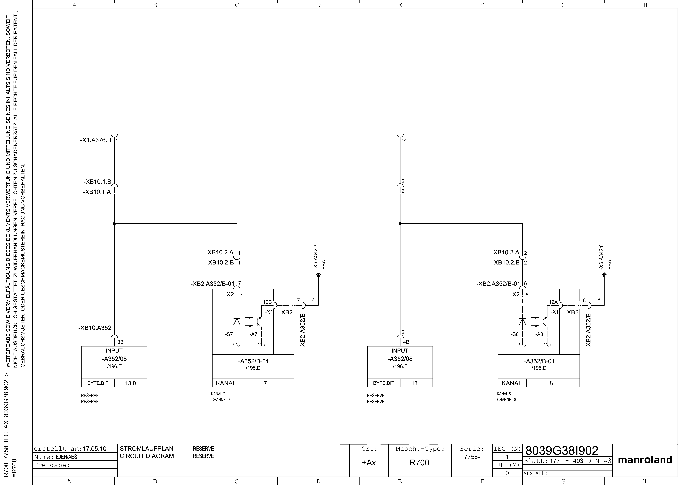

# +Ax — Sheet 177 of 403 — RESERVE

**RESERVE**

> Part of the manroland **R700** printing press IEC/UL circuit diagrams.
> Drawing class: **Stromlaufplan / Circuit diagram** (DIN A3).
> Document `+Ax` covers the **Central control console** machine section.

## At a glance

| Field | Value |
|---|---|
| Document | `+Ax`  (8039G38I902) |
| Sheet | **177** of 403 |
| Section (DE) | RESERVE |
| Section (EN) | RESERVE |
| Section type | CIRCUIT — Circuit diagram |
| Machine type | `R700` |
| Series | `7758` |
| Created | 17.05.10 |
| Replaces | — |
| Columns used | A, B, C, D, E, F, G, H |
| Path numbers | — |
| Labels on sheet | 76 |
| Cross-refs out | 4 |
| Cross-refs in | 20 |

**Previous:** [+Ax sheet 176](SHEET_0176.md) · **Next:** [+Ax sheet 178](SHEET_0178.md) · **Document TOC:** [_TOC.md](_TOC.md)  (+Ax) · **Master TOC:** [all sheets](../_MASTER_TOC.md)

## Sheet image (300 DPI, exact vector render)



_Rendered directly from the PDF vector layer at 300 DPI (1-bit), no OCR and no resampling. Use it to confirm anything ambiguous in the text below._

## Cross-references on this sheet

Each entry is a wire leaving this sheet. The printed token is `/sheet.column`; the link resolves to that sheet inside the same document.

| Ref | Target sheet | Col | Path | Destination on target | Target section | From col |
|---|---|---|---|---|---|---|
| `/196.E` | [+Ax sheet 196](SHEET_0196.md) | E | — | — | REFERENZMODUL | A |
| `/196.E` | [+Ax sheet 196](SHEET_0196.md) | E | — | — | REFERENZMODUL | E |
| `/195.D` | [+Ax sheet 195](SHEET_0195.md) | D | — | — | REFERENZMODUL | C |
| `/195.D` | [+Ax sheet 195](SHEET_0195.md) | D | — | — | REFERENZMODUL | G |

### Incoming references (sheets that point here)

Every other sheet that sends a wire to this one. `Back-ref` is the token printed on *that* sheet; `Path` is its line number.

| From sheet | Cols | Back-ref | Path | Refs | What continues there |
|---|---|---|---|---|---|
| [+Ax#195](SHEET_0195.md) | D | `/195.D` | — | 2 | — |
| [+Ax#196](SHEET_0196.md) | E | `/196.E` | — | 2 | — |
| [+Ax#208](SHEET_0208.md) | F | `/208.F` | — | 2 | — |
| [+Ax#218](SHEET_0218.md) | B, D | `/218.B`, `/218.D` | — | 4 | — |
| [+Ax#243](SHEET_0243.md) | A, B, C, E | `/243.A`, `/243.B`, `/243.C`, `/243.E` | — | 8 | — |
| [+Ax#245](SHEET_0245.md) | A | `/245.A` | — | 2 | — |


## Devices on this sheet

| Tag | Class | Class meaning (IEC) | Col | Sub | Terminal | Sign |
|---|---|---|---|---|---|---|
| `A352/08` | A | Baugruppe / assembly, module, PC board | E | 08 | — | — |
| `S8` | S | Schalter / switch | F | — | — | — |
| `A8` | A | Baugruppe / assembly, module, PC board | G | — | — | — |
| `X1` | X | Klemme / terminal, plug connector | G | — | — | — |
| `X2` | X | Klemme / terminal, plug connector | F | — | — | — |
| `XB2` | XB |  | G | — | — | — |
| `A352/08` | A | Baugruppe / assembly, module, PC board | A | 08 | — | — |
| `S7` | S | Schalter / switch | C | — | — | — |
| `A7` | A | Baugruppe / assembly, module, PC board | C | — | — | — |
| `X1` | X | Klemme / terminal, plug connector | C | — | — | — |
| `X2` | X | Klemme / terminal, plug connector | C | — | — | — |
| `XB2` | XB |  | D | — | — | — |
| `13.1` | — | cross-device reference | E | — | — | — |
| `X6.A342:8` | — | cross-device reference | G | — | 8 | — |
| `XB10.2.B` | — | cross-device reference | F | — | — | — |
| `XB10.2.A` | — | cross-device reference | F | — | — | — |
| `13.0` | — | cross-device reference | B | — | — | — |
| `XB10.A352` | — | cross-device reference | A | — | — | — |
| `X1.A376.B` | — | cross-device reference | A | — | — | — |
| `X6.A342:7` | — | cross-device reference | D | — | 7 | — |
| `XB10.2.B` | — | cross-device reference | C | — | — | — |
| `XB10.2.A` | — | cross-device reference | C | — | — | — |
| `XB10.1.B` | — | cross-device reference | A | — | — | — |
| `XB10.1.A` | — | cross-device reference | A | — | — | — |

## Potentials / nets

_No named potentials on this sheet._

## Wire-end annotations (grouped as printed)

A wire that continues elsewhere is annotated with a small cluster: the destination description, the path/line number `#NN`, and the `/sheet.column` cross reference. Each row below is one such cluster exactly as it is grouped on the drawing.

| Col | Y | Path | Cross-ref | Text on the wire |
|---|---|---|---|---|
| A | 238.4 | — | — | `X1.A376.B 1` |
| E | 239.8 | — | — | `14` |
| A | 310.7 | — | — | `XB10.1.B 1` |
| E | 310.7 | — | — | `2` |
| A | 327.7 | — | — | `XB10.1.A 1` |
| E | 327.7 | — | — | `2` |
| D | 424.1 | — | — | `X6.A342:7` |
| G | 424.1 | — | — | `X6.A342:8` |
| C | 433.3 | — | — | `XB10.2.A 1` |
| F | 433.3 | — | — | `XB10.2.A 2` |
| C | 451.0 | — | — | `XB10.2.B 1` |
| D | 451.0 | — | — | `+BA` |
| F | 451.0 | — | — | `XB10.2.B 2` |
| H | 451.0 | — | — | `+BA` |
| C | 487.9 | — | — | `XB2.A352/B 01 7` |
| F | 487.9 | — | — | `XB2.A352/B 01 8` |
| C | 506.3 | — | — | `X2` |
| F | 506.3 | — | — | `X2` |
| C | 507.7 | — | — | `7 7` |
| G | 507.7 | — | — | `8 8` |
| D | 516.2 | — | — | `7` |
| G | 516.2 | — | — | `8` |
| G | 520.4 | — | — | `12A` |
| C | 520.5 | — | — | `12C` |
| C | 537.5 | — | — | `X1` |
| D | 537.5 | — | — | `XB2` |
| G | 537.5 | — | — | `X1` |
| G | 537.5 | — | — | `XB2` |
| D | 543.7 | — | — | `XB2.A352/B` |
| G | 543.7 | — | — | `XB2.A352/B` |
| A | 564.4 | — | — | `XB10.A352 1` |
| E | 572.9 | — | — | `2` |
| C | 576.4 | — | — | `S7 A7` |
| G | 576.4 | — | — | `S8 A8` |
| B | 589.9 | — | — | `3B` |
| E | 589.9 | — | — | `4B` |
| A | 604.4 | — | — | `INPUT` |
| E | 604.4 | — | — | `INPUT` |
| A | 618.3 | — | — | `A352/08` |
| E | 618.3 | — | — | `A352/08` |
| C | 622.5 | — | — | `A352/B 01` |
| G | 622.5 | — | — | `A352/B 01` |
| A | 632.0 | — | `/196.E` | — |
| E | 632.0 | — | `/196.E` | — |
| C | 634.9 | — | `/195.D` | — |
| G | 634.9 | — | `/195.D` | — |
| C | 660.7 | — | — | `KANAL 7` |
| G | 660.7 | — | — | `KANAL 8` |
| A | 661.1 | — | — | `BYTE.BIT 13.0` |
| E | 661.1 | — | — | `BYTE.BIT 13.1` |
| C | 681.1 | — | — | `KANAL 7 CHANNEL 7` |
| F | 681.1 | — | — | `KANAL 8 CHANNEL 8` |
| A | 683.7 | — | — | `RESERVE RESERVE` |
| E | 683.7 | — | — | `RESERVE RESERVE` |


## Reconstructed tables

This sheet carries tabular content (pin map / terminal assignment / index). The grid below was rebuilt from the drawing's own rule lines, so each row is exactly one physical row of the table.

### Table 1 — 2 data rows × 2 columns (at x=141.7, y=388.3)

| XB10.A352 | 1 3B |
|---|---|
| `INPUT` | `A352/08 /196.E` |
| `BYTE.BIT` | `13.0` |


### Table 2 — 4 data rows × 8 columns (at x=368.5, y=388.3)

| XB10.2.A XB10.2.B XB2.A352/B 01 | 1 1 7 |  |  | X6.A342:7 | +BA |  |  |
|---|---|---|---|---|---|---|---|
| `X2 S7` | `7 A7` | `12C X1` | `XB2` | `7 7 XB2.A352/B` |  |  | `2 4B` |
|  |  |  |  |  |  | `INPUT` |  |
|  | `A352/B 01 /195.D` |  |  |  |  |  | `A352/08 /196.E` |
| `KANAL` |  | `7` |  |  |  | `BYTE.BIT` | `13.1` |


### Table 3 — 3 data rows × 5 columns (at x=864.6, y=388.3)

| XB10.2.A XB10.2.B XB2.A352/B 01 | 2 2 8 |  |  | X6.A342:8 |
|---|---|---|---|---|
| `X2 S8` | `8 A8` | `12A X1` | `XB2` | `8 8 XB2.A352/B` |
|  | `A352/B 01 /195.D` |  |  |  |
| `KANAL` |  | `8` |  |  |


## Notes and free text on this sheet

| Text | Col | Y (pt) |
|---|---|---|
| `4B` | E | 589.88 |
| `INPUT` | E | 604.42 |
| `BYTE.BIT` | E | 661.67 |
| `RESERVE` | E | 683.73 |
| `KANAL 8` | F | 681.1 |
| `CHANNEL 8` | F | 691.04 |
| `12A` | G | 520.44 |
| `KANAL` | F | 660.77 |
| `A352/B 01` | G | 622.52 |
| `XB2.A352/B 01` | F | 487.87 |
| `XB2.A352/B` | G | 543.68 |
| `+BA` | H | 450.99 |
| `3B` | B | 589.88 |
| `INPUT` | A | 604.42 |
| `BYTE.BIT` | A | 661.67 |
| `RESERVE` | A | 683.73 |
| `KANAL 7` | C | 681.1 |
| `CHANNEL 7` | C | 691.04 |
| `12C` | C | 520.49 |
| `KANAL` | C | 660.77 |
| `A352/B 01` | C | 622.52 |
| `XB2.A352/B 01` | C | 487.87 |
| `XB2.A352/B` | D | 543.68 |
| `+BA` | D | 450.99 |

## Complete label inventory (exact text from the drawing)

Every text object inside the drawing area of this sheet, in DIN reading order (column A→H, then top→bottom). This is the authoritative list: if a string is not here it is not printed on this sheet.

| Col | Y | X | Dir | Type | Text |
|---|---|---|---|---|---|
| A | 238.4 | 139.2 | → | device ref | `X1.A376.B` |
| A | 310.7 | 145.1 | → | device ref | `XB10.1.B` |
| A | 328.4 | 144.3 | → | device ref | `XB10.1.A` |
| A | 564.4 | 136.1 | → | device ref | `XB10.A352` |
| A | 604.4 | 183.5 | → | text | `INPUT` |
| A | 618.3 | 177.0 | → | device tag | `A352/08` |
| A | 632.0 | 186.0 | → | cross-reference | `/196.E` |
| A | 661.7 | 151.7 | → | text | `BYTE.BIT` |
| A | 683.7 | 140.9 | → | text | `RESERVE` |
| A | 694.4 | 140.9 | → | text | `RESERVE` |
| B | 239.9 | 200.4 | → | number | `1` |
| B | 310.7 | 200.4 | → | number | `1` |
| B | 327.7 | 200.4 | → | number | `1` |
| B | 572.9 | 200.4 | → | number | `1` |
| B | 589.9 | 203.8 | → | text | `3B` |
| B | 661.1 | 217.0 | → | device ref | `13.0` |
| C | 433.3 | 356.9 | → | device ref | `XB10.2.A` |
| C | 435.4 | 413.0 | → | number | `1` |
| C | 451.0 | 357.7 | → | device ref | `XB10.2.B` |
| C | 452.5 | 413.0 | → | number | `1` |
| C | 487.9 | 330.8 | → | text | `XB2.A352/B 01` |
| C | 487.9 | 413.6 | → | number | `7` |
| C | 506.3 | 389.5 | → | device tag | `X2` |
| C | 507.7 | 416.4 | → | number | `7` |
| C | 520.5 | 456.4 | → | text | `12C` |
| C | 537.5 | 460.1 | → | device tag | `X1` |
| C | 576.4 | 390.6 | → | device tag | `S7` |
| C | 576.4 | 433.1 | → | device tag | `A7` |
| C | 622.5 | 413.4 | → | text | `A352/B 01` |
| C | 634.9 | 426.6 | → | cross-reference | `/195.D` |
| C | 660.7 | 457.8 | → | number | `7` |
| C | 660.8 | 374.7 | → | text | `KANAL` |
| C | 681.1 | 366.5 | → | text | `KANAL 7` |
| C | 691.0 | 366.8 | → | text | `CHANNEL 7` |
| D | 424.1 | 543.8 | ↕ | device ref | `X6.A342:7` |
| D | 451.0 | 558.0 | ↕ | text | `+BA` |
| D | 516.2 | 541.1 | → | number | `7` |
| D | 517.6 | 515.6 | → | number | `7` |
| D | 537.5 | 484.4 | → | device tag | `XB2` |
| D | 543.7 | 520.5 | ↕ | text | `XB2.A352/B` |
| E | 239.9 | 696.5 | → | number | `14` |
| E | 310.7 | 697.0 | → | number | `2` |
| E | 327.7 | 697.0 | → | number | `2` |
| E | 572.9 | 697.0 | → | number | `2` |
| E | 589.9 | 699.9 | → | text | `4B` |
| E | 604.4 | 679.6 | → | text | `INPUT` |
| E | 618.3 | 673.1 | → | device tag | `A352/08` |
| E | 632.0 | 682.0 | → | cross-reference | `/196.E` |
| E | 661.1 | 713.9 | → | device ref | `13.1` |
| E | 661.7 | 647.7 | → | text | `BYTE.BIT` |
| E | 683.7 | 636.9 | → | text | `RESERVE` |
| E | 694.4 | 636.9 | → | text | `RESERVE` |
| F | 433.3 | 852.9 | → | device ref | `XB10.2.A` |
| F | 451.0 | 853.8 | → | device ref | `XB10.2.B` |
| F | 487.9 | 826.9 | → | text | `XB2.A352/B 01` |
| F | 506.3 | 885.5 | → | device tag | `X2` |
| F | 576.4 | 886.7 | → | device tag | `S8` |
| F | 660.8 | 870.8 | → | text | `KANAL` |
| F | 681.1 | 862.6 | → | text | `KANAL 8` |
| F | 691.0 | 862.9 | → | text | `CHANNEL 8` |
| G | 424.1 | 1039.9 | ↕ | device ref | `X6.A342:8` |
| G | 435.4 | 909.6 | → | number | `2` |
| G | 452.5 | 909.6 | → | number | `2` |
| G | 487.9 | 909.6 | → | number | `8` |
| G | 507.7 | 912.5 | → | number | `8` |
| G | 516.2 | 1037.2 | → | number | `8` |
| G | 517.6 | 1011.7 | → | number | `8` |
| G | 520.4 | 952.4 | → | text | `12A` |
| G | 537.5 | 956.1 | → | device tag | `X1` |
| G | 537.5 | 980.5 | → | device tag | `XB2` |
| G | 543.7 | 1016.5 | ↕ | text | `XB2.A352/B` |
| G | 576.4 | 929.2 | → | device tag | `A8` |
| G | 622.5 | 909.5 | → | text | `A352/B 01` |
| G | 634.9 | 922.7 | → | cross-reference | `/195.D` |
| G | 660.7 | 953.7 | → | number | `8` |
| H | 451.0 | 1054.0 | ↕ | text | `+BA` |

## Reading-order text block

The same content as a plain block, grouped by DIN column — convenient to paste or to match against a visual description.

```text
=== Column A ===
 238.4  139.2  devref       X1.A376.B
 310.7  145.1  devref       XB10.1.B
 328.4  144.3  devref       XB10.1.A
 564.4  136.1  devref       XB10.A352
 604.4  183.5  text         INPUT
 618.3  177.0  devtag       A352/08
 632.0  186.0  xref         /196.E
 661.7  151.7  text         BYTE.BIT
 683.7  140.9  text         RESERVE
 694.4  140.9  text         RESERVE
=== Column B ===
 239.9  200.4  numeric      1
 310.7  200.4  numeric      1
 327.7  200.4  numeric      1
 572.9  200.4  numeric      1
 589.9  203.8  text         3B
 661.1  217.0  devref       13.0
=== Column C ===
 433.3  356.9  devref       XB10.2.A
 435.4  413.0  numeric      1
 451.0  357.7  devref       XB10.2.B
 452.5  413.0  numeric      1
 487.9  330.8  text         XB2.A352/B 01
 487.9  413.6  numeric      7
 506.3  389.5  devtag       X2
 507.7  416.4  numeric      7
 520.5  456.4  text         12C
 537.5  460.1  devtag       X1
 576.4  390.6  devtag       S7
 576.4  433.1  devtag       A7
 622.5  413.4  text         A352/B 01
 634.9  426.6  xref         /195.D
 660.7  457.8  numeric      7
 660.8  374.7  text         KANAL
 681.1  366.5  text         KANAL 7
 691.0  366.8  text         CHANNEL 7
=== Column D ===
 424.1  543.8  devref       X6.A342:7
 451.0  558.0  text         +BA
 516.2  541.1  numeric      7
 517.6  515.6  numeric      7
 537.5  484.4  devtag       XB2
 543.7  520.5  text         XB2.A352/B
=== Column E ===
 239.9  696.5  numeric      14
 310.7  697.0  numeric      2
 327.7  697.0  numeric      2
 572.9  697.0  numeric      2
 589.9  699.9  text         4B
 604.4  679.6  text         INPUT
 618.3  673.1  devtag       A352/08
 632.0  682.0  xref         /196.E
 661.1  713.9  devref       13.1
 661.7  647.7  text         BYTE.BIT
 683.7  636.9  text         RESERVE
 694.4  636.9  text         RESERVE
=== Column F ===
 433.3  852.9  devref       XB10.2.A
 451.0  853.8  devref       XB10.2.B
 487.9  826.9  text         XB2.A352/B 01
 506.3  885.5  devtag       X2
 576.4  886.7  devtag       S8
 660.8  870.8  text         KANAL
 681.1  862.6  text         KANAL 8
 691.0  862.9  text         CHANNEL 8
=== Column G ===
 424.1 1039.9  devref       X6.A342:8
 435.4  909.6  numeric      2
 452.5  909.6  numeric      2
 487.9  909.6  numeric      8
 507.7  912.5  numeric      8
 516.2 1037.2  numeric      8
 517.6 1011.7  numeric      8
 520.4  952.4  text         12A
 537.5  956.1  devtag       X1
 537.5  980.5  devtag       XB2
 543.7 1016.5  text         XB2.A352/B
 576.4  929.2  devtag       A8
 622.5  909.5  text         A352/B 01
 634.9  922.7  xref         /195.D
 660.7  953.7  numeric      8
=== Column H ===
 451.0 1054.0  text         +BA
```

---
_Generated from the PDF vector text layer; no OCR. Source: `R700_7758_IEC_AX_8039G38I902_p`, sheet 177._
