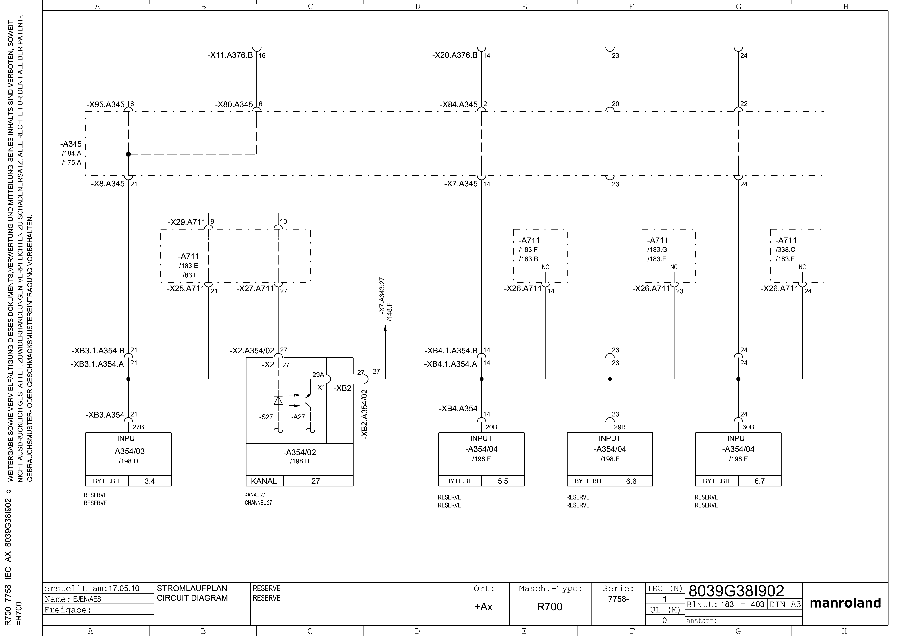

# +Ax — Sheet 183 of 403 — RESERVE

**RESERVE**

> Part of the manroland **R700** printing press IEC/UL circuit diagrams.
> Drawing class: **Stromlaufplan / Circuit diagram** (DIN A3).
> Document `+Ax` covers the **Central control console** machine section.

## At a glance

| Field | Value |
|---|---|
| Document | `+Ax`  (8039G38I902) |
| Sheet | **183** of 403 |
| Section (DE) | RESERVE |
| Section (EN) | RESERVE |
| Section type | CIRCUIT — Circuit diagram |
| Machine type | `R700` |
| Series | `7758` |
| Created | 17.05.10 |
| Replaces | — |
| Columns used | A, B, C, D, E, F, G, H |
| Path numbers | — |
| Labels on sheet | 121 |
| Cross-refs out | 16 |
| Cross-refs in | 50 |

**Previous:** [+Ax sheet 182](SHEET_0182.md) · **Next:** [+Ax sheet 184](SHEET_0184.md) · **Document TOC:** [_TOC.md](_TOC.md)  (+Ax) · **Master TOC:** [all sheets](../_MASTER_TOC.md)

## Sheet image (300 DPI, exact vector render)



_Rendered directly from the PDF vector layer at 300 DPI (1-bit), no OCR and no resampling. Use it to confirm anything ambiguous in the text below._

## Cross-references on this sheet

Each entry is a wire leaving this sheet. The printed token is `/sheet.column`; the link resolves to that sheet inside the same document.

| Ref | Target sheet | Col | Path | Destination on target | Target section | From col |
|---|---|---|---|---|---|---|
| `/184.A` | [+Ax sheet 184](SHEET_0184.md) | A | — | — | RESERVE | A |
| `/175.A` | [+Ax sheet 175](SHEET_0175.md) | A | — | — | RESERVE | A |
| `/183.F` | [+Ax sheet 183](SHEET_0183.md) | F | — | A711 | RESERVE | E |
| `/183.B` | [+Ax sheet 183](SHEET_0183.md) | B | — | A711 | RESERVE | E |
| `/183.G` | [+Ax sheet 183](SHEET_0183.md) | G | — | A711 | RESERVE | F |
| `/183.E` | [+Ax sheet 183](SHEET_0183.md) | E | — | A711 | RESERVE | F |
| `/338.C` | [+Ax sheet 338](SHEET_0338.md) | C | — | A711 | OPTION: INLINESHEETER RS104 S | G |
| `/183.F` | [+Ax sheet 183](SHEET_0183.md) | F | — | A711 | RESERVE | G |
| `/183.E` | [+Ax sheet 183](SHEET_0183.md) | E | — | — | RESERVE | B |
| `/83.E` | [+Ax sheet 83](SHEET_0083.md) | E | — | — | ANLEGER | B |
| `/148.F` | [+Ax sheet 148](SHEET_0148.md) | F | — | X7.A343:27 | ÜBERWACHUNGSRECHNER SICHERHEITSBUS | D |
| `/198.F` | [+Ax sheet 198](SHEET_0198.md) | F | — | — | REFERENZMODUL | E |
| `/198.F` | [+Ax sheet 198](SHEET_0198.md) | F | — | — | REFERENZMODUL | F |
| `/198.F` | [+Ax sheet 198](SHEET_0198.md) | F | — | — | REFERENZMODUL | G |
| `/198.B` | [+Ax sheet 198](SHEET_0198.md) | B | — | — | REFERENZMODUL | C |
| `/198.D` | [+Ax sheet 198](SHEET_0198.md) | D | — | — | REFERENZMODUL | A |

### Incoming references (sheets that point here)

Every other sheet that sends a wire to this one. `Back-ref` is the token printed on *that* sheet; `Path` is its line number.

| From sheet | Cols | Back-ref | Path | Refs | What continues there |
|---|---|---|---|---|---|
| [+Ax#83](SHEET_0083.md) | E | `/83.E` | — | 1 | — |
| [+Ax#148](SHEET_0148.md) | F | `/148.F` | — | 1 | X7.A343:27 |
| [+Ax#175](SHEET_0175.md) | A | `/175.A` | — | 1 | — |
| [+Ax#183](SHEET_0183.md) | B, E, F, G | `/183.B`, `/183.E`, `/183.F`, `/183.G` | — | 6 | A711 |
| [+Ax#184](SHEET_0184.md) | A | `/184.A` | — | 1 | — |
| [+Ax#198](SHEET_0198.md) | B, D, F | `/198.B`, `/198.D`, `/198.F` | — | 5 | — |
| [+Ax#219](SHEET_0219.md) | D, F | `/219.D`, `/219.F` | — | 2 | — |
| [+Ax#224](SHEET_0224.md) | A, B, C | `/224.A`, `/224.B`, `/224.C` | — | 3 | — |
| [+Ax#228](SHEET_0228.md) | A, B, C | `/228.A`, `/228.B`, `/228.C` | — | 9 | — |
| [+Ax#235](SHEET_0235.md) | H | `/235.H` | — | 3 | — |
| [+Ax#238](SHEET_0238.md) | A | `/238.A` | — | 1 | — |
| [+Ax#247](SHEET_0247.md) | E | `/247.E` | — | 1 | — |
| [+Ax#260](SHEET_0260.md) | F | `/260.F` | — | 3 | — |
| [+Ax#268](SHEET_0268.md) | C | `/268.C` | — | 1 | — |
| [+Ax#269](SHEET_0269.md) | H | `/269.H` | — | 3 | — |
| [+Ax#271](SHEET_0271.md) | B | `/271.B` | — | 1 | — |
| [+Ax#274](SHEET_0274.md) | A | `/274.A` | — | 2 | — |
| [+Ax#286](SHEET_0286.md) | C | `/286.C` | — | 1 | — |
| [+Ax#287](SHEET_0287.md) | B | `/287.B` | — | 3 | — |
| [+Ax#290](SHEET_0290.md) | A | `/290.A` | — | 1 | — |
| [+Ax#338](SHEET_0338.md) | B | `/338.B` | — | 1 | — |


## Devices on this sheet

| Tag | Class | Class meaning (IEC) | Col | Sub | Terminal | Sign |
|---|---|---|---|---|---|---|
| `A354/04` | A | Baugruppe / assembly, module, PC board | E | 04 | — | — |
| `A354/04` | A | Baugruppe / assembly, module, PC board | F | 04 | — | — |
| `A354/04` | A | Baugruppe / assembly, module, PC board | G | 04 | — | — |
| `A711` | A | Baugruppe / assembly, module, PC board | E | — | — | — |
| `A711` | A | Baugruppe / assembly, module, PC board | F | — | — | — |
| `A354/03` | A | Baugruppe / assembly, module, PC board | A | 03 | — | — |
| `A345` | A | Baugruppe / assembly, module, PC board | A | — | — | — |
| `A711` | A | Baugruppe / assembly, module, PC board | G | — | — | — |
| `A711` | A | Baugruppe / assembly, module, PC board | B | — | — | — |
| `S27` | S | Schalter / switch | C | — | — | — |
| `A27` | A | Baugruppe / assembly, module, PC board | C | — | — | — |
| `X1` | X | Klemme / terminal, plug connector | C | — | — | — |
| `X2` | X | Klemme / terminal, plug connector | C | — | — | — |
| `XB2` | XB |  | C | — | — | — |
| `A354/02` | A | Baugruppe / assembly, module, PC board | C | 02 | — | — |
| `5.5` | — | cross-device reference | E | — | — | — |
| `XB4.A354` | — | cross-device reference | D | — | — | — |
| `6.6` | — | cross-device reference | F | — | — | — |
| `6.7` | — | cross-device reference | G | — | — | — |
| `X7.A345` | — | cross-device reference | D | — | — | — |
| `X84.A345` | — | cross-device reference | D | — | — | — |
| `X20.A376.B` | — | cross-device reference | D | — | — | — |
| `XB4.1.A354.B` | — | cross-device reference | D | — | — | — |
| `XB4.1.A354.A` | — | cross-device reference | D | — | — | — |
| `X26.A711` | — | cross-device reference | E | — | — | — |
| `X26.A711` | — | cross-device reference | F | — | — | — |
| `3.4` | — | cross-device reference | A | — | — | — |
| `XB3.A354` | — | cross-device reference | A | — | — | — |
| `X8.A345` | — | cross-device reference | A | — | — | — |
| `X95.A345` | — | cross-device reference | A | — | — | — |
| `X80.A345` | — | cross-device reference | B | — | — | — |
| `X11.A376.B` | — | cross-device reference | B | — | — | — |
| `X26.A711` | — | cross-device reference | G | — | — | — |
| `XB3.1.A354.B` | — | cross-device reference | A | — | — | — |
| `XB3.1.A354.A` | — | cross-device reference | A | — | — | — |
| `X29.A711` | — | cross-device reference | B | — | — | — |
| `X27.A711` | — | cross-device reference | B | — | — | — |
| `X25.A711` | — | cross-device reference | B | — | — | — |
| `X7.A343:27` | — | cross-device reference | D | — | 27 | — |

## Potentials / nets

_No named potentials on this sheet._

## Wire-end annotations (grouped as printed)

A wire that continues elsewhere is annotated with a small cluster: the destination description, the path/line number `#NN`, and the `/sheet.column` cross reference. Each row below is one such cluster exactly as it is grouped on the drawing.

| Col | Y | Path | Cross-ref | Text on the wire |
|---|---|---|---|---|
| B | 68.3 | — | — | `X11.A376.B 16` |
| D | 68.3 | — | — | `X20.A376.B 14` |
| F | 69.8 | — | — | `23` |
| G | 69.8 | — | — | `24` |
| B | 133.5 | — | — | `X95.A345 8 X80.A345 6` |
| D | 133.5 | — | — | `X84.A345 2` |
| F | 133.6 | — | — | `20` |
| G | 133.6 | — | — | `22` |
| A | 186.0 | — | — | `A345` |
| A | 199.0 | — | `/184.A`, `/175.A` | — |
| A | 238.4 | — | — | `X8.A345 21` |
| D | 238.4 | — | — | `X7.A345 14` |
| F | 239.8 | — | — | `23` |
| G | 239.8 | — | — | `24` |
| B | 289.4 | — | — | `X29.A711 9 10` |
| E | 313.5 | — | `/183.F`, `/183.B` | `A711` |
| F | 313.5 | — | `/183.G`, `/183.E` | `A711` |
| G | 313.5 | — | `/338.C`, `/183.F` | `A711` |
| B | 334.8 | — | — | `A711` |
| B | 347.9 | — | `/183.E` | — |
| F | 350.7 | — | — | `NC NC NC` |
| B | 360.2 | — | `/83.E` | — |
| D | 366.8 | — | `/148.F` | `X7.A343:27` |
| B | 377.3 | — | — | `X25.A711 21 X27.A711 27` |
| E | 377.3 | — | — | `X26.A711 14` |
| F | 377.3 | — | — | `X26.A711 23` |
| G | 377.3 | — | — | `X26.A711 24` |
| A | 459.5 | — | — | `XB3.1.A354.B 21` |
| C | 459.5 | — | — | `X2.A354/02 27` |
| D | 459.5 | — | — | `XB4.1.A354.B 14` |
| F | 459.5 | — | — | `23` |
| G | 459.5 | — | — | `24` |
| A | 476.5 | — | — | `XB3.1.A354.A 21` |
| D | 476.5 | — | — | `XB4.1.A354.A 14` |
| F | 476.5 | — | — | `23` |
| G | 476.5 | — | — | `24` |
| C | 478.0 | — | — | `X2` |
| C | 479.4 | — | — | `27 27` |
| D | 487.9 | — | — | `27` |
| C | 492.1 | — | — | `29A` |
| C | 509.1 | — | — | `X1` |
| C | 509.1 | — | — | `XB2` |
| D | 515.3 | — | — | `XB2.A354/02` |
| D | 536.1 | — | — | `XB4.A354 14` |
| A | 544.6 | — | — | `XB3.A354 21` |
| F | 544.6 | — | — | `23` |
| G | 544.6 | — | — | `24` |
| C | 548.1 | — | — | `S27 A27` |
| A | 561.5 | — | — | `27B` |
| E | 561.5 | — | — | `20B` |
| F | 561.5 | — | — | `29B` |
| G | 561.5 | — | — | `30B` |
| A | 576.1 | — | — | `INPUT` |
| E | 576.1 | — | — | `INPUT` |
| F | 576.1 | — | — | `INPUT` |
| G | 576.1 | — | — | `INPUT` |
| E | 589.9 | — | — | `A354/04` |
| F | 589.9 | — | — | `A354/04` |
| G | 589.9 | — | — | `A354/04` |
| A | 592.8 | — | — | `A354/03` |
| C | 594.2 | — | — | `A354/02` |
| E | 603.7 | — | `/198.F` | — |
| F | 603.7 | — | `/198.F` | — |
| G | 603.7 | — | `/198.F` | — |
| A | 606.5 | — | `/198.D` | — |
| C | 606.5 | — | `/198.B` | — |
| C | 632.4 | — | — | `KANAL 27` |
| A | 632.7 | — | — | `BYTE.BIT 3.4` |
| E | 632.7 | — | — | `BYTE.BIT 5.5` |
| F | 632.7 | — | — | `BYTE.BIT 6.6` |
| G | 632.7 | — | — | `BYTE.BIT 6.7` |
| A | 652.5 | — | — | `RESERVE RESERVE` |
| C | 652.8 | — | — | `KANAL 27 CHANNEL 27` |
| D | 655.4 | — | — | `RESERVE RESERVE` |
| F | 655.4 | — | — | `RESERVE RESERVE` |
| G | 655.4 | — | — | `RESERVE RESERVE` |


## Reconstructed tables

This sheet carries tabular content (pin map / terminal assignment / index). The grid below was rebuilt from the drawing's own rule lines, so each row is exactly one physical row of the table.

### Table 1 — 6 data rows × 22 columns (at x=113.4, y=204.1)

| X8.A345 | 21 |  |  |  |  |  |  |  |  |  | X7.A345 | 14 |  |  |  | 23 |  |  |  | 24 |  |
|---|---|---|---|---|---|---|---|---|---|---|---|---|---|---|---|---|---|---|---|---|---|
| `XB3.1.A354.B` | `21` | `X29.A711 A711 /183.E /83.E X25.A711` | `9 21` | `X27.A711 X2.A354/02` |  | `10 27 27` |  |  | `X7.A343:27` | `/148.F` | `XB4.1.A354.B` | `X26.A711 14` | `A711 /183.F /183.B NC` | `14` |  | `X26.A711 23` | `A711 /183.G /183.E NC` | `23` |  | `X26.A711 24` | `A711 /338.C /183.F NC` |
| `XB3.1.A354.A` | `21` |  |  |  | `X2` | `27` | `29A` |  | `27 27` |  | `XB4.1.A354.A` | `14` |  |  |  | `23` |  |  |  | `24` |  |
| `XB3.A354` | `21 27B` |  |  |  | `S27` | `A27` | `X1` | `XB2` | `XB2.A354/02` |  | `XB4.A354` | `14 20B` |  |  |  | `23 29B` |  |  |  | `24 30B` |  |
| `INPUT` |  |  |  |  |  |  |  |  |  |  | `INPUT` |  |  |  | `INPUT` |  |  |  | `INPUT` |  |  |
|  | `A354/03 /198.D` |  |  |  |  | `A354/02 /198.B` |  |  |  |  |  | `A354/04 /198.F` |  |  |  | `A354/04 /198.F` |  |  |  | `A354/04 /198.F` |  |
| `BYTE.BIT` | `3.4` |  |  |  | `KANAL` |  | `27` |  |  |  | `BYTE.BIT` | `5.5` |  |  | `BYTE.BIT` | `6.6` |  |  | `BYTE.BIT` | `6.7` |  |


## Notes and free text on this sheet

| Text | Col | Y (pt) |
|---|---|---|
| `20B` | E | 561.55 |
| `INPUT` | E | 576.07 |
| `BYTE.BIT` | D | 633.32 |
| `RESERVE` | D | 655.39 |
| `29B` | F | 561.55 |
| `INPUT` | F | 576.07 |
| `BYTE.BIT` | F | 633.32 |
| `RESERVE` | F | 655.39 |
| `30B` | G | 561.55 |
| `INPUT` | G | 576.07 |
| `BYTE.BIT` | G | 633.32 |
| `RESERVE` | G | 655.39 |
| `27B` | A | 561.55 |
| `INPUT` | A | 576.07 |
| `BYTE.BIT` | A | 633.32 |
| `RESERVE` | A | 652.55 |
| `KANAL 27` | B | 652.75 |
| `CHANNEL 27` | C | 662.7 |
| `29A` | C | 492.1 |
| `KANAL` | C | 632.42 |
| `X2.A354/02` | B | 459.52 |
| `XB2.A354/02` | D | 515.34 |
| `NC` | E | 350.66 |
| `NC` | F | 350.66 |
| `NC` | H | 350.66 |

## Complete label inventory (exact text from the drawing)

Every text object inside the drawing area of this sheet, in DIN reading order (column A→H, then top→bottom). This is the authoritative list: if a string is not here it is not printed on this sheet.

| Col | Y | X | Dir | Type | Text |
|---|---|---|---|---|---|
| A | 133.5 | 114.8 | → | device ref | `X95.A345` |
| A | 133.6 | 172.6 | → | number | `8` |
| A | 186.0 | 79.9 | → | device tag | `A345` |
| A | 199.0 | 82.2 | → | cross-reference | `/184.A` |
| A | 211.4 | 82.2 | → | cross-reference | `/175.A` |
| A | 238.4 | 120.8 | → | device ref | `X8.A345` |
| A | 239.9 | 172.6 | → | number | `21` |
| A | 459.5 | 95.0 | → | device ref | `XB3.1.A354.B` |
| A | 459.5 | 172.6 | → | number | `21` |
| A | 476.5 | 172.6 | → | number | `21` |
| A | 477.2 | 94.1 | → | device ref | `XB3.1.A354.A` |
| A | 544.6 | 113.7 | → | device ref | `XB3.A354` |
| A | 544.6 | 172.6 | → | number | `21` |
| A | 561.5 | 175.5 | → | text | `27B` |
| A | 576.1 | 155.2 | → | text | `INPUT` |
| A | 592.7 | 148.7 | → | device tag | `A354/03` |
| A | 606.5 | 157.3 | → | cross-reference | `/198.D` |
| A | 632.7 | 191.6 | → | device ref | `3.4` |
| A | 633.3 | 123.3 | → | text | `BYTE.BIT` |
| A | 652.6 | 111.1 | → | text | `RESERVE` |
| A | 663.2 | 111.1 | → | text | `RESERVE` |
| B | 68.3 | 275.0 | → | device ref | `X11.A376.B` |
| B | 133.5 | 284.9 | → | device ref | `X80.A345` |
| B | 289.4 | 222.5 | → | device ref | `X29.A711` |
| B | 289.5 | 278.9 | → | number | `9` |
| B | 334.8 | 235.8 | → | device tag | `A711` |
| B | 347.9 | 237.3 | → | cross-reference | `/183.E` |
| B | 360.2 | 242.1 | → | cross-reference | `/83.E` |
| B | 377.3 | 221.1 | → | device ref | `X25.A711` |
| B | 377.3 | 313.2 | → | device ref | `X27.A711` |
| B | 381.6 | 278.9 | → | number | `21` |
| B | 459.5 | 304.4 | → | text | `X2.A354/02` |
| B | 652.8 | 324.0 | → | text | `KANAL 27` |
| C | 69.8 | 342.1 | → | number | `16` |
| C | 133.6 | 342.7 | → | number | `6` |
| C | 289.5 | 370.5 | → | number | `10` |
| C | 381.6 | 371.1 | → | number | `27` |
| C | 459.5 | 371.1 | → | number | `27` |
| C | 478.0 | 347.0 | → | device tag | `X2` |
| C | 479.4 | 373.9 | → | number | `27` |
| C | 489.3 | 473.1 | → | number | `27` |
| C | 492.1 | 413.9 | → | text | `29A` |
| C | 509.1 | 417.5 | → | device tag | `X1` |
| C | 509.1 | 441.9 | → | device tag | `XB2` |
| C | 548.1 | 343.3 | → | device tag | `S27` |
| C | 548.1 | 385.8 | → | device tag | `A27` |
| C | 594.2 | 375.4 | → | device tag | `A354/02` |
| C | 606.5 | 384.2 | → | cross-reference | `/198.B` |
| C | 632.4 | 332.2 | → | text | `KANAL` |
| C | 632.4 | 412.3 | → | number | `27` |
| C | 662.7 | 324.3 | → | text | `CHANNEL 27` |
| D | 68.3 | 572.6 | → | device ref | `X20.A376.B` |
| D | 133.5 | 582.5 | → | device ref | `X84.A345` |
| D | 238.4 | 588.5 | → | device ref | `X7.A345` |
| D | 366.8 | 502.0 | ↕ | device ref | `X7.A343:27` |
| D | 400.3 | 511.9 | ↕ | cross-reference | `/148.F` |
| D | 459.5 | 562.7 | → | device ref | `XB4.1.A354.B` |
| D | 477.2 | 561.8 | → | device ref | `XB4.1.A354.A` |
| D | 487.9 | 493.8 | → | number | `27` |
| D | 515.3 | 477.9 | ↕ | text | `XB2.A354/02` |
| D | 536.1 | 581.4 | → | device ref | `XB4.A354` |
| D | 633.3 | 591.0 | → | text | `BYTE.BIT` |
| D | 655.4 | 580.3 | → | text | `RESERVE` |
| D | 666.0 | 580.3 | → | text | `RESERVE` |
| E | 69.8 | 639.8 | → | number | `14` |
| E | 133.6 | 640.3 | → | number | `2` |
| E | 239.9 | 639.8 | → | number | `14` |
| E | 313.5 | 687.1 | → | device tag | `A711` |
| E | 326.6 | 687.4 | → | cross-reference | `/183.F` |
| E | 339.0 | 687.4 | → | cross-reference | `/183.B` |
| E | 350.7 | 718.0 | → | text | `NC` |
| E | 377.3 | 667.6 | → | device ref | `X26.A711` |
| E | 381.6 | 724.8 | → | number | `14` |
| E | 459.5 | 639.8 | → | number | `14` |
| E | 476.5 | 639.8 | → | number | `14` |
| E | 544.6 | 639.8 | → | number | `14` |
| E | 561.5 | 643.2 | → | text | `20B` |
| E | 576.1 | 622.9 | → | text | `INPUT` |
| E | 589.9 | 616.4 | → | device tag | `A354/04` |
| E | 603.7 | 625.5 | → | cross-reference | `/198.F` |
| E | 632.7 | 659.3 | → | device ref | `5.5` |
| F | 69.8 | 810.4 | → | number | `23` |
| F | 133.6 | 810.4 | → | number | `20` |
| F | 239.9 | 810.4 | → | number | `23` |
| F | 313.5 | 857.2 | → | device tag | `A711` |
| F | 326.6 | 857.5 | → | cross-reference | `/183.G` |
| F | 339.0 | 857.5 | → | cross-reference | `/183.E` |
| F | 350.7 | 888.0 | → | text | `NC` |
| F | 377.3 | 837.6 | → | device ref | `X26.A711` |
| F | 381.6 | 895.5 | → | number | `23` |
| F | 459.5 | 810.4 | → | number | `23` |
| F | 476.5 | 810.4 | → | number | `23` |
| F | 544.6 | 810.4 | → | number | `23` |
| F | 561.5 | 813.3 | → | text | `29B` |
| F | 576.1 | 793.0 | → | text | `INPUT` |
| F | 589.9 | 786.5 | → | device tag | `A354/04` |
| F | 603.7 | 795.5 | → | cross-reference | `/198.F` |
| F | 632.7 | 829.4 | → | device ref | `6.6` |
| F | 633.3 | 761.1 | → | text | `BYTE.BIT` |
| F | 655.4 | 750.3 | → | text | `RESERVE` |
| F | 666.0 | 750.3 | → | text | `RESERVE` |
| G | 69.8 | 980.5 | → | number | `24` |
| G | 133.6 | 980.5 | → | number | `22` |
| G | 239.9 | 980.5 | → | number | `24` |
| G | 313.5 | 1027.3 | → | device tag | `A711` |
| G | 326.6 | 1027.6 | → | cross-reference | `/338.C` |
| G | 339.0 | 1027.6 | → | cross-reference | `/183.F` |
| G | 377.3 | 1007.7 | → | device ref | `X26.A711` |
| G | 459.5 | 980.5 | → | number | `24` |
| G | 476.5 | 980.5 | → | number | `24` |
| G | 544.6 | 980.5 | → | number | `24` |
| G | 561.5 | 983.3 | → | text | `30B` |
| G | 576.1 | 963.1 | → | text | `INPUT` |
| G | 589.9 | 956.6 | → | device tag | `A354/04` |
| G | 603.7 | 965.6 | → | cross-reference | `/198.F` |
| G | 632.7 | 999.5 | → | device ref | `6.7` |
| G | 633.3 | 931.2 | → | text | `BYTE.BIT` |
| G | 655.4 | 920.4 | → | text | `RESERVE` |
| G | 666.0 | 920.4 | → | text | `RESERVE` |
| H | 350.7 | 1058.1 | → | text | `NC` |
| H | 381.6 | 1065.5 | → | number | `24` |

## Reading-order text block

The same content as a plain block, grouped by DIN column — convenient to paste or to match against a visual description.

```text
=== Column A ===
 133.5  114.8  devref       X95.A345
 133.6  172.6  numeric      8
 186.0   79.9  devtag       A345
 199.0   82.2  xref         /184.A
 211.4   82.2  xref         /175.A
 238.4  120.8  devref       X8.A345
 239.9  172.6  numeric      21
 459.5   95.0  devref       XB3.1.A354.B
 459.5  172.6  numeric      21
 476.5  172.6  numeric      21
 477.2   94.1  devref       XB3.1.A354.A
 544.6  113.7  devref       XB3.A354
 544.6  172.6  numeric      21
 561.5  175.5  text         27B
 576.1  155.2  text         INPUT
 592.7  148.7  devtag       A354/03
 606.5  157.3  xref         /198.D
 632.7  191.6  devref       3.4
 633.3  123.3  text         BYTE.BIT
 652.6  111.1  text         RESERVE
 663.2  111.1  text         RESERVE
=== Column B ===
  68.3  275.0  devref       X11.A376.B
 133.5  284.9  devref       X80.A345
 289.4  222.5  devref       X29.A711
 289.5  278.9  numeric      9
 334.8  235.8  devtag       A711
 347.9  237.3  xref         /183.E
 360.2  242.1  xref         /83.E
 377.3  221.1  devref       X25.A711
 377.3  313.2  devref       X27.A711
 381.6  278.9  numeric      21
 459.5  304.4  text         X2.A354/02
 652.8  324.0  text         KANAL 27
=== Column C ===
  69.8  342.1  numeric      16
 133.6  342.7  numeric      6
 289.5  370.5  numeric      10
 381.6  371.1  numeric      27
 459.5  371.1  numeric      27
 478.0  347.0  devtag       X2
 479.4  373.9  numeric      27
 489.3  473.1  numeric      27
 492.1  413.9  text         29A
 509.1  417.5  devtag       X1
 509.1  441.9  devtag       XB2
 548.1  343.3  devtag       S27
 548.1  385.8  devtag       A27
 594.2  375.4  devtag       A354/02
 606.5  384.2  xref         /198.B
 632.4  332.2  text         KANAL
 632.4  412.3  numeric      27
 662.7  324.3  text         CHANNEL 27
=== Column D ===
  68.3  572.6  devref       X20.A376.B
 133.5  582.5  devref       X84.A345
 238.4  588.5  devref       X7.A345
 366.8  502.0  devref       X7.A343:27
 400.3  511.9  xref         /148.F
 459.5  562.7  devref       XB4.1.A354.B
 477.2  561.8  devref       XB4.1.A354.A
 487.9  493.8  numeric      27
 515.3  477.9  text         XB2.A354/02
 536.1  581.4  devref       XB4.A354
 633.3  591.0  text         BYTE.BIT
 655.4  580.3  text         RESERVE
 666.0  580.3  text         RESERVE
=== Column E ===
  69.8  639.8  numeric      14
 133.6  640.3  numeric      2
 239.9  639.8  numeric      14
 313.5  687.1  devtag       A711
 326.6  687.4  xref         /183.F
 339.0  687.4  xref         /183.B
 350.7  718.0  text         NC
 377.3  667.6  devref       X26.A711
 381.6  724.8  numeric      14
 459.5  639.8  numeric      14
 476.5  639.8  numeric      14
 544.6  639.8  numeric      14
 561.5  643.2  text         20B
 576.1  622.9  text         INPUT
 589.9  616.4  devtag       A354/04
 603.7  625.5  xref         /198.F
 632.7  659.3  devref       5.5
=== Column F ===
  69.8  810.4  numeric      23
 133.6  810.4  numeric      20
 239.9  810.4  numeric      23
 313.5  857.2  devtag       A711
 326.6  857.5  xref         /183.G
 339.0  857.5  xref         /183.E
 350.7  888.0  text         NC
 377.3  837.6  devref       X26.A711
 381.6  895.5  numeric      23
 459.5  810.4  numeric      23
 476.5  810.4  numeric      23
 544.6  810.4  numeric      23
 561.5  813.3  text         29B
 576.1  793.0  text         INPUT
 589.9  786.5  devtag       A354/04
 603.7  795.5  xref         /198.F
 632.7  829.4  devref       6.6
 633.3  761.1  text         BYTE.BIT
 655.4  750.3  text         RESERVE
 666.0  750.3  text         RESERVE
=== Column G ===
  69.8  980.5  numeric      24
 133.6  980.5  numeric      22
 239.9  980.5  numeric      24
 313.5 1027.3  devtag       A711
 326.6 1027.6  xref         /338.C
 339.0 1027.6  xref         /183.F
 377.3 1007.7  devref       X26.A711
 459.5  980.5  numeric      24
 476.5  980.5  numeric      24
 544.6  980.5  numeric      24
 561.5  983.3  text         30B
 576.1  963.1  text         INPUT
 589.9  956.6  devtag       A354/04
 603.7  965.6  xref         /198.F
 632.7  999.5  devref       6.7
 633.3  931.2  text         BYTE.BIT
 655.4  920.4  text         RESERVE
 666.0  920.4  text         RESERVE
=== Column H ===
 350.7 1058.1  text         NC
 381.6 1065.5  numeric      24
```

---
_Generated from the PDF vector text layer; no OCR. Source: `R700_7758_IEC_AX_8039G38I902_p`, sheet 183._
