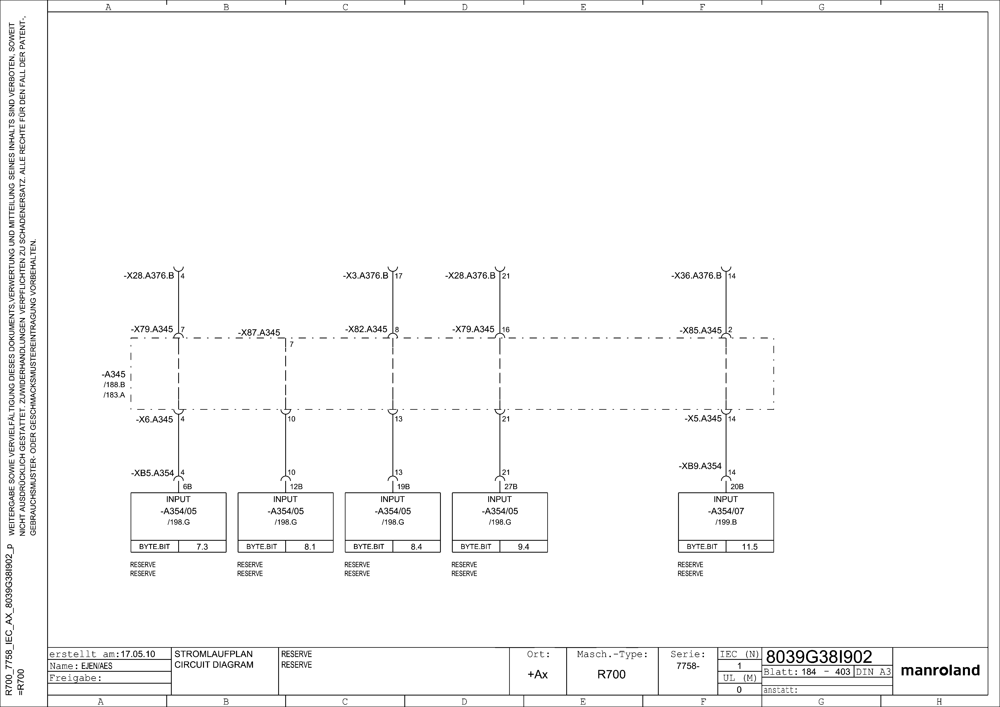

# +Ax — Sheet 184 of 403 — RESERVE

**RESERVE**

> Part of the manroland **R700** printing press IEC/UL circuit diagrams.
> Drawing class: **Stromlaufplan / Circuit diagram** (DIN A3).
> Document `+Ax` covers the **Central control console** machine section.

## At a glance

| Field | Value |
|---|---|
| Document | `+Ax`  (8039G38I902) |
| Sheet | **184** of 403 |
| Section (DE) | RESERVE |
| Section (EN) | RESERVE |
| Section type | CIRCUIT — Circuit diagram |
| Machine type | `R700` |
| Series | `7758` |
| Created | 17.05.10 |
| Replaces | — |
| Columns used | A, B, C, D, F |
| Path numbers | — |
| Labels on sheet | 75 |
| Cross-refs out | 7 |
| Cross-refs in | 26 |

**Previous:** [+Ax sheet 183](SHEET_0183.md) · **Next:** [+Ax sheet 185](SHEET_0185.md) · **Document TOC:** [_TOC.md](_TOC.md)  (+Ax) · **Master TOC:** [all sheets](../_MASTER_TOC.md)

## Sheet image (300 DPI, exact vector render)



_Rendered directly from the PDF vector layer at 300 DPI (1-bit), no OCR and no resampling. Use it to confirm anything ambiguous in the text below._

## Cross-references on this sheet

Each entry is a wire leaving this sheet. The printed token is `/sheet.column`; the link resolves to that sheet inside the same document.

| Ref | Target sheet | Col | Path | Destination on target | Target section | From col |
|---|---|---|---|---|---|---|
| `/188.B` | [+Ax sheet 188](SHEET_0188.md) | B | — | — | RESERVE | A |
| `/183.A` | [+Ax sheet 183](SHEET_0183.md) | A | — | — | RESERVE | A |
| `/199.B` | [+Ax sheet 199](SHEET_0199.md) | B | — | — | REFERENZMODUL | F |
| `/198.G` | [+Ax sheet 198](SHEET_0198.md) | G | — | — | REFERENZMODUL | B |
| `/198.G` | [+Ax sheet 198](SHEET_0198.md) | G | — | — | REFERENZMODUL | C |
| `/198.G` | [+Ax sheet 198](SHEET_0198.md) | G | — | — | REFERENZMODUL | C |
| `/198.G` | [+Ax sheet 198](SHEET_0198.md) | G | — | — | REFERENZMODUL | D |

### Incoming references (sheets that point here)

Every other sheet that sends a wire to this one. `Back-ref` is the token printed on *that* sheet; `Path` is its line number.

| From sheet | Cols | Back-ref | Path | Refs | What continues there |
|---|---|---|---|---|---|
| [+Ax#183](SHEET_0183.md) | A | `/183.A` | — | 1 | — |
| [+Ax#188](SHEET_0188.md) | B | `/188.B` | — | 1 | — |
| [+Ax#198](SHEET_0198.md) | G | `/198.G` | — | 4 | — |
| [+Ax#199](SHEET_0199.md) | B | `/199.B` | — | 1 | — |
| [+Ax#224](SHEET_0224.md) | F | `/224.F` | — | 1 | — |
| [+Ax#231](SHEET_0231.md) | A, E | `/231.A`, `/231.E` | — | 5 | — |
| [+Ax#233](SHEET_0233.md) | G | `/233.G` | — | 4 | — |
| [+Ax#242](SHEET_0242.md) | A | `/242.A` | — | 1 | — |
| [+Ax#271](SHEET_0271.md) | E | `/271.E` | — | 2 | — |
| [+Ax#279](SHEET_0279.md) | B | `/279.B` | — | 1 | — |
| [+Ax#286](SHEET_0286.md) | B, F | `/286.B`, `/286.F` | — | 3 | — |
| [+Ax#287](SHEET_0287.md) | C | `/287.C` | — | 1 | — |
| [+Ax#289](SHEET_0289.md) | A | `/289.A` | — | 1 | — |


## Devices on this sheet

| Tag | Class | Class meaning (IEC) | Col | Sub | Terminal | Sign |
|---|---|---|---|---|---|---|
| `A345` | A | Baugruppe / assembly, module, PC board | A | — | — | — |
| `A354/05` | A | Baugruppe / assembly, module, PC board | B | 05 | — | — |
| `A354/05` | A | Baugruppe / assembly, module, PC board | B | 05 | — | — |
| `A354/05` | A | Baugruppe / assembly, module, PC board | C | 05 | — | — |
| `A354/05` | A | Baugruppe / assembly, module, PC board | D | 05 | — | — |
| `A354/07` | A | Baugruppe / assembly, module, PC board | F | 07 | — | — |
| `7.3` | — | cross-device reference | B | — | — | — |
| `XB5.A354` | — | cross-device reference | A | — | — | — |
| `X79.A345` | — | cross-device reference | A | — | — | — |
| `X6.A345` | — | cross-device reference | A | — | — | — |
| `8.1` | — | cross-device reference | C | — | — | — |
| `8.4` | — | cross-device reference | D | — | — | — |
| `X82.A345` | — | cross-device reference | C | — | — | — |
| `X28.A376.B` | — | cross-device reference | A | — | — | — |
| `X3.A376.B` | — | cross-device reference | C | — | — | — |
| `9.4` | — | cross-device reference | D | — | — | — |
| `X79.A345` | — | cross-device reference | D | — | — | — |
| `X28.A376.B` | — | cross-device reference | D | — | — | — |
| `X36.A376.B` | — | cross-device reference | F | — | — | — |
| `11.5` | — | cross-device reference | F | — | — | — |
| `XB9.A354` | — | cross-device reference | F | — | — | — |
| `X85.A345` | — | cross-device reference | F | — | — | — |
| `X5.A345` | — | cross-device reference | F | — | — | — |
| `X87.A345` | — | cross-device reference | B | — | — | — |

## Potentials / nets

_No named potentials on this sheet._

## Wire-end annotations (grouped as printed)

A wire that continues elsewhere is annotated with a small cluster: the destination description, the path/line number `#NN`, and the `/sheet.column` cross reference. Each row below is one such cluster exactly as it is grouped on the drawing.

| Col | Y | Path | Cross-ref | Text on the wire |
|---|---|---|---|---|
| B | 323.5 | — | — | `X28.A376.B 4 X3.A376.B 17` |
| E | 323.5 | — | — | `X28.A376.B 21 X36.A376.B 14` |
| A | 387.2 | — | — | `X79.A345 7` |
| C | 387.2 | — | — | `X82.A345 8` |
| D | 387.2 | — | — | `X79.A345 16` |
| F | 388.6 | — | — | `X85.A345 2` |
| B | 391.5 | — | — | `X87.A345` |
| C | 406.4 | — | — | `7` |
| A | 441.1 | — | — | `A345` |
| A | 454.2 | — | `/188.B`, `/183.A` | — |
| F | 493.5 | — | — | `X5.A345 14` |
| B | 494.9 | — | — | `X6.A345 4 10` |
| C | 495.0 | — | — | `13` |
| D | 495.0 | — | — | `21` |
| F | 550.2 | — | — | `XB9.A354 14` |
| A | 558.7 | — | — | `XB5.A354 4` |
| C | 558.8 | — | — | `10` |
| C | 558.8 | — | — | `13` |
| D | 558.8 | — | — | `21` |
| B | 575.7 | — | — | `6B` |
| C | 575.7 | — | — | `12B` |
| C | 575.7 | — | — | `19B` |
| D | 575.7 | — | — | `27B` |
| F | 575.7 | — | — | `20B` |
| B | 590.2 | — | — | `INPUT` |
| B | 590.2 | — | — | `INPUT` |
| C | 590.2 | — | — | `INPUT` |
| D | 590.2 | — | — | `INPUT` |
| F | 590.2 | — | — | `INPUT` |
| B | 604.1 | — | — | `A354/05` |
| B | 604.1 | — | — | `A354/05` |
| C | 604.1 | — | — | `A354/05` |
| D | 604.1 | — | — | `A354/05` |
| F | 604.1 | — | — | `A354/07` |
| B | 617.9 | — | `/198.G` | — |
| C | 617.9 | — | `/198.G` | — |
| C | 617.9 | — | `/198.G` | — |
| D | 617.9 | — | `/198.G` | — |
| F | 617.9 | — | `/199.B` | — |
| B | 646.9 | — | — | `BYTE.BIT 7.3` |
| B | 646.9 | — | — | `BYTE.BIT 8.1` |
| C | 646.9 | — | — | `BYTE.BIT 8.4` |
| D | 646.9 | — | — | `BYTE.BIT 9.4` |
| F | 646.9 | — | — | `BYTE.BIT 11.5` |
| A | 669.6 | — | — | `RESERVE RESERVE` |
| B | 669.6 | — | — | `RESERVE RESERVE` |
| C | 669.6 | — | — | `RESERVE RESERVE` |
| D | 669.6 | — | — | `RESERVE RESERVE` |
| F | 669.6 | — | — | `RESERVE RESERVE` |


## Reconstructed tables

This sheet carries tabular content (pin map / terminal assignment / index). The grid below was rebuilt from the drawing's own rule lines, so each row is exactly one physical row of the table.

### Table 1 — 1 data rows × 2 columns (at x=155.9, y=586.8)

| INPUT | A354/05 /198.G |
|---|---|
| `BYTE.BIT` | `7.3` |


### Table 2 — 1 data rows × 2 columns (at x=283.5, y=586.8)

| INPUT | A354/05 /198.G |
|---|---|
| `BYTE.BIT` | `8.1` |


### Table 3 — 1 data rows × 2 columns (at x=411.0, y=586.8)

| INPUT | A354/05 /198.G |
|---|---|
| `BYTE.BIT` | `8.4` |


### Table 4 — 1 data rows × 2 columns (at x=538.6, y=586.8)

| INPUT | A354/05 /198.G |
|---|---|
| `BYTE.BIT` | `9.4` |


### Table 5 — 1 data rows × 2 columns (at x=807.9, y=586.8)

| INPUT | A354/07 /199.B |
|---|---|
| `BYTE.BIT` | `11.5` |


## Notes and free text on this sheet

| Text | Col | Y (pt) |
|---|---|---|
| `6B` | B | 575.7 |
| `INPUT` | B | 590.24 |
| `BYTE.BIT` | A | 647.49 |
| `RESERVE` | A | 669.56 |
| `12B` | C | 575.72 |
| `BYTE.BIT` | B | 647.49 |
| `RESERVE` | B | 669.56 |
| `19B` | C | 575.72 |
| `INPUT` | C | 590.24 |
| `BYTE.BIT` | C | 647.49 |
| `RESERVE` | C | 669.56 |
| `27B` | D | 575.72 |
| `INPUT` | D | 590.24 |
| `BYTE.BIT` | D | 647.49 |
| `RESERVE` | D | 669.56 |
| `20B` | F | 575.72 |
| `INPUT` | F | 590.24 |
| `BYTE.BIT` | F | 647.49 |
| `RESERVE` | F | 669.56 |

## Complete label inventory (exact text from the drawing)

Every text object inside the drawing area of this sheet, in DIN reading order (column A→H, then top→bottom). This is the authoritative list: if a string is not here it is not printed on this sheet.

| Col | Y | X | Dir | Type | Text |
|---|---|---|---|---|---|
| A | 323.5 | 147.4 | → | device ref | `X28.A376.B` |
| A | 387.2 | 155.9 | → | device ref | `X79.A345` |
| A | 441.1 | 121.0 | → | device tag | `A345` |
| A | 454.2 | 123.6 | → | cross-reference | `/188.B` |
| A | 466.6 | 123.3 | → | cross-reference | `/183.A` |
| A | 495.0 | 161.9 | → | device ref | `X6.A345` |
| A | 558.7 | 156.2 | → | device ref | `XB5.A354` |
| A | 647.5 | 165.8 | → | text | `BYTE.BIT` |
| A | 669.6 | 155.1 | → | text | `RESERVE` |
| A | 680.2 | 155.1 | → | text | `RESERVE` |
| B | 324.9 | 215.1 | → | number | `4` |
| B | 388.7 | 215.1 | → | number | `7` |
| B | 391.5 | 283.5 | → | device ref | `X87.A345` |
| B | 495.0 | 215.1 | → | number | `4` |
| B | 558.7 | 215.1 | → | number | `4` |
| B | 575.7 | 218.0 | → | text | `6B` |
| B | 590.2 | 197.7 | → | text | `INPUT` |
| B | 590.2 | 325.3 | → | text | `INPUT` |
| B | 604.1 | 191.2 | → | device tag | `A354/05` |
| B | 604.1 | 318.8 | → | device tag | `A354/05` |
| B | 617.9 | 199.7 | → | cross-reference | `/198.G` |
| B | 646.9 | 234.1 | → | device ref | `7.3` |
| B | 647.5 | 293.4 | → | text | `BYTE.BIT` |
| B | 669.6 | 282.6 | → | text | `RESERVE` |
| B | 680.2 | 282.6 | → | text | `RESERVE` |
| C | 323.5 | 408.5 | → | device ref | `X3.A376.B` |
| C | 324.9 | 469.7 | → | number | `17` |
| C | 387.2 | 411.0 | → | device ref | `X82.A345` |
| C | 388.7 | 470.3 | → | number | `8` |
| C | 406.4 | 344.8 | → | number | `7` |
| C | 495.0 | 342.1 | → | number | `10` |
| C | 495.0 | 469.7 | → | number | `13` |
| C | 558.7 | 342.1 | → | number | `10` |
| C | 558.7 | 469.7 | → | number | `13` |
| C | 575.7 | 345.0 | → | text | `12B` |
| C | 575.7 | 472.5 | → | text | `19B` |
| C | 590.2 | 452.8 | → | text | `INPUT` |
| C | 604.1 | 446.3 | → | device tag | `A354/05` |
| C | 617.9 | 327.3 | → | cross-reference | `/198.G` |
| C | 617.9 | 454.8 | → | cross-reference | `/198.G` |
| C | 646.9 | 362.6 | → | device ref | `8.1` |
| C | 647.5 | 420.9 | → | text | `BYTE.BIT` |
| C | 669.6 | 410.2 | → | text | `RESERVE` |
| C | 680.2 | 410.2 | → | text | `RESERVE` |
| D | 323.5 | 530.1 | → | device ref | `X28.A376.B` |
| D | 324.9 | 597.8 | → | number | `21` |
| D | 387.2 | 538.6 | → | device ref | `X79.A345` |
| D | 388.7 | 597.3 | → | number | `16` |
| D | 495.0 | 597.8 | → | number | `21` |
| D | 558.7 | 597.8 | → | number | `21` |
| D | 575.7 | 600.7 | → | text | `27B` |
| D | 590.2 | 580.4 | → | text | `INPUT` |
| D | 604.1 | 573.9 | → | device tag | `A354/05` |
| D | 617.9 | 582.4 | → | cross-reference | `/198.G` |
| D | 646.9 | 489.3 | → | device ref | `8.4` |
| D | 646.9 | 616.8 | → | device ref | `9.4` |
| D | 647.5 | 548.5 | → | text | `BYTE.BIT` |
| D | 669.6 | 537.7 | → | text | `RESERVE` |
| D | 680.2 | 537.7 | → | text | `RESERVE` |
| F | 323.5 | 799.4 | → | device ref | `X36.A376.B` |
| F | 324.9 | 866.6 | → | number | `14` |
| F | 388.7 | 809.3 | → | device ref | `X85.A345` |
| F | 388.7 | 867.1 | → | number | `2` |
| F | 493.5 | 815.2 | → | device ref | `X5.A345` |
| F | 495.0 | 866.6 | → | number | `14` |
| F | 550.2 | 808.2 | → | device ref | `XB9.A354` |
| F | 558.7 | 866.6 | → | number | `14` |
| F | 575.7 | 870.0 | → | text | `20B` |
| F | 590.2 | 849.7 | → | text | `INPUT` |
| F | 604.1 | 843.2 | → | device tag | `A354/07` |
| F | 617.9 | 852.0 | → | cross-reference | `/199.B` |
| F | 646.9 | 883.1 | → | device ref | `11.5` |
| F | 647.5 | 817.8 | → | text | `BYTE.BIT` |
| F | 669.6 | 807.0 | → | text | `RESERVE` |
| F | 680.2 | 807.0 | → | text | `RESERVE` |

## Reading-order text block

The same content as a plain block, grouped by DIN column — convenient to paste or to match against a visual description.

```text
=== Column A ===
 323.5  147.4  devref       X28.A376.B
 387.2  155.9  devref       X79.A345
 441.1  121.0  devtag       A345
 454.2  123.6  xref         /188.B
 466.6  123.3  xref         /183.A
 495.0  161.9  devref       X6.A345
 558.7  156.2  devref       XB5.A354
 647.5  165.8  text         BYTE.BIT
 669.6  155.1  text         RESERVE
 680.2  155.1  text         RESERVE
=== Column B ===
 324.9  215.1  numeric      4
 388.7  215.1  numeric      7
 391.5  283.5  devref       X87.A345
 495.0  215.1  numeric      4
 558.7  215.1  numeric      4
 575.7  218.0  text         6B
 590.2  197.7  text         INPUT
 590.2  325.3  text         INPUT
 604.1  191.2  devtag       A354/05
 604.1  318.8  devtag       A354/05
 617.9  199.7  xref         /198.G
 646.9  234.1  devref       7.3
 647.5  293.4  text         BYTE.BIT
 669.6  282.6  text         RESERVE
 680.2  282.6  text         RESERVE
=== Column C ===
 323.5  408.5  devref       X3.A376.B
 324.9  469.7  numeric      17
 387.2  411.0  devref       X82.A345
 388.7  470.3  numeric      8
 406.4  344.8  numeric      7
 495.0  342.1  numeric      10
 495.0  469.7  numeric      13
 558.7  342.1  numeric      10
 558.7  469.7  numeric      13
 575.7  345.0  text         12B
 575.7  472.5  text         19B
 590.2  452.8  text         INPUT
 604.1  446.3  devtag       A354/05
 617.9  327.3  xref         /198.G
 617.9  454.8  xref         /198.G
 646.9  362.6  devref       8.1
 647.5  420.9  text         BYTE.BIT
 669.6  410.2  text         RESERVE
 680.2  410.2  text         RESERVE
=== Column D ===
 323.5  530.1  devref       X28.A376.B
 324.9  597.8  numeric      21
 387.2  538.6  devref       X79.A345
 388.7  597.3  numeric      16
 495.0  597.8  numeric      21
 558.7  597.8  numeric      21
 575.7  600.7  text         27B
 590.2  580.4  text         INPUT
 604.1  573.9  devtag       A354/05
 617.9  582.4  xref         /198.G
 646.9  489.3  devref       8.4
 646.9  616.8  devref       9.4
 647.5  548.5  text         BYTE.BIT
 669.6  537.7  text         RESERVE
 680.2  537.7  text         RESERVE
=== Column F ===
 323.5  799.4  devref       X36.A376.B
 324.9  866.6  numeric      14
 388.7  809.3  devref       X85.A345
 388.7  867.1  numeric      2
 493.5  815.2  devref       X5.A345
 495.0  866.6  numeric      14
 550.2  808.2  devref       XB9.A354
 558.7  866.6  numeric      14
 575.7  870.0  text         20B
 590.2  849.7  text         INPUT
 604.1  843.2  devtag       A354/07
 617.9  852.0  xref         /199.B
 646.9  883.1  devref       11.5
 647.5  817.8  text         BYTE.BIT
 669.6  807.0  text         RESERVE
 680.2  807.0  text         RESERVE
```

---
_Generated from the PDF vector text layer; no OCR. Source: `R700_7758_IEC_AX_8039G38I902_p`, sheet 184._
