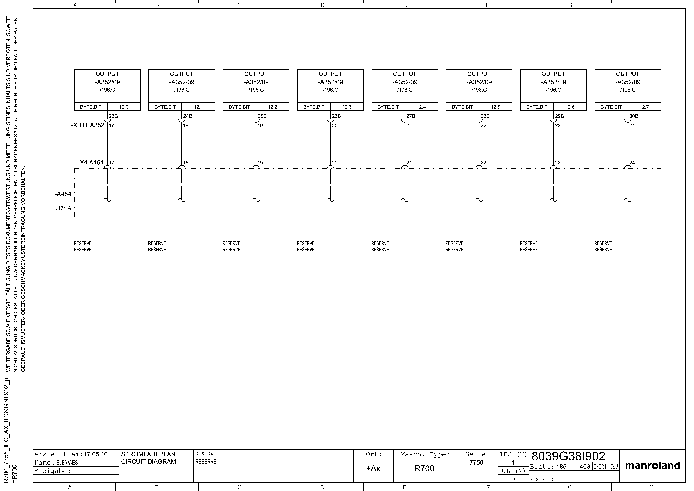

# +Ax — Sheet 185 of 403 — RESERVE

**RESERVE**

> Part of the manroland **R700** printing press IEC/UL circuit diagrams.
> Drawing class: **Stromlaufplan / Circuit diagram** (DIN A3).
> Document `+Ax` covers the **Central control console** machine section.

## At a glance

| Field | Value |
|---|---|
| Document | `+Ax`  (8039G38I902) |
| Sheet | **185** of 403 |
| Section (DE) | RESERVE |
| Section (EN) | RESERVE |
| Section type | CIRCUIT — Circuit diagram |
| Machine type | `R700` |
| Series | `7758` |
| Created | 17.05.10 |
| Replaces | — |
| Columns used | A, B, C, D, E, F, G, H |
| Path numbers | — |
| Labels on sheet | 84 |
| Cross-refs out | 9 |
| Cross-refs in | 25 |

**Previous:** [+Ax sheet 184](SHEET_0184.md) · **Next:** [+Ax sheet 186](SHEET_0186.md) · **Document TOC:** [_TOC.md](_TOC.md)  (+Ax) · **Master TOC:** [all sheets](../_MASTER_TOC.md)

## Sheet image (300 DPI, exact vector render)



_Rendered directly from the PDF vector layer at 300 DPI (1-bit), no OCR and no resampling. Use it to confirm anything ambiguous in the text below._

## Cross-references on this sheet

Each entry is a wire leaving this sheet. The printed token is `/sheet.column`; the link resolves to that sheet inside the same document.

| Ref | Target sheet | Col | Path | Destination on target | Target section | From col |
|---|---|---|---|---|---|---|
| `/196.G` | [+Ax sheet 196](SHEET_0196.md) | G | — | — | REFERENZMODUL | A |
| `/196.G` | [+Ax sheet 196](SHEET_0196.md) | G | — | — | REFERENZMODUL | B |
| `/196.G` | [+Ax sheet 196](SHEET_0196.md) | G | — | — | REFERENZMODUL | C |
| `/196.G` | [+Ax sheet 196](SHEET_0196.md) | G | — | — | REFERENZMODUL | D |
| `/196.G` | [+Ax sheet 196](SHEET_0196.md) | G | — | — | REFERENZMODUL | E |
| `/196.G` | [+Ax sheet 196](SHEET_0196.md) | G | — | — | REFERENZMODUL | F |
| `/196.G` | [+Ax sheet 196](SHEET_0196.md) | G | — | — | REFERENZMODUL | G |
| `/196.G` | [+Ax sheet 196](SHEET_0196.md) | G | — | — | REFERENZMODUL | H |
| `/174.A` | [+Ax sheet 174](SHEET_0174.md) | A | — | — | RESERVE | A |

### Incoming references (sheets that point here)

Every other sheet that sends a wire to this one. `Back-ref` is the token printed on *that* sheet; `Path` is its line number.

| From sheet | Cols | Back-ref | Path | Refs | What continues there |
|---|---|---|---|---|---|
| [+Ax#174](SHEET_0174.md) | A | `/174.A` | — | 1 | — |
| [+Ax#196](SHEET_0196.md) | G | `/196.G` | — | 8 | — |
| [+Ax#229](SHEET_0229.md) | B | `/229.B` | — | 8 | — |
| [+Ax#246](SHEET_0246.md) | H | `/246.H` | — | 8 | — |


## Devices on this sheet

| Tag | Class | Class meaning (IEC) | Col | Sub | Terminal | Sign |
|---|---|---|---|---|---|---|
| `A352/09` | A | Baugruppe / assembly, module, PC board | A | 09 | — | — |
| `A352/09` | A | Baugruppe / assembly, module, PC board | B | 09 | — | — |
| `A352/09` | A | Baugruppe / assembly, module, PC board | C | 09 | — | — |
| `A352/09` | A | Baugruppe / assembly, module, PC board | D | 09 | — | — |
| `A454` | A | Baugruppe / assembly, module, PC board | A | — | — | — |
| `A352/09` | A | Baugruppe / assembly, module, PC board | E | 09 | — | — |
| `A352/09` | A | Baugruppe / assembly, module, PC board | F | 09 | — | — |
| `A352/09` | A | Baugruppe / assembly, module, PC board | G | 09 | — | — |
| `A352/09` | A | Baugruppe / assembly, module, PC board | H | 09 | — | — |
| `XB11.A352` | — | cross-device reference | A | — | — | — |
| `12.0` | — | cross-device reference | B | — | — | — |
| `12.1` | — | cross-device reference | C | — | — | — |
| `12.2` | — | cross-device reference | C | — | — | — |
| `12.3` | — | cross-device reference | D | — | — | — |
| `X4.A454` | — | cross-device reference | A | — | — | — |
| `12.4` | — | cross-device reference | E | — | — | — |
| `12.5` | — | cross-device reference | F | — | — | — |
| `12.6` | — | cross-device reference | G | — | — | — |
| `12.7` | — | cross-device reference | H | — | — | — |

## Potentials / nets

_No named potentials on this sheet._

## Wire-end annotations (grouped as printed)

A wire that continues elsewhere is annotated with a small cluster: the destination description, the path/line number `#NN`, and the `/sheet.column` cross reference. Each row below is one such cluster exactly as it is grouped on the drawing.

| Col | Y | Path | Cross-ref | Text on the wire |
|---|---|---|---|---|
| A | 122.5 | — | — | `OUTPUT` |
| B | 122.5 | — | — | `OUTPUT` |
| C | 122.5 | — | — | `OUTPUT` |
| D | 122.5 | — | — | `OUTPUT` |
| E | 122.5 | — | — | `OUTPUT` |
| F | 122.5 | — | — | `OUTPUT` |
| G | 122.5 | — | — | `OUTPUT` |
| H | 122.5 | — | — | `OUTPUT` |
| A | 136.4 | — | — | `A352/09` |
| B | 136.4 | — | — | `A352/09` |
| C | 136.4 | — | — | `A352/09` |
| D | 136.4 | — | — | `A352/09` |
| E | 136.4 | — | — | `A352/09` |
| F | 136.4 | — | — | `A352/09` |
| G | 136.4 | — | — | `A352/09` |
| H | 136.4 | — | — | `A352/09` |
| A | 150.2 | — | `/196.G` | — |
| B | 150.2 | — | `/196.G` | — |
| C | 150.2 | — | `/196.G` | — |
| D | 150.2 | — | `/196.G` | — |
| E | 150.2 | — | `/196.G` | — |
| F | 150.2 | — | `/196.G` | — |
| G | 150.2 | — | `/196.G` | — |
| H | 150.2 | — | `/196.G` | — |
| A | 179.8 | — | — | `BYTE.BIT 12.0` |
| B | 179.8 | — | — | `BYTE.BIT 12.1` |
| C | 179.8 | — | — | `BYTE.BIT 12.2` |
| D | 179.8 | — | — | `BYTE.BIT 12.3` |
| E | 179.8 | — | — | `BYTE.BIT 12.4` |
| F | 179.8 | — | — | `BYTE.BIT 12.5` |
| G | 179.8 | — | — | `BYTE.BIT 12.6` |
| H | 179.8 | — | — | `BYTE.BIT 12.7` |
| A | 195.2 | — | — | `23B` |
| B | 195.2 | — | — | `24B` |
| C | 195.2 | — | — | `25B` |
| D | 195.2 | — | — | `26B` |
| E | 195.2 | — | — | `27B` |
| F | 195.2 | — | — | `28B` |
| G | 195.2 | — | — | `29B` |
| H | 195.2 | — | — | `30B` |
| C | 210.1 | — | — | `XB11.A352 17 18 19 20` |
| F | 211.5 | — | — | `21 22 23 24` |
| C | 273.9 | — | — | `X4.A454 17 18 19 20` |
| F | 275.3 | — | — | `21 22 23 24` |
| A | 327.7 | — | — | `A454` |
| A | 353.2 | — | `/174.A` | — |
| A | 414.4 | — | — | `RESERVE RESERVE` |
| B | 414.4 | — | — | `RESERVE RESERVE` |
| C | 414.4 | — | — | `RESERVE RESERVE` |
| D | 414.4 | — | — | `RESERVE RESERVE` |
| E | 414.4 | — | — | `RESERVE RESERVE` |
| F | 414.4 | — | — | `RESERVE RESERVE` |
| G | 414.4 | — | — | `RESERVE RESERVE` |
| G | 414.4 | — | — | `RESERVE RESERVE` |


## Reconstructed tables

This sheet carries tabular content (pin map / terminal assignment / index). The grid below was rebuilt from the drawing's own rule lines, so each row is exactly one physical row of the table.

### Table 1 — 1 data rows × 2 columns (at x=127.6, y=119.1)

| OUTPUT | A352/09 /196.G |
|---|---|
| `BYTE.BIT` | `12.0` |


### Table 2 — 1 data rows × 2 columns (at x=255.1, y=119.1)

| OUTPUT | A352/09 /196.G |
|---|---|
| `BYTE.BIT` | `12.1` |


### Table 3 — 1 data rows × 2 columns (at x=382.7, y=119.1)

| OUTPUT | A352/09 /196.G |
|---|---|
| `BYTE.BIT` | `12.2` |


### Table 4 — 1 data rows × 2 columns (at x=510.2, y=119.1)

| OUTPUT | A352/09 /196.G |
|---|---|
| `BYTE.BIT` | `12.3` |


### Table 5 — 1 data rows × 2 columns (at x=637.8, y=119.1)

| OUTPUT | A352/09 /196.G |
|---|---|
| `BYTE.BIT` | `12.4` |


### Table 6 — 1 data rows × 2 columns (at x=765.4, y=119.1)

| OUTPUT | A352/09 /196.G |
|---|---|
| `BYTE.BIT` | `12.5` |


### Table 7 — 1 data rows × 2 columns (at x=892.9, y=119.1)

| OUTPUT | A352/09 /196.G |
|---|---|
| `BYTE.BIT` | `12.6` |


### Table 8 — 1 data rows × 2 columns (at x=1020.5, y=119.1)

| OUTPUT | A352/09 /196.G |
|---|---|
| `BYTE.BIT` | `12.7` |


## Notes and free text on this sheet

| Text | Col | Y (pt) |
|---|---|---|
| `23B` | A | 195.17 |
| `OUTPUT` | A | 122.5 |
| `BYTE.BIT` | A | 179.78 |
| `RESERVE` | A | 414.44 |
| `24B` | B | 195.17 |
| `OUTPUT` | B | 122.5 |
| `BYTE.BIT` | B | 179.78 |
| `RESERVE` | B | 414.44 |
| `25B` | C | 195.17 |
| `OUTPUT` | C | 122.5 |
| `BYTE.BIT` | C | 179.78 |
| `RESERVE` | C | 414.44 |
| `26B` | D | 195.17 |
| `OUTPUT` | D | 122.5 |
| `BYTE.BIT` | D | 179.78 |
| `RESERVE` | D | 414.44 |
| `27B` | E | 195.17 |
| `OUTPUT` | E | 122.5 |
| `BYTE.BIT` | E | 179.78 |
| `RESERVE` | E | 414.44 |
| `28B` | F | 195.17 |
| `OUTPUT` | F | 122.5 |
| `BYTE.BIT` | F | 179.78 |
| `RESERVE` | F | 414.44 |
| `29B` | G | 195.17 |
| `OUTPUT` | G | 122.5 |
| `BYTE.BIT` | G | 179.78 |
| `RESERVE` | G | 414.44 |
| `30B` | H | 195.17 |
| `OUTPUT` | H | 122.5 |

## Complete label inventory (exact text from the drawing)

Every text object inside the drawing area of this sheet, in DIN reading order (column A→H, then top→bottom). This is the authoritative list: if a string is not here it is not printed on this sheet.

| Col | Y | X | Dir | Type | Text |
|---|---|---|---|---|---|
| A | 122.5 | 164.0 | → | text | `OUTPUT` |
| A | 136.4 | 162.9 | → | device tag | `A352/09` |
| A | 150.2 | 171.4 | → | cross-reference | `/196.G` |
| A | 179.8 | 137.5 | → | text | `BYTE.BIT` |
| A | 195.2 | 186.8 | → | text | `23B` |
| A | 210.1 | 121.9 | → | device ref | `XB11.A352` |
| A | 211.5 | 186.2 | → | number | `17` |
| A | 273.9 | 133.5 | → | device ref | `X4.A454` |
| A | 275.3 | 186.2 | → | number | `17` |
| A | 327.7 | 94.1 | → | device tag | `A454` |
| A | 353.2 | 96.4 | → | cross-reference | `/174.A` |
| A | 414.4 | 126.7 | → | text | `RESERVE` |
| A | 425.1 | 126.7 | → | text | `RESERVE` |
| B | 122.5 | 291.5 | → | text | `OUTPUT` |
| B | 136.4 | 290.4 | → | device tag | `A352/09` |
| B | 150.2 | 298.9 | → | cross-reference | `/196.G` |
| B | 179.8 | 204.4 | → | device ref | `12.0` |
| B | 179.8 | 265.0 | → | text | `BYTE.BIT` |
| B | 195.2 | 314.4 | → | text | `24B` |
| B | 211.5 | 313.8 | → | number | `18` |
| B | 275.3 | 313.8 | → | number | `18` |
| B | 414.4 | 254.3 | → | text | `RESERVE` |
| B | 425.1 | 254.3 | → | text | `RESERVE` |
| C | 122.5 | 419.1 | → | text | `OUTPUT` |
| C | 136.4 | 418.0 | → | device tag | `A352/09` |
| C | 150.2 | 426.5 | → | cross-reference | `/196.G` |
| C | 179.8 | 332.5 | → | device ref | `12.1` |
| C | 179.8 | 392.6 | → | text | `BYTE.BIT` |
| C | 179.8 | 459.6 | → | device ref | `12.2` |
| C | 195.2 | 441.9 | → | text | `25B` |
| C | 211.5 | 441.4 | → | number | `19` |
| C | 275.3 | 441.4 | → | number | `19` |
| C | 414.4 | 381.8 | → | text | `RESERVE` |
| C | 425.1 | 381.8 | → | text | `RESERVE` |
| D | 122.5 | 546.7 | → | text | `OUTPUT` |
| D | 136.4 | 545.5 | → | device tag | `A352/09` |
| D | 150.2 | 554.0 | → | cross-reference | `/196.G` |
| D | 179.8 | 520.2 | → | text | `BYTE.BIT` |
| D | 179.8 | 587.1 | → | device ref | `12.3` |
| D | 195.2 | 569.5 | → | text | `26B` |
| D | 211.5 | 569.5 | → | number | `20` |
| D | 275.3 | 569.5 | → | number | `20` |
| D | 414.4 | 509.4 | → | text | `RESERVE` |
| D | 425.1 | 509.4 | → | text | `RESERVE` |
| E | 122.5 | 674.2 | → | text | `OUTPUT` |
| E | 136.4 | 673.1 | → | device tag | `A352/09` |
| E | 150.2 | 681.6 | → | cross-reference | `/196.G` |
| E | 179.8 | 647.7 | → | text | `BYTE.BIT` |
| E | 179.8 | 714.6 | → | device ref | `12.4` |
| E | 195.2 | 697.0 | → | text | `27B` |
| E | 211.5 | 697.0 | → | number | `21` |
| E | 275.3 | 697.0 | → | number | `21` |
| E | 414.4 | 636.9 | → | text | `RESERVE` |
| E | 425.1 | 636.9 | → | text | `RESERVE` |
| F | 122.5 | 801.8 | → | text | `OUTPUT` |
| F | 136.4 | 800.6 | → | device tag | `A352/09` |
| F | 150.2 | 809.1 | → | cross-reference | `/196.G` |
| F | 179.8 | 775.3 | → | text | `BYTE.BIT` |
| F | 179.8 | 842.2 | → | device ref | `12.5` |
| F | 195.2 | 824.6 | → | text | `28B` |
| F | 211.5 | 824.6 | → | number | `22` |
| F | 275.3 | 824.6 | → | number | `22` |
| F | 414.4 | 764.5 | → | text | `RESERVE` |
| F | 425.1 | 764.5 | → | text | `RESERVE` |
| G | 122.5 | 929.3 | → | text | `OUTPUT` |
| G | 136.4 | 928.2 | → | device tag | `A352/09` |
| G | 150.2 | 936.7 | → | cross-reference | `/196.G` |
| G | 179.8 | 902.8 | → | text | `BYTE.BIT` |
| G | 179.8 | 969.7 | → | device ref | `12.6` |
| G | 179.8 | 1030.4 | → | text | `BYTE.BIT` |
| G | 195.2 | 952.2 | → | text | `29B` |
| G | 211.5 | 952.2 | → | number | `23` |
| G | 275.3 | 952.2 | → | number | `23` |
| G | 414.4 | 892.1 | → | text | `RESERVE` |
| G | 414.4 | 1019.6 | → | text | `RESERVE` |
| G | 425.1 | 892.1 | → | text | `RESERVE` |
| G | 425.1 | 1019.6 | → | text | `RESERVE` |
| H | 122.5 | 1056.9 | → | text | `OUTPUT` |
| H | 136.4 | 1055.8 | → | device tag | `A352/09` |
| H | 150.2 | 1064.3 | → | cross-reference | `/196.G` |
| H | 179.8 | 1097.3 | → | device ref | `12.7` |
| H | 195.2 | 1079.7 | → | text | `30B` |
| H | 211.5 | 1079.7 | → | number | `24` |
| H | 275.3 | 1079.7 | → | number | `24` |

## Reading-order text block

The same content as a plain block, grouped by DIN column — convenient to paste or to match against a visual description.

```text
=== Column A ===
 122.5  164.0  text         OUTPUT
 136.4  162.9  devtag       A352/09
 150.2  171.4  xref         /196.G
 179.8  137.5  text         BYTE.BIT
 195.2  186.8  text         23B
 210.1  121.9  devref       XB11.A352
 211.5  186.2  numeric      17
 273.9  133.5  devref       X4.A454
 275.3  186.2  numeric      17
 327.7   94.1  devtag       A454
 353.2   96.4  xref         /174.A
 414.4  126.7  text         RESERVE
 425.1  126.7  text         RESERVE
=== Column B ===
 122.5  291.5  text         OUTPUT
 136.4  290.4  devtag       A352/09
 150.2  298.9  xref         /196.G
 179.8  204.4  devref       12.0
 179.8  265.0  text         BYTE.BIT
 195.2  314.4  text         24B
 211.5  313.8  numeric      18
 275.3  313.8  numeric      18
 414.4  254.3  text         RESERVE
 425.1  254.3  text         RESERVE
=== Column C ===
 122.5  419.1  text         OUTPUT
 136.4  418.0  devtag       A352/09
 150.2  426.5  xref         /196.G
 179.8  332.5  devref       12.1
 179.8  392.6  text         BYTE.BIT
 179.8  459.6  devref       12.2
 195.2  441.9  text         25B
 211.5  441.4  numeric      19
 275.3  441.4  numeric      19
 414.4  381.8  text         RESERVE
 425.1  381.8  text         RESERVE
=== Column D ===
 122.5  546.7  text         OUTPUT
 136.4  545.5  devtag       A352/09
 150.2  554.0  xref         /196.G
 179.8  520.2  text         BYTE.BIT
 179.8  587.1  devref       12.3
 195.2  569.5  text         26B
 211.5  569.5  numeric      20
 275.3  569.5  numeric      20
 414.4  509.4  text         RESERVE
 425.1  509.4  text         RESERVE
=== Column E ===
 122.5  674.2  text         OUTPUT
 136.4  673.1  devtag       A352/09
 150.2  681.6  xref         /196.G
 179.8  647.7  text         BYTE.BIT
 179.8  714.6  devref       12.4
 195.2  697.0  text         27B
 211.5  697.0  numeric      21
 275.3  697.0  numeric      21
 414.4  636.9  text         RESERVE
 425.1  636.9  text         RESERVE
=== Column F ===
 122.5  801.8  text         OUTPUT
 136.4  800.6  devtag       A352/09
 150.2  809.1  xref         /196.G
 179.8  775.3  text         BYTE.BIT
 179.8  842.2  devref       12.5
 195.2  824.6  text         28B
 211.5  824.6  numeric      22
 275.3  824.6  numeric      22
 414.4  764.5  text         RESERVE
 425.1  764.5  text         RESERVE
=== Column G ===
 122.5  929.3  text         OUTPUT
 136.4  928.2  devtag       A352/09
 150.2  936.7  xref         /196.G
 179.8  902.8  text         BYTE.BIT
 179.8  969.7  devref       12.6
 179.8 1030.4  text         BYTE.BIT
 195.2  952.2  text         29B
 211.5  952.2  numeric      23
 275.3  952.2  numeric      23
 414.4  892.1  text         RESERVE
 414.4 1019.6  text         RESERVE
 425.1  892.1  text         RESERVE
 425.1 1019.6  text         RESERVE
=== Column H ===
 122.5 1056.9  text         OUTPUT
 136.4 1055.8  devtag       A352/09
 150.2 1064.3  xref         /196.G
 179.8 1097.3  devref       12.7
 195.2 1079.7  text         30B
 211.5 1079.7  numeric      24
 275.3 1079.7  numeric      24
```

---
_Generated from the PDF vector text layer; no OCR. Source: `R700_7758_IEC_AX_8039G38I902_p`, sheet 185._
