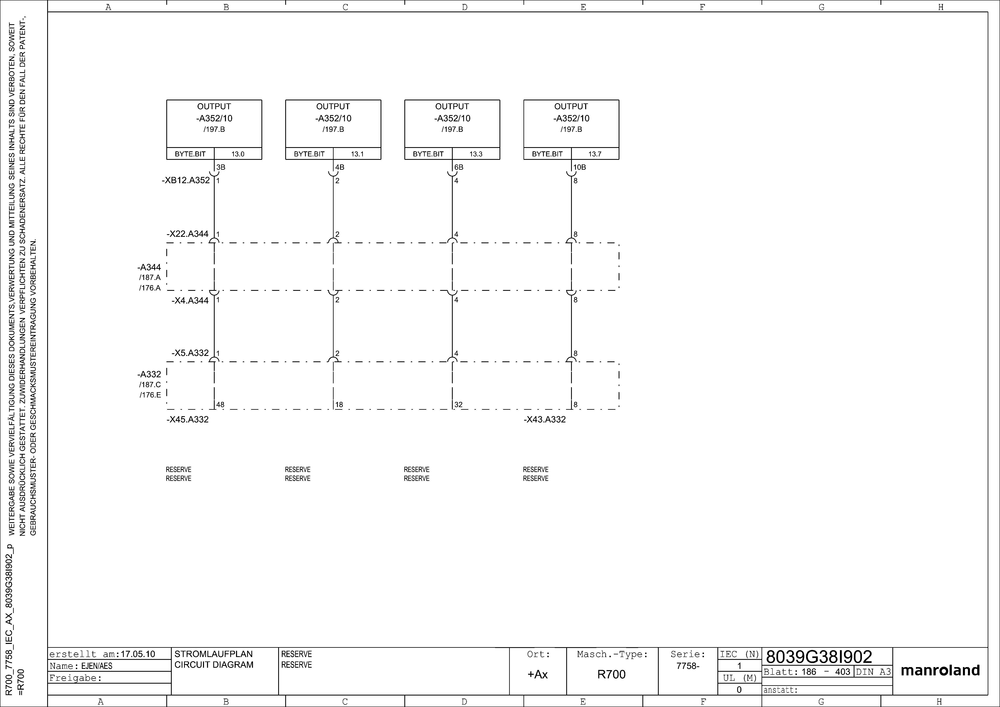

# +Ax — Sheet 186 of 403 — RESERVE

**RESERVE**

> Part of the manroland **R700** printing press IEC/UL circuit diagrams.
> Drawing class: **Stromlaufplan / Circuit diagram** (DIN A3).
> Document `+Ax` covers the **Central control console** machine section.

## At a glance

| Field | Value |
|---|---|
| Document | `+Ax`  (8039G38I902) |
| Sheet | **186** of 403 |
| Section (DE) | RESERVE |
| Section (EN) | RESERVE |
| Section type | CIRCUIT — Circuit diagram |
| Machine type | `R700` |
| Series | `7758` |
| Created | 17.05.10 |
| Replaces | — |
| Columns used | A, B, C, D, E |
| Path numbers | — |
| Labels on sheet | 64 |
| Cross-refs out | 8 |
| Cross-refs in | 28 |

**Previous:** [+Ax sheet 185](SHEET_0185.md) · **Next:** [+Ax sheet 187](SHEET_0187.md) · **Document TOC:** [_TOC.md](_TOC.md)  (+Ax) · **Master TOC:** [all sheets](../_MASTER_TOC.md)

## Sheet image (300 DPI, exact vector render)



_Rendered directly from the PDF vector layer at 300 DPI (1-bit), no OCR and no resampling. Use it to confirm anything ambiguous in the text below._

## Cross-references on this sheet

Each entry is a wire leaving this sheet. The printed token is `/sheet.column`; the link resolves to that sheet inside the same document.

| Ref | Target sheet | Col | Path | Destination on target | Target section | From col |
|---|---|---|---|---|---|---|
| `/197.B` | [+Ax sheet 197](SHEET_0197.md) | B | — | — | REFERENZMODUL | B |
| `/197.B` | [+Ax sheet 197](SHEET_0197.md) | B | — | — | REFERENZMODUL | C |
| `/197.B` | [+Ax sheet 197](SHEET_0197.md) | B | — | — | REFERENZMODUL | D |
| `/197.B` | [+Ax sheet 197](SHEET_0197.md) | B | — | — | REFERENZMODUL | E |
| `/187.A` | [+Ax sheet 187](SHEET_0187.md) | A | — | — | RESERVE | A |
| `/176.A` | [+Ax sheet 176](SHEET_0176.md) | A | — | — | RESERVE | A |
| `/187.C` | [+Ax sheet 187](SHEET_0187.md) | C | — | — | RESERVE | A |
| `/176.E` | [+Ax sheet 176](SHEET_0176.md) | E | — | — | RESERVE | A |

### Incoming references (sheets that point here)

Every other sheet that sends a wire to this one. `Back-ref` is the token printed on *that* sheet; `Path` is its line number.

| From sheet | Cols | Back-ref | Path | Refs | What continues there |
|---|---|---|---|---|---|
| [+Ax#176](SHEET_0176.md) | A, D | `/176.A`, `/176.D` | — | 2 | — |
| [+Ax#187](SHEET_0187.md) | A, C | `/187.A`, `/187.C` | — | 2 | 2 |
| [+Ax#197](SHEET_0197.md) | B | `/197.B` | — | 4 | — |
| [+Ax#226](SHEET_0226.md) | H | `/226.H` | — | 4 | — |
| [+Ax#230](SHEET_0230.md) | F | `/230.F` | — | 4 | — |
| [+Ax#248](SHEET_0248.md) | E | `/248.E` | — | 4 | — |
| [+Ax#262](SHEET_0262.md) | E | `/262.E` | — | 4 | — |
| [+Ax#281](SHEET_0281.md) | E | `/281.E` | — | 1 | — |
| [+Ax#282](SHEET_0282.md) | A, B | `/282.A`, `/282.B` | — | 3 | — |


## Devices on this sheet

| Tag | Class | Class meaning (IEC) | Col | Sub | Terminal | Sign |
|---|---|---|---|---|---|---|
| `A352/10` | A | Baugruppe / assembly, module, PC board | B | 10 | — | — |
| `A352/10` | A | Baugruppe / assembly, module, PC board | C | 10 | — | — |
| `A344` | A | Baugruppe / assembly, module, PC board | A | — | — | — |
| `A332` | A | Baugruppe / assembly, module, PC board | A | — | — | — |
| `A352/10` | A | Baugruppe / assembly, module, PC board | D | 10 | — | — |
| `A352/10` | A | Baugruppe / assembly, module, PC board | E | 10 | — | — |
| `XB12.A352` | — | cross-device reference | B | — | — | — |
| `13.0` | — | cross-device reference | B | — | — | — |
| `13.1` | — | cross-device reference | C | — | — | — |
| `X22.A344` | — | cross-device reference | B | — | — | — |
| `X4.A344` | — | cross-device reference | B | — | — | — |
| `X5.A332` | — | cross-device reference | B | — | — | — |
| `13.3` | — | cross-device reference | D | — | — | — |
| `13.7` | — | cross-device reference | E | — | — | — |
| `X45.A332` | — | cross-device reference | B | — | — | — |
| `X43.A332` | — | cross-device reference | E | — | — | — |

## Potentials / nets

_No named potentials on this sheet._

## Wire-end annotations (grouped as printed)

A wire that continues elsewhere is annotated with a small cluster: the destination description, the path/line number `#NN`, and the `/sheet.column` cross reference. Each row below is one such cluster exactly as it is grouped on the drawing.

| Col | Y | Path | Cross-ref | Text on the wire |
|---|---|---|---|---|
| B | 122.5 | — | — | `OUTPUT` |
| C | 122.5 | — | — | `OUTPUT` |
| D | 122.5 | — | — | `OUTPUT` |
| E | 122.5 | — | — | `OUTPUT` |
| B | 136.4 | — | — | `A352/10` |
| C | 136.4 | — | — | `A352/10` |
| D | 136.4 | — | — | `A352/10` |
| E | 136.4 | — | — | `A352/10` |
| B | 150.2 | — | `/197.B` | — |
| C | 150.2 | — | `/197.B` | — |
| D | 150.2 | — | `/197.B` | — |
| E | 150.2 | — | `/197.B` | — |
| B | 179.8 | — | — | `BYTE.BIT 13.0` |
| C | 179.8 | — | — | `BYTE.BIT 13.1` |
| D | 179.8 | — | — | `BYTE.BIT 13.3` |
| E | 179.8 | — | — | `BYTE.BIT 13.7` |
| B | 195.2 | — | — | `3B` |
| C | 195.2 | — | — | `4B` |
| D | 195.2 | — | — | `6B` |
| E | 195.2 | — | — | `10B` |
| B | 210.1 | — | — | `XB12.A352 1` |
| C | 211.5 | — | — | `2` |
| D | 211.5 | — | — | `4` |
| E | 211.5 | — | — | `8` |
| B | 273.9 | — | — | `X22.A344 1` |
| C | 275.3 | — | — | `2` |
| D | 275.3 | — | — | `4` |
| E | 275.3 | — | — | `8` |
| A | 313.5 | — | — | `A344` |
| A | 326.6 | — | `/187.A`, `/176.A` | — |
| B | 353.2 | — | — | `X4.A344 1` |
| C | 353.2 | — | — | `2` |
| D | 353.2 | — | — | `4` |
| E | 353.2 | — | — | `8` |
| B | 415.6 | — | — | `X5.A332 1` |
| C | 417.0 | — | — | `2` |
| D | 417.0 | — | — | `4` |
| E | 417.0 | — | — | `8` |
| A | 441.1 | — | — | `A332` |
| A | 454.2 | — | `/187.C` | — |
| A | 466.6 | — | `/176.E` | — |
| B | 478.0 | — | — | `48` |
| C | 478.0 | — | — | `18` |
| D | 478.0 | — | — | `32` |
| E | 478.0 | — | — | `8` |
| C | 494.9 | — | — | `X45.A332 X43.A332` |
| B | 556.2 | — | — | `RESERVE RESERVE` |
| C | 556.2 | — | — | `RESERVE RESERVE` |
| D | 556.2 | — | — | `RESERVE RESERVE` |
| E | 556.2 | — | — | `RESERVE RESERVE` |


## Reconstructed tables

This sheet carries tabular content (pin map / terminal assignment / index). The grid below was rebuilt from the drawing's own rule lines, so each row is exactly one physical row of the table.

### Table 1 — 1 data rows × 2 columns (at x=198.4, y=119.1)

| OUTPUT | A352/10 /197.B |
|---|---|
| `BYTE.BIT` | `13.0` |


### Table 2 — 1 data rows × 2 columns (at x=340.2, y=119.1)

| OUTPUT | A352/10 /197.B |
|---|---|
| `BYTE.BIT` | `13.1` |


### Table 3 — 1 data rows × 2 columns (at x=481.9, y=119.1)

| OUTPUT | A352/10 /197.B |
|---|---|
| `BYTE.BIT` | `13.3` |


### Table 4 — 1 data rows × 2 columns (at x=623.6, y=119.1)

| OUTPUT | A352/10 /197.B |
|---|---|
| `BYTE.BIT` | `13.7` |


## Notes and free text on this sheet

| Text | Col | Y (pt) |
|---|---|---|
| `3B` | B | 195.15 |
| `OUTPUT` | B | 122.5 |
| `BYTE.BIT` | B | 179.78 |
| `RESERVE` | B | 556.18 |
| `4B` | C | 195.15 |
| `OUTPUT` | C | 122.5 |
| `BYTE.BIT` | C | 179.78 |
| `RESERVE` | C | 556.18 |
| `6B` | D | 195.15 |
| `OUTPUT` | D | 122.5 |
| `BYTE.BIT` | D | 179.78 |
| `RESERVE` | D | 556.18 |
| `10B` | E | 195.17 |
| `OUTPUT` | E | 122.5 |
| `BYTE.BIT` | E | 179.78 |
| `RESERVE` | E | 556.18 |

## Complete label inventory (exact text from the drawing)

Every text object inside the drawing area of this sheet, in DIN reading order (column A→H, then top→bottom). This is the authoritative list: if a string is not here it is not printed on this sheet.

| Col | Y | X | Dir | Type | Text |
|---|---|---|---|---|---|
| A | 313.5 | 163.6 | → | device tag | `A344` |
| A | 326.6 | 165.8 | → | cross-reference | `/187.A` |
| A | 339.0 | 165.8 | → | cross-reference | `/176.A` |
| A | 441.1 | 163.6 | → | device tag | `A332` |
| A | 454.2 | 165.8 | → | cross-reference | `/187.C` |
| A | 466.6 | 166.4 | → | cross-reference | `/176.E` |
| B | 122.5 | 234.9 | → | text | `OUTPUT` |
| B | 136.4 | 233.7 | → | device tag | `A352/10` |
| B | 150.1 | 242.5 | → | cross-reference | `/197.B` |
| B | 179.8 | 208.3 | → | text | `BYTE.BIT` |
| B | 179.8 | 275.2 | → | device ref | `13.0` |
| B | 195.2 | 257.7 | → | text | `3B` |
| B | 210.1 | 192.8 | → | device ref | `XB12.A352` |
| B | 211.5 | 257.1 | → | number | `1` |
| B | 273.8 | 198.4 | → | device ref | `X22.A344` |
| B | 275.3 | 257.1 | → | number | `1` |
| B | 353.2 | 204.4 | → | device ref | `X4.A344` |
| B | 353.2 | 257.1 | → | number | `1` |
| B | 415.6 | 204.4 | → | device ref | `X5.A332` |
| B | 417.0 | 257.1 | → | number | `1` |
| B | 478.0 | 257.7 | → | number | `48` |
| B | 495.0 | 198.4 | → | device ref | `X45.A332` |
| B | 556.2 | 197.6 | → | text | `RESERVE` |
| B | 566.8 | 197.6 | → | text | `RESERVE` |
| C | 122.5 | 376.6 | → | text | `OUTPUT` |
| C | 136.4 | 375.4 | → | device tag | `A352/10` |
| C | 150.1 | 384.2 | → | cross-reference | `/197.B` |
| C | 179.8 | 350.1 | → | text | `BYTE.BIT` |
| C | 179.8 | 417.5 | → | device ref | `13.1` |
| C | 195.2 | 399.4 | → | text | `4B` |
| C | 211.5 | 399.4 | → | number | `2` |
| C | 275.3 | 399.4 | → | number | `2` |
| C | 353.2 | 399.4 | → | number | `2` |
| C | 417.0 | 399.4 | → | number | `2` |
| C | 478.0 | 398.8 | → | number | `18` |
| C | 556.2 | 339.3 | → | text | `RESERVE` |
| C | 566.8 | 339.3 | → | text | `RESERVE` |
| D | 122.5 | 518.3 | → | text | `OUTPUT` |
| D | 136.4 | 517.2 | → | device tag | `A352/10` |
| D | 150.1 | 526.0 | → | cross-reference | `/197.B` |
| D | 179.8 | 491.8 | → | text | `BYTE.BIT` |
| D | 179.8 | 558.7 | → | device ref | `13.3` |
| D | 195.2 | 541.1 | → | text | `6B` |
| D | 211.5 | 541.1 | → | number | `4` |
| D | 275.3 | 541.1 | → | number | `4` |
| D | 353.2 | 541.1 | → | number | `4` |
| D | 417.0 | 541.1 | → | number | `4` |
| D | 478.0 | 541.1 | → | number | `32` |
| D | 556.2 | 481.0 | → | text | `RESERVE` |
| D | 566.8 | 481.0 | → | text | `RESERVE` |
| E | 122.5 | 660.0 | → | text | `OUTPUT` |
| E | 136.4 | 658.9 | → | device tag | `A352/10` |
| E | 150.1 | 667.7 | → | cross-reference | `/197.B` |
| E | 179.8 | 633.5 | → | text | `BYTE.BIT` |
| E | 179.8 | 700.4 | → | device ref | `13.7` |
| E | 195.2 | 682.3 | → | text | `10B` |
| E | 211.5 | 682.9 | → | number | `8` |
| E | 275.3 | 682.9 | → | number | `8` |
| E | 353.2 | 682.9 | → | number | `8` |
| E | 417.0 | 682.9 | → | number | `8` |
| E | 478.0 | 682.9 | → | number | `8` |
| E | 495.0 | 623.6 | → | device ref | `X43.A332` |
| E | 556.2 | 622.8 | → | text | `RESERVE` |
| E | 566.8 | 622.8 | → | text | `RESERVE` |

## Reading-order text block

The same content as a plain block, grouped by DIN column — convenient to paste or to match against a visual description.

```text
=== Column A ===
 313.5  163.6  devtag       A344
 326.6  165.8  xref         /187.A
 339.0  165.8  xref         /176.A
 441.1  163.6  devtag       A332
 454.2  165.8  xref         /187.C
 466.6  166.4  xref         /176.E
=== Column B ===
 122.5  234.9  text         OUTPUT
 136.4  233.7  devtag       A352/10
 150.1  242.5  xref         /197.B
 179.8  208.3  text         BYTE.BIT
 179.8  275.2  devref       13.0
 195.2  257.7  text         3B
 210.1  192.8  devref       XB12.A352
 211.5  257.1  numeric      1
 273.8  198.4  devref       X22.A344
 275.3  257.1  numeric      1
 353.2  204.4  devref       X4.A344
 353.2  257.1  numeric      1
 415.6  204.4  devref       X5.A332
 417.0  257.1  numeric      1
 478.0  257.7  numeric      48
 495.0  198.4  devref       X45.A332
 556.2  197.6  text         RESERVE
 566.8  197.6  text         RESERVE
=== Column C ===
 122.5  376.6  text         OUTPUT
 136.4  375.4  devtag       A352/10
 150.1  384.2  xref         /197.B
 179.8  350.1  text         BYTE.BIT
 179.8  417.5  devref       13.1
 195.2  399.4  text         4B
 211.5  399.4  numeric      2
 275.3  399.4  numeric      2
 353.2  399.4  numeric      2
 417.0  399.4  numeric      2
 478.0  398.8  numeric      18
 556.2  339.3  text         RESERVE
 566.8  339.3  text         RESERVE
=== Column D ===
 122.5  518.3  text         OUTPUT
 136.4  517.2  devtag       A352/10
 150.1  526.0  xref         /197.B
 179.8  491.8  text         BYTE.BIT
 179.8  558.7  devref       13.3
 195.2  541.1  text         6B
 211.5  541.1  numeric      4
 275.3  541.1  numeric      4
 353.2  541.1  numeric      4
 417.0  541.1  numeric      4
 478.0  541.1  numeric      32
 556.2  481.0  text         RESERVE
 566.8  481.0  text         RESERVE
=== Column E ===
 122.5  660.0  text         OUTPUT
 136.4  658.9  devtag       A352/10
 150.1  667.7  xref         /197.B
 179.8  633.5  text         BYTE.BIT
 179.8  700.4  devref       13.7
 195.2  682.3  text         10B
 211.5  682.9  numeric      8
 275.3  682.9  numeric      8
 353.2  682.9  numeric      8
 417.0  682.9  numeric      8
 478.0  682.9  numeric      8
 495.0  623.6  devref       X43.A332
 556.2  622.8  text         RESERVE
 566.8  622.8  text         RESERVE
```

---
_Generated from the PDF vector text layer; no OCR. Source: `R700_7758_IEC_AX_8039G38I902_p`, sheet 186._
