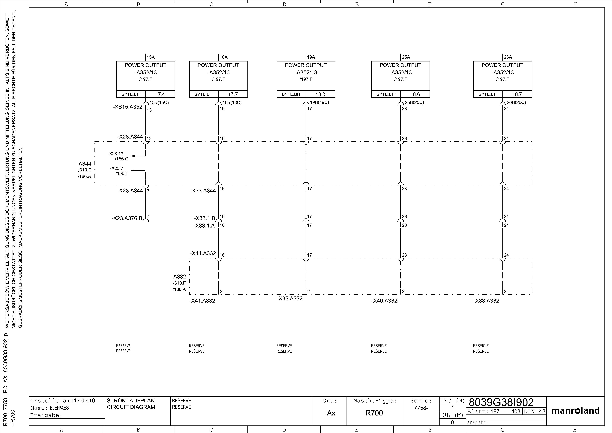

# +Ax — Sheet 187 of 403 — RESERVE

**RESERVE**

> Part of the manroland **R700** printing press IEC/UL circuit diagrams.
> Drawing class: **Stromlaufplan / Circuit diagram** (DIN A3).
> Document `+Ax` covers the **Central control console** machine section.

## At a glance

| Field | Value |
|---|---|
| Document | `+Ax`  (8039G38I902) |
| Sheet | **187** of 403 |
| Section (DE) | RESERVE |
| Section (EN) | RESERVE |
| Section type | CIRCUIT — Circuit diagram |
| Machine type | `R700` |
| Series | `7758` |
| Created | 17.05.10 |
| Replaces | — |
| Columns used | A, B, C, D, E, F, G |
| Path numbers | — |
| Labels on sheet | 99 |
| Cross-refs out | 11 |
| Cross-refs in | 43 |

**Previous:** [+Ax sheet 186](SHEET_0186.md) · **Next:** [+Ax sheet 188](SHEET_0188.md) · **Document TOC:** [_TOC.md](_TOC.md)  (+Ax) · **Master TOC:** [all sheets](../_MASTER_TOC.md)

## Sheet image (300 DPI, exact vector render)



_Rendered directly from the PDF vector layer at 300 DPI (1-bit), no OCR and no resampling. Use it to confirm anything ambiguous in the text below._

## Cross-references on this sheet

Each entry is a wire leaving this sheet. The printed token is `/sheet.column`; the link resolves to that sheet inside the same document.

| Ref | Target sheet | Col | Path | Destination on target | Target section | From col |
|---|---|---|---|---|---|---|
| `/197.F` | [+Ax sheet 197](SHEET_0197.md) | F | — | — | REFERENZMODUL | B |
| `/197.F` | [+Ax sheet 197](SHEET_0197.md) | F | — | — | REFERENZMODUL | C |
| `/197.F` | [+Ax sheet 197](SHEET_0197.md) | F | — | — | REFERENZMODUL | D |
| `/197.F` | [+Ax sheet 197](SHEET_0197.md) | F | — | — | REFERENZMODUL | F |
| `/197.F` | [+Ax sheet 197](SHEET_0197.md) | F | — | — | REFERENZMODUL | G |
| `/156.G` | [+Ax sheet 156](SHEET_0156.md) | G | — | X28:13 | ÜBERWACHUNGSRECHNER/ANSTEUERUNG NOT AUS | B |
| `/156.F` | [+Ax sheet 156](SHEET_0156.md) | F | — | X23:7 | ÜBERWACHUNGSRECHNER/ANSTEUERUNG NOT AUS | B |
| `/310.E` | [+Ax sheet 310](SHEET_0310.md) | E | — | — | OPTION: IONISATIONSANLAGE ANLEGER | A |
| `/186.A` | [+Ax sheet 186](SHEET_0186.md) | A | — | — | RESERVE | A |
| `/310.F` | [+Ax sheet 310](SHEET_0310.md) | F | — | 2 | OPTION: IONISATIONSANLAGE ANLEGER | C |
| `/186.A` | [+Ax sheet 186](SHEET_0186.md) | A | — | 2 | RESERVE | C |

### Incoming references (sheets that point here)

Every other sheet that sends a wire to this one. `Back-ref` is the token printed on *that* sheet; `Path` is its line number.

| From sheet | Cols | Back-ref | Path | Refs | What continues there |
|---|---|---|---|---|---|
| [+Ax#156](SHEET_0156.md) | F, G | `/156.F`, `/156.G` | — | 2 | — |
| [+Ax#186](SHEET_0186.md) | A | `/186.A` | — | 2 | — |
| [+Ax#197](SHEET_0197.md) | F | `/197.F` | — | 5 | — |
| [+Ax#253](SHEET_0253.md) | A | `/253.A` | — | 5 | — |
| [+Ax#264](SHEET_0264.md) | B, E | `/264.B`, `/264.E` | — | 2 | — |
| [+Ax#271](SHEET_0271.md) | H | `/271.H` | — | 5 | — |
| [+Ax#276](SHEET_0276.md) | A, B, C, E | `/276.A`, `/276.B`, `/276.C`, `/276.E` | — | 13 | — |
| [+Ax#278](SHEET_0278.md) | D | `/278.D` | — | 1 | — |
| [+Ax#280](SHEET_0280.md) | D, E | `/280.D`, `/280.E` | — | 2 | — |
| [+Ax#281](SHEET_0281.md) | H | `/281.H` | — | 4 | — |
| [+Ax#310](SHEET_0310.md) | E, F | `/310.E`, `/310.F` | — | 2 | — |


## Devices on this sheet

| Tag | Class | Class meaning (IEC) | Col | Sub | Terminal | Sign |
|---|---|---|---|---|---|---|
| `A352/13` | A | Baugruppe / assembly, module, PC board | B | 13 | — | — |
| `A344` | A | Baugruppe / assembly, module, PC board | A | — | — | — |
| `A352/13` | A | Baugruppe / assembly, module, PC board | C | 13 | — | — |
| `A352/13` | A | Baugruppe / assembly, module, PC board | D | 13 | — | — |
| `A352/13` | A | Baugruppe / assembly, module, PC board | G | 13 | — | — |
| `A352/13` | A | Baugruppe / assembly, module, PC board | F | 13 | — | — |
| `A332` | A | Baugruppe / assembly, module, PC board | C | — | — | — |
| `X23:7` | X | Klemme / terminal, plug connector | B | — | 7 | — |
| `X28:13` | X | Klemme / terminal, plug connector | B | — | 13 | — |
| `17.4` | — | cross-device reference | B | — | — | — |
| `XB15.A352` | — | cross-device reference | B | — | — | — |
| `X28.A344` | — | cross-device reference | B | — | — | — |
| `X23.A344` | — | cross-device reference | B | — | — | — |
| `X23.A376.B` | — | cross-device reference | B | — | — | — |
| `17.7` | — | cross-device reference | C | — | — | — |
| `X33.A344` | — | cross-device reference | C | — | — | — |
| `18.0` | — | cross-device reference | D | — | — | — |
| `18.7` | — | cross-device reference | G | — | — | — |
| `18.6` | — | cross-device reference | F | — | — | — |
| `X33.1.B` | — | cross-device reference | C | — | — | — |
| `X33.1.A` | — | cross-device reference | C | — | — | — |
| `X44.A332` | — | cross-device reference | C | — | — | — |
| `X33.A332` | — | cross-device reference | G | — | — | — |
| `X40.A332` | — | cross-device reference | E | — | — | — |
| `X41.A332` | — | cross-device reference | C | — | — | — |
| `X35.A332` | — | cross-device reference | D | — | — | — |

## Potentials / nets

_No named potentials on this sheet._

## Wire-end annotations (grouped as printed)

A wire that continues elsewhere is annotated with a small cluster: the destination description, the path/line number `#NN`, and the `/sheet.column` cross reference. Each row below is one such cluster exactly as it is grouped on the drawing.

| Col | Y | Path | Cross-ref | Text on the wire |
|---|---|---|---|---|
| B | 107.3 | — | — | `15A` |
| C | 107.3 | — | — | `18A` |
| D | 107.3 | — | — | `19A` |
| F | 107.3 | — | — | `25A` |
| G | 107.3 | — | — | `26A` |
| B | 122.5 | — | — | `POWER OUTPUT` |
| C | 122.5 | — | — | `POWER OUTPUT` |
| D | 122.5 | — | — | `POWER OUTPUT` |
| F | 122.5 | — | — | `POWER OUTPUT` |
| G | 122.5 | — | — | `POWER OUTPUT` |
| B | 136.4 | — | — | `A352/13` |
| C | 136.4 | — | — | `A352/13` |
| D | 136.4 | — | — | `A352/13` |
| F | 136.4 | — | — | `A352/13` |
| G | 136.4 | — | — | `A352/13` |
| B | 150.2 | — | `/197.F` | — |
| C | 150.2 | — | `/197.F` | — |
| D | 150.2 | — | `/197.F` | — |
| F | 150.2 | — | `/197.F` | — |
| G | 150.2 | — | `/197.F` | — |
| B | 179.2 | — | — | `BYTE.BIT 17.4` |
| C | 179.2 | — | — | `BYTE.BIT 17.7` |
| D | 179.2 | — | — | `BYTE.BIT 18.0` |
| F | 179.2 | — | — | `BYTE.BIT 18.6` |
| G | 179.2 | — | — | `BYTE.BIT 18.7` |
| B | 195.2 | — | — | `15B(15C)` |
| C | 195.2 | — | — | `18B(18C)` |
| D | 195.2 | — | — | `19B(19C)` |
| F | 195.2 | — | — | `25B(25C)` |
| G | 195.2 | — | — | `26B(26C)` |
| B | 203.0 | — | — | `XB15.A352 13` |
| C | 207.2 | — | — | `16` |
| D | 207.2 | — | — | `17` |
| F | 207.2 | — | — | `23` |
| G | 207.2 | — | — | `24` |
| B | 261.1 | — | — | `X28.A344 13` |
| C | 265.4 | — | — | `16` |
| D | 265.4 | — | — | `17` |
| F | 265.4 | — | — | `23` |
| G | 265.4 | — | — | `24` |
| B | 295.1 | — | `/156.G` | `X28:13` |
| A | 313.5 | — | — | `A344` |
| B | 323.4 | — | `/156.F` | `X23:7` |
| A | 326.6 | — | `/310.E`, `/186.A` | — |
| C | 363.2 | — | — | `X33.A344 16` |
| F | 363.2 | — | — | `17 23 24` |
| B | 366.0 | — | — | `X23.A344 7` |
| B | 417.0 | — | — | `X23.A376.B 7` |
| C | 417.0 | — | — | `X33.1.B 16` |
| D | 417.0 | — | — | `17` |
| F | 417.0 | — | — | `23` |
| G | 417.0 | — | — | `24` |
| C | 434.0 | — | — | `X33.1.A 16` |
| D | 434.0 | — | — | `17` |
| F | 434.0 | — | — | `23` |
| G | 434.0 | — | — | `24` |
| D | 487.9 | — | — | `X44.A332 16 17` |
| F | 492.1 | — | — | `23 24` |
| C | 533.2 | — | — | `A332` |
| C | 546.3 | — | `/310.F`, `/186.A` | `2` |
| D | 563.0 | — | — | `2` |
| F | 563.0 | — | — | `2` |
| G | 563.0 | — | — | `2` |
| E | 575.7 | — | — | `X41.A332 X35.A332 X40.A332 X33.A332` |
| C | 669.6 | — | — | `RESERVE RESERVE` |
| D | 669.6 | — | — | `RESERVE RESERVE` |
| E | 669.6 | — | — | `RESERVE RESERVE` |
| G | 669.6 | — | — | `RESERVE RESERVE` |
| B | 669.8 | — | — | `RESERVE RESERVE` |


## Reconstructed tables

This sheet carries tabular content (pin map / terminal assignment / index). The grid below was rebuilt from the drawing's own rule lines, so each row is exactly one physical row of the table.

### Table 1 — 1 data rows × 2 columns (at x=226.8, y=119.1)

| POWER | OUTPUT A352/13 /197.F |
|---|---|
| `BYTE.BIT` | `17.4` |


### Table 2 — 1 data rows × 2 columns (at x=368.5, y=119.1)

| POWER | OUTPUT A352/13 /197.F |
|---|---|
| `BYTE.BIT` | `17.7` |


### Table 3 — 1 data rows × 2 columns (at x=538.6, y=119.1)

| POWER | OUTPUT A352/13 /197.F |
|---|---|
| `BYTE.BIT` | `18.0` |


### Table 4 — 1 data rows × 2 columns (at x=722.8, y=119.1)

| POWER | OUTPUT A352/13 /197.F |
|---|---|
| `BYTE.BIT` | `18.6` |


### Table 5 — 1 data rows × 2 columns (at x=921.3, y=119.1)

| POWER | OUTPUT A352/13 /197.F |
|---|---|
| `BYTE.BIT` | `18.7` |


## Notes and free text on this sheet

| Text | Col | Y (pt) |
|---|---|---|
| `15A` | B | 107.29 |
| `15B(15C)` | B | 195.2 |
| `POWER OUTPUT` | B | 122.45 |
| `BYTE.BIT` | B | 179.78 |
| `RESERVE` | B | 669.76 |
| `18A` | C | 107.29 |
| `18B(18C)` | C | 195.2 |
| `POWER OUTPUT` | C | 122.45 |
| `BYTE.BIT` | C | 179.78 |
| `RESERVE` | C | 669.56 |
| `19A` | D | 107.29 |
| `19B(19C)` | D | 195.2 |
| `POWER OUTPUT` | D | 122.45 |
| `BYTE.BIT` | D | 179.78 |
| `RESERVE` | D | 669.56 |
| `26A` | G | 107.29 |
| `26B(26C)` | G | 195.2 |
| `POWER OUTPUT` | G | 122.45 |
| `BYTE.BIT` | G | 179.78 |
| `RESERVE` | G | 669.56 |
| `25A` | F | 107.29 |
| `25B(25C)` | F | 195.2 |
| `POWER OUTPUT` | F | 122.45 |
| `BYTE.BIT` | E | 179.78 |
| `RESERVE` | E | 669.56 |

## Complete label inventory (exact text from the drawing)

Every text object inside the drawing area of this sheet, in DIN reading order (column A→H, then top→bottom). This is the authoritative list: if a string is not here it is not printed on this sheet.

| Col | Y | X | Dir | Type | Text |
|---|---|---|---|---|---|
| A | 313.5 | 149.4 | → | device tag | `A344` |
| A | 326.6 | 152.2 | → | cross-reference | `/310.E` |
| A | 339.0 | 151.7 | → | cross-reference | `/186.A` |
| B | 107.3 | 285.4 | → | text | `15A` |
| B | 122.5 | 242.6 | → | text | `POWER OUTPUT` |
| B | 136.4 | 262.1 | → | device tag | `A352/13` |
| B | 150.2 | 271.1 | → | cross-reference | `/197.F` |
| B | 179.2 | 302.0 | → | device ref | `17.4` |
| B | 179.8 | 236.7 | → | text | `BYTE.BIT` |
| B | 195.2 | 291.1 | → | text | `15B(15C)` |
| B | 203.0 | 219.7 | → | device ref | `XB15.A352` |
| B | 210.1 | 285.4 | → | number | `13` |
| B | 261.1 | 228.2 | → | device ref | `X28.A344` |
| B | 265.4 | 285.4 | → | number | `13` |
| B | 295.1 | 209.2 | → | device tag | `X28:13` |
| B | 305.0 | 223.7 | → | cross-reference | `/156.G` |
| B | 323.4 | 214.0 | → | device tag | `X23:7` |
| B | 333.3 | 224.8 | → | cross-reference | `/156.F` |
| B | 366.0 | 228.2 | → | device ref | `X23.A344` |
| B | 367.4 | 286.0 | → | number | `7` |
| B | 417.0 | 286.0 | → | number | `7` |
| B | 419.8 | 216.9 | → | device ref | `X23.A376.B` |
| B | 669.8 | 226.2 | → | text | `RESERVE` |
| B | 679.7 | 226.2 | → | text | `RESERVE` |
| C | 107.3 | 427.2 | → | text | `18A` |
| C | 122.5 | 384.4 | → | text | `POWER OUTPUT` |
| C | 136.4 | 403.8 | → | device tag | `A352/13` |
| C | 150.2 | 412.9 | → | cross-reference | `/197.F` |
| C | 179.2 | 443.8 | → | device ref | `17.7` |
| C | 179.8 | 378.4 | → | text | `BYTE.BIT` |
| C | 195.2 | 432.9 | → | text | `18B(18C)` |
| C | 207.3 | 427.2 | → | number | `16` |
| C | 265.4 | 427.2 | → | number | `16` |
| C | 363.2 | 427.2 | → | number | `16` |
| C | 366.0 | 369.9 | → | device ref | `X33.A344` |
| C | 417.0 | 427.2 | → | number | `16` |
| C | 419.9 | 377.6 | → | device ref | `X33.1.B` |
| C | 434.0 | 376.7 | → | device ref | `X33.1.A` |
| C | 434.0 | 427.2 | → | number | `16` |
| C | 487.9 | 369.9 | → | device ref | `X44.A332` |
| C | 492.1 | 427.2 | → | number | `16` |
| C | 533.2 | 333.6 | → | device tag | `A332` |
| C | 546.3 | 336.8 | → | cross-reference | `/310.F` |
| C | 558.7 | 335.9 | → | cross-reference | `/186.A` |
| C | 563.0 | 427.7 | → | number | `2` |
| C | 580.0 | 368.5 | → | device ref | `X41.A332` |
| C | 669.6 | 367.7 | → | text | `RESERVE` |
| C | 680.2 | 367.7 | → | text | `RESERVE` |
| D | 107.3 | 597.3 | → | text | `19A` |
| D | 122.5 | 554.5 | → | text | `POWER OUTPUT` |
| D | 136.4 | 573.9 | → | device tag | `A352/13` |
| D | 150.2 | 582.9 | → | cross-reference | `/197.F` |
| D | 179.2 | 613.8 | → | device ref | `18.0` |
| D | 179.8 | 548.5 | → | text | `BYTE.BIT` |
| D | 195.2 | 602.9 | → | text | `19B(19C)` |
| D | 207.3 | 597.3 | → | number | `17` |
| D | 265.4 | 597.3 | → | number | `17` |
| D | 363.2 | 597.3 | → | number | `17` |
| D | 417.0 | 597.3 | → | number | `17` |
| D | 434.0 | 597.3 | → | number | `17` |
| D | 492.1 | 597.3 | → | number | `17` |
| D | 563.0 | 597.8 | → | number | `2` |
| D | 575.7 | 538.6 | → | device ref | `X35.A332` |
| D | 669.6 | 537.7 | → | text | `RESERVE` |
| D | 680.2 | 537.7 | → | text | `RESERVE` |
| E | 179.8 | 732.8 | → | text | `BYTE.BIT` |
| E | 580.0 | 722.8 | → | device ref | `X40.A332` |
| E | 669.6 | 722.0 | → | text | `RESERVE` |
| E | 680.2 | 722.0 | → | text | `RESERVE` |
| F | 107.3 | 782.1 | → | text | `25A` |
| F | 122.5 | 738.7 | → | text | `POWER OUTPUT` |
| F | 136.4 | 758.1 | → | device tag | `A352/13` |
| F | 150.2 | 767.2 | → | cross-reference | `/197.F` |
| F | 179.2 | 798.1 | → | device ref | `18.6` |
| F | 195.2 | 787.7 | → | text | `25B(25C)` |
| F | 207.3 | 782.1 | → | number | `23` |
| F | 265.4 | 782.1 | → | number | `23` |
| F | 363.2 | 782.1 | → | number | `23` |
| F | 417.0 | 782.1 | → | number | `23` |
| F | 434.0 | 782.1 | → | number | `23` |
| F | 492.1 | 782.1 | → | number | `23` |
| F | 563.0 | 782.1 | → | number | `2` |
| G | 107.3 | 980.5 | → | text | `26A` |
| G | 122.5 | 937.1 | → | text | `POWER OUTPUT` |
| G | 136.4 | 956.6 | → | device tag | `A352/13` |
| G | 150.2 | 965.6 | → | cross-reference | `/197.F` |
| G | 179.2 | 996.5 | → | device ref | `18.7` |
| G | 179.8 | 931.2 | → | text | `BYTE.BIT` |
| G | 195.2 | 986.2 | → | text | `26B(26C)` |
| G | 207.3 | 980.5 | → | number | `24` |
| G | 265.4 | 980.5 | → | number | `24` |
| G | 363.2 | 980.5 | → | number | `24` |
| G | 417.0 | 980.5 | → | number | `24` |
| G | 434.0 | 980.5 | → | number | `24` |
| G | 492.1 | 980.5 | → | number | `24` |
| G | 563.0 | 980.5 | → | number | `2` |
| G | 580.0 | 921.3 | → | device ref | `X33.A332` |
| G | 669.6 | 920.4 | → | text | `RESERVE` |
| G | 680.2 | 920.4 | → | text | `RESERVE` |

## Reading-order text block

The same content as a plain block, grouped by DIN column — convenient to paste or to match against a visual description.

```text
=== Column A ===
 313.5  149.4  devtag       A344
 326.6  152.2  xref         /310.E
 339.0  151.7  xref         /186.A
=== Column B ===
 107.3  285.4  text         15A
 122.5  242.6  text         POWER OUTPUT
 136.4  262.1  devtag       A352/13
 150.2  271.1  xref         /197.F
 179.2  302.0  devref       17.4
 179.8  236.7  text         BYTE.BIT
 195.2  291.1  text         15B(15C)
 203.0  219.7  devref       XB15.A352
 210.1  285.4  numeric      13
 261.1  228.2  devref       X28.A344
 265.4  285.4  numeric      13
 295.1  209.2  devtag       X28:13
 305.0  223.7  xref         /156.G
 323.4  214.0  devtag       X23:7
 333.3  224.8  xref         /156.F
 366.0  228.2  devref       X23.A344
 367.4  286.0  numeric      7
 417.0  286.0  numeric      7
 419.8  216.9  devref       X23.A376.B
 669.8  226.2  text         RESERVE
 679.7  226.2  text         RESERVE
=== Column C ===
 107.3  427.2  text         18A
 122.5  384.4  text         POWER OUTPUT
 136.4  403.8  devtag       A352/13
 150.2  412.9  xref         /197.F
 179.2  443.8  devref       17.7
 179.8  378.4  text         BYTE.BIT
 195.2  432.9  text         18B(18C)
 207.3  427.2  numeric      16
 265.4  427.2  numeric      16
 363.2  427.2  numeric      16
 366.0  369.9  devref       X33.A344
 417.0  427.2  numeric      16
 419.9  377.6  devref       X33.1.B
 434.0  376.7  devref       X33.1.A
 434.0  427.2  numeric      16
 487.9  369.9  devref       X44.A332
 492.1  427.2  numeric      16
 533.2  333.6  devtag       A332
 546.3  336.8  xref         /310.F
 558.7  335.9  xref         /186.A
 563.0  427.7  numeric      2
 580.0  368.5  devref       X41.A332
 669.6  367.7  text         RESERVE
 680.2  367.7  text         RESERVE
=== Column D ===
 107.3  597.3  text         19A
 122.5  554.5  text         POWER OUTPUT
 136.4  573.9  devtag       A352/13
 150.2  582.9  xref         /197.F
 179.2  613.8  devref       18.0
 179.8  548.5  text         BYTE.BIT
 195.2  602.9  text         19B(19C)
 207.3  597.3  numeric      17
 265.4  597.3  numeric      17
 363.2  597.3  numeric      17
 417.0  597.3  numeric      17
 434.0  597.3  numeric      17
 492.1  597.3  numeric      17
 563.0  597.8  numeric      2
 575.7  538.6  devref       X35.A332
 669.6  537.7  text         RESERVE
 680.2  537.7  text         RESERVE
=== Column E ===
 179.8  732.8  text         BYTE.BIT
 580.0  722.8  devref       X40.A332
 669.6  722.0  text         RESERVE
 680.2  722.0  text         RESERVE
=== Column F ===
 107.3  782.1  text         25A
 122.5  738.7  text         POWER OUTPUT
 136.4  758.1  devtag       A352/13
 150.2  767.2  xref         /197.F
 179.2  798.1  devref       18.6
 195.2  787.7  text         25B(25C)
 207.3  782.1  numeric      23
 265.4  782.1  numeric      23
 363.2  782.1  numeric      23
 417.0  782.1  numeric      23
 434.0  782.1  numeric      23
 492.1  782.1  numeric      23
 563.0  782.1  numeric      2
=== Column G ===
 107.3  980.5  text         26A
 122.5  937.1  text         POWER OUTPUT
 136.4  956.6  devtag       A352/13
 150.2  965.6  xref         /197.F
 179.2  996.5  devref       18.7
 179.8  931.2  text         BYTE.BIT
 195.2  986.2  text         26B(26C)
 207.3  980.5  numeric      24
 265.4  980.5  numeric      24
 363.2  980.5  numeric      24
 417.0  980.5  numeric      24
 434.0  980.5  numeric      24
 492.1  980.5  numeric      24
 563.0  980.5  numeric      2
 580.0  921.3  devref       X33.A332
 669.6  920.4  text         RESERVE
 680.2  920.4  text         RESERVE
```

---
_Generated from the PDF vector text layer; no OCR. Source: `R700_7758_IEC_AX_8039G38I902_p`, sheet 187._
