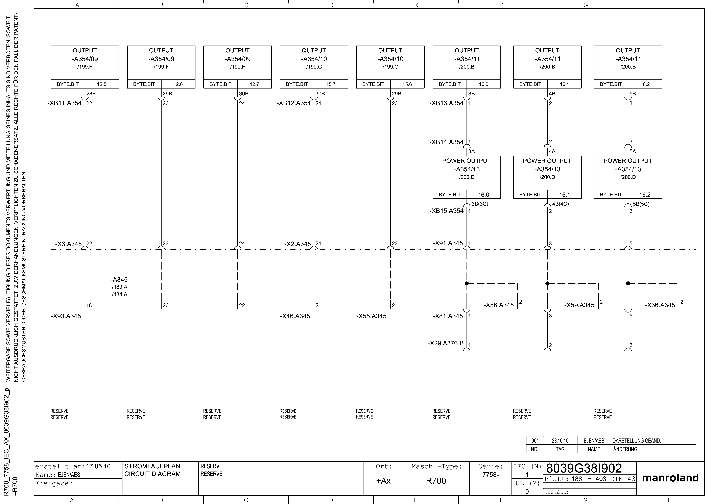

# +Ax — Sheet 188 of 403 — RESERVE

**RESERVE**

> Part of the manroland **R700** printing press IEC/UL circuit diagrams.
> Drawing class: **Stromlaufplan / Circuit diagram** (DIN A3).
> Document `+Ax` covers the **Central control console** machine section.

## At a glance

| Field | Value |
|---|---|
| Document | `+Ax`  (8039G38I902) |
| Sheet | **188** of 403 |
| Section (DE) | RESERVE |
| Section (EN) | RESERVE |
| Section type | CIRCUIT — Circuit diagram |
| Machine type | `R700` |
| Series | `7758` |
| Created | 17.05.10 |
| Replaces | — |
| Columns used | A, B, C, D, E, F, G, H |
| Path numbers | — |
| Labels on sheet | 148 |
| Cross-refs out | 13 |
| Cross-refs in | 49 |

**Previous:** [+Ax sheet 187](SHEET_0187.md) · **Next:** [+Ax sheet 189](SHEET_0189.md) · **Document TOC:** [_TOC.md](_TOC.md)  (+Ax) · **Master TOC:** [all sheets](../_MASTER_TOC.md)

## Sheet image (300 DPI, exact vector render)



_Rendered directly from the PDF vector layer at 300 DPI (1-bit), no OCR and no resampling. Use it to confirm anything ambiguous in the text below._

## Cross-references on this sheet

Each entry is a wire leaving this sheet. The printed token is `/sheet.column`; the link resolves to that sheet inside the same document.

| Ref | Target sheet | Col | Path | Destination on target | Target section | From col |
|---|---|---|---|---|---|---|
| `/200.B` | [+Ax sheet 200](SHEET_0200.md) | B | — | — | REFERENZMODUL | F |
| `/200.B` | [+Ax sheet 200](SHEET_0200.md) | B | — | — | REFERENZMODUL | G |
| `/200.B` | [+Ax sheet 200](SHEET_0200.md) | B | — | — | REFERENZMODUL | G |
| `/199.F` | [+Ax sheet 199](SHEET_0199.md) | F | — | — | REFERENZMODUL | A |
| `/199.F` | [+Ax sheet 199](SHEET_0199.md) | F | — | — | REFERENZMODUL | B |
| `/199.F` | [+Ax sheet 199](SHEET_0199.md) | F | — | — | REFERENZMODUL | C |
| `/199.G` | [+Ax sheet 199](SHEET_0199.md) | G | — | — | REFERENZMODUL | D |
| `/199.G` | [+Ax sheet 199](SHEET_0199.md) | G | — | — | REFERENZMODUL | E |
| `/200.D` | [+Ax sheet 200](SHEET_0200.md) | D | — | — | REFERENZMODUL | F |
| `/200.D` | [+Ax sheet 200](SHEET_0200.md) | D | — | — | REFERENZMODUL | G |
| `/200.D` | [+Ax sheet 200](SHEET_0200.md) | D | — | — | REFERENZMODUL | G |
| `/189.A` | [+Ax sheet 189](SHEET_0189.md) | A | — | — | RESERVE | B |
| `/184.A` | [+Ax sheet 184](SHEET_0184.md) | A | — | — | RESERVE | B |

### Incoming references (sheets that point here)

Every other sheet that sends a wire to this one. `Back-ref` is the token printed on *that* sheet; `Path` is its line number.

| From sheet | Cols | Back-ref | Path | Refs | What continues there |
|---|---|---|---|---|---|
| [+Ax#184](SHEET_0184.md) | A | `/184.A` | — | 1 | — |
| [+Ax#189](SHEET_0189.md) | A | `/189.A` | — | 1 | — |
| [+Ax#199](SHEET_0199.md) | F, G | `/199.F`, `/199.G` | — | 5 | — |
| [+Ax#200](SHEET_0200.md) | B, D | `/200.B`, `/200.D` | — | 6 | — |
| [+Ax#217](SHEET_0217.md) | H | `/217.H` | — | 2 | — |
| [+Ax#223](SHEET_0223.md) | B | `/223.B` | — | 3 | — |
| [+Ax#247](SHEET_0247.md) | A | `/247.A` | — | 3 | — |
| [+Ax#248](SHEET_0248.md) | F | `/248.F` | — | 2 | — |
| [+Ax#250](SHEET_0250.md) | B | `/250.B` | — | 3 | — |
| [+Ax#251](SHEET_0251.md) | C | `/251.C` | — | 3 | — |
| [+Ax#253](SHEET_0253.md) | B | `/253.B` | — | 3 | — |
| [+Ax#273](SHEET_0273.md) | B | `/273.B` | — | 3 | — |
| [+Ax#279](SHEET_0279.md) | C | `/279.C` | — | 1 | — |
| [+Ax#283](SHEET_0283.md) | C, H | `/283.C`, `/283.H` | — | 2 | — |
| [+Ax#284](SHEET_0284.md) | B | `/284.B` | — | 2 | — |
| [+Ax#286](SHEET_0286.md) | E | `/286.E` | — | 3 | — |
| [+Ax#289](SHEET_0289.md) | E, G | `/289.E`, `/289.G` | — | 6 | — |


## Devices on this sheet

| Tag | Class | Class meaning (IEC) | Col | Sub | Terminal | Sign |
|---|---|---|---|---|---|---|
| `A354/09` | A | Baugruppe / assembly, module, PC board | C | 09 | — | — |
| `A354/09` | A | Baugruppe / assembly, module, PC board | B | 09 | — | — |
| `A354/09` | A | Baugruppe / assembly, module, PC board | A | 09 | — | — |
| `A345` | A | Baugruppe / assembly, module, PC board | A | — | — | — |
| `A354/10` | A | Baugruppe / assembly, module, PC board | D | 10 | — | — |
| `A354/10` | A | Baugruppe / assembly, module, PC board | E | 10 | — | — |
| `A354/13` | A | Baugruppe / assembly, module, PC board | F | 13 | — | — |
| `A354/11` | A | Baugruppe / assembly, module, PC board | F | 11 | — | — |
| `A354/13` | A | Baugruppe / assembly, module, PC board | G | 13 | — | — |
| `A354/11` | A | Baugruppe / assembly, module, PC board | G | 11 | — | — |
| `A354/13` | A | Baugruppe / assembly, module, PC board | G | 13 | — | — |
| `A354/11` | A | Baugruppe / assembly, module, PC board | H | 11 | — | — |
| `12.7` | — | cross-device reference | C | — | — | — |
| `12.6` | — | cross-device reference | B | — | — | — |
| `XB11.A354` | — | cross-device reference | A | — | — | — |
| `12.5` | — | cross-device reference | A | — | — | — |
| `X3.A345` | — | cross-device reference | A | — | — | — |
| `15.7` | — | cross-device reference | D | — | — | — |
| `XB12.A354` | — | cross-device reference | D | — | — | — |
| `X2.A345` | — | cross-device reference | D | — | — | — |
| `15.6` | — | cross-device reference | E | — | — | — |
| `XB14.A354` | — | cross-device reference | E | — | — | — |
| `16.0` | — | cross-device reference | F | — | — | — |
| `XB15.A354` | — | cross-device reference | E | — | — | — |
| `X29.A376.B` | — | cross-device reference | E | — | — | — |
| `XB13.A354` | — | cross-device reference | E | — | — | — |
| `16.0` | — | cross-device reference | F | — | — | — |
| `X91.A345` | — | cross-device reference | E | — | — | — |
| `X81.A345` | — | cross-device reference | E | — | — | — |
| `16.1` | — | cross-device reference | G | — | — | — |
| `16.1` | — | cross-device reference | G | — | — | — |
| `16.2` | — | cross-device reference | H | — | — | — |
| `16.2` | — | cross-device reference | H | — | — | — |
| `NR.` | — | cross-device reference | F | — | — | — |
| `28.10.10` | — | cross-device reference | G | — | — | — |
| `X93.A345` | — | cross-device reference | A | — | — | — |
| `X58.A345` | — | cross-device reference | F | — | — | — |
| `X59.A345` | — | cross-device reference | G | — | — | — |
| `X36.A345` | — | cross-device reference | H | — | — | — |
| `X46.A345` | — | cross-device reference | D | — | — | — |
| `X55.A345` | — | cross-device reference | D | — | — | — |

## Potentials / nets

_No named potentials on this sheet._

## Wire-end annotations (grouped as printed)

A wire that continues elsewhere is annotated with a small cluster: the destination description, the path/line number `#NN`, and the `/sheet.column` cross reference. Each row below is one such cluster exactly as it is grouped on the drawing.

| Col | Y | Path | Cross-ref | Text on the wire |
|---|---|---|---|---|
| A | 80.0 | — | — | `OUTPUT` |
| B | 80.0 | — | — | `OUTPUT` |
| C | 80.0 | — | — | `OUTPUT` |
| D | 80.0 | — | — | `QUTPUT` |
| E | 80.0 | — | — | `OUTPUT` |
| F | 80.0 | — | — | `OUTPUT` |
| G | 80.0 | — | — | `OUTPUT` |
| G | 80.0 | — | — | `OUTPUT` |
| A | 93.8 | — | — | `A354/09` |
| B | 93.8 | — | — | `A354/09` |
| C | 93.8 | — | — | `A354/09` |
| D | 93.8 | — | — | `A354/10` |
| E | 93.8 | — | — | `A354/10` |
| F | 93.8 | — | — | `A354/11` |
| G | 93.8 | — | — | `A354/11` |
| H | 93.8 | — | — | `A354/11` |
| A | 107.6 | — | `/199.F` | — |
| B | 107.6 | — | `/199.F` | — |
| C | 107.6 | — | `/199.F` | — |
| D | 107.6 | — | `/199.G` | — |
| E | 107.6 | — | `/199.G` | — |
| F | 107.6 | — | `/200.B` | — |
| G | 107.6 | — | `/200.B` | — |
| G | 107.6 | — | `/200.B` | — |
| A | 137.3 | — | — | `BYTE.BIT 12.5` |
| B | 137.3 | — | — | `BYTE.BIT 12.6` |
| C | 137.3 | — | — | `BYTE.BIT 12.7` |
| D | 137.3 | — | — | `BYTE.BIT 15.7` |
| E | 137.3 | — | — | `BYTE.BIT 15.6` |
| F | 137.3 | — | — | `BYTE.BIT 16.0` |
| G | 137.3 | — | — | `BYTE.BIT 16.1` |
| G | 137.3 | — | — | `BYTE.BIT 16.2` |
| F | 152.6 | — | — | `3B` |
| G | 152.6 | — | — | `4B` |
| H | 152.6 | — | — | `5B` |
| A | 152.7 | — | — | `28B` |
| B | 152.7 | — | — | `29B` |
| C | 152.7 | — | — | `30B` |
| D | 152.7 | — | — | `30B` |
| E | 152.7 | — | — | `29B` |
| A | 167.6 | — | — | `XB11.A354 22` |
| D | 167.6 | — | — | `XB12.A354 24` |
| E | 167.6 | — | — | `XB13.A354 1` |
| B | 169.0 | — | — | `23` |
| C | 169.0 | — | — | `24` |
| E | 169.0 | — | — | `23` |
| G | 169.0 | — | — | `2` |
| H | 169.0 | — | — | `3` |
| E | 232.8 | — | — | `XB14.A354 1` |
| G | 232.8 | — | — | `2` |
| H | 232.8 | — | — | `3` |
| F | 249.0 | — | — | `3A` |
| G | 249.0 | — | — | `4A` |
| H | 249.0 | — | — | `5A` |
| F | 264.2 | — | — | `POWER OUTPUT` |
| G | 264.2 | — | — | `POWER OUTPUT` |
| G | 264.2 | — | — | `POWER OUTPUT` |
| F | 278.1 | — | — | `A354/13` |
| G | 278.1 | — | — | `A354/13` |
| G | 278.1 | — | — | `A354/13` |
| F | 291.9 | — | `/200.D` | — |
| G | 291.9 | — | `/200.D` | — |
| G | 291.9 | — | `/200.D` | — |
| F | 320.9 | — | — | `BYTE.BIT 16.0` |
| G | 320.9 | — | — | `BYTE.BIT 16.1` |
| G | 320.9 | — | — | `BYTE.BIT 16.2` |
| F | 336.9 | — | — | `3B(3C)` |
| G | 336.9 | — | — | `4B(4C)` |
| H | 336.9 | — | — | `5B(5C)` |
| E | 347.6 | — | — | `XB15.A354 1` |
| G | 349.0 | — | — | `2` |
| H | 349.0 | — | — | `3` |
| E | 401.4 | — | — | `X91.A345 1` |
| A | 402.8 | — | — | `X3.A345 22` |
| B | 402.8 | — | — | `23` |
| C | 402.8 | — | — | `24` |
| D | 402.8 | — | — | `X2.A345 24` |
| E | 402.8 | — | — | `23` |
| G | 402.8 | — | — | `3` |
| H | 402.8 | — | — | `5` |
| A | 462.4 | — | — | `A345` |
| B | 475.4 | — | `/189.A`, `/184.A` | — |
| G | 500.6 | — | — | `2 2` |
| H | 500.6 | — | — | `2` |
| G | 504.9 | — | — | `X58.A345 X59.A345 X36.A345` |
| A | 506.3 | — | — | `18` |
| B | 506.3 | — | — | `20` |
| C | 506.3 | — | — | `22` |
| D | 506.3 | — | — | `2` |
| E | 506.3 | — | — | `2` |
| A | 523.3 | — | — | `X93.A345` |
| D | 523.3 | — | — | `X46.A345 X55.A345` |
| E | 523.3 | — | — | `X81.A345 1` |
| G | 523.3 | — | — | `3` |
| H | 523.3 | — | — | `5` |
| E | 568.7 | — | — | `X29.A376.B 1` |
| G | 572.9 | — | — | `2` |
| H | 572.9 | — | — | `3` |
| A | 683.7 | — | — | `RESERVE RESERVE` |
| B | 683.7 | — | — | `RESERVE RESERVE` |
| C | 683.7 | — | — | `RESERVE RESERVE` |
| E | 683.7 | — | — | `RESERVE RESERVE` |
| F | 683.7 | — | — | `RESERVE RESERVE` |
| G | 683.7 | — | — | `RESERVE RESERVE` |
| C | 683.9 | — | — | `RESERVE RESERVE` |
| D | 683.9 | — | — | `RESERVE RESERVE` |
| G | 733.0 | — | — | `001 28.10.10 EJEN/AES DARSTELLUNG GEÄND.` |
| G | 747.1 | — | — | `NR. TAG NAME ÄNDERUNG` |


## Reconstructed tables

This sheet carries tabular content (pin map / terminal assignment / index). The grid below was rebuilt from the drawing's own rule lines, so each row is exactly one physical row of the table.

### Table 1 — 3 data rows × 5 columns (at x=85.0, y=76.5)

| OUTPUT | A354/09 /199.F |  | OUTPUT | A354/09 /199.F |
|---|---|---|---|---|
| `BYTE.BIT` | `12.5` |  | `BYTE.BIT` | `12.6` |
| `XB11.A354` | `28B 22` |  |  | `29B 23` |
| `X3.A345` | `22` | `A345` |  | `23` |


### Table 2 — 3 data rows × 2 columns (at x=340.2, y=76.5)

| OUTPUT | A354/09 /199.F |
|---|---|
| `BYTE.BIT` | `12.7` |
|  | `30B 24` |
|  | `24` |


### Table 3 — 3 data rows × 2 columns (at x=467.7, y=76.5)

| QUTPUT | A354/10 /199.G |
|---|---|
| `BYTE.BIT` | `15.7` |
| `XB12.A354` | `30B 24` |
| `X2.A345` | `24` |


### Table 4 — 3 data rows × 2 columns (at x=595.3, y=76.5)

| OUTPUT | A354/10 /199.G |
|---|---|
| `BYTE.BIT` | `15.6` |
|  | `29B 23` |
|  | `23` |


### Table 5 — 5 data rows × 2 columns (at x=722.8, y=76.5)

| OUTPUT | A354/11 /200.B |
|---|---|
| `BYTE.BIT` | `16.0` |
| `XB13.A354 XB14.A354` | `3B 1 1 3A` |
| `POWER` | `OUTPUT A354/13 /200.D` |
| `BYTE.BIT` | `16.0` |
| `XB15.A354 X91.A345` | `3B(3C) 1 1` |


### Table 6 — 5 data rows × 2 columns (at x=864.6, y=76.5)

| OUTPUT | A354/11 /200.B |
|---|---|
| `BYTE.BIT` | `16.1` |
|  | `4B 2 2 4A` |
| `POWER` | `OUTPUT A354/13 /200.D` |
| `BYTE.BIT` | `16.1` |
|  | `4B(4C) 2 3` |


### Table 7 — 5 data rows × 2 columns (at x=999.2, y=76.5)

| OUTPUT | A354/11 /200.B |
|---|---|
| `BYTE.BIT` | `16.2` |
|  | `5B 3 3 5A` |
| `POWER` | `OUTPUT A354/13 /200.D` |
| `BYTE.BIT` | `16.2` |
|  | `5B(5C) 3 5` |


## Notes and free text on this sheet

| Text | Col | Y (pt) |
|---|---|---|
| `30B` | C | 152.65 |
| `OUTPUT` | C | 79.98 |
| `BYTE.BIT` | C | 137.26 |
| `RESERVE` | C | 683.73 |
| `29B` | B | 152.65 |
| `OUTPUT` | B | 79.98 |
| `BYTE.BIT` | B | 137.26 |
| `RESERVE` | B | 683.73 |
| `28B` | A | 152.65 |
| `OUTPUT` | A | 79.98 |
| `BYTE.BIT` | A | 137.26 |
| `RESERVE` | A | 683.73 |
| `30B` | D | 152.65 |
| `QUTPUT` | D | 79.98 |
| `BYTE.BIT` | D | 137.26 |
| `29B` | E | 152.65 |
| `OUTPUT` | E | 79.98 |
| `RESERVE` | D | 683.93 |
| `3A` | F | 249.01 |
| `3B(3C)` | F | 336.93 |
| `POWER OUTPUT` | F | 264.18 |
| `BYTE.BIT` | E | 321.51 |
| `RESERVE` | E | 683.73 |
| `3B` | F | 152.63 |
| `OUTPUT` | F | 79.98 |
| `4A` | G | 249.01 |
| `4B(4C)` | G | 336.93 |
| `POWER OUTPUT` | G | 264.18 |
| `BYTE.BIT` | F | 321.51 |
| `RESERVE` | F | 683.73 |
| `4B` | G | 152.63 |
| `OUTPUT` | G | 79.98 |
| `5A` | H | 249.01 |
| `5B(5C)` | H | 336.93 |
| `BYTE.BIT` | G | 321.51 |
| `RESERVE` | G | 683.73 |
| `5B` | H | 152.63 |
| `TAG` | G | 747.27 |
| `NAME` | G | 747.25 |
| `ÄNDERUNG` | G | 747.31 |
| `EJEN/AES` | G | 733.09 |
| `DARSTELLUNG GEÄND.` | H | 733.12 |

## Complete label inventory (exact text from the drawing)

Every text object inside the drawing area of this sheet, in DIN reading order (column A→H, then top→bottom). This is the authoritative list: if a string is not here it is not printed on this sheet.

| Col | Y | X | Dir | Type | Text |
|---|---|---|---|---|---|
| A | 80.0 | 121.5 | → | text | `OUTPUT` |
| A | 93.8 | 120.3 | → | device tag | `A354/09` |
| A | 107.6 | 129.4 | → | cross-reference | `/199.F` |
| A | 137.3 | 95.0 | → | text | `BYTE.BIT` |
| A | 137.3 | 161.9 | → | device ref | `12.5` |
| A | 152.6 | 144.3 | → | text | `28B` |
| A | 167.5 | 79.4 | → | device ref | `XB11.A354` |
| A | 169.0 | 144.3 | → | number | `22` |
| A | 402.8 | 92.4 | → | device ref | `X3.A345` |
| A | 402.8 | 144.3 | → | number | `22` |
| A | 462.3 | 184.8 | → | device tag | `A345` |
| A | 506.3 | 143.7 | → | number | `18` |
| A | 523.3 | 85.0 | → | device ref | `X93.A345` |
| A | 683.7 | 84.2 | → | text | `RESERVE` |
| A | 694.4 | 84.2 | → | text | `RESERVE` |
| B | 80.0 | 249.0 | → | text | `OUTPUT` |
| B | 93.8 | 247.9 | → | device tag | `A354/09` |
| B | 107.6 | 257.0 | → | cross-reference | `/199.F` |
| B | 137.3 | 222.5 | → | text | `BYTE.BIT` |
| B | 137.3 | 289.4 | → | device ref | `12.6` |
| B | 152.6 | 271.8 | → | text | `29B` |
| B | 169.0 | 271.8 | → | number | `23` |
| B | 402.8 | 271.8 | → | number | `23` |
| B | 475.4 | 187.1 | → | cross-reference | `/189.A` |
| B | 487.8 | 187.1 | → | cross-reference | `/184.A` |
| B | 506.3 | 271.8 | → | number | `20` |
| B | 683.7 | 211.7 | → | text | `RESERVE` |
| B | 694.4 | 211.7 | → | text | `RESERVE` |
| C | 80.0 | 376.6 | → | text | `OUTPUT` |
| C | 93.8 | 375.4 | → | device tag | `A354/09` |
| C | 107.6 | 384.5 | → | cross-reference | `/199.F` |
| C | 137.3 | 350.1 | → | text | `BYTE.BIT` |
| C | 137.3 | 417.0 | → | device ref | `12.7` |
| C | 152.6 | 399.4 | → | text | `30B` |
| C | 169.0 | 399.4 | → | number | `24` |
| C | 402.8 | 399.4 | → | number | `24` |
| C | 506.3 | 399.4 | → | number | `22` |
| C | 683.7 | 339.3 | → | text | `RESERVE` |
| C | 683.9 | 467.1 | → | text | `RESERVE` |
| C | 693.9 | 467.1 | → | text | `RESERVE` |
| C | 694.4 | 339.3 | → | text | `RESERVE` |
| D | 80.0 | 504.1 | → | text | `QUTPUT` |
| D | 93.8 | 503.0 | → | device tag | `A354/10` |
| D | 107.6 | 511.5 | → | cross-reference | `/199.G` |
| D | 137.3 | 477.6 | → | text | `BYTE.BIT` |
| D | 137.3 | 544.5 | → | device ref | `15.7` |
| D | 137.3 | 605.2 | → | text | `BYTE.BIT` |
| D | 152.6 | 527.0 | → | text | `30B` |
| D | 167.5 | 462.0 | → | device ref | `XB12.A354` |
| D | 169.0 | 527.0 | → | number | `24` |
| D | 402.8 | 475.1 | → | device ref | `X2.A345` |
| D | 402.8 | 527.0 | → | number | `24` |
| D | 506.3 | 527.0 | → | number | `2` |
| D | 523.3 | 467.7 | → | device ref | `X46.A345` |
| D | 523.3 | 595.3 | → | device ref | `X55.A345` |
| D | 683.9 | 594.7 | → | text | `RESERVE` |
| D | 693.9 | 594.7 | → | text | `RESERVE` |
| E | 80.0 | 631.7 | → | text | `OUTPUT` |
| E | 93.8 | 630.6 | → | device tag | `A354/10` |
| E | 107.6 | 639.1 | → | cross-reference | `/199.G` |
| E | 137.3 | 672.1 | → | device ref | `15.6` |
| E | 137.3 | 732.8 | → | text | `BYTE.BIT` |
| E | 152.6 | 654.5 | → | text | `29B` |
| E | 167.5 | 717.2 | → | device ref | `XB13.A354` |
| E | 169.0 | 654.5 | → | number | `23` |
| E | 232.7 | 717.2 | → | device ref | `XB14.A354` |
| E | 321.5 | 732.8 | → | text | `BYTE.BIT` |
| E | 347.5 | 717.2 | → | device ref | `XB15.A354` |
| E | 401.4 | 722.8 | → | device ref | `X91.A345` |
| E | 402.8 | 654.5 | → | number | `23` |
| E | 506.3 | 654.5 | → | number | `2` |
| E | 523.3 | 722.8 | → | device ref | `X81.A345` |
| E | 568.7 | 714.3 | → | device ref | `X29.A376.B` |
| E | 683.7 | 722.0 | → | text | `RESERVE` |
| E | 694.4 | 722.0 | → | text | `RESERVE` |
| F | 80.0 | 759.3 | → | text | `OUTPUT` |
| F | 93.8 | 758.8 | → | device tag | `A354/11` |
| F | 107.6 | 766.9 | → | cross-reference | `/200.B` |
| F | 137.3 | 799.7 | → | device ref | `16.0` |
| F | 137.3 | 867.4 | → | text | `BYTE.BIT` |
| F | 152.6 | 782.1 | → | text | `3B` |
| F | 169.0 | 781.5 | → | number | `1` |
| F | 232.8 | 781.5 | → | number | `1` |
| F | 249.0 | 782.1 | → | text | `3A` |
| F | 264.2 | 738.7 | → | text | `POWER OUTPUT` |
| F | 278.1 | 758.1 | → | device tag | `A354/13` |
| F | 291.9 | 766.8 | → | cross-reference | `/200.D` |
| F | 320.9 | 798.1 | → | device ref | `16.0` |
| F | 321.5 | 867.4 | → | text | `BYTE.BIT` |
| F | 336.9 | 787.7 | → | text | `3B(3C)` |
| F | 349.0 | 781.5 | → | number | `1` |
| F | 402.8 | 781.5 | → | number | `1` |
| F | 500.6 | 867.1 | → | number | `2` |
| F | 504.9 | 807.9 | → | device ref | `X58.A345` |
| F | 523.3 | 781.5 | → | number | `1` |
| F | 572.9 | 781.5 | → | number | `1` |
| F | 683.7 | 856.6 | → | text | `RESERVE` |
| F | 694.4 | 856.6 | → | text | `RESERVE` |
| F | 733.0 | 887.7 | → | number | `001` |
| F | 747.1 | 886.7 | → | device ref | `NR.` |
| G | 80.0 | 893.9 | → | text | `OUTPUT` |
| G | 80.0 | 1028.6 | → | text | `OUTPUT` |
| G | 93.8 | 893.5 | → | device tag | `A354/11` |
| G | 107.6 | 901.6 | → | cross-reference | `/200.B` |
| G | 107.6 | 1036.2 | → | cross-reference | `/200.B` |
| G | 137.3 | 934.9 | → | device ref | `16.1` |
| G | 137.3 | 1002.0 | → | text | `BYTE.BIT` |
| G | 152.6 | 916.7 | → | text | `4B` |
| G | 169.0 | 916.7 | → | number | `2` |
| G | 232.8 | 916.7 | → | number | `2` |
| G | 249.0 | 916.7 | → | text | `4A` |
| G | 264.2 | 873.4 | → | text | `POWER OUTPUT` |
| G | 264.2 | 1008.0 | → | text | `POWER OUTPUT` |
| G | 278.1 | 892.8 | → | device tag | `A354/13` |
| G | 278.1 | 1027.4 | → | device tag | `A354/13` |
| G | 291.9 | 901.4 | → | cross-reference | `/200.D` |
| G | 291.9 | 1036.1 | → | cross-reference | `/200.D` |
| G | 320.9 | 933.6 | → | device ref | `16.1` |
| G | 321.5 | 1002.0 | → | text | `BYTE.BIT` |
| G | 336.9 | 922.4 | → | text | `4B(4C)` |
| G | 349.0 | 916.7 | → | number | `2` |
| G | 402.8 | 916.7 | → | number | `3` |
| G | 500.6 | 1001.8 | → | number | `2` |
| G | 504.9 | 942.5 | → | device ref | `X59.A345` |
| G | 523.3 | 916.7 | → | number | `3` |
| G | 572.9 | 916.7 | → | number | `2` |
| G | 683.7 | 991.3 | → | text | `RESERVE` |
| G | 694.4 | 991.3 | → | text | `RESERVE` |
| G | 733.1 | 921.9 | → | device ref | `28.10.10` |
| G | 733.1 | 974.9 | → | text | `EJEN/AES` |
| G | 747.3 | 928.3 | → | text | `TAG` |
| G | 747.3 | 981.7 | → | text | `NAME` |
| G | 747.3 | 1024.3 | → | text | `ÄNDERUNG` |
| H | 93.8 | 1028.1 | → | device tag | `A354/11` |
| H | 137.3 | 1069.1 | → | device ref | `16.2` |
| H | 152.6 | 1051.4 | → | text | `5B` |
| H | 169.0 | 1051.4 | → | number | `3` |
| H | 232.8 | 1051.4 | → | number | `3` |
| H | 249.0 | 1051.4 | → | text | `5A` |
| H | 320.9 | 1067.4 | → | device ref | `16.2` |
| H | 336.9 | 1057.0 | → | text | `5B(5C)` |
| H | 349.0 | 1051.4 | → | number | `3` |
| H | 402.8 | 1051.4 | → | number | `5` |
| H | 500.6 | 1136.4 | → | number | `2` |
| H | 504.9 | 1077.2 | → | device ref | `X36.A345` |
| H | 523.3 | 1051.4 | → | number | `5` |
| H | 572.9 | 1051.4 | → | number | `3` |
| H | 733.1 | 1023.2 | → | text | `DARSTELLUNG GEÄND.` |

## Reading-order text block

The same content as a plain block, grouped by DIN column — convenient to paste or to match against a visual description.

```text
=== Column A ===
  80.0  121.5  text         OUTPUT
  93.8  120.3  devtag       A354/09
 107.6  129.4  xref         /199.F
 137.3   95.0  text         BYTE.BIT
 137.3  161.9  devref       12.5
 152.6  144.3  text         28B
 167.5   79.4  devref       XB11.A354
 169.0  144.3  numeric      22
 402.8   92.4  devref       X3.A345
 402.8  144.3  numeric      22
 462.3  184.8  devtag       A345
 506.3  143.7  numeric      18
 523.3   85.0  devref       X93.A345
 683.7   84.2  text         RESERVE
 694.4   84.2  text         RESERVE
=== Column B ===
  80.0  249.0  text         OUTPUT
  93.8  247.9  devtag       A354/09
 107.6  257.0  xref         /199.F
 137.3  222.5  text         BYTE.BIT
 137.3  289.4  devref       12.6
 152.6  271.8  text         29B
 169.0  271.8  numeric      23
 402.8  271.8  numeric      23
 475.4  187.1  xref         /189.A
 487.8  187.1  xref         /184.A
 506.3  271.8  numeric      20
 683.7  211.7  text         RESERVE
 694.4  211.7  text         RESERVE
=== Column C ===
  80.0  376.6  text         OUTPUT
  93.8  375.4  devtag       A354/09
 107.6  384.5  xref         /199.F
 137.3  350.1  text         BYTE.BIT
 137.3  417.0  devref       12.7
 152.6  399.4  text         30B
 169.0  399.4  numeric      24
 402.8  399.4  numeric      24
 506.3  399.4  numeric      22
 683.7  339.3  text         RESERVE
 683.9  467.1  text         RESERVE
 693.9  467.1  text         RESERVE
 694.4  339.3  text         RESERVE
=== Column D ===
  80.0  504.1  text         QUTPUT
  93.8  503.0  devtag       A354/10
 107.6  511.5  xref         /199.G
 137.3  477.6  text         BYTE.BIT
 137.3  544.5  devref       15.7
 137.3  605.2  text         BYTE.BIT
 152.6  527.0  text         30B
 167.5  462.0  devref       XB12.A354
 169.0  527.0  numeric      24
 402.8  475.1  devref       X2.A345
 402.8  527.0  numeric      24
 506.3  527.0  numeric      2
 523.3  467.7  devref       X46.A345
 523.3  595.3  devref       X55.A345
 683.9  594.7  text         RESERVE
 693.9  594.7  text         RESERVE
=== Column E ===
  80.0  631.7  text         OUTPUT
  93.8  630.6  devtag       A354/10
 107.6  639.1  xref         /199.G
 137.3  672.1  devref       15.6
 137.3  732.8  text         BYTE.BIT
 152.6  654.5  text         29B
 167.5  717.2  devref       XB13.A354
 169.0  654.5  numeric      23
 232.7  717.2  devref       XB14.A354
 321.5  732.8  text         BYTE.BIT
 347.5  717.2  devref       XB15.A354
 401.4  722.8  devref       X91.A345
 402.8  654.5  numeric      23
 506.3  654.5  numeric      2
 523.3  722.8  devref       X81.A345
 568.7  714.3  devref       X29.A376.B
 683.7  722.0  text         RESERVE
 694.4  722.0  text         RESERVE
=== Column F ===
  80.0  759.3  text         OUTPUT
  93.8  758.8  devtag       A354/11
 107.6  766.9  xref         /200.B
 137.3  799.7  devref       16.0
 137.3  867.4  text         BYTE.BIT
 152.6  782.1  text         3B
 169.0  781.5  numeric      1
 232.8  781.5  numeric      1
 249.0  782.1  text         3A
 264.2  738.7  text         POWER OUTPUT
 278.1  758.1  devtag       A354/13
 291.9  766.8  xref         /200.D
 320.9  798.1  devref       16.0
 321.5  867.4  text         BYTE.BIT
 336.9  787.7  text         3B(3C)
 349.0  781.5  numeric      1
 402.8  781.5  numeric      1
 500.6  867.1  numeric      2
 504.9  807.9  devref       X58.A345
 523.3  781.5  numeric      1
 572.9  781.5  numeric      1
 683.7  856.6  text         RESERVE
 694.4  856.6  text         RESERVE
 733.0  887.7  numeric      001
 747.1  886.7  devref       NR.
=== Column G ===
  80.0  893.9  text         OUTPUT
  80.0 1028.6  text         OUTPUT
  93.8  893.5  devtag       A354/11
 107.6  901.6  xref         /200.B
 107.6 1036.2  xref         /200.B
 137.3  934.9  devref       16.1
 137.3 1002.0  text         BYTE.BIT
 152.6  916.7  text         4B
 169.0  916.7  numeric      2
 232.8  916.7  numeric      2
 249.0  916.7  text         4A
 264.2  873.4  text         POWER OUTPUT
 264.2 1008.0  text         POWER OUTPUT
 278.1  892.8  devtag       A354/13
 278.1 1027.4  devtag       A354/13
 291.9  901.4  xref         /200.D
 291.9 1036.1  xref         /200.D
 320.9  933.6  devref       16.1
 321.5 1002.0  text         BYTE.BIT
 336.9  922.4  text         4B(4C)
 349.0  916.7  numeric      2
 402.8  916.7  numeric      3
 500.6 1001.8  numeric      2
 504.9  942.5  devref       X59.A345
 523.3  916.7  numeric      3
 572.9  916.7  numeric      2
 683.7  991.3  text         RESERVE
 694.4  991.3  text         RESERVE
 733.1  921.9  devref       28.10.10
 733.1  974.9  text         EJEN/AES
 747.3  928.3  text         TAG
 747.3  981.7  text         NAME
 747.3 1024.3  text         ÄNDERUNG
=== Column H ===
  93.8 1028.1  devtag       A354/11
 137.3 1069.1  devref       16.2
 152.6 1051.4  text         5B
 169.0 1051.4  numeric      3
 232.8 1051.4  numeric      3
 249.0 1051.4  text         5A
 320.9 1067.4  devref       16.2
 336.9 1057.0  text         5B(5C)
 349.0 1051.4  numeric      3
 402.8 1051.4  numeric      5
 500.6 1136.4  numeric      2
 504.9 1077.2  devref       X36.A345
 523.3 1051.4  numeric      5
 572.9 1051.4  numeric      3
 733.1 1023.2  text         DARSTELLUNG GEÄND.
```

---
_Generated from the PDF vector text layer; no OCR. Source: `R700_7758_IEC_AX_8039G38I902_p`, sheet 188._
