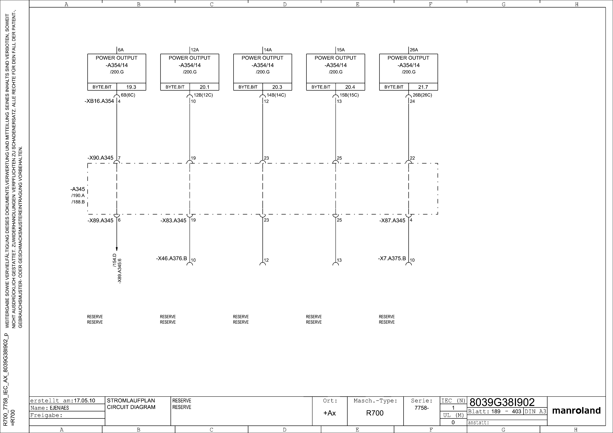

# +Ax — Sheet 189 of 403 — RESERVE

**RESERVE**

> Part of the manroland **R700** printing press IEC/UL circuit diagrams.
> Drawing class: **Stromlaufplan / Circuit diagram** (DIN A3).
> Document `+Ax` covers the **Central control console** machine section.

## At a glance

| Field | Value |
|---|---|
| Document | `+Ax`  (8039G38I902) |
| Sheet | **189** of 403 |
| Section (DE) | RESERVE |
| Section (EN) | RESERVE |
| Section type | CIRCUIT — Circuit diagram |
| Machine type | `R700` |
| Series | `7758` |
| Created | 17.05.10 |
| Replaces | — |
| Columns used | A, B, C, D, E, F |
| Path numbers | — |
| Labels on sheet | 76 |
| Cross-refs out | 8 |
| Cross-refs in | 27 |

**Previous:** [+Ax sheet 188](SHEET_0188.md) · **Next:** [+Ax sheet 190](SHEET_0190.md) · **Document TOC:** [_TOC.md](_TOC.md)  (+Ax) · **Master TOC:** [all sheets](../_MASTER_TOC.md)

## Sheet image (300 DPI, exact vector render)



_Rendered directly from the PDF vector layer at 300 DPI (1-bit), no OCR and no resampling. Use it to confirm anything ambiguous in the text below._

## Cross-references on this sheet

Each entry is a wire leaving this sheet. The printed token is `/sheet.column`; the link resolves to that sheet inside the same document.

| Ref | Target sheet | Col | Path | Destination on target | Target section | From col |
|---|---|---|---|---|---|---|
| `/200.G` | [+Ax sheet 200](SHEET_0200.md) | G | — | — | REFERENZMODUL | B |
| `/200.G` | [+Ax sheet 200](SHEET_0200.md) | G | — | — | REFERENZMODUL | C |
| `/200.G` | [+Ax sheet 200](SHEET_0200.md) | G | — | — | REFERENZMODUL | D |
| `/200.G` | [+Ax sheet 200](SHEET_0200.md) | G | — | — | REFERENZMODUL | E |
| `/200.G` | [+Ax sheet 200](SHEET_0200.md) | G | — | — | REFERENZMODUL | F |
| `/190.A` | [+Ax sheet 190](SHEET_0190.md) | A | — | — | RESERVE | A |
| `/188.B` | [+Ax sheet 188](SHEET_0188.md) | B | — | — | RESERVE | A |
| `/154.D` | [+Ax sheet 154](SHEET_0154.md) | D | — | — | ÜBERWACHUNGSRECHNER/ANSTEUERUNG NOT AUS | B |

### Incoming references (sheets that point here)

Every other sheet that sends a wire to this one. `Back-ref` is the token printed on *that* sheet; `Path` is its line number.

| From sheet | Cols | Back-ref | Path | Refs | What continues there |
|---|---|---|---|---|---|
| [+Ax#154](SHEET_0154.md) | D | `/154.D` | — | 1 | — |
| [+Ax#188](SHEET_0188.md) | B | `/188.B` | — | 1 | — |
| [+Ax#190](SHEET_0190.md) | A | `/190.A` | — | 1 | — |
| [+Ax#200](SHEET_0200.md) | F | `/200.F` | — | 5 | — |
| [+Ax#236](SHEET_0236.md) | F | `/236.F` | — | 1 | — |
| [+Ax#254](SHEET_0254.md) | F | `/254.F` | — | 5 | — |
| [+Ax#283](SHEET_0283.md) | B | `/283.B` | — | 3 | — |
| [+Ax#287](SHEET_0287.md) | A | `/287.A` | — | 3 | — |
| [+Ax#289](SHEET_0289.md) | A, B, C | `/289.A`, `/289.B`, `/289.C` | — | 7 | — |


## Devices on this sheet

| Tag | Class | Class meaning (IEC) | Col | Sub | Terminal | Sign |
|---|---|---|---|---|---|---|
| `A354/14` | A | Baugruppe / assembly, module, PC board | B | 14 | — | — |
| `A354/14` | A | Baugruppe / assembly, module, PC board | D | 14 | — | — |
| `A354/14` | A | Baugruppe / assembly, module, PC board | C | 14 | — | — |
| `A345` | A | Baugruppe / assembly, module, PC board | A | — | — | — |
| `A354/14` | A | Baugruppe / assembly, module, PC board | E | 14 | — | — |
| `A354/14` | A | Baugruppe / assembly, module, PC board | F | 14 | — | — |
| `19.3` | — | cross-device reference | B | — | — | — |
| `XB16.A354` | — | cross-device reference | A | — | — | — |
| `X89.A345` | — | cross-device reference | A | — | — | — |
| `X90.A345` | — | cross-device reference | A | — | — | — |
| `20.3` | — | cross-device reference | D | — | — | — |
| `X46.A376.B` | — | cross-device reference | B | — | — | — |
| `20.1` | — | cross-device reference | C | — | — | — |
| `X83.A345` | — | cross-device reference | B | — | — | — |
| `20.4` | — | cross-device reference | E | — | — | — |
| `21.7` | — | cross-device reference | F | — | — | — |
| `X87.A345` | — | cross-device reference | E | — | — | — |
| `X7.A375.B` | — | cross-device reference | E | — | — | — |
| `X89.A345:6` | — | cross-device reference | B | — | 6 | — |

## Potentials / nets

_No named potentials on this sheet._

## Wire-end annotations (grouped as printed)

A wire that continues elsewhere is annotated with a small cluster: the destination description, the path/line number `#NN`, and the `/sheet.column` cross reference. Each row below is one such cluster exactly as it is grouped on the drawing.

| Col | Y | Path | Cross-ref | Text on the wire |
|---|---|---|---|---|
| B | 93.1 | — | — | `6A` |
| C | 93.1 | — | — | `12A` |
| D | 93.1 | — | — | `14A` |
| E | 93.1 | — | — | `15A` |
| F | 93.1 | — | — | `26A` |
| B | 108.3 | — | — | `POWER OUTPUT` |
| C | 108.3 | — | — | `POWER OUTPUT` |
| D | 108.3 | — | — | `POWER OUTPUT` |
| E | 108.3 | — | — | `POWER OUTPUT` |
| F | 108.3 | — | — | `POWER OUTPUT` |
| B | 122.2 | — | — | `A354/14` |
| C | 122.2 | — | — | `A354/14` |
| D | 122.2 | — | — | `A354/14` |
| E | 122.2 | — | — | `A354/14` |
| F | 122.2 | — | — | `A354/14` |
| B | 136.0 | — | `/200.G` | — |
| C | 136.0 | — | `/200.G` | — |
| D | 136.0 | — | `/200.G` | — |
| E | 136.0 | — | `/200.G` | — |
| F | 136.0 | — | `/200.G` | — |
| B | 165.0 | — | — | `BYTE.BIT 19.3` |
| C | 165.0 | — | — | `BYTE.BIT 20.1` |
| D | 165.0 | — | — | `BYTE.BIT 20.3` |
| E | 165.0 | — | — | `BYTE.BIT 20.4` |
| F | 165.0 | — | — | `BYTE.BIT 21.7` |
| B | 181.0 | — | — | `6B(6C)` |
| C | 181.0 | — | — | `12B(12C)` |
| D | 181.0 | — | — | `14B(14C)` |
| E | 181.0 | — | — | `15B(15C)` |
| F | 181.0 | — | — | `26B(26C)` |
| B | 191.6 | — | — | `XB16.A354 4` |
| C | 193.1 | — | — | `10` |
| D | 193.1 | — | — | `12` |
| E | 193.1 | — | — | `13` |
| F | 193.1 | — | — | `24` |
| B | 302.2 | — | — | `X90.A345 7` |
| C | 303.6 | — | — | `19` |
| D | 303.6 | — | — | `23` |
| E | 303.6 | — | — | `25` |
| F | 303.6 | — | — | `22` |
| A | 363.1 | — | — | `A345` |
| A | 376.2 | — | `/190.A`, `/188.B` | — |
| B | 424.1 | — | — | `X89.A345 6` |
| C | 424.1 | — | — | `X83.A345 19` |
| D | 424.1 | — | — | `23` |
| E | 424.1 | — | — | `25` |
| F | 424.1 | — | — | `X87.A345 4` |
| B | 492.9 | — | `/154.D` | — |
| C | 497.8 | — | — | `X46.A376.B 10` |
| F | 497.8 | — | — | `X7.A375.B 10` |
| D | 502.1 | — | — | `12` |
| E | 502.1 | — | — | `13` |
| B | 502.9 | — | — | `X89.A345:6` |
| A | 612.9 | — | — | `RESERVE RESERVE` |
| B | 612.9 | — | — | `RESERVE RESERVE` |
| C | 612.9 | — | — | `RESERVE RESERVE` |
| D | 612.9 | — | — | `RESERVE RESERVE` |
| E | 612.9 | — | — | `RESERVE RESERVE` |


## Reconstructed tables

This sheet carries tabular content (pin map / terminal assignment / index). The grid below was rebuilt from the drawing's own rule lines, so each row is exactly one physical row of the table.

### Table 1 — 1 data rows × 2 columns (at x=170.1, y=104.9)

| POWER | OUTPUT A354/14 /200.G |
|---|---|
| `BYTE.BIT` | `19.3` |


### Table 2 — 1 data rows × 2 columns (at x=311.8, y=104.9)

| POWER | OUTPUT A354/14 /200.G |
|---|---|
| `BYTE.BIT` | `20.1` |


### Table 3 — 1 data rows × 2 columns (at x=453.5, y=104.9)

| POWER | OUTPUT A354/14 /200.G |
|---|---|
| `BYTE.BIT` | `20.3` |


### Table 4 — 1 data rows × 2 columns (at x=595.3, y=104.9)

| POWER | OUTPUT A354/14 /200.G |
|---|---|
| `BYTE.BIT` | `20.4` |


### Table 5 — 1 data rows × 2 columns (at x=737.0, y=104.9)

| POWER | OUTPUT A354/14 /200.G |
|---|---|
| `BYTE.BIT` | `21.7` |


## Notes and free text on this sheet

| Text | Col | Y (pt) |
|---|---|---|
| `6A` | B | 93.1 |
| `6B(6C)` | B | 181.03 |
| `POWER OUTPUT` | B | 108.28 |
| `BYTE.BIT` | A | 165.6 |
| `RESERVE` | A | 612.87 |
| `14A` | D | 93.12 |
| `14B(14C)` | D | 181.03 |
| `POWER OUTPUT` | D | 108.28 |
| `BYTE.BIT` | C | 165.6 |
| `RESERVE` | C | 612.87 |
| `12A` | C | 93.12 |
| `12B(12C)` | C | 181.03 |
| `POWER OUTPUT` | C | 108.28 |
| `BYTE.BIT` | B | 165.6 |
| `RESERVE` | B | 612.87 |
| `15A` | E | 93.12 |
| `15B(15C)` | E | 181.03 |
| `POWER OUTPUT` | E | 108.28 |
| `BYTE.BIT` | D | 165.6 |
| `RESERVE` | D | 612.87 |
| `26A` | F | 93.12 |
| `26B(26C)` | F | 181.03 |
| `POWER OUTPUT` | F | 108.28 |
| `BYTE.BIT` | E | 165.6 |
| `RESERVE` | E | 612.87 |

## Complete label inventory (exact text from the drawing)

Every text object inside the drawing area of this sheet, in DIN reading order (column A→H, then top→bottom). This is the authoritative list: if a string is not here it is not printed on this sheet.

| Col | Y | X | Dir | Type | Text |
|---|---|---|---|---|---|
| A | 165.6 | 180.0 | → | text | `BYTE.BIT` |
| A | 191.6 | 164.4 | → | device ref | `XB16.A354` |
| A | 302.2 | 170.1 | → | device ref | `X90.A345` |
| A | 363.1 | 136.6 | → | device tag | `A345` |
| A | 376.2 | 138.9 | → | cross-reference | `/190.A` |
| A | 388.6 | 139.2 | → | cross-reference | `/188.B` |
| A | 424.1 | 170.1 | → | device ref | `X89.A345` |
| A | 612.9 | 169.2 | → | text | `RESERVE` |
| A | 623.5 | 169.2 | → | text | `RESERVE` |
| B | 93.1 | 229.3 | → | text | `6A` |
| B | 108.3 | 186.0 | → | text | `POWER OUTPUT` |
| B | 122.2 | 205.4 | → | device tag | `A354/14` |
| B | 136.0 | 213.9 | → | cross-reference | `/200.G` |
| B | 165.0 | 245.3 | → | device ref | `19.3` |
| B | 165.6 | 321.7 | → | text | `BYTE.BIT` |
| B | 181.0 | 235.0 | → | text | `6B(6C)` |
| B | 193.1 | 229.3 | → | number | `4` |
| B | 303.6 | 229.3 | → | number | `7` |
| B | 424.1 | 229.3 | → | number | `6` |
| B | 424.1 | 311.8 | → | device ref | `X83.A345` |
| B | 492.9 | 218.6 | ↕ | cross-reference | `/154.D` |
| B | 497.8 | 303.3 | → | device ref | `X46.A376.B` |
| B | 502.9 | 228.5 | ↕ | device ref | `X89.A345:6` |
| B | 612.9 | 311.0 | → | text | `RESERVE` |
| B | 623.5 | 311.0 | → | text | `RESERVE` |
| C | 93.1 | 370.5 | → | text | `12A` |
| C | 108.3 | 327.7 | → | text | `POWER OUTPUT` |
| C | 122.2 | 347.1 | → | device tag | `A354/14` |
| C | 136.0 | 355.6 | → | cross-reference | `/200.G` |
| C | 165.0 | 388.2 | → | device ref | `20.1` |
| C | 165.6 | 463.5 | → | text | `BYTE.BIT` |
| C | 181.0 | 376.2 | → | text | `12B(12C)` |
| C | 193.1 | 370.5 | → | number | `10` |
| C | 303.6 | 370.5 | → | number | `19` |
| C | 424.1 | 370.5 | → | number | `19` |
| C | 502.1 | 370.5 | → | number | `10` |
| C | 612.9 | 452.7 | → | text | `RESERVE` |
| C | 623.5 | 452.7 | → | text | `RESERVE` |
| D | 93.1 | 512.2 | → | text | `14A` |
| D | 108.3 | 469.4 | → | text | `POWER OUTPUT` |
| D | 122.2 | 488.8 | → | device tag | `A354/14` |
| D | 136.0 | 497.3 | → | cross-reference | `/200.G` |
| D | 165.0 | 529.1 | → | device ref | `20.3` |
| D | 165.6 | 605.2 | → | text | `BYTE.BIT` |
| D | 181.0 | 517.9 | → | text | `14B(14C)` |
| D | 193.1 | 512.2 | → | number | `12` |
| D | 303.6 | 512.8 | → | number | `23` |
| D | 424.1 | 512.8 | → | number | `23` |
| D | 502.1 | 512.2 | → | number | `12` |
| D | 612.9 | 594.4 | → | text | `RESERVE` |
| D | 623.5 | 594.4 | → | text | `RESERVE` |
| E | 93.1 | 654.0 | → | text | `15A` |
| E | 108.3 | 611.1 | → | text | `POWER OUTPUT` |
| E | 122.2 | 630.6 | → | device tag | `A354/14` |
| E | 136.0 | 639.1 | → | cross-reference | `/200.G` |
| E | 165.0 | 670.8 | → | device ref | `20.4` |
| E | 165.6 | 746.9 | → | text | `BYTE.BIT` |
| E | 181.0 | 659.6 | → | text | `15B(15C)` |
| E | 193.1 | 654.0 | → | number | `13` |
| E | 303.6 | 654.5 | → | number | `25` |
| E | 424.1 | 654.5 | → | number | `25` |
| E | 424.1 | 737.0 | → | device ref | `X87.A345` |
| E | 497.8 | 734.5 | → | device ref | `X7.A375.B` |
| E | 502.1 | 654.0 | → | number | `13` |
| E | 612.9 | 736.2 | → | text | `RESERVE` |
| E | 623.5 | 736.2 | → | text | `RESERVE` |
| F | 93.1 | 796.3 | → | text | `26A` |
| F | 108.3 | 752.9 | → | text | `POWER OUTPUT` |
| F | 122.2 | 772.3 | → | device tag | `A354/14` |
| F | 136.0 | 780.8 | → | cross-reference | `/200.G` |
| F | 165.0 | 812.6 | → | device ref | `21.7` |
| F | 181.0 | 801.9 | → | text | `26B(26C)` |
| F | 193.1 | 796.3 | → | number | `24` |
| F | 303.6 | 796.3 | → | number | `22` |
| F | 424.1 | 796.3 | → | number | `4` |
| F | 502.1 | 795.7 | → | number | `10` |

## Reading-order text block

The same content as a plain block, grouped by DIN column — convenient to paste or to match against a visual description.

```text
=== Column A ===
 165.6  180.0  text         BYTE.BIT
 191.6  164.4  devref       XB16.A354
 302.2  170.1  devref       X90.A345
 363.1  136.6  devtag       A345
 376.2  138.9  xref         /190.A
 388.6  139.2  xref         /188.B
 424.1  170.1  devref       X89.A345
 612.9  169.2  text         RESERVE
 623.5  169.2  text         RESERVE
=== Column B ===
  93.1  229.3  text         6A
 108.3  186.0  text         POWER OUTPUT
 122.2  205.4  devtag       A354/14
 136.0  213.9  xref         /200.G
 165.0  245.3  devref       19.3
 165.6  321.7  text         BYTE.BIT
 181.0  235.0  text         6B(6C)
 193.1  229.3  numeric      4
 303.6  229.3  numeric      7
 424.1  229.3  numeric      6
 424.1  311.8  devref       X83.A345
 492.9  218.6  xref         /154.D
 497.8  303.3  devref       X46.A376.B
 502.9  228.5  devref       X89.A345:6
 612.9  311.0  text         RESERVE
 623.5  311.0  text         RESERVE
=== Column C ===
  93.1  370.5  text         12A
 108.3  327.7  text         POWER OUTPUT
 122.2  347.1  devtag       A354/14
 136.0  355.6  xref         /200.G
 165.0  388.2  devref       20.1
 165.6  463.5  text         BYTE.BIT
 181.0  376.2  text         12B(12C)
 193.1  370.5  numeric      10
 303.6  370.5  numeric      19
 424.1  370.5  numeric      19
 502.1  370.5  numeric      10
 612.9  452.7  text         RESERVE
 623.5  452.7  text         RESERVE
=== Column D ===
  93.1  512.2  text         14A
 108.3  469.4  text         POWER OUTPUT
 122.2  488.8  devtag       A354/14
 136.0  497.3  xref         /200.G
 165.0  529.1  devref       20.3
 165.6  605.2  text         BYTE.BIT
 181.0  517.9  text         14B(14C)
 193.1  512.2  numeric      12
 303.6  512.8  numeric      23
 424.1  512.8  numeric      23
 502.1  512.2  numeric      12
 612.9  594.4  text         RESERVE
 623.5  594.4  text         RESERVE
=== Column E ===
  93.1  654.0  text         15A
 108.3  611.1  text         POWER OUTPUT
 122.2  630.6  devtag       A354/14
 136.0  639.1  xref         /200.G
 165.0  670.8  devref       20.4
 165.6  746.9  text         BYTE.BIT
 181.0  659.6  text         15B(15C)
 193.1  654.0  numeric      13
 303.6  654.5  numeric      25
 424.1  654.5  numeric      25
 424.1  737.0  devref       X87.A345
 497.8  734.5  devref       X7.A375.B
 502.1  654.0  numeric      13
 612.9  736.2  text         RESERVE
 623.5  736.2  text         RESERVE
=== Column F ===
  93.1  796.3  text         26A
 108.3  752.9  text         POWER OUTPUT
 122.2  772.3  devtag       A354/14
 136.0  780.8  xref         /200.G
 165.0  812.6  devref       21.7
 181.0  801.9  text         26B(26C)
 193.1  796.3  numeric      24
 303.6  796.3  numeric      22
 424.1  796.3  numeric      4
 502.1  795.7  numeric      10
```

---
_Generated from the PDF vector text layer; no OCR. Source: `R700_7758_IEC_AX_8039G38I902_p`, sheet 189._
