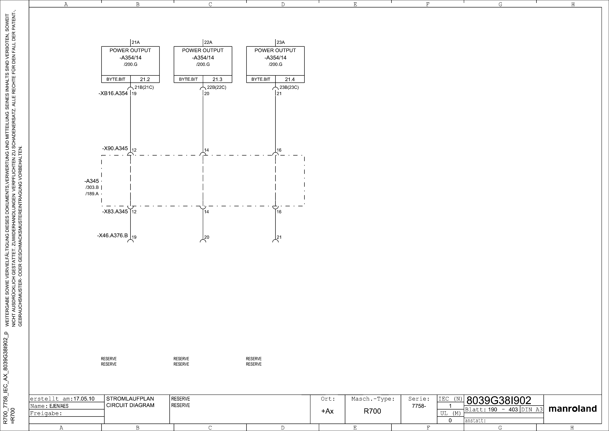

# +Ax — Sheet 190 of 403 — RESERVE

**RESERVE**

> Part of the manroland **R700** printing press IEC/UL circuit diagrams.
> Drawing class: **Stromlaufplan / Circuit diagram** (DIN A3).
> Document `+Ax` covers the **Central control console** machine section.

## At a glance

| Field | Value |
|---|---|
| Document | `+Ax`  (8039G38I902) |
| Sheet | **190** of 403 |
| Section (DE) | RESERVE |
| Section (EN) | RESERVE |
| Section type | CIRCUIT — Circuit diagram |
| Machine type | `R700` |
| Series | `7758` |
| Created | 17.05.10 |
| Replaces | — |
| Columns used | A, B, C, D |
| Path numbers | — |
| Labels on sheet | 46 |
| Cross-refs out | 5 |
| Cross-refs in | 17 |

**Previous:** [+Ax sheet 189](SHEET_0189.md) · **Next:** [+Ax sheet 191](SHEET_0191.md) · **Document TOC:** [_TOC.md](_TOC.md)  (+Ax) · **Master TOC:** [all sheets](../_MASTER_TOC.md)

## Sheet image (300 DPI, exact vector render)



_Rendered directly from the PDF vector layer at 300 DPI (1-bit), no OCR and no resampling. Use it to confirm anything ambiguous in the text below._

## Cross-references on this sheet

Each entry is a wire leaving this sheet. The printed token is `/sheet.column`; the link resolves to that sheet inside the same document.

| Ref | Target sheet | Col | Path | Destination on target | Target section | From col |
|---|---|---|---|---|---|---|
| `/200.G` | [+Ax sheet 200](SHEET_0200.md) | G | — | — | REFERENZMODUL | B |
| `/200.G` | [+Ax sheet 200](SHEET_0200.md) | G | — | — | REFERENZMODUL | C |
| `/200.G` | [+Ax sheet 200](SHEET_0200.md) | G | — | — | REFERENZMODUL | D |
| `/303.B` | [+Ax sheet 303](SHEET_0303.md) | B | — | — | SPANNUNGSVERSORGUNG: LACKMODUL | A |
| `/189.A` | [+Ax sheet 189](SHEET_0189.md) | A | — | — | RESERVE | A |

### Incoming references (sheets that point here)

Every other sheet that sends a wire to this one. `Back-ref` is the token printed on *that* sheet; `Path` is its line number.

| From sheet | Cols | Back-ref | Path | Refs | What continues there |
|---|---|---|---|---|---|
| [+Ax#189](SHEET_0189.md) | A | `/189.A` | — | 1 | — |
| [+Ax#200](SHEET_0200.md) | F | `/200.F` | — | 3 | — |
| [+Ax#254](SHEET_0254.md) | F | `/254.F` | — | 3 | — |
| [+Ax#283](SHEET_0283.md) | B | `/283.B` | — | 3 | — |
| [+Ax#287](SHEET_0287.md) | A | `/287.A` | — | 3 | — |
| [+Ax#289](SHEET_0289.md) | C | `/289.C` | — | 3 | — |
| [+Ax#303](SHEET_0303.md) | B | `/303.B` | — | 1 | — |


## Devices on this sheet

| Tag | Class | Class meaning (IEC) | Col | Sub | Terminal | Sign |
|---|---|---|---|---|---|---|
| `A345` | A | Baugruppe / assembly, module, PC board | A | — | — | — |
| `A354/14` | A | Baugruppe / assembly, module, PC board | B | 14 | — | — |
| `A354/14` | A | Baugruppe / assembly, module, PC board | C | 14 | — | — |
| `A354/14` | A | Baugruppe / assembly, module, PC board | D | 14 | — | — |
| `21.2` | — | cross-device reference | B | — | — | — |
| `XB16.A354` | — | cross-device reference | B | — | — | — |
| `X46.A376.B` | — | cross-device reference | B | — | — | — |
| `X83.A345` | — | cross-device reference | B | — | — | — |
| `X90.A345` | — | cross-device reference | B | — | — | — |
| `21.3` | — | cross-device reference | C | — | — | — |
| `21.4` | — | cross-device reference | D | — | — | — |

## Potentials / nets

_No named potentials on this sheet._

## Wire-end annotations (grouped as printed)

A wire that continues elsewhere is annotated with a small cluster: the destination description, the path/line number `#NN`, and the `/sheet.column` cross reference. Each row below is one such cluster exactly as it is grouped on the drawing.

| Col | Y | Path | Cross-ref | Text on the wire |
|---|---|---|---|---|
| B | 79.0 | — | — | `21A` |
| C | 79.0 | — | — | `22A` |
| D | 79.0 | — | — | `23A` |
| B | 94.1 | — | — | `POWER OUTPUT` |
| C | 94.1 | — | — | `POWER OUTPUT` |
| D | 94.1 | — | — | `POWER OUTPUT` |
| B | 108.0 | — | — | `A354/14` |
| C | 108.0 | — | — | `A354/14` |
| D | 108.0 | — | — | `A354/14` |
| B | 121.8 | — | `/200.G` | — |
| C | 121.8 | — | `/200.G` | — |
| D | 121.8 | — | `/200.G` | — |
| B | 150.9 | — | — | `BYTE.BIT 21.2` |
| C | 150.9 | — | — | `BYTE.BIT 21.3` |
| D | 150.9 | — | — | `BYTE.BIT 21.4` |
| B | 166.9 | — | — | `21B(21C)` |
| C | 166.9 | — | — | `22B(22C)` |
| D | 166.9 | — | — | `23B(23C)` |
| B | 177.5 | — | — | `XB16.A354 19` |
| C | 178.9 | — | — | `20` |
| D | 178.9 | — | — | `21` |
| B | 285.2 | — | — | `X90.A345 12` |
| C | 289.5 | — | — | `14` |
| D | 289.5 | — | — | `16` |
| A | 349.0 | — | — | `A345` |
| A | 362.0 | — | `/303.B`, `/189.A` | — |
| B | 408.5 | — | — | `X83.A345 12` |
| C | 409.9 | — | — | `14` |
| D | 409.9 | — | — | `16` |
| B | 455.3 | — | — | `X46.A376.B 19` |
| C | 459.5 | — | — | `20` |
| D | 459.5 | — | — | `21` |
| B | 697.9 | — | — | `RESERVE RESERVE` |
| C | 697.9 | — | — | `RESERVE RESERVE` |
| D | 697.9 | — | — | `RESERVE RESERVE` |


## Reconstructed tables

This sheet carries tabular content (pin map / terminal assignment / index). The grid below was rebuilt from the drawing's own rule lines, so each row is exactly one physical row of the table.

### Table 1 — 1 data rows × 2 columns (at x=198.4, y=90.7)

| POWER | OUTPUT A354/14 /200.G |
|---|---|
| `BYTE.BIT` | `21.2` |


### Table 2 — 1 data rows × 2 columns (at x=340.2, y=90.7)

| POWER | OUTPUT A354/14 /200.G |
|---|---|
| `BYTE.BIT` | `21.3` |


### Table 3 — 1 data rows × 2 columns (at x=481.9, y=90.7)

| POWER | OUTPUT A354/14 /200.G |
|---|---|
| `BYTE.BIT` | `21.4` |


## Notes and free text on this sheet

| Text | Col | Y (pt) |
|---|---|---|
| `21A` | B | 78.95 |
| `21B(21C)` | B | 166.86 |
| `POWER OUTPUT` | B | 94.1 |
| `BYTE.BIT` | B | 151.43 |
| `RESERVE` | B | 697.91 |
| `22A` | C | 78.95 |
| `22B(22C)` | C | 166.86 |
| `POWER OUTPUT` | C | 94.1 |
| `BYTE.BIT` | C | 151.43 |
| `RESERVE` | C | 697.91 |
| `23A` | D | 78.95 |
| `23B(23C)` | D | 166.86 |
| `POWER OUTPUT` | D | 94.1 |
| `BYTE.BIT` | D | 151.43 |
| `RESERVE` | D | 697.91 |

## Complete label inventory (exact text from the drawing)

Every text object inside the drawing area of this sheet, in DIN reading order (column A→H, then top→bottom). This is the authoritative list: if a string is not here it is not printed on this sheet.

| Col | Y | X | Dir | Type | Text |
|---|---|---|---|---|---|
| A | 349.0 | 165.0 | → | device tag | `A345` |
| A | 362.0 | 167.5 | → | cross-reference | `/303.B` |
| A | 374.4 | 167.2 | → | cross-reference | `/189.A` |
| B | 78.9 | 257.7 | → | text | `21A` |
| B | 94.1 | 214.3 | → | text | `POWER OUTPUT` |
| B | 108.0 | 233.7 | → | device tag | `A354/14` |
| B | 121.8 | 242.2 | → | cross-reference | `/200.G` |
| B | 150.9 | 274.0 | → | device ref | `21.2` |
| B | 151.4 | 208.3 | → | text | `BYTE.BIT` |
| B | 166.9 | 263.3 | → | text | `21B(21C)` |
| B | 177.5 | 192.8 | → | device ref | `XB16.A354` |
| B | 178.9 | 257.1 | → | number | `19` |
| B | 285.2 | 199.8 | → | device ref | `X90.A345` |
| B | 289.5 | 257.1 | → | number | `12` |
| B | 408.5 | 199.8 | → | device ref | `X83.A345` |
| B | 409.9 | 257.1 | → | number | `12` |
| B | 455.3 | 189.9 | → | device ref | `X46.A376.B` |
| B | 459.5 | 257.1 | → | number | `19` |
| B | 697.9 | 197.6 | → | text | `RESERVE` |
| B | 708.5 | 197.6 | → | text | `RESERVE` |
| C | 78.9 | 399.4 | → | text | `22A` |
| C | 94.1 | 356.0 | → | text | `POWER OUTPUT` |
| C | 108.0 | 375.4 | → | device tag | `A354/14` |
| C | 121.8 | 384.0 | → | cross-reference | `/200.G` |
| C | 150.9 | 415.7 | → | device ref | `21.3` |
| C | 151.4 | 350.1 | → | text | `BYTE.BIT` |
| C | 166.9 | 405.1 | → | text | `22B(22C)` |
| C | 178.9 | 399.4 | → | number | `20` |
| C | 289.5 | 398.8 | → | number | `14` |
| C | 409.9 | 398.8 | → | number | `14` |
| C | 459.5 | 399.4 | → | number | `20` |
| C | 697.9 | 339.3 | → | text | `RESERVE` |
| C | 708.5 | 339.3 | → | text | `RESERVE` |
| D | 78.9 | 541.1 | → | text | `23A` |
| D | 94.1 | 497.8 | → | text | `POWER OUTPUT` |
| D | 108.0 | 517.2 | → | device tag | `A354/14` |
| D | 121.8 | 525.7 | → | cross-reference | `/200.G` |
| D | 150.9 | 557.4 | → | device ref | `21.4` |
| D | 151.4 | 491.8 | → | text | `BYTE.BIT` |
| D | 166.9 | 546.8 | → | text | `23B(23C)` |
| D | 178.9 | 541.1 | → | number | `21` |
| D | 289.5 | 540.6 | → | number | `16` |
| D | 409.9 | 540.6 | → | number | `16` |
| D | 459.5 | 541.1 | → | number | `21` |
| D | 697.9 | 481.0 | → | text | `RESERVE` |
| D | 708.5 | 481.0 | → | text | `RESERVE` |

## Reading-order text block

The same content as a plain block, grouped by DIN column — convenient to paste or to match against a visual description.

```text
=== Column A ===
 349.0  165.0  devtag       A345
 362.0  167.5  xref         /303.B
 374.4  167.2  xref         /189.A
=== Column B ===
  78.9  257.7  text         21A
  94.1  214.3  text         POWER OUTPUT
 108.0  233.7  devtag       A354/14
 121.8  242.2  xref         /200.G
 150.9  274.0  devref       21.2
 151.4  208.3  text         BYTE.BIT
 166.9  263.3  text         21B(21C)
 177.5  192.8  devref       XB16.A354
 178.9  257.1  numeric      19
 285.2  199.8  devref       X90.A345
 289.5  257.1  numeric      12
 408.5  199.8  devref       X83.A345
 409.9  257.1  numeric      12
 455.3  189.9  devref       X46.A376.B
 459.5  257.1  numeric      19
 697.9  197.6  text         RESERVE
 708.5  197.6  text         RESERVE
=== Column C ===
  78.9  399.4  text         22A
  94.1  356.0  text         POWER OUTPUT
 108.0  375.4  devtag       A354/14
 121.8  384.0  xref         /200.G
 150.9  415.7  devref       21.3
 151.4  350.1  text         BYTE.BIT
 166.9  405.1  text         22B(22C)
 178.9  399.4  numeric      20
 289.5  398.8  numeric      14
 409.9  398.8  numeric      14
 459.5  399.4  numeric      20
 697.9  339.3  text         RESERVE
 708.5  339.3  text         RESERVE
=== Column D ===
  78.9  541.1  text         23A
  94.1  497.8  text         POWER OUTPUT
 108.0  517.2  devtag       A354/14
 121.8  525.7  xref         /200.G
 150.9  557.4  devref       21.4
 151.4  491.8  text         BYTE.BIT
 166.9  546.8  text         23B(23C)
 178.9  541.1  numeric      21
 289.5  540.6  numeric      16
 409.9  540.6  numeric      16
 459.5  541.1  numeric      21
 697.9  481.0  text         RESERVE
 708.5  481.0  text         RESERVE
```

---
_Generated from the PDF vector text layer; no OCR. Source: `R700_7758_IEC_AX_8039G38I902_p`, sheet 190._
