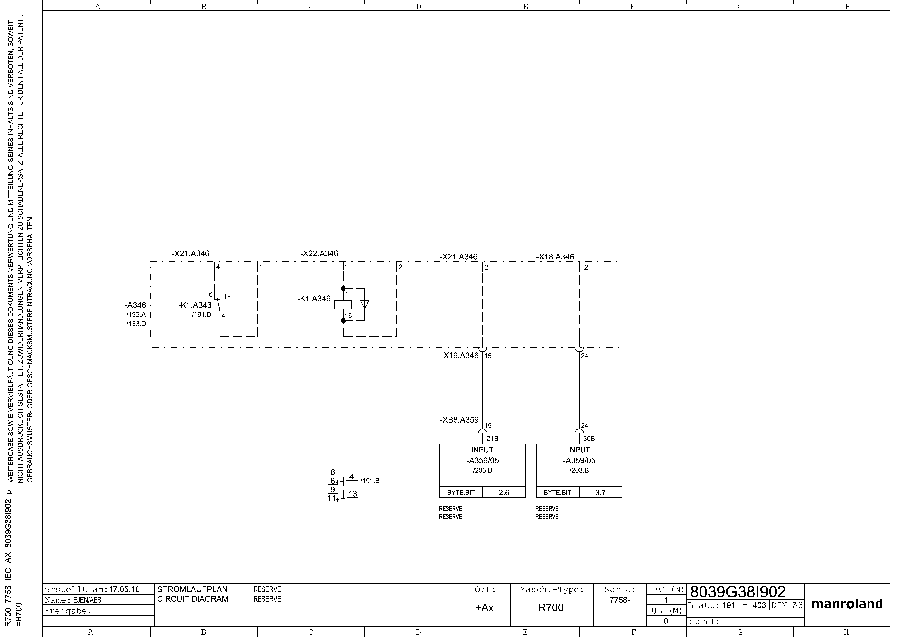

# +Ax — Sheet 191 of 403 — RESERVE

**RESERVE**

> Part of the manroland **R700** printing press IEC/UL circuit diagrams.
> Drawing class: **Stromlaufplan / Circuit diagram** (DIN A3).
> Document `+Ax` covers the **Central control console** machine section.

## At a glance

| Field | Value |
|---|---|
| Document | `+Ax`  (8039G38I902) |
| Sheet | **191** of 403 |
| Section (DE) | RESERVE |
| Section (EN) | RESERVE |
| Section type | CIRCUIT — Circuit diagram |
| Machine type | `R700` |
| Series | `7758` |
| Created | 17.05.10 |
| Replaces | — |
| Columns used | A, B, C, D, E, F |
| Path numbers | — |
| Labels on sheet | 50 |
| Cross-refs out | 6 |
| Cross-refs in | 16 |

**Previous:** [+Ax sheet 190](SHEET_0190.md) · **Next:** [+Ax sheet 192](SHEET_0192.md) · **Document TOC:** [_TOC.md](_TOC.md)  (+Ax) · **Master TOC:** [all sheets](../_MASTER_TOC.md)

## Sheet image (300 DPI, exact vector render)



_Rendered directly from the PDF vector layer at 300 DPI (1-bit), no OCR and no resampling. Use it to confirm anything ambiguous in the text below._

## Cross-references on this sheet

Each entry is a wire leaving this sheet. The printed token is `/sheet.column`; the link resolves to that sheet inside the same document.

| Ref | Target sheet | Col | Path | Destination on target | Target section | From col |
|---|---|---|---|---|---|---|
| `/191.D` | [+Ax sheet 191](SHEET_0191.md) | D | — | A346 | RESERVE | B |
| `/192.A` | [+Ax sheet 192](SHEET_0192.md) | A | — | — | RESERVE | A |
| `/133.D` | [+Ax sheet 133](SHEET_0133.md) | D | — | — | REALTIMERECHNER DRUCKWERK | A |
| `/203.B` | [+Ax sheet 203](SHEET_0203.md) | B | — | — | REFERENZMODUL | E |
| `/203.B` | [+Ax sheet 203](SHEET_0203.md) | B | — | — | REFERENZMODUL | F |
| `/191.B` | [+Ax sheet 191](SHEET_0191.md) | B | — | 4 | RESERVE | C |

### Incoming references (sheets that point here)

Every other sheet that sends a wire to this one. `Back-ref` is the token printed on *that* sheet; `Path` is its line number.

| From sheet | Cols | Back-ref | Path | Refs | What continues there |
|---|---|---|---|---|---|
| [+Ax#133](SHEET_0133.md) | D | `/133.D` | — | 1 | — |
| [+Ax#191](SHEET_0191.md) | B, C | `/191.B`, `/191.C` | — | 2 | 4; A346 |
| [+Ax#192](SHEET_0192.md) | A | `/192.A` | — | 1 | — |
| [+Ax#203](SHEET_0203.md) | B | `/203.B` | — | 2 | — |
| [+Ax#238](SHEET_0238.md) | F | `/238.F` | — | 2 | — |
| [+Ax#256](SHEET_0256.md) | F | `/256.F` | — | 1 | — |
| [+Ax#259](SHEET_0259.md) | A | `/259.A` | — | 2 | — |
| [+Ax#261](SHEET_0261.md) | C | `/261.C` | — | 3 | — |
| [+Ax#262](SHEET_0262.md) | F | `/262.F` | — | 2 | — |


## Devices on this sheet

| Tag | Class | Class meaning (IEC) | Col | Sub | Terminal | Sign |
|---|---|---|---|---|---|---|
| `A359/05` | A | Baugruppe / assembly, module, PC board | F | 05 | — | — |
| `A359/05` | A | Baugruppe / assembly, module, PC board | E | 05 | — | — |
| `A346` | A | Baugruppe / assembly, module, PC board | A | — | — | — |
| `3.7` | — | cross-device reference | F | — | — | — |
| `2.6` | — | cross-device reference | E | — | — | — |
| `XB8.A359` | — | cross-device reference | D | — | — | — |
| `K1.A346` | — | cross-device reference | B | — | — | — |
| `K1.A346` | — | cross-device reference | C | — | — | — |
| `X19.A346` | — | cross-device reference | D | — | — | — |
| `X21.A346` | — | cross-device reference | B | — | — | — |
| `X18.A346` | — | cross-device reference | E | — | — | — |
| `X21.A346` | — | cross-device reference | D | — | — | — |
| `X22.A346` | — | cross-device reference | C | — | — | — |

## Potentials / nets

_No named potentials on this sheet._

## Wire-end annotations (grouped as printed)

A wire that continues elsewhere is annotated with a small cluster: the destination description, the path/line number `#NN`, and the `/sheet.column` cross reference. Each row below is one such cluster exactly as it is grouped on the drawing.

| Col | Y | Path | Cross-ref | Text on the wire |
|---|---|---|---|---|
| D | 330.5 | — | — | `X21.A346 X18.A346` |
| C | 330.5 | — | — | `X22.A346` |
| E | 334.8 | — | — | `X21.A346 2` |
| B | 349.0 | — | — | `4` |
| C | 349.0 | — | — | `1 1 2` |
| E | 349.7 | — | — | `2` |
| B | 385.1 | — | — | `K1.A346 8` |
| B | 385.1 | — | — | `6` |
| C | 385.1 | — | — | `1` |
| C | 390.1 | — | — | `K1.A346` |
| B | 398.6 | — | `/191.D` | `A346` |
| A | 411.6 | — | `/192.A`, `/133.D` | — |
| B | 413.5 | — | — | `4` |
| C | 413.5 | — | — | `16` |
| E | 465.2 | — | — | `X19.A346 15 24` |
| D | 550.2 | — | — | `XB8.A359 15` |
| F | 558.8 | — | — | `24` |
| E | 575.7 | — | — | `21B` |
| F | 575.7 | — | — | `30B` |
| E | 590.2 | — | — | `INPUT` |
| E | 590.2 | — | — | `INPUT` |
| E | 604.1 | — | — | `A359/05` |
| F | 604.1 | — | — | `A359/05` |
| E | 617.9 | — | `/203.B` | — |
| F | 617.9 | — | `/203.B` | — |
| C | 619.6 | — | — | `11 8 6 9 13` |
| C | 625.3 | — | `/191.B` | `4` |
| E | 646.9 | — | — | `BYTE.BIT 2.6` |
| E | 646.9 | — | — | `BYTE.BIT 3.7` |
| D | 669.6 | — | — | `RESERVE RESERVE` |
| E | 669.6 | — | — | `RESERVE RESERVE` |


## Reconstructed tables

This sheet carries tabular content (pin map / terminal assignment / index). The grid below was rebuilt from the drawing's own rule lines, so each row is exactly one physical row of the table.

### Table 1 — 1 data rows × 2 columns (at x=453.5, y=445.0)

| 4 | /191.B |
|---|---|
| `13` |  |


### Table 2 — 2 data rows × 2 columns (at x=581.1, y=445.0)

| X19.A346 XB8.A359 | 15 15 21B |
|---|---|
| `INPUT` | `A359/05 /203.B` |
| `BYTE.BIT` | `2.6` |


### Table 3 — 1 data rows × 2 columns (at x=708.7, y=445.0) — **24 24 30B**

| INPUT | A359/05 /203.B |
|---|---|
| `BYTE.BIT` | `3.7` |


## Notes and free text on this sheet

| Text | Col | Y (pt) |
|---|---|---|
| `30B` | F | 575.72 |
| `INPUT` | E | 590.24 |
| `BYTE.BIT` | E | 647.49 |
| `RESERVE` | E | 669.56 |
| `21B` | E | 575.72 |
| `BYTE.BIT` | D | 647.49 |
| `RESERVE` | D | 669.56 |

## Complete label inventory (exact text from the drawing)

Every text object inside the drawing area of this sheet, in DIN reading order (column A→H, then top→bottom). This is the authoritative list: if a string is not here it is not printed on this sheet.

| Col | Y | X | Dir | Type | Text |
|---|---|---|---|---|---|
| A | 398.6 | 165.0 | → | device tag | `A346` |
| A | 411.6 | 167.2 | → | cross-reference | `/192.A` |
| A | 424.1 | 167.2 | → | cross-reference | `/133.D` |
| B | 330.5 | 226.8 | → | device ref | `X21.A346` |
| B | 349.0 | 286.0 | → | number | `4` |
| B | 385.1 | 276.1 | → | number | `6` |
| B | 385.1 | 300.2 | → | number | `8` |
| B | 398.6 | 235.6 | → | device ref | `K1.A346` |
| B | 411.7 | 253.7 | → | cross-reference | `/191.D` |
| B | 413.5 | 293.1 | → | number | `4` |
| C | 330.5 | 396.9 | → | device ref | `X22.A346` |
| C | 349.0 | 342.1 | → | number | `1` |
| C | 349.0 | 455.5 | → | number | `1` |
| C | 385.1 | 455.5 | → | number | `1` |
| C | 390.1 | 392.9 | → | device ref | `K1.A346` |
| C | 413.5 | 455.5 | → | number | `16` |
| C | 619.6 | 436.8 | → | number | `8` |
| C | 625.3 | 461.8 | → | number | `4` |
| C | 631.0 | 436.8 | → | number | `6` |
| C | 642.3 | 436.8 | → | number | `9` |
| C | 648.0 | 460.1 | → | number | `13` |
| C | 653.7 | 432.3 | → | number | `11` |
| D | 334.8 | 581.1 | → | device ref | `X21.A346` |
| D | 349.0 | 527.0 | → | number | `2` |
| D | 465.2 | 582.5 | → | device ref | `X19.A346` |
| D | 550.2 | 581.4 | → | device ref | `XB8.A359` |
| D | 631.7 | 476.2 | → | cross-reference | `/191.B` |
| D | 647.5 | 591.0 | → | text | `BYTE.BIT` |
| D | 669.6 | 580.3 | → | text | `RESERVE` |
| D | 680.2 | 580.3 | → | text | `RESERVE` |
| E | 334.8 | 708.7 | → | device ref | `X18.A346` |
| E | 349.7 | 640.6 | → | number | `2` |
| E | 466.6 | 639.8 | → | number | `15` |
| E | 558.7 | 639.8 | → | number | `15` |
| E | 575.7 | 643.2 | → | text | `21B` |
| E | 590.2 | 622.9 | → | text | `INPUT` |
| E | 590.2 | 750.5 | → | text | `INPUT` |
| E | 604.1 | 616.4 | → | device tag | `A359/05` |
| E | 617.9 | 625.2 | → | cross-reference | `/203.B` |
| E | 646.9 | 659.3 | → | device ref | `2.6` |
| E | 647.5 | 718.6 | → | text | `BYTE.BIT` |
| E | 669.6 | 707.8 | → | text | `RESERVE` |
| E | 680.2 | 707.8 | → | text | `RESERVE` |
| F | 349.7 | 772.2 | → | number | `2` |
| F | 466.6 | 767.9 | → | number | `24` |
| F | 558.7 | 767.9 | → | number | `24` |
| F | 575.7 | 770.7 | → | text | `30B` |
| F | 604.1 | 744.0 | → | device tag | `A359/05` |
| F | 617.9 | 752.7 | → | cross-reference | `/203.B` |
| F | 646.9 | 786.9 | → | device ref | `3.7` |

## Reading-order text block

The same content as a plain block, grouped by DIN column — convenient to paste or to match against a visual description.

```text
=== Column A ===
 398.6  165.0  devtag       A346
 411.6  167.2  xref         /192.A
 424.1  167.2  xref         /133.D
=== Column B ===
 330.5  226.8  devref       X21.A346
 349.0  286.0  numeric      4
 385.1  276.1  numeric      6
 385.1  300.2  numeric      8
 398.6  235.6  devref       K1.A346
 411.7  253.7  xref         /191.D
 413.5  293.1  numeric      4
=== Column C ===
 330.5  396.9  devref       X22.A346
 349.0  342.1  numeric      1
 349.0  455.5  numeric      1
 385.1  455.5  numeric      1
 390.1  392.9  devref       K1.A346
 413.5  455.5  numeric      16
 619.6  436.8  numeric      8
 625.3  461.8  numeric      4
 631.0  436.8  numeric      6
 642.3  436.8  numeric      9
 648.0  460.1  numeric      13
 653.7  432.3  numeric      11
=== Column D ===
 334.8  581.1  devref       X21.A346
 349.0  527.0  numeric      2
 465.2  582.5  devref       X19.A346
 550.2  581.4  devref       XB8.A359
 631.7  476.2  xref         /191.B
 647.5  591.0  text         BYTE.BIT
 669.6  580.3  text         RESERVE
 680.2  580.3  text         RESERVE
=== Column E ===
 334.8  708.7  devref       X18.A346
 349.7  640.6  numeric      2
 466.6  639.8  numeric      15
 558.7  639.8  numeric      15
 575.7  643.2  text         21B
 590.2  622.9  text         INPUT
 590.2  750.5  text         INPUT
 604.1  616.4  devtag       A359/05
 617.9  625.2  xref         /203.B
 646.9  659.3  devref       2.6
 647.5  718.6  text         BYTE.BIT
 669.6  707.8  text         RESERVE
 680.2  707.8  text         RESERVE
=== Column F ===
 349.7  772.2  numeric      2
 466.6  767.9  numeric      24
 558.7  767.9  numeric      24
 575.7  770.7  text         30B
 604.1  744.0  devtag       A359/05
 617.9  752.7  xref         /203.B
 646.9  786.9  devref       3.7
```

---
_Generated from the PDF vector text layer; no OCR. Source: `R700_7758_IEC_AX_8039G38I902_p`, sheet 191._
