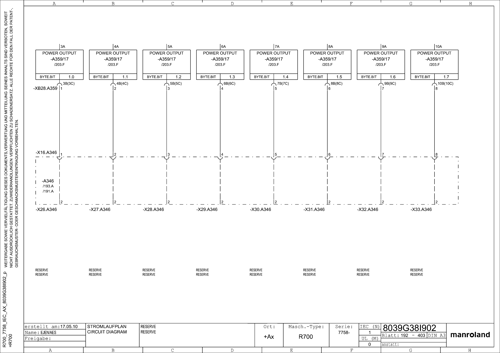

# +Ax — Sheet 192 of 403 — RESERVE

**RESERVE**

> Part of the manroland **R700** printing press IEC/UL circuit diagrams.
> Drawing class: **Stromlaufplan / Circuit diagram** (DIN A3).
> Document `+Ax` covers the **Central control console** machine section.

## At a glance

| Field | Value |
|---|---|
| Document | `+Ax`  (8039G38I902) |
| Sheet | **192** of 403 |
| Section (DE) | RESERVE |
| Section (EN) | RESERVE |
| Section type | CIRCUIT — Circuit diagram |
| Machine type | `R700` |
| Series | `7758` |
| Created | 17.05.10 |
| Replaces | — |
| Columns used | A, B, C, D, E, F, G, H |
| Path numbers | — |
| Labels on sheet | 109 |
| Cross-refs out | 10 |
| Cross-refs in | 34 |

**Previous:** [+Ax sheet 191](SHEET_0191.md) · **Next:** [+Ax sheet 193](SHEET_0193.md) · **Document TOC:** [_TOC.md](_TOC.md)  (+Ax) · **Master TOC:** [all sheets](../_MASTER_TOC.md)

## Sheet image (300 DPI, exact vector render)



_Rendered directly from the PDF vector layer at 300 DPI (1-bit), no OCR and no resampling. Use it to confirm anything ambiguous in the text below._

## Cross-references on this sheet

Each entry is a wire leaving this sheet. The printed token is `/sheet.column`; the link resolves to that sheet inside the same document.

| Ref | Target sheet | Col | Path | Destination on target | Target section | From col |
|---|---|---|---|---|---|---|
| `/203.F` | [+Ax sheet 203](SHEET_0203.md) | F | — | — | REFERENZMODUL | A |
| `/203.F` | [+Ax sheet 203](SHEET_0203.md) | F | — | — | REFERENZMODUL | B |
| `/203.F` | [+Ax sheet 203](SHEET_0203.md) | F | — | — | REFERENZMODUL | C |
| `/203.F` | [+Ax sheet 203](SHEET_0203.md) | F | — | — | REFERENZMODUL | D |
| `/203.F` | [+Ax sheet 203](SHEET_0203.md) | F | — | — | REFERENZMODUL | E |
| `/203.F` | [+Ax sheet 203](SHEET_0203.md) | F | — | — | REFERENZMODUL | F |
| `/203.F` | [+Ax sheet 203](SHEET_0203.md) | F | — | — | REFERENZMODUL | G |
| `/203.F` | [+Ax sheet 203](SHEET_0203.md) | F | — | — | REFERENZMODUL | G |
| `/193.A` | [+Ax sheet 193](SHEET_0193.md) | A | — | — | RESERVE | A |
| `/191.A` | [+Ax sheet 191](SHEET_0191.md) | A | — | — | RESERVE | A |

### Incoming references (sheets that point here)

Every other sheet that sends a wire to this one. `Back-ref` is the token printed on *that* sheet; `Path` is its line number.

| From sheet | Cols | Back-ref | Path | Refs | What continues there |
|---|---|---|---|---|---|
| [+Ax#191](SHEET_0191.md) | A | `/191.A` | — | 1 | — |
| [+Ax#193](SHEET_0193.md) | A | `/193.A` | — | 1 | — |
| [+Ax#203](SHEET_0203.md) | F | `/203.F` | — | 8 | — |
| [+Ax#254](SHEET_0254.md) | E | `/254.E` | — | 8 | — |
| [+Ax#268](SHEET_0268.md) | F | `/268.F` | — | 1 | — |
| [+Ax#270](SHEET_0270.md) | C | `/270.C` | — | 1 | — |
| [+Ax#272](SHEET_0272.md) | A, D | `/272.A`, `/272.D` | — | 9 | — |
| [+Ax#273](SHEET_0273.md) | E | `/273.E` | — | 1 | — |
| [+Ax#274](SHEET_0274.md) | G | `/274.G` | — | 1 | — |
| [+Ax#275](SHEET_0275.md) | B, E | `/275.B`, `/275.E` | — | 2 | — |
| [+Ax#276](SHEET_0276.md) | G | `/276.G` | — | 1 | — |


## Devices on this sheet

| Tag | Class | Class meaning (IEC) | Col | Sub | Terminal | Sign |
|---|---|---|---|---|---|---|
| `A346` | A | Baugruppe / assembly, module, PC board | A | — | — | — |
| `A359/17` | A | Baugruppe / assembly, module, PC board | A | 17 | — | — |
| `A359/17` | A | Baugruppe / assembly, module, PC board | B | 17 | — | — |
| `A359/17` | A | Baugruppe / assembly, module, PC board | C | 17 | — | — |
| `A359/17` | A | Baugruppe / assembly, module, PC board | D | 17 | — | — |
| `A359/17` | A | Baugruppe / assembly, module, PC board | E | 17 | — | — |
| `A359/17` | A | Baugruppe / assembly, module, PC board | F | 17 | — | — |
| `A359/17` | A | Baugruppe / assembly, module, PC board | G | 17 | — | — |
| `A359/17` | A | Baugruppe / assembly, module, PC board | G | 17 | — | — |
| `X16.A346` | — | cross-device reference | A | — | — | — |
| `XB28.A359` | — | cross-device reference | A | — | — | — |
| `1.0` | — | cross-device reference | A | — | — | — |
| `1.1` | — | cross-device reference | B | — | — | — |
| `1.2` | — | cross-device reference | C | — | — | — |
| `1.3` | — | cross-device reference | D | — | — | — |
| `1.4` | — | cross-device reference | E | — | — | — |
| `1.5` | — | cross-device reference | F | — | — | — |
| `1.6` | — | cross-device reference | G | — | — | — |
| `1.7` | — | cross-device reference | H | — | — | — |
| `X26.A346` | — | cross-device reference | A | — | — | — |
| `X27.A346` | — | cross-device reference | B | — | — | — |
| `X28.A346` | — | cross-device reference | C | — | — | — |
| `X29.A346` | — | cross-device reference | D | — | — | — |
| `X30.A346` | — | cross-device reference | D | — | — | — |
| `X31.A346` | — | cross-device reference | E | — | — | — |
| `X32.A346` | — | cross-device reference | F | — | — | — |
| `X33.A346` | — | cross-device reference | G | — | — | — |

## Potentials / nets

_No named potentials on this sheet._

## Wire-end annotations (grouped as printed)

A wire that continues elsewhere is annotated with a small cluster: the destination description, the path/line number `#NN`, and the `/sheet.column` cross reference. Each row below is one such cluster exactly as it is grouped on the drawing.

| Col | Y | Path | Cross-ref | Text on the wire |
|---|---|---|---|---|
| A | 107.3 | — | — | `3A` |
| B | 107.3 | — | — | `4A` |
| C | 107.3 | — | — | `5A` |
| D | 107.3 | — | — | `6A` |
| E | 107.3 | — | — | `7A` |
| F | 107.3 | — | — | `8A` |
| G | 107.3 | — | — | `9A` |
| G | 107.3 | — | — | `10A` |
| A | 122.5 | — | — | `POWER OUTPUT` |
| B | 122.5 | — | — | `POWER OUTPUT` |
| C | 122.5 | — | — | `POWER OUTPUT` |
| D | 122.5 | — | — | `POWER OUTPUT` |
| E | 122.5 | — | — | `POWER OUTPUT` |
| F | 122.5 | — | — | `POWER OUTPUT` |
| F | 122.5 | — | — | `POWER OUTPUT` |
| G | 122.5 | — | — | `POWER OUTPUT` |
| A | 136.4 | — | — | `A359/17` |
| B | 136.4 | — | — | `A359/17` |
| C | 136.4 | — | — | `A359/17` |
| D | 136.4 | — | — | `A359/17` |
| E | 136.4 | — | — | `A359/17` |
| F | 136.4 | — | — | `A359/17` |
| G | 136.4 | — | — | `A359/17` |
| G | 136.4 | — | — | `A359/17` |
| A | 150.2 | — | `/203.F` | — |
| B | 150.2 | — | `/203.F` | — |
| C | 150.2 | — | `/203.F` | — |
| D | 150.2 | — | `/203.F` | — |
| E | 150.2 | — | `/203.F` | — |
| F | 150.2 | — | `/203.F` | — |
| G | 150.2 | — | `/203.F` | — |
| G | 150.2 | — | `/203.F` | — |
| A | 179.2 | — | — | `BYTE.BIT 1.0` |
| B | 179.2 | — | — | `BYTE.BIT 1.1` |
| C | 179.2 | — | — | `BYTE.BIT 1.2` |
| D | 179.2 | — | — | `BYTE.BIT 1.3` |
| E | 179.2 | — | — | `BYTE.BIT 1.4` |
| F | 179.2 | — | — | `BYTE.BIT 1.5` |
| F | 179.2 | — | — | `BYTE.BIT 1.6` |
| G | 179.2 | — | — | `BYTE.BIT 1.7` |
| A | 195.2 | — | — | `3B(3C)` |
| B | 195.2 | — | — | `4B(4C)` |
| C | 195.2 | — | — | `5B(5C)` |
| D | 195.2 | — | — | `6B(6C)` |
| E | 195.2 | — | — | `7B(7C)` |
| F | 195.2 | — | — | `8B(8C)` |
| G | 195.2 | — | — | `9B(9C)` |
| H | 195.2 | — | — | `10B(10C)` |
| A | 205.8 | — | — | `XB28.A359 1` |
| B | 207.2 | — | — | `2` |
| D | 207.2 | — | — | `3 4 5` |
| F | 207.2 | — | — | `6` |
| G | 207.2 | — | — | `7` |
| G | 207.2 | — | — | `8` |
| A | 358.9 | — | — | `X16.A346 1` |
| B | 364.6 | — | — | `2` |
| C | 364.6 | — | — | `3` |
| D | 364.6 | — | — | `4` |
| E | 364.6 | — | — | `5` |
| F | 364.6 | — | — | `6` |
| G | 364.6 | — | — | `7` |
| G | 364.6 | — | — | `8` |
| A | 426.9 | — | — | `A346` |
| A | 440.0 | — | `/193.A`, `/191.A` | — |
| A | 478.0 | — | — | `2` |
| B | 478.0 | — | — | `2` |
| C | 478.0 | — | — | `2` |
| D | 478.0 | — | — | `2` |
| E | 478.0 | — | — | `2` |
| F | 478.0 | — | — | `2` |
| G | 478.0 | — | — | `2` |
| G | 478.0 | — | — | `2` |
| D | 494.9 | — | — | `X26.A346 X27.A346 X28.A346 X29.A346 X30.A346 X31.A346 X32.A346 X33.A346` |
| A | 641.2 | — | — | `RESERVE RESERVE` |
| B | 641.2 | — | — | `RESERVE RESERVE` |
| C | 641.2 | — | — | `RESERVE RESERVE` |
| D | 641.2 | — | — | `RESERVE RESERVE` |
| D | 641.2 | — | — | `RESERVE RESERVE` |
| E | 641.2 | — | — | `RESERVE RESERVE` |
| F | 641.2 | — | — | `RESERVE RESERVE` |
| G | 641.2 | — | — | `RESERVE RESERVE` |


## Reconstructed tables

This sheet carries tabular content (pin map / terminal assignment / index). The grid below was rebuilt from the drawing's own rule lines, so each row is exactly one physical row of the table.

### Table 1 — 1 data rows × 2 columns (at x=85.0, y=119.1)

| POWER | OUTPUT A359/17 /203.F |
|---|---|
| `BYTE.BIT` | `1.0` |


### Table 2 — 1 data rows × 2 columns (at x=212.6, y=119.1)

| POWER | OUTPUT A359/17 /203.F |
|---|---|
| `BYTE.BIT` | `1.1` |


### Table 3 — 1 data rows × 2 columns (at x=340.2, y=119.1)

| POWER | OUTPUT A359/17 /203.F |
|---|---|
| `BYTE.BIT` | `1.2` |


### Table 4 — 1 data rows × 2 columns (at x=467.7, y=119.1)

| POWER | OUTPUT A359/17 /203.F |
|---|---|
| `BYTE.BIT` | `1.3` |


### Table 5 — 1 data rows × 2 columns (at x=595.3, y=119.1)

| POWER | OUTPUT A359/17 /203.F |
|---|---|
| `BYTE.BIT` | `1.4` |


### Table 6 — 1 data rows × 2 columns (at x=722.8, y=119.1)

| POWER | OUTPUT A359/17 /203.F |
|---|---|
| `BYTE.BIT` | `1.5` |


### Table 7 — 1 data rows × 2 columns (at x=850.4, y=119.1)

| POWER | OUTPUT A359/17 /203.F |
|---|---|
| `BYTE.BIT` | `1.6` |


### Table 8 — 1 data rows × 2 columns (at x=978.0, y=119.1)

| POWER | OUTPUT A359/17 /203.F |
|---|---|
| `BYTE.BIT` | `1.7` |


## Notes and free text on this sheet

| Text | Col | Y (pt) |
|---|---|---|
| `3A` | A | 107.28 |
| `3B(3C)` | A | 195.2 |
| `POWER OUTPUT` | A | 122.45 |
| `BYTE.BIT` | A | 179.78 |
| `RESERVE` | A | 641.21 |
| `4A` | B | 107.28 |
| `4B(4C)` | B | 195.2 |
| `POWER OUTPUT` | B | 122.45 |
| `BYTE.BIT` | B | 179.78 |
| `RESERVE` | B | 641.21 |
| `5A` | C | 107.28 |
| `5B(5C)` | C | 195.2 |
| `POWER OUTPUT` | C | 122.45 |
| `BYTE.BIT` | C | 179.78 |
| `RESERVE` | C | 641.21 |
| `6A` | D | 107.28 |
| `6B(6C)` | D | 195.2 |
| `POWER OUTPUT` | D | 122.45 |
| `BYTE.BIT` | D | 179.78 |
| `RESERVE` | D | 641.21 |
| `7A` | E | 107.28 |
| `7B(7C)` | E | 195.2 |
| `POWER OUTPUT` | E | 122.45 |
| `8A` | F | 107.28 |
| `8B(8C)` | F | 195.2 |
| `POWER OUTPUT` | F | 122.45 |
| `BYTE.BIT` | E | 179.78 |
| `RESERVE` | E | 641.21 |
| `9A` | G | 107.28 |
| `9B(9C)` | G | 195.2 |
| `BYTE.BIT` | F | 179.78 |
| `RESERVE` | F | 641.21 |
| `10A` | G | 107.29 |
| `10B(10C)` | H | 195.2 |
| `POWER OUTPUT` | G | 122.45 |
| `BYTE.BIT` | G | 179.78 |
| `RESERVE` | G | 641.21 |

## Complete label inventory (exact text from the drawing)

Every text object inside the drawing area of this sheet, in DIN reading order (column A→H, then top→bottom). This is the authoritative list: if a string is not here it is not printed on this sheet.

| Col | Y | X | Dir | Type | Text |
|---|---|---|---|---|---|
| A | 107.3 | 144.3 | → | text | `3A` |
| A | 122.5 | 100.9 | → | text | `POWER OUTPUT` |
| A | 136.4 | 120.3 | → | device tag | `A359/17` |
| A | 150.2 | 129.4 | → | cross-reference | `/203.F` |
| A | 179.2 | 163.0 | → | device ref | `1.0` |
| A | 179.8 | 95.0 | → | text | `BYTE.BIT` |
| A | 195.2 | 150.0 | → | text | `3B(3C)` |
| A | 205.8 | 79.4 | → | device ref | `XB28.A359` |
| A | 207.3 | 143.7 | → | number | `1` |
| A | 358.9 | 85.0 | → | device ref | `X16.A346` |
| A | 364.6 | 143.7 | → | number | `1` |
| A | 426.9 | 99.8 | → | device tag | `A346` |
| A | 440.0 | 102.0 | → | cross-reference | `/193.A` |
| A | 452.4 | 102.0 | → | cross-reference | `/191.A` |
| A | 478.0 | 144.3 | → | number | `2` |
| A | 495.0 | 85.0 | → | device ref | `X26.A346` |
| A | 641.2 | 84.2 | → | text | `RESERVE` |
| A | 651.8 | 84.2 | → | text | `RESERVE` |
| B | 107.3 | 271.8 | → | text | `4A` |
| B | 122.5 | 228.5 | → | text | `POWER OUTPUT` |
| B | 136.4 | 247.9 | → | device tag | `A359/17` |
| B | 150.2 | 257.0 | → | cross-reference | `/203.F` |
| B | 179.2 | 291.4 | → | device ref | `1.1` |
| B | 179.8 | 222.5 | → | text | `BYTE.BIT` |
| B | 195.2 | 277.5 | → | text | `4B(4C)` |
| B | 207.3 | 271.8 | → | number | `2` |
| B | 364.6 | 271.8 | → | number | `2` |
| B | 478.0 | 271.8 | → | number | `2` |
| B | 495.0 | 212.6 | → | device ref | `X27.A346` |
| B | 641.2 | 211.7 | → | text | `RESERVE` |
| B | 651.8 | 211.7 | → | text | `RESERVE` |
| C | 107.3 | 399.4 | → | text | `5A` |
| C | 122.5 | 356.0 | → | text | `POWER OUTPUT` |
| C | 136.4 | 375.4 | → | device tag | `A359/17` |
| C | 150.2 | 384.5 | → | cross-reference | `/203.F` |
| C | 179.2 | 418.1 | → | device ref | `1.2` |
| C | 179.8 | 350.1 | → | text | `BYTE.BIT` |
| C | 195.2 | 405.1 | → | text | `5B(5C)` |
| C | 207.3 | 399.4 | → | number | `3` |
| C | 364.6 | 399.4 | → | number | `3` |
| C | 478.0 | 399.4 | → | number | `2` |
| C | 495.0 | 340.2 | → | device ref | `X28.A346` |
| C | 641.2 | 339.3 | → | text | `RESERVE` |
| C | 651.8 | 339.3 | → | text | `RESERVE` |
| D | 107.3 | 527.0 | → | text | `6A` |
| D | 122.5 | 483.6 | → | text | `POWER OUTPUT` |
| D | 136.4 | 503.0 | → | device tag | `A359/17` |
| D | 150.2 | 512.1 | → | cross-reference | `/203.F` |
| D | 179.2 | 545.7 | → | device ref | `1.3` |
| D | 179.8 | 477.6 | → | text | `BYTE.BIT` |
| D | 179.8 | 605.2 | → | text | `BYTE.BIT` |
| D | 195.2 | 532.6 | → | text | `6B(6C)` |
| D | 207.3 | 527.0 | → | number | `4` |
| D | 364.6 | 527.0 | → | number | `4` |
| D | 478.0 | 527.0 | → | number | `2` |
| D | 495.0 | 467.7 | → | device ref | `X29.A346` |
| D | 495.0 | 595.3 | → | device ref | `X30.A346` |
| D | 641.2 | 466.9 | → | text | `RESERVE` |
| D | 641.2 | 594.4 | → | text | `RESERVE` |
| D | 651.8 | 466.9 | → | text | `RESERVE` |
| D | 651.8 | 594.4 | → | text | `RESERVE` |
| E | 107.3 | 654.5 | → | text | `7A` |
| E | 122.5 | 611.1 | → | text | `POWER OUTPUT` |
| E | 136.4 | 630.6 | → | device tag | `A359/17` |
| E | 150.2 | 639.6 | → | cross-reference | `/203.F` |
| E | 179.2 | 673.2 | → | device ref | `1.4` |
| E | 179.8 | 732.8 | → | text | `BYTE.BIT` |
| E | 195.2 | 660.2 | → | text | `7B(7C)` |
| E | 207.3 | 654.5 | → | number | `5` |
| E | 364.6 | 654.5 | → | number | `5` |
| E | 478.0 | 654.5 | → | number | `2` |
| E | 495.0 | 722.8 | → | device ref | `X31.A346` |
| E | 641.2 | 722.0 | → | text | `RESERVE` |
| E | 651.8 | 722.0 | → | text | `RESERVE` |
| F | 107.3 | 782.1 | → | text | `8A` |
| F | 122.5 | 738.7 | → | text | `POWER OUTPUT` |
| F | 122.5 | 866.3 | → | text | `POWER OUTPUT` |
| F | 136.4 | 758.1 | → | device tag | `A359/17` |
| F | 150.2 | 767.2 | → | cross-reference | `/203.F` |
| F | 179.2 | 800.8 | → | device ref | `1.5` |
| F | 179.8 | 860.3 | → | text | `BYTE.BIT` |
| F | 195.2 | 787.7 | → | text | `8B(8C)` |
| F | 207.3 | 782.1 | → | number | `6` |
| F | 364.6 | 782.1 | → | number | `6` |
| F | 478.0 | 782.1 | → | number | `2` |
| F | 495.0 | 850.4 | → | device ref | `X32.A346` |
| F | 641.2 | 849.5 | → | text | `RESERVE` |
| F | 651.8 | 849.5 | → | text | `RESERVE` |
| G | 107.3 | 909.6 | → | text | `9A` |
| G | 107.3 | 1036.6 | → | text | `10A` |
| G | 122.5 | 993.8 | → | text | `POWER OUTPUT` |
| G | 136.4 | 885.7 | → | device tag | `A359/17` |
| G | 136.4 | 1013.2 | → | device tag | `A359/17` |
| G | 150.2 | 894.8 | → | cross-reference | `/203.F` |
| G | 150.2 | 1022.3 | → | cross-reference | `/203.F` |
| G | 179.2 | 928.3 | → | device ref | `1.6` |
| G | 179.8 | 987.9 | → | text | `BYTE.BIT` |
| G | 195.2 | 915.3 | → | text | `9B(9C)` |
| G | 207.3 | 909.6 | → | number | `7` |
| G | 207.3 | 1037.2 | → | number | `8` |
| G | 364.6 | 909.6 | → | number | `7` |
| G | 364.6 | 1037.2 | → | number | `8` |
| G | 478.0 | 909.6 | → | number | `2` |
| G | 478.0 | 1037.2 | → | number | `2` |
| G | 495.0 | 978.0 | → | device ref | `X33.A346` |
| G | 641.2 | 977.1 | → | text | `RESERVE` |
| G | 651.8 | 977.1 | → | text | `RESERVE` |
| H | 179.2 | 1055.9 | → | device ref | `1.7` |
| H | 195.2 | 1042.3 | → | text | `10B(10C)` |

## Reading-order text block

The same content as a plain block, grouped by DIN column — convenient to paste or to match against a visual description.

```text
=== Column A ===
 107.3  144.3  text         3A
 122.5  100.9  text         POWER OUTPUT
 136.4  120.3  devtag       A359/17
 150.2  129.4  xref         /203.F
 179.2  163.0  devref       1.0
 179.8   95.0  text         BYTE.BIT
 195.2  150.0  text         3B(3C)
 205.8   79.4  devref       XB28.A359
 207.3  143.7  numeric      1
 358.9   85.0  devref       X16.A346
 364.6  143.7  numeric      1
 426.9   99.8  devtag       A346
 440.0  102.0  xref         /193.A
 452.4  102.0  xref         /191.A
 478.0  144.3  numeric      2
 495.0   85.0  devref       X26.A346
 641.2   84.2  text         RESERVE
 651.8   84.2  text         RESERVE
=== Column B ===
 107.3  271.8  text         4A
 122.5  228.5  text         POWER OUTPUT
 136.4  247.9  devtag       A359/17
 150.2  257.0  xref         /203.F
 179.2  291.4  devref       1.1
 179.8  222.5  text         BYTE.BIT
 195.2  277.5  text         4B(4C)
 207.3  271.8  numeric      2
 364.6  271.8  numeric      2
 478.0  271.8  numeric      2
 495.0  212.6  devref       X27.A346
 641.2  211.7  text         RESERVE
 651.8  211.7  text         RESERVE
=== Column C ===
 107.3  399.4  text         5A
 122.5  356.0  text         POWER OUTPUT
 136.4  375.4  devtag       A359/17
 150.2  384.5  xref         /203.F
 179.2  418.1  devref       1.2
 179.8  350.1  text         BYTE.BIT
 195.2  405.1  text         5B(5C)
 207.3  399.4  numeric      3
 364.6  399.4  numeric      3
 478.0  399.4  numeric      2
 495.0  340.2  devref       X28.A346
 641.2  339.3  text         RESERVE
 651.8  339.3  text         RESERVE
=== Column D ===
 107.3  527.0  text         6A
 122.5  483.6  text         POWER OUTPUT
 136.4  503.0  devtag       A359/17
 150.2  512.1  xref         /203.F
 179.2  545.7  devref       1.3
 179.8  477.6  text         BYTE.BIT
 179.8  605.2  text         BYTE.BIT
 195.2  532.6  text         6B(6C)
 207.3  527.0  numeric      4
 364.6  527.0  numeric      4
 478.0  527.0  numeric      2
 495.0  467.7  devref       X29.A346
 495.0  595.3  devref       X30.A346
 641.2  466.9  text         RESERVE
 641.2  594.4  text         RESERVE
 651.8  466.9  text         RESERVE
 651.8  594.4  text         RESERVE
=== Column E ===
 107.3  654.5  text         7A
 122.5  611.1  text         POWER OUTPUT
 136.4  630.6  devtag       A359/17
 150.2  639.6  xref         /203.F
 179.2  673.2  devref       1.4
 179.8  732.8  text         BYTE.BIT
 195.2  660.2  text         7B(7C)
 207.3  654.5  numeric      5
 364.6  654.5  numeric      5
 478.0  654.5  numeric      2
 495.0  722.8  devref       X31.A346
 641.2  722.0  text         RESERVE
 651.8  722.0  text         RESERVE
=== Column F ===
 107.3  782.1  text         8A
 122.5  738.7  text         POWER OUTPUT
 122.5  866.3  text         POWER OUTPUT
 136.4  758.1  devtag       A359/17
 150.2  767.2  xref         /203.F
 179.2  800.8  devref       1.5
 179.8  860.3  text         BYTE.BIT
 195.2  787.7  text         8B(8C)
 207.3  782.1  numeric      6
 364.6  782.1  numeric      6
 478.0  782.1  numeric      2
 495.0  850.4  devref       X32.A346
 641.2  849.5  text         RESERVE
 651.8  849.5  text         RESERVE
=== Column G ===
 107.3  909.6  text         9A
 107.3 1036.6  text         10A
 122.5  993.8  text         POWER OUTPUT
 136.4  885.7  devtag       A359/17
 136.4 1013.2  devtag       A359/17
 150.2  894.8  xref         /203.F
 150.2 1022.3  xref         /203.F
 179.2  928.3  devref       1.6
 179.8  987.9  text         BYTE.BIT
 195.2  915.3  text         9B(9C)
 207.3  909.6  numeric      7
 207.3 1037.2  numeric      8
 364.6  909.6  numeric      7
 364.6 1037.2  numeric      8
 478.0  909.6  numeric      2
 478.0 1037.2  numeric      2
 495.0  978.0  devref       X33.A346
 641.2  977.1  text         RESERVE
 651.8  977.1  text         RESERVE
=== Column H ===
 179.2 1055.9  devref       1.7
 195.2 1042.3  text         10B(10C)
```

---
_Generated from the PDF vector text layer; no OCR. Source: `R700_7758_IEC_AX_8039G38I902_p`, sheet 192._
