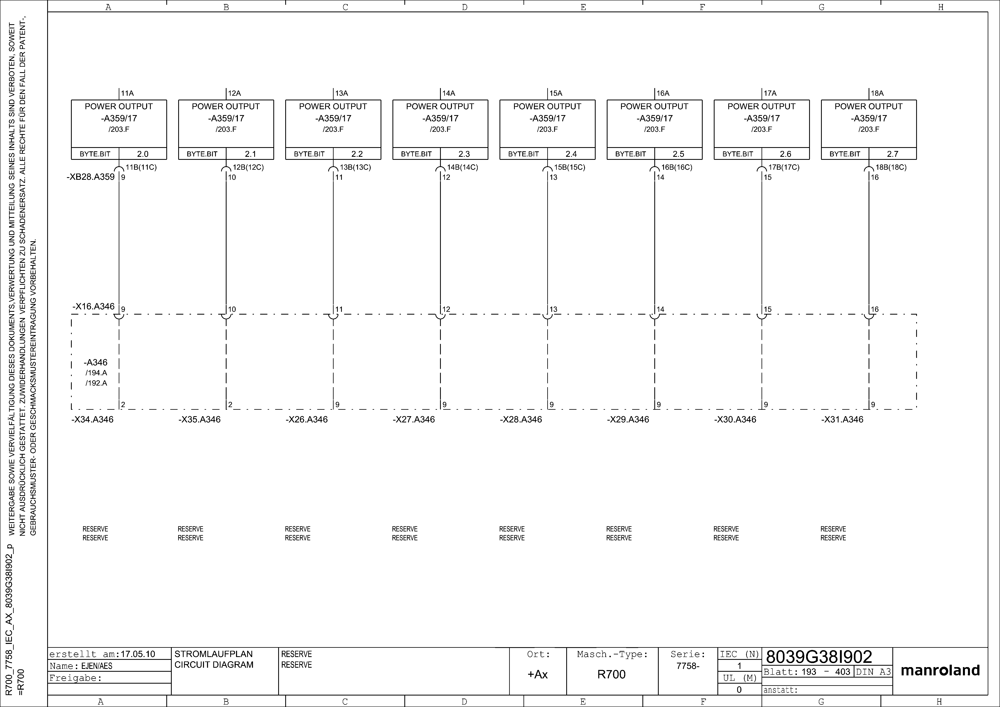

# +Ax — Sheet 193 of 403 — RESERVE

**RESERVE**

> Part of the manroland **R700** printing press IEC/UL circuit diagrams.
> Drawing class: **Stromlaufplan / Circuit diagram** (DIN A3).
> Document `+Ax` covers the **Central control console** machine section.

## At a glance

| Field | Value |
|---|---|
| Document | `+Ax`  (8039G38I902) |
| Sheet | **193** of 403 |
| Section (DE) | RESERVE |
| Section (EN) | RESERVE |
| Section type | CIRCUIT — Circuit diagram |
| Machine type | `R700` |
| Series | `7758` |
| Created | 17.05.10 |
| Replaces | — |
| Columns used | A, B, C, D, E, F, G, H |
| Path numbers | — |
| Labels on sheet | 109 |
| Cross-refs out | 10 |
| Cross-refs in | 34 |

**Previous:** [+Ax sheet 192](SHEET_0192.md) · **Next:** [+Ax sheet 194](SHEET_0194.md) · **Document TOC:** [_TOC.md](_TOC.md)  (+Ax) · **Master TOC:** [all sheets](../_MASTER_TOC.md)

## Sheet image (300 DPI, exact vector render)



_Rendered directly from the PDF vector layer at 300 DPI (1-bit), no OCR and no resampling. Use it to confirm anything ambiguous in the text below._

## Cross-references on this sheet

Each entry is a wire leaving this sheet. The printed token is `/sheet.column`; the link resolves to that sheet inside the same document.

| Ref | Target sheet | Col | Path | Destination on target | Target section | From col |
|---|---|---|---|---|---|---|
| `/203.F` | [+Ax sheet 203](SHEET_0203.md) | F | — | — | REFERENZMODUL | A |
| `/203.F` | [+Ax sheet 203](SHEET_0203.md) | F | — | — | REFERENZMODUL | B |
| `/203.F` | [+Ax sheet 203](SHEET_0203.md) | F | — | — | REFERENZMODUL | C |
| `/203.F` | [+Ax sheet 203](SHEET_0203.md) | F | — | — | REFERENZMODUL | D |
| `/203.F` | [+Ax sheet 203](SHEET_0203.md) | F | — | — | REFERENZMODUL | E |
| `/203.F` | [+Ax sheet 203](SHEET_0203.md) | F | — | — | REFERENZMODUL | F |
| `/203.F` | [+Ax sheet 203](SHEET_0203.md) | F | — | — | REFERENZMODUL | G |
| `/203.F` | [+Ax sheet 203](SHEET_0203.md) | F | — | — | REFERENZMODUL | G |
| `/194.A` | [+Ax sheet 194](SHEET_0194.md) | A | — | — | RESERVE | A |
| `/192.A` | [+Ax sheet 192](SHEET_0192.md) | A | — | — | RESERVE | A |

### Incoming references (sheets that point here)

Every other sheet that sends a wire to this one. `Back-ref` is the token printed on *that* sheet; `Path` is its line number.

| From sheet | Cols | Back-ref | Path | Refs | What continues there |
|---|---|---|---|---|---|
| [+Ax#192](SHEET_0192.md) | A | `/192.A` | — | 1 | — |
| [+Ax#194](SHEET_0194.md) | A | `/194.A` | — | 1 | — |
| [+Ax#203](SHEET_0203.md) | F | `/203.F` | — | 8 | — |
| [+Ax#254](SHEET_0254.md) | E | `/254.E` | — | 8 | — |
| [+Ax#268](SHEET_0268.md) | F | `/268.F` | — | 1 | — |
| [+Ax#270](SHEET_0270.md) | C | `/270.C` | — | 1 | — |
| [+Ax#272](SHEET_0272.md) | A, D | `/272.A`, `/272.D` | — | 9 | — |
| [+Ax#273](SHEET_0273.md) | E | `/273.E` | — | 1 | — |
| [+Ax#274](SHEET_0274.md) | G | `/274.G` | — | 1 | — |
| [+Ax#275](SHEET_0275.md) | B | `/275.B` | — | 1 | — |
| [+Ax#278](SHEET_0278.md) | B, F | `/278.B`, `/278.F` | — | 2 | — |


## Devices on this sheet

| Tag | Class | Class meaning (IEC) | Col | Sub | Terminal | Sign |
|---|---|---|---|---|---|---|
| `A346` | A | Baugruppe / assembly, module, PC board | A | — | — | — |
| `A359/17` | A | Baugruppe / assembly, module, PC board | B | 17 | — | — |
| `A359/17` | A | Baugruppe / assembly, module, PC board | C | 17 | — | — |
| `A359/17` | A | Baugruppe / assembly, module, PC board | D | 17 | — | — |
| `A359/17` | A | Baugruppe / assembly, module, PC board | E | 17 | — | — |
| `A359/17` | A | Baugruppe / assembly, module, PC board | F | 17 | — | — |
| `A359/17` | A | Baugruppe / assembly, module, PC board | G | 17 | — | — |
| `A359/17` | A | Baugruppe / assembly, module, PC board | G | 17 | — | — |
| `A359/17` | A | Baugruppe / assembly, module, PC board | A | 17 | — | — |
| `X16.A346` | — | cross-device reference | A | — | — | — |
| `2.1` | — | cross-device reference | B | — | — | — |
| `2.2` | — | cross-device reference | C | — | — | — |
| `2.3` | — | cross-device reference | D | — | — | — |
| `2.4` | — | cross-device reference | E | — | — | — |
| `2.5` | — | cross-device reference | F | — | — | — |
| `2.6` | — | cross-device reference | G | — | — | — |
| `2.7` | — | cross-device reference | H | — | — | — |
| `XB28.A359` | — | cross-device reference | A | — | — | — |
| `2.0` | — | cross-device reference | A | — | — | — |
| `X34.A346` | — | cross-device reference | A | — | — | — |
| `X35.A346` | — | cross-device reference | B | — | — | — |
| `X26.A346` | — | cross-device reference | C | — | — | — |
| `X27.A346` | — | cross-device reference | D | — | — | — |
| `X28.A346` | — | cross-device reference | D | — | — | — |
| `X29.A346` | — | cross-device reference | E | — | — | — |
| `X30.A346` | — | cross-device reference | F | — | — | — |
| `X31.A346` | — | cross-device reference | G | — | — | — |

## Potentials / nets

_No named potentials on this sheet._

## Wire-end annotations (grouped as printed)

A wire that continues elsewhere is annotated with a small cluster: the destination description, the path/line number `#NN`, and the `/sheet.column` cross reference. Each row below is one such cluster exactly as it is grouped on the drawing.

| Col | Y | Path | Cross-ref | Text on the wire |
|---|---|---|---|---|
| A | 107.3 | — | — | `11A` |
| B | 107.3 | — | — | `12A` |
| C | 107.3 | — | — | `13A` |
| D | 107.3 | — | — | `14A` |
| E | 107.3 | — | — | `15A` |
| F | 107.3 | — | — | `16A` |
| G | 107.3 | — | — | `17A` |
| G | 107.3 | — | — | `18A` |
| A | 122.5 | — | — | `POWER OUTPUT` |
| B | 122.5 | — | — | `POWER OUTPUT` |
| C | 122.5 | — | — | `POWER OUTPUT` |
| D | 122.5 | — | — | `POWER OUTPUT` |
| E | 122.5 | — | — | `POWER OUTPUT` |
| F | 122.5 | — | — | `POWER OUTPUT` |
| F | 122.5 | — | — | `POWER OUTPUT` |
| G | 122.5 | — | — | `POWER OUTPUT` |
| A | 136.4 | — | — | `A359/17` |
| B | 136.4 | — | — | `A359/17` |
| C | 136.4 | — | — | `A359/17` |
| D | 136.4 | — | — | `A359/17` |
| E | 136.4 | — | — | `A359/17` |
| F | 136.4 | — | — | `A359/17` |
| G | 136.4 | — | — | `A359/17` |
| G | 136.4 | — | — | `A359/17` |
| A | 150.2 | — | `/203.F` | — |
| B | 150.2 | — | `/203.F` | — |
| C | 150.2 | — | `/203.F` | — |
| D | 150.2 | — | `/203.F` | — |
| E | 150.2 | — | `/203.F` | — |
| F | 150.2 | — | `/203.F` | — |
| G | 150.2 | — | `/203.F` | — |
| G | 150.2 | — | `/203.F` | — |
| A | 179.2 | — | — | `BYTE.BIT 2.0` |
| B | 179.2 | — | — | `BYTE.BIT 2.1` |
| C | 179.2 | — | — | `BYTE.BIT 2.2` |
| D | 179.2 | — | — | `BYTE.BIT 2.3` |
| E | 179.2 | — | — | `BYTE.BIT 2.4` |
| F | 179.2 | — | — | `BYTE.BIT 2.5` |
| F | 179.2 | — | — | `BYTE.BIT 2.6` |
| G | 179.2 | — | — | `BYTE.BIT 2.7` |
| A | 195.2 | — | — | `11B(11C)` |
| B | 195.2 | — | — | `12B(12C)` |
| C | 195.2 | — | — | `13B(13C)` |
| D | 195.2 | — | — | `14B(14C)` |
| E | 195.2 | — | — | `15B(15C)` |
| F | 195.2 | — | — | `16B(16C)` |
| G | 195.2 | — | — | `17B(17C)` |
| H | 195.2 | — | — | `18B(18C)` |
| A | 205.8 | — | — | `XB28.A359 9` |
| B | 207.2 | — | — | `10` |
| E | 207.2 | — | — | `11 12 13 14 15 16` |
| A | 360.3 | — | — | `X16.A346 9` |
| B | 364.6 | — | — | `10` |
| C | 364.6 | — | — | `11` |
| D | 364.6 | — | — | `12` |
| E | 364.6 | — | — | `13` |
| F | 364.6 | — | — | `14` |
| G | 364.6 | — | — | `15` |
| G | 364.6 | — | — | `16` |
| A | 426.9 | — | — | `A346` |
| A | 440.0 | — | `/194.A`, `/192.A` | — |
| A | 478.0 | — | — | `2` |
| B | 478.0 | — | — | `2` |
| C | 478.0 | — | — | `9` |
| D | 478.0 | — | — | `9` |
| E | 478.0 | — | — | `9` |
| F | 478.0 | — | — | `9` |
| G | 478.0 | — | — | `9` |
| G | 478.0 | — | — | `9` |
| D | 494.9 | — | — | `X34.A346 X35.A346 X26.A346 X27.A346 X28.A346 X29.A346 X30.A346 X31.A346` |
| A | 627.0 | — | — | `RESERVE RESERVE` |
| B | 627.0 | — | — | `RESERVE RESERVE` |
| C | 627.0 | — | — | `RESERVE RESERVE` |
| D | 627.0 | — | — | `RESERVE RESERVE` |
| D | 627.0 | — | — | `RESERVE RESERVE` |
| E | 627.0 | — | — | `RESERVE RESERVE` |
| F | 627.0 | — | — | `RESERVE RESERVE` |
| G | 627.0 | — | — | `RESERVE RESERVE` |


## Reconstructed tables

This sheet carries tabular content (pin map / terminal assignment / index). The grid below was rebuilt from the drawing's own rule lines, so each row is exactly one physical row of the table.

### Table 1 — 1 data rows × 2 columns (at x=85.0, y=119.1)

| POWER | OUTPUT A359/17 /203.F |
|---|---|
| `BYTE.BIT` | `2.0` |


### Table 2 — 1 data rows × 2 columns (at x=212.6, y=119.1)

| POWER | OUTPUT A359/17 /203.F |
|---|---|
| `BYTE.BIT` | `2.1` |


### Table 3 — 1 data rows × 2 columns (at x=340.2, y=119.1)

| POWER | OUTPUT A359/17 /203.F |
|---|---|
| `BYTE.BIT` | `2.2` |


### Table 4 — 1 data rows × 2 columns (at x=467.7, y=119.1)

| POWER | OUTPUT A359/17 /203.F |
|---|---|
| `BYTE.BIT` | `2.3` |


### Table 5 — 1 data rows × 2 columns (at x=595.3, y=119.1)

| POWER | OUTPUT A359/17 /203.F |
|---|---|
| `BYTE.BIT` | `2.4` |


### Table 6 — 1 data rows × 2 columns (at x=722.8, y=119.1)

| POWER | OUTPUT A359/17 /203.F |
|---|---|
| `BYTE.BIT` | `2.5` |


### Table 7 — 1 data rows × 2 columns (at x=850.4, y=119.1)

| POWER | OUTPUT A359/17 /203.F |
|---|---|
| `BYTE.BIT` | `2.6` |


### Table 8 — 1 data rows × 2 columns (at x=978.0, y=119.1)

| POWER | OUTPUT A359/17 /203.F |
|---|---|
| `BYTE.BIT` | `2.7` |


## Notes and free text on this sheet

| Text | Col | Y (pt) |
|---|---|---|
| `12A` | B | 107.29 |
| `12B(12C)` | B | 195.2 |
| `POWER OUTPUT` | B | 122.45 |
| `BYTE.BIT` | B | 179.78 |
| `RESERVE` | B | 627.04 |
| `13A` | C | 107.29 |
| `13B(13C)` | C | 195.2 |
| `POWER OUTPUT` | C | 122.45 |
| `BYTE.BIT` | C | 179.78 |
| `RESERVE` | C | 627.04 |
| `14A` | D | 107.29 |
| `14B(14C)` | D | 195.2 |
| `POWER OUTPUT` | D | 122.45 |
| `BYTE.BIT` | D | 179.78 |
| `RESERVE` | D | 627.04 |
| `15A` | E | 107.29 |
| `15B(15C)` | E | 195.2 |
| `POWER OUTPUT` | E | 122.45 |
| `16A` | F | 107.29 |
| `16B(16C)` | F | 195.2 |
| `POWER OUTPUT` | F | 122.45 |
| `BYTE.BIT` | E | 179.78 |
| `RESERVE` | E | 627.04 |
| `17A` | G | 107.29 |
| `17B(17C)` | G | 195.2 |
| `BYTE.BIT` | F | 179.78 |
| `RESERVE` | F | 627.04 |
| `18A` | G | 107.29 |
| `18B(18C)` | H | 195.2 |
| `POWER OUTPUT` | G | 122.45 |
| `BYTE.BIT` | G | 179.78 |
| `RESERVE` | G | 627.04 |
| `11A` | A | 107.29 |
| `11B(11C)` | A | 195.2 |
| `POWER OUTPUT` | A | 122.45 |
| `BYTE.BIT` | A | 179.78 |
| `RESERVE` | A | 627.04 |

## Complete label inventory (exact text from the drawing)

Every text object inside the drawing area of this sheet, in DIN reading order (column A→H, then top→bottom). This is the authoritative list: if a string is not here it is not printed on this sheet.

| Col | Y | X | Dir | Type | Text |
|---|---|---|---|---|---|
| A | 107.3 | 143.7 | → | text | `11A` |
| A | 122.5 | 100.9 | → | text | `POWER OUTPUT` |
| A | 136.4 | 120.3 | → | device tag | `A359/17` |
| A | 150.2 | 129.4 | → | cross-reference | `/203.F` |
| A | 179.2 | 163.3 | → | device ref | `2.0` |
| A | 179.8 | 95.0 | → | text | `BYTE.BIT` |
| A | 195.2 | 149.4 | → | text | `11B(11C)` |
| A | 205.8 | 79.4 | → | device ref | `XB28.A359` |
| A | 207.3 | 144.3 | → | number | `9` |
| A | 360.3 | 86.5 | → | device ref | `X16.A346` |
| A | 364.6 | 144.3 | → | number | `9` |
| A | 426.9 | 99.8 | → | device tag | `A346` |
| A | 440.0 | 102.0 | → | cross-reference | `/194.A` |
| A | 452.4 | 102.0 | → | cross-reference | `/192.A` |
| A | 478.0 | 144.3 | → | number | `2` |
| A | 495.0 | 85.0 | → | device ref | `X34.A346` |
| A | 627.0 | 98.4 | → | text | `RESERVE` |
| A | 637.7 | 98.4 | → | text | `RESERVE` |
| B | 107.3 | 271.3 | → | text | `12A` |
| B | 122.5 | 228.5 | → | text | `POWER OUTPUT` |
| B | 136.4 | 247.9 | → | device tag | `A359/17` |
| B | 150.2 | 257.0 | → | cross-reference | `/203.F` |
| B | 179.2 | 291.7 | → | device ref | `2.1` |
| B | 179.8 | 222.5 | → | text | `BYTE.BIT` |
| B | 195.2 | 276.9 | → | text | `12B(12C)` |
| B | 207.3 | 271.3 | → | number | `10` |
| B | 364.6 | 271.3 | → | number | `10` |
| B | 478.0 | 271.8 | → | number | `2` |
| B | 495.0 | 212.6 | → | device ref | `X35.A346` |
| B | 627.0 | 211.7 | → | text | `RESERVE` |
| B | 637.7 | 211.7 | → | text | `RESERVE` |
| C | 107.3 | 398.8 | → | text | `13A` |
| C | 122.5 | 356.0 | → | text | `POWER OUTPUT` |
| C | 136.4 | 375.4 | → | device tag | `A359/17` |
| C | 150.2 | 384.5 | → | cross-reference | `/203.F` |
| C | 179.2 | 418.4 | → | device ref | `2.2` |
| C | 179.8 | 350.1 | → | text | `BYTE.BIT` |
| C | 195.2 | 404.5 | → | text | `13B(13C)` |
| C | 207.3 | 398.8 | → | number | `11` |
| C | 364.6 | 398.8 | → | number | `11` |
| C | 478.0 | 399.4 | → | number | `9` |
| C | 495.0 | 340.2 | → | device ref | `X26.A346` |
| C | 627.0 | 339.3 | → | text | `RESERVE` |
| C | 637.7 | 339.3 | → | text | `RESERVE` |
| D | 107.3 | 526.4 | → | text | `14A` |
| D | 122.5 | 483.6 | → | text | `POWER OUTPUT` |
| D | 136.4 | 503.0 | → | device tag | `A359/17` |
| D | 150.2 | 512.1 | → | cross-reference | `/203.F` |
| D | 179.2 | 546.0 | → | device ref | `2.3` |
| D | 179.8 | 477.6 | → | text | `BYTE.BIT` |
| D | 179.8 | 605.2 | → | text | `BYTE.BIT` |
| D | 195.2 | 532.1 | → | text | `14B(14C)` |
| D | 207.3 | 526.4 | → | number | `12` |
| D | 364.6 | 526.4 | → | number | `12` |
| D | 478.0 | 527.0 | → | number | `9` |
| D | 495.0 | 467.7 | → | device ref | `X27.A346` |
| D | 495.0 | 595.3 | → | device ref | `X28.A346` |
| D | 627.0 | 466.9 | → | text | `RESERVE` |
| D | 627.0 | 594.4 | → | text | `RESERVE` |
| D | 637.7 | 466.9 | → | text | `RESERVE` |
| D | 637.7 | 594.4 | → | text | `RESERVE` |
| E | 107.3 | 654.0 | → | text | `15A` |
| E | 122.5 | 611.1 | → | text | `POWER OUTPUT` |
| E | 136.4 | 630.6 | → | device tag | `A359/17` |
| E | 150.2 | 639.6 | → | cross-reference | `/203.F` |
| E | 179.2 | 673.5 | → | device ref | `2.4` |
| E | 179.8 | 732.8 | → | text | `BYTE.BIT` |
| E | 195.2 | 659.6 | → | text | `15B(15C)` |
| E | 207.3 | 654.0 | → | number | `13` |
| E | 364.6 | 654.0 | → | number | `13` |
| E | 478.0 | 654.5 | → | number | `9` |
| E | 495.0 | 722.8 | → | device ref | `X29.A346` |
| E | 627.0 | 722.0 | → | text | `RESERVE` |
| E | 637.7 | 722.0 | → | text | `RESERVE` |
| F | 107.3 | 781.5 | → | text | `16A` |
| F | 122.5 | 738.7 | → | text | `POWER OUTPUT` |
| F | 122.5 | 866.3 | → | text | `POWER OUTPUT` |
| F | 136.4 | 758.1 | → | device tag | `A359/17` |
| F | 150.2 | 767.2 | → | cross-reference | `/203.F` |
| F | 179.2 | 801.1 | → | device ref | `2.5` |
| F | 179.8 | 860.3 | → | text | `BYTE.BIT` |
| F | 195.2 | 787.2 | → | text | `16B(16C)` |
| F | 207.3 | 781.5 | → | number | `14` |
| F | 364.6 | 781.5 | → | number | `14` |
| F | 478.0 | 782.1 | → | number | `9` |
| F | 495.0 | 850.4 | → | device ref | `X30.A346` |
| F | 627.0 | 849.5 | → | text | `RESERVE` |
| F | 637.7 | 849.5 | → | text | `RESERVE` |
| G | 107.3 | 909.1 | → | text | `17A` |
| G | 107.3 | 1036.6 | → | text | `18A` |
| G | 122.5 | 993.8 | → | text | `POWER OUTPUT` |
| G | 136.4 | 885.7 | → | device tag | `A359/17` |
| G | 136.4 | 1013.2 | → | device tag | `A359/17` |
| G | 150.2 | 894.8 | → | cross-reference | `/203.F` |
| G | 150.2 | 1022.3 | → | cross-reference | `/203.F` |
| G | 179.2 | 928.6 | → | device ref | `2.6` |
| G | 179.8 | 987.9 | → | text | `BYTE.BIT` |
| G | 195.2 | 914.7 | → | text | `17B(17C)` |
| G | 207.3 | 909.1 | → | number | `15` |
| G | 207.3 | 1036.6 | → | number | `16` |
| G | 364.6 | 909.1 | → | number | `15` |
| G | 364.6 | 1036.6 | → | number | `16` |
| G | 478.0 | 909.6 | → | number | `9` |
| G | 478.0 | 1037.2 | → | number | `9` |
| G | 495.0 | 978.0 | → | device ref | `X31.A346` |
| G | 627.0 | 977.1 | → | text | `RESERVE` |
| G | 637.7 | 977.1 | → | text | `RESERVE` |
| H | 179.2 | 1056.2 | → | device ref | `2.7` |
| H | 195.2 | 1042.3 | → | text | `18B(18C)` |

## Reading-order text block

The same content as a plain block, grouped by DIN column — convenient to paste or to match against a visual description.

```text
=== Column A ===
 107.3  143.7  text         11A
 122.5  100.9  text         POWER OUTPUT
 136.4  120.3  devtag       A359/17
 150.2  129.4  xref         /203.F
 179.2  163.3  devref       2.0
 179.8   95.0  text         BYTE.BIT
 195.2  149.4  text         11B(11C)
 205.8   79.4  devref       XB28.A359
 207.3  144.3  numeric      9
 360.3   86.5  devref       X16.A346
 364.6  144.3  numeric      9
 426.9   99.8  devtag       A346
 440.0  102.0  xref         /194.A
 452.4  102.0  xref         /192.A
 478.0  144.3  numeric      2
 495.0   85.0  devref       X34.A346
 627.0   98.4  text         RESERVE
 637.7   98.4  text         RESERVE
=== Column B ===
 107.3  271.3  text         12A
 122.5  228.5  text         POWER OUTPUT
 136.4  247.9  devtag       A359/17
 150.2  257.0  xref         /203.F
 179.2  291.7  devref       2.1
 179.8  222.5  text         BYTE.BIT
 195.2  276.9  text         12B(12C)
 207.3  271.3  numeric      10
 364.6  271.3  numeric      10
 478.0  271.8  numeric      2
 495.0  212.6  devref       X35.A346
 627.0  211.7  text         RESERVE
 637.7  211.7  text         RESERVE
=== Column C ===
 107.3  398.8  text         13A
 122.5  356.0  text         POWER OUTPUT
 136.4  375.4  devtag       A359/17
 150.2  384.5  xref         /203.F
 179.2  418.4  devref       2.2
 179.8  350.1  text         BYTE.BIT
 195.2  404.5  text         13B(13C)
 207.3  398.8  numeric      11
 364.6  398.8  numeric      11
 478.0  399.4  numeric      9
 495.0  340.2  devref       X26.A346
 627.0  339.3  text         RESERVE
 637.7  339.3  text         RESERVE
=== Column D ===
 107.3  526.4  text         14A
 122.5  483.6  text         POWER OUTPUT
 136.4  503.0  devtag       A359/17
 150.2  512.1  xref         /203.F
 179.2  546.0  devref       2.3
 179.8  477.6  text         BYTE.BIT
 179.8  605.2  text         BYTE.BIT
 195.2  532.1  text         14B(14C)
 207.3  526.4  numeric      12
 364.6  526.4  numeric      12
 478.0  527.0  numeric      9
 495.0  467.7  devref       X27.A346
 495.0  595.3  devref       X28.A346
 627.0  466.9  text         RESERVE
 627.0  594.4  text         RESERVE
 637.7  466.9  text         RESERVE
 637.7  594.4  text         RESERVE
=== Column E ===
 107.3  654.0  text         15A
 122.5  611.1  text         POWER OUTPUT
 136.4  630.6  devtag       A359/17
 150.2  639.6  xref         /203.F
 179.2  673.5  devref       2.4
 179.8  732.8  text         BYTE.BIT
 195.2  659.6  text         15B(15C)
 207.3  654.0  numeric      13
 364.6  654.0  numeric      13
 478.0  654.5  numeric      9
 495.0  722.8  devref       X29.A346
 627.0  722.0  text         RESERVE
 637.7  722.0  text         RESERVE
=== Column F ===
 107.3  781.5  text         16A
 122.5  738.7  text         POWER OUTPUT
 122.5  866.3  text         POWER OUTPUT
 136.4  758.1  devtag       A359/17
 150.2  767.2  xref         /203.F
 179.2  801.1  devref       2.5
 179.8  860.3  text         BYTE.BIT
 195.2  787.2  text         16B(16C)
 207.3  781.5  numeric      14
 364.6  781.5  numeric      14
 478.0  782.1  numeric      9
 495.0  850.4  devref       X30.A346
 627.0  849.5  text         RESERVE
 637.7  849.5  text         RESERVE
=== Column G ===
 107.3  909.1  text         17A
 107.3 1036.6  text         18A
 122.5  993.8  text         POWER OUTPUT
 136.4  885.7  devtag       A359/17
 136.4 1013.2  devtag       A359/17
 150.2  894.8  xref         /203.F
 150.2 1022.3  xref         /203.F
 179.2  928.6  devref       2.6
 179.8  987.9  text         BYTE.BIT
 195.2  914.7  text         17B(17C)
 207.3  909.1  numeric      15
 207.3 1036.6  numeric      16
 364.6  909.1  numeric      15
 364.6 1036.6  numeric      16
 478.0  909.6  numeric      9
 478.0 1037.2  numeric      9
 495.0  978.0  devref       X31.A346
 627.0  977.1  text         RESERVE
 637.7  977.1  text         RESERVE
=== Column H ===
 179.2 1056.2  devref       2.7
 195.2 1042.3  text         18B(18C)
```

---
_Generated from the PDF vector text layer; no OCR. Source: `R700_7758_IEC_AX_8039G38I902_p`, sheet 193._
