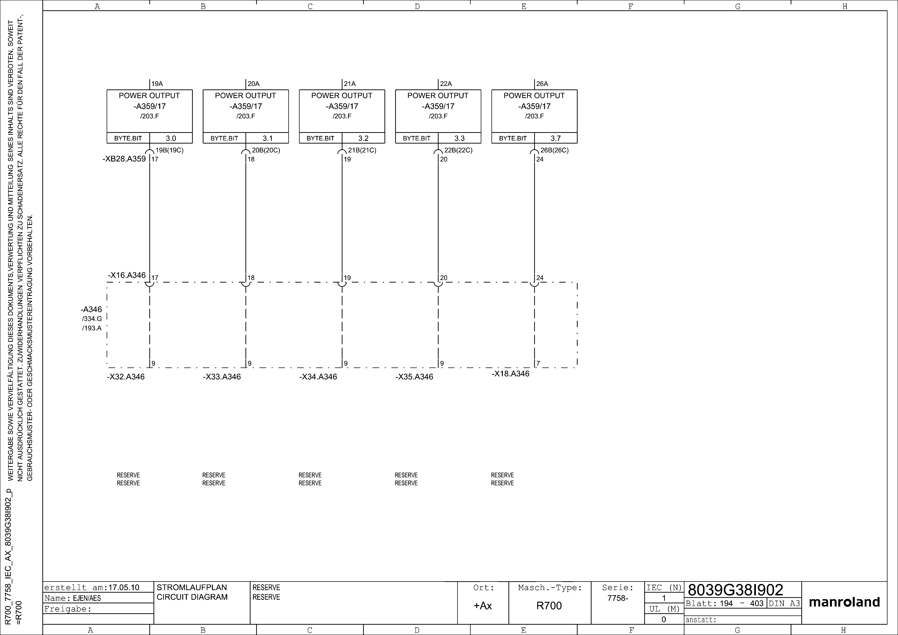

# +Ax — Sheet 194 of 403 — RESERVE

**RESERVE**

> Part of the manroland **R700** printing press IEC/UL circuit diagrams.
> Drawing class: **Stromlaufplan / Circuit diagram** (DIN A3).
> Document `+Ax` covers the **Central control console** machine section.

## At a glance

| Field | Value |
|---|---|
| Document | `+Ax`  (8039G38I902) |
| Sheet | **194** of 403 |
| Section (DE) | RESERVE |
| Section (EN) | RESERVE |
| Section type | CIRCUIT — Circuit diagram |
| Machine type | `R700` |
| Series | `7758` |
| Created | 17.05.10 |
| Replaces | — |
| Columns used | A, B, C, D, E |
| Path numbers | — |
| Labels on sheet | 70 |
| Cross-refs out | 7 |
| Cross-refs in | 22 |

**Previous:** [+Ax sheet 193](SHEET_0193.md) · **Next:** [+Ax sheet 195](SHEET_0195.md) · **Document TOC:** [_TOC.md](_TOC.md)  (+Ax) · **Master TOC:** [all sheets](../_MASTER_TOC.md)

## Sheet image (300 DPI, exact vector render)



_Rendered directly from the PDF vector layer at 300 DPI (1-bit), no OCR and no resampling. Use it to confirm anything ambiguous in the text below._

## Cross-references on this sheet

Each entry is a wire leaving this sheet. The printed token is `/sheet.column`; the link resolves to that sheet inside the same document.

| Ref | Target sheet | Col | Path | Destination on target | Target section | From col |
|---|---|---|---|---|---|---|
| `/203.F` | [+Ax sheet 203](SHEET_0203.md) | F | — | — | REFERENZMODUL | A |
| `/203.F` | [+Ax sheet 203](SHEET_0203.md) | F | — | — | REFERENZMODUL | B |
| `/203.F` | [+Ax sheet 203](SHEET_0203.md) | F | — | — | REFERENZMODUL | C |
| `/203.F` | [+Ax sheet 203](SHEET_0203.md) | F | — | — | REFERENZMODUL | D |
| `/203.F` | [+Ax sheet 203](SHEET_0203.md) | F | — | — | REFERENZMODUL | E |
| `/334.G` | [+Ax sheet 334](SHEET_0334.md) | G | — | — | OPTION: INLINESORTER | A |
| `/193.A` | [+Ax sheet 193](SHEET_0193.md) | A | — | — | RESERVE | A |

### Incoming references (sheets that point here)

Every other sheet that sends a wire to this one. `Back-ref` is the token printed on *that* sheet; `Path` is its line number.

| From sheet | Cols | Back-ref | Path | Refs | What continues there |
|---|---|---|---|---|---|
| [+Ax#193](SHEET_0193.md) | A | `/193.A` | — | 1 | — |
| [+Ax#203](SHEET_0203.md) | F | `/203.F` | — | 5 | — |
| [+Ax#254](SHEET_0254.md) | E | `/254.E` | — | 5 | — |
| [+Ax#256](SHEET_0256.md) | F | `/256.F` | — | 1 | — |
| [+Ax#272](SHEET_0272.md) | D | `/272.D` | — | 5 | — |
| [+Ax#275](SHEET_0275.md) | E | `/275.E` | — | 1 | — |
| [+Ax#276](SHEET_0276.md) | G | `/276.G` | — | 1 | — |
| [+Ax#278](SHEET_0278.md) | B, F | `/278.B`, `/278.F` | — | 2 | — |
| [+Ax#334](SHEET_0334.md) | G | `/334.G` | — | 1 | — |


## Devices on this sheet

| Tag | Class | Class meaning (IEC) | Col | Sub | Terminal | Sign |
|---|---|---|---|---|---|---|
| `A346` | A | Baugruppe / assembly, module, PC board | A | — | — | — |
| `A359/17` | A | Baugruppe / assembly, module, PC board | B | 17 | — | — |
| `A359/17` | A | Baugruppe / assembly, module, PC board | C | 17 | — | — |
| `A359/17` | A | Baugruppe / assembly, module, PC board | D | 17 | — | — |
| `A359/17` | A | Baugruppe / assembly, module, PC board | A | 17 | — | — |
| `A359/17` | A | Baugruppe / assembly, module, PC board | E | 17 | — | — |
| `X16.A346` | — | cross-device reference | A | — | — | — |
| `3.1` | — | cross-device reference | C | — | — | — |
| `3.2` | — | cross-device reference | C | — | — | — |
| `3.3` | — | cross-device reference | D | — | — | — |
| `XB28.A359` | — | cross-device reference | A | — | — | — |
| `3.0` | — | cross-device reference | B | — | — | — |
| `3.7` | — | cross-device reference | E | — | — | — |
| `X32.A346` | — | cross-device reference | A | — | — | — |
| `X33.A346` | — | cross-device reference | B | — | — | — |
| `X34.A346` | — | cross-device reference | C | — | — | — |
| `X35.A346` | — | cross-device reference | D | — | — | — |
| `X18.A346` | — | cross-device reference | E | — | — | — |

## Potentials / nets

_No named potentials on this sheet._

## Wire-end annotations (grouped as printed)

A wire that continues elsewhere is annotated with a small cluster: the destination description, the path/line number `#NN`, and the `/sheet.column` cross reference. Each row below is one such cluster exactly as it is grouped on the drawing.

| Col | Y | Path | Cross-ref | Text on the wire |
|---|---|---|---|---|
| B | 107.3 | — | — | `19A` |
| B | 107.3 | — | — | `20A` |
| C | 107.3 | — | — | `21A` |
| D | 107.3 | — | — | `22A` |
| E | 107.3 | — | — | `26A` |
| A | 122.5 | — | — | `POWER OUTPUT` |
| B | 122.5 | — | — | `POWER OUTPUT` |
| C | 122.5 | — | — | `POWER OUTPUT` |
| D | 122.5 | — | — | `POWER OUTPUT` |
| E | 122.5 | — | — | `POWER OUTPUT` |
| A | 136.4 | — | — | `A359/17` |
| B | 136.4 | — | — | `A359/17` |
| C | 136.4 | — | — | `A359/17` |
| D | 136.4 | — | — | `A359/17` |
| E | 136.4 | — | — | `A359/17` |
| A | 150.2 | — | `/203.F` | — |
| B | 150.2 | — | `/203.F` | — |
| C | 150.2 | — | `/203.F` | — |
| D | 150.2 | — | `/203.F` | — |
| E | 150.2 | — | `/203.F` | — |
| A | 179.2 | — | — | `BYTE.BIT 3.0` |
| B | 179.2 | — | — | `BYTE.BIT 3.1` |
| C | 179.2 | — | — | `BYTE.BIT 3.2` |
| D | 179.2 | — | — | `BYTE.BIT 3.3` |
| E | 179.2 | — | — | `BYTE.BIT 3.7` |
| B | 195.2 | — | — | `19B(19C)` |
| C | 195.2 | — | — | `20B(20C)` |
| C | 195.2 | — | — | `21B(21C)` |
| D | 195.2 | — | — | `22B(22C)` |
| E | 195.2 | — | — | `26B(26C)` |
| A | 205.8 | — | — | `XB28.A359 17` |
| B | 207.2 | — | — | `18` |
| D | 207.2 | — | — | `19 20` |
| E | 207.2 | — | — | `24` |
| A | 360.3 | — | — | `X16.A346 17` |
| B | 364.6 | — | — | `18` |
| C | 364.6 | — | — | `19` |
| D | 364.6 | — | — | `20` |
| E | 364.6 | — | — | `24` |
| A | 405.7 | — | — | `A346` |
| A | 418.7 | — | `/334.G`, `/193.A` | — |
| B | 478.0 | — | — | `9` |
| B | 478.0 | — | — | `9` |
| C | 478.0 | — | — | `9` |
| D | 478.0 | — | — | `9` |
| E | 478.0 | — | — | `7` |
| C | 490.7 | — | — | `X32.A346 X33.A346 X34.A346 X35.A346 X18.A346` |
| A | 627.0 | — | — | `RESERVE RESERVE` |
| B | 627.0 | — | — | `RESERVE RESERVE` |
| C | 627.0 | — | — | `RESERVE RESERVE` |
| D | 627.0 | — | — | `RESERVE RESERVE` |
| E | 627.0 | — | — | `RESERVE RESERVE` |


## Reconstructed tables

This sheet carries tabular content (pin map / terminal assignment / index). The grid below was rebuilt from the drawing's own rule lines, so each row is exactly one physical row of the table.

### Table 1 — 1 data rows × 2 columns (at x=141.7, y=119.1)

| POWER | OUTPUT A359/17 /203.F |
|---|---|
| `BYTE.BIT` | `3.0` |


### Table 2 — 1 data rows × 2 columns (at x=269.3, y=119.1)

| POWER | OUTPUT A359/17 /203.F |
|---|---|
| `BYTE.BIT` | `3.1` |


### Table 3 — 1 data rows × 2 columns (at x=396.9, y=119.1)

| POWER | OUTPUT A359/17 /203.F |
|---|---|
| `BYTE.BIT` | `3.2` |


### Table 4 — 1 data rows × 2 columns (at x=524.4, y=119.1)

| POWER | OUTPUT A359/17 /203.F |
|---|---|
| `BYTE.BIT` | `3.3` |


### Table 5 — 1 data rows × 2 columns (at x=652.0, y=119.1)

| POWER | OUTPUT A359/17 /203.F |
|---|---|
| `BYTE.BIT` | `3.7` |


## Notes and free text on this sheet

| Text | Col | Y (pt) |
|---|---|---|
| `20A` | B | 107.29 |
| `20B(20C)` | C | 195.2 |
| `POWER OUTPUT` | B | 122.45 |
| `BYTE.BIT` | B | 179.78 |
| `RESERVE` | B | 627.04 |
| `21A` | C | 107.29 |
| `21B(21C)` | C | 195.2 |
| `POWER OUTPUT` | C | 122.45 |
| `BYTE.BIT` | C | 179.78 |
| `RESERVE` | C | 627.04 |
| `22A` | D | 107.29 |
| `22B(22C)` | D | 195.2 |
| `POWER OUTPUT` | D | 122.45 |
| `BYTE.BIT` | D | 179.78 |
| `RESERVE` | D | 627.04 |
| `19A` | B | 107.29 |
| `19B(19C)` | B | 195.2 |
| `POWER OUTPUT` | A | 122.45 |
| `BYTE.BIT` | A | 179.78 |
| `RESERVE` | A | 627.04 |
| `26A` | E | 107.29 |
| `26B(26C)` | E | 195.2 |
| `POWER OUTPUT` | E | 122.45 |
| `BYTE.BIT` | E | 179.78 |
| `RESERVE` | E | 627.04 |

## Complete label inventory (exact text from the drawing)

Every text object inside the drawing area of this sheet, in DIN reading order (column A→H, then top→bottom). This is the authoritative list: if a string is not here it is not printed on this sheet.

| Col | Y | X | Dir | Type | Text |
|---|---|---|---|---|---|
| A | 122.5 | 157.6 | → | text | `POWER OUTPUT` |
| A | 136.4 | 177.0 | → | device tag | `A359/17` |
| A | 150.2 | 186.1 | → | cross-reference | `/203.F` |
| A | 179.8 | 151.7 | → | text | `BYTE.BIT` |
| A | 205.8 | 136.1 | → | device ref | `XB28.A359` |
| A | 360.3 | 143.1 | → | device ref | `X16.A346` |
| A | 405.7 | 106.9 | → | device tag | `A346` |
| A | 418.7 | 108.9 | → | cross-reference | `/334.G` |
| A | 431.1 | 109.1 | → | cross-reference | `/193.A` |
| A | 495.0 | 141.7 | → | device ref | `X32.A346` |
| A | 627.0 | 155.1 | → | text | `RESERVE` |
| A | 637.7 | 155.1 | → | text | `RESERVE` |
| B | 107.3 | 200.4 | → | text | `19A` |
| B | 107.3 | 328.5 | → | text | `20A` |
| B | 122.5 | 285.2 | → | text | `POWER OUTPUT` |
| B | 136.4 | 304.6 | → | device tag | `A359/17` |
| B | 150.2 | 313.7 | → | cross-reference | `/203.F` |
| B | 179.2 | 220.0 | → | device ref | `3.0` |
| B | 179.8 | 279.2 | → | text | `BYTE.BIT` |
| B | 195.2 | 206.1 | → | text | `19B(19C)` |
| B | 207.3 | 200.4 | → | number | `17` |
| B | 207.3 | 328.0 | → | number | `18` |
| B | 364.6 | 200.4 | → | number | `17` |
| B | 364.6 | 328.0 | → | number | `18` |
| B | 478.0 | 201.0 | → | number | `9` |
| B | 478.0 | 328.5 | → | number | `9` |
| B | 495.0 | 269.3 | → | device ref | `X33.A346` |
| B | 627.0 | 268.4 | → | text | `RESERVE` |
| B | 637.7 | 268.4 | → | text | `RESERVE` |
| C | 107.3 | 456.1 | → | text | `21A` |
| C | 122.5 | 412.7 | → | text | `POWER OUTPUT` |
| C | 136.4 | 432.1 | → | device tag | `A359/17` |
| C | 150.2 | 441.2 | → | cross-reference | `/203.F` |
| C | 179.2 | 348.4 | → | device ref | `3.1` |
| C | 179.2 | 475.1 | → | device ref | `3.2` |
| C | 179.8 | 406.8 | → | text | `BYTE.BIT` |
| C | 195.2 | 334.2 | → | text | `20B(20C)` |
| C | 195.2 | 461.8 | → | text | `21B(21C)` |
| C | 207.3 | 455.5 | → | number | `19` |
| C | 364.6 | 455.5 | → | number | `19` |
| C | 478.0 | 456.1 | → | number | `9` |
| C | 495.0 | 396.9 | → | device ref | `X34.A346` |
| C | 627.0 | 396.0 | → | text | `RESERVE` |
| C | 637.7 | 396.0 | → | text | `RESERVE` |
| D | 107.3 | 583.7 | → | text | `22A` |
| D | 122.5 | 540.3 | → | text | `POWER OUTPUT` |
| D | 136.4 | 559.7 | → | device tag | `A359/17` |
| D | 150.2 | 568.8 | → | cross-reference | `/203.F` |
| D | 179.2 | 602.6 | → | device ref | `3.3` |
| D | 179.8 | 534.3 | → | text | `BYTE.BIT` |
| D | 195.2 | 589.3 | → | text | `22B(22C)` |
| D | 207.3 | 583.7 | → | number | `20` |
| D | 364.6 | 583.7 | → | number | `20` |
| D | 478.0 | 583.7 | → | number | `9` |
| D | 495.0 | 524.4 | → | device ref | `X35.A346` |
| D | 627.0 | 523.6 | → | text | `RESERVE` |
| D | 637.7 | 523.6 | → | text | `RESERVE` |
| E | 107.3 | 711.2 | → | text | `26A` |
| E | 122.5 | 667.8 | → | text | `POWER OUTPUT` |
| E | 136.4 | 687.3 | → | device tag | `A359/17` |
| E | 150.2 | 696.3 | → | cross-reference | `/203.F` |
| E | 179.2 | 730.2 | → | device ref | `3.7` |
| E | 179.8 | 661.9 | → | text | `BYTE.BIT` |
| E | 195.2 | 716.9 | → | text | `26B(26C)` |
| E | 207.3 | 711.2 | → | number | `24` |
| E | 364.6 | 711.2 | → | number | `24` |
| E | 478.0 | 711.2 | → | number | `7` |
| E | 490.7 | 652.0 | → | device ref | `X18.A346` |
| E | 627.0 | 651.1 | → | text | `RESERVE` |
| E | 637.7 | 651.1 | → | text | `RESERVE` |

## Reading-order text block

The same content as a plain block, grouped by DIN column — convenient to paste or to match against a visual description.

```text
=== Column A ===
 122.5  157.6  text         POWER OUTPUT
 136.4  177.0  devtag       A359/17
 150.2  186.1  xref         /203.F
 179.8  151.7  text         BYTE.BIT
 205.8  136.1  devref       XB28.A359
 360.3  143.1  devref       X16.A346
 405.7  106.9  devtag       A346
 418.7  108.9  xref         /334.G
 431.1  109.1  xref         /193.A
 495.0  141.7  devref       X32.A346
 627.0  155.1  text         RESERVE
 637.7  155.1  text         RESERVE
=== Column B ===
 107.3  200.4  text         19A
 107.3  328.5  text         20A
 122.5  285.2  text         POWER OUTPUT
 136.4  304.6  devtag       A359/17
 150.2  313.7  xref         /203.F
 179.2  220.0  devref       3.0
 179.8  279.2  text         BYTE.BIT
 195.2  206.1  text         19B(19C)
 207.3  200.4  numeric      17
 207.3  328.0  numeric      18
 364.6  200.4  numeric      17
 364.6  328.0  numeric      18
 478.0  201.0  numeric      9
 478.0  328.5  numeric      9
 495.0  269.3  devref       X33.A346
 627.0  268.4  text         RESERVE
 637.7  268.4  text         RESERVE
=== Column C ===
 107.3  456.1  text         21A
 122.5  412.7  text         POWER OUTPUT
 136.4  432.1  devtag       A359/17
 150.2  441.2  xref         /203.F
 179.2  348.4  devref       3.1
 179.2  475.1  devref       3.2
 179.8  406.8  text         BYTE.BIT
 195.2  334.2  text         20B(20C)
 195.2  461.8  text         21B(21C)
 207.3  455.5  numeric      19
 364.6  455.5  numeric      19
 478.0  456.1  numeric      9
 495.0  396.9  devref       X34.A346
 627.0  396.0  text         RESERVE
 637.7  396.0  text         RESERVE
=== Column D ===
 107.3  583.7  text         22A
 122.5  540.3  text         POWER OUTPUT
 136.4  559.7  devtag       A359/17
 150.2  568.8  xref         /203.F
 179.2  602.6  devref       3.3
 179.8  534.3  text         BYTE.BIT
 195.2  589.3  text         22B(22C)
 207.3  583.7  numeric      20
 364.6  583.7  numeric      20
 478.0  583.7  numeric      9
 495.0  524.4  devref       X35.A346
 627.0  523.6  text         RESERVE
 637.7  523.6  text         RESERVE
=== Column E ===
 107.3  711.2  text         26A
 122.5  667.8  text         POWER OUTPUT
 136.4  687.3  devtag       A359/17
 150.2  696.3  xref         /203.F
 179.2  730.2  devref       3.7
 179.8  661.9  text         BYTE.BIT
 195.2  716.9  text         26B(26C)
 207.3  711.2  numeric      24
 364.6  711.2  numeric      24
 478.0  711.2  numeric      7
 490.7  652.0  devref       X18.A346
 627.0  651.1  text         RESERVE
 637.7  651.1  text         RESERVE
```

---
_Generated from the PDF vector text layer; no OCR. Source: `R700_7758_IEC_AX_8039G38I902_p`, sheet 194._
