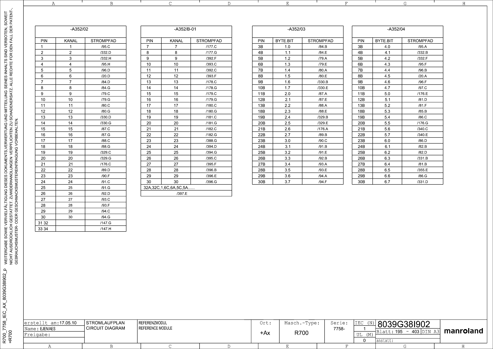

# +Ax — Sheet 195 of 403 — REFERENZMODUL

**REFERENCE MODULE**

> Part of the manroland **R700** printing press IEC/UL circuit diagrams.
> Drawing class: **Stromlaufplan / Circuit diagram** (DIN A3).
> Document `+Ax` covers the **Central control console** machine section.

## At a glance

| Field | Value |
|---|---|
| Document | `+Ax`  (8039G38I902) |
| Sheet | **195** of 403 |
| Section (DE) | REFERENZMODUL |
| Section (EN) | REFERENCE MODULE |
| Section type | REFERENCE_MODULE — Reference module |
| Machine type | `R700` |
| Series | `7758` |
| Created | 17.05.10 |
| Replaces | — |
| Columns used | A, B, C, D, E, F, G |
| Path numbers | — |
| Labels on sheet | 328 |
| Cross-refs out | 105 |
| Cross-refs in | 105 |

**Previous:** [+Ax sheet 194](SHEET_0194.md) · **Next:** [+Ax sheet 196](SHEET_0196.md) · **Document TOC:** [_TOC.md](_TOC.md)  (+Ax) · **Master TOC:** [all sheets](../_MASTER_TOC.md)

## Sheet image (300 DPI, exact vector render)



_Rendered directly from the PDF vector layer at 300 DPI (1-bit), no OCR and no resampling. Use it to confirm anything ambiguous in the text below._

## Cross-references on this sheet

Each entry is a wire leaving this sheet. The printed token is `/sheet.column`; the link resolves to that sheet inside the same document.

| Ref | Target sheet | Col | Path | Destination on target | Target section | From col |
|---|---|---|---|---|---|---|
| `/84.B` | [+Ax sheet 84](SHEET_0084.md) | B | — | — | ANLEGER | F |
| `/95.A` | [+Ax sheet 95](SHEET_0095.md) | A | — | — | ANLEGER | G |
| `/95.C` | [+Ax sheet 95](SHEET_0095.md) | C | — | — | ANLEGER | B |
| `/177.C` | [+Ax sheet 177](SHEET_0177.md) | C | — | — | RESERVE | D |
| `/84.E` | [+Ax sheet 84](SHEET_0084.md) | E | — | — | ANLEGER | F |
| `/332.B` | [+Ax sheet 332](SHEET_0332.md) | B | — | — | OPTION: NONSTOP EINRICHTUNG MANUELL, ANLEGER | G |
| `/177.G` | [+Ax sheet 177](SHEET_0177.md) | G | — | — | RESERVE | D |
| `/332.D` | [+Ax sheet 332](SHEET_0332.md) | D | — | — | OPTION: NONSTOP EINRICHTUNG MANUELL, ANLEGER | B |
| `/79.A` | [+Ax sheet 79](SHEET_0079.md) | A | — | — | ANLEGER | F |
| `/392.F` | [+Ax sheet 392](SHEET_0392.md) | F | — | — | OPTION: WASCHVORRICHTUNG MIT TUCH | D |
| `/332.F` | [+Ax sheet 332](SHEET_0332.md) | F | — | — | OPTION: NONSTOP EINRICHTUNG MANUELL, ANLEGER | G |
| `/332.H` | [+Ax sheet 332](SHEET_0332.md) | H | — | — | OPTION: NONSTOP EINRICHTUNG MANUELL, ANLEGER | B |
| `/79.E` | [+Ax sheet 79](SHEET_0079.md) | E | — | — | ANLEGER | F |
| `/95.F` | [+Ax sheet 95](SHEET_0095.md) | F | — | — | ANLEGER | G |
| `/95.H` | [+Ax sheet 95](SHEET_0095.md) | H | — | — | ANLEGER | B |
| `/393.C` | [+Ax sheet 393](SHEET_0393.md) | C | — | — | OPTION: WASCHVORRICHTUNG MIT TUCH | D |
| `/80.A` | [+Ax sheet 80](SHEET_0080.md) | A | — | — | ANLEGER | F |
| `/96.B` | [+Ax sheet 96](SHEET_0096.md) | B | — | — | ANLEGER | G |
| `/96.D` | [+Ax sheet 96](SHEET_0096.md) | D | — | — | ANLEGER | B |
| `/392.C` | [+Ax sheet 392](SHEET_0392.md) | C | — | — | OPTION: WASCHVORRICHTUNG MIT TUCH | D |
| `/80.E` | [+Ax sheet 80](SHEET_0080.md) | E | — | — | ANLEGER | F |
| `/20.A` | [+Ax sheet 20](SHEET_0020.md) | A | — | — | SPANNUNGSVERSORGUNG, SCHALTSCHRANKBELÜFTUNG | G |
| `/393.F` | [+Ax sheet 393](SHEET_0393.md) | F | — | — | OPTION: WASCHVORRICHTUNG MIT TUCH | D |
| `/20.D` | [+Ax sheet 20](SHEET_0020.md) | D | — | — | SPANNUNGSVERSORGUNG, SCHALTSCHRANKBELÜFTUNG | B |
| `/330.B` | [+Ax sheet 330](SHEET_0330.md) | B | — | — | OPTION: NONSTOP EINRICHTUNG MANUELL, ANLEGER | F |
| `/96.F` | [+Ax sheet 96](SHEET_0096.md) | F | — | — | ANLEGER | G |
| `/84.D` | [+Ax sheet 84](SHEET_0084.md) | D | — | — | ANLEGER | B |
| `/178.C` | [+Ax sheet 178](SHEET_0178.md) | C | — | — | RESERVE | D |
| `/330.E` | [+Ax sheet 330](SHEET_0330.md) | E | — | — | OPTION: NONSTOP EINRICHTUNG MANUELL, ANLEGER | F |
| `/84.G` | [+Ax sheet 84](SHEET_0084.md) | G | — | — | ANLEGER | B |
| `/178.G` | [+Ax sheet 178](SHEET_0178.md) | G | — | — | RESERVE | D |
| `/97.C` | [+Ax sheet 97](SHEET_0097.md) | C | — | — | ANLEGER | G |
| `/87.A` | [+Ax sheet 87](SHEET_0087.md) | A | — | — | ANLEGER | F |
| `/176.E` | [+Ax sheet 176](SHEET_0176.md) | E | — | — | RESERVE | G |
| `/79.C` | [+Ax sheet 79](SHEET_0079.md) | C | — | — | ANLEGER | B |
| `/179.C` | [+Ax sheet 179](SHEET_0179.md) | C | — | — | RESERVE | D |
| `/87.E` | [+Ax sheet 87](SHEET_0087.md) | E | — | — | ANLEGER | F |
| `/79.G` | [+Ax sheet 79](SHEET_0079.md) | G | — | — | ANLEGER | B |
| `/179.G` | [+Ax sheet 179](SHEET_0179.md) | G | — | — | RESERVE | D |
| `/81.D` | [+Ax sheet 81](SHEET_0081.md) | D | — | — | ANLEGER | G |
| `/88.A` | [+Ax sheet 88](SHEET_0088.md) | A | — | — | ANLEGER | F |
| `/81.F` | [+Ax sheet 81](SHEET_0081.md) | F | — | — | ANLEGER | G |
| `/80.C` | [+Ax sheet 80](SHEET_0080.md) | C | — | — | ANLEGER | B |
| `/180.C` | [+Ax sheet 180](SHEET_0180.md) | C | — | — | RESERVE | D |
| `/88.E` | [+Ax sheet 88](SHEET_0088.md) | E | — | — | ANLEGER | F |
| `/85.B` | [+Ax sheet 85](SHEET_0085.md) | B | — | — | ANLEGER | G |
| `/80.G` | [+Ax sheet 80](SHEET_0080.md) | G | — | — | ANLEGER | B |
| `/180.G` | [+Ax sheet 180](SHEET_0180.md) | G | — | — | RESERVE | D |
| `/329.B` | [+Ax sheet 329](SHEET_0329.md) | B | — | — | OPTION: NONSTOP EINRICHTUNG MANUELL, ANLEGER | F |
| `/330.D` | [+Ax sheet 330](SHEET_0330.md) | D | — | — | OPTION: NONSTOP EINRICHTUNG MANUELL, ANLEGER | B |
| `/181.C` | [+Ax sheet 181](SHEET_0181.md) | C | — | — | RESERVE | D |
| `/86.C` | [+Ax sheet 86](SHEET_0086.md) | C | — | — | ANLEGER | G |
| `/329.E` | [+Ax sheet 329](SHEET_0329.md) | E | — | — | OPTION: NONSTOP EINRICHTUNG MANUELL, ANLEGER | F |
| `/330.G` | [+Ax sheet 330](SHEET_0330.md) | G | — | — | OPTION: NONSTOP EINRICHTUNG MANUELL, ANLEGER | B |
| `/181.G` | [+Ax sheet 181](SHEET_0181.md) | G | — | — | RESERVE | D |
| `/176.G` | [+Ax sheet 176](SHEET_0176.md) | G | — | — | RESERVE | G |
| `/176.A` | [+Ax sheet 176](SHEET_0176.md) | A | — | — | RESERVE | F |
| `/87.C` | [+Ax sheet 87](SHEET_0087.md) | C | — | — | ANLEGER | B |
| `/182.C` | [+Ax sheet 182](SHEET_0182.md) | C | — | — | RESERVE | D |
| `/340.C` | [+Ax sheet 340](SHEET_0340.md) | C | — | — | OPTION: INLINESHEETER RS104 S | G |
| `/89.B` | [+Ax sheet 89](SHEET_0089.md) | B | — | — | ANLEGER | F |
| `/87.G` | [+Ax sheet 87](SHEET_0087.md) | G | — | — | ANLEGER | B |
| `/340.E` | [+Ax sheet 340](SHEET_0340.md) | E | — | — | OPTION: INLINESHEETER RS104 S | G |
| `/182.G` | [+Ax sheet 182](SHEET_0182.md) | G | — | — | RESERVE | D |
| `/88.C` | [+Ax sheet 88](SHEET_0088.md) | C | — | — | ANLEGER | B |
| `/388.G` | [+Ax sheet 388](SHEET_0388.md) | G | — | — | OPTION: WASCHVORRICHTUNG MIT TUCH | D |
| `/90.C` | [+Ax sheet 90](SHEET_0090.md) | C | — | — | ANLEGER | F |
| `/86.D` | [+Ax sheet 86](SHEET_0086.md) | D | — | — | ANLEGER | G |
| `/91.B` | [+Ax sheet 91](SHEET_0091.md) | B | — | — | ANLEGER | F |
| `/82.B` | [+Ax sheet 82](SHEET_0082.md) | B | — | — | ANLEGER | G |
| `/88.G` | [+Ax sheet 88](SHEET_0088.md) | G | — | — | ANLEGER | B |
| `/394.D` | [+Ax sheet 394](SHEET_0394.md) | D | — | — | OPTION: WASCHVORRICHTUNG MIT TUCH | D |
| `/91.E` | [+Ax sheet 91](SHEET_0091.md) | E | — | — | ANLEGER | F |
| `/394.G` | [+Ax sheet 394](SHEET_0394.md) | G | — | — | OPTION: WASCHVORRICHTUNG MIT TUCH | D |
| `/329.C` | [+Ax sheet 329](SHEET_0329.md) | C | — | — | OPTION: NONSTOP EINRICHTUNG MANUELL, ANLEGER | B |
| `/82.D` | [+Ax sheet 82](SHEET_0082.md) | D | — | — | ANLEGER | G |
| `/92.B` | [+Ax sheet 92](SHEET_0092.md) | B | — | — | ANLEGER | F |
| `/331.B` | [+Ax sheet 331](SHEET_0331.md) | B | — | — | OPTION: NONSTOP EINRICHTUNG MANUELL, ANLEGER | G |
| `/329.G` | [+Ax sheet 329](SHEET_0329.md) | G | — | — | OPTION: NONSTOP EINRICHTUNG MANUELL, ANLEGER | B |
| `/395.C` | [+Ax sheet 395](SHEET_0395.md) | C | — | — | OPTION: WASCHVORRICHTUNG MIT TUCH | D |
| `/93.A` | [+Ax sheet 93](SHEET_0093.md) | A | — | — | ANLEGER | F |
| `/81.B` | [+Ax sheet 81](SHEET_0081.md) | B | — | — | ANLEGER | G |
| `/395.F` | [+Ax sheet 395](SHEET_0395.md) | F | — | — | OPTION: WASCHVORRICHTUNG MIT TUCH | D |
| `/176.C` | [+Ax sheet 176](SHEET_0176.md) | C | — | — | RESERVE | B |
| `/93.E` | [+Ax sheet 93](SHEET_0093.md) | E | — | — | ANLEGER | F |
| `/396.B` | [+Ax sheet 396](SHEET_0396.md) | B | — | — | OPTION: WASCHVORRICHTUNG MIT TUCH | D |
| `/355.E` | [+Ax sheet 355](SHEET_0355.md) | E | — | — | OPTION: LOGISTIK ANLEGER | G |
| `/89.D` | [+Ax sheet 89](SHEET_0089.md) | D | — | — | ANLEGER | B |
| `/94.A` | [+Ax sheet 94](SHEET_0094.md) | A | — | — | ANLEGER | F |
| `/90.F` | [+Ax sheet 90](SHEET_0090.md) | F | — | — | ANLEGER | B |
| `/396.E` | [+Ax sheet 396](SHEET_0396.md) | E | — | — | OPTION: WASCHVORRICHTUNG MIT TUCH | D |
| `/86.G` | [+Ax sheet 86](SHEET_0086.md) | G | — | — | ANLEGER | G |
| `/94.F` | [+Ax sheet 94](SHEET_0094.md) | F | — | — | ANLEGER | F |
| `/91.C` | [+Ax sheet 91](SHEET_0091.md) | C | — | — | ANLEGER | B |
| `/396.G` | [+Ax sheet 396](SHEET_0396.md) | G | — | — | OPTION: WASCHVORRICHTUNG MIT TUCH | D |
| `/331.D` | [+Ax sheet 331](SHEET_0331.md) | D | — | — | OPTION: NONSTOP EINRICHTUNG MANUELL, ANLEGER | G |
| `/91.G` | [+Ax sheet 91](SHEET_0091.md) | G | — | — | ANLEGER | B |
| `/397.E` | [+Ax sheet 397](SHEET_0397.md) | E | — | — | OPTION: WASCHVORRICHTUNG MIT TUCH | C |
| `/92.D` | [+Ax sheet 92](SHEET_0092.md) | D | — | — | ANLEGER | B |
| `/93.C` | [+Ax sheet 93](SHEET_0093.md) | C | — | — | ANLEGER | B |
| `/93.F` | [+Ax sheet 93](SHEET_0093.md) | F | — | — | ANLEGER | B |
| `/94.C` | [+Ax sheet 94](SHEET_0094.md) | C | — | — | ANLEGER | B |
| `/94.G` | [+Ax sheet 94](SHEET_0094.md) | G | — | — | ANLEGER | B |
| `/147.G` | [+Ax sheet 147](SHEET_0147.md) | G | — | — | ÜBERWACHUNGSRECHNER SICHERHEITSBUS | B |
| `/147.H` | [+Ax sheet 147](SHEET_0147.md) | H | — | — | ÜBERWACHUNGSRECHNER SICHERHEITSBUS | B |

### Incoming references (sheets that point here)

Every other sheet that sends a wire to this one. `Back-ref` is the token printed on *that* sheet; `Path` is its line number.

| From sheet | Cols | Back-ref | Path | Refs | What continues there |
|---|---|---|---|---|---|
| [+Ax#20](SHEET_0020.md) | A, D | `/20.A`, `/20.D` | — | 2 | — |
| [+Ax#79](SHEET_0079.md) | A, C, E, G | `/79.A`, `/79.C`, `/79.E`, `/79.G` | — | 4 | — |
| [+Ax#80](SHEET_0080.md) | A, C, E, G | `/80.A`, `/80.C`, `/80.E`, `/80.G` | — | 4 | — |
| [+Ax#81](SHEET_0081.md) | B, D, F | `/81.B`, `/81.D`, `/81.F` | — | 3 | — |
| [+Ax#82](SHEET_0082.md) | B, D | `/82.B`, `/82.D` | — | 2 | — |
| [+Ax#84](SHEET_0084.md) | A, C, E, G | `/84.A`, `/84.C`, `/84.E`, `/84.G` | — | 4 | — |
| [+Ax#85](SHEET_0085.md) | B | `/85.B` | — | 1 | — |
| [+Ax#86](SHEET_0086.md) | C, D, G | `/86.C`, `/86.D`, `/86.G` | — | 3 | — |
| [+Ax#87](SHEET_0087.md) | A, C, E, G | `/87.A`, `/87.C`, `/87.E`, `/87.G` | — | 4 | — |
| [+Ax#88](SHEET_0088.md) | A, C, E, G | `/88.A`, `/88.C`, `/88.E`, `/88.G` | — | 4 | — |
| [+Ax#89](SHEET_0089.md) | B, D | `/89.B`, `/89.D` | — | 2 | — |
| [+Ax#90](SHEET_0090.md) | C, F | `/90.C`, `/90.F` | — | 2 | — |
| [+Ax#91](SHEET_0091.md) | A, C, E, G | `/91.A`, `/91.C`, `/91.E`, `/91.G` | — | 4 | — |
| [+Ax#92](SHEET_0092.md) | B, D | `/92.B`, `/92.D` | — | 2 | — |
| [+Ax#93](SHEET_0093.md) | A, C, E, F | `/93.A`, `/93.C`, `/93.E`, `/93.F` | — | 4 | — |
| [+Ax#94](SHEET_0094.md) | A, C, F, G | `/94.A`, `/94.C`, `/94.F`, `/94.G` | — | 4 | — |
| [+Ax#95](SHEET_0095.md) | A, C, F, G | `/95.A`, `/95.C`, `/95.F`, `/95.G` | — | 4 | — |
| [+Ax#96](SHEET_0096.md) | B, D, F | `/96.B`, `/96.D`, `/96.F` | — | 3 | — |
| [+Ax#97](SHEET_0097.md) | C | `/97.C` | — | 1 | — |
| [+Ax#147](SHEET_0147.md) | G, H | `/147.G`, `/147.H` | — | 2 | — |
| [+Ax#176](SHEET_0176.md) | A, C, E, G | `/176.A`, `/176.C`, `/176.E`, `/176.G` | — | 4 | — |
| [+Ax#177](SHEET_0177.md) | C, G | `/177.C`, `/177.G` | — | 2 | — |
| [+Ax#178](SHEET_0178.md) | C, G | `/178.C`, `/178.G` | — | 2 | — |
| [+Ax#179](SHEET_0179.md) | C, G | `/179.C`, `/179.G` | — | 2 | — |
| [+Ax#180](SHEET_0180.md) | C, G | `/180.C`, `/180.G` | — | 2 | — |
| [+Ax#181](SHEET_0181.md) | C, G | `/181.C`, `/181.G` | — | 2 | — |
| [+Ax#182](SHEET_0182.md) | C, G | `/182.C`, `/182.G` | — | 2 | — |
| [+Ax#329](SHEET_0329.md) | B, C, E, G | `/329.B`, `/329.C`, `/329.E`, `/329.G` | — | 4 | — |
| [+Ax#330](SHEET_0330.md) | B, D, E, G | `/330.B`, `/330.D`, `/330.E`, `/330.G` | — | 4 | — |
| [+Ax#331](SHEET_0331.md) | B, D | `/331.B`, `/331.D` | — | 2 | — |
| [+Ax#332](SHEET_0332.md) | B, D, F, G | `/332.B`, `/332.D`, `/332.F`, `/332.G` | — | 4 | — |
| [+Ax#340](SHEET_0340.md) | B, E | `/340.B`, `/340.E` | — | 2 | 14 11 11 /344.G 12 |
| [+Ax#355](SHEET_0355.md) | E | `/355.E` | — | 1 | — |
| [+Ax#388](SHEET_0388.md) | G | `/388.G` | — | 1 | — |
| [+Ax#392](SHEET_0392.md) | C, F | `/392.C`, `/392.F` | — | 2 | — |
| [+Ax#393](SHEET_0393.md) | C, F | `/393.C`, `/393.F` | — | 2 | — |
| [+Ax#394](SHEET_0394.md) | D, G | `/394.D`, `/394.G` | — | 2 | — |
| [+Ax#395](SHEET_0395.md) | C, F | `/395.C`, `/395.F` | — | 2 | — |
| [+Ax#396](SHEET_0396.md) | B, E, G | `/396.B`, `/396.E`, `/396.G` | — | 3 | — |
| [+Ax#397](SHEET_0397.md) | E | `/397.E` | — | 1 | — |


## Devices on this sheet

| Tag | Class | Class meaning (IEC) | Col | Sub | Terminal | Sign |
|---|---|---|---|---|---|---|
| `A352/02` | A | Baugruppe / assembly, module, PC board | A | 02 | — | — |
| `A352/03` | A | Baugruppe / assembly, module, PC board | E | 03 | — | — |
| `A352/04` | A | Baugruppe / assembly, module, PC board | G | 04 | — | — |
| `1.0` | — | cross-device reference | E | — | — | — |
| `1.1` | — | cross-device reference | E | — | — | — |
| `1.2` | — | cross-device reference | E | — | — | — |
| `1.3` | — | cross-device reference | E | — | — | — |
| `1.4` | — | cross-device reference | E | — | — | — |
| `1.5` | — | cross-device reference | E | — | — | — |
| `1.6` | — | cross-device reference | E | — | — | — |
| `1.7` | — | cross-device reference | E | — | — | — |
| `2.0` | — | cross-device reference | E | — | — | — |
| `2.1` | — | cross-device reference | E | — | — | — |
| `2.2` | — | cross-device reference | E | — | — | — |
| `2.3` | — | cross-device reference | E | — | — | — |
| `2.4` | — | cross-device reference | E | — | — | — |
| `2.5` | — | cross-device reference | E | — | — | — |
| `2.6` | — | cross-device reference | E | — | — | — |
| `2.7` | — | cross-device reference | E | — | — | — |
| `3.0` | — | cross-device reference | E | — | — | — |
| `3.1` | — | cross-device reference | E | — | — | — |
| `3.2` | — | cross-device reference | E | — | — | — |
| `3.3` | — | cross-device reference | E | — | — | — |
| `3.4` | — | cross-device reference | E | — | — | — |
| `3.5` | — | cross-device reference | E | — | — | — |
| `3.6` | — | cross-device reference | E | — | — | — |
| `3.7` | — | cross-device reference | E | — | — | — |
| `4.0` | — | cross-device reference | G | — | — | — |
| `4.1` | — | cross-device reference | G | — | — | — |
| `4.2` | — | cross-device reference | G | — | — | — |
| `4.3` | — | cross-device reference | G | — | — | — |
| `4.4` | — | cross-device reference | G | — | — | — |
| `4.5` | — | cross-device reference | G | — | — | — |
| `4.6` | — | cross-device reference | G | — | — | — |
| `4.7` | — | cross-device reference | G | — | — | — |
| `5.0` | — | cross-device reference | G | — | — | — |
| `5.1` | — | cross-device reference | G | — | — | — |
| `5.2` | — | cross-device reference | G | — | — | — |
| `5.3` | — | cross-device reference | G | — | — | — |
| `5.4` | — | cross-device reference | G | — | — | — |
| `5.5` | — | cross-device reference | G | — | — | — |
| `5.6` | — | cross-device reference | G | — | — | — |
| `5.7` | — | cross-device reference | G | — | — | — |
| `6.0` | — | cross-device reference | G | — | — | — |
| `6.1` | — | cross-device reference | G | — | — | — |
| `6.2` | — | cross-device reference | G | — | — | — |
| `6.3` | — | cross-device reference | G | — | — | — |
| `6.4` | — | cross-device reference | G | — | — | — |
| `6.5` | — | cross-device reference | G | — | — | — |
| `6.6` | — | cross-device reference | G | — | — | — |
| `6.7` | — | cross-device reference | G | — | — | — |

## Potentials / nets

_No named potentials on this sheet._

## Wire-end annotations (grouped as printed)

A wire that continues elsewhere is annotated with a small cluster: the destination description, the path/line number `#NN`, and the `/sheet.column` cross reference. Each row below is one such cluster exactly as it is grouped on the drawing.

| Col | Y | Path | Cross-ref | Text on the wire |
|---|---|---|---|---|
| A | 65.5 | — | — | `A352/02` |
| C | 65.5 | — | — | `A352/B 01` |
| E | 65.5 | — | — | `A352/03` |
| G | 65.5 | — | — | `A352/04` |
| A | 94.2 | — | — | `PIN` |
| B | 94.2 | — | — | `KANAL STROMPFAD` |
| C | 94.2 | — | — | `32A,32C,1,6C,6A,5C,5A...... 10 11 12 13 14 15 16 17 18 19 7 8 9 20 21 22 23 24 25 26 27 28 29 30 KANAL STROMPFAD` |
| C | 94.2 | — | — | `PIN` |
| E | 94.2 | — | — | `PIN BYTE.BIT` |
| F | 94.2 | — | — | `STROMPFAD` |
| F | 94.2 | — | — | `PIN BYTE.BIT` |
| G | 94.2 | — | — | `STROMPFAD` |
| E | 108.3 | — | — | `10B 11B 12B 13B 18B 19B 3B 4B 5B 6B 7B 8B 9B 20B 21B 22B 23B 24B 25B 26B 27B 28B 29B 30B` |
| E | 108.3 | — | — | `1.0 1.2 1.3 1.4 1.5 1.6 1.7 2.0 2.2 2.3 2.4 2.5 2.6 2.7 3.0 3.2 3.3 3.4 3.5 3.6 3.7 1.1 2.1 3.1` |
| F | 108.3 | — | — | `10B 11B 12B 13B 18B 19B 3B 4B 5B 6B 7B 8B 9B 20B 21B 22B 23B 24B 25B 26B 27B 28B 29B 30B` |
| G | 108.3 | — | — | `4.0 4.2 4.3 4.4 4.5 4.6 4.7 5.0 5.2 5.3 5.4 5.5 5.6 5.7 6.0 6.2 6.3 6.4 6.5 6.6 6.7 4.1 5.1 6.1` |
| A | 108.4 | — | — | `1 10 11 12 13 14 15 16 17 18 19 2 3 4 5 6 7 8 9 20 21 22 23 24` |
| A | 108.4 | — | — | `10 12 13 14 15 16 17 18 19 20 22 23 24 11 21 2 3 4 5 6 7 8 9 1` |
| C | 108.4 | — | — | `10 12 13 14 15 16 17 18 19 20 22 23 24 25 26 27 28 29 30 11 21 7 8 9` |
| B | 108.7 | — | `/95.C` | — |
| D | 108.7 | — | `/177.C` | — |
| F | 108.7 | — | `/84.B` | — |
| G | 108.7 | — | `/95.A` | — |
| F | 122.8 | — | `/84.E` | — |
| B | 122.9 | — | `/332.D` | — |
| D | 122.9 | — | `/177.G` | — |
| G | 122.9 | — | `/332.B` | — |
| D | 137.0 | — | `/392.F` | — |
| F | 137.0 | — | `/79.A` | — |
| G | 137.0 | — | `/332.F` | — |
| B | 137.1 | — | `/332.H` | — |
| B | 151.2 | — | `/95.H` | — |
| D | 151.2 | — | `/393.C` | — |
| F | 151.2 | — | `/79.E` | — |
| G | 151.2 | — | `/95.F` | — |
| B | 165.4 | — | `/96.D` | — |
| D | 165.4 | — | `/392.C` | — |
| F | 165.4 | — | `/80.A` | — |
| G | 165.4 | — | `/96.B` | — |
| F | 179.5 | — | `/80.E` | — |
| G | 179.5 | — | `/20.A` | — |
| B | 179.6 | — | `/20.D` | — |
| D | 179.6 | — | `/393.F` | — |
| F | 193.7 | — | `/330.B` | — |
| G | 193.7 | — | `/96.F` | — |
| B | 193.8 | — | `/84.D` | — |
| D | 193.8 | — | `/178.C` | — |
| B | 207.9 | — | `/84.G` | — |
| D | 207.9 | — | `/178.G` | — |
| F | 207.9 | — | `/330.E` | — |
| G | 207.9 | — | `/97.C` | — |
| B | 222.1 | — | `/79.C` | — |
| D | 222.1 | — | `/179.C` | — |
| F | 222.1 | — | `/87.A` | — |
| G | 222.1 | — | `/176.E` | — |
| B | 236.2 | — | `/79.G` | — |
| F | 236.2 | — | `/87.E` | — |
| D | 236.3 | — | `/179.G` | — |
| G | 236.3 | — | `/81.D` | — |
| B | 250.4 | — | `/80.C` | — |
| D | 250.4 | — | `/180.C` | — |
| F | 250.4 | — | `/88.A` | — |
| G | 250.4 | — | `/81.F` | — |
| B | 264.6 | — | `/80.G` | — |
| D | 264.6 | — | `/180.G` | — |
| F | 264.6 | — | `/88.E` | — |
| G | 264.6 | — | `/85.B` | — |
| B | 278.8 | — | `/330.D` | — |
| D | 278.8 | — | `/181.C` | — |
| F | 278.8 | — | `/329.B` | — |
| G | 278.8 | — | `/86.C` | — |
| F | 292.9 | — | `/329.E` | — |
| B | 293.0 | — | `/330.G` | — |
| D | 293.0 | — | `/181.G` | — |
| G | 293.0 | — | `/176.G` | — |
| B | 307.1 | — | `/87.C` | — |
| D | 307.1 | — | `/182.C` | — |
| F | 307.1 | — | `/176.A` | — |
| G | 307.1 | — | `/340.C` | — |
| B | 321.3 | — | `/87.G` | — |
| D | 321.3 | — | `/182.G` | — |
| F | 321.3 | — | `/89.B` | — |
| G | 321.3 | — | `/340.E` | — |
| B | 335.5 | — | `/88.C` | — |
| D | 335.5 | — | `/388.G` | — |
| F | 335.5 | — | `/90.C` | — |
| G | 335.5 | — | `/86.D` | — |
| B | 349.6 | — | `/88.G` | — |
| F | 349.6 | — | `/91.B` | — |
| G | 349.6 | — | `/82.B` | — |
| D | 349.7 | — | `/394.D` | — |
| B | 363.8 | — | `/329.C` | — |
| D | 363.8 | — | `/394.G` | — |
| F | 363.8 | — | `/91.E` | — |
| G | 363.8 | — | `/82.D` | — |
| B | 378.0 | — | `/329.G` | — |
| D | 378.0 | — | `/395.C` | — |
| F | 378.0 | — | `/92.B` | — |
| G | 378.0 | — | `/331.B` | — |
| F | 392.1 | — | `/93.A` | — |
| G | 392.1 | — | `/81.B` | — |
| B | 392.2 | — | `/176.C` | — |
| D | 392.2 | — | `/395.F` | — |
| B | 406.3 | — | `/89.D` | — |
| D | 406.3 | — | `/396.B` | — |
| F | 406.3 | — | `/93.E` | — |
| G | 406.3 | — | `/355.E` | — |
| B | 420.5 | — | `/90.F` | — |
| D | 420.5 | — | `/396.E` | — |
| F | 420.5 | — | `/94.A` | — |
| G | 420.5 | — | `/86.G` | — |
| B | 434.7 | — | `/91.C` | — |
| D | 434.7 | — | `/396.G` | — |
| F | 434.7 | — | `/94.F` | — |
| G | 434.7 | — | `/331.D` | — |
| A | 448.5 | — | — | `31 32 33 34 25 26 27 28 29 30` |
| A | 448.9 | — | — | `25` |
| B | 448.9 | — | `/91.G` | — |
| B | 463.0 | — | `/92.D` | — |
| C | 463.0 | — | `/397.E` | — |
| A | 463.1 | — | — | `26` |
| A | 477.2 | — | — | `27` |
| B | 477.2 | — | `/93.C` | — |
| A | 491.4 | — | — | `28` |
| B | 491.4 | — | `/93.F` | — |
| A | 505.6 | — | — | `29` |
| B | 505.6 | — | `/94.C` | — |
| B | 519.7 | — | `/94.G` | — |
| A | 519.8 | — | — | `30` |
| B | 533.9 | — | `/147.G` | — |
| B | 548.1 | — | `/147.H` | — |


## Reconstructed tables

This sheet carries tabular content (pin map / terminal assignment / index). The grid below was rebuilt from the drawing's own rule lines, so each row is exactly one physical row of the table.

### Table 1 — 32 data rows × 3 columns (at x=85.0, y=62.4) — **A352/02**

| PIN | KANAL | STROMPFAD |
|---|---|---|
| `1` | `1` | `/95.C` |
| `2` | `2` | `/332.D` |
| `3` | `3` | `/332.H` |
| `4` | `4` | `/95.H` |
| `5` | `5` | `/96.D` |
| `6` | `6` | `/20.D` |
| `7` | `7` | `/84.D` |
| `8` | `8` | `/84.G` |
| `9` | `9` | `/79.C` |
| `10` | `10` | `/79.G` |
| `11` | `11` | `/80.C` |
| `12` | `12` | `/80.G` |
| `13` | `13` | `/330.D` |
| `14` | `14` | `/330.G` |
| `15` | `15` | `/87.C` |
| `16` | `16` | `/87.G` |
| `17` | `17` | `/88.C` |
| `18` | `18` | `/88.G` |
| `19` | `19` | `/329.C` |
| `20` | `20` | `/329.G` |
| `21` | `21` | `/176.C` |
| `22` | `22` | `/89.D` |
| `23` | `23` | `/90.F` |
| `24` | `24` | `/91.C` |
| `25` | `25` | `/91.G` |
| `26` | `26` | `/92.D` |
| `27` | `27` | `/93.C` |
| `28` | `28` | `/93.F` |
| `29` | `29` | `/94.C` |
| `30` | `30` | `/94.G` |
| `31 32` |  | `/147.G` |
| `33 34` |  | `/147.H` |


### Table 2 — 26 data rows × 3 columns (at x=340.2, y=62.4) — **A352/B 01**

| PIN | KANAL | STROMPFAD |
|---|---|---|
| `7` | `7` | `/177.C` |
| `8` | `8` | `/177.G` |
| `9` | `9` | `/392.F` |
| `10` | `10` | `/393.C` |
| `11` | `11` | `/392.C` |
| `12` | `12` | `/393.F` |
| `13` | `13` | `/178.C` |
| `14` | `14` | `/178.G` |
| `15` | `15` | `/179.C` |
| `16` | `16` | `/179.G` |
| `17` | `17` | `/180.C` |
| `18` | `18` | `/180.G` |
| `19` | `19` | `/181.C` |
| `20` | `20` | `/181.G` |
| `21` | `21` | `/182.C` |
| `22` | `22` | `/182.G` |
| `23` | `23` | `/388.G` |
| `24` | `24` | `/394.D` |
| `25` | `25` | `/394.G` |
| `26` | `26` | `/395.C` |
| `27` | `27` | `/395.F` |
| `28` | `28` | `/396.B` |
| `29` | `29` | `/396.E` |
| `30` | `30` | `/396.G` |
|  | `32A,32C,1,6C,6A,5C,5A......` |  |
|  | `/397.E` |  |


### Table 3 — 24 data rows × 3 columns (at x=609.4, y=62.4) — **A352/03**

| PIN | BYTE.BIT | STROMPFAD |
|---|---|---|
| `3B` | `1.0` | `/84.B` |
| `4B` | `1.1` | `/84.E` |
| `5B` | `1.2` | `/79.A` |
| `6B` | `1.3` | `/79.E` |
| `7B` | `1.4` | `/80.A` |
| `8B` | `1.5` | `/80.E` |
| `9B` | `1.6` | `/330.B` |
| `10B` | `1.7` | `/330.E` |
| `11B` | `2.0` | `/87.A` |
| `12B` | `2.1` | `/87.E` |
| `13B` | `2.2` | `/88.A` |
| `18B` | `2.3` | `/88.E` |
| `19B` | `2.4` | `/329.B` |
| `20B` | `2.5` | `/329.E` |
| `21B` | `2.6` | `/176.A` |
| `22B` | `2.7` | `/89.B` |
| `23B` | `3.0` | `/90.C` |
| `24B` | `3.1` | `/91.B` |
| `25B` | `3.2` | `/91.E` |
| `26B` | `3.3` | `/92.B` |
| `27B` | `3.4` | `/93.A` |
| `28B` | `3.5` | `/93.E` |
| `29B` | `3.6` | `/94.A` |
| `30B` | `3.7` | `/94.F` |


### Table 4 — 24 data rows × 3 columns (at x=850.4, y=62.4) — **A352/04**

| PIN | BYTE.BIT | STROMPFAD |
|---|---|---|
| `3B` | `4.0` | `/95.A` |
| `4B` | `4.1` | `/332.B` |
| `5B` | `4.2` | `/332.F` |
| `6B` | `4.3` | `/95.F` |
| `7B` | `4.4` | `/96.B` |
| `8B` | `4.5` | `/20.A` |
| `9B` | `4.6` | `/96.F` |
| `10B` | `4.7` | `/97.C` |
| `11B` | `5.0` | `/176.E` |
| `12B` | `5.1` | `/81.D` |
| `13B` | `5.2` | `/81.F` |
| `18B` | `5.3` | `/85.B` |
| `19B` | `5.4` | `/86.C` |
| `20B` | `5.5` | `/176.G` |
| `21B` | `5.6` | `/340.C` |
| `22B` | `5.7` | `/340.E` |
| `23B` | `6.0` | `/86.D` |
| `24B` | `6.1` | `/82.B` |
| `25B` | `6.2` | `/82.D` |
| `26B` | `6.3` | `/331.B` |
| `27B` | `6.4` | `/81.B` |
| `28B` | `6.5` | `/355.E` |
| `29B` | `6.6` | `/86.G` |
| `30B` | `6.7` | `/331.D` |


## Notes and free text on this sheet

| Text | Col | Y (pt) |
|---|---|---|
| `PIN` | A | 94.2 |
| `STROMPFAD` | B | 94.15 |
| `KANAL` | A | 94.17 |
| `3B` | E | 108.35 |
| `4B` | E | 122.53 |
| `5B` | E | 136.7 |
| `6B` | E | 150.87 |
| `7B` | E | 165.05 |
| `8B` | E | 179.22 |
| `9B` | E | 193.39 |
| `10B` | E | 207.57 |
| `11B` | E | 221.74 |
| `12B` | E | 235.92 |
| `13B` | E | 250.09 |
| `18B` | E | 264.26 |
| `19B` | E | 278.44 |
| `20B` | E | 292.61 |
| `21B` | E | 306.78 |
| `22B` | E | 320.96 |
| `23B` | E | 335.13 |
| `24B` | E | 349.3 |
| `25B` | E | 363.48 |
| `26B` | E | 377.65 |
| `27B` | E | 391.82 |
| `28B` | E | 406 |
| `29B` | E | 420.17 |
| `30B` | E | 434.34 |
| `PIN` | E | 94.2 |
| `BYTE.BIT` | E | 94.17 |
| `STROMPFAD` | F | 94.15 |
| `3B` | F | 108.35 |
| `4B` | F | 122.53 |
| `5B` | F | 136.7 |
| `6B` | F | 150.87 |
| `7B` | F | 165.05 |
| `8B` | F | 179.22 |
| `9B` | F | 193.39 |
| `10B` | F | 207.57 |
| `11B` | F | 221.74 |
| `12B` | F | 235.92 |
| `13B` | F | 250.09 |
| `18B` | F | 264.26 |
| `19B` | F | 278.44 |
| `20B` | F | 292.61 |
| `21B` | F | 306.78 |
| `22B` | F | 320.96 |
| `23B` | F | 335.13 |
| `24B` | F | 349.3 |
| `25B` | F | 363.48 |
| `26B` | F | 377.65 |
| `27B` | F | 391.82 |
| `28B` | F | 406 |
| `29B` | F | 420.17 |
| `30B` | F | 434.34 |
| `PIN` | F | 94.2 |
| `BYTE.BIT` | G | 94.17 |
| `STROMPFAD` | G | 94.15 |
| `PIN` | C | 94.2 |
| `STROMPFAD` | D | 94.15 |
| `KANAL` | C | 94.17 |
| `32A,32C,1,6C,6A,5C,5A......` | C | 448.46 |
| `A352/B 01` | C | 65.51 |

## Complete label inventory (exact text from the drawing)

Every text object inside the drawing area of this sheet, in DIN reading order (column A→H, then top→bottom). This is the authoritative list: if a string is not here it is not printed on this sheet.

| Col | Y | X | Dir | Type | Text |
|---|---|---|---|---|---|
| A | 65.5 | 169.9 | → | device tag | `A352/02` |
| A | 94.2 | 98.4 | → | text | `PIN` |
| A | 94.2 | 155.1 | → | text | `KANAL` |
| A | 108.4 | 98.4 | → | number | `1` |
| A | 108.4 | 168.0 | → | number | `1` |
| A | 122.5 | 98.9 | → | number | `2` |
| A | 122.5 | 167.4 | → | number | `2` |
| A | 136.7 | 98.9 | → | number | `3` |
| A | 136.7 | 167.4 | → | number | `3` |
| A | 150.9 | 98.9 | → | number | `4` |
| A | 150.9 | 167.4 | → | number | `4` |
| A | 165.1 | 98.9 | → | number | `5` |
| A | 165.1 | 167.4 | → | number | `5` |
| A | 179.2 | 98.9 | → | number | `6` |
| A | 179.2 | 167.4 | → | number | `6` |
| A | 193.4 | 98.9 | → | number | `7` |
| A | 193.4 | 167.4 | → | number | `7` |
| A | 207.6 | 98.9 | → | number | `8` |
| A | 207.6 | 167.4 | → | number | `8` |
| A | 221.8 | 98.9 | → | number | `9` |
| A | 221.8 | 167.4 | → | number | `9` |
| A | 235.9 | 98.4 | → | number | `10` |
| A | 235.9 | 164.4 | → | number | `10` |
| A | 250.1 | 98.4 | → | number | `11` |
| A | 250.1 | 165.3 | → | number | `11` |
| A | 264.3 | 98.4 | → | number | `12` |
| A | 264.3 | 164.4 | → | number | `12` |
| A | 278.5 | 98.4 | → | number | `13` |
| A | 278.5 | 164.4 | → | number | `13` |
| A | 292.6 | 98.4 | → | number | `14` |
| A | 292.6 | 164.4 | → | number | `14` |
| A | 306.8 | 98.4 | → | number | `15` |
| A | 306.8 | 164.4 | → | number | `15` |
| A | 321.0 | 98.4 | → | number | `16` |
| A | 321.0 | 164.4 | → | number | `16` |
| A | 335.1 | 98.4 | → | number | `17` |
| A | 335.1 | 164.4 | → | number | `17` |
| A | 349.3 | 98.4 | → | number | `18` |
| A | 349.3 | 164.4 | → | number | `18` |
| A | 363.5 | 98.4 | → | number | `19` |
| A | 363.5 | 164.4 | → | number | `19` |
| A | 377.7 | 98.9 | → | number | `20` |
| A | 377.7 | 164.7 | → | number | `20` |
| A | 391.8 | 98.9 | → | number | `21` |
| A | 391.8 | 165.5 | → | number | `21` |
| A | 406.0 | 98.9 | → | number | `22` |
| A | 406.0 | 164.7 | → | number | `22` |
| A | 420.2 | 98.9 | → | number | `23` |
| A | 420.2 | 164.7 | → | number | `23` |
| A | 434.4 | 98.9 | → | number | `24` |
| A | 434.4 | 164.7 | → | number | `24` |
| A | 448.5 | 98.9 | → | number | `25` |
| A | 448.9 | 165.3 | → | number | `25` |
| A | 462.7 | 98.9 | → | number | `26` |
| A | 463.1 | 165.3 | → | number | `26` |
| A | 476.9 | 98.9 | → | number | `27` |
| A | 477.3 | 165.3 | → | number | `27` |
| A | 491.0 | 98.9 | → | number | `28` |
| A | 491.4 | 165.3 | → | number | `28` |
| A | 505.2 | 98.9 | → | number | `29` |
| A | 505.6 | 165.3 | → | number | `29` |
| A | 519.4 | 98.9 | → | number | `30` |
| A | 519.8 | 165.3 | → | number | `30` |
| A | 533.5 | 91.8 | → | number | `31 32` |
| A | 547.7 | 91.8 | → | number | `33 34` |
| B | 94.2 | 219.1 | → | text | `STROMPFAD` |
| B | 108.7 | 244.8 | → | cross-reference | `/95.C` |
| B | 122.9 | 242.4 | → | cross-reference | `/332.D` |
| B | 137.1 | 242.6 | → | cross-reference | `/332.H` |
| B | 151.2 | 245.1 | → | cross-reference | `/95.H` |
| B | 165.4 | 244.8 | → | cross-reference | `/96.D` |
| B | 179.6 | 244.8 | → | cross-reference | `/20.D` |
| B | 193.7 | 244.8 | → | cross-reference | `/84.D` |
| B | 207.9 | 244.6 | → | cross-reference | `/84.G` |
| B | 222.1 | 244.8 | → | cross-reference | `/79.C` |
| B | 236.3 | 244.6 | → | cross-reference | `/79.G` |
| B | 250.4 | 244.8 | → | cross-reference | `/80.C` |
| B | 264.6 | 244.6 | → | cross-reference | `/80.G` |
| B | 278.8 | 242.4 | → | cross-reference | `/330.D` |
| B | 293.0 | 242.2 | → | cross-reference | `/330.G` |
| B | 307.1 | 244.8 | → | cross-reference | `/87.C` |
| B | 321.3 | 244.6 | → | cross-reference | `/87.G` |
| B | 335.5 | 244.8 | → | cross-reference | `/88.C` |
| B | 349.6 | 244.6 | → | cross-reference | `/88.G` |
| B | 363.8 | 242.4 | → | cross-reference | `/329.C` |
| B | 378.0 | 242.2 | → | cross-reference | `/329.G` |
| B | 392.2 | 242.4 | → | cross-reference | `/176.C` |
| B | 406.3 | 244.8 | → | cross-reference | `/89.D` |
| B | 420.5 | 245.2 | → | cross-reference | `/90.F` |
| B | 434.7 | 244.8 | → | cross-reference | `/91.C` |
| B | 448.9 | 244.6 | → | cross-reference | `/91.G` |
| B | 463.0 | 244.8 | → | cross-reference | `/92.D` |
| B | 477.2 | 244.8 | → | cross-reference | `/93.C` |
| B | 491.4 | 245.2 | → | cross-reference | `/93.F` |
| B | 505.6 | 244.8 | → | cross-reference | `/94.C` |
| B | 519.7 | 244.6 | → | cross-reference | `/94.G` |
| B | 533.9 | 242.2 | → | cross-reference | `/147.G` |
| B | 548.1 | 242.6 | → | cross-reference | `/147.H` |
| C | 65.5 | 420.5 | → | text | `A352/B 01` |
| C | 94.2 | 353.5 | → | text | `PIN` |
| C | 94.2 | 410.2 | → | text | `KANAL` |
| C | 108.4 | 354.0 | → | number | `7` |
| C | 108.4 | 422.5 | → | number | `7` |
| C | 122.5 | 354.0 | → | number | `8` |
| C | 122.5 | 422.5 | → | number | `8` |
| C | 136.7 | 354.0 | → | number | `9` |
| C | 136.7 | 422.5 | → | number | `9` |
| C | 150.9 | 353.5 | → | number | `10` |
| C | 150.9 | 419.5 | → | number | `10` |
| C | 165.1 | 353.5 | → | number | `11` |
| C | 165.1 | 420.4 | → | number | `11` |
| C | 179.2 | 353.5 | → | number | `12` |
| C | 179.2 | 419.5 | → | number | `12` |
| C | 193.4 | 353.5 | → | number | `13` |
| C | 193.4 | 419.5 | → | number | `13` |
| C | 207.6 | 353.5 | → | number | `14` |
| C | 207.6 | 419.5 | → | number | `14` |
| C | 221.8 | 353.5 | → | number | `15` |
| C | 221.8 | 419.5 | → | number | `15` |
| C | 235.9 | 353.5 | → | number | `16` |
| C | 235.9 | 419.5 | → | number | `16` |
| C | 250.1 | 353.5 | → | number | `17` |
| C | 250.1 | 419.5 | → | number | `17` |
| C | 264.3 | 353.5 | → | number | `18` |
| C | 264.3 | 419.5 | → | number | `18` |
| C | 278.5 | 353.5 | → | number | `19` |
| C | 278.5 | 419.5 | → | number | `19` |
| C | 292.6 | 354.0 | → | number | `20` |
| C | 292.6 | 419.8 | → | number | `20` |
| C | 306.8 | 354.0 | → | number | `21` |
| C | 306.8 | 420.7 | → | number | `21` |
| C | 321.0 | 354.0 | → | number | `22` |
| C | 321.0 | 419.8 | → | number | `22` |
| C | 335.1 | 354.0 | → | number | `23` |
| C | 335.1 | 419.8 | → | number | `23` |
| C | 349.3 | 354.0 | → | number | `24` |
| C | 349.3 | 419.8 | → | number | `24` |
| C | 363.5 | 354.0 | → | number | `25` |
| C | 363.5 | 419.8 | → | number | `25` |
| C | 377.7 | 354.0 | → | number | `26` |
| C | 377.7 | 419.8 | → | number | `26` |
| C | 391.8 | 354.0 | → | number | `27` |
| C | 391.8 | 419.8 | → | number | `27` |
| C | 406.0 | 354.0 | → | number | `28` |
| C | 406.0 | 419.8 | → | number | `28` |
| C | 420.2 | 354.0 | → | number | `29` |
| C | 420.2 | 419.8 | → | number | `29` |
| C | 434.4 | 354.0 | → | number | `30` |
| C | 434.4 | 419.8 | → | number | `30` |
| C | 448.5 | 347.0 | → | text | `32A,32C,1,6C,6A,5C,5A......` |
| C | 463.0 | 426.9 | → | cross-reference | `/397.E` |
| D | 94.2 | 474.2 | → | text | `STROMPFAD` |
| D | 108.7 | 497.5 | → | cross-reference | `/177.C` |
| D | 122.9 | 497.3 | → | cross-reference | `/177.G` |
| D | 137.0 | 497.9 | → | cross-reference | `/392.F` |
| D | 151.2 | 497.5 | → | cross-reference | `/393.C` |
| D | 165.4 | 497.5 | → | cross-reference | `/392.C` |
| D | 179.6 | 497.9 | → | cross-reference | `/393.F` |
| D | 193.8 | 497.5 | → | cross-reference | `/178.C` |
| D | 207.9 | 497.3 | → | cross-reference | `/178.G` |
| D | 222.1 | 497.5 | → | cross-reference | `/179.C` |
| D | 236.3 | 497.3 | → | cross-reference | `/179.G` |
| D | 250.4 | 497.5 | → | cross-reference | `/180.C` |
| D | 264.6 | 497.3 | → | cross-reference | `/180.G` |
| D | 278.8 | 497.5 | → | cross-reference | `/181.C` |
| D | 293.0 | 497.3 | → | cross-reference | `/181.G` |
| D | 307.1 | 497.5 | → | cross-reference | `/182.C` |
| D | 321.3 | 497.3 | → | cross-reference | `/182.G` |
| D | 335.5 | 497.3 | → | cross-reference | `/388.G` |
| D | 349.7 | 497.5 | → | cross-reference | `/394.D` |
| D | 363.8 | 497.3 | → | cross-reference | `/394.G` |
| D | 378.0 | 497.5 | → | cross-reference | `/395.C` |
| D | 392.2 | 497.9 | → | cross-reference | `/395.F` |
| D | 406.3 | 497.6 | → | cross-reference | `/396.B` |
| D | 420.5 | 497.8 | → | cross-reference | `/396.E` |
| D | 434.7 | 497.3 | → | cross-reference | `/396.G` |
| E | 65.5 | 694.3 | → | device tag | `A352/03` |
| E | 94.2 | 622.8 | → | text | `PIN` |
| E | 94.2 | 665.3 | → | text | `BYTE.BIT` |
| E | 108.3 | 687.4 | → | device ref | `1.0` |
| E | 108.4 | 623.3 | → | text | `3B` |
| E | 122.5 | 623.3 | → | text | `4B` |
| E | 122.5 | 688.3 | → | device ref | `1.1` |
| E | 136.7 | 623.3 | → | text | `5B` |
| E | 136.7 | 687.4 | → | device ref | `1.2` |
| E | 150.9 | 623.3 | → | text | `6B` |
| E | 150.9 | 687.4 | → | device ref | `1.3` |
| E | 165.0 | 623.3 | → | text | `7B` |
| E | 165.0 | 687.4 | → | device ref | `1.4` |
| E | 179.2 | 623.3 | → | text | `8B` |
| E | 179.2 | 687.4 | → | device ref | `1.5` |
| E | 193.4 | 623.3 | → | text | `9B` |
| E | 193.4 | 687.4 | → | device ref | `1.6` |
| E | 207.5 | 687.4 | → | device ref | `1.7` |
| E | 207.6 | 622.8 | → | text | `10B` |
| E | 221.7 | 622.8 | → | text | `11B` |
| E | 221.7 | 687.7 | → | device ref | `2.0` |
| E | 235.9 | 622.8 | → | text | `12B` |
| E | 235.9 | 688.5 | → | device ref | `2.1` |
| E | 250.1 | 622.8 | → | text | `13B` |
| E | 250.1 | 687.7 | → | device ref | `2.2` |
| E | 264.2 | 687.7 | → | device ref | `2.3` |
| E | 264.3 | 622.8 | → | text | `18B` |
| E | 278.4 | 622.8 | → | text | `19B` |
| E | 278.4 | 687.7 | → | device ref | `2.4` |
| E | 292.6 | 623.3 | → | text | `20B` |
| E | 292.6 | 687.7 | → | device ref | `2.5` |
| E | 306.8 | 623.3 | → | text | `21B` |
| E | 306.8 | 687.7 | → | device ref | `2.6` |
| E | 320.9 | 687.7 | → | device ref | `2.7` |
| E | 321.0 | 623.3 | → | text | `22B` |
| E | 335.1 | 623.3 | → | text | `23B` |
| E | 335.1 | 687.7 | → | device ref | `3.0` |
| E | 349.3 | 623.3 | → | text | `24B` |
| E | 349.3 | 688.5 | → | device ref | `3.1` |
| E | 363.5 | 623.3 | → | text | `25B` |
| E | 363.5 | 687.7 | → | device ref | `3.2` |
| E | 377.6 | 623.3 | → | text | `26B` |
| E | 377.6 | 687.7 | → | device ref | `3.3` |
| E | 391.8 | 623.3 | → | text | `27B` |
| E | 391.8 | 687.7 | → | device ref | `3.4` |
| E | 406.0 | 623.3 | → | text | `28B` |
| E | 406.0 | 687.7 | → | device ref | `3.5` |
| E | 420.1 | 687.7 | → | device ref | `3.6` |
| E | 420.2 | 623.3 | → | text | `29B` |
| E | 434.3 | 623.3 | → | text | `30B` |
| E | 434.3 | 687.7 | → | device ref | `3.7` |
| F | 94.2 | 743.5 | → | text | `STROMPFAD` |
| F | 94.2 | 863.7 | → | text | `PIN` |
| F | 108.4 | 864.3 | → | text | `3B` |
| F | 108.7 | 769.3 | → | cross-reference | `/84.B` |
| F | 122.5 | 864.3 | → | text | `4B` |
| F | 122.8 | 769.5 | → | cross-reference | `/84.E` |
| F | 136.7 | 864.3 | → | text | `5B` |
| F | 137.0 | 769.2 | → | cross-reference | `/79.A` |
| F | 150.9 | 864.3 | → | text | `6B` |
| F | 151.2 | 769.5 | → | cross-reference | `/79.E` |
| F | 165.0 | 864.3 | → | text | `7B` |
| F | 165.4 | 769.2 | → | cross-reference | `/80.A` |
| F | 179.2 | 864.3 | → | text | `8B` |
| F | 179.5 | 769.5 | → | cross-reference | `/80.E` |
| F | 193.4 | 864.3 | → | text | `9B` |
| F | 193.7 | 766.9 | → | cross-reference | `/330.B` |
| F | 207.6 | 863.7 | → | text | `10B` |
| F | 207.9 | 767.1 | → | cross-reference | `/330.E` |
| F | 221.7 | 863.7 | → | text | `11B` |
| F | 222.1 | 769.2 | → | cross-reference | `/87.A` |
| F | 235.9 | 863.7 | → | text | `12B` |
| F | 236.2 | 769.5 | → | cross-reference | `/87.E` |
| F | 250.1 | 863.7 | → | text | `13B` |
| F | 250.4 | 769.2 | → | cross-reference | `/88.A` |
| F | 264.3 | 863.7 | → | text | `18B` |
| F | 264.6 | 769.5 | → | cross-reference | `/88.E` |
| F | 278.4 | 863.7 | → | text | `19B` |
| F | 278.8 | 766.9 | → | cross-reference | `/329.B` |
| F | 292.6 | 864.3 | → | text | `20B` |
| F | 292.9 | 767.1 | → | cross-reference | `/329.E` |
| F | 306.8 | 864.3 | → | text | `21B` |
| F | 307.1 | 766.8 | → | cross-reference | `/176.A` |
| F | 321.0 | 864.3 | → | text | `22B` |
| F | 321.3 | 769.3 | → | cross-reference | `/89.B` |
| F | 335.1 | 864.3 | → | text | `23B` |
| F | 335.5 | 769.2 | → | cross-reference | `/90.C` |
| F | 349.3 | 864.3 | → | text | `24B` |
| F | 349.6 | 769.3 | → | cross-reference | `/91.B` |
| F | 363.5 | 864.3 | → | text | `25B` |
| F | 363.8 | 769.5 | → | cross-reference | `/91.E` |
| F | 377.6 | 864.3 | → | text | `26B` |
| F | 378.0 | 769.3 | → | cross-reference | `/92.B` |
| F | 391.8 | 864.3 | → | text | `27B` |
| F | 392.1 | 769.2 | → | cross-reference | `/93.A` |
| F | 406.0 | 864.3 | → | text | `28B` |
| F | 406.3 | 769.5 | → | cross-reference | `/93.E` |
| F | 420.2 | 864.3 | → | text | `29B` |
| F | 420.5 | 769.2 | → | cross-reference | `/94.A` |
| F | 434.3 | 864.3 | → | text | `30B` |
| F | 434.7 | 769.6 | → | cross-reference | `/94.F` |
| G | 65.5 | 935.3 | → | device tag | `A352/04` |
| G | 94.2 | 906.2 | → | text | `BYTE.BIT` |
| G | 94.2 | 984.5 | → | text | `STROMPFAD` |
| G | 108.3 | 928.6 | → | device ref | `4.0` |
| G | 108.7 | 1010.1 | → | cross-reference | `/95.A` |
| G | 122.5 | 929.5 | → | device ref | `4.1` |
| G | 122.9 | 1007.9 | → | cross-reference | `/332.B` |
| G | 136.7 | 928.6 | → | device ref | `4.2` |
| G | 137.0 | 1008.1 | → | cross-reference | `/332.F` |
| G | 150.9 | 928.6 | → | device ref | `4.3` |
| G | 151.2 | 1010.6 | → | cross-reference | `/95.F` |
| G | 165.0 | 928.6 | → | device ref | `4.4` |
| G | 165.4 | 1010.3 | → | cross-reference | `/96.B` |
| G | 179.2 | 928.6 | → | device ref | `4.5` |
| G | 179.5 | 1010.1 | → | cross-reference | `/20.A` |
| G | 193.4 | 928.6 | → | device ref | `4.6` |
| G | 193.7 | 1010.6 | → | cross-reference | `/96.F` |
| G | 207.5 | 928.6 | → | device ref | `4.7` |
| G | 207.9 | 1010.1 | → | cross-reference | `/97.C` |
| G | 221.7 | 928.6 | → | device ref | `5.0` |
| G | 222.1 | 1008.0 | → | cross-reference | `/176.E` |
| G | 235.9 | 929.5 | → | device ref | `5.1` |
| G | 236.3 | 1010.1 | → | cross-reference | `/81.D` |
| G | 250.1 | 928.6 | → | device ref | `5.2` |
| G | 250.4 | 1010.6 | → | cross-reference | `/81.F` |
| G | 264.2 | 928.6 | → | device ref | `5.3` |
| G | 264.6 | 1010.3 | → | cross-reference | `/85.B` |
| G | 278.4 | 928.6 | → | device ref | `5.4` |
| G | 278.8 | 1010.1 | → | cross-reference | `/86.C` |
| G | 292.6 | 928.6 | → | device ref | `5.5` |
| G | 293.0 | 1007.6 | → | cross-reference | `/176.G` |
| G | 306.8 | 928.6 | → | device ref | `5.6` |
| G | 307.1 | 1007.7 | → | cross-reference | `/340.C` |
| G | 320.9 | 928.6 | → | device ref | `5.7` |
| G | 321.3 | 1008.0 | → | cross-reference | `/340.E` |
| G | 335.1 | 928.6 | → | device ref | `6.0` |
| G | 335.5 | 1010.1 | → | cross-reference | `/86.D` |
| G | 349.3 | 929.5 | → | device ref | `6.1` |
| G | 349.6 | 1010.3 | → | cross-reference | `/82.B` |
| G | 363.5 | 928.6 | → | device ref | `6.2` |
| G | 363.8 | 1010.1 | → | cross-reference | `/82.D` |
| G | 377.6 | 928.6 | → | device ref | `6.3` |
| G | 378.0 | 1007.9 | → | cross-reference | `/331.B` |
| G | 391.8 | 928.6 | → | device ref | `6.4` |
| G | 392.1 | 1010.3 | → | cross-reference | `/81.B` |
| G | 406.0 | 928.6 | → | device ref | `6.5` |
| G | 406.3 | 1008.0 | → | cross-reference | `/355.E` |
| G | 420.1 | 928.6 | → | device ref | `6.6` |
| G | 420.5 | 1010.0 | → | cross-reference | `/86.G` |
| G | 434.3 | 928.6 | → | device ref | `6.7` |
| G | 434.7 | 1007.7 | → | cross-reference | `/331.D` |

## Reading-order text block

The same content as a plain block, grouped by DIN column — convenient to paste or to match against a visual description.

```text
=== Column A ===
  65.5  169.9  devtag       A352/02
  94.2   98.4  text         PIN
  94.2  155.1  text         KANAL
 108.4   98.4  numeric      1
 108.4  168.0  numeric      1
 122.5   98.9  numeric      2
 122.5  167.4  numeric      2
 136.7   98.9  numeric      3
 136.7  167.4  numeric      3
 150.9   98.9  numeric      4
 150.9  167.4  numeric      4
 165.1   98.9  numeric      5
 165.1  167.4  numeric      5
 179.2   98.9  numeric      6
 179.2  167.4  numeric      6
 193.4   98.9  numeric      7
 193.4  167.4  numeric      7
 207.6   98.9  numeric      8
 207.6  167.4  numeric      8
 221.8   98.9  numeric      9
 221.8  167.4  numeric      9
 235.9   98.4  numeric      10
 235.9  164.4  numeric      10
 250.1   98.4  numeric      11
 250.1  165.3  numeric      11
 264.3   98.4  numeric      12
 264.3  164.4  numeric      12
 278.5   98.4  numeric      13
 278.5  164.4  numeric      13
 292.6   98.4  numeric      14
 292.6  164.4  numeric      14
 306.8   98.4  numeric      15
 306.8  164.4  numeric      15
 321.0   98.4  numeric      16
 321.0  164.4  numeric      16
 335.1   98.4  numeric      17
 335.1  164.4  numeric      17
 349.3   98.4  numeric      18
 349.3  164.4  numeric      18
 363.5   98.4  numeric      19
 363.5  164.4  numeric      19
 377.7   98.9  numeric      20
 377.7  164.7  numeric      20
 391.8   98.9  numeric      21
 391.8  165.5  numeric      21
 406.0   98.9  numeric      22
 406.0  164.7  numeric      22
 420.2   98.9  numeric      23
 420.2  164.7  numeric      23
 434.4   98.9  numeric      24
 434.4  164.7  numeric      24
 448.5   98.9  numeric      25
 448.9  165.3  numeric      25
 462.7   98.9  numeric      26
 463.1  165.3  numeric      26
 476.9   98.9  numeric      27
 477.3  165.3  numeric      27
 491.0   98.9  numeric      28
 491.4  165.3  numeric      28
 505.2   98.9  numeric      29
 505.6  165.3  numeric      29
 519.4   98.9  numeric      30
 519.8  165.3  numeric      30
 533.5   91.8  numeric      31 32
 547.7   91.8  numeric      33 34
=== Column B ===
  94.2  219.1  text         STROMPFAD
 108.7  244.8  xref         /95.C
 122.9  242.4  xref         /332.D
 137.1  242.6  xref         /332.H
 151.2  245.1  xref         /95.H
 165.4  244.8  xref         /96.D
 179.6  244.8  xref         /20.D
 193.7  244.8  xref         /84.D
 207.9  244.6  xref         /84.G
 222.1  244.8  xref         /79.C
 236.3  244.6  xref         /79.G
 250.4  244.8  xref         /80.C
 264.6  244.6  xref         /80.G
 278.8  242.4  xref         /330.D
 293.0  242.2  xref         /330.G
 307.1  244.8  xref         /87.C
 321.3  244.6  xref         /87.G
 335.5  244.8  xref         /88.C
 349.6  244.6  xref         /88.G
 363.8  242.4  xref         /329.C
 378.0  242.2  xref         /329.G
 392.2  242.4  xref         /176.C
 406.3  244.8  xref         /89.D
 420.5  245.2  xref         /90.F
 434.7  244.8  xref         /91.C
 448.9  244.6  xref         /91.G
 463.0  244.8  xref         /92.D
 477.2  244.8  xref         /93.C
 491.4  245.2  xref         /93.F
 505.6  244.8  xref         /94.C
 519.7  244.6  xref         /94.G
 533.9  242.2  xref         /147.G
 548.1  242.6  xref         /147.H
=== Column C ===
  65.5  420.5  text         A352/B 01
  94.2  353.5  text         PIN
  94.2  410.2  text         KANAL
 108.4  354.0  numeric      7
 108.4  422.5  numeric      7
 122.5  354.0  numeric      8
 122.5  422.5  numeric      8
 136.7  354.0  numeric      9
 136.7  422.5  numeric      9
 150.9  353.5  numeric      10
 150.9  419.5  numeric      10
 165.1  353.5  numeric      11
 165.1  420.4  numeric      11
 179.2  353.5  numeric      12
 179.2  419.5  numeric      12
 193.4  353.5  numeric      13
 193.4  419.5  numeric      13
 207.6  353.5  numeric      14
 207.6  419.5  numeric      14
 221.8  353.5  numeric      15
 221.8  419.5  numeric      15
 235.9  353.5  numeric      16
 235.9  419.5  numeric      16
 250.1  353.5  numeric      17
 250.1  419.5  numeric      17
 264.3  353.5  numeric      18
 264.3  419.5  numeric      18
 278.5  353.5  numeric      19
 278.5  419.5  numeric      19
 292.6  354.0  numeric      20
 292.6  419.8  numeric      20
 306.8  354.0  numeric      21
 306.8  420.7  numeric      21
 321.0  354.0  numeric      22
 321.0  419.8  numeric      22
 335.1  354.0  numeric      23
 335.1  419.8  numeric      23
 349.3  354.0  numeric      24
 349.3  419.8  numeric      24
 363.5  354.0  numeric      25
 363.5  419.8  numeric      25
 377.7  354.0  numeric      26
 377.7  419.8  numeric      26
 391.8  354.0  numeric      27
 391.8  419.8  numeric      27
 406.0  354.0  numeric      28
 406.0  419.8  numeric      28
 420.2  354.0  numeric      29
 420.2  419.8  numeric      29
 434.4  354.0  numeric      30
 434.4  419.8  numeric      30
 448.5  347.0  text         32A,32C,1,6C,6A,5C,5A......
 463.0  426.9  xref         /397.E
=== Column D ===
  94.2  474.2  text         STROMPFAD
 108.7  497.5  xref         /177.C
 122.9  497.3  xref         /177.G
 137.0  497.9  xref         /392.F
 151.2  497.5  xref         /393.C
 165.4  497.5  xref         /392.C
 179.6  497.9  xref         /393.F
 193.8  497.5  xref         /178.C
 207.9  497.3  xref         /178.G
 222.1  497.5  xref         /179.C
 236.3  497.3  xref         /179.G
 250.4  497.5  xref         /180.C
 264.6  497.3  xref         /180.G
 278.8  497.5  xref         /181.C
 293.0  497.3  xref         /181.G
 307.1  497.5  xref         /182.C
 321.3  497.3  xref         /182.G
 335.5  497.3  xref         /388.G
 349.7  497.5  xref         /394.D
 363.8  497.3  xref         /394.G
 378.0  497.5  xref         /395.C
 392.2  497.9  xref         /395.F
 406.3  497.6  xref         /396.B
 420.5  497.8  xref         /396.E
 434.7  497.3  xref         /396.G
=== Column E ===
  65.5  694.3  devtag       A352/03
  94.2  622.8  text         PIN
  94.2  665.3  text         BYTE.BIT
 108.3  687.4  devref       1.0
 108.4  623.3  text         3B
 122.5  623.3  text         4B
 122.5  688.3  devref       1.1
 136.7  623.3  text         5B
 136.7  687.4  devref       1.2
 150.9  623.3  text         6B
 150.9  687.4  devref       1.3
 165.0  623.3  text         7B
 165.0  687.4  devref       1.4
 179.2  623.3  text         8B
 179.2  687.4  devref       1.5
 193.4  623.3  text         9B
 193.4  687.4  devref       1.6
 207.5  687.4  devref       1.7
 207.6  622.8  text         10B
 221.7  622.8  text         11B
 221.7  687.7  devref       2.0
 235.9  622.8  text         12B
 235.9  688.5  devref       2.1
 250.1  622.8  text         13B
 250.1  687.7  devref       2.2
 264.2  687.7  devref       2.3
 264.3  622.8  text         18B
 278.4  622.8  text         19B
 278.4  687.7  devref       2.4
 292.6  623.3  text         20B
 292.6  687.7  devref       2.5
 306.8  623.3  text         21B
 306.8  687.7  devref       2.6
 320.9  687.7  devref       2.7
 321.0  623.3  text         22B
 335.1  623.3  text         23B
 335.1  687.7  devref       3.0
 349.3  623.3  text         24B
 349.3  688.5  devref       3.1
 363.5  623.3  text         25B
 363.5  687.7  devref       3.2
 377.6  623.3  text         26B
 377.6  687.7  devref       3.3
 391.8  623.3  text         27B
 391.8  687.7  devref       3.4
 406.0  623.3  text         28B
 406.0  687.7  devref       3.5
 420.1  687.7  devref       3.6
 420.2  623.3  text         29B
 434.3  623.3  text         30B
 434.3  687.7  devref       3.7
=== Column F ===
  94.2  743.5  text         STROMPFAD
  94.2  863.7  text         PIN
 108.4  864.3  text         3B
 108.7  769.3  xref         /84.B
 122.5  864.3  text         4B
 122.8  769.5  xref         /84.E
 136.7  864.3  text         5B
 137.0  769.2  xref         /79.A
 150.9  864.3  text         6B
 151.2  769.5  xref         /79.E
 165.0  864.3  text         7B
 165.4  769.2  xref         /80.A
 179.2  864.3  text         8B
 179.5  769.5  xref         /80.E
 193.4  864.3  text         9B
 193.7  766.9  xref         /330.B
 207.6  863.7  text         10B
 207.9  767.1  xref         /330.E
 221.7  863.7  text         11B
 222.1  769.2  xref         /87.A
 235.9  863.7  text         12B
 236.2  769.5  xref         /87.E
 250.1  863.7  text         13B
 250.4  769.2  xref         /88.A
 264.3  863.7  text         18B
 264.6  769.5  xref         /88.E
 278.4  863.7  text         19B
 278.8  766.9  xref         /329.B
 292.6  864.3  text         20B
 292.9  767.1  xref         /329.E
 306.8  864.3  text         21B
 307.1  766.8  xref         /176.A
 321.0  864.3  text         22B
 321.3  769.3  xref         /89.B
 335.1  864.3  text         23B
 335.5  769.2  xref         /90.C
 349.3  864.3  text         24B
 349.6  769.3  xref         /91.B
 363.5  864.3  text         25B
 363.8  769.5  xref         /91.E
 377.6  864.3  text         26B
 378.0  769.3  xref         /92.B
 391.8  864.3  text         27B
 392.1  769.2  xref         /93.A
 406.0  864.3  text         28B
 406.3  769.5  xref         /93.E
 420.2  864.3  text         29B
 420.5  769.2  xref         /94.A
 434.3  864.3  text         30B
 434.7  769.6  xref         /94.F
=== Column G ===
  65.5  935.3  devtag       A352/04
  94.2  906.2  text         BYTE.BIT
  94.2  984.5  text         STROMPFAD
 108.3  928.6  devref       4.0
 108.7 1010.1  xref         /95.A
 122.5  929.5  devref       4.1
 122.9 1007.9  xref         /332.B
 136.7  928.6  devref       4.2
 137.0 1008.1  xref         /332.F
 150.9  928.6  devref       4.3
 151.2 1010.6  xref         /95.F
 165.0  928.6  devref       4.4
 165.4 1010.3  xref         /96.B
 179.2  928.6  devref       4.5
 179.5 1010.1  xref         /20.A
 193.4  928.6  devref       4.6
 193.7 1010.6  xref         /96.F
 207.5  928.6  devref       4.7
 207.9 1010.1  xref         /97.C
 221.7  928.6  devref       5.0
 222.1 1008.0  xref         /176.E
 235.9  929.5  devref       5.1
 236.3 1010.1  xref         /81.D
 250.1  928.6  devref       5.2
 250.4 1010.6  xref         /81.F
 264.2  928.6  devref       5.3
 264.6 1010.3  xref         /85.B
 278.4  928.6  devref       5.4
 278.8 1010.1  xref         /86.C
 292.6  928.6  devref       5.5
 293.0 1007.6  xref         /176.G
 306.8  928.6  devref       5.6
 307.1 1007.7  xref         /340.C
 320.9  928.6  devref       5.7
 321.3 1008.0  xref         /340.E
 335.1  928.6  devref       6.0
 335.5 1010.1  xref         /86.D
 349.3  929.5  devref       6.1
 349.6 1010.3  xref         /82.B
 363.5  928.6  devref       6.2
 363.8 1010.1  xref         /82.D
 377.6  928.6  devref       6.3
 378.0 1007.9  xref         /331.B
 391.8  928.6  devref       6.4
 392.1 1010.3  xref         /81.B
 406.0  928.6  devref       6.5
 406.3 1008.0  xref         /355.E
 420.1  928.6  devref       6.6
 420.5 1010.0  xref         /86.G
 434.3  928.6  devref       6.7
 434.7 1007.7  xref         /331.D
```

---
_Generated from the PDF vector text layer; no OCR. Source: `R700_7758_IEC_AX_8039G38I902_p`, sheet 195._
