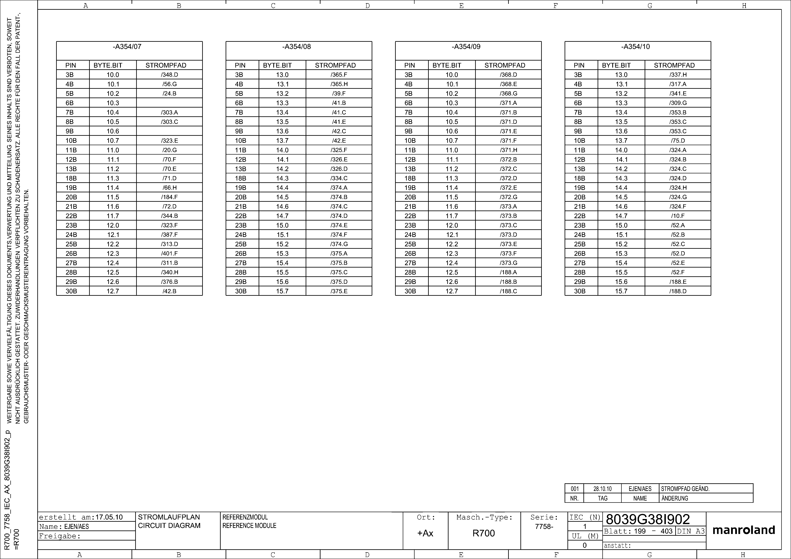

# +Ax — Sheet 199 of 403 — REFERENZMODUL

**REFERENCE MODULE**

> Part of the manroland **R700** printing press IEC/UL circuit diagrams.
> Drawing class: **Stromlaufplan / Circuit diagram** (DIN A3).
> Document `+Ax` covers the **Central control console** machine section.

## At a glance

| Field | Value |
|---|---|
| Document | `+Ax`  (8039G38I902) |
| Sheet | **199** of 403 |
| Section (DE) | REFERENZMODUL |
| Section (EN) | REFERENCE MODULE |
| Section type | REFERENCE_MODULE — Reference module |
| Machine type | `R700` |
| Series | `7758` |
| Created | 17.05.10 |
| Replaces | — |
| Columns used | A, B, C, D, E, F, G |
| Path numbers | — |
| Labels on sheet | 310 |
| Cross-refs out | 94 |
| Cross-refs in | 94 |

**Previous:** [+Ax sheet 198](SHEET_0198.md) · **Next:** [+Ax sheet 200](SHEET_0200.md) · **Document TOC:** [_TOC.md](_TOC.md)  (+Ax) · **Master TOC:** [all sheets](../_MASTER_TOC.md)

## Sheet image (300 DPI, exact vector render)



_Rendered directly from the PDF vector layer at 300 DPI (1-bit), no OCR and no resampling. Use it to confirm anything ambiguous in the text below._

## Cross-references on this sheet

Each entry is a wire leaving this sheet. The printed token is `/sheet.column`; the link resolves to that sheet inside the same document.

| Ref | Target sheet | Col | Path | Destination on target | Target section | From col |
|---|---|---|---|---|---|---|
| `/365.F` | [+Ax sheet 365](SHEET_0365.md) | F | — | — | OPTION: LOGISTIK AUSLEGER | D |
| `/348.D` | [+Ax sheet 348](SHEET_0348.md) | D | — | — | OPTION: LOGISTIK ANLEGER | B |
| `/368.D` | [+Ax sheet 368](SHEET_0368.md) | D | — | — | OPTION: LOGISTIK AUSLEGER | F |
| `/337.H` | [+Ax sheet 337](SHEET_0337.md) | H | — | — | OPTION: INLINESHEETER RS104 S | G |
| `/368.E` | [+Ax sheet 368](SHEET_0368.md) | E | — | — | OPTION: LOGISTIK AUSLEGER | F |
| `/317.A` | [+Ax sheet 317](SHEET_0317.md) | A | — | — | OPTION: "EJEKTOR" ANLAGE / SELECT AIRSTATION / | G |
| `/56.G` | [+Ax sheet 56](SHEET_0056.md) | G | — | — | LUFTVERSORGUNG | B |
| `/365.H` | [+Ax sheet 365](SHEET_0365.md) | H | — | — | OPTION: LOGISTIK AUSLEGER | D |
| `/24.B` | [+Ax sheet 24](SHEET_0024.md) | B | — | — | SPANNUNGSVERSORGUNG, SCHALTSCHRANKBELÜFTUNG | B |
| `/39.F` | [+Ax sheet 39](SHEET_0039.md) | F | — | — | HAUPTANTRIEB | D |
| `/341.E` | [+Ax sheet 341](SHEET_0341.md) | E | — | — | OPTION: INLINESHEETER RS104 S | G |
| `/368.G` | [+Ax sheet 368](SHEET_0368.md) | G | — | — | OPTION: LOGISTIK AUSLEGER | F |
| `/41.B` | [+Ax sheet 41](SHEET_0041.md) | B | — | — | HAUPTANTRIEB | D |
| `/371.A` | [+Ax sheet 371](SHEET_0371.md) | A | — | — | OPTION: VORDERMARKENEINSTELLUNG | F |
| `/309.G` | [+Ax sheet 309](SHEET_0309.md) | G | — | — | OPTION: FARBWERKTEMPERIERUNG | G |
| `/303.A` | [+Ax sheet 303](SHEET_0303.md) | A | — | — | SPANNUNGSVERSORGUNG: LACKMODUL | B |
| `/371.B` | [+Ax sheet 371](SHEET_0371.md) | B | — | — | OPTION: VORDERMARKENEINSTELLUNG | F |
| `/353.B` | [+Ax sheet 353](SHEET_0353.md) | B | — | — | OPTION: LOGISTIK ANLEGER | G |
| `/41.C` | [+Ax sheet 41](SHEET_0041.md) | C | — | — | HAUPTANTRIEB | D |
| `/41.E` | [+Ax sheet 41](SHEET_0041.md) | E | — | — | HAUPTANTRIEB | D |
| `/303.C` | [+Ax sheet 303](SHEET_0303.md) | C | — | — | SPANNUNGSVERSORGUNG: LACKMODUL | B |
| `/371.D` | [+Ax sheet 371](SHEET_0371.md) | D | — | — | OPTION: VORDERMARKENEINSTELLUNG | F |
| `/353.C` | [+Ax sheet 353](SHEET_0353.md) | C | — | — | OPTION: LOGISTIK ANLEGER | G |
| `/371.E` | [+Ax sheet 371](SHEET_0371.md) | E | — | — | OPTION: VORDERMARKENEINSTELLUNG | F |
| `/42.C` | [+Ax sheet 42](SHEET_0042.md) | C | — | — | HAUPTANTRIEB | D |
| `/353.C` | [+Ax sheet 353](SHEET_0353.md) | C | — | — | OPTION: LOGISTIK ANLEGER | G |
| `/42.E` | [+Ax sheet 42](SHEET_0042.md) | E | — | — | HAUPTANTRIEB | D |
| `/323.E` | [+Ax sheet 323](SHEET_0323.md) | E | — | — | OPTION: "EJEKTOR" ANLAGE / SELECT AIRSTATION / | B |
| `/371.F` | [+Ax sheet 371](SHEET_0371.md) | F | — | — | OPTION: VORDERMARKENEINSTELLUNG | F |
| `/75.D` | [+Ax sheet 75](SHEET_0075.md) | D | — | — | FEUCHTMITTELKÜHLGERÄT | G |
| `/324.A` | [+Ax sheet 324](SHEET_0324.md) | A | — | — | OPTION: "EJEKTOR" ANLAGE / SELECT AIRSTATION / | G |
| `/20.G` | [+Ax sheet 20](SHEET_0020.md) | G | — | — | SPANNUNGSVERSORGUNG, SCHALTSCHRANKBELÜFTUNG | B |
| `/325.F` | [+Ax sheet 325](SHEET_0325.md) | F | — | — | OPTION: AUTOMATISCHE FARBZUFÜHRUNG | D |
| `/371.H` | [+Ax sheet 371](SHEET_0371.md) | H | — | — | OPTION: VORDERMARKENEINSTELLUNG | F |
| `/70.F` | [+Ax sheet 70](SHEET_0070.md) | F | — | — | WASCHVORRICHTUNGEN DRUCKWERKE | B |
| `/326.E` | [+Ax sheet 326](SHEET_0326.md) | E | — | — | OPTION: AUTOMATISCHE FARBZUFÜHRUNG | D |
| `/372.B` | [+Ax sheet 372](SHEET_0372.md) | B | — | — | OPTION: VORDERMARKENEINSTELLUNG | F |
| `/324.B` | [+Ax sheet 324](SHEET_0324.md) | B | — | — | OPTION: "EJEKTOR" ANLAGE / SELECT AIRSTATION / | G |
| `/70.E` | [+Ax sheet 70](SHEET_0070.md) | E | — | — | WASCHVORRICHTUNGEN DRUCKWERKE | B |
| `/326.D` | [+Ax sheet 326](SHEET_0326.md) | D | — | — | OPTION: AUTOMATISCHE FARBZUFÜHRUNG | D |
| `/372.C` | [+Ax sheet 372](SHEET_0372.md) | C | — | — | OPTION: VORDERMARKENEINSTELLUNG | F |
| `/324.C` | [+Ax sheet 324](SHEET_0324.md) | C | — | — | OPTION: "EJEKTOR" ANLAGE / SELECT AIRSTATION / | G |
| `/71.D` | [+Ax sheet 71](SHEET_0071.md) | D | — | — | WASCHVORRICHTUNGEN DRUCKWERKE | B |
| `/334.C` | [+Ax sheet 334](SHEET_0334.md) | C | — | — | OPTION: INLINESORTER | D |
| `/372.D` | [+Ax sheet 372](SHEET_0372.md) | D | — | — | OPTION: VORDERMARKENEINSTELLUNG | F |
| `/324.D` | [+Ax sheet 324](SHEET_0324.md) | D | — | — | OPTION: "EJEKTOR" ANLAGE / SELECT AIRSTATION / | G |
| `/374.A` | [+Ax sheet 374](SHEET_0374.md) | A | — | — | OPTION: VORDERMARKENEINSTELLUNG | D |
| `/372.E` | [+Ax sheet 372](SHEET_0372.md) | E | — | — | OPTION: VORDERMARKENEINSTELLUNG | F |
| `/66.H` | [+Ax sheet 66](SHEET_0066.md) | H | — | — | DRUCKLUFTANLAGE | B |
| `/324.H` | [+Ax sheet 324](SHEET_0324.md) | H | — | — | OPTION: "EJEKTOR" ANLAGE / SELECT AIRSTATION / | G |
| `/374.B` | [+Ax sheet 374](SHEET_0374.md) | B | — | — | OPTION: VORDERMARKENEINSTELLUNG | D |
| `/184.F` | [+Ax sheet 184](SHEET_0184.md) | F | — | — | RESERVE | B |
| `/372.G` | [+Ax sheet 372](SHEET_0372.md) | G | — | — | OPTION: VORDERMARKENEINSTELLUNG | F |
| `/324.G` | [+Ax sheet 324](SHEET_0324.md) | G | — | — | OPTION: "EJEKTOR" ANLAGE / SELECT AIRSTATION / | G |
| `/373.A` | [+Ax sheet 373](SHEET_0373.md) | A | — | — | OPTION: VORDERMARKENEINSTELLUNG | F |
| `/324.F` | [+Ax sheet 324](SHEET_0324.md) | F | — | — | OPTION: "EJEKTOR" ANLAGE / SELECT AIRSTATION / | G |
| `/72.D` | [+Ax sheet 72](SHEET_0072.md) | D | — | — | WASCHVORRICHTUNGEN DRUCKWERKE | B |
| `/374.C` | [+Ax sheet 374](SHEET_0374.md) | C | — | — | OPTION: VORDERMARKENEINSTELLUNG | D |
| `/10.F` | [+Ax sheet 10](SHEET_0010.md) | F | — | — | SPANNUNGSVERSORGUNG, SCHALTSCHRANKBELÜFTUNG | G |
| `/344.B` | [+Ax sheet 344](SHEET_0344.md) | B | — | — | OPTION: INLINESHEETER RS104 S | B |
| `/373.B` | [+Ax sheet 373](SHEET_0373.md) | B | — | — | OPTION: VORDERMARKENEINSTELLUNG | F |
| `/374.D` | [+Ax sheet 374](SHEET_0374.md) | D | — | — | OPTION: VORDERMARKENEINSTELLUNG | D |
| `/52.A` | [+Ax sheet 52](SHEET_0052.md) | A | — | — | SIGNALGEBER: AKUSTISCHE WARNSIGNALE | G |
| `/374.E` | [+Ax sheet 374](SHEET_0374.md) | E | — | — | OPTION: VORDERMARKENEINSTELLUNG | D |
| `/323.F` | [+Ax sheet 323](SHEET_0323.md) | F | — | — | OPTION: "EJEKTOR" ANLAGE / SELECT AIRSTATION / | B |
| `/373.C` | [+Ax sheet 373](SHEET_0373.md) | C | — | — | OPTION: VORDERMARKENEINSTELLUNG | F |
| `/52.B` | [+Ax sheet 52](SHEET_0052.md) | B | — | — | SIGNALGEBER: AKUSTISCHE WARNSIGNALE | G |
| `/387.F` | [+Ax sheet 387](SHEET_0387.md) | F | — | — | OPTION: PUDERABSAUGEINRICHTUNG | B |
| `/374.F` | [+Ax sheet 374](SHEET_0374.md) | F | — | — | OPTION: VORDERMARKENEINSTELLUNG | D |
| `/373.D` | [+Ax sheet 373](SHEET_0373.md) | D | — | — | OPTION: VORDERMARKENEINSTELLUNG | F |
| `/373.E` | [+Ax sheet 373](SHEET_0373.md) | E | — | — | OPTION: VORDERMARKENEINSTELLUNG | F |
| `/374.G` | [+Ax sheet 374](SHEET_0374.md) | G | — | — | OPTION: VORDERMARKENEINSTELLUNG | D |
| `/313.D` | [+Ax sheet 313](SHEET_0313.md) | D | — | — | OPTION: STAUBSAUGER MIT BÜRSTE | B |
| `/52.C` | [+Ax sheet 52](SHEET_0052.md) | C | — | — | SIGNALGEBER: AKUSTISCHE WARNSIGNALE | G |
| `/375.A` | [+Ax sheet 375](SHEET_0375.md) | A | — | — | OPTION: VORDERMARKENEINSTELLUNG | D |
| `/401.F` | [+Ax sheet 401](SHEET_0401.md) | F | — | — | OPTION: INLINE COLORPILOT | B |
| `/373.F` | [+Ax sheet 373](SHEET_0373.md) | F | — | — | OPTION: VORDERMARKENEINSTELLUNG | F |
| `/52.D` | [+Ax sheet 52](SHEET_0052.md) | D | — | — | SIGNALGEBER: AKUSTISCHE WARNSIGNALE | G |
| `/52.E` | [+Ax sheet 52](SHEET_0052.md) | E | — | — | SIGNALGEBER: AKUSTISCHE WARNSIGNALE | G |
| `/311.B` | [+Ax sheet 311](SHEET_0311.md) | B | — | — | OPTION: IONISATIONSANLAGE ANLEGER | B |
| `/375.B` | [+Ax sheet 375](SHEET_0375.md) | B | — | — | OPTION: VORDERMARKENEINSTELLUNG | D |
| `/373.G` | [+Ax sheet 373](SHEET_0373.md) | G | — | — | OPTION: VORDERMARKENEINSTELLUNG | F |
| `/52.F` | [+Ax sheet 52](SHEET_0052.md) | F | — | — | SIGNALGEBER: AKUSTISCHE WARNSIGNALE | G |
| `/188.A` | [+Ax sheet 188](SHEET_0188.md) | A | — | — | RESERVE | F |
| `/340.H` | [+Ax sheet 340](SHEET_0340.md) | H | — | — | OPTION: INLINESHEETER RS104 S | B |
| `/375.C` | [+Ax sheet 375](SHEET_0375.md) | C | — | — | OPTION: VORDERMARKENEINSTELLUNG | D |
| `/376.B` | [+Ax sheet 376](SHEET_0376.md) | B | — | — | OPTION: FWW SPEZIALREINIGER | B |
| `/188.B` | [+Ax sheet 188](SHEET_0188.md) | B | — | — | RESERVE | F |
| `/188.E` | [+Ax sheet 188](SHEET_0188.md) | E | — | — | RESERVE | G |
| `/375.D` | [+Ax sheet 375](SHEET_0375.md) | D | — | — | OPTION: VORDERMARKENEINSTELLUNG | D |
| `/42.B` | [+Ax sheet 42](SHEET_0042.md) | B | — | — | HAUPTANTRIEB | B |
| `/375.E` | [+Ax sheet 375](SHEET_0375.md) | E | — | — | OPTION: VORDERMARKENEINSTELLUNG | D |
| `/188.C` | [+Ax sheet 188](SHEET_0188.md) | C | — | — | RESERVE | F |
| `/188.D` | [+Ax sheet 188](SHEET_0188.md) | D | — | — | RESERVE | G |

### Incoming references (sheets that point here)

Every other sheet that sends a wire to this one. `Back-ref` is the token printed on *that* sheet; `Path` is its line number.

| From sheet | Cols | Back-ref | Path | Refs | What continues there |
|---|---|---|---|---|---|
| [+Ax#10](SHEET_0010.md) | F | `/10.F` | — | 1 | — |
| [+Ax#20](SHEET_0020.md) | G | `/20.G` | — | 1 | — |
| [+Ax#24](SHEET_0024.md) | B | `/24.B` | — | 1 | — |
| [+Ax#39](SHEET_0039.md) | F | `/39.F` | — | 1 | — |
| [+Ax#41](SHEET_0041.md) | B, C, E | `/41.B`, `/41.C`, `/41.E` | — | 3 | — |
| [+Ax#42](SHEET_0042.md) | B, C, E | `/42.B`, `/42.C`, `/42.E` | — | 3 | — |
| [+Ax#52](SHEET_0052.md) | A, B, C, D, E, F | `/52.A`, `/52.B`, `/52.C`, `/52.D`, `/52.E`, `/52.F` | — | 6 | — |
| [+Ax#56](SHEET_0056.md) | G | `/56.G` | — | 1 | — |
| [+Ax#66](SHEET_0066.md) | G | `/66.G` | — | 1 | — |
| [+Ax#70](SHEET_0070.md) | E, F | `/70.E`, `/70.F` | — | 2 | — |
| [+Ax#71](SHEET_0071.md) | D | `/71.D` | — | 1 | — |
| [+Ax#72](SHEET_0072.md) | D | `/72.D` | — | 1 | — |
| [+Ax#75](SHEET_0075.md) | D | `/75.D` | — | 1 | — |
| [+Ax#184](SHEET_0184.md) | F | `/184.F` | — | 1 | — |
| [+Ax#188](SHEET_0188.md) | A, B, C, D, E | `/188.A`, `/188.B`, `/188.C`, `/188.D`, `/188.E` | — | 5 | — |
| [+Ax#303](SHEET_0303.md) | A, C | `/303.A`, `/303.C` | — | 2 | — |
| [+Ax#309](SHEET_0309.md) | G | `/309.G` | — | 1 | — |
| [+Ax#311](SHEET_0311.md) | B | `/311.B` | — | 1 | — |
| [+Ax#313](SHEET_0313.md) | D | `/313.D` | — | 1 | — |
| [+Ax#317](SHEET_0317.md) | A | `/317.A` | — | 1 | — |
| [+Ax#323](SHEET_0323.md) | E, F | `/323.E`, `/323.F` | — | 2 | — |
| [+Ax#324](SHEET_0324.md) | A, B, C, D, F, G, H | `/324.A`, `/324.B`, `/324.C`, `/324.D`, `/324.F`, `/324.G`, `/324.H` | — | 7 | — |
| [+Ax#325](SHEET_0325.md) | F | `/325.F` | — | 1 | — |
| [+Ax#326](SHEET_0326.md) | D, E | `/326.D`, `/326.E` | — | 2 | — |
| [+Ax#334](SHEET_0334.md) | C | `/334.C` | — | 1 | — |
| [+Ax#337](SHEET_0337.md) | H | `/337.H` | — | 1 | — |
| [+Ax#340](SHEET_0340.md) | H | `/340.H` | — | 1 | — |
| [+Ax#341](SHEET_0341.md) | E | `/341.E` | — | 1 | — |
| [+Ax#344](SHEET_0344.md) | B | `/344.B` | — | 1 | — |
| [+Ax#348](SHEET_0348.md) | D | `/348.D` | — | 1 | — |
| [+Ax#353](SHEET_0353.md) | B, C | `/353.B`, `/353.C` | — | 3 | — |
| [+Ax#365](SHEET_0365.md) | F, G | `/365.F`, `/365.G` | — | 2 | — |
| [+Ax#368](SHEET_0368.md) | D, E, G | `/368.D`, `/368.E`, `/368.G` | — | 3 | — |
| [+Ax#371](SHEET_0371.md) | A, B, D, E, F, H | `/371.A`, `/371.B`, `/371.D`, `/371.E`, `/371.F`, `/371.H` | — | 6 | — |
| [+Ax#372](SHEET_0372.md) | A, C, D, E, G | `/372.A`, `/372.C`, `/372.D`, `/372.E`, `/372.G` | — | 5 | — |
| [+Ax#373](SHEET_0373.md) | A, B, C, D, E, F, G | `/373.A`, `/373.B`, `/373.C`, `/373.D`, `/373.E`, `/373.F`, `/373.G` | — | 7 | — |
| [+Ax#374](SHEET_0374.md) | A, B, C, D, E, F, G | `/374.A`, `/374.B`, `/374.C`, `/374.D`, `/374.E`, `/374.F`, `/374.G` | — | 7 | — |
| [+Ax#375](SHEET_0375.md) | A, B, C, D, E | `/375.A`, `/375.B`, `/375.C`, `/375.D`, `/375.E` | — | 5 | — |
| [+Ax#376](SHEET_0376.md) | B | `/376.B` | — | 1 | — |
| [+Ax#387](SHEET_0387.md) | F | `/387.F` | — | 1 | — |
| [+Ax#401](SHEET_0401.md) | F | `/401.F` | — | 1 | — |


## Devices on this sheet

| Tag | Class | Class meaning (IEC) | Col | Sub | Terminal | Sign |
|---|---|---|---|---|---|---|
| `A354/08` | A | Baugruppe / assembly, module, PC board | C | 08 | — | — |
| `A354/09` | A | Baugruppe / assembly, module, PC board | E | 09 | — | — |
| `A354/10` | A | Baugruppe / assembly, module, PC board | G | 10 | — | — |
| `A354/07` | A | Baugruppe / assembly, module, PC board | A | 07 | — | — |
| `13.0` | — | cross-device reference | C | — | — | — |
| `13.1` | — | cross-device reference | C | — | — | — |
| `13.2` | — | cross-device reference | C | — | — | — |
| `13.3` | — | cross-device reference | C | — | — | — |
| `13.4` | — | cross-device reference | C | — | — | — |
| `13.5` | — | cross-device reference | C | — | — | — |
| `13.6` | — | cross-device reference | C | — | — | — |
| `13.7` | — | cross-device reference | C | — | — | — |
| `14.0` | — | cross-device reference | C | — | — | — |
| `14.1` | — | cross-device reference | C | — | — | — |
| `14.2` | — | cross-device reference | C | — | — | — |
| `14.3` | — | cross-device reference | C | — | — | — |
| `14.4` | — | cross-device reference | C | — | — | — |
| `14.5` | — | cross-device reference | C | — | — | — |
| `14.6` | — | cross-device reference | C | — | — | — |
| `14.7` | — | cross-device reference | C | — | — | — |
| `15.0` | — | cross-device reference | C | — | — | — |
| `15.1` | — | cross-device reference | C | — | — | — |
| `15.2` | — | cross-device reference | C | — | — | — |
| `15.3` | — | cross-device reference | C | — | — | — |
| `15.4` | — | cross-device reference | C | — | — | — |
| `15.5` | — | cross-device reference | C | — | — | — |
| `15.6` | — | cross-device reference | C | — | — | — |
| `15.7` | — | cross-device reference | C | — | — | — |
| `10.0` | — | cross-device reference | E | — | — | — |
| `10.1` | — | cross-device reference | E | — | — | — |
| `10.2` | — | cross-device reference | E | — | — | — |
| `10.3` | — | cross-device reference | E | — | — | — |
| `10.4` | — | cross-device reference | E | — | — | — |
| `10.5` | — | cross-device reference | E | — | — | — |
| `10.6` | — | cross-device reference | E | — | — | — |
| `10.7` | — | cross-device reference | E | — | — | — |
| `11.0` | — | cross-device reference | E | — | — | — |
| `11.1` | — | cross-device reference | E | — | — | — |
| `11.2` | — | cross-device reference | E | — | — | — |
| `11.3` | — | cross-device reference | E | — | — | — |
| `11.4` | — | cross-device reference | E | — | — | — |
| `11.5` | — | cross-device reference | E | — | — | — |
| `11.6` | — | cross-device reference | E | — | — | — |
| `11.7` | — | cross-device reference | E | — | — | — |
| `12.0` | — | cross-device reference | E | — | — | — |
| `12.1` | — | cross-device reference | E | — | — | — |
| `12.2` | — | cross-device reference | E | — | — | — |
| `12.3` | — | cross-device reference | E | — | — | — |
| `12.4` | — | cross-device reference | E | — | — | — |
| `12.5` | — | cross-device reference | E | — | — | — |
| `12.6` | — | cross-device reference | E | — | — | — |
| `12.7` | — | cross-device reference | E | — | — | — |
| `13.0` | — | cross-device reference | G | — | — | — |
| `13.1` | — | cross-device reference | G | — | — | — |
| `13.2` | — | cross-device reference | G | — | — | — |
| `13.3` | — | cross-device reference | G | — | — | — |
| `13.4` | — | cross-device reference | G | — | — | — |
| `13.5` | — | cross-device reference | G | — | — | — |
| `13.6` | — | cross-device reference | G | — | — | — |
| `13.7` | — | cross-device reference | G | — | — | — |
| `14.0` | — | cross-device reference | G | — | — | — |
| `14.1` | — | cross-device reference | G | — | — | — |
| `14.2` | — | cross-device reference | G | — | — | — |
| `14.3` | — | cross-device reference | G | — | — | — |
| `14.4` | — | cross-device reference | G | — | — | — |
| `14.5` | — | cross-device reference | G | — | — | — |
| `14.6` | — | cross-device reference | G | — | — | — |
| `14.7` | — | cross-device reference | G | — | — | — |
| `15.0` | — | cross-device reference | G | — | — | — |
| `15.1` | — | cross-device reference | G | — | — | — |
| `15.2` | — | cross-device reference | G | — | — | — |
| `15.3` | — | cross-device reference | G | — | — | — |
| `15.4` | — | cross-device reference | G | — | — | — |
| `15.5` | — | cross-device reference | G | — | — | — |
| `15.6` | — | cross-device reference | G | — | — | — |
| `15.7` | — | cross-device reference | G | — | — | — |
| `10.0` | — | cross-device reference | A | — | — | — |
| `10.1` | — | cross-device reference | A | — | — | — |
| `10.2` | — | cross-device reference | A | — | — | — |
| `10.3` | — | cross-device reference | A | — | — | — |
| `10.4` | — | cross-device reference | A | — | — | — |
| `10.5` | — | cross-device reference | A | — | — | — |
| `10.6` | — | cross-device reference | A | — | — | — |
| `10.7` | — | cross-device reference | A | — | — | — |
| `11.0` | — | cross-device reference | A | — | — | — |
| `11.1` | — | cross-device reference | A | — | — | — |
| `11.2` | — | cross-device reference | A | — | — | — |
| `11.3` | — | cross-device reference | A | — | — | — |
| `11.4` | — | cross-device reference | A | — | — | — |
| `11.5` | — | cross-device reference | A | — | — | — |
| `11.6` | — | cross-device reference | A | — | — | — |
| `11.7` | — | cross-device reference | A | — | — | — |
| `12.0` | — | cross-device reference | A | — | — | — |
| `12.1` | — | cross-device reference | A | — | — | — |
| `12.2` | — | cross-device reference | A | — | — | — |
| `12.3` | — | cross-device reference | A | — | — | — |
| `12.4` | — | cross-device reference | A | — | — | — |
| `12.5` | — | cross-device reference | A | — | — | — |
| `12.6` | — | cross-device reference | A | — | — | — |
| `12.7` | — | cross-device reference | A | — | — | — |
| `NR.` | — | cross-device reference | F | — | — | — |
| `28.10.10` | — | cross-device reference | F | — | — | — |

## Potentials / nets

_No named potentials on this sheet._

## Wire-end annotations (grouped as printed)

A wire that continues elsewhere is annotated with a small cluster: the destination description, the path/line number `#NN`, and the `/sheet.column` cross reference. Each row below is one such cluster exactly as it is grouped on the drawing.

| Col | Y | Path | Cross-ref | Text on the wire |
|---|---|---|---|---|
| A | 65.5 | — | — | `A354/07` |
| C | 65.5 | — | — | `A354/08` |
| E | 65.5 | — | — | `A354/09` |
| G | 65.5 | — | — | `A354/10` |
| A | 94.2 | — | — | `PIN BYTE.BIT` |
| B | 94.2 | — | — | `STROMPFAD` |
| C | 94.2 | — | — | `PIN BYTE.BIT` |
| D | 94.2 | — | — | `STROMPFAD` |
| E | 94.2 | — | — | `PIN BYTE.BIT` |
| E | 94.2 | — | — | `STROMPFAD` |
| F | 94.2 | — | — | `PIN BYTE.BIT` |
| G | 94.2 | — | — | `STROMPFAD` |
| A | 108.3 | — | — | `10B 11B 12B 13B 18B 19B 3B 4B 5B 6B 7B 8B 9B 20B 21B 22B 23B 24B 25B 26B 27B 28B 29B 30B` |
| A | 108.3 | — | — | `10.0 10.2 10.3 10.4 10.5 10.6 10.7 11.0 11.2 11.3 11.4 11.5 11.6 11.7 12.0 12.2 12.3 12.4 12.5 12.6 12.7 10.1 11.1 12.1` |
| C | 108.3 | — | — | `10B 11B 12B 13B 18B 19B 3B 4B 5B 6B 7B 8B 9B 20B 21B 22B 23B 24B 25B 26B 27B 28B 29B 30B` |
| C | 108.3 | — | — | `13.0 13.2 13.3 13.4 13.5 13.6 13.7 14.0 14.2 14.3 14.4 14.5 14.6 14.7 15.0 15.2 15.3 15.4 15.5 15.6 15.7 13.1 14.1 15.1` |
| D | 108.3 | — | — | `10B 11B 12B 13B 18B 19B 3B 4B 5B 6B 7B 8B 9B 20B 21B 22B 23B 24B 25B 26B 27B 28B 29B 30B` |
| E | 108.3 | — | — | `10.0 10.2 10.3 10.4 10.5 10.6 10.7 11.0 11.2 11.3 11.4 11.5 11.6 11.7 12.0 12.2 12.3 12.4 12.5 12.6 12.7 10.1 11.1 12.1` |
| F | 108.3 | — | — | `10B 11B 12B 13B 18B 19B 3B 4B 5B 6B 7B 8B 9B 20B 21B 22B 23B 24B 25B 26B 27B 28B 29B 30B` |
| G | 108.3 | — | — | `13.0 13.2 13.3 13.4 13.5 13.6 13.7 14.0 14.2 14.3 14.4 14.5 14.6 14.7 15.0 15.2 15.3 15.4 15.5 15.6 15.7 13.1 14.1 15.1` |
| B | 108.7 | — | `/348.D` | — |
| D | 108.7 | — | `/365.F` | — |
| F | 108.7 | — | `/368.D` | — |
| G | 108.7 | — | `/337.H` | — |
| B | 122.9 | — | `/56.G` | — |
| D | 122.9 | — | `/365.H` | — |
| F | 122.9 | — | `/368.E` | — |
| G | 122.9 | — | `/317.A` | — |
| B | 137.0 | — | `/24.B` | — |
| D | 137.0 | — | `/39.F` | — |
| G | 137.0 | — | `/341.E` | — |
| F | 137.1 | — | `/368.G` | — |
| D | 151.2 | — | `/41.B` | — |
| F | 151.2 | — | `/371.A` | — |
| G | 151.2 | — | `/309.G` | — |
| B | 165.4 | — | `/303.A` | — |
| D | 165.4 | — | `/41.C` | — |
| F | 165.4 | — | `/371.B` | — |
| G | 165.4 | — | `/353.B` | — |
| D | 179.5 | — | `/41.E` | — |
| B | 179.6 | — | `/303.C` | — |
| F | 179.6 | — | `/371.D` | — |
| G | 179.6 | — | `/353.C` | — |
| F | 193.7 | — | `/371.E` | — |
| D | 193.8 | — | `/42.C` | — |
| G | 193.8 | — | `/353.C` | — |
| B | 207.9 | — | `/323.E` | — |
| D | 207.9 | — | `/42.E` | — |
| F | 207.9 | — | `/371.F` | — |
| G | 207.9 | — | `/75.D` | — |
| B | 222.1 | — | `/20.G` | — |
| D | 222.1 | — | `/325.F` | — |
| F | 222.1 | — | `/371.H` | — |
| G | 222.1 | — | `/324.A` | — |
| B | 236.2 | — | `/70.F` | — |
| D | 236.2 | — | `/326.E` | — |
| F | 236.2 | — | `/372.B` | — |
| G | 236.2 | — | `/324.B` | — |
| B | 250.4 | — | `/70.E` | — |
| D | 250.4 | — | `/326.D` | — |
| F | 250.4 | — | `/372.C` | — |
| G | 250.4 | — | `/324.C` | — |
| B | 264.6 | — | `/71.D` | — |
| D | 264.6 | — | `/334.C` | — |
| F | 264.6 | — | `/372.D` | — |
| G | 264.6 | — | `/324.D` | — |
| B | 278.8 | — | `/66.H` | — |
| D | 278.8 | — | `/374.A` | — |
| F | 278.8 | — | `/372.E` | — |
| G | 278.8 | — | `/324.H` | — |
| B | 292.9 | — | `/184.F` | — |
| D | 292.9 | — | `/374.B` | — |
| F | 293.0 | — | `/372.G` | — |
| G | 293.0 | — | `/324.G` | — |
| B | 307.1 | — | `/72.D` | — |
| D | 307.1 | — | `/374.C` | — |
| F | 307.1 | — | `/373.A` | — |
| G | 307.1 | — | `/324.F` | — |
| B | 321.3 | — | `/344.B` | — |
| D | 321.3 | — | `/374.D` | — |
| F | 321.3 | — | `/373.B` | — |
| G | 321.3 | — | `/10.F` | — |
| G | 335.4 | — | `/52.A` | — |
| B | 335.5 | — | `/323.F` | — |
| D | 335.5 | — | `/374.E` | — |
| F | 335.5 | — | `/373.C` | — |
| B | 349.6 | — | `/387.F` | — |
| D | 349.6 | — | `/374.F` | — |
| G | 349.6 | — | `/52.B` | — |
| F | 349.7 | — | `/373.D` | — |
| B | 363.8 | — | `/313.D` | — |
| D | 363.8 | — | `/374.G` | — |
| F | 363.8 | — | `/373.E` | — |
| G | 363.8 | — | `/52.C` | — |
| B | 378.0 | — | `/401.F` | — |
| D | 378.0 | — | `/375.A` | — |
| F | 378.0 | — | `/373.F` | — |
| G | 378.0 | — | `/52.D` | — |
| B | 392.1 | — | `/311.B` | — |
| D | 392.1 | — | `/375.B` | — |
| G | 392.1 | — | `/52.E` | — |
| F | 392.2 | — | `/373.G` | — |
| F | 406.3 | — | `/188.A` | — |
| G | 406.3 | — | `/52.F` | — |
| B | 406.4 | — | `/340.H` | — |
| D | 406.4 | — | `/375.C` | — |
| B | 420.5 | — | `/376.B` | — |
| D | 420.5 | — | `/375.D` | — |
| F | 420.5 | — | `/188.B` | — |
| G | 420.5 | — | `/188.E` | — |
| B | 434.7 | — | `/42.B` | — |
| D | 434.7 | — | `/375.E` | — |
| F | 434.7 | — | `/188.C` | — |
| G | 434.7 | — | `/188.D` | — |
| G | 733.0 | — | — | `001 28.10.10 EJEN/AES STROMPFAD GEÄND.` |
| G | 747.1 | — | — | `NR. TAG NAME ÄNDERUNG` |


## Reconstructed tables

This sheet carries tabular content (pin map / terminal assignment / index). The grid below was rebuilt from the drawing's own rule lines, so each row is exactly one physical row of the table.

### Table 1 — 24 data rows × 3 columns (at x=85.0, y=62.4) — **A354/07**

| PIN | BYTE.BIT | STROMPFAD |
|---|---|---|
| `3B` | `10.0` | `/348.D` |
| `4B` | `10.1` | `/56.G` |
| `5B` | `10.2` | `/24.B` |
| `6B` | `10.3` |  |
| `7B` | `10.4` | `/303.A` |
| `8B` | `10.5` | `/303.C` |
| `9B` | `10.6` |  |
| `10B` | `10.7` | `/323.E` |
| `11B` | `11.0` | `/20.G` |
| `12B` | `11.1` | `/70.F` |
| `13B` | `11.2` | `/70.E` |
| `18B` | `11.3` | `/71.D` |
| `19B` | `11.4` | `/66.H` |
| `20B` | `11.5` | `/184.F` |
| `21B` | `11.6` | `/72.D` |
| `22B` | `11.7` | `/344.B` |
| `23B` | `12.0` | `/323.F` |
| `24B` | `12.1` | `/387.F` |
| `25B` | `12.2` | `/313.D` |
| `26B` | `12.3` | `/401.F` |
| `27B` | `12.4` | `/311.B` |
| `28B` | `12.5` | `/340.H` |
| `29B` | `12.6` | `/376.B` |
| `30B` | `12.7` | `/42.B` |


### Table 2 — 24 data rows × 3 columns (at x=340.2, y=62.4) — **A354/08**

| PIN | BYTE.BIT | STROMPFAD |
|---|---|---|
| `3B` | `13.0` | `/365.F` |
| `4B` | `13.1` | `/365.H` |
| `5B` | `13.2` | `/39.F` |
| `6B` | `13.3` | `/41.B` |
| `7B` | `13.4` | `/41.C` |
| `8B` | `13.5` | `/41.E` |
| `9B` | `13.6` | `/42.C` |
| `10B` | `13.7` | `/42.E` |
| `11B` | `14.0` | `/325.F` |
| `12B` | `14.1` | `/326.E` |
| `13B` | `14.2` | `/326.D` |
| `18B` | `14.3` | `/334.C` |
| `19B` | `14.4` | `/374.A` |
| `20B` | `14.5` | `/374.B` |
| `21B` | `14.6` | `/374.C` |
| `22B` | `14.7` | `/374.D` |
| `23B` | `15.0` | `/374.E` |
| `24B` | `15.1` | `/374.F` |
| `25B` | `15.2` | `/374.G` |
| `26B` | `15.3` | `/375.A` |
| `27B` | `15.4` | `/375.B` |
| `28B` | `15.5` | `/375.C` |
| `29B` | `15.6` | `/375.D` |
| `30B` | `15.7` | `/375.E` |


### Table 3 — 24 data rows × 3 columns (at x=595.3, y=62.4) — **A354/09**

| PIN | BYTE.BIT | STROMPFAD |
|---|---|---|
| `3B` | `10.0` | `/368.D` |
| `4B` | `10.1` | `/368.E` |
| `5B` | `10.2` | `/368.G` |
| `6B` | `10.3` | `/371.A` |
| `7B` | `10.4` | `/371.B` |
| `8B` | `10.5` | `/371.D` |
| `9B` | `10.6` | `/371.E` |
| `10B` | `10.7` | `/371.F` |
| `11B` | `11.0` | `/371.H` |
| `12B` | `11.1` | `/372.B` |
| `13B` | `11.2` | `/372.C` |
| `18B` | `11.3` | `/372.D` |
| `19B` | `11.4` | `/372.E` |
| `20B` | `11.5` | `/372.G` |
| `21B` | `11.6` | `/373.A` |
| `22B` | `11.7` | `/373.B` |
| `23B` | `12.0` | `/373.C` |
| `24B` | `12.1` | `/373.D` |
| `25B` | `12.2` | `/373.E` |
| `26B` | `12.3` | `/373.F` |
| `27B` | `12.4` | `/373.G` |
| `28B` | `12.5` | `/188.A` |
| `29B` | `12.6` | `/188.B` |
| `30B` | `12.7` | `/188.C` |


### Table 4 — 24 data rows × 3 columns (at x=850.4, y=62.4) — **A354/10**

| PIN | BYTE.BIT | STROMPFAD |
|---|---|---|
| `3B` | `13.0` | `/337.H` |
| `4B` | `13.1` | `/317.A` |
| `5B` | `13.2` | `/341.E` |
| `6B` | `13.3` | `/309.G` |
| `7B` | `13.4` | `/353.B` |
| `8B` | `13.5` | `/353.C` |
| `9B` | `13.6` | `/353.C` |
| `10B` | `13.7` | `/75.D` |
| `11B` | `14.0` | `/324.A` |
| `12B` | `14.1` | `/324.B` |
| `13B` | `14.2` | `/324.C` |
| `18B` | `14.3` | `/324.D` |
| `19B` | `14.4` | `/324.H` |
| `20B` | `14.5` | `/324.G` |
| `21B` | `14.6` | `/324.F` |
| `22B` | `14.7` | `/10.F` |
| `23B` | `15.0` | `/52.A` |
| `24B` | `15.1` | `/52.B` |
| `25B` | `15.2` | `/52.C` |
| `26B` | `15.3` | `/52.D` |
| `27B` | `15.4` | `/52.E` |
| `28B` | `15.5` | `/52.F` |
| `29B` | `15.6` | `/188.E` |
| `30B` | `15.7` | `/188.D` |


## Notes and free text on this sheet

| Text | Col | Y (pt) |
|---|---|---|
| `3B` | C | 108.35 |
| `4B` | C | 122.53 |
| `5B` | C | 136.7 |
| `6B` | C | 150.87 |
| `7B` | C | 165.05 |
| `8B` | C | 179.22 |
| `9B` | C | 193.39 |
| `10B` | C | 207.57 |
| `11B` | C | 221.74 |
| `12B` | C | 235.92 |
| `13B` | C | 250.09 |
| `18B` | C | 264.26 |
| `19B` | C | 278.44 |
| `20B` | C | 292.61 |
| `21B` | C | 306.78 |
| `22B` | C | 320.96 |
| `23B` | C | 335.13 |
| `24B` | C | 349.3 |
| `25B` | C | 363.48 |
| `26B` | C | 377.65 |
| `27B` | C | 391.82 |
| `28B` | C | 406 |
| `29B` | C | 420.17 |
| `30B` | C | 434.34 |
| `PIN` | C | 94.2 |
| `BYTE.BIT` | C | 94.17 |
| `STROMPFAD` | D | 94.15 |
| `3B` | D | 108.35 |
| `4B` | D | 122.53 |
| `5B` | D | 136.7 |
| `6B` | D | 150.87 |
| `7B` | D | 165.05 |
| `8B` | D | 179.22 |
| `9B` | D | 193.39 |
| `10B` | D | 207.57 |
| `11B` | D | 221.74 |
| `12B` | D | 235.92 |
| `13B` | D | 250.09 |
| `18B` | D | 264.26 |
| `19B` | D | 278.44 |
| `20B` | D | 292.61 |
| `21B` | D | 306.78 |
| `22B` | D | 320.96 |
| `23B` | D | 335.13 |
| `24B` | D | 349.3 |
| `25B` | D | 363.48 |
| `26B` | D | 377.65 |
| `27B` | D | 391.82 |
| `28B` | D | 406 |
| `29B` | D | 420.17 |
| `30B` | D | 434.34 |
| `PIN` | D | 94.2 |
| `BYTE.BIT` | E | 94.17 |
| `STROMPFAD` | E | 94.15 |
| `3B` | F | 108.35 |
| `4B` | F | 122.53 |
| `5B` | F | 136.7 |
| `6B` | F | 150.87 |
| `7B` | F | 165.05 |
| `8B` | F | 179.22 |
| `9B` | F | 193.39 |
| `10B` | F | 207.57 |
| `11B` | F | 221.74 |
| `12B` | F | 235.92 |
| `13B` | F | 250.09 |
| `18B` | F | 264.26 |
| `19B` | F | 278.44 |
| `20B` | F | 292.61 |
| `21B` | F | 306.78 |
| `22B` | F | 320.96 |
| `23B` | F | 335.13 |
| `24B` | F | 349.3 |
| `25B` | F | 363.48 |
| `26B` | F | 377.65 |
| `27B` | F | 391.82 |
| `28B` | F | 406 |
| `29B` | F | 420.17 |
| `30B` | F | 434.34 |
| `PIN` | F | 94.2 |
| `BYTE.BIT` | G | 94.17 |
| `STROMPFAD` | G | 94.15 |
| `3B` | A | 108.35 |
| `4B` | A | 122.53 |
| `5B` | A | 136.7 |
| `6B` | A | 150.87 |
| `7B` | A | 165.05 |
| `8B` | A | 179.22 |
| `9B` | A | 193.39 |
| `10B` | A | 207.57 |
| `11B` | A | 221.74 |
| `12B` | A | 235.92 |
| `13B` | A | 250.09 |
| `18B` | A | 264.26 |
| `19B` | A | 278.44 |
| `20B` | A | 292.61 |
| `21B` | A | 306.78 |
| `22B` | A | 320.96 |
| `23B` | A | 335.13 |
| `24B` | A | 349.3 |
| `25B` | A | 363.48 |
| `26B` | A | 377.65 |
| `27B` | A | 391.82 |
| `28B` | A | 406 |
| `29B` | A | 420.17 |
| `30B` | A | 434.34 |
| `PIN` | A | 94.2 |
| `BYTE.BIT` | A | 94.17 |
| `STROMPFAD` | B | 94.15 |
| `TAG` | G | 747.27 |
| `NAME` | G | 747.25 |
| `ÄNDERUNG` | G | 747.31 |
| `EJEN/AES` | G | 733.09 |
| `STROMPFAD GEÄND.` | G | 733.12 |

## Complete label inventory (exact text from the drawing)

Every text object inside the drawing area of this sheet, in DIN reading order (column A→H, then top→bottom). This is the authoritative list: if a string is not here it is not printed on this sheet.

| Col | Y | X | Dir | Type | Text |
|---|---|---|---|---|---|
| A | 65.5 | 169.9 | → | device tag | `A354/07` |
| A | 94.2 | 98.4 | → | text | `PIN` |
| A | 94.2 | 140.9 | → | text | `BYTE.BIT` |
| A | 108.3 | 160.3 | → | device ref | `10.0` |
| A | 108.4 | 98.9 | → | text | `3B` |
| A | 122.5 | 98.9 | → | text | `4B` |
| A | 122.5 | 161.1 | → | device ref | `10.1` |
| A | 136.7 | 98.9 | → | text | `5B` |
| A | 136.7 | 160.3 | → | device ref | `10.2` |
| A | 150.9 | 98.9 | → | text | `6B` |
| A | 150.9 | 160.3 | → | device ref | `10.3` |
| A | 165.0 | 98.9 | → | text | `7B` |
| A | 165.0 | 160.3 | → | device ref | `10.4` |
| A | 179.2 | 98.9 | → | text | `8B` |
| A | 179.2 | 160.3 | → | device ref | `10.5` |
| A | 193.4 | 98.9 | → | text | `9B` |
| A | 193.4 | 160.3 | → | device ref | `10.6` |
| A | 207.6 | 98.4 | → | text | `10B` |
| A | 207.6 | 160.3 | → | device ref | `10.7` |
| A | 221.7 | 98.4 | → | text | `11B` |
| A | 221.7 | 160.3 | → | device ref | `11.0` |
| A | 235.9 | 98.4 | → | text | `12B` |
| A | 235.9 | 161.1 | → | device ref | `11.1` |
| A | 250.1 | 98.4 | → | text | `13B` |
| A | 250.1 | 160.3 | → | device ref | `11.2` |
| A | 264.2 | 160.3 | → | device ref | `11.3` |
| A | 264.3 | 98.4 | → | text | `18B` |
| A | 278.4 | 98.4 | → | text | `19B` |
| A | 278.4 | 160.3 | → | device ref | `11.4` |
| A | 292.6 | 98.9 | → | text | `20B` |
| A | 292.6 | 160.3 | → | device ref | `11.5` |
| A | 306.8 | 98.9 | → | text | `21B` |
| A | 306.8 | 160.3 | → | device ref | `11.6` |
| A | 320.9 | 160.3 | → | device ref | `11.7` |
| A | 321.0 | 98.9 | → | text | `22B` |
| A | 335.1 | 98.9 | → | text | `23B` |
| A | 335.1 | 160.3 | → | device ref | `12.0` |
| A | 349.3 | 98.9 | → | text | `24B` |
| A | 349.3 | 161.1 | → | device ref | `12.1` |
| A | 363.5 | 98.9 | → | text | `25B` |
| A | 363.5 | 160.3 | → | device ref | `12.2` |
| A | 377.6 | 98.9 | → | text | `26B` |
| A | 377.6 | 160.3 | → | device ref | `12.3` |
| A | 391.8 | 98.9 | → | text | `27B` |
| A | 391.8 | 160.3 | → | device ref | `12.4` |
| A | 406.0 | 98.9 | → | text | `28B` |
| A | 406.0 | 160.3 | → | device ref | `12.5` |
| A | 420.2 | 98.9 | → | text | `29B` |
| A | 420.2 | 160.3 | → | device ref | `12.6` |
| A | 434.3 | 98.9 | → | text | `30B` |
| A | 434.3 | 160.3 | → | device ref | `12.7` |
| B | 94.2 | 219.1 | → | text | `STROMPFAD` |
| B | 108.7 | 242.4 | → | cross-reference | `/348.D` |
| B | 122.9 | 244.6 | → | cross-reference | `/56.G` |
| B | 137.0 | 244.9 | → | cross-reference | `/24.B` |
| B | 165.4 | 242.4 | → | cross-reference | `/303.A` |
| B | 179.6 | 242.4 | → | cross-reference | `/303.C` |
| B | 207.9 | 242.6 | → | cross-reference | `/323.E` |
| B | 222.1 | 244.6 | → | cross-reference | `/20.G` |
| B | 236.2 | 245.2 | → | cross-reference | `/70.F` |
| B | 250.4 | 245.1 | → | cross-reference | `/70.E` |
| B | 264.6 | 244.8 | → | cross-reference | `/71.D` |
| B | 278.8 | 245.1 | → | cross-reference | `/66.H` |
| B | 293.0 | 242.8 | → | cross-reference | `/184.F` |
| B | 307.1 | 244.8 | → | cross-reference | `/72.D` |
| B | 321.3 | 242.5 | → | cross-reference | `/344.B` |
| B | 335.5 | 242.8 | → | cross-reference | `/323.F` |
| B | 349.6 | 242.8 | → | cross-reference | `/387.F` |
| B | 363.8 | 242.4 | → | cross-reference | `/313.D` |
| B | 378.0 | 242.8 | → | cross-reference | `/401.F` |
| B | 392.2 | 242.5 | → | cross-reference | `/311.B` |
| B | 406.4 | 242.6 | → | cross-reference | `/340.H` |
| B | 420.5 | 242.5 | → | cross-reference | `/376.B` |
| B | 434.7 | 244.9 | → | cross-reference | `/42.B` |
| C | 65.5 | 425.1 | → | device tag | `A354/08` |
| C | 94.2 | 353.5 | → | text | `PIN` |
| C | 94.2 | 396.0 | → | text | `BYTE.BIT` |
| C | 108.3 | 415.4 | → | device ref | `13.0` |
| C | 108.4 | 354.0 | → | text | `3B` |
| C | 122.5 | 354.0 | → | text | `4B` |
| C | 122.5 | 416.3 | → | device ref | `13.1` |
| C | 136.7 | 354.0 | → | text | `5B` |
| C | 136.7 | 415.4 | → | device ref | `13.2` |
| C | 150.9 | 354.0 | → | text | `6B` |
| C | 150.9 | 415.4 | → | device ref | `13.3` |
| C | 165.0 | 354.0 | → | text | `7B` |
| C | 165.0 | 415.4 | → | device ref | `13.4` |
| C | 179.2 | 354.0 | → | text | `8B` |
| C | 179.2 | 415.4 | → | device ref | `13.5` |
| C | 193.4 | 354.0 | → | text | `9B` |
| C | 193.4 | 415.4 | → | device ref | `13.6` |
| C | 207.6 | 353.5 | → | text | `10B` |
| C | 207.6 | 415.4 | → | device ref | `13.7` |
| C | 221.7 | 353.5 | → | text | `11B` |
| C | 221.7 | 415.4 | → | device ref | `14.0` |
| C | 235.9 | 353.5 | → | text | `12B` |
| C | 235.9 | 416.3 | → | device ref | `14.1` |
| C | 250.1 | 353.5 | → | text | `13B` |
| C | 250.1 | 415.4 | → | device ref | `14.2` |
| C | 264.2 | 415.4 | → | device ref | `14.3` |
| C | 264.3 | 353.5 | → | text | `18B` |
| C | 278.4 | 353.5 | → | text | `19B` |
| C | 278.4 | 415.4 | → | device ref | `14.4` |
| C | 292.6 | 354.0 | → | text | `20B` |
| C | 292.6 | 415.4 | → | device ref | `14.5` |
| C | 306.8 | 354.0 | → | text | `21B` |
| C | 306.8 | 415.4 | → | device ref | `14.6` |
| C | 320.9 | 415.4 | → | device ref | `14.7` |
| C | 321.0 | 354.0 | → | text | `22B` |
| C | 335.1 | 354.0 | → | text | `23B` |
| C | 335.1 | 415.4 | → | device ref | `15.0` |
| C | 349.3 | 354.0 | → | text | `24B` |
| C | 349.3 | 416.3 | → | device ref | `15.1` |
| C | 363.5 | 354.0 | → | text | `25B` |
| C | 363.5 | 415.4 | → | device ref | `15.2` |
| C | 377.6 | 354.0 | → | text | `26B` |
| C | 377.6 | 415.4 | → | device ref | `15.3` |
| C | 391.8 | 354.0 | → | text | `27B` |
| C | 391.8 | 415.4 | → | device ref | `15.4` |
| C | 406.0 | 354.0 | → | text | `28B` |
| C | 406.0 | 415.4 | → | device ref | `15.5` |
| C | 420.2 | 354.0 | → | text | `29B` |
| C | 420.2 | 415.4 | → | device ref | `15.6` |
| C | 434.3 | 354.0 | → | text | `30B` |
| C | 434.3 | 415.4 | → | device ref | `15.7` |
| D | 94.2 | 474.2 | → | text | `STROMPFAD` |
| D | 94.2 | 608.6 | → | text | `PIN` |
| D | 108.4 | 609.2 | → | text | `3B` |
| D | 108.7 | 497.9 | → | cross-reference | `/365.F` |
| D | 122.5 | 609.2 | → | text | `4B` |
| D | 122.9 | 497.8 | → | cross-reference | `/365.H` |
| D | 136.7 | 609.2 | → | text | `5B` |
| D | 137.0 | 500.3 | → | cross-reference | `/39.F` |
| D | 150.9 | 609.2 | → | text | `6B` |
| D | 151.2 | 500.0 | → | cross-reference | `/41.B` |
| D | 165.0 | 609.2 | → | text | `7B` |
| D | 165.4 | 499.9 | → | cross-reference | `/41.C` |
| D | 179.2 | 609.2 | → | text | `8B` |
| D | 179.5 | 500.2 | → | cross-reference | `/41.E` |
| D | 193.4 | 609.2 | → | text | `9B` |
| D | 193.7 | 499.9 | → | cross-reference | `/42.C` |
| D | 207.6 | 608.6 | → | text | `10B` |
| D | 207.9 | 500.2 | → | cross-reference | `/42.E` |
| D | 221.7 | 608.6 | → | text | `11B` |
| D | 222.1 | 497.9 | → | cross-reference | `/325.F` |
| D | 235.9 | 608.6 | → | text | `12B` |
| D | 236.2 | 497.8 | → | cross-reference | `/326.E` |
| D | 250.1 | 608.6 | → | text | `13B` |
| D | 250.4 | 497.5 | → | cross-reference | `/326.D` |
| D | 264.3 | 608.6 | → | text | `18B` |
| D | 264.6 | 497.5 | → | cross-reference | `/334.C` |
| D | 278.4 | 608.6 | → | text | `19B` |
| D | 278.8 | 497.5 | → | cross-reference | `/374.A` |
| D | 292.6 | 609.2 | → | text | `20B` |
| D | 292.9 | 497.6 | → | cross-reference | `/374.B` |
| D | 306.8 | 609.2 | → | text | `21B` |
| D | 307.1 | 497.5 | → | cross-reference | `/374.C` |
| D | 321.0 | 609.2 | → | text | `22B` |
| D | 321.3 | 497.5 | → | cross-reference | `/374.D` |
| D | 335.1 | 609.2 | → | text | `23B` |
| D | 335.5 | 497.8 | → | cross-reference | `/374.E` |
| D | 349.3 | 609.2 | → | text | `24B` |
| D | 349.6 | 497.9 | → | cross-reference | `/374.F` |
| D | 363.5 | 609.2 | → | text | `25B` |
| D | 363.8 | 497.3 | → | cross-reference | `/374.G` |
| D | 377.6 | 609.2 | → | text | `26B` |
| D | 378.0 | 497.5 | → | cross-reference | `/375.A` |
| D | 391.8 | 609.2 | → | text | `27B` |
| D | 392.2 | 497.6 | → | cross-reference | `/375.B` |
| D | 406.0 | 609.2 | → | text | `28B` |
| D | 406.4 | 497.5 | → | cross-reference | `/375.C` |
| D | 420.2 | 609.2 | → | text | `29B` |
| D | 420.5 | 497.5 | → | cross-reference | `/375.D` |
| D | 434.3 | 609.2 | → | text | `30B` |
| D | 434.7 | 497.8 | → | cross-reference | `/375.E` |
| E | 65.5 | 680.2 | → | device tag | `A354/09` |
| E | 94.2 | 651.1 | → | text | `BYTE.BIT` |
| E | 94.2 | 729.4 | → | text | `STROMPFAD` |
| E | 108.3 | 670.5 | → | device ref | `10.0` |
| E | 122.5 | 671.4 | → | device ref | `10.1` |
| E | 136.7 | 670.5 | → | device ref | `10.2` |
| E | 150.9 | 670.5 | → | device ref | `10.3` |
| E | 165.0 | 670.5 | → | device ref | `10.4` |
| E | 179.2 | 670.5 | → | device ref | `10.5` |
| E | 193.4 | 670.5 | → | device ref | `10.6` |
| E | 207.6 | 670.5 | → | device ref | `10.7` |
| E | 221.7 | 670.5 | → | device ref | `11.0` |
| E | 235.9 | 671.4 | → | device ref | `11.1` |
| E | 250.1 | 670.5 | → | device ref | `11.2` |
| E | 264.2 | 670.5 | → | device ref | `11.3` |
| E | 278.4 | 670.5 | → | device ref | `11.4` |
| E | 292.6 | 670.5 | → | device ref | `11.5` |
| E | 306.8 | 670.5 | → | device ref | `11.6` |
| E | 320.9 | 670.5 | → | device ref | `11.7` |
| E | 335.1 | 670.5 | → | device ref | `12.0` |
| E | 349.3 | 671.4 | → | device ref | `12.1` |
| E | 363.5 | 670.5 | → | device ref | `12.2` |
| E | 377.6 | 670.5 | → | device ref | `12.3` |
| E | 391.8 | 670.5 | → | device ref | `12.4` |
| E | 406.0 | 670.5 | → | device ref | `12.5` |
| E | 420.2 | 670.5 | → | device ref | `12.6` |
| E | 434.3 | 670.5 | → | device ref | `12.7` |
| F | 94.2 | 863.7 | → | text | `PIN` |
| F | 108.4 | 864.3 | → | text | `3B` |
| F | 108.7 | 752.6 | → | cross-reference | `/368.D` |
| F | 122.5 | 864.3 | → | text | `4B` |
| F | 122.9 | 752.9 | → | cross-reference | `/368.E` |
| F | 136.7 | 864.3 | → | text | `5B` |
| F | 137.1 | 752.5 | → | cross-reference | `/368.G` |
| F | 150.9 | 864.3 | → | text | `6B` |
| F | 151.2 | 752.6 | → | cross-reference | `/371.A` |
| F | 165.0 | 864.3 | → | text | `7B` |
| F | 165.4 | 752.7 | → | cross-reference | `/371.B` |
| F | 179.2 | 864.3 | → | text | `8B` |
| F | 179.6 | 752.6 | → | cross-reference | `/371.D` |
| F | 193.4 | 864.3 | → | text | `9B` |
| F | 193.7 | 752.9 | → | cross-reference | `/371.E` |
| F | 207.6 | 863.7 | → | text | `10B` |
| F | 207.9 | 753.0 | → | cross-reference | `/371.F` |
| F | 221.7 | 863.7 | → | text | `11B` |
| F | 222.1 | 752.9 | → | cross-reference | `/371.H` |
| F | 235.9 | 863.7 | → | text | `12B` |
| F | 236.2 | 752.7 | → | cross-reference | `/372.B` |
| F | 250.1 | 863.7 | → | text | `13B` |
| F | 250.4 | 752.6 | → | cross-reference | `/372.C` |
| F | 264.3 | 863.7 | → | text | `18B` |
| F | 264.6 | 752.6 | → | cross-reference | `/372.D` |
| F | 278.4 | 863.7 | → | text | `19B` |
| F | 278.8 | 752.9 | → | cross-reference | `/372.E` |
| F | 292.6 | 864.3 | → | text | `20B` |
| F | 293.0 | 752.5 | → | cross-reference | `/372.G` |
| F | 306.8 | 864.3 | → | text | `21B` |
| F | 307.1 | 752.6 | → | cross-reference | `/373.A` |
| F | 321.0 | 864.3 | → | text | `22B` |
| F | 321.3 | 752.7 | → | cross-reference | `/373.B` |
| F | 335.1 | 864.3 | → | text | `23B` |
| F | 335.5 | 752.6 | → | cross-reference | `/373.C` |
| F | 349.3 | 864.3 | → | text | `24B` |
| F | 349.7 | 752.6 | → | cross-reference | `/373.D` |
| F | 363.5 | 864.3 | → | text | `25B` |
| F | 363.8 | 752.9 | → | cross-reference | `/373.E` |
| F | 377.6 | 864.3 | → | text | `26B` |
| F | 378.0 | 753.0 | → | cross-reference | `/373.F` |
| F | 391.8 | 864.3 | → | text | `27B` |
| F | 392.2 | 752.5 | → | cross-reference | `/373.G` |
| F | 406.0 | 864.3 | → | text | `28B` |
| F | 406.3 | 752.6 | → | cross-reference | `/188.A` |
| F | 420.2 | 864.3 | → | text | `29B` |
| F | 420.5 | 752.7 | → | cross-reference | `/188.B` |
| F | 434.3 | 864.3 | → | text | `30B` |
| F | 434.7 | 752.6 | → | cross-reference | `/188.C` |
| F | 733.0 | 859.4 | → | number | `001` |
| F | 733.1 | 893.5 | → | device ref | `28.10.10` |
| F | 747.1 | 858.4 | → | device ref | `NR.` |
| G | 65.5 | 935.3 | → | device tag | `A354/10` |
| G | 94.2 | 906.2 | → | text | `BYTE.BIT` |
| G | 94.2 | 984.5 | → | text | `STROMPFAD` |
| G | 108.3 | 925.7 | → | device ref | `13.0` |
| G | 108.7 | 1008.0 | → | cross-reference | `/337.H` |
| G | 122.5 | 926.5 | → | device ref | `13.1` |
| G | 122.9 | 1007.7 | → | cross-reference | `/317.A` |
| G | 136.7 | 925.7 | → | device ref | `13.2` |
| G | 137.0 | 1008.0 | → | cross-reference | `/341.E` |
| G | 150.9 | 925.7 | → | device ref | `13.3` |
| G | 151.2 | 1007.6 | → | cross-reference | `/309.G` |
| G | 165.0 | 925.7 | → | device ref | `13.4` |
| G | 165.4 | 1007.9 | → | cross-reference | `/353.B` |
| G | 179.2 | 925.7 | → | device ref | `13.5` |
| G | 179.6 | 1007.7 | → | cross-reference | `/353.C` |
| G | 193.4 | 925.7 | → | device ref | `13.6` |
| G | 193.8 | 1007.7 | → | cross-reference | `/353.C` |
| G | 207.6 | 925.7 | → | device ref | `13.7` |
| G | 207.9 | 1010.1 | → | cross-reference | `/75.D` |
| G | 221.7 | 925.7 | → | device ref | `14.0` |
| G | 222.1 | 1007.7 | → | cross-reference | `/324.A` |
| G | 235.9 | 926.5 | → | device ref | `14.1` |
| G | 236.2 | 1007.9 | → | cross-reference | `/324.B` |
| G | 250.1 | 925.7 | → | device ref | `14.2` |
| G | 250.4 | 1007.7 | → | cross-reference | `/324.C` |
| G | 264.2 | 925.7 | → | device ref | `14.3` |
| G | 264.6 | 1007.7 | → | cross-reference | `/324.D` |
| G | 278.4 | 925.7 | → | device ref | `14.4` |
| G | 278.8 | 1008.0 | → | cross-reference | `/324.H` |
| G | 292.6 | 925.7 | → | device ref | `14.5` |
| G | 293.0 | 1007.6 | → | cross-reference | `/324.G` |
| G | 306.8 | 925.7 | → | device ref | `14.6` |
| G | 307.1 | 1008.1 | → | cross-reference | `/324.F` |
| G | 320.9 | 925.7 | → | device ref | `14.7` |
| G | 321.3 | 1010.6 | → | cross-reference | `/10.F` |
| G | 335.1 | 925.7 | → | device ref | `15.0` |
| G | 335.4 | 1010.1 | → | cross-reference | `/52.A` |
| G | 349.3 | 926.5 | → | device ref | `15.1` |
| G | 349.6 | 1010.3 | → | cross-reference | `/52.B` |
| G | 363.5 | 925.7 | → | device ref | `15.2` |
| G | 363.8 | 1010.1 | → | cross-reference | `/52.C` |
| G | 377.6 | 925.7 | → | device ref | `15.3` |
| G | 378.0 | 1010.1 | → | cross-reference | `/52.D` |
| G | 391.8 | 925.7 | → | device ref | `15.4` |
| G | 392.1 | 1010.4 | → | cross-reference | `/52.E` |
| G | 406.0 | 925.7 | → | device ref | `15.5` |
| G | 406.3 | 1010.6 | → | cross-reference | `/52.F` |
| G | 420.2 | 925.7 | → | device ref | `15.6` |
| G | 420.5 | 1008.0 | → | cross-reference | `/188.E` |
| G | 434.3 | 925.7 | → | device ref | `15.7` |
| G | 434.7 | 1007.7 | → | cross-reference | `/188.D` |
| G | 733.1 | 946.5 | → | text | `EJEN/AES` |
| G | 733.1 | 995.1 | → | text | `STROMPFAD GEÄND.` |
| G | 747.3 | 900.0 | → | text | `TAG` |
| G | 747.3 | 953.4 | → | text | `NAME` |
| G | 747.3 | 996.0 | → | text | `ÄNDERUNG` |

## Reading-order text block

The same content as a plain block, grouped by DIN column — convenient to paste or to match against a visual description.

```text
=== Column A ===
  65.5  169.9  devtag       A354/07
  94.2   98.4  text         PIN
  94.2  140.9  text         BYTE.BIT
 108.3  160.3  devref       10.0
 108.4   98.9  text         3B
 122.5   98.9  text         4B
 122.5  161.1  devref       10.1
 136.7   98.9  text         5B
 136.7  160.3  devref       10.2
 150.9   98.9  text         6B
 150.9  160.3  devref       10.3
 165.0   98.9  text         7B
 165.0  160.3  devref       10.4
 179.2   98.9  text         8B
 179.2  160.3  devref       10.5
 193.4   98.9  text         9B
 193.4  160.3  devref       10.6
 207.6   98.4  text         10B
 207.6  160.3  devref       10.7
 221.7   98.4  text         11B
 221.7  160.3  devref       11.0
 235.9   98.4  text         12B
 235.9  161.1  devref       11.1
 250.1   98.4  text         13B
 250.1  160.3  devref       11.2
 264.2  160.3  devref       11.3
 264.3   98.4  text         18B
 278.4   98.4  text         19B
 278.4  160.3  devref       11.4
 292.6   98.9  text         20B
 292.6  160.3  devref       11.5
 306.8   98.9  text         21B
 306.8  160.3  devref       11.6
 320.9  160.3  devref       11.7
 321.0   98.9  text         22B
 335.1   98.9  text         23B
 335.1  160.3  devref       12.0
 349.3   98.9  text         24B
 349.3  161.1  devref       12.1
 363.5   98.9  text         25B
 363.5  160.3  devref       12.2
 377.6   98.9  text         26B
 377.6  160.3  devref       12.3
 391.8   98.9  text         27B
 391.8  160.3  devref       12.4
 406.0   98.9  text         28B
 406.0  160.3  devref       12.5
 420.2   98.9  text         29B
 420.2  160.3  devref       12.6
 434.3   98.9  text         30B
 434.3  160.3  devref       12.7
=== Column B ===
  94.2  219.1  text         STROMPFAD
 108.7  242.4  xref         /348.D
 122.9  244.6  xref         /56.G
 137.0  244.9  xref         /24.B
 165.4  242.4  xref         /303.A
 179.6  242.4  xref         /303.C
 207.9  242.6  xref         /323.E
 222.1  244.6  xref         /20.G
 236.2  245.2  xref         /70.F
 250.4  245.1  xref         /70.E
 264.6  244.8  xref         /71.D
 278.8  245.1  xref         /66.H
 293.0  242.8  xref         /184.F
 307.1  244.8  xref         /72.D
 321.3  242.5  xref         /344.B
 335.5  242.8  xref         /323.F
 349.6  242.8  xref         /387.F
 363.8  242.4  xref         /313.D
 378.0  242.8  xref         /401.F
 392.2  242.5  xref         /311.B
 406.4  242.6  xref         /340.H
 420.5  242.5  xref         /376.B
 434.7  244.9  xref         /42.B
=== Column C ===
  65.5  425.1  devtag       A354/08
  94.2  353.5  text         PIN
  94.2  396.0  text         BYTE.BIT
 108.3  415.4  devref       13.0
 108.4  354.0  text         3B
 122.5  354.0  text         4B
 122.5  416.3  devref       13.1
 136.7  354.0  text         5B
 136.7  415.4  devref       13.2
 150.9  354.0  text         6B
 150.9  415.4  devref       13.3
 165.0  354.0  text         7B
 165.0  415.4  devref       13.4
 179.2  354.0  text         8B
 179.2  415.4  devref       13.5
 193.4  354.0  text         9B
 193.4  415.4  devref       13.6
 207.6  353.5  text         10B
 207.6  415.4  devref       13.7
 221.7  353.5  text         11B
 221.7  415.4  devref       14.0
 235.9  353.5  text         12B
 235.9  416.3  devref       14.1
 250.1  353.5  text         13B
 250.1  415.4  devref       14.2
 264.2  415.4  devref       14.3
 264.3  353.5  text         18B
 278.4  353.5  text         19B
 278.4  415.4  devref       14.4
 292.6  354.0  text         20B
 292.6  415.4  devref       14.5
 306.8  354.0  text         21B
 306.8  415.4  devref       14.6
 320.9  415.4  devref       14.7
 321.0  354.0  text         22B
 335.1  354.0  text         23B
 335.1  415.4  devref       15.0
 349.3  354.0  text         24B
 349.3  416.3  devref       15.1
 363.5  354.0  text         25B
 363.5  415.4  devref       15.2
 377.6  354.0  text         26B
 377.6  415.4  devref       15.3
 391.8  354.0  text         27B
 391.8  415.4  devref       15.4
 406.0  354.0  text         28B
 406.0  415.4  devref       15.5
 420.2  354.0  text         29B
 420.2  415.4  devref       15.6
 434.3  354.0  text         30B
 434.3  415.4  devref       15.7
=== Column D ===
  94.2  474.2  text         STROMPFAD
  94.2  608.6  text         PIN
 108.4  609.2  text         3B
 108.7  497.9  xref         /365.F
 122.5  609.2  text         4B
 122.9  497.8  xref         /365.H
 136.7  609.2  text         5B
 137.0  500.3  xref         /39.F
 150.9  609.2  text         6B
 151.2  500.0  xref         /41.B
 165.0  609.2  text         7B
 165.4  499.9  xref         /41.C
 179.2  609.2  text         8B
 179.5  500.2  xref         /41.E
 193.4  609.2  text         9B
 193.7  499.9  xref         /42.C
 207.6  608.6  text         10B
 207.9  500.2  xref         /42.E
 221.7  608.6  text         11B
 222.1  497.9  xref         /325.F
 235.9  608.6  text         12B
 236.2  497.8  xref         /326.E
 250.1  608.6  text         13B
 250.4  497.5  xref         /326.D
 264.3  608.6  text         18B
 264.6  497.5  xref         /334.C
 278.4  608.6  text         19B
 278.8  497.5  xref         /374.A
 292.6  609.2  text         20B
 292.9  497.6  xref         /374.B
 306.8  609.2  text         21B
 307.1  497.5  xref         /374.C
 321.0  609.2  text         22B
 321.3  497.5  xref         /374.D
 335.1  609.2  text         23B
 335.5  497.8  xref         /374.E
 349.3  609.2  text         24B
 349.6  497.9  xref         /374.F
 363.5  609.2  text         25B
 363.8  497.3  xref         /374.G
 377.6  609.2  text         26B
 378.0  497.5  xref         /375.A
 391.8  609.2  text         27B
 392.2  497.6  xref         /375.B
 406.0  609.2  text         28B
 406.4  497.5  xref         /375.C
 420.2  609.2  text         29B
 420.5  497.5  xref         /375.D
 434.3  609.2  text         30B
 434.7  497.8  xref         /375.E
=== Column E ===
  65.5  680.2  devtag       A354/09
  94.2  651.1  text         BYTE.BIT
  94.2  729.4  text         STROMPFAD
 108.3  670.5  devref       10.0
 122.5  671.4  devref       10.1
 136.7  670.5  devref       10.2
 150.9  670.5  devref       10.3
 165.0  670.5  devref       10.4
 179.2  670.5  devref       10.5
 193.4  670.5  devref       10.6
 207.6  670.5  devref       10.7
 221.7  670.5  devref       11.0
 235.9  671.4  devref       11.1
 250.1  670.5  devref       11.2
 264.2  670.5  devref       11.3
 278.4  670.5  devref       11.4
 292.6  670.5  devref       11.5
 306.8  670.5  devref       11.6
 320.9  670.5  devref       11.7
 335.1  670.5  devref       12.0
 349.3  671.4  devref       12.1
 363.5  670.5  devref       12.2
 377.6  670.5  devref       12.3
 391.8  670.5  devref       12.4
 406.0  670.5  devref       12.5
 420.2  670.5  devref       12.6
 434.3  670.5  devref       12.7
=== Column F ===
  94.2  863.7  text         PIN
 108.4  864.3  text         3B
 108.7  752.6  xref         /368.D
 122.5  864.3  text         4B
 122.9  752.9  xref         /368.E
 136.7  864.3  text         5B
 137.1  752.5  xref         /368.G
 150.9  864.3  text         6B
 151.2  752.6  xref         /371.A
 165.0  864.3  text         7B
 165.4  752.7  xref         /371.B
 179.2  864.3  text         8B
 179.6  752.6  xref         /371.D
 193.4  864.3  text         9B
 193.7  752.9  xref         /371.E
 207.6  863.7  text         10B
 207.9  753.0  xref         /371.F
 221.7  863.7  text         11B
 222.1  752.9  xref         /371.H
 235.9  863.7  text         12B
 236.2  752.7  xref         /372.B
 250.1  863.7  text         13B
 250.4  752.6  xref         /372.C
 264.3  863.7  text         18B
 264.6  752.6  xref         /372.D
 278.4  863.7  text         19B
 278.8  752.9  xref         /372.E
 292.6  864.3  text         20B
 293.0  752.5  xref         /372.G
 306.8  864.3  text         21B
 307.1  752.6  xref         /373.A
 321.0  864.3  text         22B
 321.3  752.7  xref         /373.B
 335.1  864.3  text         23B
 335.5  752.6  xref         /373.C
 349.3  864.3  text         24B
 349.7  752.6  xref         /373.D
 363.5  864.3  text         25B
 363.8  752.9  xref         /373.E
 377.6  864.3  text         26B
 378.0  753.0  xref         /373.F
 391.8  864.3  text         27B
 392.2  752.5  xref         /373.G
 406.0  864.3  text         28B
 406.3  752.6  xref         /188.A
 420.2  864.3  text         29B
 420.5  752.7  xref         /188.B
 434.3  864.3  text         30B
 434.7  752.6  xref         /188.C
 733.0  859.4  numeric      001
 733.1  893.5  devref       28.10.10
 747.1  858.4  devref       NR.
=== Column G ===
  65.5  935.3  devtag       A354/10
  94.2  906.2  text         BYTE.BIT
  94.2  984.5  text         STROMPFAD
 108.3  925.7  devref       13.0
 108.7 1008.0  xref         /337.H
 122.5  926.5  devref       13.1
 122.9 1007.7  xref         /317.A
 136.7  925.7  devref       13.2
 137.0 1008.0  xref         /341.E
 150.9  925.7  devref       13.3
 151.2 1007.6  xref         /309.G
 165.0  925.7  devref       13.4
 165.4 1007.9  xref         /353.B
 179.2  925.7  devref       13.5
 179.6 1007.7  xref         /353.C
 193.4  925.7  devref       13.6
 193.8 1007.7  xref         /353.C
 207.6  925.7  devref       13.7
 207.9 1010.1  xref         /75.D
 221.7  925.7  devref       14.0
 222.1 1007.7  xref         /324.A
 235.9  926.5  devref       14.1
 236.2 1007.9  xref         /324.B
 250.1  925.7  devref       14.2
 250.4 1007.7  xref         /324.C
 264.2  925.7  devref       14.3
 264.6 1007.7  xref         /324.D
 278.4  925.7  devref       14.4
 278.8 1008.0  xref         /324.H
 292.6  925.7  devref       14.5
 293.0 1007.6  xref         /324.G
 306.8  925.7  devref       14.6
 307.1 1008.1  xref         /324.F
 320.9  925.7  devref       14.7
 321.3 1010.6  xref         /10.F
 335.1  925.7  devref       15.0
 335.4 1010.1  xref         /52.A
 349.3  926.5  devref       15.1
 349.6 1010.3  xref         /52.B
 363.5  925.7  devref       15.2
 363.8 1010.1  xref         /52.C
 377.6  925.7  devref       15.3
 378.0 1010.1  xref         /52.D
 391.8  925.7  devref       15.4
 392.1 1010.4  xref         /52.E
 406.0  925.7  devref       15.5
 406.3 1010.6  xref         /52.F
 420.2  925.7  devref       15.6
 420.5 1008.0  xref         /188.E
 434.3  925.7  devref       15.7
 434.7 1007.7  xref         /188.D
 733.1  946.5  text         EJEN/AES
 733.1  995.1  text         STROMPFAD GEÄND.
 747.3  900.0  text         TAG
 747.3  953.4  text         NAME
 747.3  996.0  text         ÄNDERUNG
```

---
_Generated from the PDF vector text layer; no OCR. Source: `R700_7758_IEC_AX_8039G38I902_p`, sheet 199._
