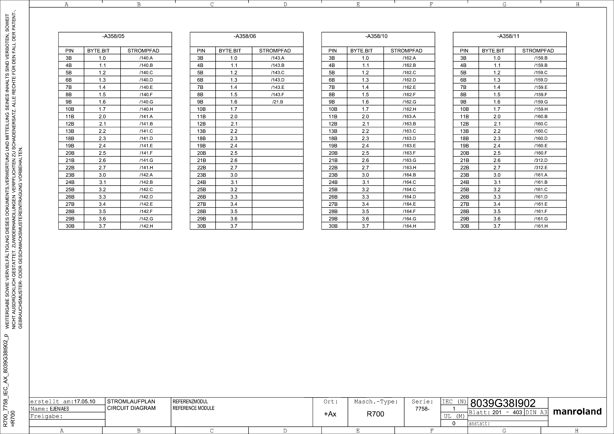

# +Ax — Sheet 201 of 403 — REFERENZMODUL

**REFERENCE MODULE**

> Part of the manroland **R700** printing press IEC/UL circuit diagrams.
> Drawing class: **Stromlaufplan / Circuit diagram** (DIN A3).
> Document `+Ax` covers the **Central control console** machine section.

## At a glance

| Field | Value |
|---|---|
| Document | `+Ax`  (8039G38I902) |
| Sheet | **201** of 403 |
| Section (DE) | REFERENZMODUL |
| Section (EN) | REFERENCE MODULE |
| Section type | REFERENCE_MODULE — Reference module |
| Machine type | `R700` |
| Series | `7758` |
| Created | 17.05.10 |
| Replaces | — |
| Columns used | A, B, C, D, E, F, G, H |
| Path numbers | — |
| Labels on sheet | 287 |
| Cross-refs out | 79 |
| Cross-refs in | 79 |

**Previous:** [+Ax sheet 200](SHEET_0200.md) · **Next:** [+Ax sheet 202](SHEET_0202.md) · **Document TOC:** [_TOC.md](_TOC.md)  (+Ax) · **Master TOC:** [all sheets](../_MASTER_TOC.md)

## Sheet image (300 DPI, exact vector render)



_Rendered directly from the PDF vector layer at 300 DPI (1-bit), no OCR and no resampling. Use it to confirm anything ambiguous in the text below._

## Cross-references on this sheet

Each entry is a wire leaving this sheet. The printed token is `/sheet.column`; the link resolves to that sheet inside the same document.

| Ref | Target sheet | Col | Path | Destination on target | Target section | From col |
|---|---|---|---|---|---|---|
| `/140.A` | [+Ax sheet 140](SHEET_0140.md) | A | — | — | ÜBERWACHUNGSRECHNER SICHERHEITSBUS | B |
| `/143.A` | [+Ax sheet 143](SHEET_0143.md) | A | — | — | ÜBERWACHUNGSRECHNER SICHERHEITSBUS | D |
| `/162.A` | [+Ax sheet 162](SHEET_0162.md) | A | — | — | ÜBERWACHUNGSRECHNER/ANSTEUERUNG NOT AUS | F |
| `/159.B` | [+Ax sheet 159](SHEET_0159.md) | B | — | — | ÜBERWACHUNGSRECHNER/ANSTEUERUNG NOT AUS | G |
| `/140.B` | [+Ax sheet 140](SHEET_0140.md) | B | — | — | ÜBERWACHUNGSRECHNER SICHERHEITSBUS | B |
| `/143.B` | [+Ax sheet 143](SHEET_0143.md) | B | — | — | ÜBERWACHUNGSRECHNER SICHERHEITSBUS | D |
| `/162.B` | [+Ax sheet 162](SHEET_0162.md) | B | — | — | ÜBERWACHUNGSRECHNER/ANSTEUERUNG NOT AUS | F |
| `/159.B` | [+Ax sheet 159](SHEET_0159.md) | B | — | — | ÜBERWACHUNGSRECHNER/ANSTEUERUNG NOT AUS | G |
| `/140.C` | [+Ax sheet 140](SHEET_0140.md) | C | — | — | ÜBERWACHUNGSRECHNER SICHERHEITSBUS | B |
| `/143.C` | [+Ax sheet 143](SHEET_0143.md) | C | — | — | ÜBERWACHUNGSRECHNER SICHERHEITSBUS | D |
| `/162.C` | [+Ax sheet 162](SHEET_0162.md) | C | — | — | ÜBERWACHUNGSRECHNER/ANSTEUERUNG NOT AUS | F |
| `/159.C` | [+Ax sheet 159](SHEET_0159.md) | C | — | — | ÜBERWACHUNGSRECHNER/ANSTEUERUNG NOT AUS | G |
| `/140.D` | [+Ax sheet 140](SHEET_0140.md) | D | — | — | ÜBERWACHUNGSRECHNER SICHERHEITSBUS | B |
| `/143.D` | [+Ax sheet 143](SHEET_0143.md) | D | — | — | ÜBERWACHUNGSRECHNER SICHERHEITSBUS | D |
| `/162.D` | [+Ax sheet 162](SHEET_0162.md) | D | — | — | ÜBERWACHUNGSRECHNER/ANSTEUERUNG NOT AUS | F |
| `/159.D` | [+Ax sheet 159](SHEET_0159.md) | D | — | — | ÜBERWACHUNGSRECHNER/ANSTEUERUNG NOT AUS | G |
| `/140.E` | [+Ax sheet 140](SHEET_0140.md) | E | — | — | ÜBERWACHUNGSRECHNER SICHERHEITSBUS | B |
| `/143.E` | [+Ax sheet 143](SHEET_0143.md) | E | — | — | ÜBERWACHUNGSRECHNER SICHERHEITSBUS | D |
| `/162.E` | [+Ax sheet 162](SHEET_0162.md) | E | — | — | ÜBERWACHUNGSRECHNER/ANSTEUERUNG NOT AUS | F |
| `/159.E` | [+Ax sheet 159](SHEET_0159.md) | E | — | — | ÜBERWACHUNGSRECHNER/ANSTEUERUNG NOT AUS | H |
| `/140.F` | [+Ax sheet 140](SHEET_0140.md) | F | — | — | ÜBERWACHUNGSRECHNER SICHERHEITSBUS | B |
| `/143.F` | [+Ax sheet 143](SHEET_0143.md) | F | — | — | ÜBERWACHUNGSRECHNER SICHERHEITSBUS | D |
| `/162.F` | [+Ax sheet 162](SHEET_0162.md) | F | — | — | ÜBERWACHUNGSRECHNER/ANSTEUERUNG NOT AUS | F |
| `/159.F` | [+Ax sheet 159](SHEET_0159.md) | F | — | — | ÜBERWACHUNGSRECHNER/ANSTEUERUNG NOT AUS | G |
| `/21.B` | [+Ax sheet 21](SHEET_0021.md) | B | — | — | SPANNUNGSVERSORGUNG, SCHALTSCHRANKBELÜFTUNG | D |
| `/140.G` | [+Ax sheet 140](SHEET_0140.md) | G | — | — | ÜBERWACHUNGSRECHNER SICHERHEITSBUS | B |
| `/162.G` | [+Ax sheet 162](SHEET_0162.md) | G | — | — | ÜBERWACHUNGSRECHNER/ANSTEUERUNG NOT AUS | F |
| `/159.G` | [+Ax sheet 159](SHEET_0159.md) | G | — | — | ÜBERWACHUNGSRECHNER/ANSTEUERUNG NOT AUS | H |
| `/140.H` | [+Ax sheet 140](SHEET_0140.md) | H | — | — | ÜBERWACHUNGSRECHNER SICHERHEITSBUS | B |
| `/162.H` | [+Ax sheet 162](SHEET_0162.md) | H | — | — | ÜBERWACHUNGSRECHNER/ANSTEUERUNG NOT AUS | F |
| `/159.H` | [+Ax sheet 159](SHEET_0159.md) | H | — | — | ÜBERWACHUNGSRECHNER/ANSTEUERUNG NOT AUS | H |
| `/141.A` | [+Ax sheet 141](SHEET_0141.md) | A | — | — | ÜBERWACHUNGSRECHNER SICHERHEITSBUS | B |
| `/163.A` | [+Ax sheet 163](SHEET_0163.md) | A | — | — | ÜBERWACHUNGSRECHNER/ANSTEUERUNG NOT AUS | F |
| `/160.B` | [+Ax sheet 160](SHEET_0160.md) | B | — | — | ÜBERWACHUNGSRECHNER/ANSTEUERUNG NOT AUS | G |
| `/141.B` | [+Ax sheet 141](SHEET_0141.md) | B | — | — | ÜBERWACHUNGSRECHNER SICHERHEITSBUS | B |
| `/163.B` | [+Ax sheet 163](SHEET_0163.md) | B | — | — | ÜBERWACHUNGSRECHNER/ANSTEUERUNG NOT AUS | F |
| `/160.C` | [+Ax sheet 160](SHEET_0160.md) | C | — | — | ÜBERWACHUNGSRECHNER/ANSTEUERUNG NOT AUS | G |
| `/141.C` | [+Ax sheet 141](SHEET_0141.md) | C | — | — | ÜBERWACHUNGSRECHNER SICHERHEITSBUS | B |
| `/163.C` | [+Ax sheet 163](SHEET_0163.md) | C | — | — | ÜBERWACHUNGSRECHNER/ANSTEUERUNG NOT AUS | F |
| `/160.C` | [+Ax sheet 160](SHEET_0160.md) | C | — | — | ÜBERWACHUNGSRECHNER/ANSTEUERUNG NOT AUS | G |
| `/141.D` | [+Ax sheet 141](SHEET_0141.md) | D | — | — | ÜBERWACHUNGSRECHNER SICHERHEITSBUS | B |
| `/163.D` | [+Ax sheet 163](SHEET_0163.md) | D | — | — | ÜBERWACHUNGSRECHNER/ANSTEUERUNG NOT AUS | F |
| `/160.D` | [+Ax sheet 160](SHEET_0160.md) | D | — | — | ÜBERWACHUNGSRECHNER/ANSTEUERUNG NOT AUS | G |
| `/141.E` | [+Ax sheet 141](SHEET_0141.md) | E | — | — | ÜBERWACHUNGSRECHNER SICHERHEITSBUS | B |
| `/163.E` | [+Ax sheet 163](SHEET_0163.md) | E | — | — | ÜBERWACHUNGSRECHNER/ANSTEUERUNG NOT AUS | F |
| `/160.E` | [+Ax sheet 160](SHEET_0160.md) | E | — | — | ÜBERWACHUNGSRECHNER/ANSTEUERUNG NOT AUS | H |
| `/141.F` | [+Ax sheet 141](SHEET_0141.md) | F | — | — | ÜBERWACHUNGSRECHNER SICHERHEITSBUS | B |
| `/163.F` | [+Ax sheet 163](SHEET_0163.md) | F | — | — | ÜBERWACHUNGSRECHNER/ANSTEUERUNG NOT AUS | F |
| `/160.F` | [+Ax sheet 160](SHEET_0160.md) | F | — | — | ÜBERWACHUNGSRECHNER/ANSTEUERUNG NOT AUS | G |
| `/141.G` | [+Ax sheet 141](SHEET_0141.md) | G | — | — | ÜBERWACHUNGSRECHNER SICHERHEITSBUS | B |
| `/163.G` | [+Ax sheet 163](SHEET_0163.md) | G | — | — | ÜBERWACHUNGSRECHNER/ANSTEUERUNG NOT AUS | F |
| `/312.D` | [+Ax sheet 312](SHEET_0312.md) | D | — | — | OPTION: IR/UV ZWISCHENTROCKNER | G |
| `/312.E` | [+Ax sheet 312](SHEET_0312.md) | E | — | — | OPTION: IR/UV ZWISCHENTROCKNER | H |
| `/141.H` | [+Ax sheet 141](SHEET_0141.md) | H | — | — | ÜBERWACHUNGSRECHNER SICHERHEITSBUS | B |
| `/163.H` | [+Ax sheet 163](SHEET_0163.md) | H | — | — | ÜBERWACHUNGSRECHNER/ANSTEUERUNG NOT AUS | F |
| `/142.A` | [+Ax sheet 142](SHEET_0142.md) | A | — | — | ÜBERWACHUNGSRECHNER SICHERHEITSBUS | B |
| `/164.B` | [+Ax sheet 164](SHEET_0164.md) | B | — | — | ÜBERWACHUNGSRECHNER/ANSTEUERUNG NOT AUS | F |
| `/161.A` | [+Ax sheet 161](SHEET_0161.md) | A | — | — | ÜBERWACHUNGSRECHNER/ANSTEUERUNG NOT AUS | G |
| `/142.B` | [+Ax sheet 142](SHEET_0142.md) | B | — | — | ÜBERWACHUNGSRECHNER SICHERHEITSBUS | B |
| `/161.B` | [+Ax sheet 161](SHEET_0161.md) | B | — | — | ÜBERWACHUNGSRECHNER/ANSTEUERUNG NOT AUS | G |
| `/164.C` | [+Ax sheet 164](SHEET_0164.md) | C | — | — | ÜBERWACHUNGSRECHNER/ANSTEUERUNG NOT AUS | F |
| `/142.C` | [+Ax sheet 142](SHEET_0142.md) | C | — | — | ÜBERWACHUNGSRECHNER SICHERHEITSBUS | B |
| `/164.C` | [+Ax sheet 164](SHEET_0164.md) | C | — | — | ÜBERWACHUNGSRECHNER/ANSTEUERUNG NOT AUS | F |
| `/161.C` | [+Ax sheet 161](SHEET_0161.md) | C | — | — | ÜBERWACHUNGSRECHNER/ANSTEUERUNG NOT AUS | G |
| `/142.D` | [+Ax sheet 142](SHEET_0142.md) | D | — | — | ÜBERWACHUNGSRECHNER SICHERHEITSBUS | B |
| `/164.D` | [+Ax sheet 164](SHEET_0164.md) | D | — | — | ÜBERWACHUNGSRECHNER/ANSTEUERUNG NOT AUS | F |
| `/161.D` | [+Ax sheet 161](SHEET_0161.md) | D | — | — | ÜBERWACHUNGSRECHNER/ANSTEUERUNG NOT AUS | G |
| `/142.E` | [+Ax sheet 142](SHEET_0142.md) | E | — | — | ÜBERWACHUNGSRECHNER SICHERHEITSBUS | B |
| `/164.E` | [+Ax sheet 164](SHEET_0164.md) | E | — | — | ÜBERWACHUNGSRECHNER/ANSTEUERUNG NOT AUS | F |
| `/161.E` | [+Ax sheet 161](SHEET_0161.md) | E | — | — | ÜBERWACHUNGSRECHNER/ANSTEUERUNG NOT AUS | H |
| `/142.F` | [+Ax sheet 142](SHEET_0142.md) | F | — | — | ÜBERWACHUNGSRECHNER SICHERHEITSBUS | B |
| `/164.F` | [+Ax sheet 164](SHEET_0164.md) | F | — | — | ÜBERWACHUNGSRECHNER/ANSTEUERUNG NOT AUS | F |
| `/161.F` | [+Ax sheet 161](SHEET_0161.md) | F | — | — | ÜBERWACHUNGSRECHNER/ANSTEUERUNG NOT AUS | G |
| `/142.G` | [+Ax sheet 142](SHEET_0142.md) | G | — | — | ÜBERWACHUNGSRECHNER SICHERHEITSBUS | B |
| `/164.G` | [+Ax sheet 164](SHEET_0164.md) | G | — | — | ÜBERWACHUNGSRECHNER/ANSTEUERUNG NOT AUS | F |
| `/161.G` | [+Ax sheet 161](SHEET_0161.md) | G | — | — | ÜBERWACHUNGSRECHNER/ANSTEUERUNG NOT AUS | H |
| `/142.H` | [+Ax sheet 142](SHEET_0142.md) | H | — | — | ÜBERWACHUNGSRECHNER SICHERHEITSBUS | B |
| `/164.H` | [+Ax sheet 164](SHEET_0164.md) | H | — | — | ÜBERWACHUNGSRECHNER/ANSTEUERUNG NOT AUS | F |
| `/161.H` | [+Ax sheet 161](SHEET_0161.md) | H | — | — | ÜBERWACHUNGSRECHNER/ANSTEUERUNG NOT AUS | H |

### Incoming references (sheets that point here)

Every other sheet that sends a wire to this one. `Back-ref` is the token printed on *that* sheet; `Path` is its line number.

| From sheet | Cols | Back-ref | Path | Refs | What continues there |
|---|---|---|---|---|---|
| [+Ax#21](SHEET_0021.md) | B | `/21.B` | — | 1 | — |
| [+Ax#140](SHEET_0140.md) | A, B, C, D, E, F, G, H | `/140.A`, `/140.B`, `/140.C`, `/140.D`, `/140.E`, `/140.F`, `/140.G`, `/140.H` | — | 8 | — |
| [+Ax#141](SHEET_0141.md) | A, B, C, D, E, F, G, H | `/141.A`, `/141.B`, `/141.C`, `/141.D`, `/141.E`, `/141.F`, `/141.G`, `/141.H` | — | 8 | — |
| [+Ax#142](SHEET_0142.md) | A, B, C, D, E, F, G, H | `/142.A`, `/142.B`, `/142.C`, `/142.D`, `/142.E`, `/142.F`, `/142.G`, `/142.H` | — | 8 | — |
| [+Ax#143](SHEET_0143.md) | A, B, C, D, E, F | `/143.A`, `/143.B`, `/143.C`, `/143.D`, `/143.E`, `/143.F` | — | 6 | — |
| [+Ax#159](SHEET_0159.md) | A, B, C, D, E, F, G, H | `/159.A`, `/159.B`, `/159.C`, `/159.D`, `/159.E`, `/159.F`, `/159.G`, `/159.H` | — | 8 | — |
| [+Ax#160](SHEET_0160.md) | B, C, D, E, F | `/160.B`, `/160.C`, `/160.D`, `/160.E`, `/160.F` | — | 6 | — |
| [+Ax#161](SHEET_0161.md) | A, B, C, D, E, F, G, H | `/161.A`, `/161.B`, `/161.C`, `/161.D`, `/161.E`, `/161.F`, `/161.G`, `/161.H` | — | 8 | — |
| [+Ax#162](SHEET_0162.md) | A, B, C, D, E, F, G, H | `/162.A`, `/162.B`, `/162.C`, `/162.D`, `/162.E`, `/162.F`, `/162.G`, `/162.H` | — | 8 | — |
| [+Ax#163](SHEET_0163.md) | A, B, C, D, E, F, G, H | `/163.A`, `/163.B`, `/163.C`, `/163.D`, `/163.E`, `/163.F`, `/163.G`, `/163.H` | — | 8 | — |
| [+Ax#164](SHEET_0164.md) | B, C, D, E, F, G, H | `/164.B`, `/164.C`, `/164.D`, `/164.E`, `/164.F`, `/164.G`, `/164.H` | — | 8 | — |
| [+Ax#312](SHEET_0312.md) | D, E | `/312.D`, `/312.E` | — | 2 | — |


## Devices on this sheet

| Tag | Class | Class meaning (IEC) | Col | Sub | Terminal | Sign |
|---|---|---|---|---|---|---|
| `A358/10` | A | Baugruppe / assembly, module, PC board | E | 10 | — | — |
| `A358/11` | A | Baugruppe / assembly, module, PC board | G | 11 | — | — |
| `A358/06` | A | Baugruppe / assembly, module, PC board | C | 06 | — | — |
| `A358/05` | A | Baugruppe / assembly, module, PC board | B | 05 | — | — |
| `1.0` | — | cross-device reference | E | — | — | — |
| `1.1` | — | cross-device reference | E | — | — | — |
| `1.2` | — | cross-device reference | E | — | — | — |
| `1.3` | — | cross-device reference | E | — | — | — |
| `1.4` | — | cross-device reference | E | — | — | — |
| `1.5` | — | cross-device reference | E | — | — | — |
| `1.6` | — | cross-device reference | E | — | — | — |
| `1.7` | — | cross-device reference | E | — | — | — |
| `2.0` | — | cross-device reference | E | — | — | — |
| `2.1` | — | cross-device reference | E | — | — | — |
| `2.2` | — | cross-device reference | E | — | — | — |
| `2.3` | — | cross-device reference | E | — | — | — |
| `2.4` | — | cross-device reference | E | — | — | — |
| `2.5` | — | cross-device reference | E | — | — | — |
| `2.6` | — | cross-device reference | E | — | — | — |
| `2.7` | — | cross-device reference | E | — | — | — |
| `3.0` | — | cross-device reference | E | — | — | — |
| `3.1` | — | cross-device reference | E | — | — | — |
| `3.2` | — | cross-device reference | E | — | — | — |
| `3.3` | — | cross-device reference | E | — | — | — |
| `3.4` | — | cross-device reference | E | — | — | — |
| `3.5` | — | cross-device reference | E | — | — | — |
| `3.6` | — | cross-device reference | E | — | — | — |
| `3.7` | — | cross-device reference | E | — | — | — |
| `1.0` | — | cross-device reference | G | — | — | — |
| `1.1` | — | cross-device reference | G | — | — | — |
| `1.2` | — | cross-device reference | G | — | — | — |
| `1.3` | — | cross-device reference | G | — | — | — |
| `1.4` | — | cross-device reference | G | — | — | — |
| `1.5` | — | cross-device reference | G | — | — | — |
| `1.6` | — | cross-device reference | G | — | — | — |
| `1.7` | — | cross-device reference | G | — | — | — |
| `2.0` | — | cross-device reference | G | — | — | — |
| `2.1` | — | cross-device reference | G | — | — | — |
| `2.2` | — | cross-device reference | G | — | — | — |
| `2.3` | — | cross-device reference | G | — | — | — |
| `2.4` | — | cross-device reference | G | — | — | — |
| `2.5` | — | cross-device reference | G | — | — | — |
| `2.6` | — | cross-device reference | G | — | — | — |
| `2.7` | — | cross-device reference | G | — | — | — |
| `3.0` | — | cross-device reference | G | — | — | — |
| `3.1` | — | cross-device reference | G | — | — | — |
| `3.2` | — | cross-device reference | G | — | — | — |
| `3.3` | — | cross-device reference | G | — | — | — |
| `3.4` | — | cross-device reference | G | — | — | — |
| `3.5` | — | cross-device reference | G | — | — | — |
| `3.6` | — | cross-device reference | G | — | — | — |
| `3.7` | — | cross-device reference | G | — | — | — |
| `1.0` | — | cross-device reference | C | — | — | — |
| `1.1` | — | cross-device reference | C | — | — | — |
| `1.2` | — | cross-device reference | C | — | — | — |
| `1.3` | — | cross-device reference | C | — | — | — |
| `1.4` | — | cross-device reference | C | — | — | — |
| `1.5` | — | cross-device reference | C | — | — | — |
| `1.6` | — | cross-device reference | C | — | — | — |
| `1.7` | — | cross-device reference | C | — | — | — |
| `2.0` | — | cross-device reference | C | — | — | — |
| `2.1` | — | cross-device reference | C | — | — | — |
| `2.2` | — | cross-device reference | C | — | — | — |
| `2.3` | — | cross-device reference | C | — | — | — |
| `2.4` | — | cross-device reference | C | — | — | — |
| `2.5` | — | cross-device reference | C | — | — | — |
| `2.6` | — | cross-device reference | C | — | — | — |
| `2.7` | — | cross-device reference | C | — | — | — |
| `3.0` | — | cross-device reference | C | — | — | — |
| `3.1` | — | cross-device reference | C | — | — | — |
| `3.2` | — | cross-device reference | C | — | — | — |
| `3.3` | — | cross-device reference | C | — | — | — |
| `3.4` | — | cross-device reference | C | — | — | — |
| `3.5` | — | cross-device reference | C | — | — | — |
| `3.6` | — | cross-device reference | C | — | — | — |
| `3.7` | — | cross-device reference | C | — | — | — |
| `1.0` | — | cross-device reference | A | — | — | — |
| `1.1` | — | cross-device reference | A | — | — | — |
| `1.2` | — | cross-device reference | A | — | — | — |
| `1.3` | — | cross-device reference | A | — | — | — |
| `1.4` | — | cross-device reference | A | — | — | — |
| `1.5` | — | cross-device reference | A | — | — | — |
| `1.6` | — | cross-device reference | A | — | — | — |
| `1.7` | — | cross-device reference | A | — | — | — |
| `2.0` | — | cross-device reference | A | — | — | — |
| `2.1` | — | cross-device reference | B | — | — | — |
| `2.2` | — | cross-device reference | A | — | — | — |
| `2.3` | — | cross-device reference | A | — | — | — |
| `2.4` | — | cross-device reference | A | — | — | — |
| `2.5` | — | cross-device reference | A | — | — | — |
| `2.6` | — | cross-device reference | A | — | — | — |
| `2.7` | — | cross-device reference | A | — | — | — |
| `3.0` | — | cross-device reference | A | — | — | — |
| `3.1` | — | cross-device reference | B | — | — | — |
| `3.2` | — | cross-device reference | A | — | — | — |
| `3.3` | — | cross-device reference | A | — | — | — |
| `3.4` | — | cross-device reference | A | — | — | — |
| `3.5` | — | cross-device reference | A | — | — | — |
| `3.6` | — | cross-device reference | A | — | — | — |
| `3.7` | — | cross-device reference | A | — | — | — |

## Potentials / nets

_No named potentials on this sheet._

## Wire-end annotations (grouped as printed)

A wire that continues elsewhere is annotated with a small cluster: the destination description, the path/line number `#NN`, and the `/sheet.column` cross reference. Each row below is one such cluster exactly as it is grouped on the drawing.

| Col | Y | Path | Cross-ref | Text on the wire |
|---|---|---|---|---|
| B | 65.5 | — | — | `A358/05` |
| C | 65.5 | — | — | `A358/06` |
| E | 65.5 | — | — | `A358/10` |
| G | 65.5 | — | — | `A358/11` |
| A | 94.2 | — | — | `PIN BYTE.BIT` |
| B | 94.2 | — | — | `STROMPFAD` |
| C | 94.2 | — | — | `PIN BYTE.BIT` |
| D | 94.2 | — | — | `STROMPFAD` |
| E | 94.2 | — | — | `PIN BYTE.BIT` |
| F | 94.2 | — | — | `STROMPFAD` |
| G | 94.2 | — | — | `PIN BYTE.BIT` |
| G | 94.2 | — | — | `STROMPFAD` |
| A | 108.3 | — | — | `10B 11B 12B 13B 18B 19B 3B 4B 5B 6B 7B 8B 9B 20B 21B 22B 23B 24B 25B 26B 27B 28B 29B 30B` |
| A | 108.3 | — | — | `1.0 1.2 1.3 1.4 1.5 1.6 1.7 2.0 2.2 2.3 2.4 2.5 2.6 2.7 3.0 3.2 3.3 3.4 3.5 3.6 3.7 1.1 2.1 3.1` |
| C | 108.3 | — | — | `10B 11B 12B 13B 18B 19B 3B 4B 5B 6B 7B 8B 9B 20B 21B 22B 23B 24B 25B 26B 27B 28B 29B 30B` |
| C | 108.3 | — | — | `1.0 1.2 1.3 1.4 1.5 1.6 1.7 2.0 2.2 2.3 2.4 2.5 2.6 2.7 3.0 3.2 3.3 3.4 3.5 3.6 3.7 1.1 2.1 3.1` |
| E | 108.3 | — | — | `10B 11B 12B 13B 18B 19B 3B 4B 5B 6B 7B 8B 9B 20B 21B 22B 23B 24B 25B 26B 27B 28B 29B 30B` |
| E | 108.3 | — | — | `1.0 1.2 1.3 1.4 1.5 1.6 1.7 2.0 2.2 2.3 2.4 2.5 2.6 2.7 3.0 3.2 3.3 3.4 3.5 3.6 3.7 1.1 2.1 3.1` |
| F | 108.3 | — | — | `10B 11B 12B 13B 18B 19B 3B 4B 5B 6B 7B 8B 9B 20B 21B 22B 23B 24B 25B 26B 27B 28B 29B 30B` |
| G | 108.3 | — | — | `1.0 1.2 1.3 1.4 1.5 1.6 1.7 2.0 2.2 2.3 2.4 2.5 2.6 2.7 3.0 3.2 3.3 3.4 3.5 3.6 3.7 1.1 2.1 3.1` |
| B | 108.7 | — | `/140.A` | — |
| D | 108.7 | — | `/143.A` | — |
| F | 108.7 | — | `/162.A` | — |
| G | 108.7 | — | `/159.B` | — |
| B | 122.9 | — | `/140.B` | — |
| D | 122.9 | — | `/143.B` | — |
| F | 122.9 | — | `/162.B` | — |
| G | 122.9 | — | `/159.B` | — |
| B | 137.1 | — | `/140.C` | — |
| D | 137.1 | — | `/143.C` | — |
| F | 137.1 | — | `/162.C` | — |
| G | 137.1 | — | `/159.C` | — |
| B | 151.2 | — | `/140.D` | — |
| D | 151.2 | — | `/143.D` | — |
| F | 151.2 | — | `/162.D` | — |
| G | 151.2 | — | `/159.D` | — |
| B | 165.4 | — | `/140.E` | — |
| D | 165.4 | — | `/143.E` | — |
| F | 165.4 | — | `/162.E` | — |
| H | 165.4 | — | `/159.E` | — |
| B | 179.6 | — | `/140.F` | — |
| D | 179.6 | — | `/143.F` | — |
| F | 179.6 | — | `/162.F` | — |
| G | 179.6 | — | `/159.F` | — |
| B | 193.7 | — | `/140.G` | — |
| D | 193.7 | — | `/21.B` | — |
| F | 193.7 | — | `/162.G` | — |
| H | 193.7 | — | `/159.G` | — |
| B | 207.9 | — | `/140.H` | — |
| F | 207.9 | — | `/162.H` | — |
| H | 207.9 | — | `/159.H` | — |
| B | 222.1 | — | `/141.A` | — |
| F | 222.1 | — | `/163.A` | — |
| G | 222.1 | — | `/160.B` | — |
| B | 236.2 | — | `/141.B` | — |
| F | 236.2 | — | `/163.B` | — |
| G | 236.3 | — | `/160.C` | — |
| B | 250.4 | — | `/141.C` | — |
| F | 250.4 | — | `/163.C` | — |
| G | 250.4 | — | `/160.C` | — |
| B | 264.6 | — | `/141.D` | — |
| F | 264.6 | — | `/163.D` | — |
| G | 264.6 | — | `/160.D` | — |
| B | 278.8 | — | `/141.E` | — |
| F | 278.8 | — | `/163.E` | — |
| H | 278.8 | — | `/160.E` | — |
| B | 292.9 | — | `/141.F` | — |
| F | 292.9 | — | `/163.F` | — |
| G | 292.9 | — | `/160.F` | — |
| B | 307.1 | — | `/141.G` | — |
| F | 307.1 | — | `/163.G` | — |
| G | 307.1 | — | `/312.D` | — |
| B | 321.3 | — | `/141.H` | — |
| F | 321.3 | — | `/163.H` | — |
| H | 321.3 | — | `/312.E` | — |
| B | 335.5 | — | `/142.A` | — |
| F | 335.5 | — | `/164.B` | — |
| G | 335.5 | — | `/161.A` | — |
| B | 349.6 | — | `/142.B` | — |
| G | 349.6 | — | `/161.B` | — |
| F | 349.7 | — | `/164.C` | — |
| B | 363.8 | — | `/142.C` | — |
| F | 363.8 | — | `/164.C` | — |
| G | 363.8 | — | `/161.C` | — |
| B | 378.0 | — | `/142.D` | — |
| F | 378.0 | — | `/164.D` | — |
| G | 378.0 | — | `/161.D` | — |
| B | 392.1 | — | `/142.E` | — |
| F | 392.1 | — | `/164.E` | — |
| H | 392.1 | — | `/161.E` | — |
| B | 406.3 | — | `/142.F` | — |
| F | 406.3 | — | `/164.F` | — |
| G | 406.3 | — | `/161.F` | — |
| B | 420.5 | — | `/142.G` | — |
| F | 420.5 | — | `/164.G` | — |
| H | 420.5 | — | `/161.G` | — |
| B | 434.7 | — | `/142.H` | — |
| F | 434.7 | — | `/164.H` | — |
| H | 434.7 | — | `/161.H` | — |


## Reconstructed tables

This sheet carries tabular content (pin map / terminal assignment / index). The grid below was rebuilt from the drawing's own rule lines, so each row is exactly one physical row of the table.

### Table 1 — 24 data rows × 3 columns (at x=113.4, y=62.4) — **A358/05**

| PIN | BYTE.BIT | STROMPFAD |
|---|---|---|
| `3B` | `1.0` | `/140.A` |
| `4B` | `1.1` | `/140.B` |
| `5B` | `1.2` | `/140.C` |
| `6B` | `1.3` | `/140.D` |
| `7B` | `1.4` | `/140.E` |
| `8B` | `1.5` | `/140.F` |
| `9B` | `1.6` | `/140.G` |
| `10B` | `1.7` | `/140.H` |
| `11B` | `2.0` | `/141.A` |
| `12B` | `2.1` | `/141.B` |
| `13B` | `2.2` | `/141.C` |
| `18B` | `2.3` | `/141.D` |
| `19B` | `2.4` | `/141.E` |
| `20B` | `2.5` | `/141.F` |
| `21B` | `2.6` | `/141.G` |
| `22B` | `2.7` | `/141.H` |
| `23B` | `3.0` | `/142.A` |
| `24B` | `3.1` | `/142.B` |
| `25B` | `3.2` | `/142.C` |
| `26B` | `3.3` | `/142.D` |
| `27B` | `3.4` | `/142.E` |
| `28B` | `3.5` | `/142.F` |
| `29B` | `3.6` | `/142.G` |
| `30B` | `3.7` | `/142.H` |


### Table 2 — 24 data rows × 3 columns (at x=368.5, y=62.4) — **A358/06**

| PIN | BYTE.BIT | STROMPFAD |
|---|---|---|
| `3B` | `1.0` | `/143.A` |
| `4B` | `1.1` | `/143.B` |
| `5B` | `1.2` | `/143.C` |
| `6B` | `1.3` | `/143.D` |
| `7B` | `1.4` | `/143.E` |
| `8B` | `1.5` | `/143.F` |
| `9B` | `1.6` | `/21.B` |
| `10B` | `1.7` |  |
| `11B` | `2.0` |  |
| `12B` | `2.1` |  |
| `13B` | `2.2` |  |
| `18B` | `2.3` |  |
| `19B` | `2.4` |  |
| `20B` | `2.5` |  |
| `21B` | `2.6` |  |
| `22B` | `2.7` |  |
| `23B` | `3.0` |  |
| `24B` | `3.1` |  |
| `25B` | `3.2` |  |
| `26B` | `3.3` |  |
| `27B` | `3.4` |  |
| `28B` | `3.5` |  |
| `29B` | `3.6` |  |
| `30B` | `3.7` |  |


### Table 3 — 24 data rows × 3 columns (at x=623.6, y=62.4) — **A358/10**

| PIN | BYTE.BIT | STROMPFAD |
|---|---|---|
| `3B` | `1.0` | `/162.A` |
| `4B` | `1.1` | `/162.B` |
| `5B` | `1.2` | `/162.C` |
| `6B` | `1.3` | `/162.D` |
| `7B` | `1.4` | `/162.E` |
| `8B` | `1.5` | `/162.F` |
| `9B` | `1.6` | `/162.G` |
| `10B` | `1.7` | `/162.H` |
| `11B` | `2.0` | `/163.A` |
| `12B` | `2.1` | `/163.B` |
| `13B` | `2.2` | `/163.C` |
| `18B` | `2.3` | `/163.D` |
| `19B` | `2.4` | `/163.E` |
| `20B` | `2.5` | `/163.F` |
| `21B` | `2.6` | `/163.G` |
| `22B` | `2.7` | `/163.H` |
| `23B` | `3.0` | `/164.B` |
| `24B` | `3.1` | `/164.C` |
| `25B` | `3.2` | `/164.C` |
| `26B` | `3.3` | `/164.D` |
| `27B` | `3.4` | `/164.E` |
| `28B` | `3.5` | `/164.F` |
| `29B` | `3.6` | `/164.G` |
| `30B` | `3.7` | `/164.H` |


### Table 4 — 24 data rows × 3 columns (at x=878.7, y=62.4) — **A358/11**

| PIN | BYTE.BIT | STROMPFAD |
|---|---|---|
| `3B` | `1.0` | `/159.B` |
| `4B` | `1.1` | `/159.B` |
| `5B` | `1.2` | `/159.C` |
| `6B` | `1.3` | `/159.D` |
| `7B` | `1.4` | `/159.E` |
| `8B` | `1.5` | `/159.F` |
| `9B` | `1.6` | `/159.G` |
| `10B` | `1.7` | `/159.H` |
| `11B` | `2.0` | `/160.B` |
| `12B` | `2.1` | `/160.C` |
| `13B` | `2.2` | `/160.C` |
| `18B` | `2.3` | `/160.D` |
| `19B` | `2.4` | `/160.E` |
| `20B` | `2.5` | `/160.F` |
| `21B` | `2.6` | `/312.D` |
| `22B` | `2.7` | `/312.E` |
| `23B` | `3.0` | `/161.A` |
| `24B` | `3.1` | `/161.B` |
| `25B` | `3.2` | `/161.C` |
| `26B` | `3.3` | `/161.D` |
| `27B` | `3.4` | `/161.E` |
| `28B` | `3.5` | `/161.F` |
| `29B` | `3.6` | `/161.G` |
| `30B` | `3.7` | `/161.H` |


## Notes and free text on this sheet

| Text | Col | Y (pt) |
|---|---|---|
| `3B` | E | 108.35 |
| `4B` | E | 122.53 |
| `5B` | E | 136.7 |
| `6B` | E | 150.87 |
| `7B` | E | 165.05 |
| `8B` | E | 179.22 |
| `9B` | E | 193.39 |
| `10B` | E | 207.57 |
| `11B` | E | 221.74 |
| `12B` | E | 235.92 |
| `13B` | E | 250.09 |
| `18B` | E | 264.26 |
| `19B` | E | 278.44 |
| `20B` | E | 292.61 |
| `21B` | E | 306.78 |
| `22B` | E | 320.96 |
| `23B` | E | 335.13 |
| `24B` | E | 349.3 |
| `25B` | E | 363.48 |
| `26B` | E | 377.65 |
| `27B` | E | 391.82 |
| `28B` | E | 406 |
| `29B` | E | 420.17 |
| `30B` | E | 434.34 |
| `PIN` | E | 94.2 |
| `BYTE.BIT` | E | 94.17 |
| `STROMPFAD` | F | 94.15 |
| `3B` | F | 108.35 |
| `4B` | F | 122.53 |
| `5B` | F | 136.7 |
| `6B` | F | 150.87 |
| `7B` | F | 165.05 |
| `8B` | F | 179.22 |
| `9B` | F | 193.39 |
| `10B` | F | 207.57 |
| `11B` | F | 221.74 |
| `12B` | F | 235.92 |
| `13B` | F | 250.09 |
| `18B` | F | 264.26 |
| `19B` | F | 278.44 |
| `20B` | F | 292.61 |
| `21B` | F | 306.78 |
| `22B` | F | 320.96 |
| `23B` | F | 335.13 |
| `24B` | F | 349.3 |
| `25B` | F | 363.48 |
| `26B` | F | 377.65 |
| `27B` | F | 391.82 |
| `28B` | F | 406 |
| `29B` | F | 420.17 |
| `30B` | F | 434.34 |
| `PIN` | F | 94.2 |
| `BYTE.BIT` | G | 94.17 |
| `STROMPFAD` | G | 94.15 |
| `3B` | C | 108.35 |
| `4B` | C | 122.53 |
| `5B` | C | 136.7 |
| `6B` | C | 150.87 |
| `7B` | C | 165.05 |
| `8B` | C | 179.22 |
| `9B` | C | 193.39 |
| `10B` | C | 207.57 |
| `11B` | C | 221.74 |
| `12B` | C | 235.92 |
| `13B` | C | 250.09 |
| `18B` | C | 264.26 |
| `19B` | C | 278.44 |
| `20B` | C | 292.61 |
| `21B` | C | 306.78 |
| `22B` | C | 320.96 |
| `23B` | C | 335.13 |
| `24B` | C | 349.3 |
| `25B` | C | 363.48 |
| `26B` | C | 377.65 |
| `27B` | C | 391.82 |
| `28B` | C | 406 |
| `29B` | C | 420.17 |
| `30B` | C | 434.34 |
| `PIN` | C | 94.2 |
| `BYTE.BIT` | C | 94.17 |
| `STROMPFAD` | D | 94.15 |
| `3B` | A | 108.35 |
| `4B` | A | 122.53 |
| `5B` | A | 136.7 |
| `6B` | A | 150.87 |
| `7B` | A | 165.05 |
| `8B` | A | 179.22 |
| `9B` | A | 193.39 |
| `10B` | A | 207.57 |
| `11B` | A | 221.74 |
| `12B` | A | 235.92 |
| `13B` | A | 250.09 |
| `18B` | A | 264.26 |
| `19B` | A | 278.44 |
| `20B` | A | 292.61 |
| `21B` | A | 306.78 |
| `22B` | A | 320.96 |
| `23B` | A | 335.13 |
| `24B` | A | 349.3 |
| `25B` | A | 363.48 |
| `26B` | A | 377.65 |
| `27B` | A | 391.82 |
| `28B` | A | 406 |
| `29B` | A | 420.17 |
| `30B` | A | 434.34 |
| `PIN` | A | 94.2 |
| `BYTE.BIT` | A | 94.17 |
| `STROMPFAD` | B | 94.15 |

## Complete label inventory (exact text from the drawing)

Every text object inside the drawing area of this sheet, in DIN reading order (column A→H, then top→bottom). This is the authoritative list: if a string is not here it is not printed on this sheet.

| Col | Y | X | Dir | Type | Text |
|---|---|---|---|---|---|
| A | 94.2 | 126.7 | → | text | `PIN` |
| A | 94.2 | 169.2 | → | text | `BYTE.BIT` |
| A | 108.3 | 191.3 | → | device ref | `1.0` |
| A | 108.4 | 127.3 | → | text | `3B` |
| A | 122.5 | 127.3 | → | text | `4B` |
| A | 122.5 | 192.2 | → | device ref | `1.1` |
| A | 136.7 | 127.3 | → | text | `5B` |
| A | 136.7 | 191.3 | → | device ref | `1.2` |
| A | 150.9 | 127.3 | → | text | `6B` |
| A | 150.9 | 191.3 | → | device ref | `1.3` |
| A | 165.0 | 127.3 | → | text | `7B` |
| A | 165.0 | 191.3 | → | device ref | `1.4` |
| A | 179.2 | 127.3 | → | text | `8B` |
| A | 179.2 | 191.3 | → | device ref | `1.5` |
| A | 193.4 | 127.3 | → | text | `9B` |
| A | 193.4 | 191.3 | → | device ref | `1.6` |
| A | 207.5 | 191.3 | → | device ref | `1.7` |
| A | 207.6 | 126.7 | → | text | `10B` |
| A | 221.7 | 126.7 | → | text | `11B` |
| A | 221.7 | 191.6 | → | device ref | `2.0` |
| A | 235.9 | 126.7 | → | text | `12B` |
| A | 250.1 | 126.7 | → | text | `13B` |
| A | 250.1 | 191.6 | → | device ref | `2.2` |
| A | 264.2 | 191.6 | → | device ref | `2.3` |
| A | 264.3 | 126.7 | → | text | `18B` |
| A | 278.4 | 126.7 | → | text | `19B` |
| A | 278.4 | 191.6 | → | device ref | `2.4` |
| A | 292.6 | 127.3 | → | text | `20B` |
| A | 292.6 | 191.6 | → | device ref | `2.5` |
| A | 306.8 | 127.3 | → | text | `21B` |
| A | 306.8 | 191.6 | → | device ref | `2.6` |
| A | 320.9 | 191.6 | → | device ref | `2.7` |
| A | 321.0 | 127.3 | → | text | `22B` |
| A | 335.1 | 127.3 | → | text | `23B` |
| A | 335.1 | 191.6 | → | device ref | `3.0` |
| A | 349.3 | 127.3 | → | text | `24B` |
| A | 363.5 | 127.3 | → | text | `25B` |
| A | 363.5 | 191.6 | → | device ref | `3.2` |
| A | 377.6 | 127.3 | → | text | `26B` |
| A | 377.6 | 191.6 | → | device ref | `3.3` |
| A | 391.8 | 127.3 | → | text | `27B` |
| A | 391.8 | 191.6 | → | device ref | `3.4` |
| A | 406.0 | 127.3 | → | text | `28B` |
| A | 406.0 | 191.6 | → | device ref | `3.5` |
| A | 420.1 | 191.6 | → | device ref | `3.6` |
| A | 420.2 | 127.3 | → | text | `29B` |
| A | 434.3 | 127.3 | → | text | `30B` |
| A | 434.3 | 191.6 | → | device ref | `3.7` |
| B | 65.5 | 198.3 | → | device tag | `A358/05` |
| B | 94.2 | 247.5 | → | text | `STROMPFAD` |
| B | 108.7 | 270.7 | → | cross-reference | `/140.A` |
| B | 122.9 | 270.9 | → | cross-reference | `/140.B` |
| B | 137.1 | 270.7 | → | cross-reference | `/140.C` |
| B | 151.2 | 270.7 | → | cross-reference | `/140.D` |
| B | 165.4 | 271.0 | → | cross-reference | `/140.E` |
| B | 179.6 | 271.1 | → | cross-reference | `/140.F` |
| B | 193.7 | 270.6 | → | cross-reference | `/140.G` |
| B | 207.9 | 271.0 | → | cross-reference | `/140.H` |
| B | 222.1 | 270.7 | → | cross-reference | `/141.A` |
| B | 235.9 | 192.5 | → | device ref | `2.1` |
| B | 236.2 | 270.9 | → | cross-reference | `/141.B` |
| B | 250.4 | 270.7 | → | cross-reference | `/141.C` |
| B | 264.6 | 270.7 | → | cross-reference | `/141.D` |
| B | 278.8 | 271.0 | → | cross-reference | `/141.E` |
| B | 293.0 | 271.1 | → | cross-reference | `/141.F` |
| B | 307.1 | 270.6 | → | cross-reference | `/141.G` |
| B | 321.3 | 271.0 | → | cross-reference | `/141.H` |
| B | 335.5 | 270.7 | → | cross-reference | `/142.A` |
| B | 349.3 | 192.5 | → | device ref | `3.1` |
| B | 349.6 | 270.9 | → | cross-reference | `/142.B` |
| B | 363.8 | 270.7 | → | cross-reference | `/142.C` |
| B | 378.0 | 270.7 | → | cross-reference | `/142.D` |
| B | 392.2 | 271.0 | → | cross-reference | `/142.E` |
| B | 406.3 | 271.1 | → | cross-reference | `/142.F` |
| B | 420.5 | 270.6 | → | cross-reference | `/142.G` |
| B | 434.7 | 271.0 | → | cross-reference | `/142.H` |
| C | 65.5 | 453.4 | → | device tag | `A358/06` |
| C | 94.2 | 381.8 | → | text | `PIN` |
| C | 94.2 | 424.3 | → | text | `BYTE.BIT` |
| C | 108.3 | 446.5 | → | device ref | `1.0` |
| C | 108.4 | 382.4 | → | text | `3B` |
| C | 122.5 | 382.4 | → | text | `4B` |
| C | 122.5 | 447.3 | → | device ref | `1.1` |
| C | 136.7 | 382.4 | → | text | `5B` |
| C | 136.7 | 446.5 | → | device ref | `1.2` |
| C | 150.9 | 382.4 | → | text | `6B` |
| C | 150.9 | 446.5 | → | device ref | `1.3` |
| C | 165.0 | 382.4 | → | text | `7B` |
| C | 165.0 | 446.5 | → | device ref | `1.4` |
| C | 179.2 | 382.4 | → | text | `8B` |
| C | 179.2 | 446.5 | → | device ref | `1.5` |
| C | 193.4 | 382.4 | → | text | `9B` |
| C | 193.4 | 446.5 | → | device ref | `1.6` |
| C | 207.5 | 446.5 | → | device ref | `1.7` |
| C | 207.6 | 381.8 | → | text | `10B` |
| C | 221.7 | 381.8 | → | text | `11B` |
| C | 221.7 | 446.7 | → | device ref | `2.0` |
| C | 235.9 | 381.8 | → | text | `12B` |
| C | 235.9 | 447.6 | → | device ref | `2.1` |
| C | 250.1 | 381.8 | → | text | `13B` |
| C | 250.1 | 446.7 | → | device ref | `2.2` |
| C | 264.2 | 446.7 | → | device ref | `2.3` |
| C | 264.3 | 381.8 | → | text | `18B` |
| C | 278.4 | 381.8 | → | text | `19B` |
| C | 278.4 | 446.7 | → | device ref | `2.4` |
| C | 292.6 | 382.4 | → | text | `20B` |
| C | 292.6 | 446.7 | → | device ref | `2.5` |
| C | 306.8 | 382.4 | → | text | `21B` |
| C | 306.8 | 446.7 | → | device ref | `2.6` |
| C | 320.9 | 446.7 | → | device ref | `2.7` |
| C | 321.0 | 382.4 | → | text | `22B` |
| C | 335.1 | 382.4 | → | text | `23B` |
| C | 335.1 | 446.7 | → | device ref | `3.0` |
| C | 349.3 | 382.4 | → | text | `24B` |
| C | 349.3 | 447.6 | → | device ref | `3.1` |
| C | 363.5 | 382.4 | → | text | `25B` |
| C | 363.5 | 446.7 | → | device ref | `3.2` |
| C | 377.6 | 382.4 | → | text | `26B` |
| C | 377.6 | 446.7 | → | device ref | `3.3` |
| C | 391.8 | 382.4 | → | text | `27B` |
| C | 391.8 | 446.7 | → | device ref | `3.4` |
| C | 406.0 | 382.4 | → | text | `28B` |
| C | 406.0 | 446.7 | → | device ref | `3.5` |
| C | 420.1 | 446.7 | → | device ref | `3.6` |
| C | 420.2 | 382.4 | → | text | `29B` |
| C | 434.3 | 382.4 | → | text | `30B` |
| C | 434.3 | 446.7 | → | device ref | `3.7` |
| D | 94.2 | 502.6 | → | text | `STROMPFAD` |
| D | 108.7 | 525.8 | → | cross-reference | `/143.A` |
| D | 122.9 | 526.0 | → | cross-reference | `/143.B` |
| D | 137.1 | 525.8 | → | cross-reference | `/143.C` |
| D | 151.2 | 525.8 | → | cross-reference | `/143.D` |
| D | 165.4 | 526.1 | → | cross-reference | `/143.E` |
| D | 179.6 | 526.3 | → | cross-reference | `/143.F` |
| D | 193.7 | 528.4 | → | cross-reference | `/21.B` |
| E | 65.5 | 708.5 | → | device tag | `A358/10` |
| E | 94.2 | 636.9 | → | text | `PIN` |
| E | 94.2 | 679.5 | → | text | `BYTE.BIT` |
| E | 108.3 | 701.6 | → | device ref | `1.0` |
| E | 108.4 | 637.5 | → | text | `3B` |
| E | 122.5 | 637.5 | → | text | `4B` |
| E | 122.5 | 702.4 | → | device ref | `1.1` |
| E | 136.7 | 637.5 | → | text | `5B` |
| E | 136.7 | 701.6 | → | device ref | `1.2` |
| E | 150.9 | 637.5 | → | text | `6B` |
| E | 150.9 | 701.6 | → | device ref | `1.3` |
| E | 165.0 | 637.5 | → | text | `7B` |
| E | 165.0 | 701.6 | → | device ref | `1.4` |
| E | 179.2 | 637.5 | → | text | `8B` |
| E | 179.2 | 701.6 | → | device ref | `1.5` |
| E | 193.4 | 637.5 | → | text | `9B` |
| E | 193.4 | 701.6 | → | device ref | `1.6` |
| E | 207.5 | 701.6 | → | device ref | `1.7` |
| E | 207.6 | 636.9 | → | text | `10B` |
| E | 221.7 | 636.9 | → | text | `11B` |
| E | 221.7 | 701.9 | → | device ref | `2.0` |
| E | 235.9 | 636.9 | → | text | `12B` |
| E | 235.9 | 702.7 | → | device ref | `2.1` |
| E | 250.1 | 636.9 | → | text | `13B` |
| E | 250.1 | 701.9 | → | device ref | `2.2` |
| E | 264.2 | 701.9 | → | device ref | `2.3` |
| E | 264.3 | 636.9 | → | text | `18B` |
| E | 278.4 | 636.9 | → | text | `19B` |
| E | 278.4 | 701.9 | → | device ref | `2.4` |
| E | 292.6 | 637.5 | → | text | `20B` |
| E | 292.6 | 701.9 | → | device ref | `2.5` |
| E | 306.8 | 637.5 | → | text | `21B` |
| E | 306.8 | 701.9 | → | device ref | `2.6` |
| E | 320.9 | 701.9 | → | device ref | `2.7` |
| E | 321.0 | 637.5 | → | text | `22B` |
| E | 335.1 | 637.5 | → | text | `23B` |
| E | 335.1 | 701.9 | → | device ref | `3.0` |
| E | 349.3 | 637.5 | → | text | `24B` |
| E | 349.3 | 702.7 | → | device ref | `3.1` |
| E | 363.5 | 637.5 | → | text | `25B` |
| E | 363.5 | 701.9 | → | device ref | `3.2` |
| E | 377.6 | 637.5 | → | text | `26B` |
| E | 377.6 | 701.9 | → | device ref | `3.3` |
| E | 391.8 | 637.5 | → | text | `27B` |
| E | 391.8 | 701.9 | → | device ref | `3.4` |
| E | 406.0 | 637.5 | → | text | `28B` |
| E | 406.0 | 701.9 | → | device ref | `3.5` |
| E | 420.1 | 701.9 | → | device ref | `3.6` |
| E | 420.2 | 637.5 | → | text | `29B` |
| E | 434.3 | 637.5 | → | text | `30B` |
| E | 434.3 | 701.9 | → | device ref | `3.7` |
| F | 94.2 | 757.7 | → | text | `STROMPFAD` |
| F | 94.2 | 892.1 | → | text | `PIN` |
| F | 108.4 | 892.6 | → | text | `3B` |
| F | 108.7 | 780.9 | → | cross-reference | `/162.A` |
| F | 122.5 | 892.6 | → | text | `4B` |
| F | 122.9 | 781.1 | → | cross-reference | `/162.B` |
| F | 136.7 | 892.6 | → | text | `5B` |
| F | 137.1 | 780.9 | → | cross-reference | `/162.C` |
| F | 150.9 | 892.6 | → | text | `6B` |
| F | 151.2 | 780.9 | → | cross-reference | `/162.D` |
| F | 165.0 | 892.6 | → | text | `7B` |
| F | 165.4 | 781.2 | → | cross-reference | `/162.E` |
| F | 179.2 | 892.6 | → | text | `8B` |
| F | 179.6 | 781.4 | → | cross-reference | `/162.F` |
| F | 193.4 | 892.6 | → | text | `9B` |
| F | 193.7 | 780.8 | → | cross-reference | `/162.G` |
| F | 207.6 | 892.1 | → | text | `10B` |
| F | 207.9 | 781.2 | → | cross-reference | `/162.H` |
| F | 221.7 | 892.1 | → | text | `11B` |
| F | 222.1 | 780.9 | → | cross-reference | `/163.A` |
| F | 235.9 | 892.1 | → | text | `12B` |
| F | 236.2 | 781.1 | → | cross-reference | `/163.B` |
| F | 250.1 | 892.1 | → | text | `13B` |
| F | 250.4 | 780.9 | → | cross-reference | `/163.C` |
| F | 264.3 | 892.1 | → | text | `18B` |
| F | 264.6 | 780.9 | → | cross-reference | `/163.D` |
| F | 278.4 | 892.1 | → | text | `19B` |
| F | 278.8 | 781.2 | → | cross-reference | `/163.E` |
| F | 292.6 | 892.6 | → | text | `20B` |
| F | 293.0 | 781.4 | → | cross-reference | `/163.F` |
| F | 306.8 | 892.6 | → | text | `21B` |
| F | 307.1 | 780.8 | → | cross-reference | `/163.G` |
| F | 321.0 | 892.6 | → | text | `22B` |
| F | 321.3 | 781.2 | → | cross-reference | `/163.H` |
| F | 335.1 | 892.6 | → | text | `23B` |
| F | 335.5 | 781.1 | → | cross-reference | `/164.B` |
| F | 349.3 | 892.6 | → | text | `24B` |
| F | 349.7 | 780.9 | → | cross-reference | `/164.C` |
| F | 363.5 | 892.6 | → | text | `25B` |
| F | 363.8 | 780.9 | → | cross-reference | `/164.C` |
| F | 377.6 | 892.6 | → | text | `26B` |
| F | 378.0 | 780.9 | → | cross-reference | `/164.D` |
| F | 391.8 | 892.6 | → | text | `27B` |
| F | 392.2 | 781.2 | → | cross-reference | `/164.E` |
| F | 406.0 | 892.6 | → | text | `28B` |
| F | 406.3 | 781.4 | → | cross-reference | `/164.F` |
| F | 420.2 | 892.6 | → | text | `29B` |
| F | 420.5 | 780.8 | → | cross-reference | `/164.G` |
| F | 434.3 | 892.6 | → | text | `30B` |
| F | 434.7 | 781.2 | → | cross-reference | `/164.H` |
| G | 65.5 | 964.3 | → | device tag | `A358/11` |
| G | 94.2 | 934.6 | → | text | `BYTE.BIT` |
| G | 94.2 | 1012.8 | → | text | `STROMPFAD` |
| G | 108.3 | 956.7 | → | device ref | `1.0` |
| G | 108.7 | 1036.2 | → | cross-reference | `/159.B` |
| G | 122.5 | 957.5 | → | device ref | `1.1` |
| G | 122.9 | 1036.2 | → | cross-reference | `/159.B` |
| G | 136.7 | 956.7 | → | device ref | `1.2` |
| G | 137.1 | 1036.1 | → | cross-reference | `/159.C` |
| G | 150.9 | 956.7 | → | device ref | `1.3` |
| G | 151.2 | 1036.1 | → | cross-reference | `/159.D` |
| G | 165.0 | 956.7 | → | device ref | `1.4` |
| G | 179.2 | 956.7 | → | device ref | `1.5` |
| G | 179.6 | 1036.5 | → | cross-reference | `/159.F` |
| G | 193.4 | 956.7 | → | device ref | `1.6` |
| G | 207.5 | 956.7 | → | device ref | `1.7` |
| G | 221.7 | 957.0 | → | device ref | `2.0` |
| G | 222.1 | 1036.2 | → | cross-reference | `/160.B` |
| G | 235.9 | 957.8 | → | device ref | `2.1` |
| G | 236.3 | 1036.1 | → | cross-reference | `/160.C` |
| G | 250.1 | 957.0 | → | device ref | `2.2` |
| G | 250.4 | 1036.1 | → | cross-reference | `/160.C` |
| G | 264.2 | 957.0 | → | device ref | `2.3` |
| G | 264.6 | 1036.1 | → | cross-reference | `/160.D` |
| G | 278.4 | 957.0 | → | device ref | `2.4` |
| G | 292.6 | 957.0 | → | device ref | `2.5` |
| G | 293.0 | 1036.5 | → | cross-reference | `/160.F` |
| G | 306.8 | 957.0 | → | device ref | `2.6` |
| G | 307.1 | 1036.1 | → | cross-reference | `/312.D` |
| G | 320.9 | 957.0 | → | device ref | `2.7` |
| G | 335.1 | 957.0 | → | device ref | `3.0` |
| G | 335.5 | 1036.1 | → | cross-reference | `/161.A` |
| G | 349.3 | 957.8 | → | device ref | `3.1` |
| G | 349.6 | 1036.2 | → | cross-reference | `/161.B` |
| G | 363.5 | 957.0 | → | device ref | `3.2` |
| G | 363.8 | 1036.1 | → | cross-reference | `/161.C` |
| G | 377.6 | 957.0 | → | device ref | `3.3` |
| G | 378.0 | 1036.1 | → | cross-reference | `/161.D` |
| G | 391.8 | 957.0 | → | device ref | `3.4` |
| G | 406.0 | 957.0 | → | device ref | `3.5` |
| G | 406.3 | 1036.5 | → | cross-reference | `/161.F` |
| G | 420.1 | 957.0 | → | device ref | `3.6` |
| G | 434.3 | 957.0 | → | device ref | `3.7` |
| H | 165.4 | 1036.3 | → | cross-reference | `/159.E` |
| H | 193.7 | 1035.9 | → | cross-reference | `/159.G` |
| H | 207.9 | 1036.3 | → | cross-reference | `/159.H` |
| H | 278.8 | 1036.3 | → | cross-reference | `/160.E` |
| H | 321.3 | 1036.3 | → | cross-reference | `/312.E` |
| H | 392.2 | 1036.3 | → | cross-reference | `/161.E` |
| H | 420.5 | 1035.9 | → | cross-reference | `/161.G` |
| H | 434.7 | 1036.3 | → | cross-reference | `/161.H` |

## Reading-order text block

The same content as a plain block, grouped by DIN column — convenient to paste or to match against a visual description.

```text
=== Column A ===
  94.2  126.7  text         PIN
  94.2  169.2  text         BYTE.BIT
 108.3  191.3  devref       1.0
 108.4  127.3  text         3B
 122.5  127.3  text         4B
 122.5  192.2  devref       1.1
 136.7  127.3  text         5B
 136.7  191.3  devref       1.2
 150.9  127.3  text         6B
 150.9  191.3  devref       1.3
 165.0  127.3  text         7B
 165.0  191.3  devref       1.4
 179.2  127.3  text         8B
 179.2  191.3  devref       1.5
 193.4  127.3  text         9B
 193.4  191.3  devref       1.6
 207.5  191.3  devref       1.7
 207.6  126.7  text         10B
 221.7  126.7  text         11B
 221.7  191.6  devref       2.0
 235.9  126.7  text         12B
 250.1  126.7  text         13B
 250.1  191.6  devref       2.2
 264.2  191.6  devref       2.3
 264.3  126.7  text         18B
 278.4  126.7  text         19B
 278.4  191.6  devref       2.4
 292.6  127.3  text         20B
 292.6  191.6  devref       2.5
 306.8  127.3  text         21B
 306.8  191.6  devref       2.6
 320.9  191.6  devref       2.7
 321.0  127.3  text         22B
 335.1  127.3  text         23B
 335.1  191.6  devref       3.0
 349.3  127.3  text         24B
 363.5  127.3  text         25B
 363.5  191.6  devref       3.2
 377.6  127.3  text         26B
 377.6  191.6  devref       3.3
 391.8  127.3  text         27B
 391.8  191.6  devref       3.4
 406.0  127.3  text         28B
 406.0  191.6  devref       3.5
 420.1  191.6  devref       3.6
 420.2  127.3  text         29B
 434.3  127.3  text         30B
 434.3  191.6  devref       3.7
=== Column B ===
  65.5  198.3  devtag       A358/05
  94.2  247.5  text         STROMPFAD
 108.7  270.7  xref         /140.A
 122.9  270.9  xref         /140.B
 137.1  270.7  xref         /140.C
 151.2  270.7  xref         /140.D
 165.4  271.0  xref         /140.E
 179.6  271.1  xref         /140.F
 193.7  270.6  xref         /140.G
 207.9  271.0  xref         /140.H
 222.1  270.7  xref         /141.A
 235.9  192.5  devref       2.1
 236.2  270.9  xref         /141.B
 250.4  270.7  xref         /141.C
 264.6  270.7  xref         /141.D
 278.8  271.0  xref         /141.E
 293.0  271.1  xref         /141.F
 307.1  270.6  xref         /141.G
 321.3  271.0  xref         /141.H
 335.5  270.7  xref         /142.A
 349.3  192.5  devref       3.1
 349.6  270.9  xref         /142.B
 363.8  270.7  xref         /142.C
 378.0  270.7  xref         /142.D
 392.2  271.0  xref         /142.E
 406.3  271.1  xref         /142.F
 420.5  270.6  xref         /142.G
 434.7  271.0  xref         /142.H
=== Column C ===
  65.5  453.4  devtag       A358/06
  94.2  381.8  text         PIN
  94.2  424.3  text         BYTE.BIT
 108.3  446.5  devref       1.0
 108.4  382.4  text         3B
 122.5  382.4  text         4B
 122.5  447.3  devref       1.1
 136.7  382.4  text         5B
 136.7  446.5  devref       1.2
 150.9  382.4  text         6B
 150.9  446.5  devref       1.3
 165.0  382.4  text         7B
 165.0  446.5  devref       1.4
 179.2  382.4  text         8B
 179.2  446.5  devref       1.5
 193.4  382.4  text         9B
 193.4  446.5  devref       1.6
 207.5  446.5  devref       1.7
 207.6  381.8  text         10B
 221.7  381.8  text         11B
 221.7  446.7  devref       2.0
 235.9  381.8  text         12B
 235.9  447.6  devref       2.1
 250.1  381.8  text         13B
 250.1  446.7  devref       2.2
 264.2  446.7  devref       2.3
 264.3  381.8  text         18B
 278.4  381.8  text         19B
 278.4  446.7  devref       2.4
 292.6  382.4  text         20B
 292.6  446.7  devref       2.5
 306.8  382.4  text         21B
 306.8  446.7  devref       2.6
 320.9  446.7  devref       2.7
 321.0  382.4  text         22B
 335.1  382.4  text         23B
 335.1  446.7  devref       3.0
 349.3  382.4  text         24B
 349.3  447.6  devref       3.1
 363.5  382.4  text         25B
 363.5  446.7  devref       3.2
 377.6  382.4  text         26B
 377.6  446.7  devref       3.3
 391.8  382.4  text         27B
 391.8  446.7  devref       3.4
 406.0  382.4  text         28B
 406.0  446.7  devref       3.5
 420.1  446.7  devref       3.6
 420.2  382.4  text         29B
 434.3  382.4  text         30B
 434.3  446.7  devref       3.7
=== Column D ===
  94.2  502.6  text         STROMPFAD
 108.7  525.8  xref         /143.A
 122.9  526.0  xref         /143.B
 137.1  525.8  xref         /143.C
 151.2  525.8  xref         /143.D
 165.4  526.1  xref         /143.E
 179.6  526.3  xref         /143.F
 193.7  528.4  xref         /21.B
=== Column E ===
  65.5  708.5  devtag       A358/10
  94.2  636.9  text         PIN
  94.2  679.5  text         BYTE.BIT
 108.3  701.6  devref       1.0
 108.4  637.5  text         3B
 122.5  637.5  text         4B
 122.5  702.4  devref       1.1
 136.7  637.5  text         5B
 136.7  701.6  devref       1.2
 150.9  637.5  text         6B
 150.9  701.6  devref       1.3
 165.0  637.5  text         7B
 165.0  701.6  devref       1.4
 179.2  637.5  text         8B
 179.2  701.6  devref       1.5
 193.4  637.5  text         9B
 193.4  701.6  devref       1.6
 207.5  701.6  devref       1.7
 207.6  636.9  text         10B
 221.7  636.9  text         11B
 221.7  701.9  devref       2.0
 235.9  636.9  text         12B
 235.9  702.7  devref       2.1
 250.1  636.9  text         13B
 250.1  701.9  devref       2.2
 264.2  701.9  devref       2.3
 264.3  636.9  text         18B
 278.4  636.9  text         19B
 278.4  701.9  devref       2.4
 292.6  637.5  text         20B
 292.6  701.9  devref       2.5
 306.8  637.5  text         21B
 306.8  701.9  devref       2.6
 320.9  701.9  devref       2.7
 321.0  637.5  text         22B
 335.1  637.5  text         23B
 335.1  701.9  devref       3.0
 349.3  637.5  text         24B
 349.3  702.7  devref       3.1
 363.5  637.5  text         25B
 363.5  701.9  devref       3.2
 377.6  637.5  text         26B
 377.6  701.9  devref       3.3
 391.8  637.5  text         27B
 391.8  701.9  devref       3.4
 406.0  637.5  text         28B
 406.0  701.9  devref       3.5
 420.1  701.9  devref       3.6
 420.2  637.5  text         29B
 434.3  637.5  text         30B
 434.3  701.9  devref       3.7
=== Column F ===
  94.2  757.7  text         STROMPFAD
  94.2  892.1  text         PIN
 108.4  892.6  text         3B
 108.7  780.9  xref         /162.A
 122.5  892.6  text         4B
 122.9  781.1  xref         /162.B
 136.7  892.6  text         5B
 137.1  780.9  xref         /162.C
 150.9  892.6  text         6B
 151.2  780.9  xref         /162.D
 165.0  892.6  text         7B
 165.4  781.2  xref         /162.E
 179.2  892.6  text         8B
 179.6  781.4  xref         /162.F
 193.4  892.6  text         9B
 193.7  780.8  xref         /162.G
 207.6  892.1  text         10B
 207.9  781.2  xref         /162.H
 221.7  892.1  text         11B
 222.1  780.9  xref         /163.A
 235.9  892.1  text         12B
 236.2  781.1  xref         /163.B
 250.1  892.1  text         13B
 250.4  780.9  xref         /163.C
 264.3  892.1  text         18B
 264.6  780.9  xref         /163.D
 278.4  892.1  text         19B
 278.8  781.2  xref         /163.E
 292.6  892.6  text         20B
 293.0  781.4  xref         /163.F
 306.8  892.6  text         21B
 307.1  780.8  xref         /163.G
 321.0  892.6  text         22B
 321.3  781.2  xref         /163.H
 335.1  892.6  text         23B
 335.5  781.1  xref         /164.B
 349.3  892.6  text         24B
 349.7  780.9  xref         /164.C
 363.5  892.6  text         25B
 363.8  780.9  xref         /164.C
 377.6  892.6  text         26B
 378.0  780.9  xref         /164.D
 391.8  892.6  text         27B
 392.2  781.2  xref         /164.E
 406.0  892.6  text         28B
 406.3  781.4  xref         /164.F
 420.2  892.6  text         29B
 420.5  780.8  xref         /164.G
 434.3  892.6  text         30B
 434.7  781.2  xref         /164.H
=== Column G ===
  65.5  964.3  devtag       A358/11
  94.2  934.6  text         BYTE.BIT
  94.2 1012.8  text         STROMPFAD
 108.3  956.7  devref       1.0
 108.7 1036.2  xref         /159.B
 122.5  957.5  devref       1.1
 122.9 1036.2  xref         /159.B
 136.7  956.7  devref       1.2
 137.1 1036.1  xref         /159.C
 150.9  956.7  devref       1.3
 151.2 1036.1  xref         /159.D
 165.0  956.7  devref       1.4
 179.2  956.7  devref       1.5
 179.6 1036.5  xref         /159.F
 193.4  956.7  devref       1.6
 207.5  956.7  devref       1.7
 221.7  957.0  devref       2.0
 222.1 1036.2  xref         /160.B
 235.9  957.8  devref       2.1
 236.3 1036.1  xref         /160.C
 250.1  957.0  devref       2.2
 250.4 1036.1  xref         /160.C
 264.2  957.0  devref       2.3
 264.6 1036.1  xref         /160.D
 278.4  957.0  devref       2.4
 292.6  957.0  devref       2.5
 293.0 1036.5  xref         /160.F
 306.8  957.0  devref       2.6
 307.1 1036.1  xref         /312.D
 320.9  957.0  devref       2.7
 335.1  957.0  devref       3.0
 335.5 1036.1  xref         /161.A
 349.3  957.8  devref       3.1
 349.6 1036.2  xref         /161.B
 363.5  957.0  devref       3.2
 363.8 1036.1  xref         /161.C
 377.6  957.0  devref       3.3
 378.0 1036.1  xref         /161.D
 391.8  957.0  devref       3.4
 406.0  957.0  devref       3.5
 406.3 1036.5  xref         /161.F
 420.1  957.0  devref       3.6
 434.3  957.0  devref       3.7
=== Column H ===
 165.4 1036.3  xref         /159.E
 193.7 1035.9  xref         /159.G
 207.9 1036.3  xref         /159.H
 278.8 1036.3  xref         /160.E
 321.3 1036.3  xref         /312.E
 392.2 1036.3  xref         /161.E
 420.5 1035.9  xref         /161.G
 434.7 1036.3  xref         /161.H
```

---
_Generated from the PDF vector text layer; no OCR. Source: `R700_7758_IEC_AX_8039G38I902_p`, sheet 201._
