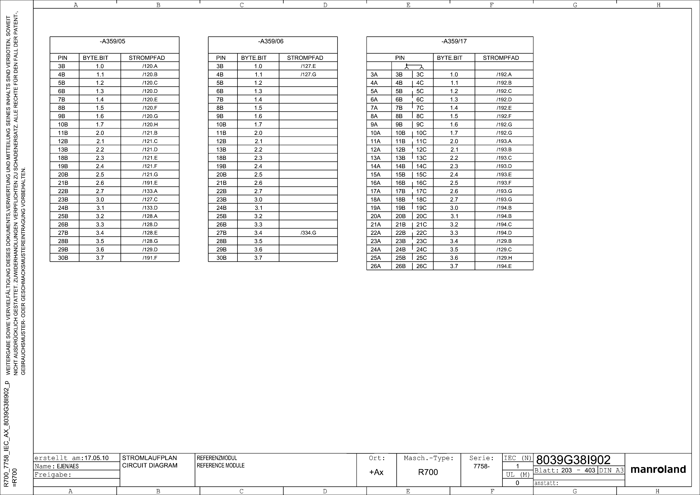

# +Ax — Sheet 203 of 403 — REFERENZMODUL

**REFERENCE MODULE**

> Part of the manroland **R700** printing press IEC/UL circuit diagrams.
> Drawing class: **Stromlaufplan / Circuit diagram** (DIN A3).
> Document `+Ax` covers the **Central control console** machine section.

## At a glance

| Field | Value |
|---|---|
| Document | `+Ax`  (8039G38I902) |
| Sheet | **203** of 403 |
| Section (DE) | REFERENZMODUL |
| Section (EN) | REFERENCE MODULE |
| Section type | REFERENCE_MODULE — Reference module |
| Machine type | `R700` |
| Series | `7758` |
| Created | 17.05.10 |
| Replaces | — |
| Columns used | A, B, C, D, E, F |
| Path numbers | — |
| Labels on sheet | 255 |
| Cross-refs out | 51 |
| Cross-refs in | 51 |

**Previous:** [+Ax sheet 202](SHEET_0202.md) · **Next:** [+Ax sheet 204](SHEET_0204.md) · **Document TOC:** [_TOC.md](_TOC.md)  (+Ax) · **Master TOC:** [all sheets](../_MASTER_TOC.md)

## Sheet image (300 DPI, exact vector render)



_Rendered directly from the PDF vector layer at 300 DPI (1-bit), no OCR and no resampling. Use it to confirm anything ambiguous in the text below._

## Cross-references on this sheet

Each entry is a wire leaving this sheet. The printed token is `/sheet.column`; the link resolves to that sheet inside the same document.

| Ref | Target sheet | Col | Path | Destination on target | Target section | From col |
|---|---|---|---|---|---|---|
| `/120.A` | [+Ax sheet 120](SHEET_0120.md) | A | — | — | REALTIMERECHNER FEHLBOGENKONTROLLE | B |
| `/127.E` | [+Ax sheet 127](SHEET_0127.md) | E | — | — | REALTIMERECHNER ANLEGER | D |
| `/120.B` | [+Ax sheet 120](SHEET_0120.md) | B | — | — | REALTIMERECHNER FEHLBOGENKONTROLLE | B |
| `/192.A` | [+Ax sheet 192](SHEET_0192.md) | A | — | — | RESERVE | F |
| `/127.G` | [+Ax sheet 127](SHEET_0127.md) | G | — | — | REALTIMERECHNER ANLEGER | D |
| `/192.B` | [+Ax sheet 192](SHEET_0192.md) | B | — | — | RESERVE | F |
| `/120.C` | [+Ax sheet 120](SHEET_0120.md) | C | — | — | REALTIMERECHNER FEHLBOGENKONTROLLE | B |
| `/120.D` | [+Ax sheet 120](SHEET_0120.md) | D | — | — | REALTIMERECHNER FEHLBOGENKONTROLLE | B |
| `/192.C` | [+Ax sheet 192](SHEET_0192.md) | C | — | — | RESERVE | F |
| `/120.E` | [+Ax sheet 120](SHEET_0120.md) | E | — | — | REALTIMERECHNER FEHLBOGENKONTROLLE | B |
| `/192.D` | [+Ax sheet 192](SHEET_0192.md) | D | — | — | RESERVE | F |
| `/192.E` | [+Ax sheet 192](SHEET_0192.md) | E | — | — | RESERVE | F |
| `/120.F` | [+Ax sheet 120](SHEET_0120.md) | F | — | — | REALTIMERECHNER FEHLBOGENKONTROLLE | B |
| `/120.G` | [+Ax sheet 120](SHEET_0120.md) | G | — | — | REALTIMERECHNER FEHLBOGENKONTROLLE | B |
| `/192.F` | [+Ax sheet 192](SHEET_0192.md) | F | — | — | RESERVE | F |
| `/192.G` | [+Ax sheet 192](SHEET_0192.md) | G | — | — | RESERVE | F |
| `/120.H` | [+Ax sheet 120](SHEET_0120.md) | H | — | — | REALTIMERECHNER FEHLBOGENKONTROLLE | B |
| `/121.B` | [+Ax sheet 121](SHEET_0121.md) | B | — | — | REALTIMERECHNER FEHLBOGENKONTROLLE | B |
| `/192.G` | [+Ax sheet 192](SHEET_0192.md) | G | — | — | RESERVE | F |
| `/193.A` | [+Ax sheet 193](SHEET_0193.md) | A | — | — | RESERVE | F |
| `/121.C` | [+Ax sheet 121](SHEET_0121.md) | C | — | — | REALTIMERECHNER FEHLBOGENKONTROLLE | B |
| `/193.B` | [+Ax sheet 193](SHEET_0193.md) | B | — | — | RESERVE | F |
| `/121.D` | [+Ax sheet 121](SHEET_0121.md) | D | — | — | REALTIMERECHNER FEHLBOGENKONTROLLE | B |
| `/121.E` | [+Ax sheet 121](SHEET_0121.md) | E | — | — | REALTIMERECHNER FEHLBOGENKONTROLLE | B |
| `/193.C` | [+Ax sheet 193](SHEET_0193.md) | C | — | — | RESERVE | F |
| `/121.F` | [+Ax sheet 121](SHEET_0121.md) | F | — | — | REALTIMERECHNER FEHLBOGENKONTROLLE | B |
| `/193.D` | [+Ax sheet 193](SHEET_0193.md) | D | — | — | RESERVE | F |
| `/193.E` | [+Ax sheet 193](SHEET_0193.md) | E | — | — | RESERVE | F |
| `/121.G` | [+Ax sheet 121](SHEET_0121.md) | G | — | — | REALTIMERECHNER FEHLBOGENKONTROLLE | B |
| `/191.E` | [+Ax sheet 191](SHEET_0191.md) | E | — | — | RESERVE | B |
| `/193.F` | [+Ax sheet 193](SHEET_0193.md) | F | — | — | RESERVE | F |
| `/133.A` | [+Ax sheet 133](SHEET_0133.md) | A | — | — | REALTIMERECHNER DRUCKWERK | B |
| `/193.G` | [+Ax sheet 193](SHEET_0193.md) | G | — | — | RESERVE | F |
| `/193.G` | [+Ax sheet 193](SHEET_0193.md) | G | — | — | RESERVE | F |
| `/127.C` | [+Ax sheet 127](SHEET_0127.md) | C | — | — | REALTIMERECHNER ANLEGER | B |
| `/194.B` | [+Ax sheet 194](SHEET_0194.md) | B | — | — | RESERVE | F |
| `/133.D` | [+Ax sheet 133](SHEET_0133.md) | D | — | — | REALTIMERECHNER DRUCKWERK | B |
| `/128.A` | [+Ax sheet 128](SHEET_0128.md) | A | — | — | REALTIMERECHNER ANLEGER | B |
| `/194.B` | [+Ax sheet 194](SHEET_0194.md) | B | — | — | RESERVE | F |
| `/128.D` | [+Ax sheet 128](SHEET_0128.md) | D | — | — | REALTIMERECHNER ANLEGER | B |
| `/194.C` | [+Ax sheet 194](SHEET_0194.md) | C | — | — | RESERVE | F |
| `/128.E` | [+Ax sheet 128](SHEET_0128.md) | E | — | — | REALTIMERECHNER ANLEGER | B |
| `/334.G` | [+Ax sheet 334](SHEET_0334.md) | G | — | — | OPTION: INLINESORTER | D |
| `/194.D` | [+Ax sheet 194](SHEET_0194.md) | D | — | — | RESERVE | F |
| `/129.B` | [+Ax sheet 129](SHEET_0129.md) | B | — | — | REALTIMERECHNER ANLAGE | F |
| `/128.G` | [+Ax sheet 128](SHEET_0128.md) | G | — | — | REALTIMERECHNER ANLEGER | B |
| `/129.D` | [+Ax sheet 129](SHEET_0129.md) | D | — | — | REALTIMERECHNER ANLAGE | B |
| `/129.C` | [+Ax sheet 129](SHEET_0129.md) | C | — | — | REALTIMERECHNER ANLAGE | F |
| `/191.F` | [+Ax sheet 191](SHEET_0191.md) | F | — | — | RESERVE | B |
| `/129.H` | [+Ax sheet 129](SHEET_0129.md) | H | — | — | REALTIMERECHNER ANLAGE | F |
| `/194.E` | [+Ax sheet 194](SHEET_0194.md) | E | — | — | RESERVE | F |

### Incoming references (sheets that point here)

Every other sheet that sends a wire to this one. `Back-ref` is the token printed on *that* sheet; `Path` is its line number.

| From sheet | Cols | Back-ref | Path | Refs | What continues there |
|---|---|---|---|---|---|
| [+Ax#120](SHEET_0120.md) | A, B, C, D, E, F, G, H | `/120.A`, `/120.B`, `/120.C`, `/120.D`, `/120.E`, `/120.F`, `/120.G`, `/120.H` | — | 8 | — |
| [+Ax#121](SHEET_0121.md) | A, B, C, E, F, G | `/121.A`, `/121.B`, `/121.C`, `/121.E`, `/121.F`, `/121.G` | — | 6 | — |
| [+Ax#127](SHEET_0127.md) | C, E, G | `/127.C`, `/127.E`, `/127.G` | — | 3 | — |
| [+Ax#128](SHEET_0128.md) | A, C, E, G | `/128.A`, `/128.C`, `/128.E`, `/128.G` | — | 4 | — |
| [+Ax#129](SHEET_0129.md) | B, C, D, H | `/129.B`, `/129.C`, `/129.D`, `/129.H` | — | 4 | — |
| [+Ax#133](SHEET_0133.md) | A, D | `/133.A`, `/133.D` | — | 2 | — |
| [+Ax#191](SHEET_0191.md) | E, F | `/191.E`, `/191.F` | — | 2 | — |
| [+Ax#192](SHEET_0192.md) | A, B, C, D, E, F, G | `/192.A`, `/192.B`, `/192.C`, `/192.D`, `/192.E`, `/192.F`, `/192.G` | — | 8 | — |
| [+Ax#193](SHEET_0193.md) | A, B, C, D, E, F, G | `/193.A`, `/193.B`, `/193.C`, `/193.D`, `/193.E`, `/193.F`, `/193.G` | — | 8 | — |
| [+Ax#194](SHEET_0194.md) | A, B, C, D, E | `/194.A`, `/194.B`, `/194.C`, `/194.D`, `/194.E` | — | 5 | — |
| [+Ax#334](SHEET_0334.md) | G | `/334.G` | — | 1 | — |


## Devices on this sheet

| Tag | Class | Class meaning (IEC) | Col | Sub | Terminal | Sign |
|---|---|---|---|---|---|---|
| `A359/05` | A | Baugruppe / assembly, module, PC board | A | 05 | — | — |
| `A359/06` | A | Baugruppe / assembly, module, PC board | C | 06 | — | — |
| `A359/17` | A | Baugruppe / assembly, module, PC board | F | 17 | — | — |
| `1.0` | — | cross-device reference | A | — | — | — |
| `1.1` | — | cross-device reference | A | — | — | — |
| `1.2` | — | cross-device reference | A | — | — | — |
| `1.3` | — | cross-device reference | A | — | — | — |
| `1.4` | — | cross-device reference | A | — | — | — |
| `1.5` | — | cross-device reference | A | — | — | — |
| `1.6` | — | cross-device reference | A | — | — | — |
| `1.7` | — | cross-device reference | A | — | — | — |
| `2.0` | — | cross-device reference | A | — | — | — |
| `2.1` | — | cross-device reference | A | — | — | — |
| `2.2` | — | cross-device reference | A | — | — | — |
| `2.3` | — | cross-device reference | A | — | — | — |
| `2.4` | — | cross-device reference | A | — | — | — |
| `2.5` | — | cross-device reference | A | — | — | — |
| `2.6` | — | cross-device reference | A | — | — | — |
| `2.7` | — | cross-device reference | A | — | — | — |
| `3.0` | — | cross-device reference | A | — | — | — |
| `3.1` | — | cross-device reference | A | — | — | — |
| `3.2` | — | cross-device reference | A | — | — | — |
| `3.3` | — | cross-device reference | A | — | — | — |
| `3.4` | — | cross-device reference | A | — | — | — |
| `3.5` | — | cross-device reference | A | — | — | — |
| `3.6` | — | cross-device reference | A | — | — | — |
| `3.7` | — | cross-device reference | A | — | — | — |
| `1.0` | — | cross-device reference | C | — | — | — |
| `1.1` | — | cross-device reference | C | — | — | — |
| `1.2` | — | cross-device reference | C | — | — | — |
| `1.3` | — | cross-device reference | C | — | — | — |
| `1.4` | — | cross-device reference | C | — | — | — |
| `1.5` | — | cross-device reference | C | — | — | — |
| `1.6` | — | cross-device reference | C | — | — | — |
| `1.7` | — | cross-device reference | C | — | — | — |
| `2.0` | — | cross-device reference | C | — | — | — |
| `2.1` | — | cross-device reference | C | — | — | — |
| `2.2` | — | cross-device reference | C | — | — | — |
| `2.3` | — | cross-device reference | C | — | — | — |
| `2.4` | — | cross-device reference | C | — | — | — |
| `2.5` | — | cross-device reference | C | — | — | — |
| `2.6` | — | cross-device reference | C | — | — | — |
| `2.7` | — | cross-device reference | C | — | — | — |
| `3.0` | — | cross-device reference | C | — | — | — |
| `3.1` | — | cross-device reference | C | — | — | — |
| `3.2` | — | cross-device reference | C | — | — | — |
| `3.3` | — | cross-device reference | C | — | — | — |
| `3.4` | — | cross-device reference | C | — | — | — |
| `3.5` | — | cross-device reference | C | — | — | — |
| `3.6` | — | cross-device reference | C | — | — | — |
| `3.7` | — | cross-device reference | C | — | — | — |
| `1.0` | — | cross-device reference | F | — | — | — |
| `1.1` | — | cross-device reference | F | — | — | — |
| `1.2` | — | cross-device reference | F | — | — | — |
| `1.3` | — | cross-device reference | F | — | — | — |
| `1.4` | — | cross-device reference | F | — | — | — |
| `1.5` | — | cross-device reference | F | — | — | — |
| `1.6` | — | cross-device reference | F | — | — | — |
| `1.7` | — | cross-device reference | F | — | — | — |
| `2.0` | — | cross-device reference | F | — | — | — |
| `2.1` | — | cross-device reference | F | — | — | — |
| `2.2` | — | cross-device reference | F | — | — | — |
| `2.3` | — | cross-device reference | F | — | — | — |
| `2.4` | — | cross-device reference | F | — | — | — |
| `2.5` | — | cross-device reference | F | — | — | — |
| `2.6` | — | cross-device reference | F | — | — | — |
| `2.7` | — | cross-device reference | F | — | — | — |
| `3.0` | — | cross-device reference | F | — | — | — |
| `3.1` | — | cross-device reference | F | — | — | — |
| `3.2` | — | cross-device reference | F | — | — | — |
| `3.3` | — | cross-device reference | F | — | — | — |
| `3.4` | — | cross-device reference | F | — | — | — |
| `3.5` | — | cross-device reference | F | — | — | — |
| `3.6` | — | cross-device reference | F | — | — | — |
| `3.7` | — | cross-device reference | F | — | — | — |

## Potentials / nets

_No named potentials on this sheet._

## Wire-end annotations (grouped as printed)

A wire that continues elsewhere is annotated with a small cluster: the destination description, the path/line number `#NN`, and the `/sheet.column` cross reference. Each row below is one such cluster exactly as it is grouped on the drawing.

| Col | Y | Path | Cross-ref | Text on the wire |
|---|---|---|---|---|
| A | 65.5 | — | — | `A359/05` |
| C | 65.5 | — | — | `A359/06` |
| F | 65.5 | — | — | `A359/17` |
| A | 94.2 | — | — | `PIN BYTE.BIT` |
| B | 94.2 | — | — | `STROMPFAD` |
| C | 94.2 | — | — | `PIN BYTE.BIT` |
| D | 94.2 | — | — | `STROMPFAD` |
| E | 94.2 | — | — | `PIN` |
| F | 94.2 | — | — | `BYTE.BIT STROMPFAD` |
| A | 108.3 | — | — | `10B 11B 12B 13B 18B 19B 3B 4B 5B 6B 7B 8B 9B 20B 21B 22B 23B 24B 25B 26B 27B 28B 29B 30B` |
| A | 108.3 | — | — | `1.0 1.2 1.3 1.4 1.5 1.6 1.7 2.0 2.2 2.3 2.4 2.5 2.6 2.7 3.0 3.2 3.3 3.4 3.5 3.6 3.7 1.1 2.1 3.1` |
| C | 108.3 | — | — | `10B 11B 12B 13B 18B 19B 3B 4B 5B 6B 7B 8B 9B 20B 21B 22B 23B 24B 25B 26B 27B 28B 29B 30B` |
| C | 108.3 | — | — | `1.0 1.2 1.3 1.4 1.5 1.6 1.7 2.0 2.2 2.3 2.4 2.5 2.6 2.7 3.0 3.2 3.3 3.4 3.5 3.6 3.7 1.1 2.1 3.1` |
| B | 108.7 | — | `/120.A` | — |
| D | 108.7 | — | `/127.E` | — |
| E | 122.5 | — | — | `10A 11A 12A 13A 14A 15A 16A 17A 18A 19A 3A 4A 5A 6A 7A 8A 9A 20A` |
| E | 122.5 | — | — | `21A 22A 23A 24A 25A 26A 10B 11B 12B 13B 14B 15B 16B 17B 18B 19B 3B 4B 5B 6B 7B 8B 9B 20B` |
| E | 122.5 | — | — | `10C 11C 12C 13C 14C 15C 16C 17C 18C 19C 3C 4C 5C 6C 7C 8C 9C 20C 21C 22C 23C 24C 25C 26C` |
| F | 122.5 | — | — | `1.0 1.2 1.3 1.4 1.5 1.6 1.7 2.0 2.2 2.3 2.4 2.5 2.6 2.7 3.0 3.2 3.3 3.4 3.5 3.6 3.7 1.1 2.1 3.1` |
| B | 122.9 | — | `/120.B` | — |
| D | 122.9 | — | `/127.G` | — |
| F | 122.9 | — | `/192.A` | — |
| F | 137.0 | — | `/192.B` | — |
| B | 137.1 | — | `/120.C` | — |
| B | 151.2 | — | `/120.D` | — |
| F | 151.2 | — | `/192.C` | — |
| B | 165.4 | — | `/120.E` | — |
| F | 165.4 | — | `/192.D` | — |
| B | 179.6 | — | `/120.F` | — |
| F | 179.6 | — | `/192.E` | — |
| B | 193.7 | — | `/120.G` | — |
| F | 193.7 | — | `/192.F` | — |
| B | 207.9 | — | `/120.H` | — |
| F | 207.9 | — | `/192.G` | — |
| B | 222.1 | — | `/121.B` | — |
| F | 222.1 | — | `/192.G` | — |
| F | 236.2 | — | `/193.A` | — |
| B | 236.3 | — | `/121.C` | — |
| B | 250.4 | — | `/121.D` | — |
| F | 250.4 | — | `/193.B` | — |
| B | 264.6 | — | `/121.E` | — |
| F | 264.6 | — | `/193.C` | — |
| B | 278.8 | — | `/121.F` | — |
| F | 278.8 | — | `/193.D` | — |
| F | 292.9 | — | `/193.E` | — |
| B | 293.0 | — | `/121.G` | — |
| B | 307.1 | — | `/191.E` | — |
| F | 307.1 | — | `/193.F` | — |
| B | 321.3 | — | `/133.A` | — |
| F | 321.3 | — | `/193.G` | — |
| B | 335.5 | — | `/127.C` | — |
| F | 335.5 | — | `/193.G` | — |
| F | 349.6 | — | `/194.B` | — |
| B | 349.7 | — | `/133.D` | — |
| B | 363.8 | — | `/128.A` | — |
| F | 363.8 | — | `/194.B` | — |
| E | 377.6 | — | — | `21B 22B 23B 24B 25B 26B` |
| B | 378.0 | — | `/128.D` | — |
| F | 378.0 | — | `/194.C` | — |
| B | 392.1 | — | `/128.E` | — |
| D | 392.2 | — | `/334.G` | — |
| F | 392.2 | — | `/194.D` | — |
| B | 406.3 | — | `/128.G` | — |
| F | 406.3 | — | `/129.B` | — |
| B | 420.5 | — | `/129.D` | — |
| F | 420.5 | — | `/129.C` | — |
| B | 434.7 | — | `/191.F` | — |
| F | 434.7 | — | `/129.H` | — |
| F | 448.9 | — | `/194.E` | — |


## Reconstructed tables

This sheet carries tabular content (pin map / terminal assignment / index). The grid below was rebuilt from the drawing's own rule lines, so each row is exactly one physical row of the table.

### Table 1 — 24 data rows × 3 columns (at x=85.0, y=62.4) — **A359/05**

| PIN | BYTE.BIT | STROMPFAD |
|---|---|---|
| `3B` | `1.0` | `/120.A` |
| `4B` | `1.1` | `/120.B` |
| `5B` | `1.2` | `/120.C` |
| `6B` | `1.3` | `/120.D` |
| `7B` | `1.4` | `/120.E` |
| `8B` | `1.5` | `/120.F` |
| `9B` | `1.6` | `/120.G` |
| `10B` | `1.7` | `/120.H` |
| `11B` | `2.0` | `/121.B` |
| `12B` | `2.1` | `/121.C` |
| `13B` | `2.2` | `/121.D` |
| `18B` | `2.3` | `/121.E` |
| `19B` | `2.4` | `/121.F` |
| `20B` | `2.5` | `/121.G` |
| `21B` | `2.6` | `/191.E` |
| `22B` | `2.7` | `/133.A` |
| `23B` | `3.0` | `/127.C` |
| `24B` | `3.1` | `/133.D` |
| `25B` | `3.2` | `/128.A` |
| `26B` | `3.3` | `/128.D` |
| `27B` | `3.4` | `/128.E` |
| `28B` | `3.5` | `/128.G` |
| `29B` | `3.6` | `/129.D` |
| `30B` | `3.7` | `/191.F` |


### Table 2 — 24 data rows × 3 columns (at x=354.3, y=62.4) — **A359/06**

| PIN | BYTE.BIT | STROMPFAD |
|---|---|---|
| `3B` | `1.0` | `/127.E` |
| `4B` | `1.1` | `/127.G` |
| `5B` | `1.2` |  |
| `6B` | `1.3` |  |
| `7B` | `1.4` |  |
| `8B` | `1.5` |  |
| `9B` | `1.6` |  |
| `10B` | `1.7` |  |
| `11B` | `2.0` |  |
| `12B` | `2.1` |  |
| `13B` | `2.2` |  |
| `18B` | `2.3` |  |
| `19B` | `2.4` |  |
| `20B` | `2.5` |  |
| `21B` | `2.6` |  |
| `22B` | `2.7` |  |
| `23B` | `3.0` |  |
| `24B` | `3.1` |  |
| `25B` | `3.2` |  |
| `26B` | `3.3` |  |
| `27B` | `3.4` | `/334.G` |
| `28B` | `3.5` |  |
| `29B` | `3.6` |  |
| `30B` | `3.7` |  |


### Table 3 — 24 data rows × 5 columns (at x=623.6, y=62.4) — **A359/17**

|  | PIN |  | BYTE.BIT | STROMPFAD |
|---|---|---|---|---|
| `3A` | `3B` | `3C` | `1.0` | `/192.A` |
| `4A` | `4B` | `4C` | `1.1` | `/192.B` |
| `5A` | `5B` | `5C` | `1.2` | `/192.C` |
| `6A` | `6B` | `6C` | `1.3` | `/192.D` |
| `7A` | `7B` | `7C` | `1.4` | `/192.E` |
| `8A` | `8B` | `8C` | `1.5` | `/192.F` |
| `9A` | `9B` | `9C` | `1.6` | `/192.G` |
| `10A` | `10B` | `10C` | `1.7` | `/192.G` |
| `11A` | `11B` | `11C` | `2.0` | `/193.A` |
| `12A` | `12B` | `12C` | `2.1` | `/193.B` |
| `13A` | `13B` | `13C` | `2.2` | `/193.C` |
| `14A` | `14B` | `14C` | `2.3` | `/193.D` |
| `15A` | `15B` | `15C` | `2.4` | `/193.E` |
| `16A` | `16B` | `16C` | `2.5` | `/193.F` |
| `17A` | `17B` | `17C` | `2.6` | `/193.G` |
| `18A` | `18B` | `18C` | `2.7` | `/193.G` |
| `19A` | `19B` | `19C` | `3.0` | `/194.B` |
| `20A` | `20B` | `20C` | `3.1` | `/194.B` |
| `21A` | `21B` | `21C` | `3.2` | `/194.C` |
| `22A` | `22B` | `22C` | `3.3` | `/194.D` |
| `23A` | `23B` | `23C` | `3.4` | `/129.B` |
| `24A` | `24B` | `24C` | `3.5` | `/129.C` |
| `25A` | `25B` | `25C` | `3.6` | `/129.H` |
| `26A` | `26B` | `26C` | `3.7` | `/194.E` |


## Notes and free text on this sheet

| Text | Col | Y (pt) |
|---|---|---|
| `3B` | A | 108.35 |
| `4B` | A | 122.53 |
| `5B` | A | 136.7 |
| `6B` | A | 150.87 |
| `7B` | A | 165.05 |
| `8B` | A | 179.22 |
| `9B` | A | 193.39 |
| `10B` | A | 207.57 |
| `11B` | A | 221.74 |
| `12B` | A | 235.92 |
| `13B` | A | 250.09 |
| `18B` | A | 264.26 |
| `19B` | A | 278.44 |
| `20B` | A | 292.61 |
| `21B` | A | 306.78 |
| `22B` | A | 320.96 |
| `23B` | A | 335.13 |
| `24B` | A | 349.3 |
| `25B` | A | 363.48 |
| `26B` | A | 377.65 |
| `27B` | A | 391.82 |
| `28B` | A | 406 |
| `29B` | A | 420.17 |
| `30B` | A | 434.34 |
| `PIN` | A | 94.2 |
| `BYTE.BIT` | A | 94.17 |
| `STROMPFAD` | B | 94.15 |
| `3B` | C | 108.35 |
| `4B` | C | 122.53 |
| `5B` | C | 136.7 |
| `6B` | C | 150.87 |
| `7B` | C | 165.05 |
| `8B` | C | 179.22 |
| `9B` | C | 193.39 |
| `10B` | C | 207.57 |
| `11B` | C | 221.74 |
| `12B` | C | 235.92 |
| `13B` | C | 250.09 |
| `18B` | C | 264.26 |
| `19B` | C | 278.44 |
| `20B` | C | 292.61 |
| `21B` | C | 306.78 |
| `22B` | C | 320.96 |
| `23B` | C | 335.13 |
| `24B` | C | 349.3 |
| `25B` | C | 363.48 |
| `26B` | C | 377.65 |
| `27B` | C | 391.82 |
| `28B` | C | 406 |
| `29B` | C | 420.17 |
| `30B` | C | 434.34 |
| `PIN` | C | 94.2 |
| `BYTE.BIT` | C | 94.17 |
| `STROMPFAD` | D | 94.15 |
| `PIN` | E | 94.2 |
| `3A` | E | 122.53 |
| `4A` | E | 136.7 |
| `5A` | E | 150.87 |
| `6A` | E | 165.05 |
| `7A` | E | 179.22 |
| `8A` | E | 193.39 |
| `9A` | E | 207.57 |
| `10A` | E | 221.74 |
| `11A` | E | 235.92 |
| `12A` | E | 250.09 |
| `13A` | E | 264.26 |
| `14A` | E | 278.44 |
| `15A` | E | 292.61 |
| `16A` | E | 306.78 |
| `17A` | E | 320.96 |
| `18A` | E | 335.13 |
| `19A` | E | 349.3 |
| `20A` | E | 363.48 |
| `3B` | E | 122.53 |
| `4B` | E | 136.7 |
| `5B` | E | 150.87 |
| `6B` | E | 165.05 |
| `7B` | E | 179.22 |
| `8B` | E | 193.39 |
| `9B` | E | 207.57 |
| `10B` | E | 221.74 |
| `11B` | E | 235.92 |
| `12B` | E | 250.09 |
| `13B` | E | 264.26 |
| `14B` | E | 278.44 |
| `15B` | E | 292.61 |
| `16B` | E | 306.78 |
| `17B` | E | 320.96 |
| `18B` | E | 335.13 |
| `19B` | E | 349.3 |
| `20B` | E | 363.48 |
| `21A` | E | 377.65 |
| `22A` | E | 391.82 |
| `23A` | E | 406 |
| `24A` | E | 420.17 |
| `25A` | E | 434.34 |
| `26A` | E | 448.52 |
| `21B` | E | 377.65 |
| `22B` | E | 391.82 |
| `23B` | E | 406 |
| `24B` | E | 420.17 |
| `25B` | E | 434.34 |
| `26B` | E | 448.52 |
| `BYTE.BIT` | E | 94.17 |
| `STROMPFAD` | F | 94.15 |
| `3C` | E | 122.52 |
| `4C` | E | 136.69 |
| `5C` | E | 150.86 |
| `6C` | E | 165.04 |
| `7C` | E | 179.21 |
| `8C` | E | 193.38 |
| `9C` | E | 207.56 |
| `10C` | E | 221.74 |
| `11C` | E | 235.91 |
| `12C` | E | 250.08 |
| `13C` | E | 264.26 |
| `14C` | E | 278.43 |
| `15C` | E | 292.6 |
| `16C` | E | 306.78 |
| `17C` | E | 320.95 |
| `18C` | E | 335.12 |
| `19C` | E | 349.3 |
| `20C` | E | 363.47 |
| `21C` | E | 377.64 |
| `22C` | E | 391.82 |
| `23C` | E | 405.99 |
| `24C` | E | 420.16 |
| `25C` | E | 434.34 |
| `26C` | E | 448.51 |

## Complete label inventory (exact text from the drawing)

Every text object inside the drawing area of this sheet, in DIN reading order (column A→H, then top→bottom). This is the authoritative list: if a string is not here it is not printed on this sheet.

| Col | Y | X | Dir | Type | Text |
|---|---|---|---|---|---|
| A | 65.5 | 169.9 | → | device tag | `A359/05` |
| A | 94.2 | 98.4 | → | text | `PIN` |
| A | 94.2 | 140.9 | → | text | `BYTE.BIT` |
| A | 108.3 | 163.0 | → | device ref | `1.0` |
| A | 108.4 | 98.9 | → | text | `3B` |
| A | 122.5 | 98.9 | → | text | `4B` |
| A | 122.5 | 163.8 | → | device ref | `1.1` |
| A | 136.7 | 98.9 | → | text | `5B` |
| A | 136.7 | 163.0 | → | device ref | `1.2` |
| A | 150.9 | 98.9 | → | text | `6B` |
| A | 150.9 | 163.0 | → | device ref | `1.3` |
| A | 165.0 | 98.9 | → | text | `7B` |
| A | 165.0 | 163.0 | → | device ref | `1.4` |
| A | 179.2 | 98.9 | → | text | `8B` |
| A | 179.2 | 163.0 | → | device ref | `1.5` |
| A | 193.4 | 98.9 | → | text | `9B` |
| A | 193.4 | 163.0 | → | device ref | `1.6` |
| A | 207.5 | 163.0 | → | device ref | `1.7` |
| A | 207.6 | 98.4 | → | text | `10B` |
| A | 221.7 | 98.4 | → | text | `11B` |
| A | 221.7 | 163.3 | → | device ref | `2.0` |
| A | 235.9 | 98.4 | → | text | `12B` |
| A | 235.9 | 164.1 | → | device ref | `2.1` |
| A | 250.1 | 98.4 | → | text | `13B` |
| A | 250.1 | 163.3 | → | device ref | `2.2` |
| A | 264.2 | 163.3 | → | device ref | `2.3` |
| A | 264.3 | 98.4 | → | text | `18B` |
| A | 278.4 | 98.4 | → | text | `19B` |
| A | 278.4 | 163.3 | → | device ref | `2.4` |
| A | 292.6 | 98.9 | → | text | `20B` |
| A | 292.6 | 163.3 | → | device ref | `2.5` |
| A | 306.8 | 98.9 | → | text | `21B` |
| A | 306.8 | 163.3 | → | device ref | `2.6` |
| A | 320.9 | 163.3 | → | device ref | `2.7` |
| A | 321.0 | 98.9 | → | text | `22B` |
| A | 335.1 | 98.9 | → | text | `23B` |
| A | 335.1 | 163.3 | → | device ref | `3.0` |
| A | 349.3 | 98.9 | → | text | `24B` |
| A | 349.3 | 164.1 | → | device ref | `3.1` |
| A | 363.5 | 98.9 | → | text | `25B` |
| A | 363.5 | 163.3 | → | device ref | `3.2` |
| A | 377.6 | 98.9 | → | text | `26B` |
| A | 377.6 | 163.3 | → | device ref | `3.3` |
| A | 391.8 | 98.9 | → | text | `27B` |
| A | 391.8 | 163.3 | → | device ref | `3.4` |
| A | 406.0 | 98.9 | → | text | `28B` |
| A | 406.0 | 163.3 | → | device ref | `3.5` |
| A | 420.1 | 163.3 | → | device ref | `3.6` |
| A | 420.2 | 98.9 | → | text | `29B` |
| A | 434.3 | 98.9 | → | text | `30B` |
| A | 434.3 | 163.3 | → | device ref | `3.7` |
| B | 94.2 | 219.1 | → | text | `STROMPFAD` |
| B | 108.7 | 242.4 | → | cross-reference | `/120.A` |
| B | 122.9 | 242.5 | → | cross-reference | `/120.B` |
| B | 137.1 | 242.4 | → | cross-reference | `/120.C` |
| B | 151.2 | 242.4 | → | cross-reference | `/120.D` |
| B | 165.4 | 242.6 | → | cross-reference | `/120.E` |
| B | 179.6 | 242.8 | → | cross-reference | `/120.F` |
| B | 193.7 | 242.2 | → | cross-reference | `/120.G` |
| B | 207.9 | 242.6 | → | cross-reference | `/120.H` |
| B | 222.1 | 242.5 | → | cross-reference | `/121.B` |
| B | 236.3 | 242.4 | → | cross-reference | `/121.C` |
| B | 250.4 | 242.4 | → | cross-reference | `/121.D` |
| B | 264.6 | 242.6 | → | cross-reference | `/121.E` |
| B | 278.8 | 242.8 | → | cross-reference | `/121.F` |
| B | 293.0 | 242.2 | → | cross-reference | `/121.G` |
| B | 307.1 | 242.6 | → | cross-reference | `/191.E` |
| B | 321.3 | 242.4 | → | cross-reference | `/133.A` |
| B | 335.5 | 242.4 | → | cross-reference | `/127.C` |
| B | 349.7 | 242.4 | → | cross-reference | `/133.D` |
| B | 363.8 | 242.4 | → | cross-reference | `/128.A` |
| B | 378.0 | 242.4 | → | cross-reference | `/128.D` |
| B | 392.2 | 242.6 | → | cross-reference | `/128.E` |
| B | 406.3 | 242.2 | → | cross-reference | `/128.G` |
| B | 420.5 | 242.4 | → | cross-reference | `/129.D` |
| B | 434.7 | 242.8 | → | cross-reference | `/191.F` |
| C | 65.5 | 439.2 | → | device tag | `A359/06` |
| C | 94.2 | 367.7 | → | text | `PIN` |
| C | 94.2 | 410.2 | → | text | `BYTE.BIT` |
| C | 108.3 | 432.3 | → | device ref | `1.0` |
| C | 108.4 | 368.2 | → | text | `3B` |
| C | 122.5 | 368.2 | → | text | `4B` |
| C | 122.5 | 433.1 | → | device ref | `1.1` |
| C | 136.7 | 368.2 | → | text | `5B` |
| C | 136.7 | 432.3 | → | device ref | `1.2` |
| C | 150.9 | 368.2 | → | text | `6B` |
| C | 150.9 | 432.3 | → | device ref | `1.3` |
| C | 165.0 | 368.2 | → | text | `7B` |
| C | 165.0 | 432.3 | → | device ref | `1.4` |
| C | 179.2 | 368.2 | → | text | `8B` |
| C | 179.2 | 432.3 | → | device ref | `1.5` |
| C | 193.4 | 368.2 | → | text | `9B` |
| C | 193.4 | 432.3 | → | device ref | `1.6` |
| C | 207.5 | 432.3 | → | device ref | `1.7` |
| C | 207.6 | 367.7 | → | text | `10B` |
| C | 221.7 | 367.7 | → | text | `11B` |
| C | 221.7 | 432.6 | → | device ref | `2.0` |
| C | 235.9 | 367.7 | → | text | `12B` |
| C | 235.9 | 433.4 | → | device ref | `2.1` |
| C | 250.1 | 367.7 | → | text | `13B` |
| C | 250.1 | 432.6 | → | device ref | `2.2` |
| C | 264.2 | 432.6 | → | device ref | `2.3` |
| C | 264.3 | 367.7 | → | text | `18B` |
| C | 278.4 | 367.7 | → | text | `19B` |
| C | 278.4 | 432.6 | → | device ref | `2.4` |
| C | 292.6 | 368.2 | → | text | `20B` |
| C | 292.6 | 432.6 | → | device ref | `2.5` |
| C | 306.8 | 368.2 | → | text | `21B` |
| C | 306.8 | 432.6 | → | device ref | `2.6` |
| C | 320.9 | 432.6 | → | device ref | `2.7` |
| C | 321.0 | 368.2 | → | text | `22B` |
| C | 335.1 | 368.2 | → | text | `23B` |
| C | 335.1 | 432.6 | → | device ref | `3.0` |
| C | 349.3 | 368.2 | → | text | `24B` |
| C | 349.3 | 433.4 | → | device ref | `3.1` |
| C | 363.5 | 368.2 | → | text | `25B` |
| C | 363.5 | 432.6 | → | device ref | `3.2` |
| C | 377.6 | 368.2 | → | text | `26B` |
| C | 377.6 | 432.6 | → | device ref | `3.3` |
| C | 391.8 | 368.2 | → | text | `27B` |
| C | 391.8 | 432.6 | → | device ref | `3.4` |
| C | 406.0 | 368.2 | → | text | `28B` |
| C | 406.0 | 432.6 | → | device ref | `3.5` |
| C | 420.1 | 432.6 | → | device ref | `3.6` |
| C | 420.2 | 368.2 | → | text | `29B` |
| C | 434.3 | 368.2 | → | text | `30B` |
| C | 434.3 | 432.6 | → | device ref | `3.7` |
| D | 94.2 | 488.4 | → | text | `STROMPFAD` |
| D | 108.7 | 511.9 | → | cross-reference | `/127.E` |
| D | 122.9 | 511.5 | → | cross-reference | `/127.G` |
| D | 392.2 | 511.5 | → | cross-reference | `/334.G` |
| E | 94.2 | 672.4 | → | text | `PIN` |
| E | 94.2 | 743.2 | → | text | `BYTE.BIT` |
| E | 122.5 | 630.4 | → | text | `3A` |
| E | 122.5 | 672.9 | → | text | `3B` |
| E | 122.5 | 708.4 | → | text | `3C` |
| E | 136.7 | 630.4 | → | text | `4A` |
| E | 136.7 | 672.9 | → | text | `4B` |
| E | 136.7 | 708.4 | → | text | `4C` |
| E | 150.9 | 630.4 | → | text | `5A` |
| E | 150.9 | 672.9 | → | text | `5B` |
| E | 150.9 | 708.4 | → | text | `5C` |
| E | 165.0 | 630.4 | → | text | `6A` |
| E | 165.0 | 672.9 | → | text | `6B` |
| E | 165.0 | 708.4 | → | text | `6C` |
| E | 179.2 | 630.4 | → | text | `7A` |
| E | 179.2 | 672.9 | → | text | `7B` |
| E | 179.2 | 708.4 | → | text | `7C` |
| E | 193.4 | 630.4 | → | text | `8A` |
| E | 193.4 | 672.9 | → | text | `8B` |
| E | 193.4 | 708.4 | → | text | `8C` |
| E | 207.6 | 630.4 | → | text | `9A` |
| E | 207.6 | 672.9 | → | text | `9B` |
| E | 207.6 | 708.4 | → | text | `9C` |
| E | 221.7 | 629.9 | → | text | `10A` |
| E | 221.7 | 672.4 | → | text | `10B` |
| E | 221.7 | 707.8 | → | text | `10C` |
| E | 235.9 | 629.9 | → | text | `11A` |
| E | 235.9 | 672.4 | → | text | `11B` |
| E | 235.9 | 707.8 | → | text | `11C` |
| E | 250.1 | 629.9 | → | text | `12A` |
| E | 250.1 | 672.4 | → | text | `12B` |
| E | 250.1 | 707.8 | → | text | `12C` |
| E | 264.3 | 629.9 | → | text | `13A` |
| E | 264.3 | 672.4 | → | text | `13B` |
| E | 264.3 | 707.8 | → | text | `13C` |
| E | 278.4 | 629.9 | → | text | `14A` |
| E | 278.4 | 672.4 | → | text | `14B` |
| E | 278.4 | 707.8 | → | text | `14C` |
| E | 292.6 | 629.9 | → | text | `15A` |
| E | 292.6 | 672.4 | → | text | `15B` |
| E | 292.6 | 707.8 | → | text | `15C` |
| E | 306.8 | 629.9 | → | text | `16A` |
| E | 306.8 | 672.4 | → | text | `16B` |
| E | 306.8 | 707.8 | → | text | `16C` |
| E | 321.0 | 629.9 | → | text | `17A` |
| E | 321.0 | 672.4 | → | text | `17B` |
| E | 321.0 | 707.8 | → | text | `17C` |
| E | 335.1 | 629.9 | → | text | `18A` |
| E | 335.1 | 672.4 | → | text | `18B` |
| E | 335.1 | 707.8 | → | text | `18C` |
| E | 349.3 | 629.9 | → | text | `19A` |
| E | 349.3 | 672.4 | → | text | `19B` |
| E | 349.3 | 707.8 | → | text | `19C` |
| E | 363.5 | 630.4 | → | text | `20A` |
| E | 363.5 | 672.9 | → | text | `20B` |
| E | 363.5 | 708.4 | → | text | `20C` |
| E | 377.6 | 630.4 | → | text | `21A` |
| E | 377.6 | 672.9 | → | text | `21B` |
| E | 377.6 | 708.4 | → | text | `21C` |
| E | 391.8 | 630.4 | → | text | `22A` |
| E | 391.8 | 672.9 | → | text | `22B` |
| E | 391.8 | 708.4 | → | text | `22C` |
| E | 406.0 | 630.4 | → | text | `23A` |
| E | 406.0 | 672.9 | → | text | `23B` |
| E | 406.0 | 708.4 | → | text | `23C` |
| E | 420.2 | 630.4 | → | text | `24A` |
| E | 420.2 | 672.9 | → | text | `24B` |
| E | 420.2 | 708.4 | → | text | `24C` |
| E | 434.3 | 630.4 | → | text | `25A` |
| E | 434.3 | 672.9 | → | text | `25B` |
| E | 434.3 | 708.4 | → | text | `25C` |
| E | 448.5 | 630.4 | → | text | `26A` |
| E | 448.5 | 672.9 | → | text | `26B` |
| E | 448.5 | 708.4 | → | text | `26C` |
| F | 65.5 | 751.0 | → | device tag | `A359/17` |
| F | 94.2 | 821.5 | → | text | `STROMPFAD` |
| F | 122.5 | 765.4 | → | device ref | `1.0` |
| F | 122.9 | 844.7 | → | cross-reference | `/192.A` |
| F | 136.7 | 766.2 | → | device ref | `1.1` |
| F | 137.0 | 844.9 | → | cross-reference | `/192.B` |
| F | 150.9 | 765.4 | → | device ref | `1.2` |
| F | 151.2 | 844.7 | → | cross-reference | `/192.C` |
| F | 165.0 | 765.4 | → | device ref | `1.3` |
| F | 165.4 | 844.7 | → | cross-reference | `/192.D` |
| F | 179.2 | 765.4 | → | device ref | `1.4` |
| F | 179.6 | 845.0 | → | cross-reference | `/192.E` |
| F | 193.4 | 765.4 | → | device ref | `1.5` |
| F | 193.7 | 845.1 | → | cross-reference | `/192.F` |
| F | 207.5 | 765.4 | → | device ref | `1.6` |
| F | 207.9 | 844.6 | → | cross-reference | `/192.G` |
| F | 221.7 | 765.4 | → | device ref | `1.7` |
| F | 222.1 | 844.6 | → | cross-reference | `/192.G` |
| F | 235.9 | 765.6 | → | device ref | `2.0` |
| F | 236.2 | 844.7 | → | cross-reference | `/193.A` |
| F | 250.1 | 766.5 | → | device ref | `2.1` |
| F | 250.4 | 844.9 | → | cross-reference | `/193.B` |
| F | 264.2 | 765.6 | → | device ref | `2.2` |
| F | 264.6 | 844.7 | → | cross-reference | `/193.C` |
| F | 278.4 | 765.6 | → | device ref | `2.3` |
| F | 278.8 | 844.7 | → | cross-reference | `/193.D` |
| F | 292.6 | 765.6 | → | device ref | `2.4` |
| F | 292.9 | 845.0 | → | cross-reference | `/193.E` |
| F | 306.8 | 765.6 | → | device ref | `2.5` |
| F | 307.1 | 845.1 | → | cross-reference | `/193.F` |
| F | 320.9 | 765.6 | → | device ref | `2.6` |
| F | 321.3 | 844.6 | → | cross-reference | `/193.G` |
| F | 335.1 | 765.6 | → | device ref | `2.7` |
| F | 335.5 | 844.6 | → | cross-reference | `/193.G` |
| F | 349.3 | 765.6 | → | device ref | `3.0` |
| F | 349.6 | 844.9 | → | cross-reference | `/194.B` |
| F | 363.5 | 766.5 | → | device ref | `3.1` |
| F | 363.8 | 844.9 | → | cross-reference | `/194.B` |
| F | 377.6 | 765.6 | → | device ref | `3.2` |
| F | 378.0 | 844.7 | → | cross-reference | `/194.C` |
| F | 391.8 | 765.6 | → | device ref | `3.3` |
| F | 392.2 | 844.7 | → | cross-reference | `/194.D` |
| F | 406.0 | 765.6 | → | device ref | `3.4` |
| F | 406.3 | 844.9 | → | cross-reference | `/129.B` |
| F | 420.1 | 765.6 | → | device ref | `3.5` |
| F | 420.5 | 844.7 | → | cross-reference | `/129.C` |
| F | 434.3 | 765.6 | → | device ref | `3.6` |
| F | 434.7 | 845.0 | → | cross-reference | `/129.H` |
| F | 448.5 | 765.6 | → | device ref | `3.7` |
| F | 448.8 | 845.0 | → | cross-reference | `/194.E` |

## Reading-order text block

The same content as a plain block, grouped by DIN column — convenient to paste or to match against a visual description.

```text
=== Column A ===
  65.5  169.9  devtag       A359/05
  94.2   98.4  text         PIN
  94.2  140.9  text         BYTE.BIT
 108.3  163.0  devref       1.0
 108.4   98.9  text         3B
 122.5   98.9  text         4B
 122.5  163.8  devref       1.1
 136.7   98.9  text         5B
 136.7  163.0  devref       1.2
 150.9   98.9  text         6B
 150.9  163.0  devref       1.3
 165.0   98.9  text         7B
 165.0  163.0  devref       1.4
 179.2   98.9  text         8B
 179.2  163.0  devref       1.5
 193.4   98.9  text         9B
 193.4  163.0  devref       1.6
 207.5  163.0  devref       1.7
 207.6   98.4  text         10B
 221.7   98.4  text         11B
 221.7  163.3  devref       2.0
 235.9   98.4  text         12B
 235.9  164.1  devref       2.1
 250.1   98.4  text         13B
 250.1  163.3  devref       2.2
 264.2  163.3  devref       2.3
 264.3   98.4  text         18B
 278.4   98.4  text         19B
 278.4  163.3  devref       2.4
 292.6   98.9  text         20B
 292.6  163.3  devref       2.5
 306.8   98.9  text         21B
 306.8  163.3  devref       2.6
 320.9  163.3  devref       2.7
 321.0   98.9  text         22B
 335.1   98.9  text         23B
 335.1  163.3  devref       3.0
 349.3   98.9  text         24B
 349.3  164.1  devref       3.1
 363.5   98.9  text         25B
 363.5  163.3  devref       3.2
 377.6   98.9  text         26B
 377.6  163.3  devref       3.3
 391.8   98.9  text         27B
 391.8  163.3  devref       3.4
 406.0   98.9  text         28B
 406.0  163.3  devref       3.5
 420.1  163.3  devref       3.6
 420.2   98.9  text         29B
 434.3   98.9  text         30B
 434.3  163.3  devref       3.7
=== Column B ===
  94.2  219.1  text         STROMPFAD
 108.7  242.4  xref         /120.A
 122.9  242.5  xref         /120.B
 137.1  242.4  xref         /120.C
 151.2  242.4  xref         /120.D
 165.4  242.6  xref         /120.E
 179.6  242.8  xref         /120.F
 193.7  242.2  xref         /120.G
 207.9  242.6  xref         /120.H
 222.1  242.5  xref         /121.B
 236.3  242.4  xref         /121.C
 250.4  242.4  xref         /121.D
 264.6  242.6  xref         /121.E
 278.8  242.8  xref         /121.F
 293.0  242.2  xref         /121.G
 307.1  242.6  xref         /191.E
 321.3  242.4  xref         /133.A
 335.5  242.4  xref         /127.C
 349.7  242.4  xref         /133.D
 363.8  242.4  xref         /128.A
 378.0  242.4  xref         /128.D
 392.2  242.6  xref         /128.E
 406.3  242.2  xref         /128.G
 420.5  242.4  xref         /129.D
 434.7  242.8  xref         /191.F
=== Column C ===
  65.5  439.2  devtag       A359/06
  94.2  367.7  text         PIN
  94.2  410.2  text         BYTE.BIT
 108.3  432.3  devref       1.0
 108.4  368.2  text         3B
 122.5  368.2  text         4B
 122.5  433.1  devref       1.1
 136.7  368.2  text         5B
 136.7  432.3  devref       1.2
 150.9  368.2  text         6B
 150.9  432.3  devref       1.3
 165.0  368.2  text         7B
 165.0  432.3  devref       1.4
 179.2  368.2  text         8B
 179.2  432.3  devref       1.5
 193.4  368.2  text         9B
 193.4  432.3  devref       1.6
 207.5  432.3  devref       1.7
 207.6  367.7  text         10B
 221.7  367.7  text         11B
 221.7  432.6  devref       2.0
 235.9  367.7  text         12B
 235.9  433.4  devref       2.1
 250.1  367.7  text         13B
 250.1  432.6  devref       2.2
 264.2  432.6  devref       2.3
 264.3  367.7  text         18B
 278.4  367.7  text         19B
 278.4  432.6  devref       2.4
 292.6  368.2  text         20B
 292.6  432.6  devref       2.5
 306.8  368.2  text         21B
 306.8  432.6  devref       2.6
 320.9  432.6  devref       2.7
 321.0  368.2  text         22B
 335.1  368.2  text         23B
 335.1  432.6  devref       3.0
 349.3  368.2  text         24B
 349.3  433.4  devref       3.1
 363.5  368.2  text         25B
 363.5  432.6  devref       3.2
 377.6  368.2  text         26B
 377.6  432.6  devref       3.3
 391.8  368.2  text         27B
 391.8  432.6  devref       3.4
 406.0  368.2  text         28B
 406.0  432.6  devref       3.5
 420.1  432.6  devref       3.6
 420.2  368.2  text         29B
 434.3  368.2  text         30B
 434.3  432.6  devref       3.7
=== Column D ===
  94.2  488.4  text         STROMPFAD
 108.7  511.9  xref         /127.E
 122.9  511.5  xref         /127.G
 392.2  511.5  xref         /334.G
=== Column E ===
  94.2  672.4  text         PIN
  94.2  743.2  text         BYTE.BIT
 122.5  630.4  text         3A
 122.5  672.9  text         3B
 122.5  708.4  text         3C
 136.7  630.4  text         4A
 136.7  672.9  text         4B
 136.7  708.4  text         4C
 150.9  630.4  text         5A
 150.9  672.9  text         5B
 150.9  708.4  text         5C
 165.0  630.4  text         6A
 165.0  672.9  text         6B
 165.0  708.4  text         6C
 179.2  630.4  text         7A
 179.2  672.9  text         7B
 179.2  708.4  text         7C
 193.4  630.4  text         8A
 193.4  672.9  text         8B
 193.4  708.4  text         8C
 207.6  630.4  text         9A
 207.6  672.9  text         9B
 207.6  708.4  text         9C
 221.7  629.9  text         10A
 221.7  672.4  text         10B
 221.7  707.8  text         10C
 235.9  629.9  text         11A
 235.9  672.4  text         11B
 235.9  707.8  text         11C
 250.1  629.9  text         12A
 250.1  672.4  text         12B
 250.1  707.8  text         12C
 264.3  629.9  text         13A
 264.3  672.4  text         13B
 264.3  707.8  text         13C
 278.4  629.9  text         14A
 278.4  672.4  text         14B
 278.4  707.8  text         14C
 292.6  629.9  text         15A
 292.6  672.4  text         15B
 292.6  707.8  text         15C
 306.8  629.9  text         16A
 306.8  672.4  text         16B
 306.8  707.8  text         16C
 321.0  629.9  text         17A
 321.0  672.4  text         17B
 321.0  707.8  text         17C
 335.1  629.9  text         18A
 335.1  672.4  text         18B
 335.1  707.8  text         18C
 349.3  629.9  text         19A
 349.3  672.4  text         19B
 349.3  707.8  text         19C
 363.5  630.4  text         20A
 363.5  672.9  text         20B
 363.5  708.4  text         20C
 377.6  630.4  text         21A
 377.6  672.9  text         21B
 377.6  708.4  text         21C
 391.8  630.4  text         22A
 391.8  672.9  text         22B
 391.8  708.4  text         22C
 406.0  630.4  text         23A
 406.0  672.9  text         23B
 406.0  708.4  text         23C
 420.2  630.4  text         24A
 420.2  672.9  text         24B
 420.2  708.4  text         24C
 434.3  630.4  text         25A
 434.3  672.9  text         25B
 434.3  708.4  text         25C
 448.5  630.4  text         26A
 448.5  672.9  text         26B
 448.5  708.4  text         26C
=== Column F ===
  65.5  751.0  devtag       A359/17
  94.2  821.5  text         STROMPFAD
 122.5  765.4  devref       1.0
 122.9  844.7  xref         /192.A
 136.7  766.2  devref       1.1
 137.0  844.9  xref         /192.B
 150.9  765.4  devref       1.2
 151.2  844.7  xref         /192.C
 165.0  765.4  devref       1.3
 165.4  844.7  xref         /192.D
 179.2  765.4  devref       1.4
 179.6  845.0  xref         /192.E
 193.4  765.4  devref       1.5
 193.7  845.1  xref         /192.F
 207.5  765.4  devref       1.6
 207.9  844.6  xref         /192.G
 221.7  765.4  devref       1.7
 222.1  844.6  xref         /192.G
 235.9  765.6  devref       2.0
 236.2  844.7  xref         /193.A
 250.1  766.5  devref       2.1
 250.4  844.9  xref         /193.B
 264.2  765.6  devref       2.2
 264.6  844.7  xref         /193.C
 278.4  765.6  devref       2.3
 278.8  844.7  xref         /193.D
 292.6  765.6  devref       2.4
 292.9  845.0  xref         /193.E
 306.8  765.6  devref       2.5
 307.1  845.1  xref         /193.F
 320.9  765.6  devref       2.6
 321.3  844.6  xref         /193.G
 335.1  765.6  devref       2.7
 335.5  844.6  xref         /193.G
 349.3  765.6  devref       3.0
 349.6  844.9  xref         /194.B
 363.5  766.5  devref       3.1
 363.8  844.9  xref         /194.B
 377.6  765.6  devref       3.2
 378.0  844.7  xref         /194.C
 391.8  765.6  devref       3.3
 392.2  844.7  xref         /194.D
 406.0  765.6  devref       3.4
 406.3  844.9  xref         /129.B
 420.1  765.6  devref       3.5
 420.5  844.7  xref         /129.C
 434.3  765.6  devref       3.6
 434.7  845.0  xref         /129.H
 448.5  765.6  devref       3.7
 448.8  845.0  xref         /194.E
```

---
_Generated from the PDF vector text layer; no OCR. Source: `R700_7758_IEC_AX_8039G38I902_p`, sheet 203._
