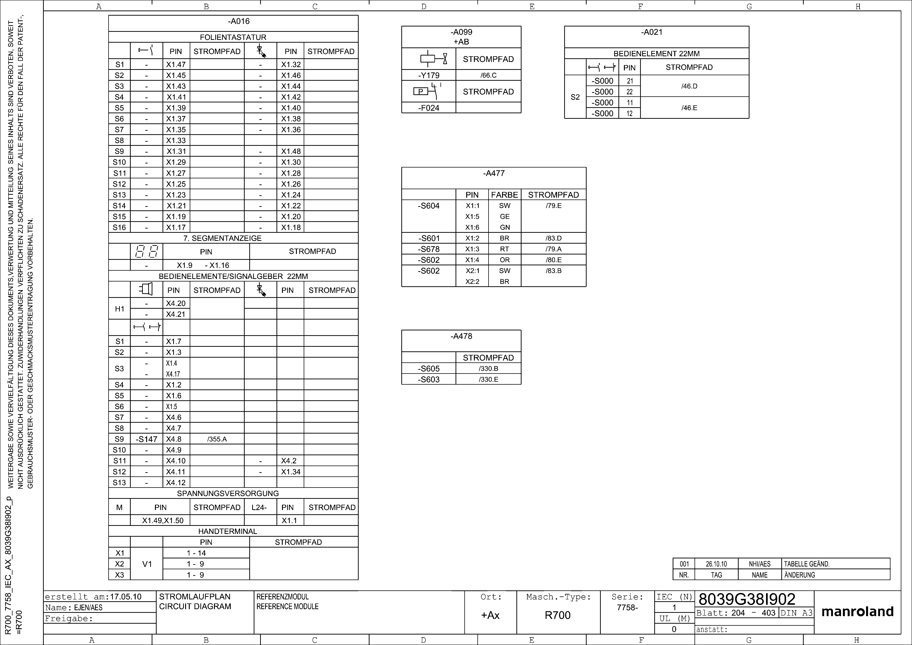

# +Ax — Sheet 204 of 403 — REFERENZMODUL

**REFERENCE MODULE**

> Part of the manroland **R700** printing press IEC/UL circuit diagrams.
> Drawing class: **Stromlaufplan / Circuit diagram** (DIN A3).
> Document `+Ax` covers the **Central control console** machine section.

## At a glance

| Field | Value |
|---|---|
| Document | `+Ax`  (8039G38I902) |
| Sheet | **204** of 403 |
| Section (DE) | REFERENZMODUL |
| Section (EN) | REFERENCE MODULE |
| Section type | REFERENCE_MODULE — Reference module |
| Machine type | `R700` |
| Series | `7758` |
| Created | 17.05.10 |
| Replaces | — |
| Columns used | A, B, C, D, E, F, G, H |
| Path numbers | — |
| Labels on sheet | 183 |
| Cross-refs out | 11 |
| Cross-refs in | 11 |

**Previous:** [+Ax sheet 203](SHEET_0203.md) · **Next:** [+Ax sheet 205](SHEET_0205.md) · **Document TOC:** [_TOC.md](_TOC.md)  (+Ax) · **Master TOC:** [all sheets](../_MASTER_TOC.md)

## Sheet image (300 DPI, exact vector render)



_Rendered directly from the PDF vector layer at 300 DPI (1-bit), no OCR and no resampling. Use it to confirm anything ambiguous in the text below._

## Cross-references on this sheet

Each entry is a wire leaving this sheet. The printed token is `/sheet.column`; the link resolves to that sheet inside the same document.

| Ref | Target sheet | Col | Path | Destination on target | Target section | From col |
|---|---|---|---|---|---|---|
| `/66.C` | [+Ax sheet 66](SHEET_0066.md) | C | — | — | DRUCKLUFTANLAGE | E |
| `/46.D` | [+Ax sheet 46](SHEET_0046.md) | D | — | — | NOT AUS | F |
| `/46.E` | [+Ax sheet 46](SHEET_0046.md) | E | — | — | NOT AUS | F |
| `/79.E` | [+Ax sheet 79](SHEET_0079.md) | E | — | — | ANLEGER | E |
| `/83.D` | [+Ax sheet 83](SHEET_0083.md) | D | — | — | ANLEGER | E |
| `/79.A` | [+Ax sheet 79](SHEET_0079.md) | A | — | — | ANLEGER | E |
| `/80.E` | [+Ax sheet 80](SHEET_0080.md) | E | — | — | ANLEGER | E |
| `/83.B` | [+Ax sheet 83](SHEET_0083.md) | B | — | — | ANLEGER | E |
| `/330.B` | [+Ax sheet 330](SHEET_0330.md) | B | — | — | OPTION: NONSTOP EINRICHTUNG MANUELL, ANLEGER | E |
| `/330.E` | [+Ax sheet 330](SHEET_0330.md) | E | — | — | OPTION: NONSTOP EINRICHTUNG MANUELL, ANLEGER | E |
| `/355.A` | [+Ax sheet 355](SHEET_0355.md) | A | — | — | OPTION: LOGISTIK ANLEGER | B |

### Incoming references (sheets that point here)

Every other sheet that sends a wire to this one. `Back-ref` is the token printed on *that* sheet; `Path` is its line number.

| From sheet | Cols | Back-ref | Path | Refs | What continues there |
|---|---|---|---|---|---|
| [+Ax#46](SHEET_0046.md) | D, E | `/46.D`, `/46.E` | — | 2 | A021 |
| [+Ax#66](SHEET_0066.md) | C | `/66.C` | — | 1 | — |
| [+Ax#79](SHEET_0079.md) | A, E | `/79.A`, `/79.E` | — | 2 | — |
| [+Ax#80](SHEET_0080.md) | E | `/80.E` | — | 1 | — |
| [+Ax#83](SHEET_0083.md) | B, D | `/83.B`, `/83.D` | — | 2 | — |
| [+Ax#330](SHEET_0330.md) | B, E | `/330.B`, `/330.E` | — | 2 | — |
| [+Ax#355](SHEET_0355.md) | A | `/355.A` | — | 1 | A016 |


## Devices on this sheet

| Tag | Class | Class meaning (IEC) | Col | Sub | Terminal | Sign |
|---|---|---|---|---|---|---|
| `Y179` | Y | Magnetventil / solenoid valve, actuator | D | — | — | — |
| `F024` | F | Schutz / protection device (fuse, circuit breaker) | D | — | — | — |
| `A099` | A | Baugruppe / assembly, module, PC board | D | — | — | — |
| `S1` | S | Schalter / switch | A | — | — | — |
| `S2` | S | Schalter / switch | A | — | — | — |
| `S3` | S | Schalter / switch | A | — | — | — |
| `S4` | S | Schalter / switch | A | — | — | — |
| `S5` | S | Schalter / switch | A | — | — | — |
| `S6` | S | Schalter / switch | A | — | — | — |
| `S7` | S | Schalter / switch | A | — | — | — |
| `S8` | S | Schalter / switch | A | — | — | — |
| `S9` | S | Schalter / switch | A | — | — | — |
| `S10` | S | Schalter / switch | A | — | — | — |
| `S11` | S | Schalter / switch | A | — | — | — |
| `S12` | S | Schalter / switch | A | — | — | — |
| `S13` | S | Schalter / switch | A | — | — | — |
| `S14` | S | Schalter / switch | A | — | — | — |
| `S15` | S | Schalter / switch | A | — | — | — |
| `S16` | S | Schalter / switch | A | — | — | — |
| `S2` | S | Schalter / switch | A | — | — | — |
| `S4` | S | Schalter / switch | A | — | — | — |
| `S5` | S | Schalter / switch | A | — | — | — |
| `S3` | S | Schalter / switch | A | — | — | — |
| `S1` | S | Schalter / switch | A | — | — | — |
| `S6` | S | Schalter / switch | A | — | — | — |
| `S8` | S | Schalter / switch | A | — | — | — |
| `S9` | S | Schalter / switch | A | — | — | — |
| `S10` | S | Schalter / switch | A | — | — | — |
| `S11` | S | Schalter / switch | A | — | — | — |
| `S12` | S | Schalter / switch | A | — | — | — |
| `S13` | S | Schalter / switch | A | — | — | — |
| `S7` | S | Schalter / switch | A | — | — | — |
| `X1` | X | Klemme / terminal, plug connector | A | — | — | — |
| `X2` | X | Klemme / terminal, plug connector | A | — | — | — |
| `X3` | X | Klemme / terminal, plug connector | A | — | — | — |
| `V1` | V | Diode / semiconductor valve | A | — | — | — |
| `S147` | S | Schalter / switch | A | — | — | — |
| `A016` | A | Baugruppe / assembly, module, PC board | B | — | — | — |
| `S000` | S | Schalter / switch | F | — | — | — |
| `S000` | S | Schalter / switch | F | — | — | — |
| `S2` | S | Schalter / switch | E | — | — | — |
| `S000` | S | Schalter / switch | F | — | — | — |
| `S000` | S | Schalter / switch | F | — | — | — |
| `A021` | A | Baugruppe / assembly, module, PC board | F | — | — | — |
| `S604` | S | Schalter / switch | D | — | — | — |
| `X1:1` | X | Klemme / terminal, plug connector | D | — | 1 | — |
| `X1:5` | X | Klemme / terminal, plug connector | D | — | 5 | — |
| `X1:2` | X | Klemme / terminal, plug connector | D | — | 2 | — |
| `X1:3` | X | Klemme / terminal, plug connector | D | — | 3 | — |
| `X1:4` | X | Klemme / terminal, plug connector | D | — | 4 | — |
| `S601` | S | Schalter / switch | D | — | — | — |
| `S678` | S | Schalter / switch | D | — | — | — |
| `S602` | S | Schalter / switch | D | — | — | — |
| `X1:6` | X | Klemme / terminal, plug connector | D | — | 6 | — |
| `X2:1` | X | Klemme / terminal, plug connector | D | — | 1 | — |
| `X2:2` | X | Klemme / terminal, plug connector | D | — | 2 | — |
| `S602` | S | Schalter / switch | D | — | — | — |
| `A477` | A | Baugruppe / assembly, module, PC board | E | — | — | — |
| `S605` | S | Schalter / switch | D | — | — | — |
| `S603` | S | Schalter / switch | D | — | — | — |
| `A478` | A | Baugruppe / assembly, module, PC board | D | — | — | — |
| `X1.46` | — | cross-device reference | C | — | — | — |
| `X1.44` | — | cross-device reference | C | — | — | — |
| `X1.42` | — | cross-device reference | C | — | — | — |
| `X1.40` | — | cross-device reference | C | — | — | — |
| `X1.38` | — | cross-device reference | C | — | — | — |
| `X1.36` | — | cross-device reference | C | — | — | — |
| `X1.30` | — | cross-device reference | C | — | — | — |
| `X1.28` | — | cross-device reference | C | — | — | — |
| `X1.26` | — | cross-device reference | C | — | — | — |
| `X1.24` | — | cross-device reference | C | — | — | — |
| `X1.22` | — | cross-device reference | C | — | — | — |
| `X1.20` | — | cross-device reference | C | — | — | — |
| `X1.32` | — | cross-device reference | C | — | — | — |
| `X1.48` | — | cross-device reference | C | — | — | — |
| `X1.18` | — | cross-device reference | C | — | — | — |
| `X1.47` | — | cross-device reference | B | — | — | — |
| `X1.45` | — | cross-device reference | B | — | — | — |
| `X1.43` | — | cross-device reference | B | — | — | — |
| `X1.41` | — | cross-device reference | B | — | — | — |
| `X1.39` | — | cross-device reference | B | — | — | — |
| `X1.37` | — | cross-device reference | B | — | — | — |
| `X1.35` | — | cross-device reference | B | — | — | — |
| `X1.33` | — | cross-device reference | B | — | — | — |
| `X1.31` | — | cross-device reference | B | — | — | — |
| `X1.29` | — | cross-device reference | B | — | — | — |
| `X1.27` | — | cross-device reference | B | — | — | — |
| `X1.25` | — | cross-device reference | B | — | — | — |
| `X1.23` | — | cross-device reference | B | — | — | — |
| `X1.21` | — | cross-device reference | B | — | — | — |
| `X1.19` | — | cross-device reference | B | — | — | — |
| `X1.17` | — | cross-device reference | B | — | — | — |
| `X4.20` | — | cross-device reference | B | — | — | — |
| `X4.21` | — | cross-device reference | B | — | — | — |
| `X1.9` | — | cross-device reference | B | — | — | — |
| `X1.16` | — | cross-device reference | B | — | — | — |
| `X1.3` | — | cross-device reference | B | — | — | — |
| `X1.4` | — | cross-device reference | B | — | — | — |
| `X1.2` | — | cross-device reference | B | — | — | — |
| `X1.6` | — | cross-device reference | B | — | — | — |
| `X1.5` | — | cross-device reference | B | — | — | — |
| `X4.17` | — | cross-device reference | B | — | — | — |
| `X1.7` | — | cross-device reference | B | — | — | — |
| `X4.7` | — | cross-device reference | B | — | — | — |
| `X4.8` | — | cross-device reference | B | — | — | — |
| `X4.9` | — | cross-device reference | B | — | — | — |
| `X4.10` | — | cross-device reference | B | — | — | — |
| `X4.11` | — | cross-device reference | B | — | — | — |
| `X4.12` | — | cross-device reference | B | — | — | — |
| `X1.34` | — | cross-device reference | C | — | — | — |
| `X4.2` | — | cross-device reference | C | — | — | — |
| `X1.1` | — | cross-device reference | C | — | — | — |
| `X4.6` | — | cross-device reference | B | — | — | — |
| `NR.` | — | cross-device reference | F | — | — | — |
| `26.10.10` | — | cross-device reference | G | — | — | — |

## Potentials / nets

| Potential | Count | Columns | Attached devices | Terminals |
|---|---|---|---|---|
| `H1` | 1 | A | — | — |
| `L24` | 1 | B | — | — |


A potential such as `L24+/4` or `M24+` is a named supply/return rail; every place it appears on this sheet is electrically common.

## Wire-end annotations (grouped as printed)

A wire that continues elsewhere is annotated with a small cluster: the destination description, the path/line number `#NN`, and the `/sheet.column` cross reference. Each row below is one such cluster exactly as it is grouped on the drawing.

| Col | Y | Path | Cross-ref | Text on the wire |
|---|---|---|---|---|
| B | 23.0 | — | — | `A016` |
| D | 37.1 | — | — | `A099` |
| F | 37.1 | — | — | `A021` |
| B | 44.6 | — | — | `FOLIENTASTATUR` |
| D | 49.8 | — | — | `+AB` |
| B | 63.0 | — | — | `PIN` |
| C | 63.0 | — | — | `STROMPFAD STROMPFAD` |
| C | 63.0 | — | — | `PIN` |
| F | 65.8 | — | — | `BEDIENELEMENT 22MM` |
| E | 72.6 | — | — | `STROMPFAD` |
| A | 80.0 | — | — | `S10 S2 S3 S4 S5 S6 S7 S8 S9 S1` |
| B | 80.0 | — | — | `X1.47 X1.45 X1.43` |
| C | 80.0 | — | — | `X1.32` |
| F | 83.5 | — | — | `STROMPFAD` |
| F | 84.3 | — | — | `PIN` |
| D | 93.9 | — | — | `Y179` |
| C | 94.2 | — | — | `X1.46 X1.44 X1.42 X1.40 X1.38 X1.36` |
| E | 94.5 | — | `/66.C` | — |
| F | 100.9 | — | — | `S000 S000 22` |
| F | 102.2 | — | — | `21` |
| F | 108.7 | — | `/46.D` | — |
| E | 115.1 | — | — | `STROMPFAD` |
| D | 115.4 | — | — | `P` |
| B | 122.5 | — | — | `X1.39 X1.37 X1.35 X1.33 X1.41` |
| F | 122.5 | — | — | `S2 S000 S000` |
| F | 130.5 | — | — | `11` |
| D | 136.4 | — | — | `F024` |
| F | 137.0 | — | `/46.E` | — |
| F | 144.9 | — | — | `12` |
| B | 193.4 | — | — | `X1.29 X1.27 X1.25 X1.23 X1.31` |
| C | 193.4 | — | — | `X1.48` |
| C | 207.6 | — | — | `X1.30 X1.28 X1.26 X1.24 X1.22 X1.20` |
| E | 221.4 | — | — | `A477` |
| A | 221.7 | — | — | `S12 S13 S14 S15 S16 S11` |
| E | 249.8 | — | — | `PIN FARBE STROMPFAD` |
| D | 263.9 | — | — | `S604` |
| B | 264.2 | — | — | `X1.19 X1.17 X1.21` |
| E | 264.4 | — | — | `SW` |
| D | 264.6 | — | — | `X1:1` |
| E | 264.6 | — | `/79.E` | — |
| D | 278.8 | — | — | `X1:5` |
| E | 278.8 | — | — | `GE` |
| C | 292.6 | — | — | `X1.18` |
| E | 292.9 | — | — | `X1:6 GN` |
| D | 306.4 | — | — | `S678 S602 S601` |
| B | 306.8 | — | — | `7. SEGMENTANZEIGE` |
| D | 307.1 | — | — | `X1:2` |
| E | 307.1 | — | — | `BR` |
| E | 307.1 | — | `/83.D` | — |
| D | 321.3 | — | — | `X1:3` |
| E | 321.3 | — | — | `RT` |
| E | 321.3 | — | `/79.A` | — |
| C | 323.8 | — | — | `PIN STROMPFAD` |
| E | 335.4 | — | `/80.E` | — |
| D | 335.5 | — | — | `X1:4` |
| E | 335.5 | — | — | `OR` |
| B | 342.2 | — | — | `X1.9 X1.16` |
| D | 349.0 | — | — | `S602 X2:2 SW` |
| D | 349.6 | — | — | `X2:1` |
| E | 349.6 | — | `/83.B` | — |
| B | 356.4 | — | — | `BEDIENELEMENTE/SIGNALGEBER 22MM` |
| E | 363.8 | — | — | `BR` |
| C | 374.8 | — | — | `PIN STROMPFAD PIN STROMPFAD` |
| B | 391.8 | — | — | `X4.20 X4.21` |
| A | 398.9 | — | — | `H1` |
| D | 434.0 | — | — | `A478` |
| A | 441.4 | — | — | `S6 S1 X1.7` |
| A | 455.6 | — | — | `S2` |
| B | 455.6 | — | — | `X1.3` |
| D | 462.4 | — | — | `S605 S603 STROMPFAD` |
| B | 470.9 | — | — | `X1.4` |
| A | 476.9 | — | — | `S3` |
| E | 477.2 | — | `/330.B` | — |
| B | 485.1 | — | — | `X4.17` |
| E | 491.4 | — | `/330.E` | — |
| A | 498.1 | — | — | `S4 S5` |
| B | 498.1 | — | — | `X1.2 X1.6` |
| B | 527.6 | — | — | `X1.5` |
| A | 540.6 | — | — | `S7 X4.6` |
| A | 554.8 | — | — | `S10 S8 S9` |
| B | 554.8 | — | — | `X4.7 X4.8 X4.9 X4.10 X4.11 X4.12` |
| A | 568.6 | — | — | `S147` |
| B | 569.3 | — | `/355.A` | — |
| A | 597.3 | — | — | `S12 S13 S11` |
| C | 597.3 | — | — | `X4.2 X1.34` |
| B | 639.8 | — | — | `SPANNUNGSVERSORGUNG` |
| A | 658.2 | — | — | `M PIN` |
| C | 658.2 | — | — | `STROMPFAD L24 PIN STROMPFAD` |
| B | 675.3 | — | — | `X1.49,X1.50` |
| C | 675.3 | — | — | `X1.1` |
| B | 689.4 | — | — | `HANDTERMINAL` |
| B | 703.6 | — | — | `X2 X3 X1 PIN STROMPFAD` |
| B | 717.8 | — | — | `V1 1 14 1 9 1 9` |
| G | 733.0 | — | — | `001 26.10.10 NHI/AES TABELLE GEÄND.` |
| G | 747.1 | — | — | `NR. TAG NAME ÄNDERUNG` |


## Reconstructed tables

This sheet carries tabular content (pin map / terminal assignment / index). The grid below was rebuilt from the drawing's own rule lines, so each row is exactly one physical row of the table.

### Table 1 — 45 data rows × 5 columns (at x=141.7, y=19.8) — **A016 FOLIENTASTATUR**

|  |  |  | PIN | STROMPFAD |
|---|---|---|---|---|
| `S1` |  |  | `X1.47` |  |
| `S2` |  |  | `X1.45` |  |
| `S3` |  |  | `X1.43` |  |
| `S4` |  |  | `X1.41` |  |
| `S5` |  |  | `X1.39` |  |
| `S6` |  |  | `X1.37` |  |
| `S7` |  |  | `X1.35` |  |
| `S8` |  |  | `X1.33` |  |
| `S9` |  |  | `X1.31` |  |
| `S10` |  |  | `X1.29` |  |
| `S11` |  |  | `X1.27` |  |
| `S12` |  |  | `X1.25` |  |
| `S13` |  |  | `X1.23` |  |
| `S14` |  |  | `X1.21` |  |
| `S15` |  |  | `X1.19` |  |
| `S16` |  |  | `X1.17` |  |
|  |  |  | `7.` | `SEGMENTANZEIGE` |
|  |  |  |  | `PIN` |
|  |  |  | `X1.9` | `X1.16` |
|  |  |  |  | `BEDIENELEMENTE/SIGNALGEBER` |
|  |  |  | `PIN` | `STROMPFAD` |
|  |  |  | `X4.20` |  |
| `H1` |  |  | `X4.21` |  |
| `S1` |  |  | `X1.7` |  |
| `S2` |  |  | `X1.3` |  |
| `S3` |  |  | `X1.4` |  |
|  |  |  | `X4.17` |  |
| `S4` |  |  | `X1.2` |  |
| `S5` |  |  | `X1.6` |  |
| `S6` |  |  | `X1.5` |  |
| `S7` |  |  | `X4.6` |  |
| `S8` |  |  | `X4.7` |  |
| `S9` | `S147` |  | `X4.8` | `/355.A` |
| `S10` |  |  | `X4.9` |  |
| `S11` |  |  | `X4.10` |  |
| `S12` |  |  | `X4.11` |  |
| `S13` |  |  | `X4.12` |  |
|  |  |  |  | `SPANNUNGSVERSORGUNG` |
| `M` |  | `PIN` |  | `STROMPFAD` |
|  |  |  | `X1.49,X1.50` |  |
|  |  |  |  | `HANDTERMINAL` |
|  |  |  |  | `PIN` |
| `X1` |  |  | `1` | `14` |
| `X2` | `V1` |  | `1` | `9` |
| `X3` |  |  | `1` | `9` |


### Table 2 — 23 data rows × 3 columns (at x=326.0, y=19.8)

|  | PIN | STROMPFAD |
|---|---|---|
|  | `X1.32` |  |
|  | `X1.46` |  |
|  | `X1.44` |  |
|  | `X1.42` |  |
|  | `X1.40` |  |
|  | `X1.38` |  |
|  | `X1.36` |  |
|  | `X1.48` |  |
|  | `X1.30` |  |
|  | `X1.28` |  |
|  | `X1.26` |  |
|  | `X1.24` |  |
|  | `X1.22` |  |
|  | `X1.20` |  |
|  | `X1.18` |  |
|  |  | `STROMPFAD` |
|  | `22MM` |  |
|  | `PIN` | `STROMPFAD` |
|  | `X4.2` |  |
|  | `X1.34` |  |
| `L24` | `PIN` | `STROMPFAD` |
|  | `X1.1` |  |
|  | `STROMPFAD` |  |


### Table 3 — 21 data rows × 7 columns (at x=524.4, y=19.8) — **A099 +AB**

|  | STROMPFAD |  |  |  |  | PIN |
|---|---|---|---|---|---|---|
| `Y179` |  | `/66.C` |  |  |  |  |
|  |  |  |  |  | `S000` | `21` |
| `P` | `STROMPFAD` |  |  |  | `S000` | `22` |
|  |  |  |  | `S2` |  |  |
|  |  |  |  |  | `S000` | `11` |
| `F024` |  |  |  |  |  |  |
|  |  |  |  |  | `S000` | `12` |
|  |  | `A477` |  |  |  |  |
|  | `PIN` | `FARBE` | `STROMPFAD` |  |  |  |
| `S604` | `X1:1` | `SW` | `/79.E` |  |  |  |
|  | `X1:5` | `GE` |  |  |  |  |
|  | `X1:6` | `GN` |  |  |  |  |
| `S601` | `X1:2` | `BR` | `/83.D` |  |  |  |
| `S678` | `X1:3` | `RT` | `/79.A` |  |  |  |
| `S602` | `X1:4` | `OR` | `/80.E` |  |  |  |
| `S602` | `X2:1` | `SW` | `/83.B` |  |  |  |
|  | `X2:2` | `BR` |  |  |  |  |
|  | `A478` |  |  |  |  |  |
|  | `STROMPFAD` |  |  |  |  |  |
| `S605` |  | `/330.B` |  |  |  |  |
| `S603` |  | `/330.E` |  |  |  |  |


## Notes and free text on this sheet

| Text | Col | Y (pt) |
|---|---|---|
| `P` | D | 115.42 |
| `STROMPFAD` | E | 72.59 |
| `+AB` | D | 49.84 |
| `7. SEGMENTANZEIGE` | B | 306.75 |
| `FOLIENTASTATUR` | B | 44.56 |
| `STROMPFAD` | B | 62.97 |
| `STROMPFAD` | C | 62.97 |
| `PIN` | C | 63.01 |
| `PIN` | B | 63.01 |
| `BEDIENELEMENTE/SIGNALGEBER 22MM` | B | 356.36 |
| `HANDTERMINAL` | B | 689.44 |
| `SPANNUNGSVERSORGUNG` | B | 639.82 |
| `X1.49,X1.50` | B | 675.26 |
| `M` | A | 658.22 |
| `PIN` | F | 84.27 |
| `BEDIENELEMENT 22MM` | F | 65.81 |
| `STROMPFAD` | F | 83.52 |
| `PIN` | D | 249.85 |
| `FARBE` | E | 249.75 |
| `SW` | E | 264.4 |
| `GE` | E | 278.77 |
| `BR` | E | 307.13 |
| `RT` | E | 321.33 |
| `OR` | E | 335.51 |
| `GN` | E | 292.99 |
| `TAG` | G | 747.27 |
| `NAME` | G | 747.25 |
| `ÄNDERUNG` | G | 747.31 |
| `NHI/AES` | G | 733.11 |
| `TABELLE GEÄND.` | H | 733.12 |

## Complete label inventory (exact text from the drawing)

Every text object inside the drawing area of this sheet, in DIN reading order (column A→H, then top→bottom). This is the authoritative list: if a string is not here it is not printed on this sheet.

| Col | Y | X | Dir | Type | Text |
|---|---|---|---|---|---|
| A | 80.0 | 150.7 | → | device tag | `S1` |
| A | 94.2 | 149.8 | → | device tag | `S2` |
| A | 108.4 | 149.8 | → | device tag | `S3` |
| A | 122.5 | 149.8 | → | device tag | `S4` |
| A | 136.7 | 149.8 | → | device tag | `S5` |
| A | 150.9 | 149.8 | → | device tag | `S6` |
| A | 165.0 | 149.8 | → | device tag | `S7` |
| A | 179.2 | 149.8 | → | device tag | `S8` |
| A | 193.4 | 149.8 | → | device tag | `S9` |
| A | 207.6 | 147.1 | → | device tag | `S10` |
| A | 221.7 | 148.0 | → | device tag | `S11` |
| A | 235.9 | 147.1 | → | device tag | `S12` |
| A | 250.1 | 147.1 | → | device tag | `S13` |
| A | 264.3 | 147.1 | → | device tag | `S14` |
| A | 278.4 | 147.1 | → | device tag | `S15` |
| A | 292.6 | 147.1 | → | device tag | `S16` |
| A | 398.9 | 150.2 | → | potential | `H1` |
| A | 441.4 | 150.7 | → | device tag | `S1` |
| A | 455.6 | 149.8 | → | device tag | `S2` |
| A | 476.9 | 149.8 | → | device tag | `S3` |
| A | 498.1 | 149.8 | → | device tag | `S4` |
| A | 512.3 | 149.8 | → | device tag | `S5` |
| A | 526.5 | 149.8 | → | device tag | `S6` |
| A | 540.6 | 149.8 | → | device tag | `S7` |
| A | 554.8 | 149.8 | → | device tag | `S8` |
| A | 568.6 | 177.3 | → | device tag | `S147` |
| A | 569.0 | 149.8 | → | device tag | `S9` |
| A | 583.2 | 147.1 | → | device tag | `S10` |
| A | 597.3 | 148.0 | → | device tag | `S11` |
| A | 611.5 | 147.1 | → | device tag | `S12` |
| A | 625.7 | 147.1 | → | device tag | `S13` |
| A | 658.2 | 151.8 | → | text | `M` |
| A | 717.8 | 150.9 | → | device tag | `X1` |
| A | 731.6 | 185.8 | → | device tag | `V1` |
| A | 732.0 | 150.1 | → | device tag | `X2` |
| A | 746.1 | 150.1 | → | device tag | `X3` |
| B | 23.0 | 297.8 | → | device tag | `A016` |
| B | 44.6 | 261.1 | → | text | `FOLIENTASTATUR` |
| B | 63.0 | 221.5 | → | text | `PIN` |
| B | 63.0 | 252.7 | → | text | `STROMPFAD` |
| B | 80.0 | 217.0 | → | device ref | `X1.47` |
| B | 94.2 | 217.0 | → | device ref | `X1.45` |
| B | 108.3 | 217.0 | → | device ref | `X1.43` |
| B | 122.5 | 217.8 | → | device ref | `X1.41` |
| B | 136.7 | 217.0 | → | device ref | `X1.39` |
| B | 150.9 | 217.0 | → | device ref | `X1.37` |
| B | 165.0 | 217.0 | → | device ref | `X1.35` |
| B | 179.2 | 217.0 | → | device ref | `X1.33` |
| B | 193.4 | 217.8 | → | device ref | `X1.31` |
| B | 207.6 | 217.0 | → | device ref | `X1.29` |
| B | 221.7 | 217.0 | → | device ref | `X1.27` |
| B | 235.9 | 217.0 | → | device ref | `X1.25` |
| B | 250.1 | 217.0 | → | device ref | `X1.23` |
| B | 264.2 | 217.8 | → | device ref | `X1.21` |
| B | 278.4 | 217.0 | → | device ref | `X1.19` |
| B | 292.6 | 217.0 | → | device ref | `X1.17` |
| B | 306.8 | 239.5 | → | text | `7. SEGMENTANZEIGE` |
| B | 324.5 | 261.2 | → | text | `PIN` |
| B | 342.2 | 231.0 | → | device ref | `X1.9` |
| B | 342.2 | 267.6 | → | device ref | `X1.16` |
| B | 356.4 | 207.4 | → | text | `BEDIENELEMENTE/SIGNALGEBER 22MM` |
| B | 374.8 | 218.7 | → | text | `PIN` |
| B | 374.8 | 252.7 | → | text | `STROMPFAD` |
| B | 391.8 | 216.9 | → | device ref | `X4.20` |
| B | 406.0 | 216.9 | → | device ref | `X4.21` |
| B | 441.4 | 216.9 | → | device ref | `X1.7` |
| B | 455.6 | 216.9 | → | device ref | `X1.3` |
| B | 470.9 | 216.9 | → | device ref | `X1.4` |
| B | 485.1 | 216.9 | → | device ref | `X4.17` |
| B | 498.1 | 216.9 | → | device ref | `X1.2` |
| B | 512.3 | 216.9 | → | device ref | `X1.6` |
| B | 527.6 | 216.9 | → | device ref | `X1.5` |
| B | 540.6 | 216.9 | → | device ref | `X4.6` |
| B | 554.8 | 216.9 | → | device ref | `X4.7` |
| B | 569.0 | 216.9 | → | device ref | `X4.8` |
| B | 569.3 | 270.7 | → | cross-reference | `/355.A` |
| B | 583.1 | 216.9 | → | device ref | `X4.9` |
| B | 597.3 | 216.9 | → | device ref | `X4.10` |
| B | 611.5 | 216.9 | → | device ref | `X4.11` |
| B | 625.7 | 216.9 | → | device ref | `X4.12` |
| B | 639.8 | 231.2 | → | text | `SPANNUNGSVERSORGUNG` |
| B | 658.2 | 252.7 | → | text | `STROMPFAD` |
| B | 658.3 | 201.7 | → | text | `PIN` |
| B | 658.3 | 328.7 | → | potential | `L24` |
| B | 675.3 | 185.8 | → | text | `X1.49,X1.50` |
| B | 689.4 | 258.8 | → | text | `HANDTERMINAL` |
| B | 703.6 | 261.2 | → | text | `PIN` |
| B | 717.8 | 243.6 | → | number | `1 14` |
| B | 731.9 | 243.6 | → | number | `1 9` |
| B | 746.1 | 243.6 | → | number | `1 9` |
| C | 63.0 | 371.8 | → | text | `PIN` |
| C | 63.0 | 401.5 | → | text | `STROMPFAD` |
| C | 80.0 | 367.2 | → | device ref | `X1.32` |
| C | 94.2 | 367.2 | → | device ref | `X1.46` |
| C | 108.3 | 367.2 | → | device ref | `X1.44` |
| C | 122.5 | 367.2 | → | device ref | `X1.42` |
| C | 136.7 | 367.2 | → | device ref | `X1.40` |
| C | 150.9 | 367.2 | → | device ref | `X1.38` |
| C | 165.0 | 367.2 | → | device ref | `X1.36` |
| C | 193.4 | 367.2 | → | device ref | `X1.48` |
| C | 207.6 | 367.2 | → | device ref | `X1.30` |
| C | 221.7 | 367.2 | → | device ref | `X1.28` |
| C | 235.9 | 367.2 | → | device ref | `X1.26` |
| C | 250.1 | 367.2 | → | device ref | `X1.24` |
| C | 264.2 | 367.2 | → | device ref | `X1.22` |
| C | 278.4 | 367.2 | → | device ref | `X1.20` |
| C | 292.6 | 367.2 | → | device ref | `X1.18` |
| C | 323.8 | 377.4 | → | text | `STROMPFAD` |
| C | 374.8 | 367.5 | → | text | `PIN` |
| C | 374.8 | 402.9 | → | text | `STROMPFAD` |
| C | 597.3 | 367.1 | → | device ref | `X4.2` |
| C | 611.5 | 367.1 | → | device ref | `X1.34` |
| C | 658.2 | 402.9 | → | text | `STROMPFAD` |
| C | 658.3 | 367.5 | → | text | `PIN` |
| C | 675.3 | 367.9 | → | device ref | `X1.1` |
| C | 703.6 | 359.0 | → | text | `STROMPFAD` |
| D | 37.2 | 588.3 | → | device tag | `A099` |
| D | 49.8 | 592.2 | → | text | `+AB` |
| D | 93.9 | 546.1 | → | device tag | `Y179` |
| D | 115.4 | 546.0 | → | text | `P` |
| D | 136.4 | 546.1 | → | device tag | `F024` |
| D | 249.8 | 607.9 | → | text | `PIN` |
| D | 263.9 | 545.8 | → | device tag | `S604` |
| D | 264.6 | 608.3 | → | device tag | `X1:1` |
| D | 278.8 | 607.6 | → | device tag | `X1:5` |
| D | 292.9 | 607.6 | → | device tag | `X1:6` |
| D | 306.4 | 546.5 | → | device tag | `S601` |
| D | 307.1 | 607.7 | → | device tag | `X1:2` |
| D | 320.6 | 545.8 | → | device tag | `S678` |
| D | 321.3 | 607.6 | → | device tag | `X1:3` |
| D | 334.8 | 545.8 | → | device tag | `S602` |
| D | 335.5 | 607.6 | → | device tag | `X1:4` |
| D | 349.0 | 545.8 | → | device tag | `S602` |
| D | 349.6 | 608.3 | → | device tag | `X2:1` |
| D | 363.8 | 607.7 | → | device tag | `X2:2` |
| D | 434.0 | 588.3 | → | device tag | `A478` |
| D | 476.5 | 545.8 | → | device tag | `S605` |
| D | 490.7 | 545.8 | → | device tag | `S603` |
| E | 72.6 | 604.5 | → | text | `STROMPFAD` |
| E | 94.5 | 627.4 | → | cross-reference | `/66.C` |
| E | 115.1 | 604.5 | → | text | `STROMPFAD` |
| E | 122.5 | 745.1 | → | device tag | `S2` |
| E | 221.4 | 630.9 | → | device tag | `A477` |
| E | 249.7 | 641.2 | → | text | `FARBE` |
| E | 249.8 | 689.5 | → | text | `STROMPFAD` |
| E | 264.4 | 651.5 | → | text | `SW` |
| E | 264.6 | 712.8 | → | cross-reference | `/79.E` |
| E | 278.8 | 652.8 | → | text | `GE` |
| E | 293.0 | 652.8 | → | text | `GN` |
| E | 307.1 | 652.7 | → | text | `BR` |
| E | 307.1 | 712.5 | → | cross-reference | `/83.D` |
| E | 321.3 | 653.0 | → | text | `RT` |
| E | 321.3 | 712.5 | → | cross-reference | `/79.A` |
| E | 335.4 | 712.8 | → | cross-reference | `/80.E` |
| E | 335.5 | 652.5 | → | text | `OR` |
| E | 349.4 | 651.5 | → | text | `SW` |
| E | 349.6 | 712.6 | → | cross-reference | `/83.B` |
| E | 363.8 | 652.7 | → | text | `BR` |
| E | 462.4 | 604.5 | → | text | `STROMPFAD` |
| E | 477.2 | 625.2 | → | cross-reference | `/330.B` |
| E | 491.4 | 625.3 | → | cross-reference | `/330.E` |
| F | 37.2 | 837.1 | → | device tag | `A021` |
| F | 65.8 | 801.2 | → | text | `BEDIENELEMENT 22MM` |
| F | 83.5 | 869.2 | → | text | `STROMPFAD` |
| F | 84.3 | 814.0 | → | text | `PIN` |
| F | 100.9 | 772.6 | → | device tag | `S000` |
| F | 102.2 | 818.7 | → | number | `21` |
| F | 108.7 | 889.7 | → | cross-reference | `/46.D` |
| F | 115.1 | 772.6 | → | device tag | `S000` |
| F | 116.6 | 818.1 | → | number | `22` |
| F | 129.3 | 772.6 | → | device tag | `S000` |
| F | 130.5 | 818.4 | → | number | `11` |
| F | 137.0 | 889.9 | → | cross-reference | `/46.E` |
| F | 143.5 | 772.6 | → | device tag | `S000` |
| F | 144.9 | 817.8 | → | number | `12` |
| F | 733.0 | 887.7 | → | number | `001` |
| F | 747.1 | 886.7 | → | device ref | `NR.` |
| G | 733.1 | 921.9 | → | device ref | `26.10.10` |
| G | 733.1 | 977.9 | → | text | `NHI/AES` |
| G | 747.3 | 928.3 | → | text | `TAG` |
| G | 747.3 | 981.7 | → | text | `NAME` |
| G | 747.3 | 1024.3 | → | text | `ÄNDERUNG` |
| H | 733.1 | 1023.7 | → | text | `TABELLE GEÄND.` |

## Reading-order text block

The same content as a plain block, grouped by DIN column — convenient to paste or to match against a visual description.

```text
=== Column A ===
  80.0  150.7  devtag       S1
  94.2  149.8  devtag       S2
 108.4  149.8  devtag       S3
 122.5  149.8  devtag       S4
 136.7  149.8  devtag       S5
 150.9  149.8  devtag       S6
 165.0  149.8  devtag       S7
 179.2  149.8  devtag       S8
 193.4  149.8  devtag       S9
 207.6  147.1  devtag       S10
 221.7  148.0  devtag       S11
 235.9  147.1  devtag       S12
 250.1  147.1  devtag       S13
 264.3  147.1  devtag       S14
 278.4  147.1  devtag       S15
 292.6  147.1  devtag       S16
 398.9  150.2  net          H1
 441.4  150.7  devtag       S1
 455.6  149.8  devtag       S2
 476.9  149.8  devtag       S3
 498.1  149.8  devtag       S4
 512.3  149.8  devtag       S5
 526.5  149.8  devtag       S6
 540.6  149.8  devtag       S7
 554.8  149.8  devtag       S8
 568.6  177.3  devtag       S147
 569.0  149.8  devtag       S9
 583.2  147.1  devtag       S10
 597.3  148.0  devtag       S11
 611.5  147.1  devtag       S12
 625.7  147.1  devtag       S13
 658.2  151.8  text         M
 717.8  150.9  devtag       X1
 731.6  185.8  devtag       V1
 732.0  150.1  devtag       X2
 746.1  150.1  devtag       X3
=== Column B ===
  23.0  297.8  devtag       A016
  44.6  261.1  text         FOLIENTASTATUR
  63.0  221.5  text         PIN
  63.0  252.7  text         STROMPFAD
  80.0  217.0  devref       X1.47
  94.2  217.0  devref       X1.45
 108.3  217.0  devref       X1.43
 122.5  217.8  devref       X1.41
 136.7  217.0  devref       X1.39
 150.9  217.0  devref       X1.37
 165.0  217.0  devref       X1.35
 179.2  217.0  devref       X1.33
 193.4  217.8  devref       X1.31
 207.6  217.0  devref       X1.29
 221.7  217.0  devref       X1.27
 235.9  217.0  devref       X1.25
 250.1  217.0  devref       X1.23
 264.2  217.8  devref       X1.21
 278.4  217.0  devref       X1.19
 292.6  217.0  devref       X1.17
 306.8  239.5  text         7. SEGMENTANZEIGE
 324.5  261.2  text         PIN
 342.2  231.0  devref       X1.9
 342.2  267.6  devref       X1.16
 356.4  207.4  text         BEDIENELEMENTE/SIGNALGEBER 22MM
 374.8  218.7  text         PIN
 374.8  252.7  text         STROMPFAD
 391.8  216.9  devref       X4.20
 406.0  216.9  devref       X4.21
 441.4  216.9  devref       X1.7
 455.6  216.9  devref       X1.3
 470.9  216.9  devref       X1.4
 485.1  216.9  devref       X4.17
 498.1  216.9  devref       X1.2
 512.3  216.9  devref       X1.6
 527.6  216.9  devref       X1.5
 540.6  216.9  devref       X4.6
 554.8  216.9  devref       X4.7
 569.0  216.9  devref       X4.8
 569.3  270.7  xref         /355.A
 583.1  216.9  devref       X4.9
 597.3  216.9  devref       X4.10
 611.5  216.9  devref       X4.11
 625.7  216.9  devref       X4.12
 639.8  231.2  text         SPANNUNGSVERSORGUNG
 658.2  252.7  text         STROMPFAD
 658.3  201.7  text         PIN
 658.3  328.7  net          L24
 675.3  185.8  text         X1.49,X1.50
 689.4  258.8  text         HANDTERMINAL
 703.6  261.2  text         PIN
 717.8  243.6  numeric      1 14
 731.9  243.6  numeric      1 9
 746.1  243.6  numeric      1 9
=== Column C ===
  63.0  371.8  text         PIN
  63.0  401.5  text         STROMPFAD
  80.0  367.2  devref       X1.32
  94.2  367.2  devref       X1.46
 108.3  367.2  devref       X1.44
 122.5  367.2  devref       X1.42
 136.7  367.2  devref       X1.40
 150.9  367.2  devref       X1.38
 165.0  367.2  devref       X1.36
 193.4  367.2  devref       X1.48
 207.6  367.2  devref       X1.30
 221.7  367.2  devref       X1.28
 235.9  367.2  devref       X1.26
 250.1  367.2  devref       X1.24
 264.2  367.2  devref       X1.22
 278.4  367.2  devref       X1.20
 292.6  367.2  devref       X1.18
 323.8  377.4  text         STROMPFAD
 374.8  367.5  text         PIN
 374.8  402.9  text         STROMPFAD
 597.3  367.1  devref       X4.2
 611.5  367.1  devref       X1.34
 658.2  402.9  text         STROMPFAD
 658.3  367.5  text         PIN
 675.3  367.9  devref       X1.1
 703.6  359.0  text         STROMPFAD
=== Column D ===
  37.2  588.3  devtag       A099
  49.8  592.2  text         +AB
  93.9  546.1  devtag       Y179
 115.4  546.0  text         P
 136.4  546.1  devtag       F024
 249.8  607.9  text         PIN
 263.9  545.8  devtag       S604
 264.6  608.3  devtag       X1:1
 278.8  607.6  devtag       X1:5
 292.9  607.6  devtag       X1:6
 306.4  546.5  devtag       S601
 307.1  607.7  devtag       X1:2
 320.6  545.8  devtag       S678
 321.3  607.6  devtag       X1:3
 334.8  545.8  devtag       S602
 335.5  607.6  devtag       X1:4
 349.0  545.8  devtag       S602
 349.6  608.3  devtag       X2:1
 363.8  607.7  devtag       X2:2
 434.0  588.3  devtag       A478
 476.5  545.8  devtag       S605
 490.7  545.8  devtag       S603
=== Column E ===
  72.6  604.5  text         STROMPFAD
  94.5  627.4  xref         /66.C
 115.1  604.5  text         STROMPFAD
 122.5  745.1  devtag       S2
 221.4  630.9  devtag       A477
 249.7  641.2  text         FARBE
 249.8  689.5  text         STROMPFAD
 264.4  651.5  text         SW
 264.6  712.8  xref         /79.E
 278.8  652.8  text         GE
 293.0  652.8  text         GN
 307.1  652.7  text         BR
 307.1  712.5  xref         /83.D
 321.3  653.0  text         RT
 321.3  712.5  xref         /79.A
 335.4  712.8  xref         /80.E
 335.5  652.5  text         OR
 349.4  651.5  text         SW
 349.6  712.6  xref         /83.B
 363.8  652.7  text         BR
 462.4  604.5  text         STROMPFAD
 477.2  625.2  xref         /330.B
 491.4  625.3  xref         /330.E
=== Column F ===
  37.2  837.1  devtag       A021
  65.8  801.2  text         BEDIENELEMENT 22MM
  83.5  869.2  text         STROMPFAD
  84.3  814.0  text         PIN
 100.9  772.6  devtag       S000
 102.2  818.7  numeric      21
 108.7  889.7  xref         /46.D
 115.1  772.6  devtag       S000
 116.6  818.1  numeric      22
 129.3  772.6  devtag       S000
 130.5  818.4  numeric      11
 137.0  889.9  xref         /46.E
 143.5  772.6  devtag       S000
 144.9  817.8  numeric      12
 733.0  887.7  numeric      001
 747.1  886.7  devref       NR.
=== Column G ===
 733.1  921.9  devref       26.10.10
 733.1  977.9  text         NHI/AES
 747.3  928.3  text         TAG
 747.3  981.7  text         NAME
 747.3 1024.3  text         ÄNDERUNG
=== Column H ===
 733.1 1023.7  text         TABELLE GEÄND.
```

---
_Generated from the PDF vector text layer; no OCR. Source: `R700_7758_IEC_AX_8039G38I902_p`, sheet 204._
