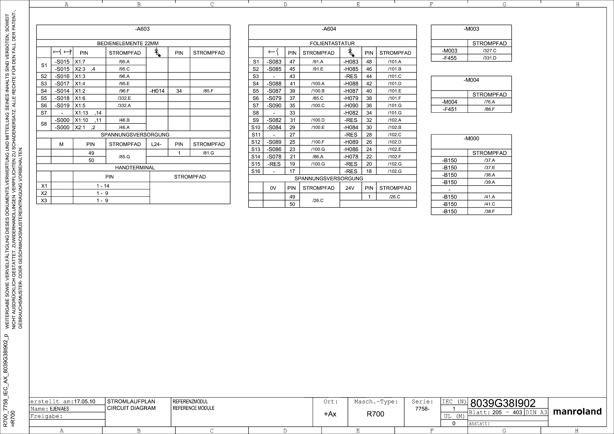

# +Ax — Sheet 205 of 403 — REFERENZMODUL

**REFERENCE MODULE**

> Part of the manroland **R700** printing press IEC/UL circuit diagrams.
> Drawing class: **Stromlaufplan / Circuit diagram** (DIN A3).
> Document `+Ax` covers the **Central control console** machine section.

## At a glance

| Field | Value |
|---|---|
| Document | `+Ax`  (8039G38I902) |
| Sheet | **205** of 403 |
| Section (DE) | REFERENZMODUL |
| Section (EN) | REFERENCE MODULE |
| Section type | REFERENCE_MODULE — Reference module |
| Machine type | `R700` |
| Series | `7758` |
| Created | 17.05.10 |
| Replaces | — |
| Columns used | A, B, C, D, E, F, G |
| Path numbers | — |
| Labels on sheet | 220 |
| Cross-refs out | 53 |
| Cross-refs in | 53 |

**Previous:** [+Ax sheet 204](SHEET_0204.md) · **Next:** [+Ax sheet 206](SHEET_0206.md) · **Document TOC:** [_TOC.md](_TOC.md)  (+Ax) · **Master TOC:** [all sheets](../_MASTER_TOC.md)

## Sheet image (300 DPI, exact vector render)



_Rendered directly from the PDF vector layer at 300 DPI (1-bit), no OCR and no resampling. Use it to confirm anything ambiguous in the text below._

## Cross-references on this sheet

Each entry is a wire leaving this sheet. The printed token is `/sheet.column`; the link resolves to that sheet inside the same document.

| Ref | Target sheet | Col | Path | Destination on target | Target section | From col |
|---|---|---|---|---|---|---|
| `/327.C` | [+Ax sheet 327](SHEET_0327.md) | C | — | — | OPTION: NONSTOP EINRICHTUNG MANUELL, ANLEGER | G |
| `/331.D` | [+Ax sheet 331](SHEET_0331.md) | D | — | — | OPTION: NONSTOP EINRICHTUNG MANUELL, ANLEGER | G |
| `/95.A` | [+Ax sheet 95](SHEET_0095.md) | A | — | — | ANLEGER | B |
| `/91.A` | [+Ax sheet 91](SHEET_0091.md) | A | — | — | ANLEGER | D |
| `/101.A` | [+Ax sheet 101](SHEET_0101.md) | A | — | — | ANLEGER | F |
| `/91.E` | [+Ax sheet 91](SHEET_0091.md) | E | — | — | ANLEGER | D |
| `/101.B` | [+Ax sheet 101](SHEET_0101.md) | B | — | — | ANLEGER | F |
| `/95.C` | [+Ax sheet 95](SHEET_0095.md) | C | — | — | ANLEGER | B |
| `/96.A` | [+Ax sheet 96](SHEET_0096.md) | A | — | — | ANLEGER | B |
| `/101.C` | [+Ax sheet 101](SHEET_0101.md) | C | — | — | ANLEGER | F |
| `/95.E` | [+Ax sheet 95](SHEET_0095.md) | E | — | — | ANLEGER | B |
| `/100.A` | [+Ax sheet 100](SHEET_0100.md) | A | — | — | ANLEGER | D |
| `/101.D` | [+Ax sheet 101](SHEET_0101.md) | D | — | — | ANLEGER | F |
| `/96.F` | [+Ax sheet 96](SHEET_0096.md) | F | — | — | ANLEGER | B |
| `/85.F` | [+Ax sheet 85](SHEET_0085.md) | F | — | — | ANLEGER | C |
| `/100.B` | [+Ax sheet 100](SHEET_0100.md) | B | — | — | ANLEGER | D |
| `/101.E` | [+Ax sheet 101](SHEET_0101.md) | E | — | — | ANLEGER | F |
| `/332.E` | [+Ax sheet 332](SHEET_0332.md) | E | — | — | OPTION: NONSTOP EINRICHTUNG MANUELL, ANLEGER | B |
| `/101.F` | [+Ax sheet 101](SHEET_0101.md) | F | — | — | ANLEGER | F |
| `/85.C` | [+Ax sheet 85](SHEET_0085.md) | C | — | — | ANLEGER | D |
| `/76.A` | [+Ax sheet 76](SHEET_0076.md) | A | — | — | ANLEGER | G |
| `/332.A` | [+Ax sheet 332](SHEET_0332.md) | A | — | — | OPTION: NONSTOP EINRICHTUNG MANUELL, ANLEGER | B |
| `/101.G` | [+Ax sheet 101](SHEET_0101.md) | G | — | — | ANLEGER | F |
| `/100.C` | [+Ax sheet 100](SHEET_0100.md) | C | — | — | ANLEGER | D |
| `/86.F` | [+Ax sheet 86](SHEET_0086.md) | F | — | — | ANLEGER | G |
| `/101.G` | [+Ax sheet 101](SHEET_0101.md) | G | — | — | ANLEGER | F |
| `/46.B` | [+Ax sheet 46](SHEET_0046.md) | B | — | — | NOT AUS | B |
| `/102.A` | [+Ax sheet 102](SHEET_0102.md) | A | — | — | ANLEGER | F |
| `/100.D` | [+Ax sheet 100](SHEET_0100.md) | D | — | — | ANLEGER | D |
| `/46.A` | [+Ax sheet 46](SHEET_0046.md) | A | — | — | NOT AUS | B |
| `/100.E` | [+Ax sheet 100](SHEET_0100.md) | E | — | — | ANLEGER | D |
| `/102.B` | [+Ax sheet 102](SHEET_0102.md) | B | — | — | ANLEGER | F |
| `/102.C` | [+Ax sheet 102](SHEET_0102.md) | C | — | — | ANLEGER | F |
| `/100.F` | [+Ax sheet 100](SHEET_0100.md) | F | — | — | ANLEGER | D |
| `/102.D` | [+Ax sheet 102](SHEET_0102.md) | D | — | — | ANLEGER | F |
| `/102.E` | [+Ax sheet 102](SHEET_0102.md) | E | — | — | ANLEGER | F |
| `/100.G` | [+Ax sheet 100](SHEET_0100.md) | G | — | — | ANLEGER | D |
| `/81.G` | [+Ax sheet 81](SHEET_0081.md) | G | — | — | ANLEGER | C |
| `/86.A` | [+Ax sheet 86](SHEET_0086.md) | A | — | — | ANLEGER | D |
| `/85.G` | [+Ax sheet 85](SHEET_0085.md) | G | — | — | ANLEGER | B |
| `/102.F` | [+Ax sheet 102](SHEET_0102.md) | F | — | — | ANLEGER | F |
| `/37.A` | [+Ax sheet 37](SHEET_0037.md) | A | — | — | HAUPTANTRIEB | G |
| `/100.G` | [+Ax sheet 100](SHEET_0100.md) | G | — | — | ANLEGER | D |
| `/102.G` | [+Ax sheet 102](SHEET_0102.md) | G | — | — | ANLEGER | F |
| `/37.E` | [+Ax sheet 37](SHEET_0037.md) | E | — | — | HAUPTANTRIEB | G |
| `/102.G` | [+Ax sheet 102](SHEET_0102.md) | G | — | — | ANLEGER | F |
| `/38.A` | [+Ax sheet 38](SHEET_0038.md) | A | — | — | HAUPTANTRIEB | G |
| `/39.A` | [+Ax sheet 39](SHEET_0039.md) | A | — | — | HAUPTANTRIEB | G |
| `/41.A` | [+Ax sheet 41](SHEET_0041.md) | A | — | — | HAUPTANTRIEB | G |
| `/26.C` | [+Ax sheet 26](SHEET_0026.md) | C | — | — | SPANNUNGSVERSORGUNG, SCHALTSCHRANKBELÜFTUNG | F |
| `/26.C` | [+Ax sheet 26](SHEET_0026.md) | C | — | — | SPANNUNGSVERSORGUNG, SCHALTSCHRANKBELÜFTUNG | D |
| `/41.C` | [+Ax sheet 41](SHEET_0041.md) | C | — | — | HAUPTANTRIEB | G |
| `/38.F` | [+Ax sheet 38](SHEET_0038.md) | F | — | — | HAUPTANTRIEB | G |

### Incoming references (sheets that point here)

Every other sheet that sends a wire to this one. `Back-ref` is the token printed on *that* sheet; `Path` is its line number.

| From sheet | Cols | Back-ref | Path | Refs | What continues there |
|---|---|---|---|---|---|
| [+Ax#26](SHEET_0026.md) | C | `/26.C` | — | 2 | A604 |
| [+Ax#37](SHEET_0037.md) | A, E | `/37.A`, `/37.E` | — | 2 | — |
| [+Ax#38](SHEET_0038.md) | A, E | `/38.A`, `/38.E` | — | 2 | 1 3 5 13 21 31 43 |
| [+Ax#39](SHEET_0039.md) | A | `/39.A` | — | 1 | — |
| [+Ax#41](SHEET_0041.md) | B, C | `/41.B`, `/41.C` | — | 2 | T |
| [+Ax#46](SHEET_0046.md) | A, B | `/46.A`, `/46.B` | — | 2 | A603 |
| [+Ax#76](SHEET_0076.md) | A | `/76.A` | — | 1 | — |
| [+Ax#81](SHEET_0081.md) | H | `/81.H` | — | 1 | A603 L24V |
| [+Ax#85](SHEET_0085.md) | C, F, G | `/85.C`, `/85.F`, `/85.G` | — | 3 | A603; A604 |
| [+Ax#86](SHEET_0086.md) | A, F | `/86.A`, `/86.F` | — | 2 | A604 |
| [+Ax#91](SHEET_0091.md) | A, E | `/91.A`, `/91.E` | — | 2 | A604 |
| [+Ax#95](SHEET_0095.md) | A, C, E | `/95.A`, `/95.C`, `/95.E` | — | 3 | A603 |
| [+Ax#96](SHEET_0096.md) | A, F | `/96.A`, `/96.F` | — | 2 | A603 |
| [+Ax#100](SHEET_0100.md) | A, B, C, D, E, F, G | `/100.A`, `/100.B`, `/100.C`, `/100.D`, `/100.E`, `/100.F`, `/100.G` | — | 8 | A604 |
| [+Ax#101](SHEET_0101.md) | A, B, C, D, E, F, G | `/101.A`, `/101.B`, `/101.C`, `/101.D`, `/101.E`, `/101.F`, `/101.G` | — | 8 | A604 |
| [+Ax#102](SHEET_0102.md) | A, B, C, D, E, F, G | `/102.A`, `/102.B`, `/102.C`, `/102.D`, `/102.E`, `/102.F`, `/102.G` | — | 8 | A604 |
| [+Ax#327](SHEET_0327.md) | B | `/327.B` | — | 1 | — |
| [+Ax#331](SHEET_0331.md) | D | `/331.D` | — | 1 | — |
| [+Ax#332](SHEET_0332.md) | A, E | `/332.A`, `/332.E` | — | 2 | A603 |


## Devices on this sheet

| Tag | Class | Class meaning (IEC) | Col | Sub | Terminal | Sign |
|---|---|---|---|---|---|---|
| `S015` | S | Schalter / switch | A | — | — | — |
| `S2` | S | Schalter / switch | A | — | — | — |
| `S3` | S | Schalter / switch | A | — | — | — |
| `S4` | S | Schalter / switch | A | — | — | — |
| `S5` | S | Schalter / switch | A | — | — | — |
| `S6` | S | Schalter / switch | A | — | — | — |
| `S7` | S | Schalter / switch | A | — | — | — |
| `S016` | S | Schalter / switch | A | — | — | — |
| `S017` | S | Schalter / switch | A | — | — | — |
| `S014` | S | Schalter / switch | A | — | — | — |
| `S018` | S | Schalter / switch | A | — | — | — |
| `S019` | S | Schalter / switch | A | — | — | — |
| `X1:7` | X | Klemme / terminal, plug connector | A | — | 7 | — |
| `X1:13` | X | Klemme / terminal, plug connector | A | — | 13 | — |
| `X2:3` | X | Klemme / terminal, plug connector | A | — | 3 | — |
| `X1:3` | X | Klemme / terminal, plug connector | A | — | 3 | — |
| `X1:2` | X | Klemme / terminal, plug connector | A | — | 2 | — |
| `X1:6` | X | Klemme / terminal, plug connector | A | — | 6 | — |
| `X1:4` | X | Klemme / terminal, plug connector | A | — | 4 | — |
| `X1:5` | X | Klemme / terminal, plug connector | A | — | 5 | — |
| `S015` | S | Schalter / switch | A | — | — | — |
| `S1` | S | Schalter / switch | A | — | — | — |
| `X1` | X | Klemme / terminal, plug connector | A | — | — | — |
| `X2` | X | Klemme / terminal, plug connector | A | — | — | — |
| `X3` | X | Klemme / terminal, plug connector | A | — | — | — |
| `S8` | S | Schalter / switch | A | — | — | — |
| `S000` | S | Schalter / switch | A | — | — | — |
| `S000` | S | Schalter / switch | A | — | — | — |
| `X1:10` | X | Klemme / terminal, plug connector | A | — | 10 | — |
| `X2:1` | X | Klemme / terminal, plug connector | A | — | 1 | — |
| `A603` | A | Baugruppe / assembly, module, PC board | B | — | — | — |
| `S1` | S | Schalter / switch | D | — | — | — |
| `S2` | S | Schalter / switch | D | — | — | — |
| `S3` | S | Schalter / switch | D | — | — | — |
| `S4` | S | Schalter / switch | D | — | — | — |
| `S5` | S | Schalter / switch | D | — | — | — |
| `S6` | S | Schalter / switch | D | — | — | — |
| `S7` | S | Schalter / switch | D | — | — | — |
| `S8` | S | Schalter / switch | D | — | — | — |
| `S9` | S | Schalter / switch | D | — | — | — |
| `S10` | S | Schalter / switch | D | — | — | — |
| `S11` | S | Schalter / switch | D | — | — | — |
| `S12` | S | Schalter / switch | D | — | — | — |
| `S13` | S | Schalter / switch | D | — | — | — |
| `S14` | S | Schalter / switch | D | — | — | — |
| `S15` | S | Schalter / switch | D | — | — | — |
| `S16` | S | Schalter / switch | D | — | — | — |
| `S083` | S | Schalter / switch | D | — | — | — |
| `S085` | S | Schalter / switch | D | — | — | — |
| `S088` | S | Schalter / switch | D | — | — | — |
| `S087` | S | Schalter / switch | D | — | — | — |
| `S079` | S | Schalter / switch | D | — | — | — |
| `S090` | S | Schalter / switch | D | — | — | — |
| `S082` | S | Schalter / switch | D | — | — | — |
| `S084` | S | Schalter / switch | D | — | — | — |
| `S089` | S | Schalter / switch | D | — | — | — |
| `S086` | S | Schalter / switch | D | — | — | — |
| `S078` | S | Schalter / switch | D | — | — | — |
| `A604` | A | Baugruppe / assembly, module, PC board | E | — | — | — |
| `F455` | F | Schutz / protection device (fuse, circuit breaker) | F | — | — | — |
| `F451` | F | Schutz / protection device (fuse, circuit breaker) | F | — | — | — |
| `B150` | B | Umformer / transducer, sensor | F | — | — | — |
| `B150` | B | Umformer / transducer, sensor | F | — | — | — |
| `B150` | B | Umformer / transducer, sensor | F | — | — | — |
| `B150` | B | Umformer / transducer, sensor | F | — | — | — |
| `B150` | B | Umformer / transducer, sensor | F | — | — | — |
| `B150` | B | Umformer / transducer, sensor | F | — | — | — |
| `B150` | B | Umformer / transducer, sensor | F | — | — | — |

## Potentials / nets

| Potential | Count | Columns | Attached devices | Terminals |
|---|---|---|---|---|
| `0V` | 1 | D | — | — |
| `24V` | 1 | E | — | — |
| `H014` | 1 | B | — | — |
| `H078` | 1 | E | — | — |
| `H079` | 1 | E | — | — |
| `H082` | 1 | E | — | — |
| `H083` | 1 | E | — | — |
| `H084` | 1 | E | — | — |
| `H085` | 1 | E | — | — |
| `H086` | 1 | E | — | — |
| `H087` | 1 | E | — | — |
| `H088` | 1 | E | — | — |
| `H089` | 1 | E | — | — |
| `H090` | 1 | E | — | — |
| `L24` | 1 | B | — | — |
| `M000` | 1 | G | — | — |
| `M003` | 2 | F, G | — | — |
| `M004` | 2 | F, G | — | — |


A potential such as `L24+/4` or `M24+` is a named supply/return rail; every place it appears on this sheet is electrically common.

## Wire-end annotations (grouped as printed)

A wire that continues elsewhere is annotated with a small cluster: the destination description, the path/line number `#NN`, and the `/sheet.column` cross reference. Each row below is one such cluster exactly as it is grouped on the drawing.

| Col | Y | Path | Cross-ref | Text on the wire |
|---|---|---|---|---|
| B | 51.3 | — | — | `A603` |
| E | 51.3 | — | — | `A604` |
| G | 51.3 | — | — | `M003` |
| G | 79.7 | — | — | `M003 STROMPFAD` |
| B | 80.0 | — | — | `BEDIENELEMENTE 22MM` |
| E | 80.0 | — | — | `FOLIENTASTATUR` |
| G | 94.5 | — | `/327.C` | — |
| B | 98.1 | — | — | `STROMPFAD PIN STROMPFAD` |
| D | 98.4 | — | — | `PIN STROMPFAD` |
| E | 98.4 | — | — | `PIN STROMPFAD` |
| A | 98.5 | — | — | `PIN` |
| F | 108.0 | — | — | `F455` |
| G | 108.7 | — | `/331.D` | — |
| A | 115.1 | — | — | `S015` |
| D | 115.1 | — | — | `S083 S085` |
| E | 115.1 | — | — | `H083 H085` |
| A | 115.4 | — | — | `X1:7` |
| D | 115.4 | — | — | `S10 S2 S3 S4 S5 S6 S7 S8 S9 S1` |
| D | 115.5 | — | — | `19 17 47 45 43 39 37 35 33 29 27 25 23 41 31 21` |
| E | 115.5 | — | — | `48` |
| B | 115.8 | — | `/95.A` | — |
| D | 115.8 | — | `/91.A` | — |
| F | 115.8 | — | `/101.A` | — |
| A | 122.5 | — | — | `S1 S015` |
| A | 129.6 | — | — | `X2:3 X1:3` |
| A | 129.6 | — | — | `,4` |
| E | 129.6 | — | — | `46 44 42 40 38` |
| D | 129.9 | — | `/91.E` | — |
| F | 129.9 | — | `/101.B` | — |
| B | 130.0 | — | `/95.C` | — |
| A | 143.4 | — | — | `S016 S017 S014 S018 S019` |
| E | 143.5 | — | — | `H088 H087 H079 H090 H082 RES` |
| A | 143.8 | — | — | `S2 S3 S4 S5 S6 S7` |
| B | 144.1 | — | `/96.A` | — |
| F | 144.2 | — | `/101.C` | — |
| G | 150.6 | — | — | `M004` |
| D | 157.6 | — | — | `S088 S087 S079 S090` |
| A | 157.9 | — | — | `X1:4` |
| B | 158.3 | — | `/95.E` | — |
| D | 158.3 | — | `/100.A` | — |
| F | 158.3 | — | `/101.D` | — |
| B | 171.8 | — | — | `H014 34` |
| A | 172.1 | — | — | `X1:2 X1:6` |
| B | 172.5 | — | `/96.F` | — |
| C | 172.5 | — | `/85.F` | — |
| D | 172.5 | — | `/100.B` | — |
| F | 172.5 | — | `/101.E` | — |
| G | 178.9 | — | — | `M004 STROMPFAD` |
| B | 186.6 | — | `/332.E` | — |
| D | 186.7 | — | `/85.C` | — |
| F | 186.7 | — | `/101.F` | — |
| G | 193.7 | — | `/76.A` | — |
| A | 200.5 | — | — | `X1:5` |
| E | 200.5 | — | — | `36` |
| B | 200.8 | — | `/332.A` | — |
| D | 200.8 | — | `/100.C` | — |
| F | 200.8 | — | `/101.G` | — |
| F | 207.2 | — | — | `F451` |
| G | 207.9 | — | `/86.F` | — |
| A | 214.6 | — | — | `X1:13` |
| A | 214.6 | — | — | `,2 ,14 ,11` |
| E | 214.7 | — | — | `34 32` |
| F | 215.0 | — | `/101.G` | — |
| A | 228.5 | — | — | `S8 S000 S000` |
| D | 228.5 | — | — | `S082 S084` |
| E | 228.5 | — | — | `H084 RES` |
| A | 228.8 | — | — | `X1:10 X2:1` |
| B | 229.2 | — | `/46.B` | — |
| D | 229.2 | — | `/100.D` | — |
| F | 229.2 | — | `/102.A` | — |
| E | 243.0 | — | — | `30 28 26 24 22` |
| B | 243.3 | — | `/46.A` | — |
| D | 243.3 | — | `/100.E` | — |
| F | 243.3 | — | `/102.B` | — |
| E | 256.9 | — | — | `H089 H086 H078 RES` |
| B | 257.1 | — | — | `SPANNUNGSVERSORGUNG` |
| D | 257.2 | — | — | `S12 S13 S14 S15 S16 S11` |
| F | 257.5 | — | `/102.C` | — |
| G | 263.9 | — | — | `M000` |
| D | 271.0 | — | — | `S089 S086 S078` |
| D | 271.7 | — | `/100.F` | — |
| F | 271.7 | — | `/102.D` | — |
| A | 275.5 | — | — | `M` |
| B | 275.6 | — | — | `PIN PIN` |
| B | 275.6 | — | — | `STROMPFAD L24` |
| C | 275.6 | — | — | `STROMPFAD` |
| D | 285.9 | — | `/100.G` | — |
| F | 285.9 | — | `/102.E` | — |
| G | 292.3 | — | — | `B150 B150 B150 B150 STROMPFAD` |
| A | 292.6 | — | — | `49 50` |
| C | 292.6 | — | — | `1` |
| C | 292.9 | — | `/81.G` | — |
| B | 300.0 | — | `/85.G` | — |
| D | 300.0 | — | `/86.A` | — |
| F | 300.0 | — | `/102.F` | — |
| G | 307.1 | — | `/37.A` | — |
| D | 313.6 | — | — | `RES` |
| E | 313.6 | — | — | `RES RES` |
| E | 313.9 | — | — | `20` |
| D | 314.2 | — | `/100.G` | — |
| F | 314.2 | — | `/102.G` | — |
| B | 320.9 | — | — | `HANDTERMINAL` |
| G | 321.3 | — | `/37.E` | — |
| E | 328.1 | — | — | `18` |
| F | 328.4 | — | `/102.G` | — |
| G | 335.4 | — | `/38.A` | — |
| C | 338.6 | — | — | `STROMPFAD` |
| B | 338.7 | — | — | `PIN` |
| E | 342.2 | — | — | `SPANNUNGSVERSORGUNG` |
| G | 349.6 | — | `/39.A` | — |
| B | 356.3 | — | — | `1 14 1 9 1 9` |
| A | 356.4 | — | — | `X2 X3 X1` |
| E | 360.6 | — | — | `0V PIN STROMPFAD 24V PIN STROMPFAD` |
| F | 377.3 | — | — | `B150 B150 B150` |
| E | 377.7 | — | — | `49 50 1` |
| F | 378.0 | — | `/26.C` | — |
| G | 378.0 | — | `/41.A` | — |
| D | 385.1 | — | `/26.C` | — |
| G | 392.2 | — | `/41.C` | — |
| G | 406.3 | — | `/38.F` | — |


## Reconstructed tables

This sheet carries tabular content (pin map / terminal assignment / index). The grid below was rebuilt from the drawing's own rule lines, so each row is exactly one physical row of the table.

### Table 1 — 20 data rows × 4 columns (at x=70.9, y=48.2) — **A603 BEDIENELEMENTE**

|  |  | PIN | STROMPFAD |
|---|---|---|---|
|  | `S015` | `X1:7` | `/95.A` |
| `S1` | `S015` | `,4 X2:3` | `/95.C` |
| `S2` | `S016` | `X1:3` | `/96.A` |
| `S3` | `S017` | `X1:4` | `/95.E` |
| `S4` | `S014` | `X1:2` | `/96.F` |
| `S5` | `S018` | `X1:6` | `/332.E` |
| `S6` | `S019` | `X1:5` | `/332.A` |
| `S7` |  | `,14 X1:13` |  |
|  | `S000` | `,11 X1:10` | `/46.B` |
| `S8` | `S000` | `,2 X2:1` | `/46.A` |
|  |  |  | `SPANNUNGSVERSORGUNG` |
|  | `M` | `PIN` | `STROMPFAD` |
|  |  | `49` |  |
|  |  |  | `/85.G` |
|  |  | `50` |  |
|  |  |  | `HANDTERMINAL` |
|  |  |  | `PIN` |
| `X1` |  | `1` | `14` |
| `X2` |  | `1` | `9` |
| `X3` |  | `1` | `9` |


### Table 2 — 4 data rows × 3 columns (at x=290.6, y=48.2) — **22MM**

|  | PIN | STROMPFAD |
|---|---|---|
| `H014` | `34` | `/85.F` |
| `L24` | `PIN` | `STROMPFAD` |
|  | `1` | `/81.G` |
|  |  | `STROMPFAD` |


### Table 3 — 21 data rows × 7 columns (at x=481.9, y=48.2) — **A604 FOLIENTASTATUR**

|  |  | PIN | STROMPFAD |  | PIN | STROMPFAD |
|---|---|---|---|---|---|---|
| `S1` | `S083` | `47` | `/91.A` | `H083` | `48` | `/101.A` |
| `S2` | `S085` | `45` | `/91.E` | `H085` | `46` | `/101.B` |
| `S3` |  | `43` |  | `RES` | `44` | `/101.C` |
| `S4` | `S088` | `41` | `/100.A` | `H088` | `42` | `/101.D` |
| `S5` | `S087` | `39` | `/100.B` | `H087` | `40` | `/101.E` |
| `S6` | `S079` | `37` | `/85.C` | `H079` | `38` | `/101.F` |
| `S7` | `S090` | `35` | `/100.C` | `H090` | `36` | `/101.G` |
| `S8` |  | `33` |  | `H082` | `34` | `/101.G` |
| `S9` | `S082` | `31` | `/100.D` | `RES` | `32` | `/102.A` |
| `S10` | `S084` | `29` | `/100.E` | `H084` | `30` | `/102.B` |
| `S11` |  | `27` |  | `RES` | `28` | `/102.C` |
| `S12` | `S089` | `25` | `/100.F` | `H089` | `26` | `/102.D` |
| `S13` | `S086` | `23` | `/100.G` | `H086` | `24` | `/102.E` |
| `S14` | `S078` | `21` | `/86.A` | `H078` | `22` | `/102.F` |
| `S15` | `RES` | `19` | `/100.G` | `RES` | `20` | `/102.G` |
| `S16` |  | `17` |  | `RES` | `18` | `/102.G` |
|  |  |  | `SPANNUNGSVERSORGUNG` |  |  |  |
|  | `0V` | `PIN` | `STROMPFAD` | `24V` | `PIN` | `STROMPFAD` |
|  |  | `49` |  |  | `1` | `/26.C` |
|  |  |  | `/26.C` |  |  |  |
|  |  | `50` |  |  |  |  |


### Table 4 — 15 data rows × 2 columns (at x=836.2, y=48.2) — **M003**

|  | STROMPFAD |
|---|---|
| `M003` | `/327.C` |
| `F455` | `/331.D` |
|  | `M004` |
|  | `STROMPFAD` |
| `M004` | `/76.A` |
| `F451` | `/86.F` |
|  | `M000` |
|  | `STROMPFAD` |
| `B150` | `/37.A` |
| `B150` | `/37.E` |
| `B150` | `/38.A` |
| `B150` | `/39.A` |
| `B150` | `/41.A` |
| `B150` | `/41.C` |
| `B150` | `/38.F` |


## Notes and free text on this sheet

| Text | Col | Y (pt) |
|---|---|---|
| `PIN` | A | 98.45 |
| `STROMPFAD` | B | 98.41 |
| `STROMPFAD` | C | 98.12 |
| `PIN` | C | 98.45 |
| `BEDIENELEMENTE 22MM` | B | 79.99 |
| `M` | A | 275.54 |
| `SPANNUNGSVERSORGUNG` | B | 257.14 |
| `HANDTERMINAL` | B | 320.94 |
| `PIN` | B | 338.68 |
| `PIN` | D | 98.45 |
| `STROMPFAD` | D | 98.41 |
| `FOLIENTASTATUR` | E | 80 |
| `PIN` | E | 98.45 |
| `STROMPFAD` | F | 98.41 |
| `RES` | D | 313.56 |
| `SPANNUNGSVERSORGUNG` | E | 342.18 |
| `RES` | E | 143.48 |
| `STROMPFAD` | G | 79.68 |

## Complete label inventory (exact text from the drawing)

Every text object inside the drawing area of this sheet, in DIN reading order (column A→H, then top→bottom). This is the authoritative list: if a string is not here it is not printed on this sheet.

| Col | Y | X | Dir | Type | Text |
|---|---|---|---|---|---|
| A | 98.4 | 154.9 | → | text | `PIN` |
| A | 115.1 | 106.4 | → | device tag | `S015` |
| A | 115.4 | 145.3 | → | device tag | `X1:7` |
| A | 122.5 | 79.8 | → | device tag | `S1` |
| A | 129.3 | 106.4 | → | device tag | `S015` |
| A | 129.6 | 145.3 | → | device tag | `X2:3` |
| A | 129.6 | 176.3 | → | number | `,4` |
| A | 143.5 | 106.4 | → | device tag | `S016` |
| A | 143.8 | 78.9 | → | device tag | `S2` |
| A | 143.8 | 145.3 | → | device tag | `X1:3` |
| A | 157.6 | 106.4 | → | device tag | `S017` |
| A | 157.9 | 145.3 | → | device tag | `X1:4` |
| A | 158.0 | 78.9 | → | device tag | `S3` |
| A | 171.8 | 106.4 | → | device tag | `S014` |
| A | 172.1 | 78.9 | → | device tag | `S4` |
| A | 172.1 | 145.3 | → | device tag | `X1:2` |
| A | 186.0 | 106.4 | → | device tag | `S018` |
| A | 186.3 | 78.9 | → | device tag | `S5` |
| A | 186.3 | 145.3 | → | device tag | `X1:6` |
| A | 200.1 | 106.4 | → | device tag | `S019` |
| A | 200.5 | 78.9 | → | device tag | `S6` |
| A | 200.5 | 145.3 | → | device tag | `X1:5` |
| A | 214.6 | 145.3 | → | device tag | `X1:13` |
| A | 214.6 | 183.4 | → | number | `,14` |
| A | 214.7 | 78.9 | → | device tag | `S7` |
| A | 228.5 | 106.4 | → | device tag | `S000` |
| A | 228.8 | 145.3 | → | device tag | `X1:10` |
| A | 228.8 | 183.4 | → | number | `,11` |
| A | 235.9 | 78.9 | → | device tag | `S8` |
| A | 242.7 | 106.4 | → | device tag | `S000` |
| A | 243.0 | 145.3 | → | device tag | `X2:1` |
| A | 243.0 | 176.3 | → | number | `,2` |
| A | 275.5 | 114.9 | → | text | `M` |
| A | 275.6 | 167.7 | → | text | `PIN` |
| A | 292.6 | 171.8 | → | number | `49` |
| A | 306.8 | 171.8 | → | number | `50` |
| A | 356.4 | 80.1 | → | device tag | `X1` |
| A | 370.5 | 186.9 | → | number | `1 9` |
| A | 370.6 | 79.2 | → | device tag | `X2` |
| A | 384.6 | 186.9 | → | number | `1 9` |
| A | 384.7 | 79.2 | → | device tag | `X3` |
| B | 51.3 | 261.9 | → | device tag | `A603` |
| B | 80.0 | 188.5 | → | text | `BEDIENELEMENTE 22MM` |
| B | 98.4 | 211.6 | → | text | `STROMPFAD` |
| B | 115.8 | 230.6 | → | cross-reference | `/95.A` |
| B | 130.0 | 230.6 | → | cross-reference | `/95.C` |
| B | 144.1 | 230.6 | → | cross-reference | `/96.A` |
| B | 158.3 | 230.9 | → | cross-reference | `/95.E` |
| B | 171.8 | 290.4 | → | potential | `H014` |
| B | 172.5 | 231.0 | → | cross-reference | `/96.F` |
| B | 186.6 | 228.5 | → | cross-reference | `/332.E` |
| B | 200.8 | 228.2 | → | cross-reference | `/332.A` |
| B | 229.1 | 230.7 | → | cross-reference | `/46.B` |
| B | 243.3 | 230.6 | → | cross-reference | `/46.A` |
| B | 257.1 | 195.7 | → | text | `SPANNUNGSVERSORGUNG` |
| B | 275.6 | 211.6 | → | text | `STROMPFAD` |
| B | 275.6 | 293.2 | → | potential | `L24` |
| B | 300.0 | 230.5 | → | cross-reference | `/85.G` |
| B | 320.9 | 223.4 | → | text | `HANDTERMINAL` |
| B | 338.7 | 204.5 | → | text | `PIN` |
| B | 356.3 | 186.9 | → | number | `1 14` |
| C | 98.1 | 374.6 | → | text | `STROMPFAD` |
| C | 98.4 | 339.2 | → | text | `PIN` |
| C | 172.2 | 341.9 | → | number | `34` |
| C | 172.5 | 394.0 | → | cross-reference | `/85.F` |
| C | 275.6 | 339.2 | → | text | `PIN` |
| C | 275.6 | 374.6 | → | text | `STROMPFAD` |
| C | 292.6 | 345.1 | → | number | `1` |
| C | 292.9 | 393.4 | → | cross-reference | `/81.G` |
| C | 338.6 | 337.7 | → | text | `STROMPFAD` |
| D | 98.4 | 558.9 | → | text | `PIN` |
| D | 98.4 | 587.2 | → | text | `STROMPFAD` |
| D | 115.1 | 517.5 | → | device tag | `S083` |
| D | 115.4 | 490.8 | → | device tag | `S1` |
| D | 115.5 | 561.5 | → | number | `47` |
| D | 115.8 | 606.2 | → | cross-reference | `/91.A` |
| D | 129.3 | 517.5 | → | device tag | `S085` |
| D | 129.6 | 490.0 | → | device tag | `S2` |
| D | 129.6 | 561.5 | → | number | `45` |
| D | 129.9 | 606.5 | → | cross-reference | `/91.E` |
| D | 143.8 | 490.0 | → | device tag | `S3` |
| D | 143.8 | 561.5 | → | number | `43` |
| D | 157.6 | 517.5 | → | device tag | `S088` |
| D | 158.0 | 490.0 | → | device tag | `S4` |
| D | 158.0 | 562.4 | → | number | `41` |
| D | 158.3 | 603.8 | → | cross-reference | `/100.A` |
| D | 171.8 | 517.5 | → | device tag | `S087` |
| D | 172.1 | 490.0 | → | device tag | `S5` |
| D | 172.2 | 561.5 | → | number | `39` |
| D | 172.5 | 603.9 | → | cross-reference | `/100.B` |
| D | 186.0 | 517.5 | → | device tag | `S079` |
| D | 186.3 | 490.0 | → | device tag | `S6` |
| D | 186.3 | 561.5 | → | number | `37` |
| D | 186.7 | 606.2 | → | cross-reference | `/85.C` |
| D | 200.1 | 517.5 | → | device tag | `S090` |
| D | 200.5 | 490.0 | → | device tag | `S7` |
| D | 200.5 | 561.5 | → | number | `35` |
| D | 200.8 | 603.8 | → | cross-reference | `/100.C` |
| D | 214.7 | 490.0 | → | device tag | `S8` |
| D | 214.7 | 561.5 | → | number | `33` |
| D | 228.5 | 517.5 | → | device tag | `S082` |
| D | 228.8 | 490.0 | → | device tag | `S9` |
| D | 228.8 | 562.4 | → | number | `31` |
| D | 229.2 | 603.8 | → | cross-reference | `/100.D` |
| D | 242.7 | 517.5 | → | device tag | `S084` |
| D | 243.0 | 487.3 | → | device tag | `S10` |
| D | 243.0 | 561.5 | → | number | `29` |
| D | 243.3 | 604.1 | → | cross-reference | `/100.E` |
| D | 257.2 | 488.1 | → | device tag | `S11` |
| D | 257.2 | 561.5 | → | number | `27` |
| D | 271.0 | 517.5 | → | device tag | `S089` |
| D | 271.4 | 487.3 | → | device tag | `S12` |
| D | 271.4 | 561.5 | → | number | `25` |
| D | 271.7 | 604.2 | → | cross-reference | `/100.F` |
| D | 285.2 | 517.5 | → | device tag | `S086` |
| D | 285.5 | 487.3 | → | device tag | `S13` |
| D | 285.5 | 561.5 | → | number | `23` |
| D | 285.9 | 603.6 | → | cross-reference | `/100.G` |
| D | 299.4 | 517.5 | → | device tag | `S078` |
| D | 299.7 | 487.3 | → | device tag | `S14` |
| D | 299.7 | 562.4 | → | number | `21` |
| D | 300.0 | 606.2 | → | cross-reference | `/86.A` |
| D | 313.6 | 519.0 | → | text | `RES` |
| D | 313.9 | 487.3 | → | device tag | `S15` |
| D | 313.9 | 561.3 | → | number | `19` |
| D | 314.2 | 603.6 | → | cross-reference | `/100.G` |
| D | 328.0 | 487.3 | → | device tag | `S16` |
| D | 328.1 | 561.3 | → | number | `17` |
| D | 360.6 | 523.8 | → | potential | `0V` |
| D | 360.6 | 587.2 | → | text | `STROMPFAD` |
| D | 360.7 | 557.4 | → | text | `PIN` |
| D | 377.7 | 561.5 | → | number | `49` |
| D | 385.1 | 606.2 | → | cross-reference | `/26.C` |
| D | 391.8 | 561.5 | → | number | `50` |
| E | 51.3 | 623.8 | → | device tag | `A604` |
| E | 80.0 | 601.2 | → | text | `FOLIENTASTATUR` |
| E | 98.4 | 707.7 | → | text | `PIN` |
| E | 115.1 | 666.0 | → | potential | `H083` |
| E | 115.5 | 710.4 | → | number | `48` |
| E | 129.3 | 666.0 | → | potential | `H085` |
| E | 129.6 | 710.4 | → | number | `46` |
| E | 143.5 | 667.8 | → | text | `RES` |
| E | 143.8 | 710.4 | → | number | `44` |
| E | 157.6 | 666.0 | → | potential | `H088` |
| E | 158.0 | 710.4 | → | number | `42` |
| E | 171.8 | 666.0 | → | potential | `H087` |
| E | 172.2 | 710.4 | → | number | `40` |
| E | 186.0 | 666.0 | → | potential | `H079` |
| E | 186.3 | 710.4 | → | number | `38` |
| E | 200.1 | 666.0 | → | potential | `H090` |
| E | 200.5 | 710.4 | → | number | `36` |
| E | 214.3 | 666.0 | → | potential | `H082` |
| E | 214.7 | 710.4 | → | number | `34` |
| E | 228.5 | 667.8 | → | text | `RES` |
| E | 228.8 | 710.4 | → | number | `32` |
| E | 242.7 | 666.0 | → | potential | `H084` |
| E | 243.0 | 710.4 | → | number | `30` |
| E | 256.9 | 667.8 | → | text | `RES` |
| E | 257.2 | 710.4 | → | number | `28` |
| E | 271.0 | 666.0 | → | potential | `H089` |
| E | 271.4 | 710.4 | → | number | `26` |
| E | 285.2 | 666.0 | → | potential | `H086` |
| E | 285.5 | 710.4 | → | number | `24` |
| E | 299.4 | 666.0 | → | potential | `H078` |
| E | 299.7 | 710.4 | → | number | `22` |
| E | 313.6 | 667.8 | → | text | `RES` |
| E | 313.9 | 710.4 | → | number | `20` |
| E | 327.7 | 667.8 | → | text | `RES` |
| E | 328.1 | 710.1 | → | number | `18` |
| E | 342.2 | 571.3 | → | text | `SPANNUNGSVERSORGUNG` |
| E | 360.6 | 670.0 | → | potential | `24V` |
| E | 360.7 | 707.7 | → | text | `PIN` |
| E | 377.7 | 713.6 | → | number | `1` |
| F | 93.9 | 856.8 | → | potential | `M003` |
| F | 98.4 | 736.0 | → | text | `STROMPFAD` |
| F | 108.0 | 857.9 | → | device tag | `F455` |
| F | 115.8 | 752.6 | → | cross-reference | `/101.A` |
| F | 129.9 | 752.7 | → | cross-reference | `/101.B` |
| F | 144.1 | 752.6 | → | cross-reference | `/101.C` |
| F | 158.3 | 752.6 | → | cross-reference | `/101.D` |
| F | 172.5 | 752.9 | → | cross-reference | `/101.E` |
| F | 186.7 | 753.0 | → | cross-reference | `/101.F` |
| F | 193.1 | 856.8 | → | potential | `M004` |
| F | 200.8 | 752.5 | → | cross-reference | `/101.G` |
| F | 207.2 | 858.6 | → | device tag | `F451` |
| F | 215.0 | 752.5 | → | cross-reference | `/101.G` |
| F | 229.2 | 752.6 | → | cross-reference | `/102.A` |
| F | 243.3 | 752.7 | → | cross-reference | `/102.B` |
| F | 257.5 | 752.6 | → | cross-reference | `/102.C` |
| F | 271.7 | 752.6 | → | cross-reference | `/102.D` |
| F | 285.9 | 752.9 | → | cross-reference | `/102.E` |
| F | 300.0 | 753.0 | → | cross-reference | `/102.F` |
| F | 306.4 | 857.6 | → | device tag | `B150` |
| F | 314.2 | 752.5 | → | cross-reference | `/102.G` |
| F | 320.6 | 857.6 | → | device tag | `B150` |
| F | 328.4 | 752.5 | → | cross-reference | `/102.G` |
| F | 334.8 | 857.6 | → | device tag | `B150` |
| F | 349.0 | 857.6 | → | device tag | `B150` |
| F | 360.6 | 736.0 | → | text | `STROMPFAD` |
| F | 377.3 | 857.6 | → | device tag | `B150` |
| F | 378.0 | 755.0 | → | cross-reference | `/26.C` |
| F | 391.5 | 857.6 | → | device tag | `B150` |
| F | 405.7 | 857.6 | → | device tag | `B150` |
| G | 51.3 | 899.3 | → | potential | `M003` |
| G | 79.7 | 916.3 | → | text | `STROMPFAD` |
| G | 94.5 | 936.9 | → | cross-reference | `/327.C` |
| G | 108.7 | 936.9 | → | cross-reference | `/331.D` |
| G | 150.5 | 899.3 | → | potential | `M004` |
| G | 178.9 | 916.3 | → | text | `STROMPFAD` |
| G | 193.7 | 939.3 | → | cross-reference | `/76.A` |
| G | 207.9 | 939.7 | → | cross-reference | `/86.F` |
| G | 263.9 | 899.3 | → | potential | `M000` |
| G | 292.3 | 916.3 | → | text | `STROMPFAD` |
| G | 307.1 | 939.3 | → | cross-reference | `/37.A` |
| G | 321.3 | 939.5 | → | cross-reference | `/37.E` |
| G | 335.4 | 939.3 | → | cross-reference | `/38.A` |
| G | 349.6 | 939.3 | → | cross-reference | `/39.A` |
| G | 378.0 | 939.3 | → | cross-reference | `/41.A` |
| G | 392.2 | 939.3 | → | cross-reference | `/41.C` |
| G | 406.3 | 939.7 | → | cross-reference | `/38.F` |

## Reading-order text block

The same content as a plain block, grouped by DIN column — convenient to paste or to match against a visual description.

```text
=== Column A ===
  98.4  154.9  text         PIN
 115.1  106.4  devtag       S015
 115.4  145.3  devtag       X1:7
 122.5   79.8  devtag       S1
 129.3  106.4  devtag       S015
 129.6  145.3  devtag       X2:3
 129.6  176.3  numeric      ,4
 143.5  106.4  devtag       S016
 143.8   78.9  devtag       S2
 143.8  145.3  devtag       X1:3
 157.6  106.4  devtag       S017
 157.9  145.3  devtag       X1:4
 158.0   78.9  devtag       S3
 171.8  106.4  devtag       S014
 172.1   78.9  devtag       S4
 172.1  145.3  devtag       X1:2
 186.0  106.4  devtag       S018
 186.3   78.9  devtag       S5
 186.3  145.3  devtag       X1:6
 200.1  106.4  devtag       S019
 200.5   78.9  devtag       S6
 200.5  145.3  devtag       X1:5
 214.6  145.3  devtag       X1:13
 214.6  183.4  numeric      ,14
 214.7   78.9  devtag       S7
 228.5  106.4  devtag       S000
 228.8  145.3  devtag       X1:10
 228.8  183.4  numeric      ,11
 235.9   78.9  devtag       S8
 242.7  106.4  devtag       S000
 243.0  145.3  devtag       X2:1
 243.0  176.3  numeric      ,2
 275.5  114.9  text         M
 275.6  167.7  text         PIN
 292.6  171.8  numeric      49
 306.8  171.8  numeric      50
 356.4   80.1  devtag       X1
 370.5  186.9  numeric      1 9
 370.6   79.2  devtag       X2
 384.6  186.9  numeric      1 9
 384.7   79.2  devtag       X3
=== Column B ===
  51.3  261.9  devtag       A603
  80.0  188.5  text         BEDIENELEMENTE 22MM
  98.4  211.6  text         STROMPFAD
 115.8  230.6  xref         /95.A
 130.0  230.6  xref         /95.C
 144.1  230.6  xref         /96.A
 158.3  230.9  xref         /95.E
 171.8  290.4  net          H014
 172.5  231.0  xref         /96.F
 186.6  228.5  xref         /332.E
 200.8  228.2  xref         /332.A
 229.1  230.7  xref         /46.B
 243.3  230.6  xref         /46.A
 257.1  195.7  text         SPANNUNGSVERSORGUNG
 275.6  211.6  text         STROMPFAD
 275.6  293.2  net          L24
 300.0  230.5  xref         /85.G
 320.9  223.4  text         HANDTERMINAL
 338.7  204.5  text         PIN
 356.3  186.9  numeric      1 14
=== Column C ===
  98.1  374.6  text         STROMPFAD
  98.4  339.2  text         PIN
 172.2  341.9  numeric      34
 172.5  394.0  xref         /85.F
 275.6  339.2  text         PIN
 275.6  374.6  text         STROMPFAD
 292.6  345.1  numeric      1
 292.9  393.4  xref         /81.G
 338.6  337.7  text         STROMPFAD
=== Column D ===
  98.4  558.9  text         PIN
  98.4  587.2  text         STROMPFAD
 115.1  517.5  devtag       S083
 115.4  490.8  devtag       S1
 115.5  561.5  numeric      47
 115.8  606.2  xref         /91.A
 129.3  517.5  devtag       S085
 129.6  490.0  devtag       S2
 129.6  561.5  numeric      45
 129.9  606.5  xref         /91.E
 143.8  490.0  devtag       S3
 143.8  561.5  numeric      43
 157.6  517.5  devtag       S088
 158.0  490.0  devtag       S4
 158.0  562.4  numeric      41
 158.3  603.8  xref         /100.A
 171.8  517.5  devtag       S087
 172.1  490.0  devtag       S5
 172.2  561.5  numeric      39
 172.5  603.9  xref         /100.B
 186.0  517.5  devtag       S079
 186.3  490.0  devtag       S6
 186.3  561.5  numeric      37
 186.7  606.2  xref         /85.C
 200.1  517.5  devtag       S090
 200.5  490.0  devtag       S7
 200.5  561.5  numeric      35
 200.8  603.8  xref         /100.C
 214.7  490.0  devtag       S8
 214.7  561.5  numeric      33
 228.5  517.5  devtag       S082
 228.8  490.0  devtag       S9
 228.8  562.4  numeric      31
 229.2  603.8  xref         /100.D
 242.7  517.5  devtag       S084
 243.0  487.3  devtag       S10
 243.0  561.5  numeric      29
 243.3  604.1  xref         /100.E
 257.2  488.1  devtag       S11
 257.2  561.5  numeric      27
 271.0  517.5  devtag       S089
 271.4  487.3  devtag       S12
 271.4  561.5  numeric      25
 271.7  604.2  xref         /100.F
 285.2  517.5  devtag       S086
 285.5  487.3  devtag       S13
 285.5  561.5  numeric      23
 285.9  603.6  xref         /100.G
 299.4  517.5  devtag       S078
 299.7  487.3  devtag       S14
 299.7  562.4  numeric      21
 300.0  606.2  xref         /86.A
 313.6  519.0  text         RES
 313.9  487.3  devtag       S15
 313.9  561.3  numeric      19
 314.2  603.6  xref         /100.G
 328.0  487.3  devtag       S16
 328.1  561.3  numeric      17
 360.6  523.8  net          0V
 360.6  587.2  text         STROMPFAD
 360.7  557.4  text         PIN
 377.7  561.5  numeric      49
 385.1  606.2  xref         /26.C
 391.8  561.5  numeric      50
=== Column E ===
  51.3  623.8  devtag       A604
  80.0  601.2  text         FOLIENTASTATUR
  98.4  707.7  text         PIN
 115.1  666.0  net          H083
 115.5  710.4  numeric      48
 129.3  666.0  net          H085
 129.6  710.4  numeric      46
 143.5  667.8  text         RES
 143.8  710.4  numeric      44
 157.6  666.0  net          H088
 158.0  710.4  numeric      42
 171.8  666.0  net          H087
 172.2  710.4  numeric      40
 186.0  666.0  net          H079
 186.3  710.4  numeric      38
 200.1  666.0  net          H090
 200.5  710.4  numeric      36
 214.3  666.0  net          H082
 214.7  710.4  numeric      34
 228.5  667.8  text         RES
 228.8  710.4  numeric      32
 242.7  666.0  net          H084
 243.0  710.4  numeric      30
 256.9  667.8  text         RES
 257.2  710.4  numeric      28
 271.0  666.0  net          H089
 271.4  710.4  numeric      26
 285.2  666.0  net          H086
 285.5  710.4  numeric      24
 299.4  666.0  net          H078
 299.7  710.4  numeric      22
 313.6  667.8  text         RES
 313.9  710.4  numeric      20
 327.7  667.8  text         RES
 328.1  710.1  numeric      18
 342.2  571.3  text         SPANNUNGSVERSORGUNG
 360.6  670.0  net          24V
 360.7  707.7  text         PIN
 377.7  713.6  numeric      1
=== Column F ===
  93.9  856.8  net          M003
  98.4  736.0  text         STROMPFAD
 108.0  857.9  devtag       F455
 115.8  752.6  xref         /101.A
 129.9  752.7  xref         /101.B
 144.1  752.6  xref         /101.C
 158.3  752.6  xref         /101.D
 172.5  752.9  xref         /101.E
 186.7  753.0  xref         /101.F
 193.1  856.8  net          M004
 200.8  752.5  xref         /101.G
 207.2  858.6  devtag       F451
 215.0  752.5  xref         /101.G
 229.2  752.6  xref         /102.A
 243.3  752.7  xref         /102.B
 257.5  752.6  xref         /102.C
 271.7  752.6  xref         /102.D
 285.9  752.9  xref         /102.E
 300.0  753.0  xref         /102.F
 306.4  857.6  devtag       B150
 314.2  752.5  xref         /102.G
 320.6  857.6  devtag       B150
 328.4  752.5  xref         /102.G
 334.8  857.6  devtag       B150
 349.0  857.6  devtag       B150
 360.6  736.0  text         STROMPFAD
 377.3  857.6  devtag       B150
 378.0  755.0  xref         /26.C
 391.5  857.6  devtag       B150
 405.7  857.6  devtag       B150
=== Column G ===
  51.3  899.3  net          M003
  79.7  916.3  text         STROMPFAD
  94.5  936.9  xref         /327.C
 108.7  936.9  xref         /331.D
 150.5  899.3  net          M004
 178.9  916.3  text         STROMPFAD
 193.7  939.3  xref         /76.A
 207.9  939.7  xref         /86.F
 263.9  899.3  net          M000
 292.3  916.3  text         STROMPFAD
 307.1  939.3  xref         /37.A
 321.3  939.5  xref         /37.E
 335.4  939.3  xref         /38.A
 349.6  939.3  xref         /39.A
 378.0  939.3  xref         /41.A
 392.2  939.3  xref         /41.C
 406.3  939.7  xref         /38.F
```

---
_Generated from the PDF vector text layer; no OCR. Source: `R700_7758_IEC_AX_8039G38I902_p`, sheet 205._
