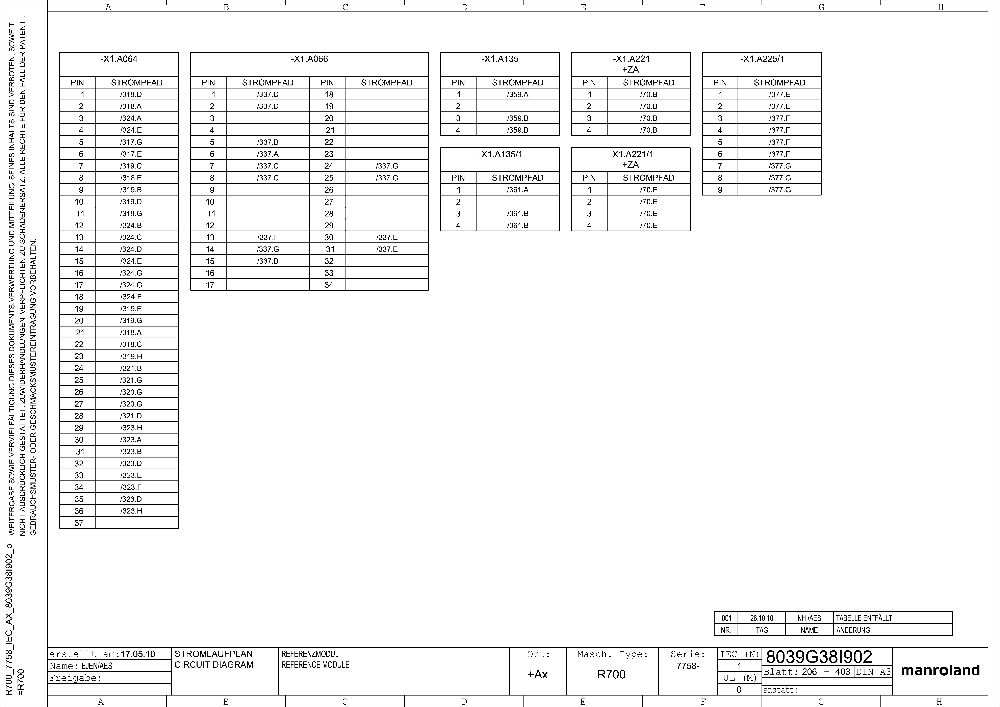

# +Ax — Sheet 206 of 403 — REFERENZMODUL

**REFERENCE MODULE**

> Part of the manroland **R700** printing press IEC/UL circuit diagrams.
> Drawing class: **Stromlaufplan / Circuit diagram** (DIN A3).
> Document `+Ax` covers the **Central control console** machine section.

## At a glance

| Field | Value |
|---|---|
| Document | `+Ax`  (8039G38I902) |
| Sheet | **206** of 403 |
| Section (DE) | REFERENZMODUL |
| Section (EN) | REFERENCE MODULE |
| Section type | REFERENCE_MODULE — Reference module |
| Machine type | `R700` |
| Series | `7758` |
| Created | 17.05.10 |
| Replaces | — |
| Columns used | A, B, C, D, E, F, G |
| Path numbers | — |
| Labels on sheet | 201 |
| Cross-refs out | 72 |
| Cross-refs in | 0 |

**Previous:** [+Ax sheet 205](SHEET_0205.md) · **Next:** [+Ax sheet 207](SHEET_0207.md) · **Document TOC:** [_TOC.md](_TOC.md)  (+Ax) · **Master TOC:** [all sheets](../_MASTER_TOC.md)

## Sheet image (300 DPI, exact vector render)



_Rendered directly from the PDF vector layer at 300 DPI (1-bit), no OCR and no resampling. Use it to confirm anything ambiguous in the text below._

## Cross-references on this sheet

Each entry is a wire leaving this sheet. The printed token is `/sheet.column`; the link resolves to that sheet inside the same document.

| Ref | Target sheet | Col | Path | Destination on target | Target section | From col |
|---|---|---|---|---|---|---|
| `/70.B` | [+Ax sheet 70](SHEET_0070.md) | B | — | — | WASCHVORRICHTUNGEN DRUCKWERKE | F |
| `/359.A` | [+Ax sheet 359](SHEET_0359.md) | A | — | — | OPTION: LOGISTIK ANLEGER | D |
| `/377.E` | [+Ax sheet 377](SHEET_0377.md) | E | — | — | OPTION: TELEPRESENCE | G |
| `/318.D` | [+Ax sheet 318](SHEET_0318.md) | D | — | — | OPTION: "EJEKTOR" ANLAGE / SELECT AIRSTATION / | A |
| `/337.D` | [+Ax sheet 337](SHEET_0337.md) | D | — | — | OPTION: INLINESHEETER RS104 S | B |
| `/70.B` | [+Ax sheet 70](SHEET_0070.md) | B | — | — | WASCHVORRICHTUNGEN DRUCKWERKE | F |
| `/318.A` | [+Ax sheet 318](SHEET_0318.md) | A | — | — | OPTION: "EJEKTOR" ANLAGE / SELECT AIRSTATION / | A |
| `/377.E` | [+Ax sheet 377](SHEET_0377.md) | E | — | — | OPTION: TELEPRESENCE | G |
| `/337.D` | [+Ax sheet 337](SHEET_0337.md) | D | — | — | OPTION: INLINESHEETER RS104 S | B |
| `/70.B` | [+Ax sheet 70](SHEET_0070.md) | B | — | — | WASCHVORRICHTUNGEN DRUCKWERKE | F |
| `/324.A` | [+Ax sheet 324](SHEET_0324.md) | A | — | — | OPTION: "EJEKTOR" ANLAGE / SELECT AIRSTATION / | A |
| `/359.B` | [+Ax sheet 359](SHEET_0359.md) | B | — | — | OPTION: LOGISTIK ANLEGER | D |
| `/377.F` | [+Ax sheet 377](SHEET_0377.md) | F | — | — | OPTION: TELEPRESENCE | G |
| `/70.B` | [+Ax sheet 70](SHEET_0070.md) | B | — | — | WASCHVORRICHTUNGEN DRUCKWERKE | F |
| `/324.E` | [+Ax sheet 324](SHEET_0324.md) | E | — | — | OPTION: "EJEKTOR" ANLAGE / SELECT AIRSTATION / | A |
| `/359.B` | [+Ax sheet 359](SHEET_0359.md) | B | — | — | OPTION: LOGISTIK ANLEGER | D |
| `/377.F` | [+Ax sheet 377](SHEET_0377.md) | F | — | — | OPTION: TELEPRESENCE | G |
| `/337.B` | [+Ax sheet 337](SHEET_0337.md) | B | — | — | OPTION: INLINESHEETER RS104 S | B |
| `/377.F` | [+Ax sheet 377](SHEET_0377.md) | F | — | — | OPTION: TELEPRESENCE | G |
| `/317.G` | [+Ax sheet 317](SHEET_0317.md) | G | — | — | OPTION: "EJEKTOR" ANLAGE / SELECT AIRSTATION / | A |
| `/317.E` | [+Ax sheet 317](SHEET_0317.md) | E | — | — | OPTION: "EJEKTOR" ANLAGE / SELECT AIRSTATION / | A |
| `/337.A` | [+Ax sheet 337](SHEET_0337.md) | A | — | — | OPTION: INLINESHEETER RS104 S | B |
| `/377.F` | [+Ax sheet 377](SHEET_0377.md) | F | — | — | OPTION: TELEPRESENCE | G |
| `/337.G` | [+Ax sheet 337](SHEET_0337.md) | G | — | — | OPTION: INLINESHEETER RS104 S | C |
| `/377.G` | [+Ax sheet 377](SHEET_0377.md) | G | — | — | OPTION: TELEPRESENCE | G |
| `/319.C` | [+Ax sheet 319](SHEET_0319.md) | C | — | — | OPTION: "EJEKTOR" ANLAGE / SELECT AIRSTATION / | A |
| `/337.C` | [+Ax sheet 337](SHEET_0337.md) | C | — | — | OPTION: INLINESHEETER RS104 S | B |
| `/318.E` | [+Ax sheet 318](SHEET_0318.md) | E | — | — | OPTION: "EJEKTOR" ANLAGE / SELECT AIRSTATION / | A |
| `/337.G` | [+Ax sheet 337](SHEET_0337.md) | G | — | — | OPTION: INLINESHEETER RS104 S | C |
| `/377.G` | [+Ax sheet 377](SHEET_0377.md) | G | — | — | OPTION: TELEPRESENCE | G |
| `/337.C` | [+Ax sheet 337](SHEET_0337.md) | C | — | — | OPTION: INLINESHEETER RS104 S | B |
| `/70.E` | [+Ax sheet 70](SHEET_0070.md) | E | — | — | WASCHVORRICHTUNGEN DRUCKWERKE | F |
| `/319.B` | [+Ax sheet 319](SHEET_0319.md) | B | — | — | OPTION: "EJEKTOR" ANLAGE / SELECT AIRSTATION / | A |
| `/361.A` | [+Ax sheet 361](SHEET_0361.md) | A | — | — | OPTION: LOGISTIK ANLEGER | D |
| `/377.G` | [+Ax sheet 377](SHEET_0377.md) | G | — | — | OPTION: TELEPRESENCE | G |
| `/70.E` | [+Ax sheet 70](SHEET_0070.md) | E | — | — | WASCHVORRICHTUNGEN DRUCKWERKE | F |
| `/319.D` | [+Ax sheet 319](SHEET_0319.md) | D | — | — | OPTION: "EJEKTOR" ANLAGE / SELECT AIRSTATION / | A |
| `/70.E` | [+Ax sheet 70](SHEET_0070.md) | E | — | — | WASCHVORRICHTUNGEN DRUCKWERKE | F |
| `/361.B` | [+Ax sheet 361](SHEET_0361.md) | B | — | — | OPTION: LOGISTIK ANLEGER | D |
| `/318.G` | [+Ax sheet 318](SHEET_0318.md) | G | — | — | OPTION: "EJEKTOR" ANLAGE / SELECT AIRSTATION / | A |
| `/70.E` | [+Ax sheet 70](SHEET_0070.md) | E | — | — | WASCHVORRICHTUNGEN DRUCKWERKE | F |
| `/324.B` | [+Ax sheet 324](SHEET_0324.md) | B | — | — | OPTION: "EJEKTOR" ANLAGE / SELECT AIRSTATION / | A |
| `/361.B` | [+Ax sheet 361](SHEET_0361.md) | B | — | — | OPTION: LOGISTIK ANLEGER | D |
| `/337.E` | [+Ax sheet 337](SHEET_0337.md) | E | — | — | OPTION: INLINESHEETER RS104 S | C |
| `/337.F` | [+Ax sheet 337](SHEET_0337.md) | F | — | — | OPTION: INLINESHEETER RS104 S | B |
| `/324.C` | [+Ax sheet 324](SHEET_0324.md) | C | — | — | OPTION: "EJEKTOR" ANLAGE / SELECT AIRSTATION / | A |
| `/337.E` | [+Ax sheet 337](SHEET_0337.md) | E | — | — | OPTION: INLINESHEETER RS104 S | C |
| `/337.G` | [+Ax sheet 337](SHEET_0337.md) | G | — | — | OPTION: INLINESHEETER RS104 S | B |
| `/324.D` | [+Ax sheet 324](SHEET_0324.md) | D | — | — | OPTION: "EJEKTOR" ANLAGE / SELECT AIRSTATION / | A |
| `/324.E` | [+Ax sheet 324](SHEET_0324.md) | E | — | — | OPTION: "EJEKTOR" ANLAGE / SELECT AIRSTATION / | A |
| `/337.B` | [+Ax sheet 337](SHEET_0337.md) | B | — | — | OPTION: INLINESHEETER RS104 S | B |
| `/324.G` | [+Ax sheet 324](SHEET_0324.md) | G | — | — | OPTION: "EJEKTOR" ANLAGE / SELECT AIRSTATION / | A |
| `/324.G` | [+Ax sheet 324](SHEET_0324.md) | G | — | — | OPTION: "EJEKTOR" ANLAGE / SELECT AIRSTATION / | A |
| `/324.F` | [+Ax sheet 324](SHEET_0324.md) | F | — | — | OPTION: "EJEKTOR" ANLAGE / SELECT AIRSTATION / | A |
| `/319.E` | [+Ax sheet 319](SHEET_0319.md) | E | — | — | OPTION: "EJEKTOR" ANLAGE / SELECT AIRSTATION / | A |
| `/319.G` | [+Ax sheet 319](SHEET_0319.md) | G | — | — | OPTION: "EJEKTOR" ANLAGE / SELECT AIRSTATION / | A |
| `/318.A` | [+Ax sheet 318](SHEET_0318.md) | A | — | — | OPTION: "EJEKTOR" ANLAGE / SELECT AIRSTATION / | A |
| `/318.C` | [+Ax sheet 318](SHEET_0318.md) | C | — | — | OPTION: "EJEKTOR" ANLAGE / SELECT AIRSTATION / | A |
| `/319.H` | [+Ax sheet 319](SHEET_0319.md) | H | — | — | OPTION: "EJEKTOR" ANLAGE / SELECT AIRSTATION / | A |
| `/321.B` | [+Ax sheet 321](SHEET_0321.md) | B | — | — | OPTION: "EJEKTOR" ANLAGE / SELECT AIRSTATION / | A |
| `/321.G` | [+Ax sheet 321](SHEET_0321.md) | G | — | — | OPTION: "EJEKTOR" ANLAGE / SELECT AIRSTATION / | A |
| `/320.G` | [+Ax sheet 320](SHEET_0320.md) | G | — | — | OPTION: "EJEKTOR" ANLAGE / SELECT AIRSTATION / | A |
| `/320.G` | [+Ax sheet 320](SHEET_0320.md) | G | — | — | OPTION: "EJEKTOR" ANLAGE / SELECT AIRSTATION / | A |
| `/321.D` | [+Ax sheet 321](SHEET_0321.md) | D | — | — | OPTION: "EJEKTOR" ANLAGE / SELECT AIRSTATION / | A |
| `/323.H` | [+Ax sheet 323](SHEET_0323.md) | H | — | — | OPTION: "EJEKTOR" ANLAGE / SELECT AIRSTATION / | A |
| `/323.A` | [+Ax sheet 323](SHEET_0323.md) | A | — | — | OPTION: "EJEKTOR" ANLAGE / SELECT AIRSTATION / | A |
| `/323.B` | [+Ax sheet 323](SHEET_0323.md) | B | — | — | OPTION: "EJEKTOR" ANLAGE / SELECT AIRSTATION / | A |
| `/323.D` | [+Ax sheet 323](SHEET_0323.md) | D | — | — | OPTION: "EJEKTOR" ANLAGE / SELECT AIRSTATION / | A |
| `/323.E` | [+Ax sheet 323](SHEET_0323.md) | E | — | — | OPTION: "EJEKTOR" ANLAGE / SELECT AIRSTATION / | A |
| `/323.F` | [+Ax sheet 323](SHEET_0323.md) | F | — | — | OPTION: "EJEKTOR" ANLAGE / SELECT AIRSTATION / | A |
| `/323.D` | [+Ax sheet 323](SHEET_0323.md) | D | — | — | OPTION: "EJEKTOR" ANLAGE / SELECT AIRSTATION / | A |
| `/323.H` | [+Ax sheet 323](SHEET_0323.md) | H | — | — | OPTION: "EJEKTOR" ANLAGE / SELECT AIRSTATION / | A |

## Devices on this sheet

| Tag | Class | Class meaning (IEC) | Col | Sub | Terminal | Sign |
|---|---|---|---|---|---|---|
| `X1.A064` | — | cross-device reference | A | — | — | — |
| `X1.A066` | — | cross-device reference | C | — | — | — |
| `X1.A221` | — | cross-device reference | E | — | — | — |
| `X1.A135` | — | cross-device reference | D | — | — | — |
| `NR.` | — | cross-device reference | F | — | — | — |
| `26.10.10` | — | cross-device reference | F | — | — | — |

## Potentials / nets

_No named potentials on this sheet._

## Wire-end annotations (grouped as printed)

A wire that continues elsewhere is annotated with a small cluster: the destination description, the path/line number `#NN`, and the `/sheet.column` cross reference. Each row below is one such cluster exactly as it is grouped on the drawing.

| Col | Y | Path | Cross-ref | Text on the wire |
|---|---|---|---|---|
| A | 65.5 | — | — | `X1.A064` |
| C | 65.5 | — | — | `X1.A066` |
| D | 65.5 | — | — | `X1.A135` |
| E | 65.5 | — | — | `X1.A221` |
| G | 65.5 | — | — | `X1.A225/1` |
| E | 78.2 | — | — | `+ZA` |
| A | 94.2 | — | — | `PIN STROMPFAD` |
| B | 94.2 | — | — | `PIN STROMPFAD` |
| C | 94.2 | — | — | `PIN 18 19 20 22 23 24 25 26 27 28 29 30 32 33 34 21 31 STROMPFAD` |
| D | 94.2 | — | — | `PIN 2 3 4 1 STROMPFAD` |
| E | 94.2 | — | — | `PIN 2 3 4 1 STROMPFAD` |
| F | 94.2 | — | — | `PIN 2 3 4 5 6 7 8 9 1 STROMPFAD` |
| A | 108.4 | — | — | `2 3 4 5 6 7 8 9 1` |
| B | 108.4 | — | — | `2 3 4 5 6 7 8 9 1` |
| A | 108.7 | — | `/318.D` | — |
| B | 108.7 | — | `/337.D` | — |
| D | 108.7 | — | `/359.A` | — |
| F | 108.7 | — | `/70.B` | — |
| G | 108.7 | — | `/377.E` | — |
| F | 122.8 | — | `/70.B` | — |
| A | 122.9 | — | `/318.A` | — |
| B | 122.9 | — | `/337.D` | — |
| G | 122.9 | — | `/377.E` | — |
| A | 137.0 | — | `/324.A` | — |
| D | 137.0 | — | `/359.B` | — |
| F | 137.0 | — | `/70.B` | — |
| G | 137.0 | — | `/377.F` | — |
| A | 151.2 | — | `/324.E` | — |
| D | 151.2 | — | `/359.B` | — |
| F | 151.2 | — | `/70.B` | — |
| G | 151.2 | — | `/377.F` | — |
| A | 165.4 | — | `/317.G` | — |
| B | 165.4 | — | `/337.B` | — |
| G | 165.4 | — | `/377.F` | — |
| D | 178.9 | — | — | `X1.A135/1` |
| E | 178.9 | — | — | `X1.A221/1` |
| A | 179.6 | — | `/317.E` | — |
| B | 179.6 | — | `/337.A` | — |
| G | 179.6 | — | `/377.F` | — |
| E | 191.6 | — | — | `+ZA` |
| C | 193.7 | — | `/337.G` | — |
| G | 193.7 | — | `/377.G` | — |
| A | 193.8 | — | `/319.C` | — |
| B | 193.8 | — | `/337.C` | — |
| D | 207.5 | — | — | `PIN 2 3 4 1 STROMPFAD` |
| E | 207.5 | — | — | `PIN 2 3 4 1 STROMPFAD` |
| A | 207.9 | — | `/318.E` | — |
| B | 207.9 | — | `/337.C` | — |
| C | 207.9 | — | `/337.G` | — |
| G | 207.9 | — | `/377.G` | — |
| A | 222.1 | — | `/319.B` | — |
| D | 222.1 | — | `/361.A` | — |
| F | 222.1 | — | `/70.E` | — |
| G | 222.1 | — | `/377.G` | — |
| A | 235.9 | — | — | `10 12 13 14 15 16 17 11` |
| B | 235.9 | — | — | `10 12 13 14 15 16 17 11` |
| F | 236.2 | — | `/70.E` | — |
| A | 236.3 | — | `/319.D` | — |
| A | 250.4 | — | `/318.G` | — |
| D | 250.4 | — | `/361.B` | — |
| F | 250.4 | — | `/70.E` | — |
| A | 264.6 | — | `/324.B` | — |
| D | 264.6 | — | `/361.B` | — |
| F | 264.6 | — | `/70.E` | — |
| A | 278.8 | — | `/324.C` | — |
| B | 278.8 | — | `/337.F` | — |
| C | 278.8 | — | `/337.E` | — |
| C | 292.9 | — | `/337.E` | — |
| A | 293.0 | — | `/324.D` | — |
| B | 293.0 | — | `/337.G` | — |
| A | 307.1 | — | `/324.E` | — |
| B | 307.1 | — | `/337.B` | — |
| A | 321.3 | — | `/324.G` | — |
| A | 335.5 | — | `/324.G` | — |
| A | 349.3 | — | — | `18 19 20 22 23 24 25 26 27 28 29 30 32 33 34 35 36 37 21 31` |
| A | 349.6 | — | `/324.F` | — |
| A | 363.8 | — | `/319.E` | — |
| A | 378.0 | — | `/319.G` | — |
| A | 392.1 | — | `/318.A` | — |
| A | 406.4 | — | `/318.C` | — |
| A | 420.5 | — | `/319.H` | — |
| A | 434.7 | — | `/321.B` | — |
| A | 448.9 | — | `/321.G` | — |
| A | 463.0 | — | `/320.G` | — |
| A | 477.2 | — | `/320.G` | — |
| A | 491.4 | — | `/321.D` | — |
| A | 505.6 | — | `/323.H` | — |
| A | 519.7 | — | `/323.A` | — |
| A | 533.9 | — | `/323.B` | — |
| A | 548.1 | — | `/323.D` | — |
| A | 562.2 | — | `/323.E` | — |
| A | 576.4 | — | `/323.F` | — |
| A | 590.6 | — | `/323.D` | — |
| A | 604.8 | — | `/323.H` | — |
| G | 733.0 | — | — | `001 26.10.10 NHI/AES TABELLE ENTFÄLLT` |
| G | 747.1 | — | — | `NR. TAG NAME ÄNDERUNG` |


## Reconstructed tables

This sheet carries tabular content (pin map / terminal assignment / index). The grid below was rebuilt from the drawing's own rule lines, so each row is exactly one physical row of the table.

### Table 1 — 37 data rows × 2 columns (at x=70.9, y=62.4) — **X1.A064**

| PIN | STROMPFAD |
|---|---|
| `1` | `/318.D` |
| `2` | `/318.A` |
| `3` | `/324.A` |
| `4` | `/324.E` |
| `5` | `/317.G` |
| `6` | `/317.E` |
| `7` | `/319.C` |
| `8` | `/318.E` |
| `9` | `/319.B` |
| `10` | `/319.D` |
| `11` | `/318.G` |
| `12` | `/324.B` |
| `13` | `/324.C` |
| `14` | `/324.D` |
| `15` | `/324.E` |
| `16` | `/324.G` |
| `17` | `/324.G` |
| `18` | `/324.F` |
| `19` | `/319.E` |
| `20` | `/319.G` |
| `21` | `/318.A` |
| `22` | `/318.C` |
| `23` | `/319.H` |
| `24` | `/321.B` |
| `25` | `/321.G` |
| `26` | `/320.G` |
| `27` | `/320.G` |
| `28` | `/321.D` |
| `29` | `/323.H` |
| `30` | `/323.A` |
| `31` | `/323.B` |
| `32` | `/323.D` |
| `33` | `/323.E` |
| `34` | `/323.F` |
| `35` | `/323.D` |
| `36` | `/323.H` |
| `37` |  |


### Table 2 — 17 data rows × 4 columns (at x=226.8, y=62.4) — **X1.A066**

| PIN | STROMPFAD | PIN | STROMPFAD |
|---|---|---|---|
| `1` | `/337.D` | `18` |  |
| `2` | `/337.D` | `19` |  |
| `3` |  | `20` |  |
| `4` |  | `21` |  |
| `5` | `/337.B` | `22` |  |
| `6` | `/337.A` | `23` |  |
| `7` | `/337.C` | `24` | `/337.G` |
| `8` | `/337.C` | `25` | `/337.G` |
| `9` |  | `26` |  |
| `10` |  | `27` |  |
| `11` |  | `28` |  |
| `12` |  | `29` |  |
| `13` | `/337.F` | `30` | `/337.E` |
| `14` | `/337.G` | `31` | `/337.E` |
| `15` | `/337.B` | `32` |  |
| `16` |  | `33` |  |
| `17` |  | `34` |  |


### Table 3 — 10 data rows × 2 columns (at x=524.4, y=62.4) — **X1.A135**

| PIN | STROMPFAD |
|---|---|
| `1` | `/359.A` |
| `2` |  |
| `3` | `/359.B` |
| `4` | `/359.B` |
|  | `X1.A135/1` |
| `PIN` | `STROMPFAD` |
| `1` | `/361.A` |
| `2` |  |
| `3` | `/361.B` |
| `4` | `/361.B` |


### Table 4 — 11 data rows × 2 columns (at x=680.3, y=62.4) — **X1.A221 +ZA**

| PIN | STROMPFAD |
|---|---|
| `1` | `/70.B` |
| `2` | `/70.B` |
| `3` | `/70.B` |
| `4` | `/70.B` |
|  | `X1.A221/1` |
|  | `+ZA` |
| `PIN` | `STROMPFAD` |
| `1` | `/70.E` |
| `2` | `/70.E` |
| `3` | `/70.E` |
| `4` | `/70.E` |


### Table 5 — 9 data rows × 2 columns (at x=836.2, y=62.4) — **X1.A225/1**

| PIN | STROMPFAD |
|---|---|
| `1` | `/377.E` |
| `2` | `/377.E` |
| `3` | `/377.F` |
| `4` | `/377.F` |
| `5` | `/377.F` |
| `6` | `/377.F` |
| `7` | `/377.G` |
| `8` | `/377.G` |
| `9` | `/377.G` |


## Notes and free text on this sheet

| Text | Col | Y (pt) |
|---|---|---|
| `PIN` | A | 94.2 |
| `STROMPFAD` | A | 94.15 |
| `PIN` | B | 94.2 |
| `STROMPFAD` | B | 94.15 |
| `PIN` | C | 94.2 |
| `STROMPFAD` | C | 94.15 |
| `PIN` | E | 94.2 |
| `STROMPFAD` | F | 94.15 |
| `+ZA` | E | 78.18 |
| `X1.A221/1` | E | 178.9 |
| `PIN` | D | 94.2 |
| `STROMPFAD` | D | 94.15 |
| `X1.A135/1` | D | 178.9 |
| `PIN` | F | 94.2 |
| `STROMPFAD` | G | 94.15 |
| `X1.A225/1` | G | 65.51 |
| `TAG` | G | 747.27 |
| `NAME` | G | 747.25 |
| `ÄNDERUNG` | G | 747.31 |
| `NHI/AES` | G | 733.11 |
| `TABELLE ENTFÄLLT` | G | 733.15 |

## Complete label inventory (exact text from the drawing)

Every text object inside the drawing area of this sheet, in DIN reading order (column A→H, then top→bottom). This is the authoritative list: if a string is not here it is not printed on this sheet.

| Col | Y | X | Dir | Type | Text |
|---|---|---|---|---|---|
| A | 65.5 | 119.8 | → | device ref | `X1.A064` |
| A | 94.2 | 84.0 | → | text | `PIN` |
| A | 94.2 | 132.2 | → | text | `STROMPFAD` |
| A | 108.4 | 95.8 | → | number | `1` |
| A | 108.7 | 143.1 | → | cross-reference | `/318.D` |
| A | 122.5 | 94.1 | → | number | `2` |
| A | 122.9 | 143.1 | → | cross-reference | `/318.A` |
| A | 136.7 | 94.1 | → | number | `3` |
| A | 137.0 | 143.1 | → | cross-reference | `/324.A` |
| A | 150.9 | 94.1 | → | number | `4` |
| A | 151.2 | 143.4 | → | cross-reference | `/324.E` |
| A | 165.1 | 94.1 | → | number | `5` |
| A | 165.4 | 143.0 | → | cross-reference | `/317.G` |
| A | 179.2 | 94.1 | → | number | `6` |
| A | 179.6 | 143.4 | → | cross-reference | `/317.E` |
| A | 193.4 | 94.1 | → | number | `7` |
| A | 193.8 | 143.1 | → | cross-reference | `/319.C` |
| A | 207.6 | 94.1 | → | number | `8` |
| A | 207.9 | 143.4 | → | cross-reference | `/318.E` |
| A | 221.8 | 94.1 | → | number | `9` |
| A | 222.1 | 143.3 | → | cross-reference | `/319.B` |
| A | 235.9 | 88.7 | → | number | `10` |
| A | 236.3 | 143.1 | → | cross-reference | `/319.D` |
| A | 250.1 | 90.4 | → | number | `11` |
| A | 250.4 | 143.0 | → | cross-reference | `/318.G` |
| A | 264.3 | 88.7 | → | number | `12` |
| A | 264.6 | 143.3 | → | cross-reference | `/324.B` |
| A | 278.5 | 88.7 | → | number | `13` |
| A | 278.8 | 143.1 | → | cross-reference | `/324.C` |
| A | 292.6 | 88.7 | → | number | `14` |
| A | 293.0 | 143.1 | → | cross-reference | `/324.D` |
| A | 306.8 | 88.7 | → | number | `15` |
| A | 307.1 | 143.4 | → | cross-reference | `/324.E` |
| A | 321.0 | 88.7 | → | number | `16` |
| A | 321.3 | 143.0 | → | cross-reference | `/324.G` |
| A | 335.1 | 88.7 | → | number | `17` |
| A | 335.5 | 143.0 | → | cross-reference | `/324.G` |
| A | 349.3 | 88.7 | → | number | `18` |
| A | 349.6 | 143.6 | → | cross-reference | `/324.F` |
| A | 363.5 | 88.7 | → | number | `19` |
| A | 363.8 | 143.4 | → | cross-reference | `/319.E` |
| A | 377.7 | 88.7 | → | number | `20` |
| A | 378.0 | 143.0 | → | cross-reference | `/319.G` |
| A | 391.8 | 90.4 | → | number | `21` |
| A | 392.2 | 143.1 | → | cross-reference | `/318.A` |
| A | 406.0 | 88.7 | → | number | `22` |
| A | 406.4 | 143.1 | → | cross-reference | `/318.C` |
| A | 420.2 | 88.7 | → | number | `23` |
| A | 420.5 | 143.4 | → | cross-reference | `/319.H` |
| A | 434.4 | 88.7 | → | number | `24` |
| A | 434.7 | 143.3 | → | cross-reference | `/321.B` |
| A | 448.5 | 88.7 | → | number | `25` |
| A | 448.9 | 143.0 | → | cross-reference | `/321.G` |
| A | 462.7 | 88.7 | → | number | `26` |
| A | 463.0 | 143.0 | → | cross-reference | `/320.G` |
| A | 476.9 | 88.7 | → | number | `27` |
| A | 477.2 | 143.0 | → | cross-reference | `/320.G` |
| A | 491.0 | 88.7 | → | number | `28` |
| A | 491.4 | 143.1 | → | cross-reference | `/321.D` |
| A | 505.2 | 88.7 | → | number | `29` |
| A | 505.6 | 143.4 | → | cross-reference | `/323.H` |
| A | 519.4 | 88.7 | → | number | `30` |
| A | 519.7 | 143.1 | → | cross-reference | `/323.A` |
| A | 533.6 | 90.4 | → | number | `31` |
| A | 533.9 | 143.3 | → | cross-reference | `/323.B` |
| A | 547.7 | 88.7 | → | number | `32` |
| A | 548.1 | 143.1 | → | cross-reference | `/323.D` |
| A | 561.9 | 88.7 | → | number | `33` |
| A | 562.2 | 143.4 | → | cross-reference | `/323.E` |
| A | 576.1 | 88.7 | → | number | `34` |
| A | 576.4 | 143.6 | → | cross-reference | `/323.F` |
| A | 590.3 | 88.7 | → | number | `35` |
| A | 590.6 | 143.1 | → | cross-reference | `/323.D` |
| A | 604.4 | 88.7 | → | number | `36` |
| A | 604.8 | 143.4 | → | cross-reference | `/323.H` |
| A | 618.6 | 88.7 | → | number | `37` |
| B | 94.2 | 240.0 | → | text | `PIN` |
| B | 94.2 | 288.1 | → | text | `STROMPFAD` |
| B | 108.4 | 251.7 | → | number | `1` |
| B | 108.7 | 306.1 | → | cross-reference | `/337.D` |
| B | 122.5 | 250.0 | → | number | `2` |
| B | 122.9 | 306.1 | → | cross-reference | `/337.D` |
| B | 136.7 | 250.0 | → | number | `3` |
| B | 150.9 | 250.0 | → | number | `4` |
| B | 165.1 | 250.0 | → | number | `5` |
| B | 165.4 | 306.3 | → | cross-reference | `/337.B` |
| B | 179.2 | 250.0 | → | number | `6` |
| B | 179.6 | 306.1 | → | cross-reference | `/337.A` |
| B | 193.4 | 250.0 | → | number | `7` |
| B | 193.8 | 306.1 | → | cross-reference | `/337.C` |
| B | 207.6 | 250.0 | → | number | `8` |
| B | 207.9 | 306.1 | → | cross-reference | `/337.C` |
| B | 221.8 | 250.0 | → | number | `9` |
| B | 235.9 | 244.6 | → | number | `10` |
| B | 250.1 | 246.3 | → | number | `11` |
| B | 264.3 | 244.6 | → | number | `12` |
| B | 278.5 | 244.6 | → | number | `13` |
| B | 278.8 | 306.6 | → | cross-reference | `/337.F` |
| B | 292.6 | 244.6 | → | number | `14` |
| B | 293.0 | 306.0 | → | cross-reference | `/337.G` |
| B | 306.8 | 244.6 | → | number | `15` |
| B | 307.1 | 306.3 | → | cross-reference | `/337.B` |
| B | 321.0 | 244.6 | → | number | `16` |
| B | 335.1 | 244.6 | → | number | `17` |
| C | 65.5 | 346.5 | → | device ref | `X1.A066` |
| C | 94.2 | 381.7 | → | text | `PIN` |
| C | 94.2 | 429.9 | → | text | `STROMPFAD` |
| C | 108.4 | 386.4 | → | number | `18` |
| C | 122.5 | 386.4 | → | number | `19` |
| C | 136.7 | 386.4 | → | number | `20` |
| C | 150.9 | 388.1 | → | number | `21` |
| C | 165.1 | 386.4 | → | number | `22` |
| C | 179.2 | 386.4 | → | number | `23` |
| C | 193.4 | 386.4 | → | number | `24` |
| C | 193.7 | 447.7 | → | cross-reference | `/337.G` |
| C | 207.6 | 386.4 | → | number | `25` |
| C | 207.9 | 447.7 | → | cross-reference | `/337.G` |
| C | 221.8 | 386.4 | → | number | `26` |
| C | 235.9 | 386.4 | → | number | `27` |
| C | 250.1 | 386.4 | → | number | `28` |
| C | 264.3 | 386.4 | → | number | `29` |
| C | 278.5 | 386.4 | → | number | `30` |
| C | 278.8 | 448.2 | → | cross-reference | `/337.E` |
| C | 292.6 | 388.1 | → | number | `31` |
| C | 292.9 | 448.2 | → | cross-reference | `/337.E` |
| C | 306.8 | 386.4 | → | number | `32` |
| C | 321.0 | 386.4 | → | number | `33` |
| C | 335.1 | 386.4 | → | number | `34` |
| D | 65.5 | 573.3 | → | device ref | `X1.A135` |
| D | 94.2 | 537.6 | → | text | `PIN` |
| D | 94.2 | 585.8 | → | text | `STROMPFAD` |
| D | 108.4 | 543.5 | → | number | `1` |
| D | 108.7 | 603.8 | → | cross-reference | `/359.A` |
| D | 122.5 | 543.0 | → | number | `2` |
| D | 136.7 | 543.0 | → | number | `3` |
| D | 137.0 | 603.9 | → | cross-reference | `/359.B` |
| D | 150.9 | 543.0 | → | number | `4` |
| D | 151.2 | 603.9 | → | cross-reference | `/359.B` |
| D | 178.9 | 569.6 | → | text | `X1.A135/1` |
| D | 207.5 | 585.8 | → | text | `STROMPFAD` |
| D | 207.6 | 537.6 | → | text | `PIN` |
| D | 221.8 | 543.5 | → | number | `1` |
| D | 222.1 | 603.8 | → | cross-reference | `/361.A` |
| D | 235.9 | 543.0 | → | number | `2` |
| D | 250.1 | 543.0 | → | number | `3` |
| D | 250.4 | 603.9 | → | cross-reference | `/361.B` |
| D | 264.3 | 543.0 | → | number | `4` |
| D | 264.6 | 603.9 | → | cross-reference | `/361.B` |
| E | 65.5 | 729.9 | → | device ref | `X1.A221` |
| E | 78.2 | 740.8 | → | text | `+ZA` |
| E | 94.2 | 693.5 | → | text | `PIN` |
| E | 108.4 | 699.4 | → | number | `1` |
| E | 122.5 | 698.9 | → | number | `2` |
| E | 136.7 | 698.9 | → | number | `3` |
| E | 150.9 | 698.9 | → | number | `4` |
| E | 178.9 | 725.5 | → | text | `X1.A221/1` |
| E | 191.6 | 740.8 | → | text | `+ZA` |
| E | 207.6 | 693.5 | → | text | `PIN` |
| E | 221.8 | 699.4 | → | number | `1` |
| E | 235.9 | 698.9 | → | number | `2` |
| E | 250.1 | 698.9 | → | number | `3` |
| E | 264.3 | 698.9 | → | number | `4` |
| F | 94.2 | 741.7 | → | text | `STROMPFAD` |
| F | 94.2 | 849.4 | → | text | `PIN` |
| F | 108.4 | 855.4 | → | number | `1` |
| F | 108.7 | 762.2 | → | cross-reference | `/70.B` |
| F | 122.5 | 854.8 | → | number | `2` |
| F | 122.8 | 762.2 | → | cross-reference | `/70.B` |
| F | 136.7 | 854.8 | → | number | `3` |
| F | 137.0 | 762.2 | → | cross-reference | `/70.B` |
| F | 150.9 | 854.8 | → | number | `4` |
| F | 151.2 | 762.2 | → | cross-reference | `/70.B` |
| F | 165.1 | 854.8 | → | number | `5` |
| F | 179.2 | 854.8 | → | number | `6` |
| F | 193.4 | 854.8 | → | number | `7` |
| F | 207.5 | 741.7 | → | text | `STROMPFAD` |
| F | 207.6 | 854.8 | → | number | `8` |
| F | 221.8 | 854.8 | → | number | `9` |
| F | 222.1 | 762.4 | → | cross-reference | `/70.E` |
| F | 236.2 | 762.4 | → | cross-reference | `/70.E` |
| F | 250.4 | 762.4 | → | cross-reference | `/70.E` |
| F | 264.6 | 762.4 | → | cross-reference | `/70.E` |
| F | 733.0 | 859.4 | → | number | `001` |
| F | 733.1 | 893.5 | → | device ref | `26.10.10` |
| F | 747.1 | 858.4 | → | device ref | `NR.` |
| G | 65.5 | 881.4 | → | text | `X1.A225/1` |
| G | 94.2 | 897.6 | → | text | `STROMPFAD` |
| G | 108.7 | 915.9 | → | cross-reference | `/377.E` |
| G | 122.9 | 915.9 | → | cross-reference | `/377.E` |
| G | 137.0 | 916.0 | → | cross-reference | `/377.F` |
| G | 151.2 | 916.0 | → | cross-reference | `/377.F` |
| G | 165.4 | 916.0 | → | cross-reference | `/377.F` |
| G | 179.6 | 916.0 | → | cross-reference | `/377.F` |
| G | 193.7 | 915.4 | → | cross-reference | `/377.G` |
| G | 207.9 | 915.4 | → | cross-reference | `/377.G` |
| G | 222.1 | 915.4 | → | cross-reference | `/377.G` |
| G | 733.1 | 949.5 | → | text | `NHI/AES` |
| G | 733.2 | 995.4 | → | text | `TABELLE ENTFÄLLT` |
| G | 747.3 | 900.0 | → | text | `TAG` |
| G | 747.3 | 953.4 | → | text | `NAME` |
| G | 747.3 | 996.0 | → | text | `ÄNDERUNG` |

## Reading-order text block

The same content as a plain block, grouped by DIN column — convenient to paste or to match against a visual description.

```text
=== Column A ===
  65.5  119.8  devref       X1.A064
  94.2   84.0  text         PIN
  94.2  132.2  text         STROMPFAD
 108.4   95.8  numeric      1
 108.7  143.1  xref         /318.D
 122.5   94.1  numeric      2
 122.9  143.1  xref         /318.A
 136.7   94.1  numeric      3
 137.0  143.1  xref         /324.A
 150.9   94.1  numeric      4
 151.2  143.4  xref         /324.E
 165.1   94.1  numeric      5
 165.4  143.0  xref         /317.G
 179.2   94.1  numeric      6
 179.6  143.4  xref         /317.E
 193.4   94.1  numeric      7
 193.8  143.1  xref         /319.C
 207.6   94.1  numeric      8
 207.9  143.4  xref         /318.E
 221.8   94.1  numeric      9
 222.1  143.3  xref         /319.B
 235.9   88.7  numeric      10
 236.3  143.1  xref         /319.D
 250.1   90.4  numeric      11
 250.4  143.0  xref         /318.G
 264.3   88.7  numeric      12
 264.6  143.3  xref         /324.B
 278.5   88.7  numeric      13
 278.8  143.1  xref         /324.C
 292.6   88.7  numeric      14
 293.0  143.1  xref         /324.D
 306.8   88.7  numeric      15
 307.1  143.4  xref         /324.E
 321.0   88.7  numeric      16
 321.3  143.0  xref         /324.G
 335.1   88.7  numeric      17
 335.5  143.0  xref         /324.G
 349.3   88.7  numeric      18
 349.6  143.6  xref         /324.F
 363.5   88.7  numeric      19
 363.8  143.4  xref         /319.E
 377.7   88.7  numeric      20
 378.0  143.0  xref         /319.G
 391.8   90.4  numeric      21
 392.2  143.1  xref         /318.A
 406.0   88.7  numeric      22
 406.4  143.1  xref         /318.C
 420.2   88.7  numeric      23
 420.5  143.4  xref         /319.H
 434.4   88.7  numeric      24
 434.7  143.3  xref         /321.B
 448.5   88.7  numeric      25
 448.9  143.0  xref         /321.G
 462.7   88.7  numeric      26
 463.0  143.0  xref         /320.G
 476.9   88.7  numeric      27
 477.2  143.0  xref         /320.G
 491.0   88.7  numeric      28
 491.4  143.1  xref         /321.D
 505.2   88.7  numeric      29
 505.6  143.4  xref         /323.H
 519.4   88.7  numeric      30
 519.7  143.1  xref         /323.A
 533.6   90.4  numeric      31
 533.9  143.3  xref         /323.B
 547.7   88.7  numeric      32
 548.1  143.1  xref         /323.D
 561.9   88.7  numeric      33
 562.2  143.4  xref         /323.E
 576.1   88.7  numeric      34
 576.4  143.6  xref         /323.F
 590.3   88.7  numeric      35
 590.6  143.1  xref         /323.D
 604.4   88.7  numeric      36
 604.8  143.4  xref         /323.H
 618.6   88.7  numeric      37
=== Column B ===
  94.2  240.0  text         PIN
  94.2  288.1  text         STROMPFAD
 108.4  251.7  numeric      1
 108.7  306.1  xref         /337.D
 122.5  250.0  numeric      2
 122.9  306.1  xref         /337.D
 136.7  250.0  numeric      3
 150.9  250.0  numeric      4
 165.1  250.0  numeric      5
 165.4  306.3  xref         /337.B
 179.2  250.0  numeric      6
 179.6  306.1  xref         /337.A
 193.4  250.0  numeric      7
 193.8  306.1  xref         /337.C
 207.6  250.0  numeric      8
 207.9  306.1  xref         /337.C
 221.8  250.0  numeric      9
 235.9  244.6  numeric      10
 250.1  246.3  numeric      11
 264.3  244.6  numeric      12
 278.5  244.6  numeric      13
 278.8  306.6  xref         /337.F
 292.6  244.6  numeric      14
 293.0  306.0  xref         /337.G
 306.8  244.6  numeric      15
 307.1  306.3  xref         /337.B
 321.0  244.6  numeric      16
 335.1  244.6  numeric      17
=== Column C ===
  65.5  346.5  devref       X1.A066
  94.2  381.7  text         PIN
  94.2  429.9  text         STROMPFAD
 108.4  386.4  numeric      18
 122.5  386.4  numeric      19
 136.7  386.4  numeric      20
 150.9  388.1  numeric      21
 165.1  386.4  numeric      22
 179.2  386.4  numeric      23
 193.4  386.4  numeric      24
 193.7  447.7  xref         /337.G
 207.6  386.4  numeric      25
 207.9  447.7  xref         /337.G
 221.8  386.4  numeric      26
 235.9  386.4  numeric      27
 250.1  386.4  numeric      28
 264.3  386.4  numeric      29
 278.5  386.4  numeric      30
 278.8  448.2  xref         /337.E
 292.6  388.1  numeric      31
 292.9  448.2  xref         /337.E
 306.8  386.4  numeric      32
 321.0  386.4  numeric      33
 335.1  386.4  numeric      34
=== Column D ===
  65.5  573.3  devref       X1.A135
  94.2  537.6  text         PIN
  94.2  585.8  text         STROMPFAD
 108.4  543.5  numeric      1
 108.7  603.8  xref         /359.A
 122.5  543.0  numeric      2
 136.7  543.0  numeric      3
 137.0  603.9  xref         /359.B
 150.9  543.0  numeric      4
 151.2  603.9  xref         /359.B
 178.9  569.6  text         X1.A135/1
 207.5  585.8  text         STROMPFAD
 207.6  537.6  text         PIN
 221.8  543.5  numeric      1
 222.1  603.8  xref         /361.A
 235.9  543.0  numeric      2
 250.1  543.0  numeric      3
 250.4  603.9  xref         /361.B
 264.3  543.0  numeric      4
 264.6  603.9  xref         /361.B
=== Column E ===
  65.5  729.9  devref       X1.A221
  78.2  740.8  text         +ZA
  94.2  693.5  text         PIN
 108.4  699.4  numeric      1
 122.5  698.9  numeric      2
 136.7  698.9  numeric      3
 150.9  698.9  numeric      4
 178.9  725.5  text         X1.A221/1
 191.6  740.8  text         +ZA
 207.6  693.5  text         PIN
 221.8  699.4  numeric      1
 235.9  698.9  numeric      2
 250.1  698.9  numeric      3
 264.3  698.9  numeric      4
=== Column F ===
  94.2  741.7  text         STROMPFAD
  94.2  849.4  text         PIN
 108.4  855.4  numeric      1
 108.7  762.2  xref         /70.B
 122.5  854.8  numeric      2
 122.8  762.2  xref         /70.B
 136.7  854.8  numeric      3
 137.0  762.2  xref         /70.B
 150.9  854.8  numeric      4
 151.2  762.2  xref         /70.B
 165.1  854.8  numeric      5
 179.2  854.8  numeric      6
 193.4  854.8  numeric      7
 207.5  741.7  text         STROMPFAD
 207.6  854.8  numeric      8
 221.8  854.8  numeric      9
 222.1  762.4  xref         /70.E
 236.2  762.4  xref         /70.E
 250.4  762.4  xref         /70.E
 264.6  762.4  xref         /70.E
 733.0  859.4  numeric      001
 733.1  893.5  devref       26.10.10
 747.1  858.4  devref       NR.
=== Column G ===
  65.5  881.4  text         X1.A225/1
  94.2  897.6  text         STROMPFAD
 108.7  915.9  xref         /377.E
 122.9  915.9  xref         /377.E
 137.0  916.0  xref         /377.F
 151.2  916.0  xref         /377.F
 165.4  916.0  xref         /377.F
 179.6  916.0  xref         /377.F
 193.7  915.4  xref         /377.G
 207.9  915.4  xref         /377.G
 222.1  915.4  xref         /377.G
 733.1  949.5  text         NHI/AES
 733.2  995.4  text         TABELLE ENTFÄLLT
 747.3  900.0  text         TAG
 747.3  953.4  text         NAME
 747.3  996.0  text         ÄNDERUNG
```

---
_Generated from the PDF vector text layer; no OCR. Source: `R700_7758_IEC_AX_8039G38I902_p`, sheet 206._
