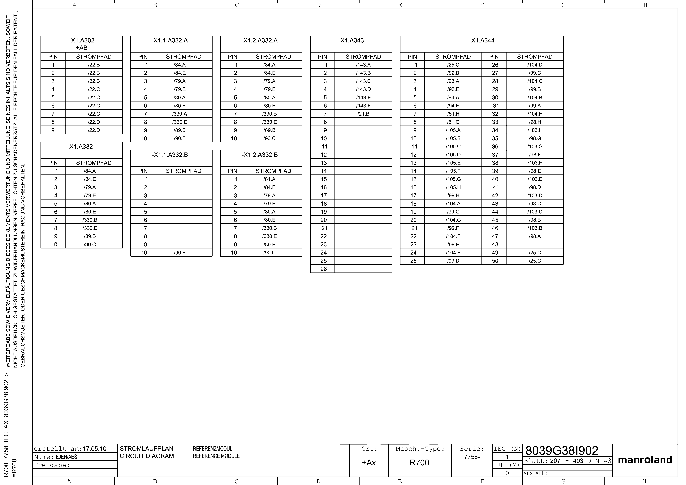

# +Ax — Sheet 207 of 403 — REFERENZMODUL

**REFERENCE MODULE**

> Part of the manroland **R700** printing press IEC/UL circuit diagrams.
> Drawing class: **Stromlaufplan / Circuit diagram** (DIN A3).
> Document `+Ax` covers the **Central control console** machine section.

## At a glance

| Field | Value |
|---|---|
| Document | `+Ax`  (8039G38I902) |
| Sheet | **207** of 403 |
| Section (DE) | REFERENZMODUL |
| Section (EN) | REFERENCE MODULE |
| Section type | REFERENCE_MODULE — Reference module |
| Machine type | `R700` |
| Series | `7758` |
| Created | 17.05.10 |
| Replaces | — |
| Columns used | A, B, C, D, E, F, G |
| Path numbers | — |
| Labels on sheet | 268 |
| Cross-refs out | 106 |
| Cross-refs in | 0 |

**Previous:** [+Ax sheet 206](SHEET_0206.md) · **Next:** [+Ax sheet 208](SHEET_0208.md) · **Document TOC:** [_TOC.md](_TOC.md)  (+Ax) · **Master TOC:** [all sheets](../_MASTER_TOC.md)

## Sheet image (300 DPI, exact vector render)



_Rendered directly from the PDF vector layer at 300 DPI (1-bit), no OCR and no resampling. Use it to confirm anything ambiguous in the text below._

## Cross-references on this sheet

Each entry is a wire leaving this sheet. The printed token is `/sheet.column`; the link resolves to that sheet inside the same document.

| Ref | Target sheet | Col | Path | Destination on target | Target section | From col |
|---|---|---|---|---|---|---|
| `/22.B` | [+Ax sheet 22](SHEET_0022.md) | B | — | — | SPANNUNGSVERSORGUNG, SCHALTSCHRANKBELÜFTUNG | A |
| `/84.A` | [+Ax sheet 84](SHEET_0084.md) | A | — | — | ANLEGER | B |
| `/84.A` | [+Ax sheet 84](SHEET_0084.md) | A | — | — | ANLEGER | C |
| `/143.A` | [+Ax sheet 143](SHEET_0143.md) | A | — | — | ÜBERWACHUNGSRECHNER SICHERHEITSBUS | E |
| `/25.C` | [+Ax sheet 25](SHEET_0025.md) | C | — | — | SPANNUNGSVERSORGUNG, SCHALTSCHRANKBELÜFTUNG | F |
| `/104.D` | [+Ax sheet 104](SHEET_0104.md) | D | — | — | ANLEGER | G |
| `/22.B` | [+Ax sheet 22](SHEET_0022.md) | B | — | — | SPANNUNGSVERSORGUNG, SCHALTSCHRANKBELÜFTUNG | A |
| `/84.E` | [+Ax sheet 84](SHEET_0084.md) | E | — | — | ANLEGER | B |
| `/84.E` | [+Ax sheet 84](SHEET_0084.md) | E | — | — | ANLEGER | C |
| `/92.B` | [+Ax sheet 92](SHEET_0092.md) | B | — | — | ANLEGER | F |
| `/143.B` | [+Ax sheet 143](SHEET_0143.md) | B | — | — | ÜBERWACHUNGSRECHNER SICHERHEITSBUS | E |
| `/99.C` | [+Ax sheet 99](SHEET_0099.md) | C | — | — | ANLEGER | G |
| `/22.B` | [+Ax sheet 22](SHEET_0022.md) | B | — | — | SPANNUNGSVERSORGUNG, SCHALTSCHRANKBELÜFTUNG | A |
| `/79.A` | [+Ax sheet 79](SHEET_0079.md) | A | — | — | ANLEGER | B |
| `/79.A` | [+Ax sheet 79](SHEET_0079.md) | A | — | — | ANLEGER | C |
| `/93.A` | [+Ax sheet 93](SHEET_0093.md) | A | — | — | ANLEGER | F |
| `/143.C` | [+Ax sheet 143](SHEET_0143.md) | C | — | — | ÜBERWACHUNGSRECHNER SICHERHEITSBUS | E |
| `/104.C` | [+Ax sheet 104](SHEET_0104.md) | C | — | — | ANLEGER | G |
| `/79.E` | [+Ax sheet 79](SHEET_0079.md) | E | — | — | ANLEGER | B |
| `/79.E` | [+Ax sheet 79](SHEET_0079.md) | E | — | — | ANLEGER | C |
| `/93.E` | [+Ax sheet 93](SHEET_0093.md) | E | — | — | ANLEGER | F |
| `/99.B` | [+Ax sheet 99](SHEET_0099.md) | B | — | — | ANLEGER | G |
| `/22.C` | [+Ax sheet 22](SHEET_0022.md) | C | — | — | SPANNUNGSVERSORGUNG, SCHALTSCHRANKBELÜFTUNG | A |
| `/143.D` | [+Ax sheet 143](SHEET_0143.md) | D | — | — | ÜBERWACHUNGSRECHNER SICHERHEITSBUS | E |
| `/80.A` | [+Ax sheet 80](SHEET_0080.md) | A | — | — | ANLEGER | B |
| `/80.A` | [+Ax sheet 80](SHEET_0080.md) | A | — | — | ANLEGER | C |
| `/94.A` | [+Ax sheet 94](SHEET_0094.md) | A | — | — | ANLEGER | F |
| `/143.E` | [+Ax sheet 143](SHEET_0143.md) | E | — | — | ÜBERWACHUNGSRECHNER SICHERHEITSBUS | E |
| `/104.B` | [+Ax sheet 104](SHEET_0104.md) | B | — | — | ANLEGER | G |
| `/22.C` | [+Ax sheet 22](SHEET_0022.md) | C | — | — | SPANNUNGSVERSORGUNG, SCHALTSCHRANKBELÜFTUNG | A |
| `/80.E` | [+Ax sheet 80](SHEET_0080.md) | E | — | — | ANLEGER | B |
| `/80.E` | [+Ax sheet 80](SHEET_0080.md) | E | — | — | ANLEGER | C |
| `/99.A` | [+Ax sheet 99](SHEET_0099.md) | A | — | — | ANLEGER | G |
| `/94.F` | [+Ax sheet 94](SHEET_0094.md) | F | — | — | ANLEGER | F |
| `/143.F` | [+Ax sheet 143](SHEET_0143.md) | F | — | — | ÜBERWACHUNGSRECHNER SICHERHEITSBUS | E |
| `/22.C` | [+Ax sheet 22](SHEET_0022.md) | C | — | — | SPANNUNGSVERSORGUNG, SCHALTSCHRANKBELÜFTUNG | A |
| `/21.B` | [+Ax sheet 21](SHEET_0021.md) | B | — | — | SPANNUNGSVERSORGUNG, SCHALTSCHRANKBELÜFTUNG | E |
| `/330.A` | [+Ax sheet 330](SHEET_0330.md) | A | — | — | OPTION: NONSTOP EINRICHTUNG MANUELL, ANLEGER | B |
| `/330.B` | [+Ax sheet 330](SHEET_0330.md) | B | — | — | OPTION: NONSTOP EINRICHTUNG MANUELL, ANLEGER | C |
| `/22.C` | [+Ax sheet 22](SHEET_0022.md) | C | — | — | SPANNUNGSVERSORGUNG, SCHALTSCHRANKBELÜFTUNG | A |
| `/51.H` | [+Ax sheet 51](SHEET_0051.md) | H | — | — | SIGNALGEBER: AKUSTISCHE WARNSIGNALE | F |
| `/104.H` | [+Ax sheet 104](SHEET_0104.md) | H | — | — | ANLEGER | G |
| `/330.E` | [+Ax sheet 330](SHEET_0330.md) | E | — | — | OPTION: NONSTOP EINRICHTUNG MANUELL, ANLEGER | B |
| `/330.E` | [+Ax sheet 330](SHEET_0330.md) | E | — | — | OPTION: NONSTOP EINRICHTUNG MANUELL, ANLEGER | C |
| `/51.G` | [+Ax sheet 51](SHEET_0051.md) | G | — | — | SIGNALGEBER: AKUSTISCHE WARNSIGNALE | F |
| `/22.D` | [+Ax sheet 22](SHEET_0022.md) | D | — | — | SPANNUNGSVERSORGUNG, SCHALTSCHRANKBELÜFTUNG | A |
| `/98.H` | [+Ax sheet 98](SHEET_0098.md) | H | — | — | ANLEGER | G |
| `/89.B` | [+Ax sheet 89](SHEET_0089.md) | B | — | — | ANLEGER | B |
| `/89.B` | [+Ax sheet 89](SHEET_0089.md) | B | — | — | ANLEGER | C |
| `/105.A` | [+Ax sheet 105](SHEET_0105.md) | A | — | — | ANLEGER | F |
| `/22.D` | [+Ax sheet 22](SHEET_0022.md) | D | — | — | SPANNUNGSVERSORGUNG, SCHALTSCHRANKBELÜFTUNG | A |
| `/103.H` | [+Ax sheet 103](SHEET_0103.md) | H | — | — | ANLEGER | G |
| `/90.F` | [+Ax sheet 90](SHEET_0090.md) | F | — | — | ANLEGER | B |
| `/105.B` | [+Ax sheet 105](SHEET_0105.md) | B | — | — | ANLEGER | F |
| `/98.G` | [+Ax sheet 98](SHEET_0098.md) | G | — | — | ANLEGER | G |
| `/90.C` | [+Ax sheet 90](SHEET_0090.md) | C | — | — | ANLEGER | C |
| `/103.G` | [+Ax sheet 103](SHEET_0103.md) | G | — | — | ANLEGER | G |
| `/105.C` | [+Ax sheet 105](SHEET_0105.md) | C | — | — | ANLEGER | F |
| `/98.F` | [+Ax sheet 98](SHEET_0098.md) | F | — | — | ANLEGER | G |
| `/105.D` | [+Ax sheet 105](SHEET_0105.md) | D | — | — | ANLEGER | F |
| `/105.E` | [+Ax sheet 105](SHEET_0105.md) | E | — | — | ANLEGER | F |
| `/103.F` | [+Ax sheet 103](SHEET_0103.md) | F | — | — | ANLEGER | G |
| `/84.A` | [+Ax sheet 84](SHEET_0084.md) | A | — | — | ANLEGER | A |
| `/98.E` | [+Ax sheet 98](SHEET_0098.md) | E | — | — | ANLEGER | G |
| `/105.F` | [+Ax sheet 105](SHEET_0105.md) | F | — | — | ANLEGER | F |
| `/84.E` | [+Ax sheet 84](SHEET_0084.md) | E | — | — | ANLEGER | A |
| `/84.A` | [+Ax sheet 84](SHEET_0084.md) | A | — | — | ANLEGER | C |
| `/103.E` | [+Ax sheet 103](SHEET_0103.md) | E | — | — | ANLEGER | G |
| `/105.G` | [+Ax sheet 105](SHEET_0105.md) | G | — | — | ANLEGER | F |
| `/79.A` | [+Ax sheet 79](SHEET_0079.md) | A | — | — | ANLEGER | A |
| `/84.E` | [+Ax sheet 84](SHEET_0084.md) | E | — | — | ANLEGER | C |
| `/105.H` | [+Ax sheet 105](SHEET_0105.md) | H | — | — | ANLEGER | F |
| `/98.D` | [+Ax sheet 98](SHEET_0098.md) | D | — | — | ANLEGER | G |
| `/79.E` | [+Ax sheet 79](SHEET_0079.md) | E | — | — | ANLEGER | A |
| `/79.A` | [+Ax sheet 79](SHEET_0079.md) | A | — | — | ANLEGER | C |
| `/99.H` | [+Ax sheet 99](SHEET_0099.md) | H | — | — | ANLEGER | F |
| `/103.D` | [+Ax sheet 103](SHEET_0103.md) | D | — | — | ANLEGER | G |
| `/80.A` | [+Ax sheet 80](SHEET_0080.md) | A | — | — | ANLEGER | A |
| `/79.E` | [+Ax sheet 79](SHEET_0079.md) | E | — | — | ANLEGER | C |
| `/104.A` | [+Ax sheet 104](SHEET_0104.md) | A | — | — | ANLEGER | F |
| `/98.C` | [+Ax sheet 98](SHEET_0098.md) | C | — | — | ANLEGER | G |
| `/80.E` | [+Ax sheet 80](SHEET_0080.md) | E | — | — | ANLEGER | A |
| `/80.A` | [+Ax sheet 80](SHEET_0080.md) | A | — | — | ANLEGER | C |
| `/99.G` | [+Ax sheet 99](SHEET_0099.md) | G | — | — | ANLEGER | F |
| `/103.C` | [+Ax sheet 103](SHEET_0103.md) | C | — | — | ANLEGER | G |
| `/80.E` | [+Ax sheet 80](SHEET_0080.md) | E | — | — | ANLEGER | C |
| `/98.B` | [+Ax sheet 98](SHEET_0098.md) | B | — | — | ANLEGER | G |
| `/330.B` | [+Ax sheet 330](SHEET_0330.md) | B | — | — | OPTION: NONSTOP EINRICHTUNG MANUELL, ANLEGER | A |
| `/104.G` | [+Ax sheet 104](SHEET_0104.md) | G | — | — | ANLEGER | F |
| `/330.E` | [+Ax sheet 330](SHEET_0330.md) | E | — | — | OPTION: NONSTOP EINRICHTUNG MANUELL, ANLEGER | A |
| `/330.B` | [+Ax sheet 330](SHEET_0330.md) | B | — | — | OPTION: NONSTOP EINRICHTUNG MANUELL, ANLEGER | C |
| `/99.F` | [+Ax sheet 99](SHEET_0099.md) | F | — | — | ANLEGER | F |
| `/103.B` | [+Ax sheet 103](SHEET_0103.md) | B | — | — | ANLEGER | G |
| `/89.B` | [+Ax sheet 89](SHEET_0089.md) | B | — | — | ANLEGER | A |
| `/98.A` | [+Ax sheet 98](SHEET_0098.md) | A | — | — | ANLEGER | G |
| `/330.E` | [+Ax sheet 330](SHEET_0330.md) | E | — | — | OPTION: NONSTOP EINRICHTUNG MANUELL, ANLEGER | C |
| `/104.F` | [+Ax sheet 104](SHEET_0104.md) | F | — | — | ANLEGER | F |
| `/89.B` | [+Ax sheet 89](SHEET_0089.md) | B | — | — | ANLEGER | C |
| `/99.E` | [+Ax sheet 99](SHEET_0099.md) | E | — | — | ANLEGER | F |
| `/90.C` | [+Ax sheet 90](SHEET_0090.md) | C | — | — | ANLEGER | A |
| `/90.F` | [+Ax sheet 90](SHEET_0090.md) | F | — | — | ANLEGER | B |
| `/104.E` | [+Ax sheet 104](SHEET_0104.md) | E | — | — | ANLEGER | F |
| `/90.C` | [+Ax sheet 90](SHEET_0090.md) | C | — | — | ANLEGER | C |
| `/25.C` | [+Ax sheet 25](SHEET_0025.md) | C | — | — | SPANNUNGSVERSORGUNG, SCHALTSCHRANKBELÜFTUNG | G |
| `/99.D` | [+Ax sheet 99](SHEET_0099.md) | D | — | — | ANLEGER | F |
| `/25.C` | [+Ax sheet 25](SHEET_0025.md) | C | — | — | SPANNUNGSVERSORGUNG, SCHALTSCHRANKBELÜFTUNG | G |

## Devices on this sheet

| Tag | Class | Class meaning (IEC) | Col | Sub | Terminal | Sign |
|---|---|---|---|---|---|---|
| `X1.A302` | — | cross-device reference | A | — | — | — |
| `X1.1.A332.A` | — | cross-device reference | B | — | — | — |
| `X1.1.A332.B` | — | cross-device reference | B | — | — | — |
| `X1.2.A332.A` | — | cross-device reference | C | — | — | — |
| `X1.2.A332.B` | — | cross-device reference | C | — | — | — |
| `X1.A332` | — | cross-device reference | A | — | — | — |
| `X1.A343` | — | cross-device reference | D | — | — | — |
| `X1.A344` | — | cross-device reference | F | — | — | — |

## Potentials / nets

_No named potentials on this sheet._

## Wire-end annotations (grouped as printed)

A wire that continues elsewhere is annotated with a small cluster: the destination description, the path/line number `#NN`, and the `/sheet.column` cross reference. Each row below is one such cluster exactly as it is grouped on the drawing.

| Col | Y | Path | Cross-ref | Text on the wire |
|---|---|---|---|---|
| A | 65.5 | — | — | `X1.A302` |
| B | 65.5 | — | — | `X1.1.A332.A` |
| C | 65.5 | — | — | `X1.2.A332.A` |
| D | 65.5 | — | — | `X1.A343` |
| F | 65.5 | — | — | `X1.A344` |
| A | 78.2 | — | — | `+AB` |
| A | 94.2 | — | — | `PIN 2 3 4 5 6 7 8 9 1 STROMPFAD` |
| B | 94.2 | — | — | `PIN 10 2 3 4 5 6 7 8 9 1 STROMPFAD` |
| C | 94.2 | — | — | `PIN 10 2 3 4 5 6 7 8 9 1 STROMPFAD` |
| D | 94.2 | — | — | `PIN STROMPFAD` |
| E | 94.2 | — | — | `PIN STROMPFAD` |
| F | 94.2 | — | — | `PIN STROMPFAD` |
| D | 108.4 | — | — | `2 3 4 5 6 7 8 9 1` |
| E | 108.4 | — | — | `2 3 4 5 6 7 8 9 1` |
| F | 108.4 | — | — | `26 27 28 29 30 32 33 34 35 36 37 38 39 40 42 43 44 45 46 47 48 49 50 31 41` |
| A | 108.7 | — | `/22.B` | — |
| B | 108.7 | — | `/84.A` | — |
| C | 108.7 | — | `/84.A` | — |
| E | 108.7 | — | `/143.A` | — |
| F | 108.7 | — | `/25.C` | — |
| G | 108.7 | — | `/104.D` | — |
| A | 122.8 | — | `/22.B` | — |
| B | 122.8 | — | `/84.E` | — |
| C | 122.8 | — | `/84.E` | — |
| F | 122.8 | — | `/92.B` | — |
| E | 122.9 | — | `/143.B` | — |
| G | 122.9 | — | `/99.C` | — |
| A | 137.0 | — | `/22.B` | — |
| B | 137.0 | — | `/79.A` | — |
| C | 137.0 | — | `/79.A` | — |
| F | 137.0 | — | `/93.A` | — |
| E | 137.1 | — | `/143.C` | — |
| G | 137.1 | — | `/104.C` | — |
| A | 151.2 | — | `/22.C` | — |
| B | 151.2 | — | `/79.E` | — |
| C | 151.2 | — | `/79.E` | — |
| E | 151.2 | — | `/143.D` | — |
| F | 151.2 | — | `/93.E` | — |
| G | 151.2 | — | `/99.B` | — |
| A | 165.4 | — | `/22.C` | — |
| B | 165.4 | — | `/80.A` | — |
| C | 165.4 | — | `/80.A` | — |
| E | 165.4 | — | `/143.E` | — |
| F | 165.4 | — | `/94.A` | — |
| G | 165.4 | — | `/104.B` | — |
| B | 179.5 | — | `/80.E` | — |
| C | 179.5 | — | `/80.E` | — |
| G | 179.5 | — | `/99.A` | — |
| A | 179.6 | — | `/22.C` | — |
| E | 179.6 | — | `/143.F` | — |
| F | 179.6 | — | `/94.F` | — |
| B | 193.7 | — | `/330.A` | — |
| C | 193.7 | — | `/330.B` | — |
| E | 193.7 | — | `/21.B` | — |
| A | 193.8 | — | `/22.C` | — |
| F | 193.8 | — | `/51.H` | — |
| G | 193.8 | — | `/104.H` | — |
| A | 207.9 | — | `/22.D` | — |
| B | 207.9 | — | `/330.E` | — |
| C | 207.9 | — | `/330.E` | — |
| F | 207.9 | — | `/51.G` | — |
| G | 207.9 | — | `/98.H` | — |
| A | 222.1 | — | `/22.D` | — |
| B | 222.1 | — | `/89.B` | — |
| C | 222.1 | — | `/89.B` | — |
| F | 222.1 | — | `/105.A` | — |
| G | 222.1 | — | `/103.H` | — |
| D | 235.9 | — | — | `10 12 13 14 15 16 17 18 19 20 11` |
| E | 235.9 | — | — | `10 12 13 14 15 16 17 18 19 20 11` |
| B | 236.2 | — | `/90.F` | — |
| F | 236.2 | — | `/105.B` | — |
| G | 236.2 | — | `/98.G` | — |
| C | 236.3 | — | `/90.C` | — |
| A | 249.8 | — | — | `X1.A332` |
| F | 250.4 | — | `/105.C` | — |
| G | 250.4 | — | `/103.G` | — |
| B | 263.9 | — | — | `X1.1.A332.B` |
| C | 263.9 | — | — | `X1.2.A332.B` |
| F | 264.6 | — | `/105.D` | — |
| G | 264.6 | — | `/98.F` | — |
| A | 278.4 | — | — | `PIN 10 2 3 4 5 6 7 8 9 1 STROMPFAD` |
| F | 278.8 | — | `/105.E` | — |
| G | 278.8 | — | `/103.F` | — |
| B | 292.6 | — | — | `PIN 10 2 3 4 5 6 7 8 9 1 STROMPFAD` |
| C | 292.6 | — | — | `PIN 10 2 3 4 5 6 7 8 9 1 STROMPFAD` |
| A | 292.9 | — | `/84.A` | — |
| F | 292.9 | — | `/105.F` | — |
| G | 292.9 | — | `/98.E` | — |
| A | 307.1 | — | `/84.E` | — |
| C | 307.1 | — | `/84.A` | — |
| F | 307.1 | — | `/105.G` | — |
| G | 307.1 | — | `/103.E` | — |
| A | 321.3 | — | `/79.A` | — |
| C | 321.3 | — | `/84.E` | — |
| F | 321.3 | — | `/105.H` | — |
| G | 321.3 | — | `/98.D` | — |
| A | 335.4 | — | `/79.E` | — |
| C | 335.4 | — | `/79.A` | — |
| F | 335.5 | — | `/99.H` | — |
| G | 335.5 | — | `/103.D` | — |
| A | 349.6 | — | `/80.A` | — |
| C | 349.6 | — | `/79.E` | — |
| F | 349.6 | — | `/104.A` | — |
| G | 349.6 | — | `/98.C` | — |
| A | 363.8 | — | `/80.E` | — |
| C | 363.8 | — | `/80.A` | — |
| F | 363.8 | — | `/99.G` | — |
| G | 363.8 | — | `/103.C` | — |
| A | 378.0 | — | `/330.B` | — |
| C | 378.0 | — | `/80.E` | — |
| F | 378.0 | — | `/104.G` | — |
| G | 378.0 | — | `/98.B` | — |
| D | 391.8 | — | — | `22 23 24 25 26 21` |
| E | 391.8 | — | — | `22 23 24 25 21` |
| A | 392.1 | — | `/330.E` | — |
| C | 392.1 | — | `/330.B` | — |
| F | 392.1 | — | `/99.F` | — |
| G | 392.1 | — | `/103.B` | — |
| A | 406.3 | — | `/89.B` | — |
| C | 406.3 | — | `/330.E` | — |
| F | 406.3 | — | `/104.F` | — |
| G | 406.3 | — | `/98.A` | — |
| A | 420.5 | — | `/90.C` | — |
| C | 420.5 | — | `/89.B` | — |
| F | 420.5 | — | `/99.E` | — |
| B | 434.7 | — | `/90.F` | — |
| C | 434.7 | — | `/90.C` | — |
| F | 434.7 | — | `/104.E` | — |
| G | 434.7 | — | `/25.C` | — |
| F | 448.9 | — | `/99.D` | — |
| G | 448.9 | — | `/25.C` | — |


## Reconstructed tables

This sheet carries tabular content (pin map / terminal assignment / index). The grid below was rebuilt from the drawing's own rule lines, so each row is exactly one physical row of the table.

### Table 1 — 21 data rows × 2 columns (at x=70.9, y=62.4) — **X1.A302 +AB**

| PIN | STROMPFAD |
|---|---|
| `1` | `/22.B` |
| `2` | `/22.B` |
| `3` | `/22.B` |
| `4` | `/22.C` |
| `5` | `/22.C` |
| `6` | `/22.C` |
| `7` | `/22.C` |
| `8` | `/22.D` |
| `9` | `/22.D` |
|  | `X1.A332` |
| `PIN` | `STROMPFAD` |
| `1` | `/84.A` |
| `2` | `/84.E` |
| `3` | `/79.A` |
| `4` | `/79.E` |
| `5` | `/80.A` |
| `6` | `/80.E` |
| `7` | `/330.B` |
| `8` | `/330.E` |
| `9` | `/89.B` |
| `10` | `/90.C` |


### Table 2 — 22 data rows × 2 columns (at x=226.8, y=62.4) — **X1.1.A332.A**

| PIN | STROMPFAD |
|---|---|
| `1` | `/84.A` |
| `2` | `/84.E` |
| `3` | `/79.A` |
| `4` | `/79.E` |
| `5` | `/80.A` |
| `6` | `/80.E` |
| `7` | `/330.A` |
| `8` | `/330.E` |
| `9` | `/89.B` |
| `10` | `/90.F` |
|  | `X1.1.A332.B` |
| `PIN` | `STROMPFAD` |
| `1` |  |
| `2` |  |
| `3` |  |
| `4` |  |
| `5` |  |
| `6` |  |
| `7` |  |
| `8` |  |
| `9` |  |
| `10` | `/90.F` |


### Table 3 — 22 data rows × 2 columns (at x=382.7, y=62.4) — **X1.2.A332.A**

| PIN | STROMPFAD |
|---|---|
| `1` | `/84.A` |
| `2` | `/84.E` |
| `3` | `/79.A` |
| `4` | `/79.E` |
| `5` | `/80.A` |
| `6` | `/80.E` |
| `7` | `/330.B` |
| `8` | `/330.E` |
| `9` | `/89.B` |
| `10` | `/90.C` |
|  | `X1.2.A332.B` |
| `PIN` | `STROMPFAD` |
| `1` | `/84.A` |
| `2` | `/84.E` |
| `3` | `/79.A` |
| `4` | `/79.E` |
| `5` | `/80.A` |
| `6` | `/80.E` |
| `7` | `/330.B` |
| `8` | `/330.E` |
| `9` | `/89.B` |
| `10` | `/90.C` |


### Table 4 — 26 data rows × 2 columns (at x=538.6, y=62.4) — **X1.A343**

| PIN | STROMPFAD |
|---|---|
| `1` | `/143.A` |
| `2` | `/143.B` |
| `3` | `/143.C` |
| `4` | `/143.D` |
| `5` | `/143.E` |
| `6` | `/143.F` |
| `7` | `/21.B` |
| `8` |  |
| `9` |  |
| `10` |  |
| `11` |  |
| `12` |  |
| `13` |  |
| `14` |  |
| `15` |  |
| `16` |  |
| `17` |  |
| `18` |  |
| `19` |  |
| `20` |  |
| `21` |  |
| `22` |  |
| `23` |  |
| `24` |  |
| `25` |  |
| `26` |  |


### Table 5 — 25 data rows × 4 columns (at x=694.5, y=62.4) — **X1.A344**

| PIN | STROMPFAD | PIN | STROMPFAD |
|---|---|---|---|
| `1` | `/25.C` | `26` | `/104.D` |
| `2` | `/92.B` | `27` | `/99.C` |
| `3` | `/93.A` | `28` | `/104.C` |
| `4` | `/93.E` | `29` | `/99.B` |
| `5` | `/94.A` | `30` | `/104.B` |
| `6` | `/94.F` | `31` | `/99.A` |
| `7` | `/51.H` | `32` | `/104.H` |
| `8` | `/51.G` | `33` | `/98.H` |
| `9` | `/105.A` | `34` | `/103.H` |
| `10` | `/105.B` | `35` | `/98.G` |
| `11` | `/105.C` | `36` | `/103.G` |
| `12` | `/105.D` | `37` | `/98.F` |
| `13` | `/105.E` | `38` | `/103.F` |
| `14` | `/105.F` | `39` | `/98.E` |
| `15` | `/105.G` | `40` | `/103.E` |
| `16` | `/105.H` | `41` | `/98.D` |
| `17` | `/99.H` | `42` | `/103.D` |
| `18` | `/104.A` | `43` | `/98.C` |
| `19` | `/99.G` | `44` | `/103.C` |
| `20` | `/104.G` | `45` | `/98.B` |
| `21` | `/99.F` | `46` | `/103.B` |
| `22` | `/104.F` | `47` | `/98.A` |
| `23` | `/99.E` | `48` |  |
| `24` | `/104.E` | `49` | `/25.C` |
| `25` | `/99.D` | `50` | `/25.C` |


## Notes and free text on this sheet

| Text | Col | Y (pt) |
|---|---|---|
| `PIN` | A | 94.2 |
| `STROMPFAD` | A | 94.15 |
| `+AB` | A | 78.18 |
| `PIN` | B | 94.2 |
| `STROMPFAD` | B | 94.15 |
| `PIN` | C | 94.2 |
| `STROMPFAD` | C | 94.15 |
| `PIN` | D | 94.2 |
| `STROMPFAD` | E | 94.15 |
| `PIN` | E | 94.2 |
| `STROMPFAD` | F | 94.15 |
| `PIN` | F | 94.2 |
| `STROMPFAD` | G | 94.15 |

## Complete label inventory (exact text from the drawing)

Every text object inside the drawing area of this sheet, in DIN reading order (column A→H, then top→bottom). This is the authoritative list: if a string is not here it is not printed on this sheet.

| Col | Y | X | Dir | Type | Text |
|---|---|---|---|---|---|
| A | 65.5 | 119.8 | → | device ref | `X1.A302` |
| A | 78.2 | 131.5 | → | text | `+AB` |
| A | 94.2 | 84.0 | → | text | `PIN` |
| A | 94.2 | 132.2 | → | text | `STROMPFAD` |
| A | 108.4 | 90.0 | → | number | `1` |
| A | 108.7 | 152.8 | → | cross-reference | `/22.B` |
| A | 122.5 | 89.4 | → | number | `2` |
| A | 122.8 | 152.8 | → | cross-reference | `/22.B` |
| A | 136.7 | 89.4 | → | number | `3` |
| A | 137.0 | 152.8 | → | cross-reference | `/22.B` |
| A | 150.9 | 89.4 | → | number | `4` |
| A | 151.2 | 152.6 | → | cross-reference | `/22.C` |
| A | 165.1 | 89.4 | → | number | `5` |
| A | 165.4 | 152.6 | → | cross-reference | `/22.C` |
| A | 179.2 | 89.4 | → | number | `6` |
| A | 179.6 | 152.6 | → | cross-reference | `/22.C` |
| A | 193.4 | 89.4 | → | number | `7` |
| A | 193.7 | 152.6 | → | cross-reference | `/22.C` |
| A | 207.6 | 89.4 | → | number | `8` |
| A | 207.9 | 152.6 | → | cross-reference | `/22.D` |
| A | 221.8 | 89.4 | → | number | `9` |
| A | 222.1 | 152.6 | → | cross-reference | `/22.D` |
| A | 249.8 | 116.9 | → | device ref | `X1.A332` |
| A | 278.4 | 84.0 | → | text | `PIN` |
| A | 278.4 | 132.2 | → | text | `STROMPFAD` |
| A | 292.6 | 95.8 | → | number | `1` |
| A | 292.9 | 145.6 | → | cross-reference | `/84.A` |
| A | 306.8 | 94.1 | → | number | `2` |
| A | 307.1 | 145.8 | → | cross-reference | `/84.E` |
| A | 321.0 | 94.1 | → | number | `3` |
| A | 321.3 | 145.6 | → | cross-reference | `/79.A` |
| A | 335.1 | 94.1 | → | number | `4` |
| A | 335.4 | 145.8 | → | cross-reference | `/79.E` |
| A | 349.3 | 94.1 | → | number | `5` |
| A | 349.6 | 145.6 | → | cross-reference | `/80.A` |
| A | 363.5 | 94.1 | → | number | `6` |
| A | 363.8 | 145.8 | → | cross-reference | `/80.E` |
| A | 377.7 | 94.1 | → | number | `7` |
| A | 378.0 | 143.3 | → | cross-reference | `/330.B` |
| A | 391.8 | 94.1 | → | number | `8` |
| A | 392.2 | 143.4 | → | cross-reference | `/330.E` |
| A | 406.0 | 94.1 | → | number | `9` |
| A | 406.3 | 145.7 | → | cross-reference | `/89.B` |
| A | 420.2 | 88.7 | → | number | `10` |
| A | 420.5 | 145.6 | → | cross-reference | `/90.C` |
| B | 65.5 | 263.1 | → | device ref | `X1.1.A332.A` |
| B | 94.2 | 240.0 | → | text | `PIN` |
| B | 94.2 | 288.1 | → | text | `STROMPFAD` |
| B | 108.4 | 251.7 | → | number | `1` |
| B | 108.7 | 301.5 | → | cross-reference | `/84.A` |
| B | 122.5 | 250.0 | → | number | `2` |
| B | 122.8 | 301.7 | → | cross-reference | `/84.E` |
| B | 136.7 | 250.0 | → | number | `3` |
| B | 137.0 | 301.5 | → | cross-reference | `/79.A` |
| B | 150.9 | 250.0 | → | number | `4` |
| B | 151.2 | 301.7 | → | cross-reference | `/79.E` |
| B | 165.1 | 250.0 | → | number | `5` |
| B | 165.4 | 301.5 | → | cross-reference | `/80.A` |
| B | 179.2 | 250.0 | → | number | `6` |
| B | 179.5 | 301.7 | → | cross-reference | `/80.E` |
| B | 193.4 | 250.0 | → | number | `7` |
| B | 193.7 | 299.1 | → | cross-reference | `/330.A` |
| B | 207.6 | 250.0 | → | number | `8` |
| B | 207.9 | 299.3 | → | cross-reference | `/330.E` |
| B | 221.8 | 250.0 | → | number | `9` |
| B | 222.1 | 301.6 | → | cross-reference | `/89.B` |
| B | 235.9 | 244.6 | → | number | `10` |
| B | 236.2 | 301.9 | → | cross-reference | `/90.F` |
| B | 263.9 | 263.5 | → | device ref | `X1.1.A332.B` |
| B | 292.6 | 240.0 | → | text | `PIN` |
| B | 292.6 | 288.1 | → | text | `STROMPFAD` |
| B | 306.8 | 251.7 | → | number | `1` |
| B | 321.0 | 250.0 | → | number | `2` |
| B | 335.1 | 250.0 | → | number | `3` |
| B | 349.3 | 250.0 | → | number | `4` |
| B | 363.5 | 250.0 | → | number | `5` |
| B | 377.7 | 250.0 | → | number | `6` |
| B | 391.8 | 250.0 | → | number | `7` |
| B | 406.0 | 250.0 | → | number | `8` |
| B | 420.2 | 250.0 | → | number | `9` |
| B | 434.4 | 244.6 | → | number | `10` |
| B | 434.7 | 301.9 | → | cross-reference | `/90.F` |
| C | 65.5 | 419.0 | → | device ref | `X1.2.A332.A` |
| C | 94.2 | 395.9 | → | text | `PIN` |
| C | 94.2 | 444.0 | → | text | `STROMPFAD` |
| C | 108.4 | 407.6 | → | number | `1` |
| C | 108.7 | 457.4 | → | cross-reference | `/84.A` |
| C | 122.5 | 405.9 | → | number | `2` |
| C | 122.8 | 457.7 | → | cross-reference | `/84.E` |
| C | 136.7 | 405.9 | → | number | `3` |
| C | 137.0 | 457.4 | → | cross-reference | `/79.A` |
| C | 150.9 | 405.9 | → | number | `4` |
| C | 151.2 | 457.7 | → | cross-reference | `/79.E` |
| C | 165.1 | 405.9 | → | number | `5` |
| C | 165.4 | 457.4 | → | cross-reference | `/80.A` |
| C | 179.2 | 405.9 | → | number | `6` |
| C | 179.5 | 457.7 | → | cross-reference | `/80.E` |
| C | 193.4 | 405.9 | → | number | `7` |
| C | 193.7 | 455.1 | → | cross-reference | `/330.B` |
| C | 207.6 | 405.9 | → | number | `8` |
| C | 207.9 | 455.2 | → | cross-reference | `/330.E` |
| C | 221.8 | 405.9 | → | number | `9` |
| C | 222.1 | 457.5 | → | cross-reference | `/89.B` |
| C | 235.9 | 400.5 | → | number | `10` |
| C | 236.3 | 457.4 | → | cross-reference | `/90.C` |
| C | 263.9 | 419.4 | → | device ref | `X1.2.A332.B` |
| C | 292.6 | 395.9 | → | text | `PIN` |
| C | 292.6 | 444.0 | → | text | `STROMPFAD` |
| C | 306.8 | 407.6 | → | number | `1` |
| C | 307.1 | 457.4 | → | cross-reference | `/84.A` |
| C | 321.0 | 405.9 | → | number | `2` |
| C | 321.3 | 457.7 | → | cross-reference | `/84.E` |
| C | 335.1 | 405.9 | → | number | `3` |
| C | 335.4 | 457.4 | → | cross-reference | `/79.A` |
| C | 349.3 | 405.9 | → | number | `4` |
| C | 349.6 | 457.7 | → | cross-reference | `/79.E` |
| C | 363.5 | 405.9 | → | number | `5` |
| C | 363.8 | 457.4 | → | cross-reference | `/80.A` |
| C | 377.7 | 405.9 | → | number | `6` |
| C | 378.0 | 457.7 | → | cross-reference | `/80.E` |
| C | 391.8 | 405.9 | → | number | `7` |
| C | 392.2 | 455.1 | → | cross-reference | `/330.B` |
| C | 406.0 | 405.9 | → | number | `8` |
| C | 406.3 | 455.2 | → | cross-reference | `/330.E` |
| C | 420.2 | 405.9 | → | number | `9` |
| C | 420.5 | 457.5 | → | cross-reference | `/89.B` |
| C | 434.4 | 400.5 | → | number | `10` |
| C | 434.7 | 457.4 | → | cross-reference | `/90.C` |
| D | 65.5 | 587.5 | → | device ref | `X1.A343` |
| D | 94.2 | 551.8 | → | text | `PIN` |
| D | 108.4 | 563.5 | → | number | `1` |
| D | 122.5 | 561.8 | → | number | `2` |
| D | 136.7 | 561.8 | → | number | `3` |
| D | 150.9 | 561.8 | → | number | `4` |
| D | 165.1 | 561.8 | → | number | `5` |
| D | 179.2 | 561.8 | → | number | `6` |
| D | 193.4 | 561.8 | → | number | `7` |
| D | 207.6 | 561.8 | → | number | `8` |
| D | 221.8 | 561.8 | → | number | `9` |
| D | 235.9 | 556.4 | → | number | `10` |
| D | 250.1 | 558.1 | → | number | `11` |
| D | 264.3 | 556.4 | → | number | `12` |
| D | 278.5 | 556.4 | → | number | `13` |
| D | 292.6 | 556.4 | → | number | `14` |
| D | 306.8 | 556.4 | → | number | `15` |
| D | 321.0 | 556.4 | → | number | `16` |
| D | 335.1 | 556.4 | → | number | `17` |
| D | 349.3 | 556.4 | → | number | `18` |
| D | 363.5 | 556.4 | → | number | `19` |
| D | 377.7 | 556.4 | → | number | `20` |
| D | 391.8 | 558.1 | → | number | `21` |
| D | 406.0 | 556.4 | → | number | `22` |
| D | 420.2 | 556.4 | → | number | `23` |
| D | 434.4 | 556.4 | → | number | `24` |
| D | 448.5 | 556.4 | → | number | `25` |
| D | 462.7 | 556.4 | → | number | `26` |
| E | 94.2 | 600.0 | → | text | `STROMPFAD` |
| E | 94.2 | 707.7 | → | text | `PIN` |
| E | 108.4 | 719.4 | → | number | `1` |
| E | 108.7 | 618.0 | → | cross-reference | `/143.A` |
| E | 122.5 | 717.7 | → | number | `2` |
| E | 122.9 | 618.1 | → | cross-reference | `/143.B` |
| E | 136.7 | 717.7 | → | number | `3` |
| E | 137.1 | 618.0 | → | cross-reference | `/143.C` |
| E | 150.9 | 717.7 | → | number | `4` |
| E | 151.2 | 618.0 | → | cross-reference | `/143.D` |
| E | 165.1 | 717.7 | → | number | `5` |
| E | 165.4 | 618.2 | → | cross-reference | `/143.E` |
| E | 179.2 | 717.7 | → | number | `6` |
| E | 179.6 | 618.4 | → | cross-reference | `/143.F` |
| E | 193.4 | 717.7 | → | number | `7` |
| E | 193.7 | 620.5 | → | cross-reference | `/21.B` |
| E | 207.6 | 717.7 | → | number | `8` |
| E | 221.8 | 717.7 | → | number | `9` |
| E | 235.9 | 712.3 | → | number | `10` |
| E | 250.1 | 714.0 | → | number | `11` |
| E | 264.3 | 712.3 | → | number | `12` |
| E | 278.5 | 712.3 | → | number | `13` |
| E | 292.6 | 712.3 | → | number | `14` |
| E | 306.8 | 712.3 | → | number | `15` |
| E | 321.0 | 712.3 | → | number | `16` |
| E | 335.1 | 712.3 | → | number | `17` |
| E | 349.3 | 712.3 | → | number | `18` |
| E | 363.5 | 712.3 | → | number | `19` |
| E | 377.7 | 712.3 | → | number | `20` |
| E | 391.8 | 714.0 | → | number | `21` |
| E | 406.0 | 712.3 | → | number | `22` |
| E | 420.2 | 712.3 | → | number | `23` |
| E | 434.4 | 712.3 | → | number | `24` |
| E | 448.5 | 712.3 | → | number | `25` |
| F | 65.5 | 814.3 | → | device ref | `X1.A344` |
| F | 94.2 | 755.9 | → | text | `STROMPFAD` |
| F | 94.2 | 849.4 | → | text | `PIN` |
| F | 108.4 | 854.1 | → | number | `26` |
| F | 108.7 | 776.3 | → | cross-reference | `/25.C` |
| F | 122.5 | 854.1 | → | number | `27` |
| F | 122.8 | 776.4 | → | cross-reference | `/92.B` |
| F | 136.7 | 854.1 | → | number | `28` |
| F | 137.0 | 776.3 | → | cross-reference | `/93.A` |
| F | 150.9 | 854.1 | → | number | `29` |
| F | 151.2 | 776.6 | → | cross-reference | `/93.E` |
| F | 165.1 | 854.1 | → | number | `30` |
| F | 165.4 | 776.3 | → | cross-reference | `/94.A` |
| F | 179.2 | 855.8 | → | number | `31` |
| F | 179.6 | 776.7 | → | cross-reference | `/94.F` |
| F | 193.4 | 854.1 | → | number | `32` |
| F | 193.7 | 776.6 | → | cross-reference | `/51.H` |
| F | 207.6 | 854.1 | → | number | `33` |
| F | 207.9 | 776.1 | → | cross-reference | `/51.G` |
| F | 221.8 | 854.1 | → | number | `34` |
| F | 222.1 | 773.9 | → | cross-reference | `/105.A` |
| F | 235.9 | 854.1 | → | number | `35` |
| F | 236.2 | 774.0 | → | cross-reference | `/105.B` |
| F | 250.1 | 854.1 | → | number | `36` |
| F | 250.4 | 773.9 | → | cross-reference | `/105.C` |
| F | 264.3 | 854.1 | → | number | `37` |
| F | 264.6 | 773.9 | → | cross-reference | `/105.D` |
| F | 278.5 | 854.1 | → | number | `38` |
| F | 278.8 | 774.1 | → | cross-reference | `/105.E` |
| F | 292.6 | 854.1 | → | number | `39` |
| F | 293.0 | 774.3 | → | cross-reference | `/105.F` |
| F | 306.8 | 854.1 | → | number | `40` |
| F | 307.1 | 773.7 | → | cross-reference | `/105.G` |
| F | 321.0 | 855.8 | → | number | `41` |
| F | 321.3 | 774.1 | → | cross-reference | `/105.H` |
| F | 335.1 | 854.1 | → | number | `42` |
| F | 335.5 | 776.6 | → | cross-reference | `/99.H` |
| F | 349.3 | 854.1 | → | number | `43` |
| F | 349.6 | 773.9 | → | cross-reference | `/104.A` |
| F | 363.5 | 854.1 | → | number | `44` |
| F | 363.8 | 776.1 | → | cross-reference | `/99.G` |
| F | 377.7 | 854.1 | → | number | `45` |
| F | 378.0 | 773.7 | → | cross-reference | `/104.G` |
| F | 391.8 | 854.1 | → | number | `46` |
| F | 392.2 | 776.7 | → | cross-reference | `/99.F` |
| F | 406.0 | 854.1 | → | number | `47` |
| F | 406.3 | 774.3 | → | cross-reference | `/104.F` |
| F | 420.2 | 854.1 | → | number | `48` |
| F | 420.5 | 776.6 | → | cross-reference | `/99.E` |
| F | 434.4 | 854.1 | → | number | `49` |
| F | 434.7 | 774.1 | → | cross-reference | `/104.E` |
| F | 448.5 | 854.1 | → | number | `50` |
| F | 448.9 | 776.3 | → | cross-reference | `/99.D` |
| G | 94.2 | 897.6 | → | text | `STROMPFAD` |
| G | 108.7 | 915.6 | → | cross-reference | `/104.D` |
| G | 122.9 | 918.0 | → | cross-reference | `/99.C` |
| G | 137.1 | 915.6 | → | cross-reference | `/104.C` |
| G | 151.2 | 918.1 | → | cross-reference | `/99.B` |
| G | 165.4 | 915.7 | → | cross-reference | `/104.B` |
| G | 179.5 | 918.0 | → | cross-reference | `/99.A` |
| G | 193.8 | 915.9 | → | cross-reference | `/104.H` |
| G | 207.9 | 918.3 | → | cross-reference | `/98.H` |
| G | 222.1 | 915.9 | → | cross-reference | `/103.H` |
| G | 236.3 | 917.9 | → | cross-reference | `/98.G` |
| G | 250.4 | 915.4 | → | cross-reference | `/103.G` |
| G | 264.6 | 918.4 | → | cross-reference | `/98.F` |
| G | 278.8 | 916.0 | → | cross-reference | `/103.F` |
| G | 292.9 | 918.3 | → | cross-reference | `/98.E` |
| G | 307.1 | 915.9 | → | cross-reference | `/103.E` |
| G | 321.3 | 918.0 | → | cross-reference | `/98.D` |
| G | 335.5 | 915.6 | → | cross-reference | `/103.D` |
| G | 349.7 | 918.0 | → | cross-reference | `/98.C` |
| G | 363.8 | 915.6 | → | cross-reference | `/103.C` |
| G | 378.0 | 918.1 | → | cross-reference | `/98.B` |
| G | 392.2 | 915.7 | → | cross-reference | `/103.B` |
| G | 406.3 | 918.0 | → | cross-reference | `/98.A` |
| G | 434.7 | 918.0 | → | cross-reference | `/25.C` |
| G | 448.9 | 918.0 | → | cross-reference | `/25.C` |

## Reading-order text block

The same content as a plain block, grouped by DIN column — convenient to paste or to match against a visual description.

```text
=== Column A ===
  65.5  119.8  devref       X1.A302
  78.2  131.5  text         +AB
  94.2   84.0  text         PIN
  94.2  132.2  text         STROMPFAD
 108.4   90.0  numeric      1
 108.7  152.8  xref         /22.B
 122.5   89.4  numeric      2
 122.8  152.8  xref         /22.B
 136.7   89.4  numeric      3
 137.0  152.8  xref         /22.B
 150.9   89.4  numeric      4
 151.2  152.6  xref         /22.C
 165.1   89.4  numeric      5
 165.4  152.6  xref         /22.C
 179.2   89.4  numeric      6
 179.6  152.6  xref         /22.C
 193.4   89.4  numeric      7
 193.7  152.6  xref         /22.C
 207.6   89.4  numeric      8
 207.9  152.6  xref         /22.D
 221.8   89.4  numeric      9
 222.1  152.6  xref         /22.D
 249.8  116.9  devref       X1.A332
 278.4   84.0  text         PIN
 278.4  132.2  text         STROMPFAD
 292.6   95.8  numeric      1
 292.9  145.6  xref         /84.A
 306.8   94.1  numeric      2
 307.1  145.8  xref         /84.E
 321.0   94.1  numeric      3
 321.3  145.6  xref         /79.A
 335.1   94.1  numeric      4
 335.4  145.8  xref         /79.E
 349.3   94.1  numeric      5
 349.6  145.6  xref         /80.A
 363.5   94.1  numeric      6
 363.8  145.8  xref         /80.E
 377.7   94.1  numeric      7
 378.0  143.3  xref         /330.B
 391.8   94.1  numeric      8
 392.2  143.4  xref         /330.E
 406.0   94.1  numeric      9
 406.3  145.7  xref         /89.B
 420.2   88.7  numeric      10
 420.5  145.6  xref         /90.C
=== Column B ===
  65.5  263.1  devref       X1.1.A332.A
  94.2  240.0  text         PIN
  94.2  288.1  text         STROMPFAD
 108.4  251.7  numeric      1
 108.7  301.5  xref         /84.A
 122.5  250.0  numeric      2
 122.8  301.7  xref         /84.E
 136.7  250.0  numeric      3
 137.0  301.5  xref         /79.A
 150.9  250.0  numeric      4
 151.2  301.7  xref         /79.E
 165.1  250.0  numeric      5
 165.4  301.5  xref         /80.A
 179.2  250.0  numeric      6
 179.5  301.7  xref         /80.E
 193.4  250.0  numeric      7
 193.7  299.1  xref         /330.A
 207.6  250.0  numeric      8
 207.9  299.3  xref         /330.E
 221.8  250.0  numeric      9
 222.1  301.6  xref         /89.B
 235.9  244.6  numeric      10
 236.2  301.9  xref         /90.F
 263.9  263.5  devref       X1.1.A332.B
 292.6  240.0  text         PIN
 292.6  288.1  text         STROMPFAD
 306.8  251.7  numeric      1
 321.0  250.0  numeric      2
 335.1  250.0  numeric      3
 349.3  250.0  numeric      4
 363.5  250.0  numeric      5
 377.7  250.0  numeric      6
 391.8  250.0  numeric      7
 406.0  250.0  numeric      8
 420.2  250.0  numeric      9
 434.4  244.6  numeric      10
 434.7  301.9  xref         /90.F
=== Column C ===
  65.5  419.0  devref       X1.2.A332.A
  94.2  395.9  text         PIN
  94.2  444.0  text         STROMPFAD
 108.4  407.6  numeric      1
 108.7  457.4  xref         /84.A
 122.5  405.9  numeric      2
 122.8  457.7  xref         /84.E
 136.7  405.9  numeric      3
 137.0  457.4  xref         /79.A
 150.9  405.9  numeric      4
 151.2  457.7  xref         /79.E
 165.1  405.9  numeric      5
 165.4  457.4  xref         /80.A
 179.2  405.9  numeric      6
 179.5  457.7  xref         /80.E
 193.4  405.9  numeric      7
 193.7  455.1  xref         /330.B
 207.6  405.9  numeric      8
 207.9  455.2  xref         /330.E
 221.8  405.9  numeric      9
 222.1  457.5  xref         /89.B
 235.9  400.5  numeric      10
 236.3  457.4  xref         /90.C
 263.9  419.4  devref       X1.2.A332.B
 292.6  395.9  text         PIN
 292.6  444.0  text         STROMPFAD
 306.8  407.6  numeric      1
 307.1  457.4  xref         /84.A
 321.0  405.9  numeric      2
 321.3  457.7  xref         /84.E
 335.1  405.9  numeric      3
 335.4  457.4  xref         /79.A
 349.3  405.9  numeric      4
 349.6  457.7  xref         /79.E
 363.5  405.9  numeric      5
 363.8  457.4  xref         /80.A
 377.7  405.9  numeric      6
 378.0  457.7  xref         /80.E
 391.8  405.9  numeric      7
 392.2  455.1  xref         /330.B
 406.0  405.9  numeric      8
 406.3  455.2  xref         /330.E
 420.2  405.9  numeric      9
 420.5  457.5  xref         /89.B
 434.4  400.5  numeric      10
 434.7  457.4  xref         /90.C
=== Column D ===
  65.5  587.5  devref       X1.A343
  94.2  551.8  text         PIN
 108.4  563.5  numeric      1
 122.5  561.8  numeric      2
 136.7  561.8  numeric      3
 150.9  561.8  numeric      4
 165.1  561.8  numeric      5
 179.2  561.8  numeric      6
 193.4  561.8  numeric      7
 207.6  561.8  numeric      8
 221.8  561.8  numeric      9
 235.9  556.4  numeric      10
 250.1  558.1  numeric      11
 264.3  556.4  numeric      12
 278.5  556.4  numeric      13
 292.6  556.4  numeric      14
 306.8  556.4  numeric      15
 321.0  556.4  numeric      16
 335.1  556.4  numeric      17
 349.3  556.4  numeric      18
 363.5  556.4  numeric      19
 377.7  556.4  numeric      20
 391.8  558.1  numeric      21
 406.0  556.4  numeric      22
 420.2  556.4  numeric      23
 434.4  556.4  numeric      24
 448.5  556.4  numeric      25
 462.7  556.4  numeric      26
=== Column E ===
  94.2  600.0  text         STROMPFAD
  94.2  707.7  text         PIN
 108.4  719.4  numeric      1
 108.7  618.0  xref         /143.A
 122.5  717.7  numeric      2
 122.9  618.1  xref         /143.B
 136.7  717.7  numeric      3
 137.1  618.0  xref         /143.C
 150.9  717.7  numeric      4
 151.2  618.0  xref         /143.D
 165.1  717.7  numeric      5
 165.4  618.2  xref         /143.E
 179.2  717.7  numeric      6
 179.6  618.4  xref         /143.F
 193.4  717.7  numeric      7
 193.7  620.5  xref         /21.B
 207.6  717.7  numeric      8
 221.8  717.7  numeric      9
 235.9  712.3  numeric      10
 250.1  714.0  numeric      11
 264.3  712.3  numeric      12
 278.5  712.3  numeric      13
 292.6  712.3  numeric      14
 306.8  712.3  numeric      15
 321.0  712.3  numeric      16
 335.1  712.3  numeric      17
 349.3  712.3  numeric      18
 363.5  712.3  numeric      19
 377.7  712.3  numeric      20
 391.8  714.0  numeric      21
 406.0  712.3  numeric      22
 420.2  712.3  numeric      23
 434.4  712.3  numeric      24
 448.5  712.3  numeric      25
=== Column F ===
  65.5  814.3  devref       X1.A344
  94.2  755.9  text         STROMPFAD
  94.2  849.4  text         PIN
 108.4  854.1  numeric      26
 108.7  776.3  xref         /25.C
 122.5  854.1  numeric      27
 122.8  776.4  xref         /92.B
 136.7  854.1  numeric      28
 137.0  776.3  xref         /93.A
 150.9  854.1  numeric      29
 151.2  776.6  xref         /93.E
 165.1  854.1  numeric      30
 165.4  776.3  xref         /94.A
 179.2  855.8  numeric      31
 179.6  776.7  xref         /94.F
 193.4  854.1  numeric      32
 193.7  776.6  xref         /51.H
 207.6  854.1  numeric      33
 207.9  776.1  xref         /51.G
 221.8  854.1  numeric      34
 222.1  773.9  xref         /105.A
 235.9  854.1  numeric      35
 236.2  774.0  xref         /105.B
 250.1  854.1  numeric      36
 250.4  773.9  xref         /105.C
 264.3  854.1  numeric      37
 264.6  773.9  xref         /105.D
 278.5  854.1  numeric      38
 278.8  774.1  xref         /105.E
 292.6  854.1  numeric      39
 293.0  774.3  xref         /105.F
 306.8  854.1  numeric      40
 307.1  773.7  xref         /105.G
 321.0  855.8  numeric      41
 321.3  774.1  xref         /105.H
 335.1  854.1  numeric      42
 335.5  776.6  xref         /99.H
 349.3  854.1  numeric      43
 349.6  773.9  xref         /104.A
 363.5  854.1  numeric      44
 363.8  776.1  xref         /99.G
 377.7  854.1  numeric      45
 378.0  773.7  xref         /104.G
 391.8  854.1  numeric      46
 392.2  776.7  xref         /99.F
 406.0  854.1  numeric      47
 406.3  774.3  xref         /104.F
 420.2  854.1  numeric      48
 420.5  776.6  xref         /99.E
 434.4  854.1  numeric      49
 434.7  774.1  xref         /104.E
 448.5  854.1  numeric      50
 448.9  776.3  xref         /99.D
=== Column G ===
  94.2  897.6  text         STROMPFAD
 108.7  915.6  xref         /104.D
 122.9  918.0  xref         /99.C
 137.1  915.6  xref         /104.C
 151.2  918.1  xref         /99.B
 165.4  915.7  xref         /104.B
 179.5  918.0  xref         /99.A
 193.8  915.9  xref         /104.H
 207.9  918.3  xref         /98.H
 222.1  915.9  xref         /103.H
 236.3  917.9  xref         /98.G
 250.4  915.4  xref         /103.G
 264.6  918.4  xref         /98.F
 278.8  916.0  xref         /103.F
 292.9  918.3  xref         /98.E
 307.1  915.9  xref         /103.E
 321.3  918.0  xref         /98.D
 335.5  915.6  xref         /103.D
 349.7  918.0  xref         /98.C
 363.8  915.6  xref         /103.C
 378.0  918.1  xref         /98.B
 392.2  915.7  xref         /103.B
 406.3  918.0  xref         /98.A
 434.7  918.0  xref         /25.C
 448.9  918.0  xref         /25.C
```

---
_Generated from the PDF vector text layer; no OCR. Source: `R700_7758_IEC_AX_8039G38I902_p`, sheet 207._
