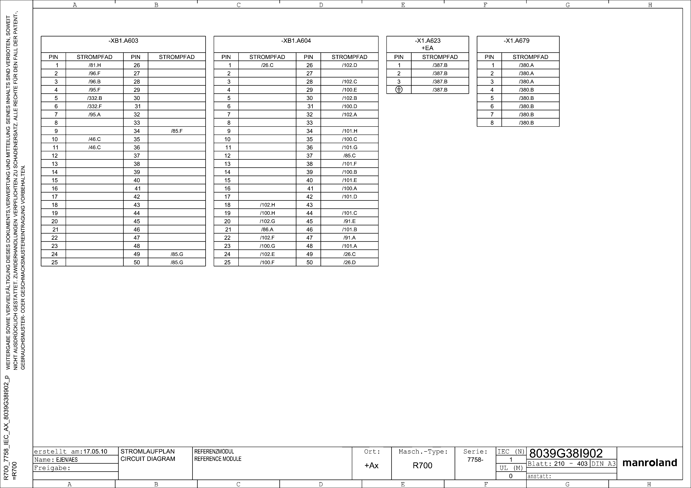

# +Ax — Sheet 210 of 403 — REFERENZMODUL

**REFERENCE MODULE**

> Part of the manroland **R700** printing press IEC/UL circuit diagrams.
> Drawing class: **Stromlaufplan / Circuit diagram** (DIN A3).
> Document `+Ax` covers the **Central control console** machine section.

## At a glance

| Field | Value |
|---|---|
| Document | `+Ax`  (8039G38I902) |
| Sheet | **210** of 403 |
| Section (DE) | REFERENZMODUL |
| Section (EN) | REFERENCE MODULE |
| Section type | REFERENCE_MODULE — Reference module |
| Machine type | `R700` |
| Series | `7758` |
| Created | 17.05.10 |
| Replaces | — |
| Columns used | A, B, C, D, E, F, G |
| Path numbers | — |
| Labels on sheet | 183 |
| Cross-refs out | 55 |
| Cross-refs in | 0 |

**Previous:** [+Ax sheet 209](SHEET_0209.md) · **Next:** [+Ax sheet 211](SHEET_0211.md) · **Document TOC:** [_TOC.md](_TOC.md)  (+Ax) · **Master TOC:** [all sheets](../_MASTER_TOC.md)

## Sheet image (300 DPI, exact vector render)



_Rendered directly from the PDF vector layer at 300 DPI (1-bit), no OCR and no resampling. Use it to confirm anything ambiguous in the text below._

## Cross-references on this sheet

Each entry is a wire leaving this sheet. The printed token is `/sheet.column`; the link resolves to that sheet inside the same document.

| Ref | Target sheet | Col | Path | Destination on target | Target section | From col |
|---|---|---|---|---|---|---|
| `/387.B` | [+Ax sheet 387](SHEET_0387.md) | B | — | — | OPTION: PUDERABSAUGEINRICHTUNG | E |
| `/380.A` | [+Ax sheet 380](SHEET_0380.md) | A | — | — | OPTION: TELEPRESENCE | F |
| `/81.H` | [+Ax sheet 81](SHEET_0081.md) | H | — | — | ANLEGER | A |
| `/26.C` | [+Ax sheet 26](SHEET_0026.md) | C | — | — | SPANNUNGSVERSORGUNG, SCHALTSCHRANKBELÜFTUNG | C |
| `/102.D` | [+Ax sheet 102](SHEET_0102.md) | D | — | — | ANLEGER | D |
| `/96.F` | [+Ax sheet 96](SHEET_0096.md) | F | — | — | ANLEGER | A |
| `/387.B` | [+Ax sheet 387](SHEET_0387.md) | B | — | — | OPTION: PUDERABSAUGEINRICHTUNG | E |
| `/380.A` | [+Ax sheet 380](SHEET_0380.md) | A | — | — | OPTION: TELEPRESENCE | F |
| `/96.B` | [+Ax sheet 96](SHEET_0096.md) | B | — | — | ANLEGER | A |
| `/387.B` | [+Ax sheet 387](SHEET_0387.md) | B | — | — | OPTION: PUDERABSAUGEINRICHTUNG | E |
| `/380.A` | [+Ax sheet 380](SHEET_0380.md) | A | — | — | OPTION: TELEPRESENCE | F |
| `/102.C` | [+Ax sheet 102](SHEET_0102.md) | C | — | — | ANLEGER | D |
| `/95.F` | [+Ax sheet 95](SHEET_0095.md) | F | — | — | ANLEGER | A |
| `/100.E` | [+Ax sheet 100](SHEET_0100.md) | E | — | — | ANLEGER | D |
| `/387.B` | [+Ax sheet 387](SHEET_0387.md) | B | — | — | OPTION: PUDERABSAUGEINRICHTUNG | E |
| `/380.B` | [+Ax sheet 380](SHEET_0380.md) | B | — | — | OPTION: TELEPRESENCE | G |
| `/332.B` | [+Ax sheet 332](SHEET_0332.md) | B | — | — | OPTION: NONSTOP EINRICHTUNG MANUELL, ANLEGER | A |
| `/102.B` | [+Ax sheet 102](SHEET_0102.md) | B | — | — | ANLEGER | D |
| `/380.B` | [+Ax sheet 380](SHEET_0380.md) | B | — | — | OPTION: TELEPRESENCE | G |
| `/380.B` | [+Ax sheet 380](SHEET_0380.md) | B | — | — | OPTION: TELEPRESENCE | G |
| `/332.F` | [+Ax sheet 332](SHEET_0332.md) | F | — | — | OPTION: NONSTOP EINRICHTUNG MANUELL, ANLEGER | A |
| `/100.D` | [+Ax sheet 100](SHEET_0100.md) | D | — | — | ANLEGER | D |
| `/95.A` | [+Ax sheet 95](SHEET_0095.md) | A | — | — | ANLEGER | A |
| `/102.A` | [+Ax sheet 102](SHEET_0102.md) | A | — | — | ANLEGER | D |
| `/380.B` | [+Ax sheet 380](SHEET_0380.md) | B | — | — | OPTION: TELEPRESENCE | G |
| `/380.B` | [+Ax sheet 380](SHEET_0380.md) | B | — | — | OPTION: TELEPRESENCE | G |
| `/85.F` | [+Ax sheet 85](SHEET_0085.md) | F | — | — | ANLEGER | B |
| `/101.H` | [+Ax sheet 101](SHEET_0101.md) | H | — | — | ANLEGER | D |
| `/46.C` | [+Ax sheet 46](SHEET_0046.md) | C | — | — | NOT AUS | A |
| `/100.C` | [+Ax sheet 100](SHEET_0100.md) | C | — | — | ANLEGER | D |
| `/46.C` | [+Ax sheet 46](SHEET_0046.md) | C | — | — | NOT AUS | A |
| `/101.G` | [+Ax sheet 101](SHEET_0101.md) | G | — | — | ANLEGER | D |
| `/85.C` | [+Ax sheet 85](SHEET_0085.md) | C | — | — | ANLEGER | D |
| `/101.F` | [+Ax sheet 101](SHEET_0101.md) | F | — | — | ANLEGER | D |
| `/100.B` | [+Ax sheet 100](SHEET_0100.md) | B | — | — | ANLEGER | D |
| `/101.E` | [+Ax sheet 101](SHEET_0101.md) | E | — | — | ANLEGER | D |
| `/100.A` | [+Ax sheet 100](SHEET_0100.md) | A | — | — | ANLEGER | D |
| `/101.D` | [+Ax sheet 101](SHEET_0101.md) | D | — | — | ANLEGER | D |
| `/102.H` | [+Ax sheet 102](SHEET_0102.md) | H | — | — | ANLEGER | C |
| `/100.H` | [+Ax sheet 100](SHEET_0100.md) | H | — | — | ANLEGER | C |
| `/101.C` | [+Ax sheet 101](SHEET_0101.md) | C | — | — | ANLEGER | D |
| `/91.E` | [+Ax sheet 91](SHEET_0091.md) | E | — | — | ANLEGER | D |
| `/102.G` | [+Ax sheet 102](SHEET_0102.md) | G | — | — | ANLEGER | C |
| `/86.A` | [+Ax sheet 86](SHEET_0086.md) | A | — | — | ANLEGER | C |
| `/101.B` | [+Ax sheet 101](SHEET_0101.md) | B | — | — | ANLEGER | D |
| `/91.A` | [+Ax sheet 91](SHEET_0091.md) | A | — | — | ANLEGER | D |
| `/102.F` | [+Ax sheet 102](SHEET_0102.md) | F | — | — | ANLEGER | C |
| `/101.A` | [+Ax sheet 101](SHEET_0101.md) | A | — | — | ANLEGER | D |
| `/100.G` | [+Ax sheet 100](SHEET_0100.md) | G | — | — | ANLEGER | C |
| `/102.E` | [+Ax sheet 102](SHEET_0102.md) | E | — | — | ANLEGER | C |
| `/85.G` | [+Ax sheet 85](SHEET_0085.md) | G | — | — | ANLEGER | B |
| `/26.C` | [+Ax sheet 26](SHEET_0026.md) | C | — | — | SPANNUNGSVERSORGUNG, SCHALTSCHRANKBELÜFTUNG | D |
| `/85.G` | [+Ax sheet 85](SHEET_0085.md) | G | — | — | ANLEGER | B |
| `/100.F` | [+Ax sheet 100](SHEET_0100.md) | F | — | — | ANLEGER | C |
| `/26.D` | [+Ax sheet 26](SHEET_0026.md) | D | — | — | SPANNUNGSVERSORGUNG, SCHALTSCHRANKBELÜFTUNG | D |

## Devices on this sheet

| Tag | Class | Class meaning (IEC) | Col | Sub | Terminal | Sign |
|---|---|---|---|---|---|---|
| `XB1.A604` | — | cross-device reference | D | — | — | — |
| `XB1.A603` | — | cross-device reference | B | — | — | — |
| `X1.A623` | — | cross-device reference | E | — | — | — |
| `X1.A679` | — | cross-device reference | F | — | — | — |

## Potentials / nets

_No named potentials on this sheet._

## Wire-end annotations (grouped as printed)

A wire that continues elsewhere is annotated with a small cluster: the destination description, the path/line number `#NN`, and the `/sheet.column` cross reference. Each row below is one such cluster exactly as it is grouped on the drawing.

| Col | Y | Path | Cross-ref | Text on the wire |
|---|---|---|---|---|
| B | 65.5 | — | — | `XB1.A603` |
| D | 65.5 | — | — | `XB1.A604` |
| E | 65.5 | — | — | `X1.A623` |
| F | 65.5 | — | — | `X1.A679` |
| E | 78.2 | — | — | `+EA` |
| A | 94.2 | — | — | `PIN STROMPFAD` |
| B | 94.2 | — | — | `PIN STROMPFAD` |
| C | 94.2 | — | — | `PIN STROMPFAD` |
| D | 94.2 | — | — | `PIN STROMPFAD` |
| E | 94.2 | — | — | `PIN 2 3 1 STROMPFAD` |
| F | 94.2 | — | — | `PIN 2 3 4 5 6 7 8 1 STROMPFAD` |
| A | 108.4 | — | — | `2 3 4 5 6 7 8 9 1` |
| B | 108.4 | — | — | `26 27 28 29 30 32 33 34 35 36 37 38 39 40 42 43 44 45 46 47 48 49 50 31 41` |
| C | 108.4 | — | — | `2 3 4 5 6 7 8 9 1` |
| D | 108.4 | — | — | `26 27 28 29 30 32 33 34 35 36 37 38 39 40 42 43 44 45 46 47 48 49 50 31 41` |
| A | 108.7 | — | `/81.H` | — |
| C | 108.7 | — | `/26.C` | — |
| D | 108.7 | — | `/102.D` | — |
| E | 108.7 | — | `/387.B` | — |
| F | 108.7 | — | `/380.A` | — |
| A | 122.9 | — | `/96.F` | — |
| E | 122.9 | — | `/387.B` | — |
| F | 122.9 | — | `/380.A` | — |
| A | 137.0 | — | `/96.B` | — |
| E | 137.0 | — | `/387.B` | — |
| F | 137.0 | — | `/380.A` | — |
| D | 137.1 | — | `/102.C` | — |
| A | 151.2 | — | `/95.F` | — |
| D | 151.2 | — | `/100.E` | — |
| E | 151.2 | — | `/387.B` | — |
| G | 151.2 | — | `/380.B` | — |
| A | 165.4 | — | `/332.B` | — |
| D | 165.4 | — | `/102.B` | — |
| G | 165.4 | — | `/380.B` | — |
| A | 179.6 | — | `/332.F` | — |
| D | 179.6 | — | `/100.D` | — |
| G | 179.6 | — | `/380.B` | — |
| A | 193.7 | — | `/95.A` | — |
| D | 193.7 | — | `/102.A` | — |
| G | 193.7 | — | `/380.B` | — |
| G | 207.9 | — | `/380.B` | — |
| B | 222.1 | — | `/85.F` | — |
| D | 222.1 | — | `/101.H` | — |
| A | 235.9 | — | — | `10 12 13 14 15 16 17 18 19 20 11` |
| C | 235.9 | — | — | `10 12 13 14 15 16 17 18 19 20 11` |
| A | 236.3 | — | `/46.C` | — |
| D | 236.3 | — | `/100.C` | — |
| A | 250.4 | — | `/46.C` | — |
| D | 250.4 | — | `/101.G` | — |
| D | 264.6 | — | `/85.C` | — |
| D | 278.8 | — | `/101.F` | — |
| D | 292.9 | — | `/100.B` | — |
| D | 307.1 | — | `/101.E` | — |
| D | 321.3 | — | `/100.A` | — |
| D | 335.5 | — | `/101.D` | — |
| C | 349.7 | — | `/102.H` | — |
| C | 363.8 | — | `/100.H` | — |
| D | 363.8 | — | `/101.C` | — |
| C | 378.0 | — | `/102.G` | — |
| D | 378.0 | — | `/91.E` | — |
| A | 391.8 | — | — | `22 23 24 25 21` |
| C | 391.8 | — | — | `22 23 24 25 21` |
| C | 392.1 | — | `/86.A` | — |
| D | 392.1 | — | `/101.B` | — |
| C | 406.3 | — | `/102.F` | — |
| D | 406.3 | — | `/91.A` | — |
| C | 420.5 | — | `/100.G` | — |
| D | 420.5 | — | `/101.A` | — |
| B | 434.7 | — | `/85.G` | — |
| C | 434.7 | — | `/102.E` | — |
| D | 434.7 | — | `/26.C` | — |
| B | 448.9 | — | `/85.G` | — |
| C | 448.9 | — | `/100.F` | — |
| D | 448.9 | — | `/26.D` | — |


## Reconstructed tables

This sheet carries tabular content (pin map / terminal assignment / index). The grid below was rebuilt from the drawing's own rule lines, so each row is exactly one physical row of the table.

### Table 1 — 25 data rows × 4 columns (at x=70.9, y=62.4) — **XB1.A603**

| PIN | STROMPFAD | PIN | STROMPFAD |
|---|---|---|---|
| `1` | `/81.H` | `26` |  |
| `2` | `/96.F` | `27` |  |
| `3` | `/96.B` | `28` |  |
| `4` | `/95.F` | `29` |  |
| `5` | `/332.B` | `30` |  |
| `6` | `/332.F` | `31` |  |
| `7` | `/95.A` | `32` |  |
| `8` |  | `33` |  |
| `9` |  | `34` | `/85.F` |
| `10` | `/46.C` | `35` |  |
| `11` | `/46.C` | `36` |  |
| `12` |  | `37` |  |
| `13` |  | `38` |  |
| `14` |  | `39` |  |
| `15` |  | `40` |  |
| `16` |  | `41` |  |
| `17` |  | `42` |  |
| `18` |  | `43` |  |
| `19` |  | `44` |  |
| `20` |  | `45` |  |
| `21` |  | `46` |  |
| `22` |  | `47` |  |
| `23` |  | `48` |  |
| `24` |  | `49` | `/85.G` |
| `25` |  | `50` | `/85.G` |


### Table 2 — 25 data rows × 4 columns (at x=368.5, y=62.4) — **XB1.A604**

| PIN | STROMPFAD | PIN | STROMPFAD |
|---|---|---|---|
| `1` | `/26.C` | `26` | `/102.D` |
| `2` |  | `27` |  |
| `3` |  | `28` | `/102.C` |
| `4` |  | `29` | `/100.E` |
| `5` |  | `30` | `/102.B` |
| `6` |  | `31` | `/100.D` |
| `7` |  | `32` | `/102.A` |
| `8` |  | `33` |  |
| `9` |  | `34` | `/101.H` |
| `10` |  | `35` | `/100.C` |
| `11` |  | `36` | `/101.G` |
| `12` |  | `37` | `/85.C` |
| `13` |  | `38` | `/101.F` |
| `14` |  | `39` | `/100.B` |
| `15` |  | `40` | `/101.E` |
| `16` |  | `41` | `/100.A` |
| `17` |  | `42` | `/101.D` |
| `18` | `/102.H` | `43` |  |
| `19` | `/100.H` | `44` | `/101.C` |
| `20` | `/102.G` | `45` | `/91.E` |
| `21` | `/86.A` | `46` | `/101.B` |
| `22` | `/102.F` | `47` | `/91.A` |
| `23` | `/100.G` | `48` | `/101.A` |
| `24` | `/102.E` | `49` | `/26.C` |
| `25` | `/100.F` | `50` | `/26.D` |


### Table 3 — 4 data rows × 2 columns (at x=666.1, y=62.4) — **X1.A623 +EA**

| PIN | STROMPFAD |
|---|---|
| `1` | `/387.B` |
| `2` | `/387.B` |
| `3` | `/387.B` |
|  | `/387.B` |


### Table 4 — 8 data rows × 2 columns (at x=822.0, y=62.4) — **X1.A679**

| PIN | STROMPFAD |
|---|---|
| `1` | `/380.A` |
| `2` | `/380.A` |
| `3` | `/380.A` |
| `4` | `/380.B` |
| `5` | `/380.B` |
| `6` | `/380.B` |
| `7` | `/380.B` |
| `8` | `/380.B` |


## Notes and free text on this sheet

| Text | Col | Y (pt) |
|---|---|---|
| `PIN` | C | 94.2 |
| `STROMPFAD` | C | 94.15 |
| `PIN` | D | 94.2 |
| `STROMPFAD` | D | 94.15 |
| `PIN` | A | 94.2 |
| `STROMPFAD` | A | 94.15 |
| `PIN` | B | 94.2 |
| `STROMPFAD` | B | 94.15 |
| `PIN` | E | 94.2 |
| `STROMPFAD` | E | 94.15 |
| `+EA` | E | 78.18 |
| `PIN` | F | 94.2 |
| `STROMPFAD` | G | 94.15 |

## Complete label inventory (exact text from the drawing)

Every text object inside the drawing area of this sheet, in DIN reading order (column A→H, then top→bottom). This is the authoritative list: if a string is not here it is not printed on this sheet.

| Col | Y | X | Dir | Type | Text |
|---|---|---|---|---|---|
| A | 94.2 | 84.0 | → | text | `PIN` |
| A | 94.2 | 132.2 | → | text | `STROMPFAD` |
| A | 108.4 | 95.8 | → | number | `1` |
| A | 108.7 | 152.9 | → | cross-reference | `/81.H` |
| A | 122.5 | 94.1 | → | number | `2` |
| A | 122.9 | 153.1 | → | cross-reference | `/96.F` |
| A | 136.7 | 94.1 | → | number | `3` |
| A | 137.0 | 152.8 | → | cross-reference | `/96.B` |
| A | 150.9 | 94.1 | → | number | `4` |
| A | 151.2 | 153.1 | → | cross-reference | `/95.F` |
| A | 165.1 | 94.1 | → | number | `5` |
| A | 165.4 | 150.4 | → | cross-reference | `/332.B` |
| A | 179.2 | 94.1 | → | number | `6` |
| A | 179.6 | 150.7 | → | cross-reference | `/332.F` |
| A | 193.4 | 94.1 | → | number | `7` |
| A | 193.7 | 152.6 | → | cross-reference | `/95.A` |
| A | 207.6 | 94.1 | → | number | `8` |
| A | 221.8 | 94.1 | → | number | `9` |
| A | 235.9 | 88.7 | → | number | `10` |
| A | 236.3 | 152.6 | → | cross-reference | `/46.C` |
| A | 250.1 | 90.4 | → | number | `11` |
| A | 250.4 | 152.6 | → | cross-reference | `/46.C` |
| A | 264.3 | 88.7 | → | number | `12` |
| A | 278.5 | 88.7 | → | number | `13` |
| A | 292.6 | 88.7 | → | number | `14` |
| A | 306.8 | 88.7 | → | number | `15` |
| A | 321.0 | 88.7 | → | number | `16` |
| A | 335.1 | 88.7 | → | number | `17` |
| A | 349.3 | 88.7 | → | number | `18` |
| A | 363.5 | 88.7 | → | number | `19` |
| A | 377.7 | 88.7 | → | number | `20` |
| A | 391.8 | 90.4 | → | number | `21` |
| A | 406.0 | 88.7 | → | number | `22` |
| A | 420.2 | 88.7 | → | number | `23` |
| A | 434.4 | 88.7 | → | number | `24` |
| A | 448.5 | 88.7 | → | number | `25` |
| B | 65.5 | 187.1 | → | device ref | `XB1.A603` |
| B | 94.2 | 225.8 | → | text | `PIN` |
| B | 94.2 | 274.0 | → | text | `STROMPFAD` |
| B | 108.4 | 230.5 | → | number | `26` |
| B | 122.5 | 230.5 | → | number | `27` |
| B | 136.7 | 230.5 | → | number | `28` |
| B | 150.9 | 230.5 | → | number | `29` |
| B | 165.1 | 230.5 | → | number | `30` |
| B | 179.2 | 232.2 | → | number | `31` |
| B | 193.4 | 230.5 | → | number | `32` |
| B | 207.6 | 230.5 | → | number | `33` |
| B | 221.8 | 230.5 | → | number | `34` |
| B | 222.1 | 294.8 | → | cross-reference | `/85.F` |
| B | 235.9 | 230.5 | → | number | `35` |
| B | 250.1 | 230.5 | → | number | `36` |
| B | 264.3 | 230.5 | → | number | `37` |
| B | 278.5 | 230.5 | → | number | `38` |
| B | 292.6 | 230.5 | → | number | `39` |
| B | 306.8 | 230.5 | → | number | `40` |
| B | 321.0 | 232.2 | → | number | `41` |
| B | 335.1 | 230.5 | → | number | `42` |
| B | 349.3 | 230.5 | → | number | `43` |
| B | 363.5 | 230.5 | → | number | `44` |
| B | 377.7 | 230.5 | → | number | `45` |
| B | 391.8 | 230.5 | → | number | `46` |
| B | 406.0 | 230.5 | → | number | `47` |
| B | 420.2 | 230.5 | → | number | `48` |
| B | 434.4 | 230.5 | → | number | `49` |
| B | 434.7 | 294.2 | → | cross-reference | `/85.G` |
| B | 448.5 | 230.5 | → | number | `50` |
| B | 448.9 | 294.2 | → | cross-reference | `/85.G` |
| C | 94.2 | 381.7 | → | text | `PIN` |
| C | 94.2 | 429.9 | → | text | `STROMPFAD` |
| C | 108.4 | 393.4 | → | number | `1` |
| C | 108.7 | 450.3 | → | cross-reference | `/26.C` |
| C | 122.5 | 391.7 | → | number | `2` |
| C | 136.7 | 391.7 | → | number | `3` |
| C | 150.9 | 391.7 | → | number | `4` |
| C | 165.1 | 391.7 | → | number | `5` |
| C | 179.2 | 391.7 | → | number | `6` |
| C | 193.4 | 391.7 | → | number | `7` |
| C | 207.6 | 391.7 | → | number | `8` |
| C | 221.8 | 391.7 | → | number | `9` |
| C | 235.9 | 386.4 | → | number | `10` |
| C | 250.1 | 388.1 | → | number | `11` |
| C | 264.3 | 386.4 | → | number | `12` |
| C | 278.5 | 386.4 | → | number | `13` |
| C | 292.6 | 386.4 | → | number | `14` |
| C | 306.8 | 386.4 | → | number | `15` |
| C | 321.0 | 386.4 | → | number | `16` |
| C | 335.1 | 386.4 | → | number | `17` |
| C | 349.3 | 386.4 | → | number | `18` |
| C | 349.7 | 448.2 | → | cross-reference | `/102.H` |
| C | 363.5 | 386.4 | → | number | `19` |
| C | 363.8 | 448.2 | → | cross-reference | `/100.H` |
| C | 377.7 | 386.4 | → | number | `20` |
| C | 378.0 | 447.7 | → | cross-reference | `/102.G` |
| C | 391.8 | 388.1 | → | number | `21` |
| C | 392.1 | 450.3 | → | cross-reference | `/86.A` |
| C | 406.0 | 386.4 | → | number | `22` |
| C | 406.3 | 448.3 | → | cross-reference | `/102.F` |
| C | 420.2 | 386.4 | → | number | `23` |
| C | 420.5 | 447.7 | → | cross-reference | `/100.G` |
| C | 434.4 | 386.4 | → | number | `24` |
| C | 434.7 | 448.2 | → | cross-reference | `/102.E` |
| C | 448.5 | 386.4 | → | number | `25` |
| C | 448.9 | 448.3 | → | cross-reference | `/100.F` |
| D | 65.5 | 484.7 | → | device ref | `XB1.A604` |
| D | 94.2 | 523.4 | → | text | `PIN` |
| D | 94.2 | 571.6 | → | text | `STROMPFAD` |
| D | 108.4 | 528.1 | → | number | `26` |
| D | 108.7 | 589.6 | → | cross-reference | `/102.D` |
| D | 122.5 | 528.1 | → | number | `27` |
| D | 136.7 | 528.1 | → | number | `28` |
| D | 137.1 | 589.6 | → | cross-reference | `/102.C` |
| D | 150.9 | 528.1 | → | number | `29` |
| D | 151.2 | 589.9 | → | cross-reference | `/100.E` |
| D | 165.1 | 528.1 | → | number | `30` |
| D | 165.4 | 589.7 | → | cross-reference | `/102.B` |
| D | 179.2 | 529.8 | → | number | `31` |
| D | 179.6 | 589.6 | → | cross-reference | `/100.D` |
| D | 193.4 | 528.1 | → | number | `32` |
| D | 193.7 | 589.6 | → | cross-reference | `/102.A` |
| D | 207.6 | 528.1 | → | number | `33` |
| D | 221.8 | 528.1 | → | number | `34` |
| D | 222.1 | 589.9 | → | cross-reference | `/101.H` |
| D | 235.9 | 528.1 | → | number | `35` |
| D | 236.3 | 589.6 | → | cross-reference | `/100.C` |
| D | 250.1 | 528.1 | → | number | `36` |
| D | 250.4 | 589.5 | → | cross-reference | `/101.G` |
| D | 264.3 | 528.1 | → | number | `37` |
| D | 264.6 | 592.0 | → | cross-reference | `/85.C` |
| D | 278.5 | 528.1 | → | number | `38` |
| D | 278.8 | 590.0 | → | cross-reference | `/101.F` |
| D | 292.6 | 528.1 | → | number | `39` |
| D | 292.9 | 589.7 | → | cross-reference | `/100.B` |
| D | 306.8 | 528.1 | → | number | `40` |
| D | 307.1 | 589.9 | → | cross-reference | `/101.E` |
| D | 321.0 | 529.8 | → | number | `41` |
| D | 321.3 | 589.6 | → | cross-reference | `/100.A` |
| D | 335.1 | 528.1 | → | number | `42` |
| D | 335.5 | 589.6 | → | cross-reference | `/101.D` |
| D | 349.3 | 528.1 | → | number | `43` |
| D | 363.5 | 528.1 | → | number | `44` |
| D | 363.8 | 589.6 | → | cross-reference | `/101.C` |
| D | 377.7 | 528.1 | → | number | `45` |
| D | 378.0 | 592.3 | → | cross-reference | `/91.E` |
| D | 391.8 | 528.1 | → | number | `46` |
| D | 392.2 | 589.7 | → | cross-reference | `/101.B` |
| D | 406.0 | 528.1 | → | number | `47` |
| D | 406.3 | 592.0 | → | cross-reference | `/91.A` |
| D | 420.2 | 528.1 | → | number | `48` |
| D | 420.5 | 589.6 | → | cross-reference | `/101.A` |
| D | 434.4 | 528.1 | → | number | `49` |
| D | 434.7 | 592.0 | → | cross-reference | `/26.C` |
| D | 448.5 | 528.1 | → | number | `50` |
| D | 448.9 | 592.0 | → | cross-reference | `/26.D` |
| E | 65.5 | 715.0 | → | device ref | `X1.A623` |
| E | 78.2 | 726.4 | → | text | `+EA` |
| E | 94.2 | 679.3 | → | text | `PIN` |
| E | 94.2 | 727.5 | → | text | `STROMPFAD` |
| E | 108.4 | 685.3 | → | number | `1` |
| E | 108.7 | 745.7 | → | cross-reference | `/387.B` |
| E | 122.5 | 684.7 | → | number | `2` |
| E | 122.9 | 745.7 | → | cross-reference | `/387.B` |
| E | 136.7 | 684.7 | → | number | `3` |
| E | 137.0 | 745.7 | → | cross-reference | `/387.B` |
| E | 151.2 | 745.7 | → | cross-reference | `/387.B` |
| F | 65.5 | 868.1 | → | device ref | `X1.A679` |
| F | 94.2 | 835.2 | → | text | `PIN` |
| F | 108.4 | 847.0 | → | number | `1` |
| F | 108.7 | 894.3 | → | cross-reference | `/380.A` |
| F | 122.5 | 845.3 | → | number | `2` |
| F | 122.9 | 894.3 | → | cross-reference | `/380.A` |
| F | 136.7 | 845.3 | → | number | `3` |
| F | 137.0 | 894.3 | → | cross-reference | `/380.A` |
| F | 150.9 | 845.3 | → | number | `4` |
| F | 165.1 | 845.3 | → | number | `5` |
| F | 179.2 | 845.3 | → | number | `6` |
| F | 193.4 | 845.3 | → | number | `7` |
| F | 207.6 | 845.3 | → | number | `8` |
| G | 94.2 | 883.4 | → | text | `STROMPFAD` |
| G | 151.2 | 894.5 | → | cross-reference | `/380.B` |
| G | 165.4 | 894.5 | → | cross-reference | `/380.B` |
| G | 179.6 | 894.5 | → | cross-reference | `/380.B` |
| G | 193.7 | 894.5 | → | cross-reference | `/380.B` |
| G | 207.9 | 894.5 | → | cross-reference | `/380.B` |

## Reading-order text block

The same content as a plain block, grouped by DIN column — convenient to paste or to match against a visual description.

```text
=== Column A ===
  94.2   84.0  text         PIN
  94.2  132.2  text         STROMPFAD
 108.4   95.8  numeric      1
 108.7  152.9  xref         /81.H
 122.5   94.1  numeric      2
 122.9  153.1  xref         /96.F
 136.7   94.1  numeric      3
 137.0  152.8  xref         /96.B
 150.9   94.1  numeric      4
 151.2  153.1  xref         /95.F
 165.1   94.1  numeric      5
 165.4  150.4  xref         /332.B
 179.2   94.1  numeric      6
 179.6  150.7  xref         /332.F
 193.4   94.1  numeric      7
 193.7  152.6  xref         /95.A
 207.6   94.1  numeric      8
 221.8   94.1  numeric      9
 235.9   88.7  numeric      10
 236.3  152.6  xref         /46.C
 250.1   90.4  numeric      11
 250.4  152.6  xref         /46.C
 264.3   88.7  numeric      12
 278.5   88.7  numeric      13
 292.6   88.7  numeric      14
 306.8   88.7  numeric      15
 321.0   88.7  numeric      16
 335.1   88.7  numeric      17
 349.3   88.7  numeric      18
 363.5   88.7  numeric      19
 377.7   88.7  numeric      20
 391.8   90.4  numeric      21
 406.0   88.7  numeric      22
 420.2   88.7  numeric      23
 434.4   88.7  numeric      24
 448.5   88.7  numeric      25
=== Column B ===
  65.5  187.1  devref       XB1.A603
  94.2  225.8  text         PIN
  94.2  274.0  text         STROMPFAD
 108.4  230.5  numeric      26
 122.5  230.5  numeric      27
 136.7  230.5  numeric      28
 150.9  230.5  numeric      29
 165.1  230.5  numeric      30
 179.2  232.2  numeric      31
 193.4  230.5  numeric      32
 207.6  230.5  numeric      33
 221.8  230.5  numeric      34
 222.1  294.8  xref         /85.F
 235.9  230.5  numeric      35
 250.1  230.5  numeric      36
 264.3  230.5  numeric      37
 278.5  230.5  numeric      38
 292.6  230.5  numeric      39
 306.8  230.5  numeric      40
 321.0  232.2  numeric      41
 335.1  230.5  numeric      42
 349.3  230.5  numeric      43
 363.5  230.5  numeric      44
 377.7  230.5  numeric      45
 391.8  230.5  numeric      46
 406.0  230.5  numeric      47
 420.2  230.5  numeric      48
 434.4  230.5  numeric      49
 434.7  294.2  xref         /85.G
 448.5  230.5  numeric      50
 448.9  294.2  xref         /85.G
=== Column C ===
  94.2  381.7  text         PIN
  94.2  429.9  text         STROMPFAD
 108.4  393.4  numeric      1
 108.7  450.3  xref         /26.C
 122.5  391.7  numeric      2
 136.7  391.7  numeric      3
 150.9  391.7  numeric      4
 165.1  391.7  numeric      5
 179.2  391.7  numeric      6
 193.4  391.7  numeric      7
 207.6  391.7  numeric      8
 221.8  391.7  numeric      9
 235.9  386.4  numeric      10
 250.1  388.1  numeric      11
 264.3  386.4  numeric      12
 278.5  386.4  numeric      13
 292.6  386.4  numeric      14
 306.8  386.4  numeric      15
 321.0  386.4  numeric      16
 335.1  386.4  numeric      17
 349.3  386.4  numeric      18
 349.7  448.2  xref         /102.H
 363.5  386.4  numeric      19
 363.8  448.2  xref         /100.H
 377.7  386.4  numeric      20
 378.0  447.7  xref         /102.G
 391.8  388.1  numeric      21
 392.1  450.3  xref         /86.A
 406.0  386.4  numeric      22
 406.3  448.3  xref         /102.F
 420.2  386.4  numeric      23
 420.5  447.7  xref         /100.G
 434.4  386.4  numeric      24
 434.7  448.2  xref         /102.E
 448.5  386.4  numeric      25
 448.9  448.3  xref         /100.F
=== Column D ===
  65.5  484.7  devref       XB1.A604
  94.2  523.4  text         PIN
  94.2  571.6  text         STROMPFAD
 108.4  528.1  numeric      26
 108.7  589.6  xref         /102.D
 122.5  528.1  numeric      27
 136.7  528.1  numeric      28
 137.1  589.6  xref         /102.C
 150.9  528.1  numeric      29
 151.2  589.9  xref         /100.E
 165.1  528.1  numeric      30
 165.4  589.7  xref         /102.B
 179.2  529.8  numeric      31
 179.6  589.6  xref         /100.D
 193.4  528.1  numeric      32
 193.7  589.6  xref         /102.A
 207.6  528.1  numeric      33
 221.8  528.1  numeric      34
 222.1  589.9  xref         /101.H
 235.9  528.1  numeric      35
 236.3  589.6  xref         /100.C
 250.1  528.1  numeric      36
 250.4  589.5  xref         /101.G
 264.3  528.1  numeric      37
 264.6  592.0  xref         /85.C
 278.5  528.1  numeric      38
 278.8  590.0  xref         /101.F
 292.6  528.1  numeric      39
 292.9  589.7  xref         /100.B
 306.8  528.1  numeric      40
 307.1  589.9  xref         /101.E
 321.0  529.8  numeric      41
 321.3  589.6  xref         /100.A
 335.1  528.1  numeric      42
 335.5  589.6  xref         /101.D
 349.3  528.1  numeric      43
 363.5  528.1  numeric      44
 363.8  589.6  xref         /101.C
 377.7  528.1  numeric      45
 378.0  592.3  xref         /91.E
 391.8  528.1  numeric      46
 392.2  589.7  xref         /101.B
 406.0  528.1  numeric      47
 406.3  592.0  xref         /91.A
 420.2  528.1  numeric      48
 420.5  589.6  xref         /101.A
 434.4  528.1  numeric      49
 434.7  592.0  xref         /26.C
 448.5  528.1  numeric      50
 448.9  592.0  xref         /26.D
=== Column E ===
  65.5  715.0  devref       X1.A623
  78.2  726.4  text         +EA
  94.2  679.3  text         PIN
  94.2  727.5  text         STROMPFAD
 108.4  685.3  numeric      1
 108.7  745.7  xref         /387.B
 122.5  684.7  numeric      2
 122.9  745.7  xref         /387.B
 136.7  684.7  numeric      3
 137.0  745.7  xref         /387.B
 151.2  745.7  xref         /387.B
=== Column F ===
  65.5  868.1  devref       X1.A679
  94.2  835.2  text         PIN
 108.4  847.0  numeric      1
 108.7  894.3  xref         /380.A
 122.5  845.3  numeric      2
 122.9  894.3  xref         /380.A
 136.7  845.3  numeric      3
 137.0  894.3  xref         /380.A
 150.9  845.3  numeric      4
 165.1  845.3  numeric      5
 179.2  845.3  numeric      6
 193.4  845.3  numeric      7
 207.6  845.3  numeric      8
=== Column G ===
  94.2  883.4  text         STROMPFAD
 151.2  894.5  xref         /380.B
 165.4  894.5  xref         /380.B
 179.6  894.5  xref         /380.B
 193.7  894.5  xref         /380.B
 207.9  894.5  xref         /380.B
```

---
_Generated from the PDF vector text layer; no OCR. Source: `R700_7758_IEC_AX_8039G38I902_p`, sheet 210._
