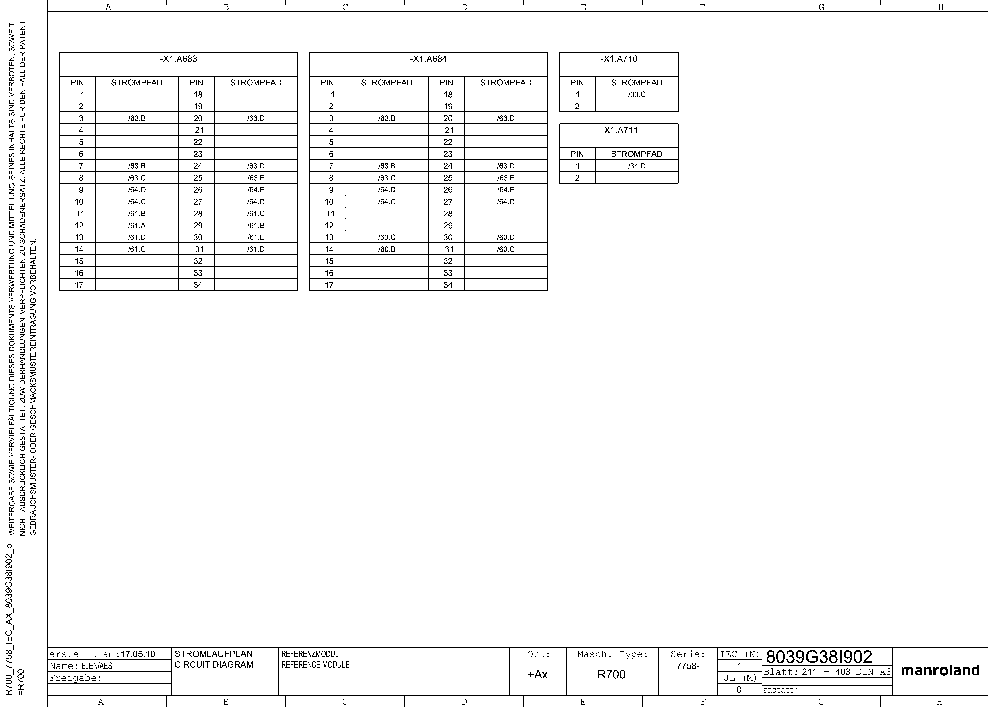

# +Ax — Sheet 211 of 403 — REFERENZMODUL

**REFERENCE MODULE**

> Part of the manroland **R700** printing press IEC/UL circuit diagrams.
> Drawing class: **Stromlaufplan / Circuit diagram** (DIN A3).
> Document `+Ax` covers the **Central control console** machine section.

## At a glance

| Field | Value |
|---|---|
| Document | `+Ax`  (8039G38I902) |
| Sheet | **211** of 403 |
| Section (DE) | REFERENZMODUL |
| Section (EN) | REFERENCE MODULE |
| Section type | REFERENCE_MODULE — Reference module |
| Machine type | `R700` |
| Series | `7758` |
| Created | 17.05.10 |
| Replaces | — |
| Columns used | A, B, C, D, E |
| Path numbers | — |
| Labels on sheet | 122 |
| Cross-refs out | 34 |
| Cross-refs in | 0 |

**Previous:** [+Ax sheet 210](SHEET_0210.md) · **Next:** [+Ax sheet 212](SHEET_0212.md) · **Document TOC:** [_TOC.md](_TOC.md)  (+Ax) · **Master TOC:** [all sheets](../_MASTER_TOC.md)

## Sheet image (300 DPI, exact vector render)



_Rendered directly from the PDF vector layer at 300 DPI (1-bit), no OCR and no resampling. Use it to confirm anything ambiguous in the text below._

## Cross-references on this sheet

Each entry is a wire leaving this sheet. The printed token is `/sheet.column`; the link resolves to that sheet inside the same document.

| Ref | Target sheet | Col | Path | Destination on target | Target section | From col |
|---|---|---|---|---|---|---|
| `/33.C` | [+Ax sheet 33](SHEET_0033.md) | C | — | STROMPFAD PIN 1 2 | SPANNUNGSVERSORGUNG, SCHALTSCHRANKBELÜFTUNG | E |
| `/63.B` | [+Ax sheet 63](SHEET_0063.md) | B | — | — | DRUCKLUFTANLAGE | A |
| `/63.B` | [+Ax sheet 63](SHEET_0063.md) | B | — | — | DRUCKLUFTANLAGE | C |
| `/63.D` | [+Ax sheet 63](SHEET_0063.md) | D | — | — | DRUCKLUFTANLAGE | B |
| `/63.D` | [+Ax sheet 63](SHEET_0063.md) | D | — | — | DRUCKLUFTANLAGE | D |
| `/34.D` | [+Ax sheet 34](SHEET_0034.md) | D | — | STROMPFAD PIN 1 2 | SPANNUNGSVERSORGUNG, SCHALTSCHRANKBELÜFTUNG | E |
| `/63.B` | [+Ax sheet 63](SHEET_0063.md) | B | — | — | DRUCKLUFTANLAGE | A |
| `/63.B` | [+Ax sheet 63](SHEET_0063.md) | B | — | — | DRUCKLUFTANLAGE | C |
| `/63.D` | [+Ax sheet 63](SHEET_0063.md) | D | — | — | DRUCKLUFTANLAGE | B |
| `/63.D` | [+Ax sheet 63](SHEET_0063.md) | D | — | — | DRUCKLUFTANLAGE | D |
| `/63.E` | [+Ax sheet 63](SHEET_0063.md) | E | — | — | DRUCKLUFTANLAGE | B |
| `/63.E` | [+Ax sheet 63](SHEET_0063.md) | E | — | — | DRUCKLUFTANLAGE | D |
| `/63.C` | [+Ax sheet 63](SHEET_0063.md) | C | — | — | DRUCKLUFTANLAGE | A |
| `/63.C` | [+Ax sheet 63](SHEET_0063.md) | C | — | — | DRUCKLUFTANLAGE | C |
| `/64.E` | [+Ax sheet 64](SHEET_0064.md) | E | — | — | DRUCKLUFTANLAGE | B |
| `/64.E` | [+Ax sheet 64](SHEET_0064.md) | E | — | — | DRUCKLUFTANLAGE | D |
| `/64.D` | [+Ax sheet 64](SHEET_0064.md) | D | — | — | DRUCKLUFTANLAGE | A |
| `/64.D` | [+Ax sheet 64](SHEET_0064.md) | D | — | — | DRUCKLUFTANLAGE | C |
| `/64.C` | [+Ax sheet 64](SHEET_0064.md) | C | — | — | DRUCKLUFTANLAGE | A |
| `/64.D` | [+Ax sheet 64](SHEET_0064.md) | D | — | — | DRUCKLUFTANLAGE | B |
| `/64.C` | [+Ax sheet 64](SHEET_0064.md) | C | — | — | DRUCKLUFTANLAGE | C |
| `/64.D` | [+Ax sheet 64](SHEET_0064.md) | D | — | — | DRUCKLUFTANLAGE | D |
| `/61.B` | [+Ax sheet 61](SHEET_0061.md) | B | — | — | DRUCKLUFTANLAGE | A |
| `/61.C` | [+Ax sheet 61](SHEET_0061.md) | C | — | — | DRUCKLUFTANLAGE | B |
| `/61.A` | [+Ax sheet 61](SHEET_0061.md) | A | — | — | DRUCKLUFTANLAGE | A |
| `/61.B` | [+Ax sheet 61](SHEET_0061.md) | B | — | — | DRUCKLUFTANLAGE | B |
| `/61.E` | [+Ax sheet 61](SHEET_0061.md) | E | — | — | DRUCKLUFTANLAGE | B |
| `/61.D` | [+Ax sheet 61](SHEET_0061.md) | D | — | — | DRUCKLUFTANLAGE | A |
| `/60.C` | [+Ax sheet 60](SHEET_0060.md) | C | — | — | DRUCKLUFTANLAGE | C |
| `/60.D` | [+Ax sheet 60](SHEET_0060.md) | D | — | — | DRUCKLUFTANLAGE | D |
| `/60.B` | [+Ax sheet 60](SHEET_0060.md) | B | — | — | DRUCKLUFTANLAGE | C |
| `/61.C` | [+Ax sheet 61](SHEET_0061.md) | C | — | — | DRUCKLUFTANLAGE | A |
| `/61.D` | [+Ax sheet 61](SHEET_0061.md) | D | — | — | DRUCKLUFTANLAGE | B |
| `/60.C` | [+Ax sheet 60](SHEET_0060.md) | C | — | — | DRUCKLUFTANLAGE | D |

## Devices on this sheet

| Tag | Class | Class meaning (IEC) | Col | Sub | Terminal | Sign |
|---|---|---|---|---|---|---|
| `X1.A683` | — | cross-device reference | B | — | — | — |
| `X1.A684` | — | cross-device reference | D | — | — | — |
| `X1.A710` | — | cross-device reference | E | — | — | — |
| `X1.A711` | — | cross-device reference | E | — | — | — |

## Potentials / nets

_No named potentials on this sheet._

## Wire-end annotations (grouped as printed)

A wire that continues elsewhere is annotated with a small cluster: the destination description, the path/line number `#NN`, and the `/sheet.column` cross reference. Each row below is one such cluster exactly as it is grouped on the drawing.

| Col | Y | Path | Cross-ref | Text on the wire |
|---|---|---|---|---|
| B | 65.5 | — | — | `X1.A683` |
| D | 65.5 | — | — | `X1.A684` |
| E | 65.5 | — | — | `X1.A710` |
| A | 94.2 | — | — | `PIN STROMPFAD` |
| B | 94.2 | — | — | `PIN 18 19 20 22 23 24 25 26 27 28 29 30 32 33 34 21 31 STROMPFAD` |
| C | 94.2 | — | — | `PIN STROMPFAD` |
| D | 94.2 | — | — | `PIN 18 19 20 22 23 24 25 26 27 28 29 30 32 33 34 21 31 STROMPFAD` |
| E | 94.2 | — | `/33.C` | `PIN 2 1 STROMPFAD` |
| A | 108.4 | — | — | `2 3 4 5 6 7 8 9 1` |
| C | 108.4 | — | — | `2 3 4 5 6 7 8 9 1` |
| A | 137.0 | — | `/63.B` | — |
| C | 137.0 | — | `/63.B` | — |
| B | 137.1 | — | `/63.D` | — |
| D | 137.1 | — | `/63.D` | — |
| E | 150.6 | — | — | `X1.A711` |
| E | 179.2 | — | `/34.D` | `PIN 2 1 STROMPFAD` |
| A | 193.7 | — | `/63.B` | — |
| C | 193.7 | — | `/63.B` | — |
| B | 193.8 | — | `/63.D` | — |
| D | 193.8 | — | `/63.D` | — |
| A | 207.9 | — | `/63.C` | — |
| B | 207.9 | — | `/63.E` | — |
| C | 207.9 | — | `/63.C` | — |
| D | 207.9 | — | `/63.E` | — |
| A | 222.1 | — | `/64.D` | — |
| B | 222.1 | — | `/64.E` | — |
| C | 222.1 | — | `/64.D` | — |
| D | 222.1 | — | `/64.E` | — |
| A | 235.9 | — | — | `10 12 13 14 15 16 17 11` |
| C | 235.9 | — | — | `10 12 13 14 15 16 17 11` |
| A | 236.3 | — | `/64.C` | — |
| B | 236.3 | — | `/64.D` | — |
| C | 236.3 | — | `/64.C` | — |
| D | 236.3 | — | `/64.D` | — |
| A | 250.4 | — | `/61.B` | — |
| B | 250.4 | — | `/61.C` | — |
| A | 264.6 | — | `/61.A` | — |
| B | 264.6 | — | `/61.B` | — |
| A | 278.8 | — | `/61.D` | — |
| B | 278.8 | — | `/61.E` | — |
| C | 278.8 | — | `/60.C` | — |
| D | 278.8 | — | `/60.D` | — |
| C | 292.9 | — | `/60.B` | — |
| A | 293.0 | — | `/61.C` | — |
| B | 293.0 | — | `/61.D` | — |
| D | 293.0 | — | `/60.C` | — |


## Reconstructed tables

This sheet carries tabular content (pin map / terminal assignment / index). The grid below was rebuilt from the drawing's own rule lines, so each row is exactly one physical row of the table.

### Table 1 — 17 data rows × 4 columns (at x=70.9, y=62.4) — **X1.A683**

| PIN | STROMPFAD | PIN | STROMPFAD |
|---|---|---|---|
| `1` |  | `18` |  |
| `2` |  | `19` |  |
| `3` | `/63.B` | `20` | `/63.D` |
| `4` |  | `21` |  |
| `5` |  | `22` |  |
| `6` |  | `23` |  |
| `7` | `/63.B` | `24` | `/63.D` |
| `8` | `/63.C` | `25` | `/63.E` |
| `9` | `/64.D` | `26` | `/64.E` |
| `10` | `/64.C` | `27` | `/64.D` |
| `11` | `/61.B` | `28` | `/61.C` |
| `12` | `/61.A` | `29` | `/61.B` |
| `13` | `/61.D` | `30` | `/61.E` |
| `14` | `/61.C` | `31` | `/61.D` |
| `15` |  | `32` |  |
| `16` |  | `33` |  |
| `17` |  | `34` |  |


### Table 2 — 17 data rows × 4 columns (at x=368.5, y=62.4) — **X1.A684**

| PIN | STROMPFAD | PIN | STROMPFAD |
|---|---|---|---|
| `1` |  | `18` |  |
| `2` |  | `19` |  |
| `3` | `/63.B` | `20` | `/63.D` |
| `4` |  | `21` |  |
| `5` |  | `22` |  |
| `6` |  | `23` |  |
| `7` | `/63.B` | `24` | `/63.D` |
| `8` | `/63.C` | `25` | `/63.E` |
| `9` | `/64.D` | `26` | `/64.E` |
| `10` | `/64.C` | `27` | `/64.D` |
| `11` |  | `28` |  |
| `12` |  | `29` |  |
| `13` | `/60.C` | `30` | `/60.D` |
| `14` | `/60.B` | `31` | `/60.C` |
| `15` |  | `32` |  |
| `16` |  | `33` |  |
| `17` |  | `34` |  |


### Table 3 — 6 data rows × 2 columns (at x=666.1, y=62.4) — **X1.A710**

| PIN | STROMPFAD |
|---|---|
| `1` | `/33.C` |
| `2` |  |
|  | `X1.A711` |
| `PIN` | `STROMPFAD` |
| `1` | `/34.D` |
| `2` |  |


## Notes and free text on this sheet

| Text | Col | Y (pt) |
|---|---|---|
| `PIN` | A | 94.2 |
| `STROMPFAD` | A | 94.15 |
| `PIN` | B | 94.2 |
| `STROMPFAD` | B | 94.15 |
| `PIN` | C | 94.2 |
| `STROMPFAD` | C | 94.15 |
| `PIN` | D | 94.2 |
| `STROMPFAD` | D | 94.15 |
| `PIN` | E | 94.2 |
| `STROMPFAD` | E | 94.15 |

## Complete label inventory (exact text from the drawing)

Every text object inside the drawing area of this sheet, in DIN reading order (column A→H, then top→bottom). This is the authoritative list: if a string is not here it is not printed on this sheet.

| Col | Y | X | Dir | Type | Text |
|---|---|---|---|---|---|
| A | 94.2 | 84.0 | → | text | `PIN` |
| A | 94.2 | 132.2 | → | text | `STROMPFAD` |
| A | 108.4 | 95.8 | → | number | `1` |
| A | 122.5 | 94.1 | → | number | `2` |
| A | 136.7 | 94.1 | → | number | `3` |
| A | 137.0 | 152.8 | → | cross-reference | `/63.B` |
| A | 150.9 | 94.1 | → | number | `4` |
| A | 165.1 | 94.1 | → | number | `5` |
| A | 179.2 | 94.1 | → | number | `6` |
| A | 193.4 | 94.1 | → | number | `7` |
| A | 193.7 | 152.8 | → | cross-reference | `/63.B` |
| A | 207.6 | 94.1 | → | number | `8` |
| A | 207.9 | 152.6 | → | cross-reference | `/63.C` |
| A | 221.8 | 94.1 | → | number | `9` |
| A | 222.1 | 152.6 | → | cross-reference | `/64.D` |
| A | 235.9 | 88.7 | → | number | `10` |
| A | 236.3 | 152.6 | → | cross-reference | `/64.C` |
| A | 250.1 | 90.4 | → | number | `11` |
| A | 250.4 | 152.8 | → | cross-reference | `/61.B` |
| A | 264.3 | 88.7 | → | number | `12` |
| A | 264.6 | 152.6 | → | cross-reference | `/61.A` |
| A | 278.5 | 88.7 | → | number | `13` |
| A | 278.8 | 152.6 | → | cross-reference | `/61.D` |
| A | 292.6 | 88.7 | → | number | `14` |
| A | 293.0 | 152.6 | → | cross-reference | `/61.C` |
| A | 306.8 | 88.7 | → | number | `15` |
| A | 321.0 | 88.7 | → | number | `16` |
| A | 335.1 | 88.7 | → | number | `17` |
| B | 65.5 | 190.6 | → | device ref | `X1.A683` |
| B | 94.2 | 225.8 | → | text | `PIN` |
| B | 94.2 | 274.0 | → | text | `STROMPFAD` |
| B | 108.4 | 230.5 | → | number | `18` |
| B | 122.5 | 230.5 | → | number | `19` |
| B | 136.7 | 230.5 | → | number | `20` |
| B | 137.1 | 294.4 | → | cross-reference | `/63.D` |
| B | 150.9 | 232.2 | → | number | `21` |
| B | 165.1 | 230.5 | → | number | `22` |
| B | 179.2 | 230.5 | → | number | `23` |
| B | 193.4 | 230.5 | → | number | `24` |
| B | 193.7 | 294.4 | → | cross-reference | `/63.D` |
| B | 207.6 | 230.5 | → | number | `25` |
| B | 207.9 | 294.7 | → | cross-reference | `/63.E` |
| B | 221.8 | 230.5 | → | number | `26` |
| B | 222.1 | 294.7 | → | cross-reference | `/64.E` |
| B | 235.9 | 230.5 | → | number | `27` |
| B | 236.3 | 294.4 | → | cross-reference | `/64.D` |
| B | 250.1 | 230.5 | → | number | `28` |
| B | 250.4 | 294.4 | → | cross-reference | `/61.C` |
| B | 264.3 | 230.5 | → | number | `29` |
| B | 264.6 | 294.5 | → | cross-reference | `/61.B` |
| B | 278.5 | 230.5 | → | number | `30` |
| B | 278.8 | 294.7 | → | cross-reference | `/61.E` |
| B | 292.6 | 232.2 | → | number | `31` |
| B | 293.0 | 294.4 | → | cross-reference | `/61.D` |
| B | 306.8 | 230.5 | → | number | `32` |
| B | 321.0 | 230.5 | → | number | `33` |
| B | 335.1 | 230.5 | → | number | `34` |
| C | 94.2 | 381.7 | → | text | `PIN` |
| C | 94.2 | 429.9 | → | text | `STROMPFAD` |
| C | 108.4 | 393.4 | → | number | `1` |
| C | 122.5 | 391.7 | → | number | `2` |
| C | 136.7 | 391.7 | → | number | `3` |
| C | 137.0 | 450.4 | → | cross-reference | `/63.B` |
| C | 150.9 | 391.7 | → | number | `4` |
| C | 165.1 | 391.7 | → | number | `5` |
| C | 179.2 | 391.7 | → | number | `6` |
| C | 193.4 | 391.7 | → | number | `7` |
| C | 193.7 | 450.4 | → | cross-reference | `/63.B` |
| C | 207.6 | 391.7 | → | number | `8` |
| C | 207.9 | 450.3 | → | cross-reference | `/63.C` |
| C | 221.8 | 391.7 | → | number | `9` |
| C | 222.1 | 450.3 | → | cross-reference | `/64.D` |
| C | 235.9 | 386.4 | → | number | `10` |
| C | 236.3 | 450.3 | → | cross-reference | `/64.C` |
| C | 250.1 | 388.1 | → | number | `11` |
| C | 264.3 | 386.4 | → | number | `12` |
| C | 278.5 | 386.4 | → | number | `13` |
| C | 278.8 | 450.3 | → | cross-reference | `/60.C` |
| C | 292.6 | 386.4 | → | number | `14` |
| C | 292.9 | 450.4 | → | cross-reference | `/60.B` |
| C | 306.8 | 386.4 | → | number | `15` |
| C | 321.0 | 386.4 | → | number | `16` |
| C | 335.1 | 386.4 | → | number | `17` |
| D | 65.5 | 488.3 | → | device ref | `X1.A684` |
| D | 94.2 | 523.4 | → | text | `PIN` |
| D | 94.2 | 571.6 | → | text | `STROMPFAD` |
| D | 108.4 | 528.1 | → | number | `18` |
| D | 122.5 | 528.1 | → | number | `19` |
| D | 136.7 | 528.1 | → | number | `20` |
| D | 137.1 | 592.0 | → | cross-reference | `/63.D` |
| D | 150.9 | 529.8 | → | number | `21` |
| D | 165.1 | 528.1 | → | number | `22` |
| D | 179.2 | 528.1 | → | number | `23` |
| D | 193.4 | 528.1 | → | number | `24` |
| D | 193.7 | 592.0 | → | cross-reference | `/63.D` |
| D | 207.6 | 528.1 | → | number | `25` |
| D | 207.9 | 592.3 | → | cross-reference | `/63.E` |
| D | 221.8 | 528.1 | → | number | `26` |
| D | 222.1 | 592.3 | → | cross-reference | `/64.E` |
| D | 235.9 | 528.1 | → | number | `27` |
| D | 236.3 | 592.0 | → | cross-reference | `/64.D` |
| D | 250.1 | 528.1 | → | number | `28` |
| D | 264.3 | 528.1 | → | number | `29` |
| D | 278.5 | 528.1 | → | number | `30` |
| D | 278.8 | 592.0 | → | cross-reference | `/60.D` |
| D | 292.6 | 529.8 | → | number | `31` |
| D | 293.0 | 592.0 | → | cross-reference | `/60.C` |
| D | 306.8 | 528.1 | → | number | `32` |
| D | 321.0 | 528.1 | → | number | `33` |
| D | 335.1 | 528.1 | → | number | `34` |
| E | 65.5 | 715.0 | → | device ref | `X1.A710` |
| E | 94.2 | 679.3 | → | text | `PIN` |
| E | 94.2 | 727.5 | → | text | `STROMPFAD` |
| E | 108.4 | 685.3 | → | number | `1` |
| E | 108.7 | 747.9 | → | cross-reference | `/33.C` |
| E | 122.5 | 684.7 | → | number | `2` |
| E | 150.5 | 715.7 | → | device ref | `X1.A711` |
| E | 179.2 | 679.3 | → | text | `PIN` |
| E | 179.2 | 727.5 | → | text | `STROMPFAD` |
| E | 193.4 | 685.3 | → | number | `1` |
| E | 193.7 | 747.9 | → | cross-reference | `/34.D` |
| E | 207.6 | 684.7 | → | number | `2` |

## Reading-order text block

The same content as a plain block, grouped by DIN column — convenient to paste or to match against a visual description.

```text
=== Column A ===
  94.2   84.0  text         PIN
  94.2  132.2  text         STROMPFAD
 108.4   95.8  numeric      1
 122.5   94.1  numeric      2
 136.7   94.1  numeric      3
 137.0  152.8  xref         /63.B
 150.9   94.1  numeric      4
 165.1   94.1  numeric      5
 179.2   94.1  numeric      6
 193.4   94.1  numeric      7
 193.7  152.8  xref         /63.B
 207.6   94.1  numeric      8
 207.9  152.6  xref         /63.C
 221.8   94.1  numeric      9
 222.1  152.6  xref         /64.D
 235.9   88.7  numeric      10
 236.3  152.6  xref         /64.C
 250.1   90.4  numeric      11
 250.4  152.8  xref         /61.B
 264.3   88.7  numeric      12
 264.6  152.6  xref         /61.A
 278.5   88.7  numeric      13
 278.8  152.6  xref         /61.D
 292.6   88.7  numeric      14
 293.0  152.6  xref         /61.C
 306.8   88.7  numeric      15
 321.0   88.7  numeric      16
 335.1   88.7  numeric      17
=== Column B ===
  65.5  190.6  devref       X1.A683
  94.2  225.8  text         PIN
  94.2  274.0  text         STROMPFAD
 108.4  230.5  numeric      18
 122.5  230.5  numeric      19
 136.7  230.5  numeric      20
 137.1  294.4  xref         /63.D
 150.9  232.2  numeric      21
 165.1  230.5  numeric      22
 179.2  230.5  numeric      23
 193.4  230.5  numeric      24
 193.7  294.4  xref         /63.D
 207.6  230.5  numeric      25
 207.9  294.7  xref         /63.E
 221.8  230.5  numeric      26
 222.1  294.7  xref         /64.E
 235.9  230.5  numeric      27
 236.3  294.4  xref         /64.D
 250.1  230.5  numeric      28
 250.4  294.4  xref         /61.C
 264.3  230.5  numeric      29
 264.6  294.5  xref         /61.B
 278.5  230.5  numeric      30
 278.8  294.7  xref         /61.E
 292.6  232.2  numeric      31
 293.0  294.4  xref         /61.D
 306.8  230.5  numeric      32
 321.0  230.5  numeric      33
 335.1  230.5  numeric      34
=== Column C ===
  94.2  381.7  text         PIN
  94.2  429.9  text         STROMPFAD
 108.4  393.4  numeric      1
 122.5  391.7  numeric      2
 136.7  391.7  numeric      3
 137.0  450.4  xref         /63.B
 150.9  391.7  numeric      4
 165.1  391.7  numeric      5
 179.2  391.7  numeric      6
 193.4  391.7  numeric      7
 193.7  450.4  xref         /63.B
 207.6  391.7  numeric      8
 207.9  450.3  xref         /63.C
 221.8  391.7  numeric      9
 222.1  450.3  xref         /64.D
 235.9  386.4  numeric      10
 236.3  450.3  xref         /64.C
 250.1  388.1  numeric      11
 264.3  386.4  numeric      12
 278.5  386.4  numeric      13
 278.8  450.3  xref         /60.C
 292.6  386.4  numeric      14
 292.9  450.4  xref         /60.B
 306.8  386.4  numeric      15
 321.0  386.4  numeric      16
 335.1  386.4  numeric      17
=== Column D ===
  65.5  488.3  devref       X1.A684
  94.2  523.4  text         PIN
  94.2  571.6  text         STROMPFAD
 108.4  528.1  numeric      18
 122.5  528.1  numeric      19
 136.7  528.1  numeric      20
 137.1  592.0  xref         /63.D
 150.9  529.8  numeric      21
 165.1  528.1  numeric      22
 179.2  528.1  numeric      23
 193.4  528.1  numeric      24
 193.7  592.0  xref         /63.D
 207.6  528.1  numeric      25
 207.9  592.3  xref         /63.E
 221.8  528.1  numeric      26
 222.1  592.3  xref         /64.E
 235.9  528.1  numeric      27
 236.3  592.0  xref         /64.D
 250.1  528.1  numeric      28
 264.3  528.1  numeric      29
 278.5  528.1  numeric      30
 278.8  592.0  xref         /60.D
 292.6  529.8  numeric      31
 293.0  592.0  xref         /60.C
 306.8  528.1  numeric      32
 321.0  528.1  numeric      33
 335.1  528.1  numeric      34
=== Column E ===
  65.5  715.0  devref       X1.A710
  94.2  679.3  text         PIN
  94.2  727.5  text         STROMPFAD
 108.4  685.3  numeric      1
 108.7  747.9  xref         /33.C
 122.5  684.7  numeric      2
 150.5  715.7  devref       X1.A711
 179.2  679.3  text         PIN
 179.2  727.5  text         STROMPFAD
 193.4  685.3  numeric      1
 193.7  747.9  xref         /34.D
 207.6  684.7  numeric      2
```

---
_Generated from the PDF vector text layer; no OCR. Source: `R700_7758_IEC_AX_8039G38I902_p`, sheet 211._
