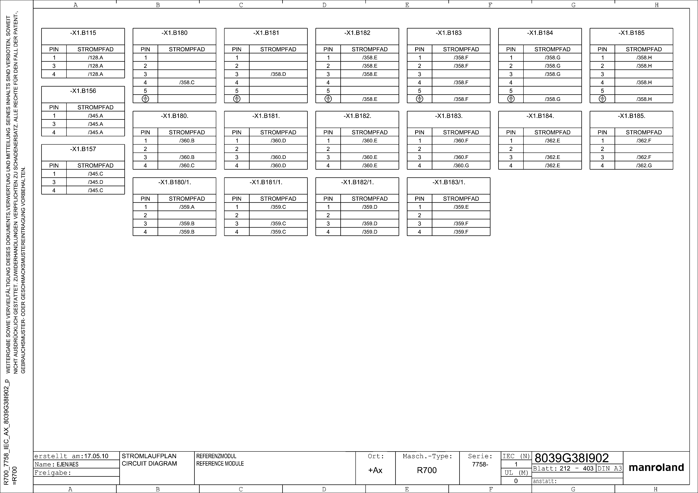

# +Ax — Sheet 212 of 403 — REFERENZMODUL

**REFERENCE MODULE**

> Part of the manroland **R700** printing press IEC/UL circuit diagrams.
> Drawing class: **Stromlaufplan / Circuit diagram** (DIN A3).
> Document `+Ax` covers the **Central control console** machine section.

## At a glance

| Field | Value |
|---|---|
| Document | `+Ax`  (8039G38I902) |
| Sheet | **212** of 403 |
| Section (DE) | REFERENZMODUL |
| Section (EN) | REFERENCE MODULE |
| Section type | REFERENCE_MODULE — Reference module |
| Machine type | `R700` |
| Series | `7758` |
| Created | 17.05.10 |
| Replaces | — |
| Columns used | A, B, C, D, E, F, G, H |
| Path numbers | — |
| Labels on sheet | 193 |
| Cross-refs out | 57 |
| Cross-refs in | 0 |

**Previous:** [+Ax sheet 211](SHEET_0211.md) · **Next:** [+Ax sheet 213](SHEET_0213.md) · **Document TOC:** [_TOC.md](_TOC.md)  (+Ax) · **Master TOC:** [all sheets](../_MASTER_TOC.md)

## Sheet image (300 DPI, exact vector render)



_Rendered directly from the PDF vector layer at 300 DPI (1-bit), no OCR and no resampling. Use it to confirm anything ambiguous in the text below._

## Cross-references on this sheet

Each entry is a wire leaving this sheet. The printed token is `/sheet.column`; the link resolves to that sheet inside the same document.

| Ref | Target sheet | Col | Path | Destination on target | Target section | From col |
|---|---|---|---|---|---|---|
| `/128.A` | [+Ax sheet 128](SHEET_0128.md) | A | — | — | REALTIMERECHNER ANLEGER | A |
| `/358.E` | [+Ax sheet 358](SHEET_0358.md) | E | — | — | OPTION: LOGISTIK ANLEGER | E |
| `/358.F` | [+Ax sheet 358](SHEET_0358.md) | F | — | — | OPTION: LOGISTIK ANLEGER | F |
| `/358.G` | [+Ax sheet 358](SHEET_0358.md) | G | — | — | OPTION: LOGISTIK ANLEGER | G |
| `/358.H` | [+Ax sheet 358](SHEET_0358.md) | H | — | — | OPTION: LOGISTIK ANLEGER | H |
| `/128.A` | [+Ax sheet 128](SHEET_0128.md) | A | — | — | REALTIMERECHNER ANLEGER | A |
| `/358.E` | [+Ax sheet 358](SHEET_0358.md) | E | — | — | OPTION: LOGISTIK ANLEGER | E |
| `/358.F` | [+Ax sheet 358](SHEET_0358.md) | F | — | — | OPTION: LOGISTIK ANLEGER | F |
| `/358.G` | [+Ax sheet 358](SHEET_0358.md) | G | — | — | OPTION: LOGISTIK ANLEGER | G |
| `/358.H` | [+Ax sheet 358](SHEET_0358.md) | H | — | — | OPTION: LOGISTIK ANLEGER | H |
| `/128.A` | [+Ax sheet 128](SHEET_0128.md) | A | — | — | REALTIMERECHNER ANLEGER | A |
| `/358.E` | [+Ax sheet 358](SHEET_0358.md) | E | — | — | OPTION: LOGISTIK ANLEGER | E |
| `/358.G` | [+Ax sheet 358](SHEET_0358.md) | G | — | — | OPTION: LOGISTIK ANLEGER | G |
| `/358.D` | [+Ax sheet 358](SHEET_0358.md) | D | — | — | OPTION: LOGISTIK ANLEGER | C |
| `/358.F` | [+Ax sheet 358](SHEET_0358.md) | F | — | — | OPTION: LOGISTIK ANLEGER | F |
| `/358.C` | [+Ax sheet 358](SHEET_0358.md) | C | — | — | OPTION: LOGISTIK ANLEGER | B |
| `/358.H` | [+Ax sheet 358](SHEET_0358.md) | H | — | — | OPTION: LOGISTIK ANLEGER | H |
| `/358.E` | [+Ax sheet 358](SHEET_0358.md) | E | — | — | OPTION: LOGISTIK ANLEGER | E |
| `/358.F` | [+Ax sheet 358](SHEET_0358.md) | F | — | — | OPTION: LOGISTIK ANLEGER | F |
| `/358.G` | [+Ax sheet 358](SHEET_0358.md) | G | — | — | OPTION: LOGISTIK ANLEGER | G |
| `/358.H` | [+Ax sheet 358](SHEET_0358.md) | H | — | — | OPTION: LOGISTIK ANLEGER | H |
| `/345.A` | [+Ax sheet 345](SHEET_0345.md) | A | — | — | OPTION: INLINESHEETER RS104 S | A |
| `/345.A` | [+Ax sheet 345](SHEET_0345.md) | A | — | — | OPTION: INLINESHEETER RS104 S | A |
| `/345.A` | [+Ax sheet 345](SHEET_0345.md) | A | — | — | OPTION: INLINESHEETER RS104 S | A |
| `/360.B` | [+Ax sheet 360](SHEET_0360.md) | B | — | — | OPTION: LOGISTIK ANLEGER | B |
| `/360.E` | [+Ax sheet 360](SHEET_0360.md) | E | — | — | OPTION: LOGISTIK ANLEGER | E |
| `/362.E` | [+Ax sheet 362](SHEET_0362.md) | E | — | — | OPTION: LOGISTIK ANLEGER | G |
| `/360.F` | [+Ax sheet 360](SHEET_0360.md) | F | — | — | OPTION: LOGISTIK ANLEGER | F |
| `/362.F` | [+Ax sheet 362](SHEET_0362.md) | F | — | — | OPTION: LOGISTIK ANLEGER | H |
| `/360.D` | [+Ax sheet 360](SHEET_0360.md) | D | — | — | OPTION: LOGISTIK ANLEGER | C |
| `/360.B` | [+Ax sheet 360](SHEET_0360.md) | B | — | — | OPTION: LOGISTIK ANLEGER | B |
| `/360.E` | [+Ax sheet 360](SHEET_0360.md) | E | — | — | OPTION: LOGISTIK ANLEGER | E |
| `/362.E` | [+Ax sheet 362](SHEET_0362.md) | E | — | — | OPTION: LOGISTIK ANLEGER | G |
| `/360.F` | [+Ax sheet 360](SHEET_0360.md) | F | — | — | OPTION: LOGISTIK ANLEGER | F |
| `/362.F` | [+Ax sheet 362](SHEET_0362.md) | F | — | — | OPTION: LOGISTIK ANLEGER | H |
| `/360.D` | [+Ax sheet 360](SHEET_0360.md) | D | — | — | OPTION: LOGISTIK ANLEGER | C |
| `/360.E` | [+Ax sheet 360](SHEET_0360.md) | E | — | — | OPTION: LOGISTIK ANLEGER | E |
| `/362.E` | [+Ax sheet 362](SHEET_0362.md) | E | — | — | OPTION: LOGISTIK ANLEGER | G |
| `/360.G` | [+Ax sheet 360](SHEET_0360.md) | G | — | — | OPTION: LOGISTIK ANLEGER | F |
| `/362.G` | [+Ax sheet 362](SHEET_0362.md) | G | — | — | OPTION: LOGISTIK ANLEGER | H |
| `/360.C` | [+Ax sheet 360](SHEET_0360.md) | C | — | — | OPTION: LOGISTIK ANLEGER | B |
| `/360.D` | [+Ax sheet 360](SHEET_0360.md) | D | — | — | OPTION: LOGISTIK ANLEGER | C |
| `/345.C` | [+Ax sheet 345](SHEET_0345.md) | C | — | — | OPTION: INLINESHEETER RS104 S | A |
| `/345.D` | [+Ax sheet 345](SHEET_0345.md) | D | — | — | OPTION: INLINESHEETER RS104 S | A |
| `/345.C` | [+Ax sheet 345](SHEET_0345.md) | C | — | — | OPTION: INLINESHEETER RS104 S | A |
| `/359.A` | [+Ax sheet 359](SHEET_0359.md) | A | — | — | OPTION: LOGISTIK ANLEGER | B |
| `/359.E` | [+Ax sheet 359](SHEET_0359.md) | E | — | — | OPTION: LOGISTIK ANLEGER | F |
| `/359.C` | [+Ax sheet 359](SHEET_0359.md) | C | — | — | OPTION: LOGISTIK ANLEGER | C |
| `/359.D` | [+Ax sheet 359](SHEET_0359.md) | D | — | — | OPTION: LOGISTIK ANLEGER | E |
| `/359.B` | [+Ax sheet 359](SHEET_0359.md) | B | — | — | OPTION: LOGISTIK ANLEGER | B |
| `/359.F` | [+Ax sheet 359](SHEET_0359.md) | F | — | — | OPTION: LOGISTIK ANLEGER | F |
| `/359.C` | [+Ax sheet 359](SHEET_0359.md) | C | — | — | OPTION: LOGISTIK ANLEGER | C |
| `/359.D` | [+Ax sheet 359](SHEET_0359.md) | D | — | — | OPTION: LOGISTIK ANLEGER | E |
| `/359.B` | [+Ax sheet 359](SHEET_0359.md) | B | — | — | OPTION: LOGISTIK ANLEGER | B |
| `/359.F` | [+Ax sheet 359](SHEET_0359.md) | F | — | — | OPTION: LOGISTIK ANLEGER | F |
| `/359.C` | [+Ax sheet 359](SHEET_0359.md) | C | — | — | OPTION: LOGISTIK ANLEGER | C |
| `/359.D` | [+Ax sheet 359](SHEET_0359.md) | D | — | — | OPTION: LOGISTIK ANLEGER | E |

## Devices on this sheet

| Tag | Class | Class meaning (IEC) | Col | Sub | Terminal | Sign |
|---|---|---|---|---|---|---|
| `X1.B115` | — | cross-device reference | A | — | — | — |
| `X1.B156` | — | cross-device reference | A | — | — | — |
| `X1.B157` | — | cross-device reference | A | — | — | — |
| `X1.B180` | — | cross-device reference | B | — | — | — |
| `X1.B180.` | — | cross-device reference | B | — | — | — |
| `X1.B181` | — | cross-device reference | C | — | — | — |
| `X1.B181.` | — | cross-device reference | C | — | — | — |
| `X1.B182` | — | cross-device reference | D | — | — | — |
| `X1.B182.` | — | cross-device reference | D | — | — | — |
| `X1.B183` | — | cross-device reference | F | — | — | — |
| `X1.B183.` | — | cross-device reference | F | — | — | — |
| `X1.B184` | — | cross-device reference | G | — | — | — |
| `X1.B184.` | — | cross-device reference | G | — | — | — |
| `X1.B185` | — | cross-device reference | H | — | — | — |
| `X1.B185.` | — | cross-device reference | H | — | — | — |

## Potentials / nets

_No named potentials on this sheet._

## Wire-end annotations (grouped as printed)

A wire that continues elsewhere is annotated with a small cluster: the destination description, the path/line number `#NN`, and the `/sheet.column` cross reference. Each row below is one such cluster exactly as it is grouped on the drawing.

| Col | Y | Path | Cross-ref | Text on the wire |
|---|---|---|---|---|
| A | 51.3 | — | — | `X1.B115` |
| B | 51.3 | — | — | `X1.B180` |
| C | 51.3 | — | — | `X1.B181` |
| D | 51.3 | — | — | `X1.B182` |
| F | 51.3 | — | — | `X1.B183` |
| G | 51.3 | — | — | `X1.B184` |
| H | 51.3 | — | — | `X1.B185` |
| A | 80.0 | — | — | `PIN 3 4 1 STROMPFAD` |
| B | 80.0 | — | — | `PIN 2 3 4 5 1 STROMPFAD` |
| C | 80.0 | — | — | `PIN 2 3 4 5 1 STROMPFAD` |
| D | 80.0 | — | — | `PIN 2 3 4 5 1 STROMPFAD` |
| E | 80.0 | — | — | `PIN 2 3 4 5 1 STROMPFAD` |
| G | 80.0 | — | — | `PIN 2 3 4 5 1 STROMPFAD` |
| H | 80.0 | — | — | `PIN 2 3 4 5 1 STROMPFAD` |
| A | 94.5 | — | `/128.A` | — |
| E | 94.5 | — | `/358.E` | — |
| F | 94.5 | — | `/358.F` | — |
| G | 94.5 | — | `/358.G` | — |
| H | 94.5 | — | `/358.H` | — |
| A | 108.7 | — | `/128.A` | — |
| E | 108.7 | — | `/358.E` | — |
| F | 108.7 | — | `/358.F` | — |
| G | 108.7 | — | `/358.G` | — |
| H | 108.7 | — | `/358.H` | — |
| A | 122.9 | — | `/128.A` | — |
| C | 122.9 | — | `/358.D` | — |
| E | 122.9 | — | `/358.E` | — |
| G | 122.9 | — | `/358.G` | — |
| F | 137.0 | — | `/358.F` | — |
| B | 137.1 | — | `/358.C` | — |
| H | 137.1 | — | `/358.H` | — |
| A | 150.6 | — | — | `X1.B156` |
| E | 165.4 | — | `/358.E` | — |
| F | 165.4 | — | `/358.F` | — |
| G | 165.4 | — | `/358.G` | — |
| H | 165.4 | — | `/358.H` | — |
| A | 179.2 | — | — | `PIN 3 4 1 STROMPFAD` |
| B | 193.1 | — | — | `X1.B180.` |
| C | 193.1 | — | — | `X1.B181.` |
| D | 193.1 | — | — | `X1.B182.` |
| F | 193.1 | — | — | `X1.B183.` |
| G | 193.1 | — | — | `X1.B184.` |
| H | 193.1 | — | — | `X1.B185.` |
| A | 193.7 | — | `/345.A` | — |
| A | 207.9 | — | `/345.A` | — |
| B | 221.7 | — | — | `PIN 2 3 4 1 STROMPFAD` |
| C | 221.7 | — | — | `PIN 2 3 4 1 STROMPFAD` |
| D | 221.7 | — | — | `PIN 2 3 4 1 STROMPFAD` |
| E | 221.7 | — | — | `PIN 2 3 4 1 STROMPFAD` |
| G | 221.7 | — | — | `PIN 2 3 4 1 STROMPFAD` |
| H | 221.7 | — | — | `PIN 2 3 4 1 STROMPFAD` |
| A | 222.1 | — | `/345.A` | — |
| B | 236.2 | — | `/360.B` | — |
| E | 236.2 | — | `/360.E` | — |
| G | 236.2 | — | `/362.E` | — |
| C | 236.3 | — | `/360.D` | — |
| F | 236.3 | — | `/360.F` | — |
| H | 236.3 | — | `/362.F` | — |
| A | 249.8 | — | — | `X1.B157` |
| B | 264.6 | — | `/360.B` | — |
| C | 264.6 | — | `/360.D` | — |
| E | 264.6 | — | `/360.E` | — |
| F | 264.6 | — | `/360.F` | — |
| G | 264.6 | — | `/362.E` | — |
| H | 264.6 | — | `/362.F` | — |
| A | 278.4 | — | — | `PIN 3 4 1 STROMPFAD` |
| B | 278.8 | — | `/360.C` | — |
| C | 278.8 | — | `/360.D` | — |
| E | 278.8 | — | `/360.E` | — |
| F | 278.8 | — | `/360.G` | — |
| G | 278.8 | — | `/362.E` | — |
| H | 278.8 | — | `/362.G` | — |
| A | 293.0 | — | `/345.C` | — |
| B | 306.5 | — | — | `X1.B180/1.` |
| C | 306.5 | — | — | `X1.B181/1.` |
| D | 306.5 | — | — | `X1.B182/1.` |
| F | 306.5 | — | — | `X1.B183/1.` |
| A | 307.1 | — | `/345.D` | — |
| A | 321.3 | — | `/345.C` | — |
| B | 335.1 | — | — | `PIN 2 3 4 1 STROMPFAD` |
| C | 335.1 | — | — | `PIN 2 3 4 1 STROMPFAD` |
| D | 335.1 | — | — | `PIN 2 3 4 1 STROMPFAD` |
| E | 335.1 | — | — | `PIN 2 3 4 1 STROMPFAD` |
| B | 349.6 | — | `/359.A` | — |
| F | 349.6 | — | `/359.E` | — |
| C | 349.7 | — | `/359.C` | — |
| E | 349.7 | — | `/359.D` | — |
| B | 378.0 | — | `/359.B` | — |
| C | 378.0 | — | `/359.C` | — |
| E | 378.0 | — | `/359.D` | — |
| F | 378.0 | — | `/359.F` | — |
| B | 392.1 | — | `/359.B` | — |
| C | 392.2 | — | `/359.C` | — |
| E | 392.2 | — | `/359.D` | — |
| F | 392.2 | — | `/359.F` | — |


## Reconstructed tables

This sheet carries tabular content (pin map / terminal assignment / index). The grid below was rebuilt from the drawing's own rule lines, so each row is exactly one physical row of the table.

### Table 1 — 13 data rows × 2 columns (at x=70.9, y=48.2) — **X1.B115**

| PIN | STROMPFAD |
|---|---|
| `1` | `/128.A` |
| `3` | `/128.A` |
| `4` | `/128.A` |
|  | `X1.B156` |
| `PIN` | `STROMPFAD` |
| `1` | `/345.A` |
| `3` | `/345.A` |
| `4` | `/345.A` |
|  | `X1.B157` |
| `PIN` | `STROMPFAD` |
| `1` | `/345.C` |
| `3` | `/345.D` |
| `4` | `/345.C` |


### Table 2 — 17 data rows × 2 columns (at x=226.8, y=48.2) — **X1.B180**

| PIN | STROMPFAD |
|---|---|
| `1` |  |
| `2` |  |
| `3` |  |
| `4` | `/358.C` |
| `5` |  |
|  | `X1.B180.` |
| `PIN` | `STROMPFAD` |
| `1` | `/360.B` |
| `2` |  |
| `3` | `/360.B` |
| `4` | `/360.C` |
|  | `X1.B180/1.` |
| `PIN` | `STROMPFAD` |
| `1` | `/359.A` |
| `2` |  |
| `3` | `/359.B` |
| `4` | `/359.B` |


### Table 3 — 17 data rows × 2 columns (at x=382.7, y=48.2) — **X1.B181**

| PIN | STROMPFAD |
|---|---|
| `1` |  |
| `2` |  |
| `3` | `/358.D` |
| `4` |  |
| `5` |  |
|  | `X1.B181.` |
| `PIN` | `STROMPFAD` |
| `1` | `/360.D` |
| `2` |  |
| `3` | `/360.D` |
| `4` | `/360.D` |
|  | `X1.B181/1.` |
| `PIN` | `STROMPFAD` |
| `1` | `/359.C` |
| `2` |  |
| `3` | `/359.C` |
| `4` | `/359.C` |


### Table 4 — 18 data rows × 2 columns (at x=538.6, y=48.2) — **X1.B182**

| PIN | STROMPFAD |
|---|---|
| `1` | `/358.E` |
| `2` | `/358.E` |
| `3` | `/358.E` |
| `4` |  |
| `5` |  |
|  | `/358.E` |
|  | `X1.B182.` |
| `PIN` | `STROMPFAD` |
| `1` | `/360.E` |
| `2` |  |
| `3` | `/360.E` |
| `4` | `/360.E` |
|  | `X1.B182/1.` |
| `PIN` | `STROMPFAD` |
| `1` | `/359.D` |
| `2` |  |
| `3` | `/359.D` |
| `4` | `/359.D` |


### Table 5 — 18 data rows × 2 columns (at x=694.5, y=48.2) — **X1.B183**

| PIN | STROMPFAD |
|---|---|
| `1` | `/358.F` |
| `2` | `/358.F` |
| `3` |  |
| `4` | `/358.F` |
| `5` |  |
|  | `/358.F` |
|  | `X1.B183.` |
| `PIN` | `STROMPFAD` |
| `1` | `/360.F` |
| `2` |  |
| `3` | `/360.F` |
| `4` | `/360.G` |
|  | `X1.B183/1.` |
| `PIN` | `STROMPFAD` |
| `1` | `/359.E` |
| `2` |  |
| `3` | `/359.F` |
| `4` | `/359.F` |


### Table 6 — 12 data rows × 2 columns (at x=850.4, y=48.2) — **X1.B184**

| PIN | STROMPFAD |
|---|---|
| `1` | `/358.G` |
| `2` | `/358.G` |
| `3` | `/358.G` |
| `4` |  |
| `5` |  |
|  | `/358.G` |
|  | `X1.B184.` |
| `PIN` | `STROMPFAD` |
| `1` | `/362.E` |
| `2` |  |
| `3` | `/362.E` |
| `4` | `/362.E` |


### Table 7 — 12 data rows × 2 columns (at x=1006.3, y=48.2) — **X1.B185**

| PIN | STROMPFAD |
|---|---|
| `1` | `/358.H` |
| `2` | `/358.H` |
| `3` |  |
| `4` | `/358.H` |
| `5` |  |
|  | `/358.H` |
|  | `X1.B185.` |
| `PIN` | `STROMPFAD` |
| `1` | `/362.F` |
| `2` |  |
| `3` | `/362.F` |
| `4` | `/362.G` |


## Notes and free text on this sheet

| Text | Col | Y (pt) |
|---|---|---|
| `PIN` | A | 80.02 |
| `STROMPFAD` | A | 79.98 |
| `PIN` | B | 80.02 |
| `STROMPFAD` | B | 79.98 |
| `X1.B180/1.` | B | 306.46 |
| `PIN` | C | 80.02 |
| `STROMPFAD` | C | 79.98 |
| `X1.B181/1.` | C | 306.46 |
| `PIN` | D | 80.02 |
| `STROMPFAD` | E | 79.98 |
| `X1.B182/1.` | D | 306.46 |
| `PIN` | E | 80.02 |
| `STROMPFAD` | F | 79.98 |
| `X1.B183/1.` | F | 306.46 |
| `PIN` | F | 80.02 |
| `STROMPFAD` | G | 79.98 |
| `PIN` | G | 80.02 |
| `STROMPFAD` | H | 79.98 |

## Complete label inventory (exact text from the drawing)

Every text object inside the drawing area of this sheet, in DIN reading order (column A→H, then top→bottom). This is the authoritative list: if a string is not here it is not printed on this sheet.

| Col | Y | X | Dir | Type | Text |
|---|---|---|---|---|---|
| A | 51.3 | 119.8 | → | device ref | `X1.B115` |
| A | 80.0 | 84.0 | → | text | `PIN` |
| A | 80.0 | 132.2 | → | text | `STROMPFAD` |
| A | 94.2 | 90.0 | → | number | `1` |
| A | 94.5 | 150.2 | → | cross-reference | `/128.A` |
| A | 108.4 | 89.4 | → | number | `3` |
| A | 108.7 | 150.2 | → | cross-reference | `/128.A` |
| A | 122.5 | 89.4 | → | number | `4` |
| A | 122.9 | 150.2 | → | cross-reference | `/128.A` |
| A | 150.5 | 119.8 | → | device ref | `X1.B156` |
| A | 179.2 | 84.0 | → | text | `PIN` |
| A | 179.2 | 132.2 | → | text | `STROMPFAD` |
| A | 193.4 | 90.0 | → | number | `1` |
| A | 193.7 | 150.2 | → | cross-reference | `/345.A` |
| A | 207.6 | 89.4 | → | number | `3` |
| A | 207.9 | 150.2 | → | cross-reference | `/345.A` |
| A | 221.8 | 89.4 | → | number | `4` |
| A | 222.1 | 150.2 | → | cross-reference | `/345.A` |
| A | 249.8 | 119.8 | → | device ref | `X1.B157` |
| A | 278.4 | 84.0 | → | text | `PIN` |
| A | 278.4 | 132.2 | → | text | `STROMPFAD` |
| A | 292.6 | 90.0 | → | number | `1` |
| A | 293.0 | 150.2 | → | cross-reference | `/345.C` |
| A | 306.8 | 89.4 | → | number | `3` |
| A | 307.1 | 150.2 | → | cross-reference | `/345.D` |
| A | 321.0 | 89.4 | → | number | `4` |
| A | 321.3 | 150.2 | → | cross-reference | `/345.C` |
| B | 51.3 | 275.7 | → | device ref | `X1.B180` |
| B | 80.0 | 240.0 | → | text | `PIN` |
| B | 80.0 | 288.1 | → | text | `STROMPFAD` |
| B | 94.2 | 245.9 | → | number | `1` |
| B | 108.4 | 245.3 | → | number | `2` |
| B | 122.5 | 245.3 | → | number | `3` |
| B | 136.7 | 245.3 | → | number | `4` |
| B | 137.1 | 306.1 | → | cross-reference | `/358.C` |
| B | 150.9 | 245.3 | → | number | `5` |
| B | 193.1 | 274.5 | → | device ref | `X1.B180.` |
| B | 221.7 | 288.1 | → | text | `STROMPFAD` |
| B | 221.8 | 240.0 | → | text | `PIN` |
| B | 235.9 | 245.9 | → | number | `1` |
| B | 236.2 | 306.3 | → | cross-reference | `/360.B` |
| B | 250.1 | 245.3 | → | number | `2` |
| B | 264.3 | 245.3 | → | number | `3` |
| B | 264.6 | 306.3 | → | cross-reference | `/360.B` |
| B | 278.5 | 245.3 | → | number | `4` |
| B | 278.8 | 306.1 | → | cross-reference | `/360.C` |
| B | 306.5 | 270.1 | → | text | `X1.B180/1.` |
| B | 335.1 | 240.0 | → | text | `PIN` |
| B | 335.1 | 288.1 | → | text | `STROMPFAD` |
| B | 349.3 | 245.9 | → | number | `1` |
| B | 349.6 | 306.1 | → | cross-reference | `/359.A` |
| B | 363.5 | 245.3 | → | number | `2` |
| B | 377.7 | 245.3 | → | number | `3` |
| B | 378.0 | 306.3 | → | cross-reference | `/359.B` |
| B | 391.8 | 245.3 | → | number | `4` |
| B | 392.2 | 306.3 | → | cross-reference | `/359.B` |
| C | 51.3 | 432.3 | → | device ref | `X1.B181` |
| C | 80.0 | 395.9 | → | text | `PIN` |
| C | 80.0 | 444.0 | → | text | `STROMPFAD` |
| C | 94.2 | 401.8 | → | number | `1` |
| C | 108.4 | 401.2 | → | number | `2` |
| C | 122.5 | 401.2 | → | number | `3` |
| C | 122.9 | 462.0 | → | cross-reference | `/358.D` |
| C | 136.7 | 401.2 | → | number | `4` |
| C | 150.9 | 401.2 | → | number | `5` |
| C | 193.1 | 430.4 | → | device ref | `X1.B181.` |
| C | 221.7 | 444.0 | → | text | `STROMPFAD` |
| C | 221.8 | 395.9 | → | text | `PIN` |
| C | 235.9 | 401.8 | → | number | `1` |
| C | 236.3 | 462.0 | → | cross-reference | `/360.D` |
| C | 250.1 | 401.2 | → | number | `2` |
| C | 264.3 | 401.2 | → | number | `3` |
| C | 264.6 | 462.0 | → | cross-reference | `/360.D` |
| C | 278.5 | 401.2 | → | number | `4` |
| C | 278.8 | 462.0 | → | cross-reference | `/360.D` |
| C | 306.5 | 426.0 | → | text | `X1.B181/1.` |
| C | 335.1 | 395.9 | → | text | `PIN` |
| C | 335.1 | 444.0 | → | text | `STROMPFAD` |
| C | 349.3 | 401.8 | → | number | `1` |
| C | 349.7 | 462.0 | → | cross-reference | `/359.C` |
| C | 363.5 | 401.2 | → | number | `2` |
| C | 377.7 | 401.2 | → | number | `3` |
| C | 378.0 | 462.0 | → | cross-reference | `/359.C` |
| C | 391.8 | 401.2 | → | number | `4` |
| C | 392.2 | 462.0 | → | cross-reference | `/359.C` |
| D | 51.3 | 587.5 | → | device ref | `X1.B182` |
| D | 80.0 | 551.8 | → | text | `PIN` |
| D | 94.2 | 557.7 | → | number | `1` |
| D | 108.4 | 557.1 | → | number | `2` |
| D | 122.5 | 557.1 | → | number | `3` |
| D | 136.7 | 557.1 | → | number | `4` |
| D | 150.9 | 557.1 | → | number | `5` |
| D | 193.1 | 586.3 | → | device ref | `X1.B182.` |
| D | 221.8 | 551.8 | → | text | `PIN` |
| D | 235.9 | 557.7 | → | number | `1` |
| D | 250.1 | 557.1 | → | number | `2` |
| D | 264.3 | 557.1 | → | number | `3` |
| D | 278.5 | 557.1 | → | number | `4` |
| D | 306.5 | 582.0 | → | text | `X1.B182/1.` |
| D | 335.1 | 551.8 | → | text | `PIN` |
| D | 349.3 | 557.7 | → | number | `1` |
| D | 363.5 | 557.1 | → | number | `2` |
| D | 377.7 | 557.1 | → | number | `3` |
| D | 391.8 | 557.1 | → | number | `4` |
| E | 80.0 | 600.0 | → | text | `STROMPFAD` |
| E | 80.0 | 707.7 | → | text | `PIN` |
| E | 94.2 | 713.6 | → | number | `1` |
| E | 94.5 | 618.2 | → | cross-reference | `/358.E` |
| E | 108.4 | 713.1 | → | number | `2` |
| E | 108.7 | 618.2 | → | cross-reference | `/358.E` |
| E | 122.5 | 713.1 | → | number | `3` |
| E | 122.9 | 618.2 | → | cross-reference | `/358.E` |
| E | 136.7 | 713.1 | → | number | `4` |
| E | 150.9 | 713.1 | → | number | `5` |
| E | 165.4 | 618.2 | → | cross-reference | `/358.E` |
| E | 221.7 | 600.0 | → | text | `STROMPFAD` |
| E | 221.8 | 707.7 | → | text | `PIN` |
| E | 235.9 | 713.6 | → | number | `1` |
| E | 236.2 | 618.2 | → | cross-reference | `/360.E` |
| E | 250.1 | 713.1 | → | number | `2` |
| E | 264.3 | 713.1 | → | number | `3` |
| E | 264.6 | 618.2 | → | cross-reference | `/360.E` |
| E | 278.5 | 713.1 | → | number | `4` |
| E | 278.8 | 618.2 | → | cross-reference | `/360.E` |
| E | 335.1 | 600.0 | → | text | `STROMPFAD` |
| E | 335.1 | 707.7 | → | text | `PIN` |
| E | 349.3 | 713.6 | → | number | `1` |
| E | 349.7 | 618.0 | → | cross-reference | `/359.D` |
| E | 363.5 | 713.1 | → | number | `2` |
| E | 377.7 | 713.1 | → | number | `3` |
| E | 378.0 | 618.0 | → | cross-reference | `/359.D` |
| E | 391.8 | 713.1 | → | number | `4` |
| E | 392.2 | 618.0 | → | cross-reference | `/359.D` |
| F | 51.3 | 743.4 | → | device ref | `X1.B183` |
| F | 80.0 | 755.9 | → | text | `STROMPFAD` |
| F | 80.0 | 863.6 | → | text | `PIN` |
| F | 94.2 | 869.5 | → | number | `1` |
| F | 94.5 | 774.3 | → | cross-reference | `/358.F` |
| F | 108.4 | 869.0 | → | number | `2` |
| F | 108.7 | 774.3 | → | cross-reference | `/358.F` |
| F | 122.5 | 869.0 | → | number | `3` |
| F | 136.7 | 869.0 | → | number | `4` |
| F | 137.0 | 774.3 | → | cross-reference | `/358.F` |
| F | 150.9 | 869.0 | → | number | `5` |
| F | 165.4 | 774.3 | → | cross-reference | `/358.F` |
| F | 193.1 | 742.3 | → | device ref | `X1.B183.` |
| F | 221.7 | 755.9 | → | text | `STROMPFAD` |
| F | 221.8 | 863.6 | → | text | `PIN` |
| F | 235.9 | 869.5 | → | number | `1` |
| F | 236.3 | 774.3 | → | cross-reference | `/360.F` |
| F | 250.1 | 869.0 | → | number | `2` |
| F | 264.3 | 869.0 | → | number | `3` |
| F | 264.6 | 774.3 | → | cross-reference | `/360.F` |
| F | 278.5 | 869.0 | → | number | `4` |
| F | 278.8 | 773.7 | → | cross-reference | `/360.G` |
| F | 306.5 | 737.9 | → | text | `X1.B183/1.` |
| F | 335.1 | 755.9 | → | text | `STROMPFAD` |
| F | 349.6 | 774.1 | → | cross-reference | `/359.E` |
| F | 378.0 | 774.3 | → | cross-reference | `/359.F` |
| F | 392.2 | 774.3 | → | cross-reference | `/359.F` |
| G | 51.3 | 899.3 | → | device ref | `X1.B184` |
| G | 80.0 | 911.8 | → | text | `STROMPFAD` |
| G | 80.0 | 1019.5 | → | text | `PIN` |
| G | 94.2 | 1025.4 | → | number | `1` |
| G | 94.5 | 929.6 | → | cross-reference | `/358.G` |
| G | 108.4 | 1024.9 | → | number | `2` |
| G | 108.7 | 929.6 | → | cross-reference | `/358.G` |
| G | 122.5 | 1024.9 | → | number | `3` |
| G | 122.9 | 929.6 | → | cross-reference | `/358.G` |
| G | 136.7 | 1024.9 | → | number | `4` |
| G | 150.9 | 1024.9 | → | number | `5` |
| G | 165.4 | 929.6 | → | cross-reference | `/358.G` |
| G | 193.1 | 898.2 | → | device ref | `X1.B184.` |
| G | 221.7 | 911.8 | → | text | `STROMPFAD` |
| G | 221.8 | 1019.5 | → | text | `PIN` |
| G | 235.9 | 1025.4 | → | number | `1` |
| G | 236.2 | 930.0 | → | cross-reference | `/362.E` |
| G | 250.1 | 1024.9 | → | number | `2` |
| G | 264.3 | 1024.9 | → | number | `3` |
| G | 264.6 | 930.0 | → | cross-reference | `/362.E` |
| G | 278.5 | 1024.9 | → | number | `4` |
| G | 278.8 | 930.0 | → | cross-reference | `/362.E` |
| H | 51.3 | 1055.2 | → | device ref | `X1.B185` |
| H | 80.0 | 1067.7 | → | text | `STROMPFAD` |
| H | 94.5 | 1086.0 | → | cross-reference | `/358.H` |
| H | 108.7 | 1086.0 | → | cross-reference | `/358.H` |
| H | 137.1 | 1086.0 | → | cross-reference | `/358.H` |
| H | 165.4 | 1086.0 | → | cross-reference | `/358.H` |
| H | 193.1 | 1054.1 | → | device ref | `X1.B185.` |
| H | 221.7 | 1067.7 | → | text | `STROMPFAD` |
| H | 236.3 | 1086.1 | → | cross-reference | `/362.F` |
| H | 264.6 | 1086.1 | → | cross-reference | `/362.F` |
| H | 278.8 | 1085.5 | → | cross-reference | `/362.G` |

## Reading-order text block

The same content as a plain block, grouped by DIN column — convenient to paste or to match against a visual description.

```text
=== Column A ===
  51.3  119.8  devref       X1.B115
  80.0   84.0  text         PIN
  80.0  132.2  text         STROMPFAD
  94.2   90.0  numeric      1
  94.5  150.2  xref         /128.A
 108.4   89.4  numeric      3
 108.7  150.2  xref         /128.A
 122.5   89.4  numeric      4
 122.9  150.2  xref         /128.A
 150.5  119.8  devref       X1.B156
 179.2   84.0  text         PIN
 179.2  132.2  text         STROMPFAD
 193.4   90.0  numeric      1
 193.7  150.2  xref         /345.A
 207.6   89.4  numeric      3
 207.9  150.2  xref         /345.A
 221.8   89.4  numeric      4
 222.1  150.2  xref         /345.A
 249.8  119.8  devref       X1.B157
 278.4   84.0  text         PIN
 278.4  132.2  text         STROMPFAD
 292.6   90.0  numeric      1
 293.0  150.2  xref         /345.C
 306.8   89.4  numeric      3
 307.1  150.2  xref         /345.D
 321.0   89.4  numeric      4
 321.3  150.2  xref         /345.C
=== Column B ===
  51.3  275.7  devref       X1.B180
  80.0  240.0  text         PIN
  80.0  288.1  text         STROMPFAD
  94.2  245.9  numeric      1
 108.4  245.3  numeric      2
 122.5  245.3  numeric      3
 136.7  245.3  numeric      4
 137.1  306.1  xref         /358.C
 150.9  245.3  numeric      5
 193.1  274.5  devref       X1.B180.
 221.7  288.1  text         STROMPFAD
 221.8  240.0  text         PIN
 235.9  245.9  numeric      1
 236.2  306.3  xref         /360.B
 250.1  245.3  numeric      2
 264.3  245.3  numeric      3
 264.6  306.3  xref         /360.B
 278.5  245.3  numeric      4
 278.8  306.1  xref         /360.C
 306.5  270.1  text         X1.B180/1.
 335.1  240.0  text         PIN
 335.1  288.1  text         STROMPFAD
 349.3  245.9  numeric      1
 349.6  306.1  xref         /359.A
 363.5  245.3  numeric      2
 377.7  245.3  numeric      3
 378.0  306.3  xref         /359.B
 391.8  245.3  numeric      4
 392.2  306.3  xref         /359.B
=== Column C ===
  51.3  432.3  devref       X1.B181
  80.0  395.9  text         PIN
  80.0  444.0  text         STROMPFAD
  94.2  401.8  numeric      1
 108.4  401.2  numeric      2
 122.5  401.2  numeric      3
 122.9  462.0  xref         /358.D
 136.7  401.2  numeric      4
 150.9  401.2  numeric      5
 193.1  430.4  devref       X1.B181.
 221.7  444.0  text         STROMPFAD
 221.8  395.9  text         PIN
 235.9  401.8  numeric      1
 236.3  462.0  xref         /360.D
 250.1  401.2  numeric      2
 264.3  401.2  numeric      3
 264.6  462.0  xref         /360.D
 278.5  401.2  numeric      4
 278.8  462.0  xref         /360.D
 306.5  426.0  text         X1.B181/1.
 335.1  395.9  text         PIN
 335.1  444.0  text         STROMPFAD
 349.3  401.8  numeric      1
 349.7  462.0  xref         /359.C
 363.5  401.2  numeric      2
 377.7  401.2  numeric      3
 378.0  462.0  xref         /359.C
 391.8  401.2  numeric      4
 392.2  462.0  xref         /359.C
=== Column D ===
  51.3  587.5  devref       X1.B182
  80.0  551.8  text         PIN
  94.2  557.7  numeric      1
 108.4  557.1  numeric      2
 122.5  557.1  numeric      3
 136.7  557.1  numeric      4
 150.9  557.1  numeric      5
 193.1  586.3  devref       X1.B182.
 221.8  551.8  text         PIN
 235.9  557.7  numeric      1
 250.1  557.1  numeric      2
 264.3  557.1  numeric      3
 278.5  557.1  numeric      4
 306.5  582.0  text         X1.B182/1.
 335.1  551.8  text         PIN
 349.3  557.7  numeric      1
 363.5  557.1  numeric      2
 377.7  557.1  numeric      3
 391.8  557.1  numeric      4
=== Column E ===
  80.0  600.0  text         STROMPFAD
  80.0  707.7  text         PIN
  94.2  713.6  numeric      1
  94.5  618.2  xref         /358.E
 108.4  713.1  numeric      2
 108.7  618.2  xref         /358.E
 122.5  713.1  numeric      3
 122.9  618.2  xref         /358.E
 136.7  713.1  numeric      4
 150.9  713.1  numeric      5
 165.4  618.2  xref         /358.E
 221.7  600.0  text         STROMPFAD
 221.8  707.7  text         PIN
 235.9  713.6  numeric      1
 236.2  618.2  xref         /360.E
 250.1  713.1  numeric      2
 264.3  713.1  numeric      3
 264.6  618.2  xref         /360.E
 278.5  713.1  numeric      4
 278.8  618.2  xref         /360.E
 335.1  600.0  text         STROMPFAD
 335.1  707.7  text         PIN
 349.3  713.6  numeric      1
 349.7  618.0  xref         /359.D
 363.5  713.1  numeric      2
 377.7  713.1  numeric      3
 378.0  618.0  xref         /359.D
 391.8  713.1  numeric      4
 392.2  618.0  xref         /359.D
=== Column F ===
  51.3  743.4  devref       X1.B183
  80.0  755.9  text         STROMPFAD
  80.0  863.6  text         PIN
  94.2  869.5  numeric      1
  94.5  774.3  xref         /358.F
 108.4  869.0  numeric      2
 108.7  774.3  xref         /358.F
 122.5  869.0  numeric      3
 136.7  869.0  numeric      4
 137.0  774.3  xref         /358.F
 150.9  869.0  numeric      5
 165.4  774.3  xref         /358.F
 193.1  742.3  devref       X1.B183.
 221.7  755.9  text         STROMPFAD
 221.8  863.6  text         PIN
 235.9  869.5  numeric      1
 236.3  774.3  xref         /360.F
 250.1  869.0  numeric      2
 264.3  869.0  numeric      3
 264.6  774.3  xref         /360.F
 278.5  869.0  numeric      4
 278.8  773.7  xref         /360.G
 306.5  737.9  text         X1.B183/1.
 335.1  755.9  text         STROMPFAD
 349.6  774.1  xref         /359.E
 378.0  774.3  xref         /359.F
 392.2  774.3  xref         /359.F
=== Column G ===
  51.3  899.3  devref       X1.B184
  80.0  911.8  text         STROMPFAD
  80.0 1019.5  text         PIN
  94.2 1025.4  numeric      1
  94.5  929.6  xref         /358.G
 108.4 1024.9  numeric      2
 108.7  929.6  xref         /358.G
 122.5 1024.9  numeric      3
 122.9  929.6  xref         /358.G
 136.7 1024.9  numeric      4
 150.9 1024.9  numeric      5
 165.4  929.6  xref         /358.G
 193.1  898.2  devref       X1.B184.
 221.7  911.8  text         STROMPFAD
 221.8 1019.5  text         PIN
 235.9 1025.4  numeric      1
 236.2  930.0  xref         /362.E
 250.1 1024.9  numeric      2
 264.3 1024.9  numeric      3
 264.6  930.0  xref         /362.E
 278.5 1024.9  numeric      4
 278.8  930.0  xref         /362.E
=== Column H ===
  51.3 1055.2  devref       X1.B185
  80.0 1067.7  text         STROMPFAD
  94.5 1086.0  xref         /358.H
 108.7 1086.0  xref         /358.H
 137.1 1086.0  xref         /358.H
 165.4 1086.0  xref         /358.H
 193.1 1054.1  devref       X1.B185.
 221.7 1067.7  text         STROMPFAD
 236.3 1086.1  xref         /362.F
 264.6 1086.1  xref         /362.F
 278.8 1085.5  xref         /362.G
```

---
_Generated from the PDF vector text layer; no OCR. Source: `R700_7758_IEC_AX_8039G38I902_p`, sheet 212._
