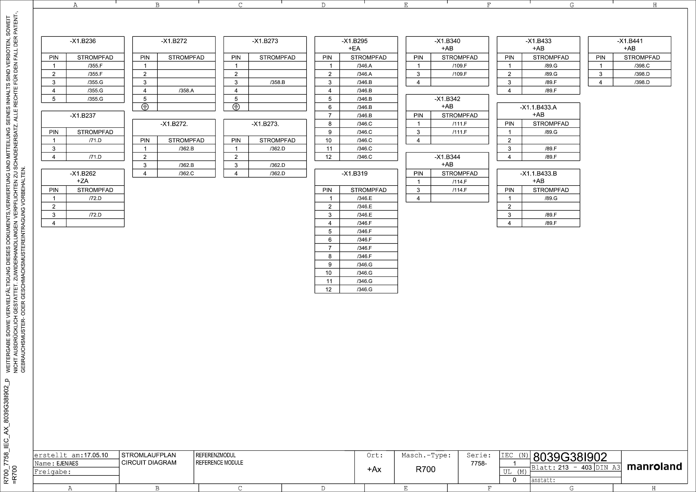

# +Ax — Sheet 213 of 403 — REFERENZMODUL

**REFERENCE MODULE**

> Part of the manroland **R700** printing press IEC/UL circuit diagrams.
> Drawing class: **Stromlaufplan / Circuit diagram** (DIN A3).
> Document `+Ax` covers the **Central control console** machine section.

## At a glance

| Field | Value |
|---|---|
| Document | `+Ax`  (8039G38I902) |
| Sheet | **213** of 403 |
| Section (DE) | REFERENZMODUL |
| Section (EN) | REFERENCE MODULE |
| Section type | REFERENCE_MODULE — Reference module |
| Machine type | `R700` |
| Series | `7758` |
| Created | 17.05.10 |
| Replaces | — |
| Columns used | A, B, C, D, E, F, G, H |
| Path numbers | — |
| Labels on sheet | 195 |
| Cross-refs out | 60 |
| Cross-refs in | 0 |

**Previous:** [+Ax sheet 212](SHEET_0212.md) · **Next:** [+Ax sheet 214](SHEET_0214.md) · **Document TOC:** [_TOC.md](_TOC.md)  (+Ax) · **Master TOC:** [all sheets](../_MASTER_TOC.md)

## Sheet image (300 DPI, exact vector render)



_Rendered directly from the PDF vector layer at 300 DPI (1-bit), no OCR and no resampling. Use it to confirm anything ambiguous in the text below._

## Cross-references on this sheet

Each entry is a wire leaving this sheet. The printed token is `/sheet.column`; the link resolves to that sheet inside the same document.

| Ref | Target sheet | Col | Path | Destination on target | Target section | From col |
|---|---|---|---|---|---|---|
| `/346.A` | [+Ax sheet 346](SHEET_0346.md) | A | — | — | OPTION: INLINESHEETER RS104 S | D |
| `/355.F` | [+Ax sheet 355](SHEET_0355.md) | F | — | — | OPTION: LOGISTIK ANLEGER | A |
| `/109.F` | [+Ax sheet 109](SHEET_0109.md) | F | — | — | SAUGKOPF, FORMATEINSTELLUNG / | F |
| `/89.G` | [+Ax sheet 89](SHEET_0089.md) | G | — | — | ANLEGER | G |
| `/398.C` | [+Ax sheet 398](SHEET_0398.md) | C | — | — | OPTION: BOGENSTOPPEINRICHTUNG | H |
| `/346.A` | [+Ax sheet 346](SHEET_0346.md) | A | — | — | OPTION: INLINESHEETER RS104 S | D |
| `/355.F` | [+Ax sheet 355](SHEET_0355.md) | F | — | — | OPTION: LOGISTIK ANLEGER | A |
| `/109.F` | [+Ax sheet 109](SHEET_0109.md) | F | — | — | SAUGKOPF, FORMATEINSTELLUNG / | F |
| `/89.G` | [+Ax sheet 89](SHEET_0089.md) | G | — | — | ANLEGER | G |
| `/398.D` | [+Ax sheet 398](SHEET_0398.md) | D | — | — | OPTION: BOGENSTOPPEINRICHTUNG | H |
| `/89.F` | [+Ax sheet 89](SHEET_0089.md) | F | — | — | ANLEGER | G |
| `/358.B` | [+Ax sheet 358](SHEET_0358.md) | B | — | — | OPTION: LOGISTIK ANLEGER | C |
| `/346.B` | [+Ax sheet 346](SHEET_0346.md) | B | — | — | OPTION: INLINESHEETER RS104 S | E |
| `/355.G` | [+Ax sheet 355](SHEET_0355.md) | G | — | — | OPTION: LOGISTIK ANLEGER | A |
| `/398.D` | [+Ax sheet 398](SHEET_0398.md) | D | — | — | OPTION: BOGENSTOPPEINRICHTUNG | H |
| `/358.A` | [+Ax sheet 358](SHEET_0358.md) | A | — | — | OPTION: LOGISTIK ANLEGER | B |
| `/346.B` | [+Ax sheet 346](SHEET_0346.md) | B | — | — | OPTION: INLINESHEETER RS104 S | E |
| `/89.F` | [+Ax sheet 89](SHEET_0089.md) | F | — | — | ANLEGER | G |
| `/355.G` | [+Ax sheet 355](SHEET_0355.md) | G | — | — | OPTION: LOGISTIK ANLEGER | A |
| `/346.B` | [+Ax sheet 346](SHEET_0346.md) | B | — | — | OPTION: INLINESHEETER RS104 S | E |
| `/355.G` | [+Ax sheet 355](SHEET_0355.md) | G | — | — | OPTION: LOGISTIK ANLEGER | A |
| `/346.B` | [+Ax sheet 346](SHEET_0346.md) | B | — | — | OPTION: INLINESHEETER RS104 S | E |
| `/346.B` | [+Ax sheet 346](SHEET_0346.md) | B | — | — | OPTION: INLINESHEETER RS104 S | E |
| `/111.F` | [+Ax sheet 111](SHEET_0111.md) | F | — | — | ANLEGEREINSATZPUNKTEINSTELLUNG | F |
| `/346.C` | [+Ax sheet 346](SHEET_0346.md) | C | — | — | OPTION: INLINESHEETER RS104 S | E |
| `/111.F` | [+Ax sheet 111](SHEET_0111.md) | F | — | — | ANLEGEREINSATZPUNKTEINSTELLUNG | F |
| `/89.G` | [+Ax sheet 89](SHEET_0089.md) | G | — | — | ANLEGER | G |
| `/346.C` | [+Ax sheet 346](SHEET_0346.md) | C | — | — | OPTION: INLINESHEETER RS104 S | E |
| `/71.D` | [+Ax sheet 71](SHEET_0071.md) | D | — | — | WASCHVORRICHTUNGEN DRUCKWERKE | A |
| `/346.C` | [+Ax sheet 346](SHEET_0346.md) | C | — | — | OPTION: INLINESHEETER RS104 S | E |
| `/362.B` | [+Ax sheet 362](SHEET_0362.md) | B | — | — | OPTION: LOGISTIK ANLEGER | B |
| `/89.F` | [+Ax sheet 89](SHEET_0089.md) | F | — | — | ANLEGER | G |
| `/362.D` | [+Ax sheet 362](SHEET_0362.md) | D | — | — | OPTION: LOGISTIK ANLEGER | C |
| `/346.C` | [+Ax sheet 346](SHEET_0346.md) | C | — | — | OPTION: INLINESHEETER RS104 S | E |
| `/89.F` | [+Ax sheet 89](SHEET_0089.md) | F | — | — | ANLEGER | G |
| `/71.D` | [+Ax sheet 71](SHEET_0071.md) | D | — | — | WASCHVORRICHTUNGEN DRUCKWERKE | A |
| `/346.C` | [+Ax sheet 346](SHEET_0346.md) | C | — | — | OPTION: INLINESHEETER RS104 S | E |
| `/362.B` | [+Ax sheet 362](SHEET_0362.md) | B | — | — | OPTION: LOGISTIK ANLEGER | B |
| `/362.D` | [+Ax sheet 362](SHEET_0362.md) | D | — | — | OPTION: LOGISTIK ANLEGER | C |
| `/362.C` | [+Ax sheet 362](SHEET_0362.md) | C | — | — | OPTION: LOGISTIK ANLEGER | B |
| `/362.D` | [+Ax sheet 362](SHEET_0362.md) | D | — | — | OPTION: LOGISTIK ANLEGER | C |
| `/114.F` | [+Ax sheet 114](SHEET_0114.md) | F | — | — | STAPELTRAGPLATTENEINSTELLUNG | F |
| `/114.F` | [+Ax sheet 114](SHEET_0114.md) | F | — | — | STAPELTRAGPLATTENEINSTELLUNG | F |
| `/346.E` | [+Ax sheet 346](SHEET_0346.md) | E | — | — | OPTION: INLINESHEETER RS104 S | E |
| `/89.G` | [+Ax sheet 89](SHEET_0089.md) | G | — | — | ANLEGER | G |
| `/72.D` | [+Ax sheet 72](SHEET_0072.md) | D | — | — | WASCHVORRICHTUNGEN DRUCKWERKE | A |
| `/346.E` | [+Ax sheet 346](SHEET_0346.md) | E | — | — | OPTION: INLINESHEETER RS104 S | E |
| `/89.F` | [+Ax sheet 89](SHEET_0089.md) | F | — | — | ANLEGER | G |
| `/346.E` | [+Ax sheet 346](SHEET_0346.md) | E | — | — | OPTION: INLINESHEETER RS104 S | E |
| `/72.D` | [+Ax sheet 72](SHEET_0072.md) | D | — | — | WASCHVORRICHTUNGEN DRUCKWERKE | A |
| `/89.F` | [+Ax sheet 89](SHEET_0089.md) | F | — | — | ANLEGER | G |
| `/346.F` | [+Ax sheet 346](SHEET_0346.md) | F | — | — | OPTION: INLINESHEETER RS104 S | E |
| `/346.F` | [+Ax sheet 346](SHEET_0346.md) | F | — | — | OPTION: INLINESHEETER RS104 S | E |
| `/346.F` | [+Ax sheet 346](SHEET_0346.md) | F | — | — | OPTION: INLINESHEETER RS104 S | E |
| `/346.F` | [+Ax sheet 346](SHEET_0346.md) | F | — | — | OPTION: INLINESHEETER RS104 S | E |
| `/346.F` | [+Ax sheet 346](SHEET_0346.md) | F | — | — | OPTION: INLINESHEETER RS104 S | E |
| `/346.G` | [+Ax sheet 346](SHEET_0346.md) | G | — | — | OPTION: INLINESHEETER RS104 S | E |
| `/346.G` | [+Ax sheet 346](SHEET_0346.md) | G | — | — | OPTION: INLINESHEETER RS104 S | E |
| `/346.G` | [+Ax sheet 346](SHEET_0346.md) | G | — | — | OPTION: INLINESHEETER RS104 S | E |
| `/346.G` | [+Ax sheet 346](SHEET_0346.md) | G | — | — | OPTION: INLINESHEETER RS104 S | E |

## Devices on this sheet

| Tag | Class | Class meaning (IEC) | Col | Sub | Terminal | Sign |
|---|---|---|---|---|---|---|
| `X1.B236` | — | cross-device reference | A | — | — | — |
| `X1.B237` | — | cross-device reference | A | — | — | — |
| `X1.B262` | — | cross-device reference | A | — | — | — |
| `X1.B272` | — | cross-device reference | B | — | — | — |
| `X1.B272.` | — | cross-device reference | B | — | — | — |
| `X1.B273` | — | cross-device reference | C | — | — | — |
| `X1.B273.` | — | cross-device reference | C | — | — | — |
| `X1.B295` | — | cross-device reference | D | — | — | — |
| `X1.B319` | — | cross-device reference | D | — | — | — |
| `X1.B340` | — | cross-device reference | F | — | — | — |
| `X1.B342` | — | cross-device reference | F | — | — | — |
| `X1.B344` | — | cross-device reference | F | — | — | — |
| `X1.B441` | — | cross-device reference | H | — | — | — |
| `X1.B433` | — | cross-device reference | G | — | — | — |
| `X1.1.B433.A` | — | cross-device reference | G | — | — | — |
| `X1.1.B433.B` | — | cross-device reference | G | — | — | — |

## Potentials / nets

_No named potentials on this sheet._

## Wire-end annotations (grouped as printed)

A wire that continues elsewhere is annotated with a small cluster: the destination description, the path/line number `#NN`, and the `/sheet.column` cross reference. Each row below is one such cluster exactly as it is grouped on the drawing.

| Col | Y | Path | Cross-ref | Text on the wire |
|---|---|---|---|---|
| A | 65.5 | — | — | `X1.B236` |
| B | 65.5 | — | — | `X1.B272` |
| C | 65.5 | — | — | `X1.B273` |
| D | 65.5 | — | — | `X1.B295` |
| F | 65.5 | — | — | `X1.B340` |
| G | 65.5 | — | — | `X1.B433` |
| H | 65.5 | — | — | `X1.B441` |
| D | 78.2 | — | — | `+EA` |
| F | 78.2 | — | — | `+AB` |
| G | 78.2 | — | — | `+AB` |
| H | 78.2 | — | — | `+AB` |
| A | 94.2 | — | — | `PIN 2 3 4 5 1 STROMPFAD` |
| B | 94.2 | — | — | `PIN 2 3 4 5 1 STROMPFAD` |
| C | 94.2 | — | — | `PIN 2 3 4 5 1 STROMPFAD` |
| D | 94.2 | — | — | `PIN 10 12 11 2 3 4 5 6 7 8 9 1 STROMPFAD` |
| E | 94.2 | — | — | `PIN 3 4 1 STROMPFAD` |
| G | 94.2 | — | — | `PIN 2 3 4 1 STROMPFAD` |
| H | 94.2 | — | — | `PIN 3 4 1 STROMPFAD` |
| A | 108.7 | — | `/355.F` | — |
| D | 108.7 | — | `/346.A` | — |
| F | 108.7 | — | `/109.F` | — |
| G | 108.7 | — | `/89.G` | — |
| H | 108.7 | — | `/398.C` | — |
| A | 122.9 | — | `/355.F` | — |
| D | 122.9 | — | `/346.A` | — |
| F | 122.9 | — | `/109.F` | — |
| G | 122.9 | — | `/89.G` | — |
| H | 122.9 | — | `/398.D` | — |
| C | 137.0 | — | `/358.B` | — |
| E | 137.0 | — | `/346.B` | — |
| G | 137.0 | — | `/89.F` | — |
| A | 137.1 | — | `/355.G` | — |
| H | 137.1 | — | `/398.D` | — |
| A | 151.2 | — | `/355.G` | — |
| B | 151.2 | — | `/358.A` | — |
| E | 151.2 | — | `/346.B` | — |
| G | 151.2 | — | `/89.F` | — |
| F | 164.7 | — | — | `X1.B342` |
| A | 165.4 | — | `/355.G` | — |
| E | 165.4 | — | `/346.B` | — |
| F | 177.4 | — | — | `+AB` |
| G | 178.9 | — | — | `X1.1.B433.A` |
| E | 179.6 | — | `/346.B` | — |
| G | 191.6 | — | — | `+AB` |
| A | 193.1 | — | — | `X1.B237` |
| E | 193.4 | — | — | `PIN 3 4 1 STROMPFAD` |
| E | 193.7 | — | `/346.B` | — |
| B | 207.2 | — | — | `X1.B272.` |
| C | 207.2 | — | — | `X1.B273.` |
| G | 207.5 | — | — | `PIN 2 3 4 1 STROMPFAD` |
| E | 207.9 | — | `/346.C` | — |
| F | 207.9 | — | `/111.F` | — |
| A | 221.7 | — | — | `PIN 3 4 1 STROMPFAD` |
| E | 222.1 | — | `/346.C` | — |
| F | 222.1 | — | `/111.F` | — |
| G | 222.1 | — | `/89.G` | — |
| B | 235.9 | — | — | `PIN 2 3 4 1 STROMPFAD` |
| C | 235.9 | — | — | `PIN 2 3 4 1 STROMPFAD` |
| A | 236.3 | — | `/71.D` | — |
| E | 236.3 | — | `/346.C` | — |
| B | 250.4 | — | `/362.B` | — |
| C | 250.4 | — | `/362.D` | — |
| E | 250.4 | — | `/346.C` | — |
| G | 250.4 | — | `/89.F` | — |
| F | 263.9 | — | — | `X1.B344` |
| A | 264.6 | — | `/71.D` | — |
| E | 264.6 | — | `/346.C` | — |
| G | 264.6 | — | `/89.F` | — |
| F | 276.6 | — | — | `+AB` |
| B | 278.8 | — | `/362.B` | — |
| C | 278.8 | — | `/362.D` | — |
| A | 292.3 | — | — | `X1.B262` |
| D | 292.3 | — | — | `X1.B319` |
| G | 292.3 | — | — | `X1.1.B433.B` |
| E | 292.6 | — | — | `PIN 3 4 1 STROMPFAD` |
| B | 293.0 | — | `/362.C` | — |
| C | 293.0 | — | `/362.D` | — |
| A | 304.9 | — | — | `+ZA` |
| G | 304.9 | — | — | `+AB` |
| F | 307.1 | — | `/114.F` | — |
| A | 320.9 | — | — | `PIN 2 3 4 1 STROMPFAD` |
| D | 320.9 | — | — | `PIN 10 12 11 2 3 4 5 6 7 8 9 1 STROMPFAD` |
| G | 320.9 | — | — | `PIN 2 3 4 1 STROMPFAD` |
| F | 321.3 | — | `/114.F` | — |
| A | 335.5 | — | `/72.D` | — |
| E | 335.5 | — | `/346.E` | — |
| G | 335.5 | — | `/89.G` | — |
| E | 349.6 | — | `/346.E` | — |
| A | 363.8 | — | `/72.D` | — |
| E | 363.8 | — | `/346.E` | — |
| G | 363.8 | — | `/89.F` | — |
| E | 378.0 | — | `/346.F` | — |
| G | 378.0 | — | `/89.F` | — |
| E | 392.2 | — | `/346.F` | — |
| E | 406.3 | — | `/346.F` | — |
| E | 420.5 | — | `/346.F` | — |
| E | 434.7 | — | `/346.F` | — |
| E | 448.9 | — | `/346.G` | — |
| E | 463.0 | — | `/346.G` | — |
| E | 477.2 | — | `/346.G` | — |
| E | 491.4 | — | `/346.G` | — |


## Reconstructed tables

This sheet carries tabular content (pin map / terminal assignment / index). The grid below was rebuilt from the drawing's own rule lines, so each row is exactly one physical row of the table.

### Table 1 — 17 data rows × 2 columns (at x=70.9, y=62.4) — **X1.B236**

| PIN | STROMPFAD |
|---|---|
| `1` | `/355.F` |
| `2` | `/355.F` |
| `3` | `/355.G` |
| `4` | `/355.G` |
| `5` | `/355.G` |
|  | `X1.B237` |
| `PIN` | `STROMPFAD` |
| `1` | `/71.D` |
| `3` |  |
| `4` | `/71.D` |
|  | `X1.B262` |
|  | `+ZA` |
| `PIN` | `STROMPFAD` |
| `1` | `/72.D` |
| `2` |  |
| `3` | `/72.D` |
| `4` |  |


### Table 2 — 11 data rows × 2 columns (at x=226.8, y=62.4) — **X1.B272**

| PIN | STROMPFAD |
|---|---|
| `1` |  |
| `2` |  |
| `3` |  |
| `4` | `/358.A` |
| `5` |  |
|  | `X1.B272.` |
| `PIN` | `STROMPFAD` |
| `1` | `/362.B` |
| `2` |  |
| `3` | `/362.B` |
| `4` | `/362.C` |


### Table 3 — 11 data rows × 2 columns (at x=382.7, y=62.4) — **X1.B273**

| PIN | STROMPFAD |
|---|---|
| `1` |  |
| `2` |  |
| `3` | `/358.B` |
| `4` |  |
| `5` |  |
|  | `X1.B273.` |
| `PIN` | `STROMPFAD` |
| `1` | `/362.D` |
| `2` |  |
| `3` | `/362.D` |
| `4` | `/362.D` |


### Table 4 — 26 data rows × 2 columns (at x=538.6, y=62.4) — **X1.B295 +EA**

| PIN | STROMPFAD |
|---|---|
| `1` | `/346.A` |
| `2` | `/346.A` |
| `3` | `/346.B` |
| `4` | `/346.B` |
| `5` | `/346.B` |
| `6` | `/346.B` |
| `7` | `/346.B` |
| `8` | `/346.C` |
| `9` | `/346.C` |
| `10` | `/346.C` |
| `11` | `/346.C` |
| `12` | `/346.C` |
|  | `X1.B319` |
| `PIN` | `STROMPFAD` |
| `1` | `/346.E` |
| `2` | `/346.E` |
| `3` | `/346.E` |
| `4` | `/346.F` |
| `5` | `/346.F` |
| `6` | `/346.F` |
| `7` | `/346.F` |
| `8` | `/346.F` |
| `9` | `/346.G` |
| `10` | `/346.G` |
| `11` | `/346.G` |
| `12` | `/346.G` |


### Table 5 — 15 data rows × 2 columns (at x=694.5, y=62.4) — **X1.B340 +AB**

| PIN | STROMPFAD |
|---|---|
| `1` | `/109.F` |
| `3` | `/109.F` |
| `4` |  |
|  | `X1.B342` |
|  | `+AB` |
| `PIN` | `STROMPFAD` |
| `1` | `/111.F` |
| `3` | `/111.F` |
| `4` |  |
|  | `X1.B344` |
|  | `+AB` |
| `PIN` | `STROMPFAD` |
| `1` | `/114.F` |
| `3` | `/114.F` |
| `4` |  |


### Table 6 — 18 data rows × 2 columns (at x=850.4, y=62.4) — **X1.B433 +AB**

| PIN | STROMPFAD |
|---|---|
| `1` | `/89.G` |
| `2` | `/89.G` |
| `3` | `/89.F` |
| `4` | `/89.F` |
|  | `X1.1.B433.A` |
|  | `+AB` |
| `PIN` | `STROMPFAD` |
| `1` | `/89.G` |
| `2` |  |
| `3` | `/89.F` |
| `4` | `/89.F` |
|  | `X1.1.B433.B` |
|  | `+AB` |
| `PIN` | `STROMPFAD` |
| `1` | `/89.G` |
| `2` |  |
| `3` | `/89.F` |
| `4` | `/89.F` |


### Table 7 — 3 data rows × 2 columns (at x=1006.3, y=62.4) — **X1.B441 +AB**

| PIN | STROMPFAD |
|---|---|
| `1` | `/398.C` |
| `3` | `/398.D` |
| `4` | `/398.D` |


## Notes and free text on this sheet

| Text | Col | Y (pt) |
|---|---|---|
| `PIN` | A | 94.2 |
| `STROMPFAD` | A | 94.15 |
| `+ZA` | A | 304.95 |
| `PIN` | B | 94.2 |
| `STROMPFAD` | B | 94.15 |
| `PIN` | C | 94.2 |
| `STROMPFAD` | C | 94.15 |
| `PIN` | D | 94.2 |
| `STROMPFAD` | E | 94.15 |
| `+EA` | D | 78.18 |
| `PIN` | E | 94.2 |
| `STROMPFAD` | F | 94.15 |
| `+AB` | F | 78.18 |
| `PIN` | G | 94.2 |
| `STROMPFAD` | H | 94.15 |
| `+AB` | H | 78.18 |
| `PIN` | F | 94.2 |
| `STROMPFAD` | G | 94.15 |
| `+AB` | G | 78.18 |

## Complete label inventory (exact text from the drawing)

Every text object inside the drawing area of this sheet, in DIN reading order (column A→H, then top→bottom). This is the authoritative list: if a string is not here it is not printed on this sheet.

| Col | Y | X | Dir | Type | Text |
|---|---|---|---|---|---|
| A | 65.5 | 119.8 | → | device ref | `X1.B236` |
| A | 94.2 | 84.0 | → | text | `PIN` |
| A | 94.2 | 132.2 | → | text | `STROMPFAD` |
| A | 108.4 | 90.0 | → | number | `1` |
| A | 108.7 | 150.7 | → | cross-reference | `/355.F` |
| A | 122.5 | 89.4 | → | number | `2` |
| A | 122.9 | 150.7 | → | cross-reference | `/355.F` |
| A | 136.7 | 89.4 | → | number | `3` |
| A | 137.1 | 150.1 | → | cross-reference | `/355.G` |
| A | 150.9 | 89.4 | → | number | `4` |
| A | 151.2 | 150.1 | → | cross-reference | `/355.G` |
| A | 165.1 | 89.4 | → | number | `5` |
| A | 165.4 | 150.1 | → | cross-reference | `/355.G` |
| A | 193.1 | 119.8 | → | device ref | `X1.B237` |
| A | 221.7 | 132.2 | → | text | `STROMPFAD` |
| A | 221.8 | 84.0 | → | text | `PIN` |
| A | 235.9 | 90.0 | → | number | `1` |
| A | 236.3 | 152.6 | → | cross-reference | `/71.D` |
| A | 250.1 | 89.4 | → | number | `3` |
| A | 264.3 | 89.4 | → | number | `4` |
| A | 264.6 | 152.6 | → | cross-reference | `/71.D` |
| A | 292.3 | 119.8 | → | device ref | `X1.B262` |
| A | 304.9 | 131.4 | → | text | `+ZA` |
| A | 320.9 | 132.2 | → | text | `STROMPFAD` |
| A | 321.0 | 84.0 | → | text | `PIN` |
| A | 335.1 | 90.0 | → | number | `1` |
| A | 335.5 | 152.6 | → | cross-reference | `/72.D` |
| A | 349.3 | 89.4 | → | number | `2` |
| A | 363.5 | 89.4 | → | number | `3` |
| A | 363.8 | 152.6 | → | cross-reference | `/72.D` |
| A | 377.7 | 89.4 | → | number | `4` |
| B | 65.5 | 275.7 | → | device ref | `X1.B272` |
| B | 94.2 | 240.0 | → | text | `PIN` |
| B | 94.2 | 288.1 | → | text | `STROMPFAD` |
| B | 108.4 | 245.9 | → | number | `1` |
| B | 122.5 | 245.3 | → | number | `2` |
| B | 136.7 | 245.3 | → | number | `3` |
| B | 150.9 | 245.3 | → | number | `4` |
| B | 151.2 | 306.1 | → | cross-reference | `/358.A` |
| B | 165.1 | 245.3 | → | number | `5` |
| B | 207.2 | 274.5 | → | device ref | `X1.B272.` |
| B | 235.9 | 240.0 | → | text | `PIN` |
| B | 235.9 | 288.1 | → | text | `STROMPFAD` |
| B | 250.1 | 245.9 | → | number | `1` |
| B | 250.4 | 306.3 | → | cross-reference | `/362.B` |
| B | 264.3 | 245.3 | → | number | `2` |
| B | 278.5 | 245.3 | → | number | `3` |
| B | 278.8 | 306.3 | → | cross-reference | `/362.B` |
| B | 292.6 | 245.3 | → | number | `4` |
| B | 293.0 | 306.1 | → | cross-reference | `/362.C` |
| C | 65.5 | 431.6 | → | device ref | `X1.B273` |
| C | 94.2 | 395.9 | → | text | `PIN` |
| C | 94.2 | 444.0 | → | text | `STROMPFAD` |
| C | 108.4 | 401.8 | → | number | `1` |
| C | 122.5 | 401.2 | → | number | `2` |
| C | 136.7 | 401.2 | → | number | `3` |
| C | 137.0 | 462.2 | → | cross-reference | `/358.B` |
| C | 150.9 | 401.2 | → | number | `4` |
| C | 165.1 | 401.2 | → | number | `5` |
| C | 207.2 | 430.4 | → | device ref | `X1.B273.` |
| C | 235.9 | 395.9 | → | text | `PIN` |
| C | 235.9 | 444.0 | → | text | `STROMPFAD` |
| C | 250.1 | 401.8 | → | number | `1` |
| C | 250.4 | 462.0 | → | cross-reference | `/362.D` |
| C | 264.3 | 401.2 | → | number | `2` |
| C | 278.5 | 401.2 | → | number | `3` |
| C | 278.8 | 462.0 | → | cross-reference | `/362.D` |
| C | 292.6 | 401.2 | → | number | `4` |
| C | 293.0 | 462.0 | → | cross-reference | `/362.D` |
| D | 65.5 | 584.6 | → | device ref | `X1.B295` |
| D | 78.2 | 596.0 | → | text | `+EA` |
| D | 94.2 | 551.8 | → | text | `PIN` |
| D | 108.4 | 563.5 | → | number | `1` |
| D | 108.7 | 610.9 | → | cross-reference | `/346.A` |
| D | 122.5 | 561.8 | → | number | `2` |
| D | 122.9 | 610.9 | → | cross-reference | `/346.A` |
| D | 136.7 | 561.8 | → | number | `3` |
| D | 150.9 | 561.8 | → | number | `4` |
| D | 165.1 | 561.8 | → | number | `5` |
| D | 179.2 | 561.8 | → | number | `6` |
| D | 193.4 | 561.8 | → | number | `7` |
| D | 207.6 | 561.8 | → | number | `8` |
| D | 221.8 | 561.8 | → | number | `9` |
| D | 235.9 | 556.4 | → | number | `10` |
| D | 250.1 | 558.1 | → | number | `11` |
| D | 264.3 | 556.4 | → | number | `12` |
| D | 292.3 | 584.6 | → | device ref | `X1.B319` |
| D | 321.0 | 551.8 | → | text | `PIN` |
| D | 335.1 | 563.5 | → | number | `1` |
| D | 349.3 | 561.8 | → | number | `2` |
| D | 363.5 | 561.8 | → | number | `3` |
| D | 377.7 | 561.8 | → | number | `4` |
| D | 391.8 | 561.8 | → | number | `5` |
| D | 406.0 | 561.8 | → | number | `6` |
| D | 420.2 | 561.8 | → | number | `7` |
| D | 434.4 | 561.8 | → | number | `8` |
| D | 448.5 | 561.8 | → | number | `9` |
| D | 462.7 | 556.4 | → | number | `10` |
| D | 476.9 | 558.1 | → | number | `11` |
| D | 491.0 | 556.4 | → | number | `12` |
| E | 94.2 | 600.0 | → | text | `STROMPFAD` |
| E | 94.2 | 707.7 | → | text | `PIN` |
| E | 108.4 | 713.6 | → | number | `1` |
| E | 122.5 | 713.1 | → | number | `3` |
| E | 136.7 | 713.1 | → | number | `4` |
| E | 137.0 | 611.0 | → | cross-reference | `/346.B` |
| E | 151.2 | 611.0 | → | cross-reference | `/346.B` |
| E | 165.4 | 611.0 | → | cross-reference | `/346.B` |
| E | 179.6 | 611.0 | → | cross-reference | `/346.B` |
| E | 193.4 | 707.7 | → | text | `PIN` |
| E | 193.7 | 611.0 | → | cross-reference | `/346.B` |
| E | 207.6 | 713.6 | → | number | `1` |
| E | 207.9 | 610.9 | → | cross-reference | `/346.C` |
| E | 221.8 | 713.1 | → | number | `3` |
| E | 222.1 | 610.9 | → | cross-reference | `/346.C` |
| E | 235.9 | 713.1 | → | number | `4` |
| E | 236.3 | 610.9 | → | cross-reference | `/346.C` |
| E | 250.4 | 610.9 | → | cross-reference | `/346.C` |
| E | 264.6 | 610.9 | → | cross-reference | `/346.C` |
| E | 292.6 | 707.7 | → | text | `PIN` |
| E | 306.8 | 713.6 | → | number | `1` |
| E | 320.9 | 600.0 | → | text | `STROMPFAD` |
| E | 321.0 | 713.1 | → | number | `3` |
| E | 335.1 | 713.1 | → | number | `4` |
| E | 335.5 | 611.1 | → | cross-reference | `/346.E` |
| E | 349.6 | 611.1 | → | cross-reference | `/346.E` |
| E | 363.8 | 611.1 | → | cross-reference | `/346.E` |
| E | 378.0 | 611.3 | → | cross-reference | `/346.F` |
| E | 392.2 | 611.3 | → | cross-reference | `/346.F` |
| E | 406.3 | 611.3 | → | cross-reference | `/346.F` |
| E | 420.5 | 611.3 | → | cross-reference | `/346.F` |
| E | 434.7 | 611.3 | → | cross-reference | `/346.F` |
| E | 448.9 | 610.7 | → | cross-reference | `/346.G` |
| E | 463.0 | 610.7 | → | cross-reference | `/346.G` |
| E | 477.2 | 610.7 | → | cross-reference | `/346.G` |
| E | 491.4 | 610.7 | → | cross-reference | `/346.G` |
| F | 65.5 | 743.4 | → | device ref | `X1.B340` |
| F | 78.2 | 755.1 | → | text | `+AB` |
| F | 94.2 | 755.9 | → | text | `STROMPFAD` |
| F | 94.2 | 863.6 | → | text | `PIN` |
| F | 108.4 | 869.5 | → | number | `1` |
| F | 108.7 | 774.3 | → | cross-reference | `/109.F` |
| F | 122.5 | 869.0 | → | number | `2` |
| F | 122.9 | 774.3 | → | cross-reference | `/109.F` |
| F | 136.7 | 869.0 | → | number | `3` |
| F | 150.9 | 869.0 | → | number | `4` |
| F | 164.7 | 743.4 | → | device ref | `X1.B342` |
| F | 177.4 | 755.1 | → | text | `+AB` |
| F | 193.4 | 755.9 | → | text | `STROMPFAD` |
| F | 207.6 | 863.6 | → | text | `PIN` |
| F | 207.9 | 774.3 | → | cross-reference | `/111.F` |
| F | 221.8 | 869.5 | → | number | `1` |
| F | 222.1 | 774.3 | → | cross-reference | `/111.F` |
| F | 235.9 | 869.0 | → | number | `2` |
| F | 250.1 | 869.0 | → | number | `3` |
| F | 263.9 | 743.4 | → | device ref | `X1.B344` |
| F | 264.3 | 869.0 | → | number | `4` |
| F | 276.6 | 755.1 | → | text | `+AB` |
| F | 292.6 | 755.9 | → | text | `STROMPFAD` |
| F | 307.1 | 774.3 | → | cross-reference | `/114.F` |
| F | 321.0 | 863.6 | → | text | `PIN` |
| F | 321.3 | 774.3 | → | cross-reference | `/114.F` |
| F | 335.1 | 869.5 | → | number | `1` |
| F | 349.3 | 869.0 | → | number | `2` |
| F | 363.5 | 869.0 | → | number | `3` |
| F | 377.7 | 869.0 | → | number | `4` |
| G | 65.5 | 899.3 | → | device ref | `X1.B433` |
| G | 78.2 | 911.1 | → | text | `+AB` |
| G | 94.2 | 911.8 | → | text | `STROMPFAD` |
| G | 94.2 | 1019.5 | → | text | `PIN` |
| G | 108.4 | 1025.4 | → | number | `1` |
| G | 108.7 | 932.0 | → | cross-reference | `/89.G` |
| G | 122.5 | 1024.9 | → | number | `3` |
| G | 122.9 | 932.0 | → | cross-reference | `/89.G` |
| G | 136.7 | 1024.9 | → | number | `4` |
| G | 137.0 | 932.6 | → | cross-reference | `/89.F` |
| G | 151.2 | 932.6 | → | cross-reference | `/89.F` |
| G | 178.9 | 889.5 | → | device ref | `X1.1.B433.A` |
| G | 191.6 | 911.1 | → | text | `+AB` |
| G | 207.5 | 911.8 | → | text | `STROMPFAD` |
| G | 222.1 | 932.0 | → | cross-reference | `/89.G` |
| G | 250.4 | 932.6 | → | cross-reference | `/89.F` |
| G | 264.6 | 932.6 | → | cross-reference | `/89.F` |
| G | 292.3 | 889.9 | → | device ref | `X1.1.B433.B` |
| G | 305.0 | 911.1 | → | text | `+AB` |
| G | 320.9 | 911.8 | → | text | `STROMPFAD` |
| G | 335.5 | 932.0 | → | cross-reference | `/89.G` |
| G | 363.8 | 932.6 | → | cross-reference | `/89.F` |
| G | 378.0 | 932.6 | → | cross-reference | `/89.F` |
| H | 65.5 | 1055.9 | → | device ref | `X1.B441` |
| H | 78.2 | 1067.0 | → | text | `+AB` |
| H | 94.2 | 1067.7 | → | text | `STROMPFAD` |
| H | 108.7 | 1085.7 | → | cross-reference | `/398.C` |
| H | 122.9 | 1085.7 | → | cross-reference | `/398.D` |
| H | 137.1 | 1085.7 | → | cross-reference | `/398.D` |

## Reading-order text block

The same content as a plain block, grouped by DIN column — convenient to paste or to match against a visual description.

```text
=== Column A ===
  65.5  119.8  devref       X1.B236
  94.2   84.0  text         PIN
  94.2  132.2  text         STROMPFAD
 108.4   90.0  numeric      1
 108.7  150.7  xref         /355.F
 122.5   89.4  numeric      2
 122.9  150.7  xref         /355.F
 136.7   89.4  numeric      3
 137.1  150.1  xref         /355.G
 150.9   89.4  numeric      4
 151.2  150.1  xref         /355.G
 165.1   89.4  numeric      5
 165.4  150.1  xref         /355.G
 193.1  119.8  devref       X1.B237
 221.7  132.2  text         STROMPFAD
 221.8   84.0  text         PIN
 235.9   90.0  numeric      1
 236.3  152.6  xref         /71.D
 250.1   89.4  numeric      3
 264.3   89.4  numeric      4
 264.6  152.6  xref         /71.D
 292.3  119.8  devref       X1.B262
 304.9  131.4  text         +ZA
 320.9  132.2  text         STROMPFAD
 321.0   84.0  text         PIN
 335.1   90.0  numeric      1
 335.5  152.6  xref         /72.D
 349.3   89.4  numeric      2
 363.5   89.4  numeric      3
 363.8  152.6  xref         /72.D
 377.7   89.4  numeric      4
=== Column B ===
  65.5  275.7  devref       X1.B272
  94.2  240.0  text         PIN
  94.2  288.1  text         STROMPFAD
 108.4  245.9  numeric      1
 122.5  245.3  numeric      2
 136.7  245.3  numeric      3
 150.9  245.3  numeric      4
 151.2  306.1  xref         /358.A
 165.1  245.3  numeric      5
 207.2  274.5  devref       X1.B272.
 235.9  240.0  text         PIN
 235.9  288.1  text         STROMPFAD
 250.1  245.9  numeric      1
 250.4  306.3  xref         /362.B
 264.3  245.3  numeric      2
 278.5  245.3  numeric      3
 278.8  306.3  xref         /362.B
 292.6  245.3  numeric      4
 293.0  306.1  xref         /362.C
=== Column C ===
  65.5  431.6  devref       X1.B273
  94.2  395.9  text         PIN
  94.2  444.0  text         STROMPFAD
 108.4  401.8  numeric      1
 122.5  401.2  numeric      2
 136.7  401.2  numeric      3
 137.0  462.2  xref         /358.B
 150.9  401.2  numeric      4
 165.1  401.2  numeric      5
 207.2  430.4  devref       X1.B273.
 235.9  395.9  text         PIN
 235.9  444.0  text         STROMPFAD
 250.1  401.8  numeric      1
 250.4  462.0  xref         /362.D
 264.3  401.2  numeric      2
 278.5  401.2  numeric      3
 278.8  462.0  xref         /362.D
 292.6  401.2  numeric      4
 293.0  462.0  xref         /362.D
=== Column D ===
  65.5  584.6  devref       X1.B295
  78.2  596.0  text         +EA
  94.2  551.8  text         PIN
 108.4  563.5  numeric      1
 108.7  610.9  xref         /346.A
 122.5  561.8  numeric      2
 122.9  610.9  xref         /346.A
 136.7  561.8  numeric      3
 150.9  561.8  numeric      4
 165.1  561.8  numeric      5
 179.2  561.8  numeric      6
 193.4  561.8  numeric      7
 207.6  561.8  numeric      8
 221.8  561.8  numeric      9
 235.9  556.4  numeric      10
 250.1  558.1  numeric      11
 264.3  556.4  numeric      12
 292.3  584.6  devref       X1.B319
 321.0  551.8  text         PIN
 335.1  563.5  numeric      1
 349.3  561.8  numeric      2
 363.5  561.8  numeric      3
 377.7  561.8  numeric      4
 391.8  561.8  numeric      5
 406.0  561.8  numeric      6
 420.2  561.8  numeric      7
 434.4  561.8  numeric      8
 448.5  561.8  numeric      9
 462.7  556.4  numeric      10
 476.9  558.1  numeric      11
 491.0  556.4  numeric      12
=== Column E ===
  94.2  600.0  text         STROMPFAD
  94.2  707.7  text         PIN
 108.4  713.6  numeric      1
 122.5  713.1  numeric      3
 136.7  713.1  numeric      4
 137.0  611.0  xref         /346.B
 151.2  611.0  xref         /346.B
 165.4  611.0  xref         /346.B
 179.6  611.0  xref         /346.B
 193.4  707.7  text         PIN
 193.7  611.0  xref         /346.B
 207.6  713.6  numeric      1
 207.9  610.9  xref         /346.C
 221.8  713.1  numeric      3
 222.1  610.9  xref         /346.C
 235.9  713.1  numeric      4
 236.3  610.9  xref         /346.C
 250.4  610.9  xref         /346.C
 264.6  610.9  xref         /346.C
 292.6  707.7  text         PIN
 306.8  713.6  numeric      1
 320.9  600.0  text         STROMPFAD
 321.0  713.1  numeric      3
 335.1  713.1  numeric      4
 335.5  611.1  xref         /346.E
 349.6  611.1  xref         /346.E
 363.8  611.1  xref         /346.E
 378.0  611.3  xref         /346.F
 392.2  611.3  xref         /346.F
 406.3  611.3  xref         /346.F
 420.5  611.3  xref         /346.F
 434.7  611.3  xref         /346.F
 448.9  610.7  xref         /346.G
 463.0  610.7  xref         /346.G
 477.2  610.7  xref         /346.G
 491.4  610.7  xref         /346.G
=== Column F ===
  65.5  743.4  devref       X1.B340
  78.2  755.1  text         +AB
  94.2  755.9  text         STROMPFAD
  94.2  863.6  text         PIN
 108.4  869.5  numeric      1
 108.7  774.3  xref         /109.F
 122.5  869.0  numeric      2
 122.9  774.3  xref         /109.F
 136.7  869.0  numeric      3
 150.9  869.0  numeric      4
 164.7  743.4  devref       X1.B342
 177.4  755.1  text         +AB
 193.4  755.9  text         STROMPFAD
 207.6  863.6  text         PIN
 207.9  774.3  xref         /111.F
 221.8  869.5  numeric      1
 222.1  774.3  xref         /111.F
 235.9  869.0  numeric      2
 250.1  869.0  numeric      3
 263.9  743.4  devref       X1.B344
 264.3  869.0  numeric      4
 276.6  755.1  text         +AB
 292.6  755.9  text         STROMPFAD
 307.1  774.3  xref         /114.F
 321.0  863.6  text         PIN
 321.3  774.3  xref         /114.F
 335.1  869.5  numeric      1
 349.3  869.0  numeric      2
 363.5  869.0  numeric      3
 377.7  869.0  numeric      4
=== Column G ===
  65.5  899.3  devref       X1.B433
  78.2  911.1  text         +AB
  94.2  911.8  text         STROMPFAD
  94.2 1019.5  text         PIN
 108.4 1025.4  numeric      1
 108.7  932.0  xref         /89.G
 122.5 1024.9  numeric      3
 122.9  932.0  xref         /89.G
 136.7 1024.9  numeric      4
 137.0  932.6  xref         /89.F
 151.2  932.6  xref         /89.F
 178.9  889.5  devref       X1.1.B433.A
 191.6  911.1  text         +AB
 207.5  911.8  text         STROMPFAD
 222.1  932.0  xref         /89.G
 250.4  932.6  xref         /89.F
 264.6  932.6  xref         /89.F
 292.3  889.9  devref       X1.1.B433.B
 305.0  911.1  text         +AB
 320.9  911.8  text         STROMPFAD
 335.5  932.0  xref         /89.G
 363.8  932.6  xref         /89.F
 378.0  932.6  xref         /89.F
=== Column H ===
  65.5 1055.9  devref       X1.B441
  78.2 1067.0  text         +AB
  94.2 1067.7  text         STROMPFAD
 108.7 1085.7  xref         /398.C
 122.9 1085.7  xref         /398.D
 137.1 1085.7  xref         /398.D
```

---
_Generated from the PDF vector text layer; no OCR. Source: `R700_7758_IEC_AX_8039G38I902_p`, sheet 213._
