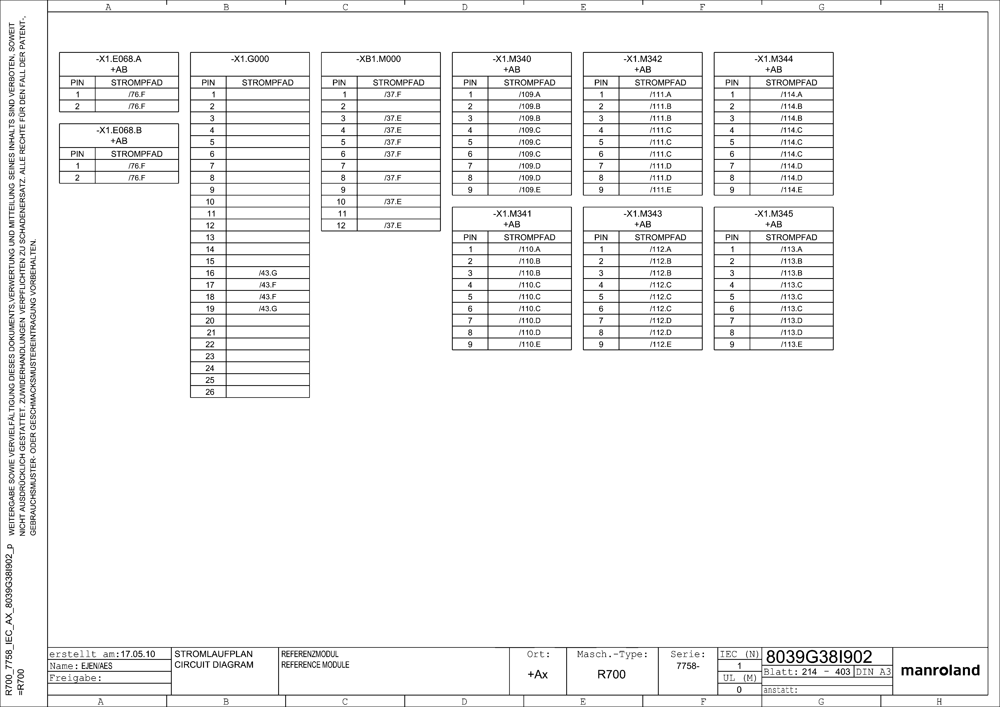

# +Ax — Sheet 214 of 403 — REFERENZMODUL

**REFERENCE MODULE**

> Part of the manroland **R700** printing press IEC/UL circuit diagrams.
> Drawing class: **Stromlaufplan / Circuit diagram** (DIN A3).
> Document `+Ax` covers the **Central control console** machine section.

## At a glance

| Field | Value |
|---|---|
| Document | `+Ax`  (8039G38I902) |
| Sheet | **214** of 403 |
| Section (DE) | REFERENZMODUL |
| Section (EN) | REFERENCE MODULE |
| Section type | REFERENCE_MODULE — Reference module |
| Machine type | `R700` |
| Series | `7758` |
| Created | 17.05.10 |
| Replaces | — |
| Columns used | A, B, C, D, E, F, G |
| Path numbers | — |
| Labels on sheet | 204 |
| Cross-refs out | 70 |
| Cross-refs in | 0 |

**Previous:** [+Ax sheet 213](SHEET_0213.md) · **Next:** [+Ax sheet 215](SHEET_0215.md) · **Document TOC:** [_TOC.md](_TOC.md)  (+Ax) · **Master TOC:** [all sheets](../_MASTER_TOC.md)

## Sheet image (300 DPI, exact vector render)



_Rendered directly from the PDF vector layer at 300 DPI (1-bit), no OCR and no resampling. Use it to confirm anything ambiguous in the text below._

## Cross-references on this sheet

Each entry is a wire leaving this sheet. The printed token is `/sheet.column`; the link resolves to that sheet inside the same document.

| Ref | Target sheet | Col | Path | Destination on target | Target section | From col |
|---|---|---|---|---|---|---|
| `/76.F` | [+Ax sheet 76](SHEET_0076.md) | F | — | — | ANLEGER | A |
| `/37.F` | [+Ax sheet 37](SHEET_0037.md) | F | — | — | HAUPTANTRIEB | C |
| `/109.A` | [+Ax sheet 109](SHEET_0109.md) | A | — | — | SAUGKOPF, FORMATEINSTELLUNG / | E |
| `/111.A` | [+Ax sheet 111](SHEET_0111.md) | A | — | — | ANLEGEREINSATZPUNKTEINSTELLUNG | F |
| `/114.A` | [+Ax sheet 114](SHEET_0114.md) | A | — | — | STAPELTRAGPLATTENEINSTELLUNG | G |
| `/76.F` | [+Ax sheet 76](SHEET_0076.md) | F | — | — | ANLEGER | A |
| `/109.B` | [+Ax sheet 109](SHEET_0109.md) | B | — | — | SAUGKOPF, FORMATEINSTELLUNG / | E |
| `/111.B` | [+Ax sheet 111](SHEET_0111.md) | B | — | — | ANLEGEREINSATZPUNKTEINSTELLUNG | F |
| `/114.B` | [+Ax sheet 114](SHEET_0114.md) | B | — | — | STAPELTRAGPLATTENEINSTELLUNG | G |
| `/37.E` | [+Ax sheet 37](SHEET_0037.md) | E | — | — | HAUPTANTRIEB | C |
| `/109.B` | [+Ax sheet 109](SHEET_0109.md) | B | — | — | SAUGKOPF, FORMATEINSTELLUNG / | E |
| `/111.B` | [+Ax sheet 111](SHEET_0111.md) | B | — | — | ANLEGEREINSATZPUNKTEINSTELLUNG | F |
| `/114.B` | [+Ax sheet 114](SHEET_0114.md) | B | — | — | STAPELTRAGPLATTENEINSTELLUNG | G |
| `/37.E` | [+Ax sheet 37](SHEET_0037.md) | E | — | — | HAUPTANTRIEB | C |
| `/109.C` | [+Ax sheet 109](SHEET_0109.md) | C | — | — | SAUGKOPF, FORMATEINSTELLUNG / | E |
| `/111.C` | [+Ax sheet 111](SHEET_0111.md) | C | — | — | ANLEGEREINSATZPUNKTEINSTELLUNG | F |
| `/114.C` | [+Ax sheet 114](SHEET_0114.md) | C | — | — | STAPELTRAGPLATTENEINSTELLUNG | G |
| `/37.F` | [+Ax sheet 37](SHEET_0037.md) | F | — | — | HAUPTANTRIEB | C |
| `/109.C` | [+Ax sheet 109](SHEET_0109.md) | C | — | — | SAUGKOPF, FORMATEINSTELLUNG / | E |
| `/111.C` | [+Ax sheet 111](SHEET_0111.md) | C | — | — | ANLEGEREINSATZPUNKTEINSTELLUNG | F |
| `/114.C` | [+Ax sheet 114](SHEET_0114.md) | C | — | — | STAPELTRAGPLATTENEINSTELLUNG | G |
| `/37.F` | [+Ax sheet 37](SHEET_0037.md) | F | — | — | HAUPTANTRIEB | C |
| `/109.C` | [+Ax sheet 109](SHEET_0109.md) | C | — | — | SAUGKOPF, FORMATEINSTELLUNG / | E |
| `/111.C` | [+Ax sheet 111](SHEET_0111.md) | C | — | — | ANLEGEREINSATZPUNKTEINSTELLUNG | F |
| `/114.C` | [+Ax sheet 114](SHEET_0114.md) | C | — | — | STAPELTRAGPLATTENEINSTELLUNG | G |
| `/76.F` | [+Ax sheet 76](SHEET_0076.md) | F | — | — | ANLEGER | A |
| `/109.D` | [+Ax sheet 109](SHEET_0109.md) | D | — | — | SAUGKOPF, FORMATEINSTELLUNG / | E |
| `/111.D` | [+Ax sheet 111](SHEET_0111.md) | D | — | — | ANLEGEREINSATZPUNKTEINSTELLUNG | F |
| `/114.D` | [+Ax sheet 114](SHEET_0114.md) | D | — | — | STAPELTRAGPLATTENEINSTELLUNG | G |
| `/76.F` | [+Ax sheet 76](SHEET_0076.md) | F | — | — | ANLEGER | A |
| `/37.F` | [+Ax sheet 37](SHEET_0037.md) | F | — | — | HAUPTANTRIEB | C |
| `/109.D` | [+Ax sheet 109](SHEET_0109.md) | D | — | — | SAUGKOPF, FORMATEINSTELLUNG / | E |
| `/111.D` | [+Ax sheet 111](SHEET_0111.md) | D | — | — | ANLEGEREINSATZPUNKTEINSTELLUNG | F |
| `/114.D` | [+Ax sheet 114](SHEET_0114.md) | D | — | — | STAPELTRAGPLATTENEINSTELLUNG | G |
| `/109.E` | [+Ax sheet 109](SHEET_0109.md) | E | — | — | SAUGKOPF, FORMATEINSTELLUNG / | E |
| `/111.E` | [+Ax sheet 111](SHEET_0111.md) | E | — | — | ANLEGEREINSATZPUNKTEINSTELLUNG | F |
| `/114.E` | [+Ax sheet 114](SHEET_0114.md) | E | — | — | STAPELTRAGPLATTENEINSTELLUNG | G |
| `/37.E` | [+Ax sheet 37](SHEET_0037.md) | E | — | — | HAUPTANTRIEB | C |
| `/37.E` | [+Ax sheet 37](SHEET_0037.md) | E | — | — | HAUPTANTRIEB | C |
| `/110.A` | [+Ax sheet 110](SHEET_0110.md) | A | — | — | SAUGKOPF LÄNGSEINSTELLUNG / | E |
| `/112.A` | [+Ax sheet 112](SHEET_0112.md) | A | — | — | FORMATEINSTELLUNG MOTORISCH, SEITLICHE | F |
| `/113.A` | [+Ax sheet 113](SHEET_0113.md) | A | — | — | FORMATEINSTELLUNG MOTORISCH, SEITLICHE | G |
| `/110.B` | [+Ax sheet 110](SHEET_0110.md) | B | — | — | SAUGKOPF LÄNGSEINSTELLUNG / | E |
| `/112.B` | [+Ax sheet 112](SHEET_0112.md) | B | — | — | FORMATEINSTELLUNG MOTORISCH, SEITLICHE | F |
| `/113.B` | [+Ax sheet 113](SHEET_0113.md) | B | — | — | FORMATEINSTELLUNG MOTORISCH, SEITLICHE | G |
| `/43.G` | [+Ax sheet 43](SHEET_0043.md) | G | — | — | HAUPTANTRIEB | B |
| `/110.B` | [+Ax sheet 110](SHEET_0110.md) | B | — | — | SAUGKOPF LÄNGSEINSTELLUNG / | E |
| `/112.B` | [+Ax sheet 112](SHEET_0112.md) | B | — | — | FORMATEINSTELLUNG MOTORISCH, SEITLICHE | F |
| `/113.B` | [+Ax sheet 113](SHEET_0113.md) | B | — | — | FORMATEINSTELLUNG MOTORISCH, SEITLICHE | G |
| `/43.F` | [+Ax sheet 43](SHEET_0043.md) | F | — | — | HAUPTANTRIEB | B |
| `/110.C` | [+Ax sheet 110](SHEET_0110.md) | C | — | — | SAUGKOPF LÄNGSEINSTELLUNG / | E |
| `/112.C` | [+Ax sheet 112](SHEET_0112.md) | C | — | — | FORMATEINSTELLUNG MOTORISCH, SEITLICHE | F |
| `/113.C` | [+Ax sheet 113](SHEET_0113.md) | C | — | — | FORMATEINSTELLUNG MOTORISCH, SEITLICHE | G |
| `/43.F` | [+Ax sheet 43](SHEET_0043.md) | F | — | — | HAUPTANTRIEB | B |
| `/110.C` | [+Ax sheet 110](SHEET_0110.md) | C | — | — | SAUGKOPF LÄNGSEINSTELLUNG / | E |
| `/112.C` | [+Ax sheet 112](SHEET_0112.md) | C | — | — | FORMATEINSTELLUNG MOTORISCH, SEITLICHE | F |
| `/113.C` | [+Ax sheet 113](SHEET_0113.md) | C | — | — | FORMATEINSTELLUNG MOTORISCH, SEITLICHE | G |
| `/43.G` | [+Ax sheet 43](SHEET_0043.md) | G | — | — | HAUPTANTRIEB | B |
| `/110.C` | [+Ax sheet 110](SHEET_0110.md) | C | — | — | SAUGKOPF LÄNGSEINSTELLUNG / | E |
| `/112.C` | [+Ax sheet 112](SHEET_0112.md) | C | — | — | FORMATEINSTELLUNG MOTORISCH, SEITLICHE | F |
| `/113.C` | [+Ax sheet 113](SHEET_0113.md) | C | — | — | FORMATEINSTELLUNG MOTORISCH, SEITLICHE | G |
| `/110.D` | [+Ax sheet 110](SHEET_0110.md) | D | — | — | SAUGKOPF LÄNGSEINSTELLUNG / | E |
| `/112.D` | [+Ax sheet 112](SHEET_0112.md) | D | — | — | FORMATEINSTELLUNG MOTORISCH, SEITLICHE | F |
| `/113.D` | [+Ax sheet 113](SHEET_0113.md) | D | — | — | FORMATEINSTELLUNG MOTORISCH, SEITLICHE | G |
| `/110.D` | [+Ax sheet 110](SHEET_0110.md) | D | — | — | SAUGKOPF LÄNGSEINSTELLUNG / | E |
| `/112.D` | [+Ax sheet 112](SHEET_0112.md) | D | — | — | FORMATEINSTELLUNG MOTORISCH, SEITLICHE | F |
| `/113.D` | [+Ax sheet 113](SHEET_0113.md) | D | — | — | FORMATEINSTELLUNG MOTORISCH, SEITLICHE | G |
| `/110.E` | [+Ax sheet 110](SHEET_0110.md) | E | — | — | SAUGKOPF LÄNGSEINSTELLUNG / | E |
| `/112.E` | [+Ax sheet 112](SHEET_0112.md) | E | — | — | FORMATEINSTELLUNG MOTORISCH, SEITLICHE | F |
| `/113.E` | [+Ax sheet 113](SHEET_0113.md) | E | — | — | FORMATEINSTELLUNG MOTORISCH, SEITLICHE | G |

## Devices on this sheet

| Tag | Class | Class meaning (IEC) | Col | Sub | Terminal | Sign |
|---|---|---|---|---|---|---|
| `X1.E068.A` | — | cross-device reference | A | — | — | — |
| `X1.E068.B` | — | cross-device reference | A | — | — | — |
| `XB1.M000` | — | cross-device reference | C | — | — | — |
| `X1.M342` | — | cross-device reference | F | — | — | — |
| `X1.M343` | — | cross-device reference | F | — | — | — |
| `X1.M344` | — | cross-device reference | G | — | — | — |
| `X1.M345` | — | cross-device reference | G | — | — | — |
| `X1.M340` | — | cross-device reference | D | — | — | — |
| `X1.M341` | — | cross-device reference | D | — | — | — |
| `X1.G000` | — | cross-device reference | B | — | — | — |

## Potentials / nets

_No named potentials on this sheet._

## Wire-end annotations (grouped as printed)

A wire that continues elsewhere is annotated with a small cluster: the destination description, the path/line number `#NN`, and the `/sheet.column` cross reference. Each row below is one such cluster exactly as it is grouped on the drawing.

| Col | Y | Path | Cross-ref | Text on the wire |
|---|---|---|---|---|
| A | 65.5 | — | — | `X1.E068.A` |
| B | 65.5 | — | — | `X1.G000` |
| C | 65.5 | — | — | `XB1.M000` |
| D | 65.5 | — | — | `X1.M340` |
| F | 65.5 | — | — | `X1.M342` |
| G | 65.5 | — | — | `X1.M344` |
| A | 78.2 | — | — | `+AB` |
| D | 78.2 | — | — | `+AB` |
| F | 78.2 | — | — | `+AB` |
| G | 78.2 | — | — | `+AB` |
| A | 94.2 | — | — | `PIN 2 1 STROMPFAD` |
| B | 94.2 | — | — | `PIN STROMPFAD` |
| C | 94.2 | — | — | `PIN 10 12 11 2 3 4 5 6 7 8 9 1 STROMPFAD` |
| D | 94.2 | — | — | `PIN 2 3 4 5 6 7 8 9 1 STROMPFAD` |
| E | 94.2 | — | — | `PIN 2 3 4 5 6 7 8 9 1 STROMPFAD` |
| G | 94.2 | — | — | `PIN 2 3 4 5 6 7 8 9 1 STROMPFAD` |
| B | 108.4 | — | — | `2 3 4 5 6 7 8 9 1` |
| A | 108.7 | — | `/76.F` | — |
| C | 108.7 | — | `/37.F` | — |
| E | 108.7 | — | `/109.A` | — |
| F | 108.7 | — | `/111.A` | — |
| G | 108.7 | — | `/114.A` | — |
| A | 122.9 | — | `/76.F` | — |
| E | 122.9 | — | `/109.B` | — |
| F | 122.9 | — | `/111.B` | — |
| G | 122.9 | — | `/114.B` | — |
| C | 137.0 | — | `/37.E` | — |
| E | 137.0 | — | `/109.B` | — |
| F | 137.0 | — | `/111.B` | — |
| G | 137.0 | — | `/114.B` | — |
| A | 150.6 | — | — | `X1.E068.B` |
| C | 151.2 | — | `/37.E` | — |
| E | 151.2 | — | `/109.C` | — |
| F | 151.2 | — | `/111.C` | — |
| G | 151.2 | — | `/114.C` | — |
| A | 163.2 | — | — | `+AB` |
| C | 165.4 | — | `/37.F` | — |
| E | 165.4 | — | `/109.C` | — |
| F | 165.4 | — | `/111.C` | — |
| G | 165.4 | — | `/114.C` | — |
| A | 179.2 | — | — | `PIN 2 1 STROMPFAD` |
| C | 179.6 | — | `/37.F` | — |
| E | 179.6 | — | `/109.C` | — |
| F | 179.6 | — | `/111.C` | — |
| G | 179.6 | — | `/114.C` | — |
| A | 193.7 | — | `/76.F` | — |
| E | 193.8 | — | `/109.D` | — |
| F | 193.8 | — | `/111.D` | — |
| G | 193.8 | — | `/114.D` | — |
| A | 207.9 | — | `/76.F` | — |
| C | 207.9 | — | `/37.F` | — |
| E | 207.9 | — | `/109.D` | — |
| F | 207.9 | — | `/111.D` | — |
| G | 207.9 | — | `/114.D` | — |
| E | 222.1 | — | `/109.E` | — |
| F | 222.1 | — | `/111.E` | — |
| G | 222.1 | — | `/114.E` | — |
| B | 235.9 | — | — | `10 12 13 14 15 16 17 18 19 20 11` |
| C | 236.2 | — | `/37.E` | — |
| D | 249.8 | — | — | `X1.M341` |
| F | 249.8 | — | — | `X1.M343` |
| G | 249.8 | — | — | `X1.M345` |
| D | 262.4 | — | — | `+AB` |
| F | 262.4 | — | — | `+AB` |
| G | 262.4 | — | — | `+AB` |
| C | 264.6 | — | `/37.E` | — |
| D | 278.4 | — | — | `PIN 2 3 4 5 6 7 8 9 1 STROMPFAD` |
| E | 278.4 | — | — | `PIN 2 3 4 5 6 7 8 9 1 STROMPFAD` |
| G | 278.4 | — | — | `PIN 2 3 4 5 6 7 8 9 1 STROMPFAD` |
| E | 292.9 | — | `/110.A` | — |
| F | 292.9 | — | `/112.A` | — |
| G | 292.9 | — | `/113.A` | — |
| E | 307.1 | — | `/110.B` | — |
| F | 307.1 | — | `/112.B` | — |
| G | 307.1 | — | `/113.B` | — |
| B | 321.3 | — | `/43.G` | — |
| E | 321.3 | — | `/110.B` | — |
| F | 321.3 | — | `/112.B` | — |
| G | 321.3 | — | `/113.B` | — |
| B | 335.5 | — | `/43.F` | — |
| E | 335.5 | — | `/110.C` | — |
| F | 335.5 | — | `/112.C` | — |
| G | 335.5 | — | `/113.C` | — |
| B | 349.6 | — | `/43.F` | — |
| E | 349.7 | — | `/110.C` | — |
| F | 349.7 | — | `/112.C` | — |
| G | 349.7 | — | `/113.C` | — |
| B | 363.8 | — | `/43.G` | — |
| E | 363.8 | — | `/110.C` | — |
| F | 363.8 | — | `/112.C` | — |
| G | 363.8 | — | `/113.C` | — |
| E | 378.0 | — | `/110.D` | — |
| F | 378.0 | — | `/112.D` | — |
| G | 378.0 | — | `/113.D` | — |
| B | 391.8 | — | — | `22 23 24 25 26 21` |
| E | 392.2 | — | `/110.D` | — |
| F | 392.2 | — | `/112.D` | — |
| G | 392.2 | — | `/113.D` | — |
| E | 406.3 | — | `/110.E` | — |
| F | 406.3 | — | `/112.E` | — |
| G | 406.3 | — | `/113.E` | — |


## Reconstructed tables

This sheet carries tabular content (pin map / terminal assignment / index). The grid below was rebuilt from the drawing's own rule lines, so each row is exactly one physical row of the table.

### Table 1 — 7 data rows × 2 columns (at x=70.9, y=62.4) — **X1.E068.A +AB**

| PIN | STROMPFAD |
|---|---|
| `1` | `/76.F` |
| `2` | `/76.F` |
|  | `X1.E068.B` |
|  | `+AB` |
| `PIN` | `STROMPFAD` |
| `1` | `/76.F` |
| `2` | `/76.F` |


### Table 2 — 26 data rows × 2 columns (at x=226.8, y=62.4) — **X1.G000**

| PIN | STROMPFAD |
|---|---|
| `1` |  |
| `2` |  |
| `3` |  |
| `4` |  |
| `5` |  |
| `6` |  |
| `7` |  |
| `8` |  |
| `9` |  |
| `10` |  |
| `11` |  |
| `12` |  |
| `13` |  |
| `14` |  |
| `15` |  |
| `16` | `/43.G` |
| `17` | `/43.F` |
| `18` | `/43.F` |
| `19` | `/43.G` |
| `20` |  |
| `21` |  |
| `22` |  |
| `23` |  |
| `24` |  |
| `25` |  |
| `26` |  |


### Table 3 — 12 data rows × 2 columns (at x=382.7, y=62.4) — **XB1.M000**

| PIN | STROMPFAD |
|---|---|
| `1` | `/37.F` |
| `2` |  |
| `3` | `/37.E` |
| `4` | `/37.E` |
| `5` | `/37.F` |
| `6` | `/37.F` |
| `7` |  |
| `8` | `/37.F` |
| `9` |  |
| `10` | `/37.E` |
| `11` |  |
| `12` | `/37.E` |


### Table 4 — 21 data rows × 2 columns (at x=538.6, y=62.4) — **X1.M340 +AB**

| PIN | STROMPFAD |
|---|---|
| `1` | `/109.A` |
| `2` | `/109.B` |
| `3` | `/109.B` |
| `4` | `/109.C` |
| `5` | `/109.C` |
| `6` | `/109.C` |
| `7` | `/109.D` |
| `8` | `/109.D` |
| `9` | `/109.E` |
|  | `X1.M341` |
|  | `+AB` |
| `PIN` | `STROMPFAD` |
| `1` | `/110.A` |
| `2` | `/110.B` |
| `3` | `/110.B` |
| `4` | `/110.C` |
| `5` | `/110.C` |
| `6` | `/110.C` |
| `7` | `/110.D` |
| `8` | `/110.D` |
| `9` | `/110.E` |


### Table 5 — 21 data rows × 2 columns (at x=694.5, y=62.4) — **X1.M342 +AB**

| PIN | STROMPFAD |
|---|---|
| `1` | `/111.A` |
| `2` | `/111.B` |
| `3` | `/111.B` |
| `4` | `/111.C` |
| `5` | `/111.C` |
| `6` | `/111.C` |
| `7` | `/111.D` |
| `8` | `/111.D` |
| `9` | `/111.E` |
|  | `X1.M343` |
|  | `+AB` |
| `PIN` | `STROMPFAD` |
| `1` | `/112.A` |
| `2` | `/112.B` |
| `3` | `/112.B` |
| `4` | `/112.C` |
| `5` | `/112.C` |
| `6` | `/112.C` |
| `7` | `/112.D` |
| `8` | `/112.D` |
| `9` | `/112.E` |


### Table 6 — 21 data rows × 2 columns (at x=850.4, y=62.4) — **X1.M344 +AB**

| PIN | STROMPFAD |
|---|---|
| `1` | `/114.A` |
| `2` | `/114.B` |
| `3` | `/114.B` |
| `4` | `/114.C` |
| `5` | `/114.C` |
| `6` | `/114.C` |
| `7` | `/114.D` |
| `8` | `/114.D` |
| `9` | `/114.E` |
|  | `X1.M345` |
|  | `+AB` |
| `PIN` | `STROMPFAD` |
| `1` | `/113.A` |
| `2` | `/113.B` |
| `3` | `/113.B` |
| `4` | `/113.C` |
| `5` | `/113.C` |
| `6` | `/113.C` |
| `7` | `/113.D` |
| `8` | `/113.D` |
| `9` | `/113.E` |


## Notes and free text on this sheet

| Text | Col | Y (pt) |
|---|---|---|
| `PIN` | A | 94.2 |
| `STROMPFAD` | A | 94.15 |
| `+AB` | A | 78.18 |
| `PIN` | C | 94.2 |
| `STROMPFAD` | C | 94.15 |
| `PIN` | E | 94.2 |
| `STROMPFAD` | F | 94.15 |
| `+AB` | F | 78.18 |
| `PIN` | F | 94.2 |
| `STROMPFAD` | G | 94.15 |
| `+AB` | G | 78.18 |
| `PIN` | D | 94.2 |
| `STROMPFAD` | E | 94.15 |
| `+AB` | D | 78.18 |
| `PIN` | B | 94.2 |
| `STROMPFAD` | B | 94.15 |

## Complete label inventory (exact text from the drawing)

Every text object inside the drawing area of this sheet, in DIN reading order (column A→H, then top→bottom). This is the authoritative list: if a string is not here it is not printed on this sheet.

| Col | Y | X | Dir | Type | Text |
|---|---|---|---|---|---|
| A | 65.5 | 114.4 | → | device ref | `X1.E068.A` |
| A | 78.2 | 131.5 | → | text | `+AB` |
| A | 94.2 | 84.0 | → | text | `PIN` |
| A | 94.2 | 132.2 | → | text | `STROMPFAD` |
| A | 108.4 | 90.0 | → | number | `1` |
| A | 108.7 | 153.1 | → | cross-reference | `/76.F` |
| A | 122.5 | 89.4 | → | number | `2` |
| A | 122.9 | 153.1 | → | cross-reference | `/76.F` |
| A | 150.6 | 114.8 | → | device ref | `X1.E068.B` |
| A | 163.2 | 131.5 | → | text | `+AB` |
| A | 179.2 | 84.0 | → | text | `PIN` |
| A | 179.2 | 132.2 | → | text | `STROMPFAD` |
| A | 193.4 | 90.0 | → | number | `1` |
| A | 193.7 | 153.1 | → | cross-reference | `/76.F` |
| A | 207.6 | 89.4 | → | number | `2` |
| A | 207.9 | 153.1 | → | cross-reference | `/76.F` |
| B | 65.5 | 275.1 | → | device ref | `X1.G000` |
| B | 94.2 | 240.0 | → | text | `PIN` |
| B | 94.2 | 288.1 | → | text | `STROMPFAD` |
| B | 108.4 | 251.7 | → | number | `1` |
| B | 122.5 | 250.0 | → | number | `2` |
| B | 136.7 | 250.0 | → | number | `3` |
| B | 150.9 | 250.0 | → | number | `4` |
| B | 165.1 | 250.0 | → | number | `5` |
| B | 179.2 | 250.0 | → | number | `6` |
| B | 193.4 | 250.0 | → | number | `7` |
| B | 207.6 | 250.0 | → | number | `8` |
| B | 221.8 | 250.0 | → | number | `9` |
| B | 235.9 | 244.6 | → | number | `10` |
| B | 250.1 | 246.3 | → | number | `11` |
| B | 264.3 | 244.6 | → | number | `12` |
| B | 278.5 | 244.6 | → | number | `13` |
| B | 292.6 | 244.6 | → | number | `14` |
| B | 306.8 | 244.6 | → | number | `15` |
| B | 321.0 | 244.6 | → | number | `16` |
| B | 321.3 | 308.4 | → | cross-reference | `/43.G` |
| B | 335.1 | 244.6 | → | number | `17` |
| B | 335.5 | 309.0 | → | cross-reference | `/43.F` |
| B | 349.3 | 244.6 | → | number | `18` |
| B | 349.6 | 309.0 | → | cross-reference | `/43.F` |
| B | 363.5 | 244.6 | → | number | `19` |
| B | 363.8 | 308.4 | → | cross-reference | `/43.G` |
| B | 377.7 | 244.6 | → | number | `20` |
| B | 391.8 | 246.3 | → | number | `21` |
| B | 406.0 | 244.6 | → | number | `22` |
| B | 420.2 | 244.6 | → | number | `23` |
| B | 434.4 | 244.6 | → | number | `24` |
| B | 448.5 | 244.6 | → | number | `25` |
| B | 462.7 | 244.6 | → | number | `26` |
| C | 65.5 | 424.3 | → | device ref | `XB1.M000` |
| C | 94.2 | 395.9 | → | text | `PIN` |
| C | 94.2 | 444.0 | → | text | `STROMPFAD` |
| C | 108.4 | 407.6 | → | number | `1` |
| C | 108.7 | 457.8 | → | cross-reference | `/37.F` |
| C | 122.5 | 405.9 | → | number | `2` |
| C | 136.7 | 405.9 | → | number | `3` |
| C | 137.0 | 457.7 | → | cross-reference | `/37.E` |
| C | 150.9 | 405.9 | → | number | `4` |
| C | 151.2 | 457.7 | → | cross-reference | `/37.E` |
| C | 165.1 | 405.9 | → | number | `5` |
| C | 165.4 | 457.8 | → | cross-reference | `/37.F` |
| C | 179.2 | 405.9 | → | number | `6` |
| C | 179.6 | 457.8 | → | cross-reference | `/37.F` |
| C | 193.4 | 405.9 | → | number | `7` |
| C | 207.6 | 405.9 | → | number | `8` |
| C | 207.9 | 457.8 | → | cross-reference | `/37.F` |
| C | 221.8 | 405.9 | → | number | `9` |
| C | 235.9 | 400.5 | → | number | `10` |
| C | 236.2 | 457.7 | → | cross-reference | `/37.E` |
| C | 250.1 | 402.2 | → | number | `11` |
| C | 264.3 | 400.5 | → | number | `12` |
| C | 264.6 | 457.7 | → | cross-reference | `/37.E` |
| D | 65.5 | 586.6 | → | device ref | `X1.M340` |
| D | 78.2 | 599.2 | → | text | `+AB` |
| D | 94.2 | 551.8 | → | text | `PIN` |
| D | 108.4 | 557.7 | → | number | `1` |
| D | 122.5 | 557.1 | → | number | `2` |
| D | 136.7 | 557.1 | → | number | `3` |
| D | 150.9 | 557.1 | → | number | `4` |
| D | 165.1 | 557.1 | → | number | `5` |
| D | 179.2 | 557.1 | → | number | `6` |
| D | 193.4 | 557.1 | → | number | `7` |
| D | 207.6 | 557.1 | → | number | `8` |
| D | 221.8 | 557.1 | → | number | `9` |
| D | 249.8 | 587.3 | → | device ref | `X1.M341` |
| D | 262.4 | 599.2 | → | text | `+AB` |
| D | 278.4 | 551.8 | → | text | `PIN` |
| D | 292.6 | 557.7 | → | number | `1` |
| D | 306.8 | 557.1 | → | number | `2` |
| D | 321.0 | 557.1 | → | number | `3` |
| D | 335.1 | 557.1 | → | number | `4` |
| D | 349.3 | 557.1 | → | number | `5` |
| D | 363.5 | 557.1 | → | number | `6` |
| D | 377.7 | 557.1 | → | number | `7` |
| D | 391.8 | 557.1 | → | number | `8` |
| D | 406.0 | 557.1 | → | number | `9` |
| E | 94.2 | 600.0 | → | text | `STROMPFAD` |
| E | 94.2 | 707.7 | → | text | `PIN` |
| E | 108.4 | 713.6 | → | number | `1` |
| E | 108.7 | 618.0 | → | cross-reference | `/109.A` |
| E | 122.5 | 713.1 | → | number | `2` |
| E | 122.9 | 618.1 | → | cross-reference | `/109.B` |
| E | 136.7 | 713.1 | → | number | `3` |
| E | 137.0 | 618.1 | → | cross-reference | `/109.B` |
| E | 150.9 | 713.1 | → | number | `4` |
| E | 151.2 | 618.0 | → | cross-reference | `/109.C` |
| E | 165.1 | 713.1 | → | number | `5` |
| E | 165.4 | 618.0 | → | cross-reference | `/109.C` |
| E | 179.2 | 713.1 | → | number | `6` |
| E | 179.6 | 618.0 | → | cross-reference | `/109.C` |
| E | 193.4 | 713.1 | → | number | `7` |
| E | 193.8 | 618.0 | → | cross-reference | `/109.D` |
| E | 207.6 | 713.1 | → | number | `8` |
| E | 207.9 | 618.0 | → | cross-reference | `/109.D` |
| E | 221.8 | 713.1 | → | number | `9` |
| E | 222.1 | 618.2 | → | cross-reference | `/109.E` |
| E | 278.4 | 600.0 | → | text | `STROMPFAD` |
| E | 278.4 | 707.7 | → | text | `PIN` |
| E | 292.6 | 713.6 | → | number | `1` |
| E | 292.9 | 618.0 | → | cross-reference | `/110.A` |
| E | 306.8 | 713.1 | → | number | `2` |
| E | 307.1 | 618.1 | → | cross-reference | `/110.B` |
| E | 321.0 | 713.1 | → | number | `3` |
| E | 321.3 | 618.1 | → | cross-reference | `/110.B` |
| E | 335.1 | 713.1 | → | number | `4` |
| E | 335.5 | 618.0 | → | cross-reference | `/110.C` |
| E | 349.3 | 713.1 | → | number | `5` |
| E | 349.7 | 618.0 | → | cross-reference | `/110.C` |
| E | 363.5 | 713.1 | → | number | `6` |
| E | 363.8 | 618.0 | → | cross-reference | `/110.C` |
| E | 377.7 | 713.1 | → | number | `7` |
| E | 378.0 | 618.0 | → | cross-reference | `/110.D` |
| E | 391.8 | 713.1 | → | number | `8` |
| E | 392.2 | 618.0 | → | cross-reference | `/110.D` |
| E | 406.0 | 713.1 | → | number | `9` |
| E | 406.3 | 618.2 | → | cross-reference | `/110.E` |
| F | 65.5 | 742.5 | → | device ref | `X1.M342` |
| F | 78.2 | 755.1 | → | text | `+AB` |
| F | 94.2 | 755.9 | → | text | `STROMPFAD` |
| F | 94.2 | 863.6 | → | text | `PIN` |
| F | 108.4 | 869.5 | → | number | `1` |
| F | 108.7 | 773.9 | → | cross-reference | `/111.A` |
| F | 122.5 | 869.0 | → | number | `2` |
| F | 122.9 | 774.0 | → | cross-reference | `/111.B` |
| F | 136.7 | 869.0 | → | number | `3` |
| F | 137.0 | 774.0 | → | cross-reference | `/111.B` |
| F | 150.9 | 869.0 | → | number | `4` |
| F | 151.2 | 773.9 | → | cross-reference | `/111.C` |
| F | 165.1 | 869.0 | → | number | `5` |
| F | 165.4 | 773.9 | → | cross-reference | `/111.C` |
| F | 179.2 | 869.0 | → | number | `6` |
| F | 179.6 | 773.9 | → | cross-reference | `/111.C` |
| F | 193.4 | 869.0 | → | number | `7` |
| F | 193.8 | 773.9 | → | cross-reference | `/111.D` |
| F | 207.6 | 869.0 | → | number | `8` |
| F | 207.9 | 773.9 | → | cross-reference | `/111.D` |
| F | 221.8 | 869.0 | → | number | `9` |
| F | 222.1 | 774.1 | → | cross-reference | `/111.E` |
| F | 249.8 | 742.5 | → | device ref | `X1.M343` |
| F | 262.4 | 755.1 | → | text | `+AB` |
| F | 278.4 | 755.9 | → | text | `STROMPFAD` |
| F | 278.4 | 863.6 | → | text | `PIN` |
| F | 292.6 | 869.5 | → | number | `1` |
| F | 292.9 | 773.9 | → | cross-reference | `/112.A` |
| F | 306.8 | 869.0 | → | number | `2` |
| F | 307.1 | 774.0 | → | cross-reference | `/112.B` |
| F | 321.0 | 869.0 | → | number | `3` |
| F | 321.3 | 774.0 | → | cross-reference | `/112.B` |
| F | 335.1 | 869.0 | → | number | `4` |
| F | 335.5 | 773.9 | → | cross-reference | `/112.C` |
| F | 349.3 | 869.0 | → | number | `5` |
| F | 349.7 | 773.9 | → | cross-reference | `/112.C` |
| F | 363.5 | 869.0 | → | number | `6` |
| F | 363.8 | 773.9 | → | cross-reference | `/112.C` |
| F | 377.7 | 869.0 | → | number | `7` |
| F | 378.0 | 773.9 | → | cross-reference | `/112.D` |
| F | 391.8 | 869.0 | → | number | `8` |
| F | 392.2 | 773.9 | → | cross-reference | `/112.D` |
| F | 406.0 | 869.0 | → | number | `9` |
| F | 406.3 | 774.1 | → | cross-reference | `/112.E` |
| G | 65.5 | 898.4 | → | device ref | `X1.M344` |
| G | 78.2 | 911.1 | → | text | `+AB` |
| G | 94.2 | 911.8 | → | text | `STROMPFAD` |
| G | 108.7 | 929.8 | → | cross-reference | `/114.A` |
| G | 122.9 | 929.9 | → | cross-reference | `/114.B` |
| G | 137.0 | 929.9 | → | cross-reference | `/114.B` |
| G | 151.2 | 929.8 | → | cross-reference | `/114.C` |
| G | 165.4 | 929.8 | → | cross-reference | `/114.C` |
| G | 179.6 | 929.8 | → | cross-reference | `/114.C` |
| G | 193.8 | 929.8 | → | cross-reference | `/114.D` |
| G | 207.9 | 929.8 | → | cross-reference | `/114.D` |
| G | 222.1 | 930.0 | → | cross-reference | `/114.E` |
| G | 249.8 | 898.4 | → | device ref | `X1.M345` |
| G | 262.4 | 911.1 | → | text | `+AB` |
| G | 278.4 | 911.8 | → | text | `STROMPFAD` |
| G | 292.9 | 929.8 | → | cross-reference | `/113.A` |
| G | 307.1 | 929.9 | → | cross-reference | `/113.B` |
| G | 321.3 | 929.9 | → | cross-reference | `/113.B` |
| G | 335.5 | 929.8 | → | cross-reference | `/113.C` |
| G | 349.7 | 929.8 | → | cross-reference | `/113.C` |
| G | 363.8 | 929.8 | → | cross-reference | `/113.C` |
| G | 378.0 | 929.8 | → | cross-reference | `/113.D` |
| G | 392.2 | 929.8 | → | cross-reference | `/113.D` |
| G | 406.3 | 930.0 | → | cross-reference | `/113.E` |

## Reading-order text block

The same content as a plain block, grouped by DIN column — convenient to paste or to match against a visual description.

```text
=== Column A ===
  65.5  114.4  devref       X1.E068.A
  78.2  131.5  text         +AB
  94.2   84.0  text         PIN
  94.2  132.2  text         STROMPFAD
 108.4   90.0  numeric      1
 108.7  153.1  xref         /76.F
 122.5   89.4  numeric      2
 122.9  153.1  xref         /76.F
 150.6  114.8  devref       X1.E068.B
 163.2  131.5  text         +AB
 179.2   84.0  text         PIN
 179.2  132.2  text         STROMPFAD
 193.4   90.0  numeric      1
 193.7  153.1  xref         /76.F
 207.6   89.4  numeric      2
 207.9  153.1  xref         /76.F
=== Column B ===
  65.5  275.1  devref       X1.G000
  94.2  240.0  text         PIN
  94.2  288.1  text         STROMPFAD
 108.4  251.7  numeric      1
 122.5  250.0  numeric      2
 136.7  250.0  numeric      3
 150.9  250.0  numeric      4
 165.1  250.0  numeric      5
 179.2  250.0  numeric      6
 193.4  250.0  numeric      7
 207.6  250.0  numeric      8
 221.8  250.0  numeric      9
 235.9  244.6  numeric      10
 250.1  246.3  numeric      11
 264.3  244.6  numeric      12
 278.5  244.6  numeric      13
 292.6  244.6  numeric      14
 306.8  244.6  numeric      15
 321.0  244.6  numeric      16
 321.3  308.4  xref         /43.G
 335.1  244.6  numeric      17
 335.5  309.0  xref         /43.F
 349.3  244.6  numeric      18
 349.6  309.0  xref         /43.F
 363.5  244.6  numeric      19
 363.8  308.4  xref         /43.G
 377.7  244.6  numeric      20
 391.8  246.3  numeric      21
 406.0  244.6  numeric      22
 420.2  244.6  numeric      23
 434.4  244.6  numeric      24
 448.5  244.6  numeric      25
 462.7  244.6  numeric      26
=== Column C ===
  65.5  424.3  devref       XB1.M000
  94.2  395.9  text         PIN
  94.2  444.0  text         STROMPFAD
 108.4  407.6  numeric      1
 108.7  457.8  xref         /37.F
 122.5  405.9  numeric      2
 136.7  405.9  numeric      3
 137.0  457.7  xref         /37.E
 150.9  405.9  numeric      4
 151.2  457.7  xref         /37.E
 165.1  405.9  numeric      5
 165.4  457.8  xref         /37.F
 179.2  405.9  numeric      6
 179.6  457.8  xref         /37.F
 193.4  405.9  numeric      7
 207.6  405.9  numeric      8
 207.9  457.8  xref         /37.F
 221.8  405.9  numeric      9
 235.9  400.5  numeric      10
 236.2  457.7  xref         /37.E
 250.1  402.2  numeric      11
 264.3  400.5  numeric      12
 264.6  457.7  xref         /37.E
=== Column D ===
  65.5  586.6  devref       X1.M340
  78.2  599.2  text         +AB
  94.2  551.8  text         PIN
 108.4  557.7  numeric      1
 122.5  557.1  numeric      2
 136.7  557.1  numeric      3
 150.9  557.1  numeric      4
 165.1  557.1  numeric      5
 179.2  557.1  numeric      6
 193.4  557.1  numeric      7
 207.6  557.1  numeric      8
 221.8  557.1  numeric      9
 249.8  587.3  devref       X1.M341
 262.4  599.2  text         +AB
 278.4  551.8  text         PIN
 292.6  557.7  numeric      1
 306.8  557.1  numeric      2
 321.0  557.1  numeric      3
 335.1  557.1  numeric      4
 349.3  557.1  numeric      5
 363.5  557.1  numeric      6
 377.7  557.1  numeric      7
 391.8  557.1  numeric      8
 406.0  557.1  numeric      9
=== Column E ===
  94.2  600.0  text         STROMPFAD
  94.2  707.7  text         PIN
 108.4  713.6  numeric      1
 108.7  618.0  xref         /109.A
 122.5  713.1  numeric      2
 122.9  618.1  xref         /109.B
 136.7  713.1  numeric      3
 137.0  618.1  xref         /109.B
 150.9  713.1  numeric      4
 151.2  618.0  xref         /109.C
 165.1  713.1  numeric      5
 165.4  618.0  xref         /109.C
 179.2  713.1  numeric      6
 179.6  618.0  xref         /109.C
 193.4  713.1  numeric      7
 193.8  618.0  xref         /109.D
 207.6  713.1  numeric      8
 207.9  618.0  xref         /109.D
 221.8  713.1  numeric      9
 222.1  618.2  xref         /109.E
 278.4  600.0  text         STROMPFAD
 278.4  707.7  text         PIN
 292.6  713.6  numeric      1
 292.9  618.0  xref         /110.A
 306.8  713.1  numeric      2
 307.1  618.1  xref         /110.B
 321.0  713.1  numeric      3
 321.3  618.1  xref         /110.B
 335.1  713.1  numeric      4
 335.5  618.0  xref         /110.C
 349.3  713.1  numeric      5
 349.7  618.0  xref         /110.C
 363.5  713.1  numeric      6
 363.8  618.0  xref         /110.C
 377.7  713.1  numeric      7
 378.0  618.0  xref         /110.D
 391.8  713.1  numeric      8
 392.2  618.0  xref         /110.D
 406.0  713.1  numeric      9
 406.3  618.2  xref         /110.E
=== Column F ===
  65.5  742.5  devref       X1.M342
  78.2  755.1  text         +AB
  94.2  755.9  text         STROMPFAD
  94.2  863.6  text         PIN
 108.4  869.5  numeric      1
 108.7  773.9  xref         /111.A
 122.5  869.0  numeric      2
 122.9  774.0  xref         /111.B
 136.7  869.0  numeric      3
 137.0  774.0  xref         /111.B
 150.9  869.0  numeric      4
 151.2  773.9  xref         /111.C
 165.1  869.0  numeric      5
 165.4  773.9  xref         /111.C
 179.2  869.0  numeric      6
 179.6  773.9  xref         /111.C
 193.4  869.0  numeric      7
 193.8  773.9  xref         /111.D
 207.6  869.0  numeric      8
 207.9  773.9  xref         /111.D
 221.8  869.0  numeric      9
 222.1  774.1  xref         /111.E
 249.8  742.5  devref       X1.M343
 262.4  755.1  text         +AB
 278.4  755.9  text         STROMPFAD
 278.4  863.6  text         PIN
 292.6  869.5  numeric      1
 292.9  773.9  xref         /112.A
 306.8  869.0  numeric      2
 307.1  774.0  xref         /112.B
 321.0  869.0  numeric      3
 321.3  774.0  xref         /112.B
 335.1  869.0  numeric      4
 335.5  773.9  xref         /112.C
 349.3  869.0  numeric      5
 349.7  773.9  xref         /112.C
 363.5  869.0  numeric      6
 363.8  773.9  xref         /112.C
 377.7  869.0  numeric      7
 378.0  773.9  xref         /112.D
 391.8  869.0  numeric      8
 392.2  773.9  xref         /112.D
 406.0  869.0  numeric      9
 406.3  774.1  xref         /112.E
=== Column G ===
  65.5  898.4  devref       X1.M344
  78.2  911.1  text         +AB
  94.2  911.8  text         STROMPFAD
 108.7  929.8  xref         /114.A
 122.9  929.9  xref         /114.B
 137.0  929.9  xref         /114.B
 151.2  929.8  xref         /114.C
 165.4  929.8  xref         /114.C
 179.6  929.8  xref         /114.C
 193.8  929.8  xref         /114.D
 207.9  929.8  xref         /114.D
 222.1  930.0  xref         /114.E
 249.8  898.4  devref       X1.M345
 262.4  911.1  text         +AB
 278.4  911.8  text         STROMPFAD
 292.9  929.8  xref         /113.A
 307.1  929.9  xref         /113.B
 321.3  929.9  xref         /113.B
 335.5  929.8  xref         /113.C
 349.7  929.8  xref         /113.C
 363.8  929.8  xref         /113.C
 378.0  929.8  xref         /113.D
 392.2  929.8  xref         /113.D
 406.3  930.0  xref         /113.E
```

---
_Generated from the PDF vector text layer; no OCR. Source: `R700_7758_IEC_AX_8039G38I902_p`, sheet 214._
