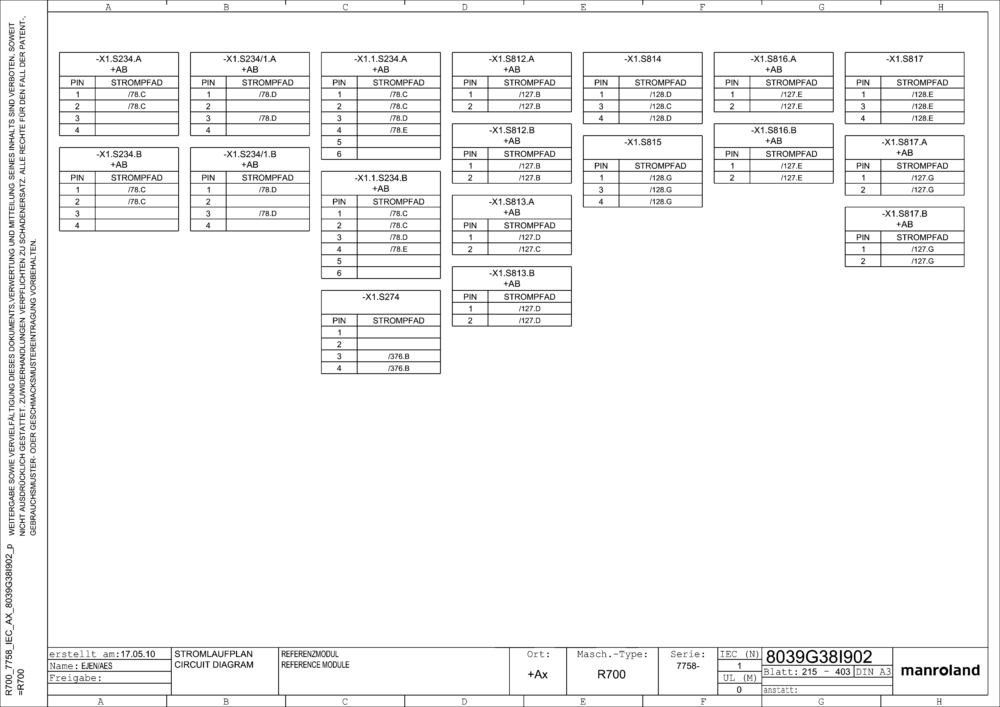

# +Ax — Sheet 215 of 403 — REFERENZMODUL

**REFERENCE MODULE**

> Part of the manroland **R700** printing press IEC/UL circuit diagrams.
> Drawing class: **Stromlaufplan / Circuit diagram** (DIN A3).
> Document `+Ax` covers the **Central control console** machine section.

## At a glance

| Field | Value |
|---|---|
| Document | `+Ax`  (8039G38I902) |
| Sheet | **215** of 403 |
| Section (DE) | REFERENZMODUL |
| Section (EN) | REFERENCE MODULE |
| Section type | REFERENCE_MODULE — Reference module |
| Machine type | `R700` |
| Series | `7758` |
| Created | 17.05.10 |
| Replaces | — |
| Columns used | A, B, C, D, E, F, G, H |
| Path numbers | — |
| Labels on sheet | 168 |
| Cross-refs out | 43 |
| Cross-refs in | 0 |

**Previous:** [+Ax sheet 214](SHEET_0214.md) · **Next:** [+Ax sheet 216](SHEET_0216.md) · **Document TOC:** [_TOC.md](_TOC.md)  (+Ax) · **Master TOC:** [all sheets](../_MASTER_TOC.md)

## Sheet image (300 DPI, exact vector render)



_Rendered directly from the PDF vector layer at 300 DPI (1-bit), no OCR and no resampling. Use it to confirm anything ambiguous in the text below._

## Cross-references on this sheet

Each entry is a wire leaving this sheet. The printed token is `/sheet.column`; the link resolves to that sheet inside the same document.

| Ref | Target sheet | Col | Path | Destination on target | Target section | From col |
|---|---|---|---|---|---|---|
| `/127.B` | [+Ax sheet 127](SHEET_0127.md) | B | — | — | REALTIMERECHNER ANLEGER | E |
| `/127.E` | [+Ax sheet 127](SHEET_0127.md) | E | — | — | REALTIMERECHNER ANLEGER | G |
| `/128.E` | [+Ax sheet 128](SHEET_0128.md) | E | — | — | REALTIMERECHNER ANLEGER | H |
| `/78.C` | [+Ax sheet 78](SHEET_0078.md) | C | — | — | ANLEGER | A |
| `/78.D` | [+Ax sheet 78](SHEET_0078.md) | D | — | — | ANLEGER | B |
| `/78.C` | [+Ax sheet 78](SHEET_0078.md) | C | — | — | ANLEGER | C |
| `/128.D` | [+Ax sheet 128](SHEET_0128.md) | D | — | — | REALTIMERECHNER ANLEGER | F |
| `/127.B` | [+Ax sheet 127](SHEET_0127.md) | B | — | — | REALTIMERECHNER ANLEGER | E |
| `/127.E` | [+Ax sheet 127](SHEET_0127.md) | E | — | — | REALTIMERECHNER ANLEGER | G |
| `/128.E` | [+Ax sheet 128](SHEET_0128.md) | E | — | — | REALTIMERECHNER ANLEGER | H |
| `/78.C` | [+Ax sheet 78](SHEET_0078.md) | C | — | — | ANLEGER | A |
| `/78.C` | [+Ax sheet 78](SHEET_0078.md) | C | — | — | ANLEGER | C |
| `/128.C` | [+Ax sheet 128](SHEET_0128.md) | C | — | — | REALTIMERECHNER ANLEGER | F |
| `/128.E` | [+Ax sheet 128](SHEET_0128.md) | E | — | — | REALTIMERECHNER ANLEGER | H |
| `/78.D` | [+Ax sheet 78](SHEET_0078.md) | D | — | — | ANLEGER | B |
| `/78.D` | [+Ax sheet 78](SHEET_0078.md) | D | — | — | ANLEGER | C |
| `/128.D` | [+Ax sheet 128](SHEET_0128.md) | D | — | — | REALTIMERECHNER ANLEGER | F |
| `/78.E` | [+Ax sheet 78](SHEET_0078.md) | E | — | — | ANLEGER | C |
| `/127.B` | [+Ax sheet 127](SHEET_0127.md) | B | — | — | REALTIMERECHNER ANLEGER | E |
| `/127.E` | [+Ax sheet 127](SHEET_0127.md) | E | — | — | REALTIMERECHNER ANLEGER | G |
| `/127.B` | [+Ax sheet 127](SHEET_0127.md) | B | — | — | REALTIMERECHNER ANLEGER | E |
| `/127.E` | [+Ax sheet 127](SHEET_0127.md) | E | — | — | REALTIMERECHNER ANLEGER | G |
| `/128.G` | [+Ax sheet 128](SHEET_0128.md) | G | — | — | REALTIMERECHNER ANLEGER | F |
| `/127.G` | [+Ax sheet 127](SHEET_0127.md) | G | — | — | REALTIMERECHNER ANLEGER | H |
| `/78.C` | [+Ax sheet 78](SHEET_0078.md) | C | — | — | ANLEGER | A |
| `/78.D` | [+Ax sheet 78](SHEET_0078.md) | D | — | — | ANLEGER | B |
| `/128.G` | [+Ax sheet 128](SHEET_0128.md) | G | — | — | REALTIMERECHNER ANLEGER | F |
| `/127.G` | [+Ax sheet 127](SHEET_0127.md) | G | — | — | REALTIMERECHNER ANLEGER | H |
| `/128.G` | [+Ax sheet 128](SHEET_0128.md) | G | — | — | REALTIMERECHNER ANLEGER | F |
| `/78.C` | [+Ax sheet 78](SHEET_0078.md) | C | — | — | ANLEGER | A |
| `/78.D` | [+Ax sheet 78](SHEET_0078.md) | D | — | — | ANLEGER | B |
| `/78.C` | [+Ax sheet 78](SHEET_0078.md) | C | — | — | ANLEGER | C |
| `/78.C` | [+Ax sheet 78](SHEET_0078.md) | C | — | — | ANLEGER | C |
| `/78.D` | [+Ax sheet 78](SHEET_0078.md) | D | — | — | ANLEGER | C |
| `/127.D` | [+Ax sheet 127](SHEET_0127.md) | D | — | — | REALTIMERECHNER ANLEGER | E |
| `/78.E` | [+Ax sheet 78](SHEET_0078.md) | E | — | — | ANLEGER | C |
| `/127.G` | [+Ax sheet 127](SHEET_0127.md) | G | — | — | REALTIMERECHNER ANLEGER | H |
| `/127.C` | [+Ax sheet 127](SHEET_0127.md) | C | — | — | REALTIMERECHNER ANLEGER | E |
| `/127.G` | [+Ax sheet 127](SHEET_0127.md) | G | — | — | REALTIMERECHNER ANLEGER | H |
| `/127.D` | [+Ax sheet 127](SHEET_0127.md) | D | — | — | REALTIMERECHNER ANLEGER | E |
| `/127.D` | [+Ax sheet 127](SHEET_0127.md) | D | — | — | REALTIMERECHNER ANLEGER | E |
| `/376.B` | [+Ax sheet 376](SHEET_0376.md) | B | — | — | OPTION: FWW SPEZIALREINIGER | C |
| `/376.B` | [+Ax sheet 376](SHEET_0376.md) | B | — | — | OPTION: FWW SPEZIALREINIGER | C |

## Devices on this sheet

| Tag | Class | Class meaning (IEC) | Col | Sub | Terminal | Sign |
|---|---|---|---|---|---|---|
| `X1.S234.A` | — | cross-device reference | A | — | — | — |
| `X1.S234.B` | — | cross-device reference | A | — | — | — |
| `X1.1.S234.A` | — | cross-device reference | C | — | — | — |
| `X1.1.S234.B` | — | cross-device reference | C | — | — | — |
| `X1.S274` | — | cross-device reference | C | — | — | — |
| `X1.S812.A` | — | cross-device reference | D | — | — | — |
| `X1.S812.B` | — | cross-device reference | D | — | — | — |
| `X1.S813.A` | — | cross-device reference | D | — | — | — |
| `X1.S813.B` | — | cross-device reference | D | — | — | — |
| `X1.S814` | — | cross-device reference | F | — | — | — |
| `X1.S815` | — | cross-device reference | F | — | — | — |
| `X1.S816.A` | — | cross-device reference | G | — | — | — |
| `X1.S816.B` | — | cross-device reference | G | — | — | — |
| `X1.S817` | — | cross-device reference | H | — | — | — |
| `X1.S817.A` | — | cross-device reference | H | — | — | — |
| `X1.S817.B` | — | cross-device reference | H | — | — | — |

## Potentials / nets

_No named potentials on this sheet._

## Wire-end annotations (grouped as printed)

A wire that continues elsewhere is annotated with a small cluster: the destination description, the path/line number `#NN`, and the `/sheet.column` cross reference. Each row below is one such cluster exactly as it is grouped on the drawing.

| Col | Y | Path | Cross-ref | Text on the wire |
|---|---|---|---|---|
| A | 65.5 | — | — | `X1.S234.A` |
| B | 65.5 | — | — | `X1.S234/1.A` |
| C | 65.5 | — | — | `X1.1.S234.A` |
| D | 65.5 | — | — | `X1.S812.A` |
| F | 65.5 | — | — | `X1.S814` |
| G | 65.5 | — | — | `X1.S816.A` |
| H | 65.5 | — | — | `X1.S817` |
| A | 78.2 | — | — | `+AB` |
| B | 78.2 | — | — | `+AB` |
| C | 78.2 | — | — | `+AB` |
| D | 78.2 | — | — | `+AB` |
| G | 78.2 | — | — | `+AB` |
| A | 94.2 | — | — | `PIN 2 3 4 1 STROMPFAD` |
| B | 94.2 | — | — | `PIN 2 3 4 1 STROMPFAD` |
| C | 94.2 | — | — | `PIN 2 3 4 5 6 1 STROMPFAD` |
| D | 94.2 | — | — | `PIN 2 1 STROMPFAD` |
| E | 94.2 | — | — | `PIN 3 4 1 STROMPFAD` |
| G | 94.2 | — | — | `PIN 2 1 STROMPFAD` |
| H | 94.2 | — | — | `PIN 3 4 1 STROMPFAD` |
| A | 108.7 | — | `/78.C` | — |
| B | 108.7 | — | `/78.D` | — |
| C | 108.7 | — | `/78.C` | — |
| E | 108.7 | — | `/127.B` | — |
| F | 108.7 | — | `/128.D` | — |
| G | 108.7 | — | `/127.E` | — |
| H | 108.7 | — | `/128.E` | — |
| A | 122.9 | — | `/78.C` | — |
| C | 122.9 | — | `/78.C` | — |
| E | 122.9 | — | `/127.B` | — |
| F | 122.9 | — | `/128.C` | — |
| G | 122.9 | — | `/127.E` | — |
| H | 122.9 | — | `/128.E` | — |
| H | 137.0 | — | `/128.E` | — |
| B | 137.1 | — | `/78.D` | — |
| C | 137.1 | — | `/78.D` | — |
| F | 137.1 | — | `/128.D` | — |
| D | 150.6 | — | — | `X1.S812.B` |
| G | 150.6 | — | — | `X1.S816.B` |
| C | 151.2 | — | `/78.E` | — |
| D | 163.2 | — | — | `+AB` |
| G | 163.2 | — | — | `+AB` |
| F | 164.7 | — | — | `X1.S815` |
| H | 164.7 | — | — | `X1.S817.A` |
| H | 177.4 | — | — | `+AB` |
| A | 178.9 | — | — | `X1.S234.B` |
| B | 178.9 | — | — | `X1.S234/1.B` |
| D | 179.2 | — | — | `PIN 2 1 STROMPFAD` |
| G | 179.2 | — | — | `PIN 2 1 STROMPFAD` |
| A | 191.6 | — | — | `+AB` |
| B | 191.6 | — | — | `+AB` |
| E | 193.4 | — | — | `PIN 3 4 1 STROMPFAD` |
| H | 193.4 | — | — | `PIN 2 1 STROMPFAD` |
| E | 193.7 | — | `/127.B` | — |
| G | 193.7 | — | `/127.E` | — |
| C | 207.2 | — | — | `X1.1.S234.B` |
| A | 207.5 | — | — | `PIN 2 3 4 1 STROMPFAD` |
| B | 207.5 | — | — | `PIN 2 3 4 1 STROMPFAD` |
| E | 207.9 | — | `/127.B` | — |
| F | 207.9 | — | `/128.G` | — |
| G | 207.9 | — | `/127.E` | — |
| H | 207.9 | — | `/127.G` | — |
| C | 219.9 | — | — | `+AB` |
| A | 222.1 | — | `/78.C` | — |
| B | 222.1 | — | `/78.D` | — |
| F | 222.1 | — | `/128.G` | — |
| H | 222.1 | — | `/127.G` | — |
| D | 235.6 | — | — | `X1.S813.A` |
| C | 235.9 | — | — | `PIN 2 3 4 5 6 1 STROMPFAD` |
| A | 236.3 | — | `/78.C` | — |
| F | 236.3 | — | `/128.G` | — |
| D | 248.3 | — | — | `+AB` |
| H | 249.8 | — | — | `X1.S817.B` |
| B | 250.4 | — | `/78.D` | — |
| C | 250.4 | — | `/78.C` | — |
| H | 262.4 | — | — | `+AB` |
| D | 264.2 | — | — | `PIN 2 1 STROMPFAD` |
| C | 264.6 | — | `/78.C` | — |
| H | 278.4 | — | — | `PIN 2 1 STROMPFAD` |
| C | 278.8 | — | `/78.D` | — |
| E | 278.8 | — | `/127.D` | — |
| C | 292.9 | — | `/78.E` | — |
| E | 293.0 | — | `/127.C` | — |
| H | 293.0 | — | `/127.G` | — |
| H | 307.1 | — | `/127.G` | — |
| D | 320.6 | — | — | `X1.S813.B` |
| D | 333.3 | — | — | `+AB` |
| C | 349.0 | — | — | `X1.S274` |
| D | 349.3 | — | — | `PIN 2 1 STROMPFAD` |
| E | 363.8 | — | `/127.D` | — |
| C | 377.6 | — | — | `PIN 2 3 4 1 STROMPFAD` |
| E | 378.0 | — | `/127.D` | — |
| C | 420.5 | — | `/376.B` | — |
| C | 434.7 | — | `/376.B` | — |


## Reconstructed tables

This sheet carries tabular content (pin map / terminal assignment / index). The grid below was rebuilt from the drawing's own rule lines, so each row is exactly one physical row of the table.

### Table 1 — 11 data rows × 2 columns (at x=70.9, y=62.4) — **X1.S234.A +AB**

| PIN | STROMPFAD |
|---|---|
| `1` | `/78.C` |
| `2` | `/78.C` |
| `3` |  |
| `4` |  |
|  | `X1.S234.B` |
|  | `+AB` |
| `PIN` | `STROMPFAD` |
| `1` | `/78.C` |
| `2` | `/78.C` |
| `3` |  |
| `4` |  |


### Table 2 — 11 data rows × 2 columns (at x=226.8, y=62.4) — **X1.S234/1.A +AB**

| PIN | STROMPFAD |
|---|---|
| `1` | `/78.D` |
| `2` |  |
| `3` | `/78.D` |
| `4` |  |
|  | `X1.S234/1.B` |
|  | `+AB` |
| `PIN` | `STROMPFAD` |
| `1` | `/78.D` |
| `2` |  |
| `3` | `/78.D` |
| `4` |  |


### Table 3 — 21 data rows × 2 columns (at x=382.7, y=62.4) — **X1.1.S234.A +AB**

| PIN | STROMPFAD |
|---|---|
| `1` | `/78.C` |
| `2` | `/78.C` |
| `3` | `/78.D` |
| `4` | `/78.E` |
| `5` |  |
| `6` |  |
|  | `X1.1.S234.B` |
|  | `+AB` |
| `PIN` | `STROMPFAD` |
| `1` | `/78.C` |
| `2` | `/78.C` |
| `3` | `/78.D` |
| `4` | `/78.E` |
| `5` |  |
| `6` |  |
|  | `X1.S274` |
| `PIN` | `STROMPFAD` |
| `1` |  |
| `2` |  |
| `3` | `/376.B` |
| `4` | `/376.B` |


### Table 4 — 17 data rows × 2 columns (at x=538.6, y=62.4) — **X1.S812.A +AB**

| PIN | STROMPFAD |
|---|---|
| `1` | `/127.B` |
| `2` | `/127.B` |
|  | `X1.S812.B` |
|  | `+AB` |
| `PIN` | `STROMPFAD` |
| `1` | `/127.B` |
| `2` | `/127.B` |
|  | `X1.S813.A` |
|  | `+AB` |
| `PIN` | `STROMPFAD` |
| `1` | `/127.D` |
| `2` | `/127.C` |
|  | `X1.S813.B` |
|  | `+AB` |
| `PIN` | `STROMPFAD` |
| `1` | `/127.D` |
| `2` | `/127.D` |


### Table 5 — 8 data rows × 2 columns (at x=694.5, y=62.4) — **X1.S814**

| PIN | STROMPFAD |
|---|---|
| `1` | `/128.D` |
| `3` | `/128.C` |
| `4` | `/128.D` |
|  | `X1.S815` |
| `PIN` | `STROMPFAD` |
| `1` | `/128.G` |
| `3` | `/128.G` |
| `4` | `/128.G` |


### Table 6 — 7 data rows × 2 columns (at x=850.4, y=62.4) — **X1.S816.A +AB**

| PIN | STROMPFAD |
|---|---|
| `1` | `/127.E` |
| `2` | `/127.E` |
|  | `X1.S816.B` |
|  | `+AB` |
| `PIN` | `STROMPFAD` |
| `1` | `/127.E` |
| `2` | `/127.E` |


### Table 7 — 13 data rows × 2 columns (at x=1006.3, y=62.4) — **X1.S817**

| PIN | STROMPFAD |
|---|---|
| `1` | `/128.E` |
| `3` | `/128.E` |
| `4` | `/128.E` |
|  | `X1.S817.A` |
|  | `+AB` |
| `PIN` | `STROMPFAD` |
| `1` | `/127.G` |
| `2` | `/127.G` |
|  | `X1.S817.B` |
|  | `+AB` |
| `PIN` | `STROMPFAD` |
| `1` | `/127.G` |
| `2` | `/127.G` |


## Notes and free text on this sheet

| Text | Col | Y (pt) |
|---|---|---|
| `PIN` | A | 94.2 |
| `STROMPFAD` | A | 94.15 |
| `+AB` | A | 78.18 |
| `PIN` | B | 94.2 |
| `STROMPFAD` | B | 94.15 |
| `X1.S234/1.A` | B | 65.52 |
| `+AB` | B | 78.18 |
| `X1.S234/1.B` | B | 178.9 |
| `PIN` | C | 94.2 |
| `STROMPFAD` | C | 94.15 |
| `+AB` | C | 78.18 |
| `PIN` | D | 94.2 |
| `STROMPFAD` | E | 94.15 |
| `+AB` | D | 78.18 |
| `PIN` | E | 94.2 |
| `STROMPFAD` | F | 94.15 |
| `PIN` | F | 94.2 |
| `STROMPFAD` | G | 94.15 |
| `+AB` | G | 78.18 |
| `PIN` | G | 94.2 |
| `STROMPFAD` | H | 94.15 |
| `+AB` | H | 177.4 |

## Complete label inventory (exact text from the drawing)

Every text object inside the drawing area of this sheet, in DIN reading order (column A→H, then top→bottom). This is the authoritative list: if a string is not here it is not printed on this sheet.

| Col | Y | X | Dir | Type | Text |
|---|---|---|---|---|---|
| A | 65.5 | 114.4 | → | device ref | `X1.S234.A` |
| A | 78.2 | 131.5 | → | text | `+AB` |
| A | 94.2 | 84.0 | → | text | `PIN` |
| A | 94.2 | 132.2 | → | text | `STROMPFAD` |
| A | 108.4 | 90.0 | → | number | `1` |
| A | 108.7 | 152.6 | → | cross-reference | `/78.C` |
| A | 122.5 | 89.4 | → | number | `2` |
| A | 122.9 | 152.6 | → | cross-reference | `/78.C` |
| A | 136.7 | 89.4 | → | number | `3` |
| A | 150.9 | 89.4 | → | number | `4` |
| A | 178.9 | 114.8 | → | device ref | `X1.S234.B` |
| A | 191.6 | 131.5 | → | text | `+AB` |
| A | 207.5 | 132.2 | → | text | `STROMPFAD` |
| A | 207.6 | 84.0 | → | text | `PIN` |
| A | 221.8 | 90.0 | → | number | `1` |
| A | 222.1 | 152.6 | → | cross-reference | `/78.C` |
| A | 235.9 | 89.4 | → | number | `2` |
| A | 236.3 | 152.6 | → | cross-reference | `/78.C` |
| A | 250.1 | 89.4 | → | number | `3` |
| A | 264.3 | 89.4 | → | number | `4` |
| B | 65.5 | 265.9 | → | text | `X1.S234/1.A` |
| B | 78.2 | 287.4 | → | text | `+AB` |
| B | 94.2 | 240.0 | → | text | `PIN` |
| B | 94.2 | 288.1 | → | text | `STROMPFAD` |
| B | 108.4 | 245.9 | → | number | `1` |
| B | 108.7 | 308.6 | → | cross-reference | `/78.D` |
| B | 122.5 | 245.3 | → | number | `2` |
| B | 136.7 | 245.3 | → | number | `3` |
| B | 137.1 | 308.6 | → | cross-reference | `/78.D` |
| B | 150.9 | 245.3 | → | number | `4` |
| B | 178.9 | 266.3 | → | text | `X1.S234/1.B` |
| B | 191.6 | 287.4 | → | text | `+AB` |
| B | 207.5 | 288.1 | → | text | `STROMPFAD` |
| B | 207.6 | 240.0 | → | text | `PIN` |
| B | 221.8 | 245.9 | → | number | `1` |
| B | 222.1 | 308.6 | → | cross-reference | `/78.D` |
| B | 235.9 | 245.3 | → | number | `2` |
| B | 250.1 | 245.3 | → | number | `3` |
| B | 250.4 | 308.6 | → | cross-reference | `/78.D` |
| B | 264.3 | 245.3 | → | number | `4` |
| C | 65.5 | 421.8 | → | device ref | `X1.1.S234.A` |
| C | 78.2 | 443.3 | → | text | `+AB` |
| C | 94.2 | 395.9 | → | text | `PIN` |
| C | 94.2 | 444.0 | → | text | `STROMPFAD` |
| C | 108.4 | 401.8 | → | number | `1` |
| C | 108.7 | 464.5 | → | cross-reference | `/78.C` |
| C | 122.5 | 401.2 | → | number | `2` |
| C | 122.9 | 464.5 | → | cross-reference | `/78.C` |
| C | 136.7 | 401.2 | → | number | `3` |
| C | 137.1 | 464.5 | → | cross-reference | `/78.D` |
| C | 150.9 | 401.2 | → | number | `4` |
| C | 151.2 | 464.7 | → | cross-reference | `/78.E` |
| C | 165.1 | 401.2 | → | number | `5` |
| C | 179.2 | 401.2 | → | number | `6` |
| C | 207.2 | 422.2 | → | device ref | `X1.1.S234.B` |
| C | 219.9 | 443.3 | → | text | `+AB` |
| C | 235.9 | 395.9 | → | text | `PIN` |
| C | 235.9 | 444.0 | → | text | `STROMPFAD` |
| C | 250.1 | 401.8 | → | number | `1` |
| C | 250.4 | 464.5 | → | cross-reference | `/78.C` |
| C | 264.3 | 401.2 | → | number | `2` |
| C | 264.6 | 464.5 | → | cross-reference | `/78.C` |
| C | 278.5 | 401.2 | → | number | `3` |
| C | 278.8 | 464.5 | → | cross-reference | `/78.D` |
| C | 292.6 | 401.2 | → | number | `4` |
| C | 292.9 | 464.7 | → | cross-reference | `/78.E` |
| C | 306.8 | 401.2 | → | number | `5` |
| C | 321.0 | 401.2 | → | number | `6` |
| C | 349.0 | 431.6 | → | device ref | `X1.S274` |
| C | 377.6 | 444.0 | → | text | `STROMPFAD` |
| C | 377.7 | 395.9 | → | text | `PIN` |
| C | 391.8 | 401.8 | → | number | `1` |
| C | 406.0 | 401.2 | → | number | `2` |
| C | 420.2 | 401.2 | → | number | `3` |
| C | 420.5 | 462.2 | → | cross-reference | `/376.B` |
| C | 434.4 | 401.2 | → | number | `4` |
| C | 434.7 | 462.2 | → | cross-reference | `/376.B` |
| D | 65.5 | 582.1 | → | device ref | `X1.S812.A` |
| D | 78.2 | 599.2 | → | text | `+AB` |
| D | 94.2 | 551.8 | → | text | `PIN` |
| D | 108.4 | 557.7 | → | number | `1` |
| D | 122.5 | 557.1 | → | number | `2` |
| D | 150.6 | 582.5 | → | device ref | `X1.S812.B` |
| D | 163.2 | 599.2 | → | text | `+AB` |
| D | 179.2 | 551.8 | → | text | `PIN` |
| D | 193.4 | 557.7 | → | number | `1` |
| D | 207.6 | 557.1 | → | number | `2` |
| D | 235.6 | 582.1 | → | device ref | `X1.S813.A` |
| D | 248.3 | 599.2 | → | text | `+AB` |
| D | 264.3 | 551.8 | → | text | `PIN` |
| D | 278.5 | 557.7 | → | number | `1` |
| D | 292.6 | 557.1 | → | number | `2` |
| D | 320.6 | 582.5 | → | device ref | `X1.S813.B` |
| D | 333.3 | 599.2 | → | text | `+AB` |
| D | 349.3 | 551.8 | → | text | `PIN` |
| D | 363.5 | 557.7 | → | number | `1` |
| D | 377.7 | 557.1 | → | number | `2` |
| E | 94.2 | 600.0 | → | text | `STROMPFAD` |
| E | 94.2 | 707.7 | → | text | `PIN` |
| E | 108.4 | 713.6 | → | number | `1` |
| E | 108.7 | 618.1 | → | cross-reference | `/127.B` |
| E | 122.5 | 713.1 | → | number | `3` |
| E | 122.9 | 618.1 | → | cross-reference | `/127.B` |
| E | 136.7 | 713.1 | → | number | `4` |
| E | 179.2 | 600.0 | → | text | `STROMPFAD` |
| E | 193.4 | 707.7 | → | text | `PIN` |
| E | 193.7 | 618.1 | → | cross-reference | `/127.B` |
| E | 207.6 | 713.6 | → | number | `1` |
| E | 207.9 | 618.1 | → | cross-reference | `/127.B` |
| E | 221.8 | 713.1 | → | number | `3` |
| E | 235.9 | 713.1 | → | number | `4` |
| E | 264.2 | 600.0 | → | text | `STROMPFAD` |
| E | 278.8 | 618.0 | → | cross-reference | `/127.D` |
| E | 293.0 | 618.0 | → | cross-reference | `/127.C` |
| E | 349.3 | 600.0 | → | text | `STROMPFAD` |
| E | 363.8 | 618.0 | → | cross-reference | `/127.D` |
| E | 378.0 | 618.0 | → | cross-reference | `/127.D` |
| F | 65.5 | 743.4 | → | device ref | `X1.S814` |
| F | 94.2 | 755.9 | → | text | `STROMPFAD` |
| F | 94.2 | 863.6 | → | text | `PIN` |
| F | 108.4 | 869.5 | → | number | `1` |
| F | 108.7 | 773.9 | → | cross-reference | `/128.D` |
| F | 122.5 | 869.0 | → | number | `2` |
| F | 122.9 | 773.9 | → | cross-reference | `/128.C` |
| F | 137.1 | 773.9 | → | cross-reference | `/128.D` |
| F | 164.7 | 743.4 | → | device ref | `X1.S815` |
| F | 179.2 | 863.6 | → | text | `PIN` |
| F | 193.4 | 755.9 | → | text | `STROMPFAD` |
| F | 193.4 | 869.5 | → | number | `1` |
| F | 207.6 | 869.0 | → | number | `2` |
| F | 207.9 | 773.7 | → | cross-reference | `/128.G` |
| F | 222.1 | 773.7 | → | cross-reference | `/128.G` |
| F | 236.3 | 773.7 | → | cross-reference | `/128.G` |
| G | 65.5 | 893.9 | → | device ref | `X1.S816.A` |
| G | 78.2 | 911.1 | → | text | `+AB` |
| G | 94.2 | 911.8 | → | text | `STROMPFAD` |
| G | 94.2 | 1019.5 | → | text | `PIN` |
| G | 108.4 | 1025.4 | → | number | `1` |
| G | 108.7 | 930.0 | → | cross-reference | `/127.E` |
| G | 122.5 | 1024.9 | → | number | `3` |
| G | 122.9 | 930.0 | → | cross-reference | `/127.E` |
| G | 136.7 | 1024.9 | → | number | `4` |
| G | 150.6 | 894.3 | → | device ref | `X1.S816.B` |
| G | 163.2 | 911.1 | → | text | `+AB` |
| G | 179.2 | 911.8 | → | text | `STROMPFAD` |
| G | 193.4 | 1019.5 | → | text | `PIN` |
| G | 193.7 | 930.0 | → | cross-reference | `/127.E` |
| G | 207.6 | 1025.4 | → | number | `1` |
| G | 207.9 | 930.0 | → | cross-reference | `/127.E` |
| G | 221.8 | 1024.9 | → | number | `2` |
| G | 278.4 | 1019.5 | → | text | `PIN` |
| G | 292.6 | 1025.4 | → | number | `1` |
| G | 306.8 | 1024.9 | → | number | `2` |
| H | 65.5 | 1055.2 | → | device ref | `X1.S817` |
| H | 94.2 | 1067.7 | → | text | `STROMPFAD` |
| H | 108.7 | 1086.0 | → | cross-reference | `/128.E` |
| H | 122.9 | 1086.0 | → | cross-reference | `/128.E` |
| H | 137.0 | 1086.0 | → | cross-reference | `/128.E` |
| H | 164.7 | 1049.8 | → | device ref | `X1.S817.A` |
| H | 177.4 | 1067.0 | → | text | `+AB` |
| H | 193.4 | 1067.7 | → | text | `STROMPFAD` |
| H | 207.9 | 1085.5 | → | cross-reference | `/127.G` |
| H | 222.1 | 1085.5 | → | cross-reference | `/127.G` |
| H | 249.8 | 1050.2 | → | device ref | `X1.S817.B` |
| H | 262.4 | 1067.0 | → | text | `+AB` |
| H | 278.4 | 1067.7 | → | text | `STROMPFAD` |
| H | 293.0 | 1085.5 | → | cross-reference | `/127.G` |
| H | 307.1 | 1085.5 | → | cross-reference | `/127.G` |

## Reading-order text block

The same content as a plain block, grouped by DIN column — convenient to paste or to match against a visual description.

```text
=== Column A ===
  65.5  114.4  devref       X1.S234.A
  78.2  131.5  text         +AB
  94.2   84.0  text         PIN
  94.2  132.2  text         STROMPFAD
 108.4   90.0  numeric      1
 108.7  152.6  xref         /78.C
 122.5   89.4  numeric      2
 122.9  152.6  xref         /78.C
 136.7   89.4  numeric      3
 150.9   89.4  numeric      4
 178.9  114.8  devref       X1.S234.B
 191.6  131.5  text         +AB
 207.5  132.2  text         STROMPFAD
 207.6   84.0  text         PIN
 221.8   90.0  numeric      1
 222.1  152.6  xref         /78.C
 235.9   89.4  numeric      2
 236.3  152.6  xref         /78.C
 250.1   89.4  numeric      3
 264.3   89.4  numeric      4
=== Column B ===
  65.5  265.9  text         X1.S234/1.A
  78.2  287.4  text         +AB
  94.2  240.0  text         PIN
  94.2  288.1  text         STROMPFAD
 108.4  245.9  numeric      1
 108.7  308.6  xref         /78.D
 122.5  245.3  numeric      2
 136.7  245.3  numeric      3
 137.1  308.6  xref         /78.D
 150.9  245.3  numeric      4
 178.9  266.3  text         X1.S234/1.B
 191.6  287.4  text         +AB
 207.5  288.1  text         STROMPFAD
 207.6  240.0  text         PIN
 221.8  245.9  numeric      1
 222.1  308.6  xref         /78.D
 235.9  245.3  numeric      2
 250.1  245.3  numeric      3
 250.4  308.6  xref         /78.D
 264.3  245.3  numeric      4
=== Column C ===
  65.5  421.8  devref       X1.1.S234.A
  78.2  443.3  text         +AB
  94.2  395.9  text         PIN
  94.2  444.0  text         STROMPFAD
 108.4  401.8  numeric      1
 108.7  464.5  xref         /78.C
 122.5  401.2  numeric      2
 122.9  464.5  xref         /78.C
 136.7  401.2  numeric      3
 137.1  464.5  xref         /78.D
 150.9  401.2  numeric      4
 151.2  464.7  xref         /78.E
 165.1  401.2  numeric      5
 179.2  401.2  numeric      6
 207.2  422.2  devref       X1.1.S234.B
 219.9  443.3  text         +AB
 235.9  395.9  text         PIN
 235.9  444.0  text         STROMPFAD
 250.1  401.8  numeric      1
 250.4  464.5  xref         /78.C
 264.3  401.2  numeric      2
 264.6  464.5  xref         /78.C
 278.5  401.2  numeric      3
 278.8  464.5  xref         /78.D
 292.6  401.2  numeric      4
 292.9  464.7  xref         /78.E
 306.8  401.2  numeric      5
 321.0  401.2  numeric      6
 349.0  431.6  devref       X1.S274
 377.6  444.0  text         STROMPFAD
 377.7  395.9  text         PIN
 391.8  401.8  numeric      1
 406.0  401.2  numeric      2
 420.2  401.2  numeric      3
 420.5  462.2  xref         /376.B
 434.4  401.2  numeric      4
 434.7  462.2  xref         /376.B
=== Column D ===
  65.5  582.1  devref       X1.S812.A
  78.2  599.2  text         +AB
  94.2  551.8  text         PIN
 108.4  557.7  numeric      1
 122.5  557.1  numeric      2
 150.6  582.5  devref       X1.S812.B
 163.2  599.2  text         +AB
 179.2  551.8  text         PIN
 193.4  557.7  numeric      1
 207.6  557.1  numeric      2
 235.6  582.1  devref       X1.S813.A
 248.3  599.2  text         +AB
 264.3  551.8  text         PIN
 278.5  557.7  numeric      1
 292.6  557.1  numeric      2
 320.6  582.5  devref       X1.S813.B
 333.3  599.2  text         +AB
 349.3  551.8  text         PIN
 363.5  557.7  numeric      1
 377.7  557.1  numeric      2
=== Column E ===
  94.2  600.0  text         STROMPFAD
  94.2  707.7  text         PIN
 108.4  713.6  numeric      1
 108.7  618.1  xref         /127.B
 122.5  713.1  numeric      3
 122.9  618.1  xref         /127.B
 136.7  713.1  numeric      4
 179.2  600.0  text         STROMPFAD
 193.4  707.7  text         PIN
 193.7  618.1  xref         /127.B
 207.6  713.6  numeric      1
 207.9  618.1  xref         /127.B
 221.8  713.1  numeric      3
 235.9  713.1  numeric      4
 264.2  600.0  text         STROMPFAD
 278.8  618.0  xref         /127.D
 293.0  618.0  xref         /127.C
 349.3  600.0  text         STROMPFAD
 363.8  618.0  xref         /127.D
 378.0  618.0  xref         /127.D
=== Column F ===
  65.5  743.4  devref       X1.S814
  94.2  755.9  text         STROMPFAD
  94.2  863.6  text         PIN
 108.4  869.5  numeric      1
 108.7  773.9  xref         /128.D
 122.5  869.0  numeric      2
 122.9  773.9  xref         /128.C
 137.1  773.9  xref         /128.D
 164.7  743.4  devref       X1.S815
 179.2  863.6  text         PIN
 193.4  755.9  text         STROMPFAD
 193.4  869.5  numeric      1
 207.6  869.0  numeric      2
 207.9  773.7  xref         /128.G
 222.1  773.7  xref         /128.G
 236.3  773.7  xref         /128.G
=== Column G ===
  65.5  893.9  devref       X1.S816.A
  78.2  911.1  text         +AB
  94.2  911.8  text         STROMPFAD
  94.2 1019.5  text         PIN
 108.4 1025.4  numeric      1
 108.7  930.0  xref         /127.E
 122.5 1024.9  numeric      3
 122.9  930.0  xref         /127.E
 136.7 1024.9  numeric      4
 150.6  894.3  devref       X1.S816.B
 163.2  911.1  text         +AB
 179.2  911.8  text         STROMPFAD
 193.4 1019.5  text         PIN
 193.7  930.0  xref         /127.E
 207.6 1025.4  numeric      1
 207.9  930.0  xref         /127.E
 221.8 1024.9  numeric      2
 278.4 1019.5  text         PIN
 292.6 1025.4  numeric      1
 306.8 1024.9  numeric      2
=== Column H ===
  65.5 1055.2  devref       X1.S817
  94.2 1067.7  text         STROMPFAD
 108.7 1086.0  xref         /128.E
 122.9 1086.0  xref         /128.E
 137.0 1086.0  xref         /128.E
 164.7 1049.8  devref       X1.S817.A
 177.4 1067.0  text         +AB
 193.4 1067.7  text         STROMPFAD
 207.9 1085.5  xref         /127.G
 222.1 1085.5  xref         /127.G
 249.8 1050.2  devref       X1.S817.B
 262.4 1067.0  text         +AB
 278.4 1067.7  text         STROMPFAD
 293.0 1085.5  xref         /127.G
 307.1 1085.5  xref         /127.G
```

---
_Generated from the PDF vector text layer; no OCR. Source: `R700_7758_IEC_AX_8039G38I902_p`, sheet 215._
