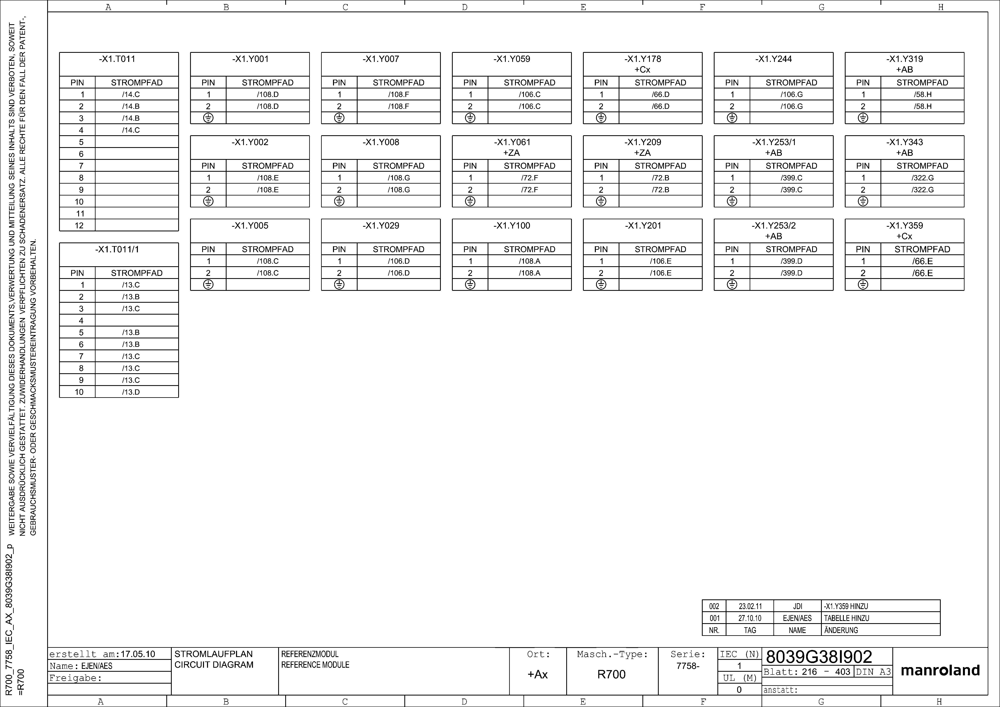

# +Ax — Sheet 216 of 403 — REFERENZMODUL

**REFERENCE MODULE**

> Part of the manroland **R700** printing press IEC/UL circuit diagrams.
> Drawing class: **Stromlaufplan / Circuit diagram** (DIN A3).
> Document `+Ax` covers the **Central control console** machine section.

## At a glance

| Field | Value |
|---|---|
| Document | `+Ax`  (8039G38I902) |
| Sheet | **216** of 403 |
| Section (DE) | REFERENZMODUL |
| Section (EN) | REFERENCE MODULE |
| Section type | REFERENCE_MODULE — Reference module |
| Machine type | `R700` |
| Series | `7758` |
| Created | 17.05.10 |
| Replaces | — |
| Columns used | A, B, C, D, E, F, G, H |
| Path numbers | — |
| Labels on sheet | 187 |
| Cross-refs out | 49 |
| Cross-refs in | 0 |

**Previous:** [+Ax sheet 215](SHEET_0215.md) · **Next:** [+Ax sheet 217](SHEET_0217.md) · **Document TOC:** [_TOC.md](_TOC.md)  (+Ax) · **Master TOC:** [all sheets](../_MASTER_TOC.md)

## Sheet image (300 DPI, exact vector render)



_Rendered directly from the PDF vector layer at 300 DPI (1-bit), no OCR and no resampling. Use it to confirm anything ambiguous in the text below._

## Cross-references on this sheet

Each entry is a wire leaving this sheet. The printed token is `/sheet.column`; the link resolves to that sheet inside the same document.

| Ref | Target sheet | Col | Path | Destination on target | Target section | From col |
|---|---|---|---|---|---|---|
| `/108.F` | [+Ax sheet 108](SHEET_0108.md) | F | — | — | ANLEGER | C |
| `/14.C` | [+Ax sheet 14](SHEET_0014.md) | C | — | — | SPANNUNGSVERSORGUNG, SCHALTSCHRANKBELÜFTUNG | A |
| `/66.D` | [+Ax sheet 66](SHEET_0066.md) | D | — | — | DRUCKLUFTANLAGE | F |
| `/106.G` | [+Ax sheet 106](SHEET_0106.md) | G | — | — | ANLEGER | G |
| `/58.H` | [+Ax sheet 58](SHEET_0058.md) | H | — | — | LUFTVERSORGUNG | H |
| `/108.D` | [+Ax sheet 108](SHEET_0108.md) | D | — | — | ANLEGER | B |
| `/106.C` | [+Ax sheet 106](SHEET_0106.md) | C | — | — | ANLEGER | E |
| `/14.B` | [+Ax sheet 14](SHEET_0014.md) | B | — | — | SPANNUNGSVERSORGUNG, SCHALTSCHRANKBELÜFTUNG | A |
| `/108.F` | [+Ax sheet 108](SHEET_0108.md) | F | — | — | ANLEGER | C |
| `/66.D` | [+Ax sheet 66](SHEET_0066.md) | D | — | — | DRUCKLUFTANLAGE | F |
| `/106.G` | [+Ax sheet 106](SHEET_0106.md) | G | — | — | ANLEGER | G |
| `/58.H` | [+Ax sheet 58](SHEET_0058.md) | H | — | — | LUFTVERSORGUNG | H |
| `/108.D` | [+Ax sheet 108](SHEET_0108.md) | D | — | — | ANLEGER | B |
| `/106.C` | [+Ax sheet 106](SHEET_0106.md) | C | — | — | ANLEGER | E |
| `/14.B` | [+Ax sheet 14](SHEET_0014.md) | B | — | — | SPANNUNGSVERSORGUNG, SCHALTSCHRANKBELÜFTUNG | A |
| `/14.C` | [+Ax sheet 14](SHEET_0014.md) | C | — | — | SPANNUNGSVERSORGUNG, SCHALTSCHRANKBELÜFTUNG | A |
| `/72.B` | [+Ax sheet 72](SHEET_0072.md) | B | — | — | WASCHVORRICHTUNGEN DRUCKWERKE | F |
| `/108.E` | [+Ax sheet 108](SHEET_0108.md) | E | — | — | ANLEGER | B |
| `/72.F` | [+Ax sheet 72](SHEET_0072.md) | F | — | — | WASCHVORRICHTUNGEN DRUCKWERKE | E |
| `/108.G` | [+Ax sheet 108](SHEET_0108.md) | G | — | — | ANLEGER | C |
| `/322.G` | [+Ax sheet 322](SHEET_0322.md) | G | — | — | OPTION: "EJEKTOR" ANLAGE / SELECT AIRSTATION / | H |
| `/399.C` | [+Ax sheet 399](SHEET_0399.md) | C | — | — | OPTION: BOGENSTOPPEINRICHTUNG | G |
| `/72.B` | [+Ax sheet 72](SHEET_0072.md) | B | — | — | WASCHVORRICHTUNGEN DRUCKWERKE | F |
| `/108.E` | [+Ax sheet 108](SHEET_0108.md) | E | — | — | ANLEGER | B |
| `/72.F` | [+Ax sheet 72](SHEET_0072.md) | F | — | — | WASCHVORRICHTUNGEN DRUCKWERKE | E |
| `/108.G` | [+Ax sheet 108](SHEET_0108.md) | G | — | — | ANLEGER | C |
| `/322.G` | [+Ax sheet 322](SHEET_0322.md) | G | — | — | OPTION: "EJEKTOR" ANLAGE / SELECT AIRSTATION / | H |
| `/399.C` | [+Ax sheet 399](SHEET_0399.md) | C | — | — | OPTION: BOGENSTOPPEINRICHTUNG | G |
| `/66.E` | [+Ax sheet 66](SHEET_0066.md) | E | — | — | DRUCKLUFTANLAGE | H |
| `/66.E` | [+Ax sheet 66](SHEET_0066.md) | E | — | — | DRUCKLUFTANLAGE | H |
| `/108.A` | [+Ax sheet 108](SHEET_0108.md) | A | — | — | ANLEGER | E |
| `/106.E` | [+Ax sheet 106](SHEET_0106.md) | E | — | — | ANLEGER | F |
| `/108.C` | [+Ax sheet 108](SHEET_0108.md) | C | — | — | ANLEGER | B |
| `/106.D` | [+Ax sheet 106](SHEET_0106.md) | D | — | — | ANLEGER | C |
| `/399.D` | [+Ax sheet 399](SHEET_0399.md) | D | — | — | OPTION: BOGENSTOPPEINRICHTUNG | G |
| `/108.A` | [+Ax sheet 108](SHEET_0108.md) | A | — | — | ANLEGER | E |
| `/106.E` | [+Ax sheet 106](SHEET_0106.md) | E | — | — | ANLEGER | F |
| `/108.C` | [+Ax sheet 108](SHEET_0108.md) | C | — | — | ANLEGER | B |
| `/106.D` | [+Ax sheet 106](SHEET_0106.md) | D | — | — | ANLEGER | C |
| `/399.D` | [+Ax sheet 399](SHEET_0399.md) | D | — | — | OPTION: BOGENSTOPPEINRICHTUNG | G |
| `/13.C` | [+Ax sheet 13](SHEET_0013.md) | C | — | — | SPANNUNGSVERSORGUNG, SCHALTSCHRANKBELÜFTUNG | A |
| `/13.B` | [+Ax sheet 13](SHEET_0013.md) | B | — | — | SPANNUNGSVERSORGUNG, SCHALTSCHRANKBELÜFTUNG | A |
| `/13.C` | [+Ax sheet 13](SHEET_0013.md) | C | — | — | SPANNUNGSVERSORGUNG, SCHALTSCHRANKBELÜFTUNG | A |
| `/13.B` | [+Ax sheet 13](SHEET_0013.md) | B | — | — | SPANNUNGSVERSORGUNG, SCHALTSCHRANKBELÜFTUNG | A |
| `/13.B` | [+Ax sheet 13](SHEET_0013.md) | B | — | — | SPANNUNGSVERSORGUNG, SCHALTSCHRANKBELÜFTUNG | A |
| `/13.C` | [+Ax sheet 13](SHEET_0013.md) | C | — | — | SPANNUNGSVERSORGUNG, SCHALTSCHRANKBELÜFTUNG | A |
| `/13.C` | [+Ax sheet 13](SHEET_0013.md) | C | — | — | SPANNUNGSVERSORGUNG, SCHALTSCHRANKBELÜFTUNG | A |
| `/13.C` | [+Ax sheet 13](SHEET_0013.md) | C | — | — | SPANNUNGSVERSORGUNG, SCHALTSCHRANKBELÜFTUNG | A |
| `/13.D` | [+Ax sheet 13](SHEET_0013.md) | D | — | — | SPANNUNGSVERSORGUNG, SCHALTSCHRANKBELÜFTUNG | A |

## Devices on this sheet

| Tag | Class | Class meaning (IEC) | Col | Sub | Terminal | Sign |
|---|---|---|---|---|---|---|
| `X1.Y001` | — | cross-device reference | B | — | — | — |
| `X1.Y002` | — | cross-device reference | B | — | — | — |
| `X1.Y005` | — | cross-device reference | B | — | — | — |
| `X1.Y007` | — | cross-device reference | C | — | — | — |
| `X1.Y008` | — | cross-device reference | C | — | — | — |
| `X1.Y029` | — | cross-device reference | C | — | — | — |
| `X1.Y059` | — | cross-device reference | D | — | — | — |
| `X1.Y100` | — | cross-device reference | D | — | — | — |
| `X1.Y061` | — | cross-device reference | D | — | — | — |
| `X1.Y178` | — | cross-device reference | F | — | — | — |
| `X1.Y209` | — | cross-device reference | F | — | — | — |
| `X1.Y201` | — | cross-device reference | F | — | — | — |
| `X1.Y244` | — | cross-device reference | G | — | — | — |
| `X1.Y319` | — | cross-device reference | H | — | — | — |
| `X1.T011` | — | cross-device reference | A | — | — | — |
| `X1.Y343` | — | cross-device reference | H | — | — | — |
| `NR.` | — | cross-device reference | F | — | — | — |
| `27.10.10` | — | cross-device reference | F | — | — | — |
| `X1.Y359` | — | cross-device reference | H | — | — | — |
| `23.02.11` | — | cross-device reference | F | — | — | — |

## Potentials / nets

_No named potentials on this sheet._

## Wire-end annotations (grouped as printed)

A wire that continues elsewhere is annotated with a small cluster: the destination description, the path/line number `#NN`, and the `/sheet.column` cross reference. Each row below is one such cluster exactly as it is grouped on the drawing.

| Col | Y | Path | Cross-ref | Text on the wire |
|---|---|---|---|---|
| A | 65.5 | — | — | `X1.T011` |
| B | 65.6 | — | — | `X1.Y001` |
| C | 65.6 | — | — | `X1.Y007` |
| D | 65.6 | — | — | `X1.Y059` |
| F | 65.6 | — | — | `X1.Y178` |
| G | 65.6 | — | — | `X1.Y244` |
| H | 65.6 | — | — | `X1.Y319` |
| H | 78.2 | — | — | `+AB` |
| E | 78.3 | — | — | `+Cx` |
| A | 94.2 | — | — | `PIN 10 12 11 2 3 4 5 6 7 8 9 1 STROMPFAD` |
| B | 94.2 | — | — | `PIN 2 1 STROMPFAD` |
| C | 94.2 | — | — | `PIN 2 1 STROMPFAD` |
| D | 94.2 | — | — | `PIN 2 1 STROMPFAD` |
| E | 94.2 | — | — | `PIN 2 1 STROMPFAD` |
| G | 94.2 | — | — | `PIN 2 1 STROMPFAD` |
| H | 94.2 | — | — | `PIN 2 1 STROMPFAD` |
| A | 108.7 | — | `/14.C` | — |
| B | 108.7 | — | `/108.D` | — |
| C | 108.7 | — | `/108.F` | — |
| E | 108.7 | — | `/106.C` | — |
| F | 108.7 | — | `/66.D` | — |
| G | 108.7 | — | `/106.G` | — |
| H | 108.7 | — | `/58.H` | — |
| A | 122.8 | — | `/14.B` | — |
| B | 122.9 | — | `/108.D` | — |
| C | 122.9 | — | `/108.F` | — |
| E | 122.9 | — | `/106.C` | — |
| F | 122.9 | — | `/66.D` | — |
| G | 122.9 | — | `/106.G` | — |
| H | 122.9 | — | `/58.H` | — |
| A | 137.0 | — | `/14.B` | — |
| A | 151.2 | — | `/14.C` | — |
| B | 164.8 | — | — | `X1.Y002` |
| C | 164.8 | — | — | `X1.Y008` |
| D | 164.8 | — | — | `X1.Y061` |
| F | 164.8 | — | — | `X1.Y209` |
| G | 164.8 | — | — | `X1.Y253/1` |
| H | 164.8 | — | — | `X1.Y343` |
| D | 177.4 | — | — | `+ZA` |
| E | 177.4 | — | — | `+ZA` |
| G | 177.4 | — | — | `+AB` |
| H | 177.4 | — | — | `+AB` |
| B | 193.4 | — | — | `PIN 2 1 STROMPFAD` |
| C | 193.4 | — | — | `PIN 2 1 STROMPFAD` |
| D | 193.4 | — | — | `PIN 2 1 STROMPFAD` |
| E | 193.4 | — | — | `PIN 2 1 STROMPFAD` |
| G | 193.4 | — | — | `PIN 2 1 STROMPFAD` |
| H | 193.4 | — | — | `PIN 2 1 STROMPFAD` |
| B | 207.9 | — | `/108.E` | — |
| C | 207.9 | — | `/108.G` | — |
| E | 207.9 | — | `/72.F` | — |
| F | 207.9 | — | `/72.B` | — |
| G | 207.9 | — | `/399.C` | — |
| H | 207.9 | — | `/322.G` | — |
| B | 222.1 | — | `/108.E` | — |
| C | 222.1 | — | `/108.G` | — |
| E | 222.1 | — | `/72.F` | — |
| F | 222.1 | — | `/72.B` | — |
| G | 222.1 | — | `/399.C` | — |
| H | 222.1 | — | `/322.G` | — |
| B | 264.0 | — | — | `X1.Y005` |
| C | 264.0 | — | — | `X1.Y029` |
| D | 264.0 | — | — | `X1.Y100` |
| F | 264.0 | — | — | `X1.Y201` |
| G | 264.0 | — | — | `X1.Y253/2` |
| H | 264.0 | — | — | `X1.Y359` |
| G | 276.6 | — | — | `+AB` |
| H | 276.7 | — | — | `+Cx` |
| A | 292.3 | — | — | `X1.T011/1` |
| H | 292.3 | — | — | `PIN 2 1 STROMPFAD` |
| B | 292.6 | — | — | `PIN 2 1 STROMPFAD` |
| C | 292.6 | — | — | `PIN 2 1 STROMPFAD` |
| D | 292.6 | — | — | `PIN 2 1 STROMPFAD` |
| E | 292.6 | — | — | `PIN 2 1 STROMPFAD` |
| G | 292.6 | — | — | `PIN 2 1 STROMPFAD` |
| H | 306.5 | — | `/66.E`, `/66.E` | — |
| B | 307.1 | — | `/108.C` | — |
| C | 307.1 | — | `/106.D` | — |
| E | 307.1 | — | `/108.A` | — |
| F | 307.1 | — | `/106.E` | — |
| G | 307.1 | — | `/399.D` | — |
| A | 320.9 | — | — | `PIN 10 2 3 4 5 6 7 8 9 1 STROMPFAD` |
| B | 321.3 | — | `/108.C` | — |
| C | 321.3 | — | `/106.D` | — |
| E | 321.3 | — | `/108.A` | — |
| F | 321.3 | — | `/106.E` | — |
| G | 321.3 | — | `/399.D` | — |
| A | 335.5 | — | `/13.C` | — |
| A | 349.6 | — | `/13.B` | — |
| A | 363.8 | — | `/13.C` | — |
| A | 392.1 | — | `/13.B` | — |
| A | 406.3 | — | `/13.B` | — |
| A | 420.5 | — | `/13.C` | — |
| A | 434.7 | — | `/13.C` | — |
| A | 448.9 | — | `/13.C` | — |
| A | 463.0 | — | `/13.D` | — |
| G | 718.9 | — | — | `002 23.02.11 JDI X1.Y359 HINZU` |
| G | 733.0 | — | — | `001 27.10.10 EJEN/AES TABELLE HINZU` |
| G | 747.1 | — | — | `NR. TAG NAME ÄNDERUNG` |


## Reconstructed tables

This sheet carries tabular content (pin map / terminal assignment / index). The grid below was rebuilt from the drawing's own rule lines, so each row is exactly one physical row of the table.

### Table 1 — 24 data rows × 2 columns (at x=70.9, y=62.4) — **X1.T011**

| PIN | STROMPFAD |
|---|---|
| `1` | `/14.C` |
| `2` | `/14.B` |
| `3` | `/14.B` |
| `4` | `/14.C` |
| `5` |  |
| `6` |  |
| `7` |  |
| `8` |  |
| `9` |  |
| `10` |  |
| `11` |  |
| `12` |  |
|  | `X1.T011/1` |
| `PIN` | `STROMPFAD` |
| `1` | `/13.C` |
| `2` | `/13.B` |
| `3` | `/13.C` |
| `4` |  |
| `5` | `/13.B` |
| `6` | `/13.B` |
| `7` | `/13.C` |
| `8` | `/13.C` |
| `9` | `/13.C` |
| `10` | `/13.D` |


### Table 2 — 10 data rows × 2 columns (at x=226.8, y=62.4) — **X1.Y001**

| PIN | STROMPFAD |
|---|---|
| `1` | `/108.D` |
| `2` | `/108.D` |
|  | `X1.Y002` |
| `PIN` | `STROMPFAD` |
| `1` | `/108.E` |
| `2` | `/108.E` |
|  | `X1.Y005` |
| `PIN` | `STROMPFAD` |
| `1` | `/108.C` |
| `2` | `/108.C` |


### Table 3 — 10 data rows × 2 columns (at x=382.7, y=62.4) — **X1.Y007**

| PIN | STROMPFAD |
|---|---|
| `1` | `/108.F` |
| `2` | `/108.F` |
|  | `X1.Y008` |
| `PIN` | `STROMPFAD` |
| `1` | `/108.G` |
| `2` | `/108.G` |
|  | `X1.Y029` |
| `PIN` | `STROMPFAD` |
| `1` | `/106.D` |
| `2` | `/106.D` |


### Table 4 — 11 data rows × 2 columns (at x=538.6, y=62.4) — **X1.Y059**

| PIN | STROMPFAD |
|---|---|
| `1` | `/106.C` |
| `2` | `/106.C` |
|  | `X1.Y061` |
|  | `+ZA` |
| `PIN` | `STROMPFAD` |
| `1` | `/72.F` |
| `2` | `/72.F` |
|  | `X1.Y100` |
| `PIN` | `STROMPFAD` |
| `1` | `/108.A` |
| `2` | `/108.A` |


### Table 5 — 11 data rows × 2 columns (at x=694.5, y=62.4) — **X1.Y178 +Cx**

| PIN | STROMPFAD |
|---|---|
| `1` | `/66.D` |
| `2` | `/66.D` |
|  | `X1.Y209` |
|  | `+ZA` |
| `PIN` | `STROMPFAD` |
| `1` | `/72.B` |
| `2` | `/72.B` |
|  | `X1.Y201` |
| `PIN` | `STROMPFAD` |
| `1` | `/106.E` |
| `2` | `/106.E` |


### Table 6 — 12 data rows × 2 columns (at x=850.4, y=62.4) — **X1.Y244**

| PIN | STROMPFAD |
|---|---|
| `1` | `/106.G` |
| `2` | `/106.G` |
|  | `X1.Y253/1` |
|  | `+AB` |
| `PIN` | `STROMPFAD` |
| `1` | `/399.C` |
| `2` | `/399.C` |
|  | `X1.Y253/2` |
|  | `+AB` |
| `PIN` | `STROMPFAD` |
| `1` | `/399.D` |
| `2` | `/399.D` |


### Table 7 — 12 data rows × 2 columns (at x=1006.3, y=62.4) — **X1.Y319 +AB**

| PIN | STROMPFAD |
|---|---|
| `1` | `/58.H` |
| `2` | `/58.H` |
|  | `X1.Y343` |
|  | `+AB` |
| `PIN` | `STROMPFAD` |
| `1` | `/322.G` |
| `2` | `/322.G` |
|  | `X1.Y359` |
|  | `+Cx` |
| `PIN` | `STROMPFAD` |
| `1` | `/66.E` |
| `2` | `/66.E` |


## Notes and free text on this sheet

| Text | Col | Y (pt) |
|---|---|---|
| `PIN` | B | 94.2 |
| `STROMPFAD` | B | 94.15 |
| `PIN` | C | 94.2 |
| `STROMPFAD` | C | 94.15 |
| `PIN` | D | 94.2 |
| `STROMPFAD` | E | 94.15 |
| `+ZA` | D | 177.39 |
| `PIN` | E | 94.2 |
| `STROMPFAD` | F | 94.15 |
| `+Cx` | E | 78.29 |
| `+ZA` | E | 177.39 |
| `PIN` | F | 94.2 |
| `STROMPFAD` | G | 94.15 |
| `X1.Y253/1` | G | 164.77 |
| `+AB` | G | 177.4 |
| `X1.Y253/2` | G | 263.98 |
| `PIN` | G | 94.2 |
| `STROMPFAD` | H | 94.15 |
| `+AB` | H | 78.18 |
| `PIN` | A | 94.2 |
| `STROMPFAD` | A | 94.15 |
| `X1.T011/1` | A | 292.28 |
| `TAG` | F | 747.27 |
| `NAME` | G | 747.25 |
| `ÄNDERUNG` | G | 747.31 |
| `EJEN/AES` | G | 733.09 |
| `TABELLE HINZU` | G | 733.14 |
| `+Cx` | H | 276.72 |
| `JDI` | G | 718.87 |
| `X1.Y359 HINZU` | G | 718.96 |

## Complete label inventory (exact text from the drawing)

Every text object inside the drawing area of this sheet, in DIN reading order (column A→H, then top→bottom). This is the authoritative list: if a string is not here it is not printed on this sheet.

| Col | Y | X | Dir | Type | Text |
|---|---|---|---|---|---|
| A | 65.5 | 117.9 | → | device ref | `X1.T011` |
| A | 94.2 | 84.0 | → | text | `PIN` |
| A | 94.2 | 132.2 | → | text | `STROMPFAD` |
| A | 108.4 | 95.8 | → | number | `1` |
| A | 108.7 | 145.6 | → | cross-reference | `/14.C` |
| A | 122.5 | 94.1 | → | number | `2` |
| A | 122.8 | 145.7 | → | cross-reference | `/14.B` |
| A | 136.7 | 94.1 | → | number | `3` |
| A | 137.0 | 145.7 | → | cross-reference | `/14.B` |
| A | 150.9 | 94.1 | → | number | `4` |
| A | 151.2 | 145.6 | → | cross-reference | `/14.C` |
| A | 165.1 | 94.1 | → | number | `5` |
| A | 179.2 | 94.1 | → | number | `6` |
| A | 193.4 | 94.1 | → | number | `7` |
| A | 207.6 | 94.1 | → | number | `8` |
| A | 221.8 | 94.1 | → | number | `9` |
| A | 235.9 | 88.7 | → | number | `10` |
| A | 250.1 | 90.4 | → | number | `11` |
| A | 264.3 | 88.7 | → | number | `12` |
| A | 292.3 | 113.5 | → | text | `X1.T011/1` |
| A | 320.9 | 132.2 | → | text | `STROMPFAD` |
| A | 321.0 | 84.0 | → | text | `PIN` |
| A | 335.1 | 95.8 | → | number | `1` |
| A | 335.5 | 145.6 | → | cross-reference | `/13.C` |
| A | 349.3 | 94.1 | → | number | `2` |
| A | 349.6 | 145.7 | → | cross-reference | `/13.B` |
| A | 363.5 | 94.1 | → | number | `3` |
| A | 363.8 | 145.6 | → | cross-reference | `/13.C` |
| A | 377.7 | 94.1 | → | number | `4` |
| A | 391.8 | 94.1 | → | number | `5` |
| A | 392.1 | 145.7 | → | cross-reference | `/13.B` |
| A | 406.0 | 94.1 | → | number | `6` |
| A | 406.3 | 145.7 | → | cross-reference | `/13.B` |
| A | 420.2 | 94.1 | → | number | `7` |
| A | 420.5 | 145.6 | → | cross-reference | `/13.C` |
| A | 434.4 | 94.1 | → | number | `8` |
| A | 434.7 | 145.6 | → | cross-reference | `/13.C` |
| A | 448.5 | 94.1 | → | number | `9` |
| A | 448.9 | 145.6 | → | cross-reference | `/13.C` |
| A | 462.7 | 88.7 | → | number | `10` |
| A | 463.0 | 145.6 | → | cross-reference | `/13.D` |
| B | 65.6 | 276.7 | → | device ref | `X1.Y001` |
| B | 94.2 | 240.0 | → | text | `PIN` |
| B | 94.2 | 288.1 | → | text | `STROMPFAD` |
| B | 108.4 | 245.9 | → | number | `1` |
| B | 108.7 | 306.1 | → | cross-reference | `/108.D` |
| B | 122.5 | 245.3 | → | number | `2` |
| B | 122.9 | 306.1 | → | cross-reference | `/108.D` |
| B | 164.8 | 276.0 | → | device ref | `X1.Y002` |
| B | 193.4 | 240.0 | → | text | `PIN` |
| B | 193.4 | 288.1 | → | text | `STROMPFAD` |
| B | 207.6 | 245.9 | → | number | `1` |
| B | 207.9 | 306.4 | → | cross-reference | `/108.E` |
| B | 221.8 | 245.3 | → | number | `2` |
| B | 222.1 | 306.4 | → | cross-reference | `/108.E` |
| B | 264.0 | 276.0 | → | device ref | `X1.Y005` |
| B | 292.6 | 240.0 | → | text | `PIN` |
| B | 292.6 | 288.1 | → | text | `STROMPFAD` |
| B | 306.8 | 245.9 | → | number | `1` |
| B | 307.1 | 306.1 | → | cross-reference | `/108.C` |
| B | 321.0 | 245.3 | → | number | `2` |
| B | 321.3 | 306.1 | → | cross-reference | `/108.C` |
| C | 65.6 | 431.9 | → | device ref | `X1.Y007` |
| C | 94.2 | 395.9 | → | text | `PIN` |
| C | 94.2 | 444.0 | → | text | `STROMPFAD` |
| C | 108.4 | 401.8 | → | number | `1` |
| C | 108.7 | 462.5 | → | cross-reference | `/108.F` |
| C | 122.5 | 401.2 | → | number | `2` |
| C | 122.9 | 462.5 | → | cross-reference | `/108.F` |
| C | 164.8 | 431.9 | → | device ref | `X1.Y008` |
| C | 193.4 | 395.9 | → | text | `PIN` |
| C | 193.4 | 444.0 | → | text | `STROMPFAD` |
| C | 207.6 | 401.8 | → | number | `1` |
| C | 207.9 | 461.9 | → | cross-reference | `/108.G` |
| C | 221.8 | 401.2 | → | number | `2` |
| C | 222.1 | 461.9 | → | cross-reference | `/108.G` |
| C | 264.0 | 431.9 | → | device ref | `X1.Y029` |
| C | 292.6 | 395.9 | → | text | `PIN` |
| C | 292.6 | 444.0 | → | text | `STROMPFAD` |
| C | 306.8 | 401.8 | → | number | `1` |
| C | 307.1 | 462.0 | → | cross-reference | `/106.D` |
| C | 321.0 | 401.2 | → | number | `2` |
| C | 321.3 | 462.0 | → | cross-reference | `/106.D` |
| D | 65.6 | 587.8 | → | device ref | `X1.Y059` |
| D | 94.2 | 551.8 | → | text | `PIN` |
| D | 108.4 | 557.7 | → | number | `1` |
| D | 122.5 | 557.1 | → | number | `2` |
| D | 164.8 | 588.5 | → | device ref | `X1.Y061` |
| D | 177.4 | 599.1 | → | text | `+ZA` |
| D | 193.4 | 551.8 | → | text | `PIN` |
| D | 207.6 | 557.7 | → | number | `1` |
| D | 221.8 | 557.1 | → | number | `2` |
| D | 264.0 | 587.8 | → | device ref | `X1.Y100` |
| D | 292.6 | 551.8 | → | text | `PIN` |
| D | 306.8 | 557.7 | → | number | `1` |
| D | 321.0 | 557.1 | → | number | `2` |
| E | 78.3 | 755.6 | → | text | `+Cx` |
| E | 94.2 | 600.0 | → | text | `STROMPFAD` |
| E | 94.2 | 707.7 | → | text | `PIN` |
| E | 108.4 | 713.6 | → | number | `1` |
| E | 108.7 | 618.0 | → | cross-reference | `/106.C` |
| E | 122.5 | 713.1 | → | number | `2` |
| E | 122.9 | 618.0 | → | cross-reference | `/106.C` |
| E | 177.4 | 755.0 | → | text | `+ZA` |
| E | 193.4 | 600.0 | → | text | `STROMPFAD` |
| E | 193.4 | 707.7 | → | text | `PIN` |
| E | 207.6 | 713.6 | → | number | `1` |
| E | 207.9 | 620.8 | → | cross-reference | `/72.F` |
| E | 221.8 | 713.1 | → | number | `2` |
| E | 222.1 | 620.8 | → | cross-reference | `/72.F` |
| E | 292.6 | 600.0 | → | text | `STROMPFAD` |
| E | 292.6 | 707.7 | → | text | `PIN` |
| E | 306.8 | 713.6 | → | number | `1` |
| E | 307.1 | 618.0 | → | cross-reference | `/108.A` |
| E | 321.0 | 713.1 | → | number | `2` |
| E | 321.3 | 618.0 | → | cross-reference | `/108.A` |
| F | 65.6 | 743.7 | → | device ref | `X1.Y178` |
| F | 94.2 | 755.9 | → | text | `STROMPFAD` |
| F | 94.2 | 863.6 | → | text | `PIN` |
| F | 108.4 | 869.5 | → | number | `1` |
| F | 108.7 | 776.3 | → | cross-reference | `/66.D` |
| F | 122.5 | 869.0 | → | number | `2` |
| F | 122.9 | 776.3 | → | cross-reference | `/66.D` |
| F | 164.8 | 743.7 | → | device ref | `X1.Y209` |
| F | 193.4 | 755.9 | → | text | `STROMPFAD` |
| F | 193.4 | 863.6 | → | text | `PIN` |
| F | 207.6 | 869.5 | → | number | `1` |
| F | 207.9 | 776.4 | → | cross-reference | `/72.B` |
| F | 221.8 | 869.0 | → | number | `2` |
| F | 222.1 | 776.4 | → | cross-reference | `/72.B` |
| F | 264.0 | 744.4 | → | device ref | `X1.Y201` |
| F | 292.6 | 755.9 | → | text | `STROMPFAD` |
| F | 292.6 | 863.6 | → | text | `PIN` |
| F | 306.8 | 869.5 | → | number | `1` |
| F | 307.1 | 774.1 | → | cross-reference | `/106.E` |
| F | 321.0 | 869.0 | → | number | `2` |
| F | 321.3 | 774.1 | → | cross-reference | `/106.E` |
| F | 718.9 | 880.0 | → | device ref | `23.02.11` |
| F | 719.0 | 844.6 | → | number | `002` |
| F | 733.0 | 845.2 | → | number | `001` |
| F | 733.1 | 879.3 | → | device ref | `27.10.10` |
| F | 747.1 | 844.2 | → | device ref | `NR.` |
| F | 747.3 | 885.8 | → | text | `TAG` |
| G | 65.6 | 899.6 | → | device ref | `X1.Y244` |
| G | 94.2 | 911.8 | → | text | `STROMPFAD` |
| G | 94.2 | 1019.5 | → | text | `PIN` |
| G | 108.4 | 1025.4 | → | number | `1` |
| G | 108.7 | 929.6 | → | cross-reference | `/106.G` |
| G | 122.5 | 1024.9 | → | number | `2` |
| G | 122.9 | 929.6 | → | cross-reference | `/106.G` |
| G | 164.8 | 895.9 | → | text | `X1.Y253/1` |
| G | 177.4 | 911.1 | → | text | `+AB` |
| G | 193.4 | 911.8 | → | text | `STROMPFAD` |
| G | 193.4 | 1019.5 | → | text | `PIN` |
| G | 207.6 | 1025.4 | → | number | `1` |
| G | 207.9 | 929.8 | → | cross-reference | `/399.C` |
| G | 221.8 | 1024.9 | → | number | `2` |
| G | 222.1 | 929.8 | → | cross-reference | `/399.C` |
| G | 264.0 | 895.2 | → | text | `X1.Y253/2` |
| G | 276.6 | 911.1 | → | text | `+AB` |
| G | 292.4 | 1018.9 | → | text | `PIN` |
| G | 292.6 | 911.8 | → | text | `STROMPFAD` |
| G | 306.4 | 1025.0 | → | number | `1` |
| G | 307.1 | 929.8 | → | cross-reference | `/399.D` |
| G | 320.6 | 1024.7 | → | number | `2` |
| G | 321.3 | 929.8 | → | cross-reference | `/399.D` |
| G | 718.9 | 944.5 | → | text | `JDI` |
| G | 719.0 | 981.2 | → | text | `X1.Y359 HINZU` |
| G | 733.1 | 932.4 | → | text | `EJEN/AES` |
| G | 733.1 | 981.2 | → | text | `TABELLE HINZU` |
| G | 747.3 | 939.2 | → | text | `NAME` |
| G | 747.3 | 981.8 | → | text | `ÄNDERUNG` |
| H | 65.6 | 1055.5 | → | device ref | `X1.Y319` |
| H | 78.2 | 1067.0 | → | text | `+AB` |
| H | 94.2 | 1067.7 | → | text | `STROMPFAD` |
| H | 108.7 | 1088.4 | → | cross-reference | `/58.H` |
| H | 122.9 | 1088.4 | → | cross-reference | `/58.H` |
| H | 164.8 | 1055.5 | → | device ref | `X1.Y343` |
| H | 177.4 | 1067.0 | → | text | `+AB` |
| H | 193.4 | 1067.7 | → | text | `STROMPFAD` |
| H | 207.9 | 1085.5 | → | cross-reference | `/322.G` |
| H | 222.1 | 1085.5 | → | cross-reference | `/322.G` |
| H | 264.0 | 1055.5 | → | device ref | `X1.Y359` |
| H | 276.7 | 1067.4 | → | text | `+Cx` |
| H | 292.3 | 1065.1 | → | text | `STROMPFAD` |
| H | 306.5 | 1086.4 | → | cross-reference | `/66.E` |
| H | 320.6 | 1086.4 | → | cross-reference | `/66.E` |

## Reading-order text block

The same content as a plain block, grouped by DIN column — convenient to paste or to match against a visual description.

```text
=== Column A ===
  65.5  117.9  devref       X1.T011
  94.2   84.0  text         PIN
  94.2  132.2  text         STROMPFAD
 108.4   95.8  numeric      1
 108.7  145.6  xref         /14.C
 122.5   94.1  numeric      2
 122.8  145.7  xref         /14.B
 136.7   94.1  numeric      3
 137.0  145.7  xref         /14.B
 150.9   94.1  numeric      4
 151.2  145.6  xref         /14.C
 165.1   94.1  numeric      5
 179.2   94.1  numeric      6
 193.4   94.1  numeric      7
 207.6   94.1  numeric      8
 221.8   94.1  numeric      9
 235.9   88.7  numeric      10
 250.1   90.4  numeric      11
 264.3   88.7  numeric      12
 292.3  113.5  text         X1.T011/1
 320.9  132.2  text         STROMPFAD
 321.0   84.0  text         PIN
 335.1   95.8  numeric      1
 335.5  145.6  xref         /13.C
 349.3   94.1  numeric      2
 349.6  145.7  xref         /13.B
 363.5   94.1  numeric      3
 363.8  145.6  xref         /13.C
 377.7   94.1  numeric      4
 391.8   94.1  numeric      5
 392.1  145.7  xref         /13.B
 406.0   94.1  numeric      6
 406.3  145.7  xref         /13.B
 420.2   94.1  numeric      7
 420.5  145.6  xref         /13.C
 434.4   94.1  numeric      8
 434.7  145.6  xref         /13.C
 448.5   94.1  numeric      9
 448.9  145.6  xref         /13.C
 462.7   88.7  numeric      10
 463.0  145.6  xref         /13.D
=== Column B ===
  65.6  276.7  devref       X1.Y001
  94.2  240.0  text         PIN
  94.2  288.1  text         STROMPFAD
 108.4  245.9  numeric      1
 108.7  306.1  xref         /108.D
 122.5  245.3  numeric      2
 122.9  306.1  xref         /108.D
 164.8  276.0  devref       X1.Y002
 193.4  240.0  text         PIN
 193.4  288.1  text         STROMPFAD
 207.6  245.9  numeric      1
 207.9  306.4  xref         /108.E
 221.8  245.3  numeric      2
 222.1  306.4  xref         /108.E
 264.0  276.0  devref       X1.Y005
 292.6  240.0  text         PIN
 292.6  288.1  text         STROMPFAD
 306.8  245.9  numeric      1
 307.1  306.1  xref         /108.C
 321.0  245.3  numeric      2
 321.3  306.1  xref         /108.C
=== Column C ===
  65.6  431.9  devref       X1.Y007
  94.2  395.9  text         PIN
  94.2  444.0  text         STROMPFAD
 108.4  401.8  numeric      1
 108.7  462.5  xref         /108.F
 122.5  401.2  numeric      2
 122.9  462.5  xref         /108.F
 164.8  431.9  devref       X1.Y008
 193.4  395.9  text         PIN
 193.4  444.0  text         STROMPFAD
 207.6  401.8  numeric      1
 207.9  461.9  xref         /108.G
 221.8  401.2  numeric      2
 222.1  461.9  xref         /108.G
 264.0  431.9  devref       X1.Y029
 292.6  395.9  text         PIN
 292.6  444.0  text         STROMPFAD
 306.8  401.8  numeric      1
 307.1  462.0  xref         /106.D
 321.0  401.2  numeric      2
 321.3  462.0  xref         /106.D
=== Column D ===
  65.6  587.8  devref       X1.Y059
  94.2  551.8  text         PIN
 108.4  557.7  numeric      1
 122.5  557.1  numeric      2
 164.8  588.5  devref       X1.Y061
 177.4  599.1  text         +ZA
 193.4  551.8  text         PIN
 207.6  557.7  numeric      1
 221.8  557.1  numeric      2
 264.0  587.8  devref       X1.Y100
 292.6  551.8  text         PIN
 306.8  557.7  numeric      1
 321.0  557.1  numeric      2
=== Column E ===
  78.3  755.6  text         +Cx
  94.2  600.0  text         STROMPFAD
  94.2  707.7  text         PIN
 108.4  713.6  numeric      1
 108.7  618.0  xref         /106.C
 122.5  713.1  numeric      2
 122.9  618.0  xref         /106.C
 177.4  755.0  text         +ZA
 193.4  600.0  text         STROMPFAD
 193.4  707.7  text         PIN
 207.6  713.6  numeric      1
 207.9  620.8  xref         /72.F
 221.8  713.1  numeric      2
 222.1  620.8  xref         /72.F
 292.6  600.0  text         STROMPFAD
 292.6  707.7  text         PIN
 306.8  713.6  numeric      1
 307.1  618.0  xref         /108.A
 321.0  713.1  numeric      2
 321.3  618.0  xref         /108.A
=== Column F ===
  65.6  743.7  devref       X1.Y178
  94.2  755.9  text         STROMPFAD
  94.2  863.6  text         PIN
 108.4  869.5  numeric      1
 108.7  776.3  xref         /66.D
 122.5  869.0  numeric      2
 122.9  776.3  xref         /66.D
 164.8  743.7  devref       X1.Y209
 193.4  755.9  text         STROMPFAD
 193.4  863.6  text         PIN
 207.6  869.5  numeric      1
 207.9  776.4  xref         /72.B
 221.8  869.0  numeric      2
 222.1  776.4  xref         /72.B
 264.0  744.4  devref       X1.Y201
 292.6  755.9  text         STROMPFAD
 292.6  863.6  text         PIN
 306.8  869.5  numeric      1
 307.1  774.1  xref         /106.E
 321.0  869.0  numeric      2
 321.3  774.1  xref         /106.E
 718.9  880.0  devref       23.02.11
 719.0  844.6  numeric      002
 733.0  845.2  numeric      001
 733.1  879.3  devref       27.10.10
 747.1  844.2  devref       NR.
 747.3  885.8  text         TAG
=== Column G ===
  65.6  899.6  devref       X1.Y244
  94.2  911.8  text         STROMPFAD
  94.2 1019.5  text         PIN
 108.4 1025.4  numeric      1
 108.7  929.6  xref         /106.G
 122.5 1024.9  numeric      2
 122.9  929.6  xref         /106.G
 164.8  895.9  text         X1.Y253/1
 177.4  911.1  text         +AB
 193.4  911.8  text         STROMPFAD
 193.4 1019.5  text         PIN
 207.6 1025.4  numeric      1
 207.9  929.8  xref         /399.C
 221.8 1024.9  numeric      2
 222.1  929.8  xref         /399.C
 264.0  895.2  text         X1.Y253/2
 276.6  911.1  text         +AB
 292.4 1018.9  text         PIN
 292.6  911.8  text         STROMPFAD
 306.4 1025.0  numeric      1
 307.1  929.8  xref         /399.D
 320.6 1024.7  numeric      2
 321.3  929.8  xref         /399.D
 718.9  944.5  text         JDI
 719.0  981.2  text         X1.Y359 HINZU
 733.1  932.4  text         EJEN/AES
 733.1  981.2  text         TABELLE HINZU
 747.3  939.2  text         NAME
 747.3  981.8  text         ÄNDERUNG
=== Column H ===
  65.6 1055.5  devref       X1.Y319
  78.2 1067.0  text         +AB
  94.2 1067.7  text         STROMPFAD
 108.7 1088.4  xref         /58.H
 122.9 1088.4  xref         /58.H
 164.8 1055.5  devref       X1.Y343
 177.4 1067.0  text         +AB
 193.4 1067.7  text         STROMPFAD
 207.9 1085.5  xref         /322.G
 222.1 1085.5  xref         /322.G
 264.0 1055.5  devref       X1.Y359
 276.7 1067.4  text         +Cx
 292.3 1065.1  text         STROMPFAD
 306.5 1086.4  xref         /66.E
 320.6 1086.4  xref         /66.E
```

---
_Generated from the PDF vector text layer; no OCR. Source: `R700_7758_IEC_AX_8039G38I902_p`, sheet 216._
