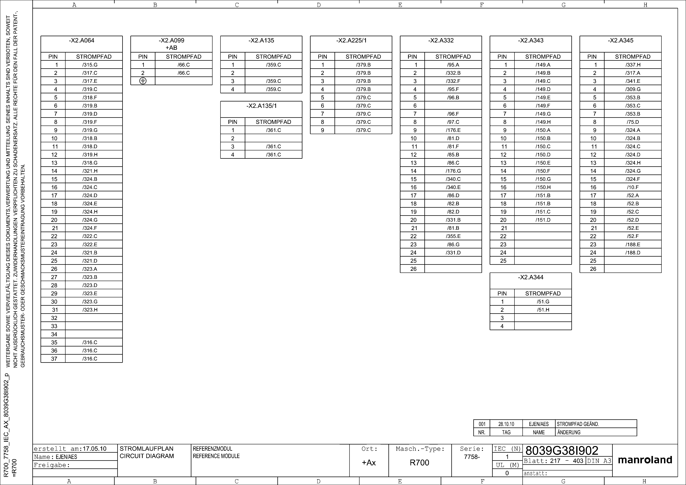

# +Ax — Sheet 217 of 403 — REFERENZMODUL

**REFERENCE MODULE**

> Part of the manroland **R700** printing press IEC/UL circuit diagrams.
> Drawing class: **Stromlaufplan / Circuit diagram** (DIN A3).
> Document `+Ax` covers the **Central control console** machine section.

## At a glance

| Field | Value |
|---|---|
| Document | `+Ax`  (8039G38I902) |
| Sheet | **217** of 403 |
| Section (DE) | REFERENZMODUL |
| Section (EN) | REFERENCE MODULE |
| Section type | REFERENCE_MODULE — Reference module |
| Machine type | `R700` |
| Series | `7758` |
| Created | 17.05.10 |
| Replaces | — |
| Columns used | A, B, C, D, E, F, G, H |
| Path numbers | — |
| Labels on sheet | 293 |
| Cross-refs out | 120 |
| Cross-refs in | 0 |

**Previous:** [+Ax sheet 216](SHEET_0216.md) · **Next:** [+Ax sheet 218](SHEET_0218.md) · **Document TOC:** [_TOC.md](_TOC.md)  (+Ax) · **Master TOC:** [all sheets](../_MASTER_TOC.md)

## Sheet image (300 DPI, exact vector render)



_Rendered directly from the PDF vector layer at 300 DPI (1-bit), no OCR and no resampling. Use it to confirm anything ambiguous in the text below._

## Cross-references on this sheet

Each entry is a wire leaving this sheet. The printed token is `/sheet.column`; the link resolves to that sheet inside the same document.

| Ref | Target sheet | Col | Path | Destination on target | Target section | From col |
|---|---|---|---|---|---|---|
| `/95.A` | [+Ax sheet 95](SHEET_0095.md) | A | — | — | ANLEGER | F |
| `/379.B` | [+Ax sheet 379](SHEET_0379.md) | B | — | — | OPTION: TELEPRESENCE | E |
| `/149.A` | [+Ax sheet 149](SHEET_0149.md) | A | — | — | ÜBERWACHUNGSRECHNER SICHERHEITSBUS | G |
| `/315.G` | [+Ax sheet 315](SHEET_0315.md) | G | — | — | OPTION: "EJEKTOR" ANLAGE / SELECT AIRSTATION / | A |
| `/66.C` | [+Ax sheet 66](SHEET_0066.md) | C | — | — | DRUCKLUFTANLAGE | B |
| `/359.C` | [+Ax sheet 359](SHEET_0359.md) | C | — | — | OPTION: LOGISTIK ANLEGER | C |
| `/337.H` | [+Ax sheet 337](SHEET_0337.md) | H | — | — | OPTION: INLINESHEETER RS104 S | H |
| `/379.B` | [+Ax sheet 379](SHEET_0379.md) | B | — | — | OPTION: TELEPRESENCE | E |
| `/332.B` | [+Ax sheet 332](SHEET_0332.md) | B | — | — | OPTION: NONSTOP EINRICHTUNG MANUELL, ANLEGER | F |
| `/149.B` | [+Ax sheet 149](SHEET_0149.md) | B | — | — | ÜBERWACHUNGSRECHNER SICHERHEITSBUS | G |
| `/317.A` | [+Ax sheet 317](SHEET_0317.md) | A | — | — | OPTION: "EJEKTOR" ANLAGE / SELECT AIRSTATION / | H |
| `/66.C` | [+Ax sheet 66](SHEET_0066.md) | C | — | — | DRUCKLUFTANLAGE | B |
| `/317.C` | [+Ax sheet 317](SHEET_0317.md) | C | — | — | OPTION: "EJEKTOR" ANLAGE / SELECT AIRSTATION / | A |
| `/317.E` | [+Ax sheet 317](SHEET_0317.md) | E | — | — | OPTION: "EJEKTOR" ANLAGE / SELECT AIRSTATION / | A |
| `/379.B` | [+Ax sheet 379](SHEET_0379.md) | B | — | — | OPTION: TELEPRESENCE | E |
| `/332.F` | [+Ax sheet 332](SHEET_0332.md) | F | — | — | OPTION: NONSTOP EINRICHTUNG MANUELL, ANLEGER | F |
| `/341.E` | [+Ax sheet 341](SHEET_0341.md) | E | — | — | OPTION: INLINESHEETER RS104 S | H |
| `/359.C` | [+Ax sheet 359](SHEET_0359.md) | C | — | — | OPTION: LOGISTIK ANLEGER | C |
| `/149.C` | [+Ax sheet 149](SHEET_0149.md) | C | — | — | ÜBERWACHUNGSRECHNER SICHERHEITSBUS | G |
| `/379.B` | [+Ax sheet 379](SHEET_0379.md) | B | — | — | OPTION: TELEPRESENCE | E |
| `/95.F` | [+Ax sheet 95](SHEET_0095.md) | F | — | — | ANLEGER | F |
| `/309.G` | [+Ax sheet 309](SHEET_0309.md) | G | — | — | OPTION: FARBWERKTEMPERIERUNG | H |
| `/319.C` | [+Ax sheet 319](SHEET_0319.md) | C | — | — | OPTION: "EJEKTOR" ANLAGE / SELECT AIRSTATION / | A |
| `/359.C` | [+Ax sheet 359](SHEET_0359.md) | C | — | — | OPTION: LOGISTIK ANLEGER | C |
| `/149.D` | [+Ax sheet 149](SHEET_0149.md) | D | — | — | ÜBERWACHUNGSRECHNER SICHERHEITSBUS | G |
| `/96.B` | [+Ax sheet 96](SHEET_0096.md) | B | — | — | ANLEGER | F |
| `/149.E` | [+Ax sheet 149](SHEET_0149.md) | E | — | — | ÜBERWACHUNGSRECHNER SICHERHEITSBUS | G |
| `/353.B` | [+Ax sheet 353](SHEET_0353.md) | B | — | — | OPTION: LOGISTIK ANLEGER | H |
| `/318.F` | [+Ax sheet 318](SHEET_0318.md) | F | — | — | OPTION: "EJEKTOR" ANLAGE / SELECT AIRSTATION / | A |
| `/379.C` | [+Ax sheet 379](SHEET_0379.md) | C | — | — | OPTION: TELEPRESENCE | E |
| `/319.B` | [+Ax sheet 319](SHEET_0319.md) | B | — | — | OPTION: "EJEKTOR" ANLAGE / SELECT AIRSTATION / | A |
| `/149.F` | [+Ax sheet 149](SHEET_0149.md) | F | — | — | ÜBERWACHUNGSRECHNER SICHERHEITSBUS | G |
| `/379.C` | [+Ax sheet 379](SHEET_0379.md) | C | — | — | OPTION: TELEPRESENCE | E |
| `/353.C` | [+Ax sheet 353](SHEET_0353.md) | C | — | — | OPTION: LOGISTIK ANLEGER | H |
| `/96.F` | [+Ax sheet 96](SHEET_0096.md) | F | — | — | ANLEGER | F |
| `/353.B` | [+Ax sheet 353](SHEET_0353.md) | B | — | — | OPTION: LOGISTIK ANLEGER | H |
| `/149.G` | [+Ax sheet 149](SHEET_0149.md) | G | — | — | ÜBERWACHUNGSRECHNER SICHERHEITSBUS | G |
| `/319.D` | [+Ax sheet 319](SHEET_0319.md) | D | — | — | OPTION: "EJEKTOR" ANLAGE / SELECT AIRSTATION / | A |
| `/379.C` | [+Ax sheet 379](SHEET_0379.md) | C | — | — | OPTION: TELEPRESENCE | E |
| `/319.F` | [+Ax sheet 319](SHEET_0319.md) | F | — | — | OPTION: "EJEKTOR" ANLAGE / SELECT AIRSTATION / | A |
| `/97.C` | [+Ax sheet 97](SHEET_0097.md) | C | — | — | ANLEGER | F |
| `/75.D` | [+Ax sheet 75](SHEET_0075.md) | D | — | — | FEUCHTMITTELKÜHLGERÄT | H |
| `/379.C` | [+Ax sheet 379](SHEET_0379.md) | C | — | — | OPTION: TELEPRESENCE | E |
| `/149.H` | [+Ax sheet 149](SHEET_0149.md) | H | — | — | ÜBERWACHUNGSRECHNER SICHERHEITSBUS | G |
| `/176.E` | [+Ax sheet 176](SHEET_0176.md) | E | — | — | RESERVE | F |
| `/150.A` | [+Ax sheet 150](SHEET_0150.md) | A | — | — | ÜBERWACHUNGSRECHNER SICHERHEITSBUS | G |
| `/324.A` | [+Ax sheet 324](SHEET_0324.md) | A | — | — | OPTION: "EJEKTOR" ANLAGE / SELECT AIRSTATION / | H |
| `/319.G` | [+Ax sheet 319](SHEET_0319.md) | G | — | — | OPTION: "EJEKTOR" ANLAGE / SELECT AIRSTATION / | A |
| `/361.C` | [+Ax sheet 361](SHEET_0361.md) | C | — | — | OPTION: LOGISTIK ANLEGER | C |
| `/379.C` | [+Ax sheet 379](SHEET_0379.md) | C | — | — | OPTION: TELEPRESENCE | E |
| `/318.B` | [+Ax sheet 318](SHEET_0318.md) | B | — | — | OPTION: "EJEKTOR" ANLAGE / SELECT AIRSTATION / | A |
| `/150.B` | [+Ax sheet 150](SHEET_0150.md) | B | — | — | ÜBERWACHUNGSRECHNER SICHERHEITSBUS | G |
| `/324.B` | [+Ax sheet 324](SHEET_0324.md) | B | — | — | OPTION: "EJEKTOR" ANLAGE / SELECT AIRSTATION / | H |
| `/81.D` | [+Ax sheet 81](SHEET_0081.md) | D | — | — | ANLEGER | F |
| `/81.F` | [+Ax sheet 81](SHEET_0081.md) | F | — | — | ANLEGER | F |
| `/318.D` | [+Ax sheet 318](SHEET_0318.md) | D | — | — | OPTION: "EJEKTOR" ANLAGE / SELECT AIRSTATION / | A |
| `/361.C` | [+Ax sheet 361](SHEET_0361.md) | C | — | — | OPTION: LOGISTIK ANLEGER | C |
| `/150.C` | [+Ax sheet 150](SHEET_0150.md) | C | — | — | ÜBERWACHUNGSRECHNER SICHERHEITSBUS | G |
| `/324.C` | [+Ax sheet 324](SHEET_0324.md) | C | — | — | OPTION: "EJEKTOR" ANLAGE / SELECT AIRSTATION / | H |
| `/85.B` | [+Ax sheet 85](SHEET_0085.md) | B | — | — | ANLEGER | F |
| `/319.H` | [+Ax sheet 319](SHEET_0319.md) | H | — | — | OPTION: "EJEKTOR" ANLAGE / SELECT AIRSTATION / | A |
| `/361.C` | [+Ax sheet 361](SHEET_0361.md) | C | — | — | OPTION: LOGISTIK ANLEGER | C |
| `/150.D` | [+Ax sheet 150](SHEET_0150.md) | D | — | — | ÜBERWACHUNGSRECHNER SICHERHEITSBUS | G |
| `/324.D` | [+Ax sheet 324](SHEET_0324.md) | D | — | — | OPTION: "EJEKTOR" ANLAGE / SELECT AIRSTATION / | H |
| `/150.E` | [+Ax sheet 150](SHEET_0150.md) | E | — | — | ÜBERWACHUNGSRECHNER SICHERHEITSBUS | G |
| `/318.G` | [+Ax sheet 318](SHEET_0318.md) | G | — | — | OPTION: "EJEKTOR" ANLAGE / SELECT AIRSTATION / | A |
| `/86.C` | [+Ax sheet 86](SHEET_0086.md) | C | — | — | ANLEGER | F |
| `/324.H` | [+Ax sheet 324](SHEET_0324.md) | H | — | — | OPTION: "EJEKTOR" ANLAGE / SELECT AIRSTATION / | H |
| `/150.F` | [+Ax sheet 150](SHEET_0150.md) | F | — | — | ÜBERWACHUNGSRECHNER SICHERHEITSBUS | G |
| `/176.G` | [+Ax sheet 176](SHEET_0176.md) | G | — | — | RESERVE | F |
| `/324.G` | [+Ax sheet 324](SHEET_0324.md) | G | — | — | OPTION: "EJEKTOR" ANLAGE / SELECT AIRSTATION / | H |
| `/321.H` | [+Ax sheet 321](SHEET_0321.md) | H | — | — | OPTION: "EJEKTOR" ANLAGE / SELECT AIRSTATION / | A |
| `/324.B` | [+Ax sheet 324](SHEET_0324.md) | B | — | — | OPTION: "EJEKTOR" ANLAGE / SELECT AIRSTATION / | A |
| `/324.F` | [+Ax sheet 324](SHEET_0324.md) | F | — | — | OPTION: "EJEKTOR" ANLAGE / SELECT AIRSTATION / | H |
| `/150.G` | [+Ax sheet 150](SHEET_0150.md) | G | — | — | ÜBERWACHUNGSRECHNER SICHERHEITSBUS | G |
| `/340.C` | [+Ax sheet 340](SHEET_0340.md) | C | — | — | OPTION: INLINESHEETER RS104 S | F |
| `/10.F` | [+Ax sheet 10](SHEET_0010.md) | F | — | — | SPANNUNGSVERSORGUNG, SCHALTSCHRANKBELÜFTUNG | H |
| `/340.E` | [+Ax sheet 340](SHEET_0340.md) | E | — | — | OPTION: INLINESHEETER RS104 S | F |
| `/324.C` | [+Ax sheet 324](SHEET_0324.md) | C | — | — | OPTION: "EJEKTOR" ANLAGE / SELECT AIRSTATION / | A |
| `/150.H` | [+Ax sheet 150](SHEET_0150.md) | H | — | — | ÜBERWACHUNGSRECHNER SICHERHEITSBUS | G |
| `/52.A` | [+Ax sheet 52](SHEET_0052.md) | A | — | — | SIGNALGEBER: AKUSTISCHE WARNSIGNALE | H |
| `/151.B` | [+Ax sheet 151](SHEET_0151.md) | B | — | — | ÜBERWACHUNGSRECHNER SICHERHEITSBUS | G |
| `/86.D` | [+Ax sheet 86](SHEET_0086.md) | D | — | — | ANLEGER | F |
| `/324.D` | [+Ax sheet 324](SHEET_0324.md) | D | — | — | OPTION: "EJEKTOR" ANLAGE / SELECT AIRSTATION / | A |
| `/82.B` | [+Ax sheet 82](SHEET_0082.md) | B | — | — | ANLEGER | F |
| `/52.B` | [+Ax sheet 52](SHEET_0052.md) | B | — | — | SIGNALGEBER: AKUSTISCHE WARNSIGNALE | H |
| `/324.E` | [+Ax sheet 324](SHEET_0324.md) | E | — | — | OPTION: "EJEKTOR" ANLAGE / SELECT AIRSTATION / | A |
| `/151.B` | [+Ax sheet 151](SHEET_0151.md) | B | — | — | ÜBERWACHUNGSRECHNER SICHERHEITSBUS | G |
| `/324.H` | [+Ax sheet 324](SHEET_0324.md) | H | — | — | OPTION: "EJEKTOR" ANLAGE / SELECT AIRSTATION / | A |
| `/82.D` | [+Ax sheet 82](SHEET_0082.md) | D | — | — | ANLEGER | F |
| `/151.C` | [+Ax sheet 151](SHEET_0151.md) | C | — | — | ÜBERWACHUNGSRECHNER SICHERHEITSBUS | G |
| `/52.C` | [+Ax sheet 52](SHEET_0052.md) | C | — | — | SIGNALGEBER: AKUSTISCHE WARNSIGNALE | H |
| `/331.B` | [+Ax sheet 331](SHEET_0331.md) | B | — | — | OPTION: NONSTOP EINRICHTUNG MANUELL, ANLEGER | F |
| `/324.G` | [+Ax sheet 324](SHEET_0324.md) | G | — | — | OPTION: "EJEKTOR" ANLAGE / SELECT AIRSTATION / | A |
| `/52.D` | [+Ax sheet 52](SHEET_0052.md) | D | — | — | SIGNALGEBER: AKUSTISCHE WARNSIGNALE | H |
| `/151.D` | [+Ax sheet 151](SHEET_0151.md) | D | — | — | ÜBERWACHUNGSRECHNER SICHERHEITSBUS | G |
| `/81.B` | [+Ax sheet 81](SHEET_0081.md) | B | — | — | ANLEGER | F |
| `/52.E` | [+Ax sheet 52](SHEET_0052.md) | E | — | — | SIGNALGEBER: AKUSTISCHE WARNSIGNALE | H |
| `/324.F` | [+Ax sheet 324](SHEET_0324.md) | F | — | — | OPTION: "EJEKTOR" ANLAGE / SELECT AIRSTATION / | A |
| `/52.F` | [+Ax sheet 52](SHEET_0052.md) | F | — | — | SIGNALGEBER: AKUSTISCHE WARNSIGNALE | H |
| `/355.E` | [+Ax sheet 355](SHEET_0355.md) | E | — | — | OPTION: LOGISTIK ANLEGER | F |
| `/322.C` | [+Ax sheet 322](SHEET_0322.md) | C | — | — | OPTION: "EJEKTOR" ANLAGE / SELECT AIRSTATION / | A |
| `/322.E` | [+Ax sheet 322](SHEET_0322.md) | E | — | — | OPTION: "EJEKTOR" ANLAGE / SELECT AIRSTATION / | A |
| `/188.E` | [+Ax sheet 188](SHEET_0188.md) | E | — | — | RESERVE | H |
| `/86.G` | [+Ax sheet 86](SHEET_0086.md) | G | — | — | ANLEGER | F |
| `/321.B` | [+Ax sheet 321](SHEET_0321.md) | B | — | — | OPTION: "EJEKTOR" ANLAGE / SELECT AIRSTATION / | A |
| `/331.D` | [+Ax sheet 331](SHEET_0331.md) | D | — | — | OPTION: NONSTOP EINRICHTUNG MANUELL, ANLEGER | F |
| `/188.D` | [+Ax sheet 188](SHEET_0188.md) | D | — | — | RESERVE | H |
| `/321.D` | [+Ax sheet 321](SHEET_0321.md) | D | — | — | OPTION: "EJEKTOR" ANLAGE / SELECT AIRSTATION / | A |
| `/323.A` | [+Ax sheet 323](SHEET_0323.md) | A | — | — | OPTION: "EJEKTOR" ANLAGE / SELECT AIRSTATION / | A |
| `/323.B` | [+Ax sheet 323](SHEET_0323.md) | B | — | — | OPTION: "EJEKTOR" ANLAGE / SELECT AIRSTATION / | A |
| `/323.D` | [+Ax sheet 323](SHEET_0323.md) | D | — | — | OPTION: "EJEKTOR" ANLAGE / SELECT AIRSTATION / | A |
| `/323.E` | [+Ax sheet 323](SHEET_0323.md) | E | — | — | OPTION: "EJEKTOR" ANLAGE / SELECT AIRSTATION / | A |
| `/51.G` | [+Ax sheet 51](SHEET_0051.md) | G | — | — | SIGNALGEBER: AKUSTISCHE WARNSIGNALE | G |
| `/323.G` | [+Ax sheet 323](SHEET_0323.md) | G | — | — | OPTION: "EJEKTOR" ANLAGE / SELECT AIRSTATION / | A |
| `/51.H` | [+Ax sheet 51](SHEET_0051.md) | H | — | — | SIGNALGEBER: AKUSTISCHE WARNSIGNALE | G |
| `/323.H` | [+Ax sheet 323](SHEET_0323.md) | H | — | — | OPTION: "EJEKTOR" ANLAGE / SELECT AIRSTATION / | A |
| `/316.C` | [+Ax sheet 316](SHEET_0316.md) | C | — | — | OPTION: "EJEKTOR" ANLAGE / SELECT AIRSTATION / | A |
| `/316.C` | [+Ax sheet 316](SHEET_0316.md) | C | — | — | OPTION: "EJEKTOR" ANLAGE / SELECT AIRSTATION / | A |
| `/316.C` | [+Ax sheet 316](SHEET_0316.md) | C | — | — | OPTION: "EJEKTOR" ANLAGE / SELECT AIRSTATION / | A |

## Devices on this sheet

| Tag | Class | Class meaning (IEC) | Col | Sub | Terminal | Sign |
|---|---|---|---|---|---|---|
| `X2.A064` | — | cross-device reference | A | — | — | — |
| `X2.A099` | — | cross-device reference | B | — | — | — |
| `X2.A332` | — | cross-device reference | F | — | — | — |
| `X2.A343` | — | cross-device reference | G | — | — | — |
| `X2.A345` | — | cross-device reference | H | — | — | — |
| `X2.A344` | — | cross-device reference | G | — | — | — |
| `X2.A135` | — | cross-device reference | C | — | — | — |
| `NR.` | — | cross-device reference | F | — | — | — |
| `28.10.10` | — | cross-device reference | F | — | — | — |

## Potentials / nets

_No named potentials on this sheet._

## Wire-end annotations (grouped as printed)

A wire that continues elsewhere is annotated with a small cluster: the destination description, the path/line number `#NN`, and the `/sheet.column` cross reference. Each row below is one such cluster exactly as it is grouped on the drawing.

| Col | Y | Path | Cross-ref | Text on the wire |
|---|---|---|---|---|
| A | 65.5 | — | — | `X2.A064` |
| B | 65.5 | — | — | `X2.A099` |
| C | 65.5 | — | — | `X2.A135` |
| D | 65.5 | — | — | `X2.A225/1` |
| F | 65.5 | — | — | `X2.A332` |
| G | 65.5 | — | — | `X2.A343` |
| H | 65.5 | — | — | `X2.A345` |
| B | 78.2 | — | — | `+AB` |
| A | 94.2 | — | — | `PIN STROMPFAD` |
| B | 94.2 | — | — | `PIN 2 1 STROMPFAD` |
| C | 94.2 | — | — | `PIN 2 3 4 1 STROMPFAD` |
| D | 94.2 | — | — | `PIN 2 3 4 5 6 7 8 9 1 STROMPFAD` |
| E | 94.2 | — | — | `PIN STROMPFAD` |
| G | 94.2 | — | — | `PIN STROMPFAD` |
| H | 94.2 | — | — | `PIN STROMPFAD` |
| A | 108.4 | — | — | `2 3 4 5 6 7 8 9 1` |
| E | 108.4 | — | — | `2 3 4 5 6 7 8 9 1` |
| F | 108.4 | — | — | `2 3 4 5 6 7 8 9 1` |
| G | 108.4 | — | — | `2 3 4 5 6 7 8 9 1` |
| A | 108.7 | — | `/315.G` | — |
| B | 108.7 | — | `/66.C` | — |
| C | 108.7 | — | `/359.C` | — |
| E | 108.7 | — | `/379.B` | — |
| F | 108.7 | — | `/95.A` | — |
| G | 108.7 | — | `/149.A` | — |
| H | 108.7 | — | `/337.H` | — |
| A | 122.9 | — | `/317.C` | — |
| B | 122.9 | — | `/66.C` | — |
| E | 122.9 | — | `/379.B` | — |
| F | 122.9 | — | `/332.B` | — |
| G | 122.9 | — | `/149.B` | — |
| H | 122.9 | — | `/317.A` | — |
| A | 137.0 | — | `/317.E` | — |
| E | 137.0 | — | `/379.B` | — |
| F | 137.0 | — | `/332.F` | — |
| H | 137.0 | — | `/341.E` | — |
| C | 137.1 | — | `/359.C` | — |
| G | 137.1 | — | `/149.C` | — |
| A | 151.2 | — | `/319.C` | — |
| C | 151.2 | — | `/359.C` | — |
| E | 151.2 | — | `/379.B` | — |
| F | 151.2 | — | `/95.F` | — |
| G | 151.2 | — | `/149.D` | — |
| H | 151.2 | — | `/309.G` | — |
| A | 165.4 | — | `/318.F` | — |
| E | 165.4 | — | `/379.C` | — |
| F | 165.4 | — | `/96.B` | — |
| G | 165.4 | — | `/149.E` | — |
| H | 165.4 | — | `/353.B` | — |
| C | 178.9 | — | — | `X2.A135/1` |
| A | 179.6 | — | `/319.B` | — |
| E | 179.6 | — | `/379.C` | — |
| G | 179.6 | — | `/149.F` | — |
| H | 179.6 | — | `/353.C` | — |
| F | 193.7 | — | `/96.F` | — |
| G | 193.7 | — | `/149.G` | — |
| H | 193.7 | — | `/353.B` | — |
| A | 193.8 | — | `/319.D` | — |
| E | 193.8 | — | `/379.C` | — |
| C | 207.5 | — | — | `PIN 2 3 4 1 STROMPFAD` |
| A | 207.9 | — | `/319.F` | — |
| E | 207.9 | — | `/379.C` | — |
| F | 207.9 | — | `/97.C` | — |
| G | 207.9 | — | `/149.H` | — |
| H | 207.9 | — | `/75.D` | — |
| A | 222.1 | — | `/319.G` | — |
| C | 222.1 | — | `/361.C` | — |
| E | 222.1 | — | `/379.C` | — |
| F | 222.1 | — | `/176.E` | — |
| G | 222.1 | — | `/150.A` | — |
| H | 222.1 | — | `/324.A` | — |
| A | 235.9 | — | — | `10 12 13 14 15 16 17 11` |
| E | 235.9 | — | — | `10 12 13 14 15 16 17 18 19 20 11` |
| F | 235.9 | — | — | `10 12 13 14 15 16 17 18 19 20 11` |
| G | 235.9 | — | — | `10 12 13 14 15 16 17 18 19 20 11` |
| A | 236.2 | — | `/318.B` | — |
| G | 236.2 | — | `/150.B` | — |
| H | 236.2 | — | `/324.B` | — |
| F | 236.3 | — | `/81.D` | — |
| A | 250.4 | — | `/318.D` | — |
| C | 250.4 | — | `/361.C` | — |
| F | 250.4 | — | `/81.F` | — |
| G | 250.4 | — | `/150.C` | — |
| H | 250.4 | — | `/324.C` | — |
| A | 264.6 | — | `/319.H` | — |
| C | 264.6 | — | `/361.C` | — |
| F | 264.6 | — | `/85.B` | — |
| G | 264.6 | — | `/150.D` | — |
| H | 264.6 | — | `/324.D` | — |
| A | 278.8 | — | `/318.G` | — |
| F | 278.8 | — | `/86.C` | — |
| G | 278.8 | — | `/150.E` | — |
| H | 278.8 | — | `/324.H` | — |
| G | 292.9 | — | `/150.F` | — |
| A | 293.0 | — | `/321.H` | — |
| F | 293.0 | — | `/176.G` | — |
| H | 293.0 | — | `/324.G` | — |
| A | 307.1 | — | `/324.B` | — |
| F | 307.1 | — | `/340.C` | — |
| G | 307.1 | — | `/150.G` | — |
| H | 307.1 | — | `/324.F` | — |
| A | 321.3 | — | `/324.C` | — |
| F | 321.3 | — | `/340.E` | — |
| G | 321.3 | — | `/150.H` | — |
| H | 321.3 | — | `/10.F` | — |
| H | 335.4 | — | `/52.A` | — |
| A | 335.5 | — | `/324.D` | — |
| F | 335.5 | — | `/86.D` | — |
| G | 335.5 | — | `/151.B` | — |
| A | 349.3 | — | — | `18 19 20 22 23 24 25 26 27 28 29 30 32 33 34 35 36 37 21 31` |
| A | 349.6 | — | `/324.E` | — |
| F | 349.6 | — | `/82.B` | — |
| G | 349.6 | — | `/151.B` | — |
| H | 349.6 | — | `/52.B` | — |
| A | 363.8 | — | `/324.H` | — |
| F | 363.8 | — | `/82.D` | — |
| G | 363.8 | — | `/151.C` | — |
| H | 363.8 | — | `/52.C` | — |
| A | 378.0 | — | `/324.G` | — |
| F | 378.0 | — | `/331.B` | — |
| G | 378.0 | — | `/151.D` | — |
| H | 378.0 | — | `/52.D` | — |
| E | 391.8 | — | — | `22 23 24 25 26 21` |
| F | 391.8 | — | — | `22 23 24 25 21` |
| G | 391.8 | — | — | `22 23 24 25 26 21` |
| F | 392.1 | — | `/81.B` | — |
| H | 392.1 | — | `/52.E` | — |
| A | 392.2 | — | `/324.F` | — |
| F | 406.3 | — | `/355.E` | — |
| H | 406.3 | — | `/52.F` | — |
| A | 406.4 | — | `/322.C` | — |
| A | 420.5 | — | `/322.E` | — |
| F | 420.5 | — | `/86.G` | — |
| H | 420.5 | — | `/188.E` | — |
| A | 434.7 | — | `/321.B` | — |
| F | 434.7 | — | `/331.D` | — |
| H | 434.7 | — | `/188.D` | — |
| A | 448.9 | — | `/321.D` | — |
| A | 463.0 | — | `/323.A` | — |
| G | 476.5 | — | — | `X2.A344` |
| A | 477.2 | — | `/323.B` | — |
| A | 491.4 | — | `/323.D` | — |
| G | 505.2 | — | — | `PIN 2 3 4 1 STROMPFAD` |
| A | 505.5 | — | `/323.E` | — |
| A | 519.7 | — | `/323.G` | — |
| G | 519.7 | — | `/51.G` | — |
| A | 533.9 | — | `/323.H` | — |
| G | 533.9 | — | `/51.H` | — |
| A | 590.6 | — | `/316.C` | — |
| A | 604.8 | — | `/316.C` | — |
| A | 619.0 | — | `/316.C` | — |
| G | 733.0 | — | — | `001 28.10.10 EJEN/AES STROMPFAD GEÄND.` |
| G | 747.1 | — | — | `NR. TAG NAME ÄNDERUNG` |


## Reconstructed tables

This sheet carries tabular content (pin map / terminal assignment / index). The grid below was rebuilt from the drawing's own rule lines, so each row is exactly one physical row of the table.

### Table 1 — 37 data rows × 2 columns (at x=70.9, y=62.4) — **X2.A064**

| PIN | STROMPFAD |
|---|---|
| `1` | `/315.G` |
| `2` | `/317.C` |
| `3` | `/317.E` |
| `4` | `/319.C` |
| `5` | `/318.F` |
| `6` | `/319.B` |
| `7` | `/319.D` |
| `8` | `/319.F` |
| `9` | `/319.G` |
| `10` | `/318.B` |
| `11` | `/318.D` |
| `12` | `/319.H` |
| `13` | `/318.G` |
| `14` | `/321.H` |
| `15` | `/324.B` |
| `16` | `/324.C` |
| `17` | `/324.D` |
| `18` | `/324.E` |
| `19` | `/324.H` |
| `20` | `/324.G` |
| `21` | `/324.F` |
| `22` | `/322.C` |
| `23` | `/322.E` |
| `24` | `/321.B` |
| `25` | `/321.D` |
| `26` | `/323.A` |
| `27` | `/323.B` |
| `28` | `/323.D` |
| `29` | `/323.E` |
| `30` | `/323.G` |
| `31` | `/323.H` |
| `32` |  |
| `33` |  |
| `34` |  |
| `35` | `/316.C` |
| `36` | `/316.C` |
| `37` | `/316.C` |


### Table 2 — 2 data rows × 2 columns (at x=226.8, y=62.4) — **X2.A099 +AB**

| PIN | STROMPFAD |
|---|---|
| `1` | `/66.C` |
| `2` | `/66.C` |


### Table 3 — 10 data rows × 2 columns (at x=382.7, y=62.4) — **X2.A135**

| PIN | STROMPFAD |
|---|---|
| `1` | `/359.C` |
| `2` |  |
| `3` | `/359.C` |
| `4` | `/359.C` |
|  | `X2.A135/1` |
| `PIN` | `STROMPFAD` |
| `1` | `/361.C` |
| `2` |  |
| `3` | `/361.C` |
| `4` | `/361.C` |


### Table 4 — 9 data rows × 2 columns (at x=538.6, y=62.4) — **X2.A225/1**

| PIN | STROMPFAD |
|---|---|
| `1` | `/379.B` |
| `2` | `/379.B` |
| `3` | `/379.B` |
| `4` | `/379.B` |
| `5` | `/379.C` |
| `6` | `/379.C` |
| `7` | `/379.C` |
| `8` | `/379.C` |
| `9` | `/379.C` |


### Table 5 — 26 data rows × 2 columns (at x=694.5, y=62.4) — **X2.A332**

| PIN | STROMPFAD |
|---|---|
| `1` | `/95.A` |
| `2` | `/332.B` |
| `3` | `/332.F` |
| `4` | `/95.F` |
| `5` | `/96.B` |
| `6` |  |
| `7` | `/96.F` |
| `8` | `/97.C` |
| `9` | `/176.E` |
| `10` | `/81.D` |
| `11` | `/81.F` |
| `12` | `/85.B` |
| `13` | `/86.C` |
| `14` | `/176.G` |
| `15` | `/340.C` |
| `16` | `/340.E` |
| `17` | `/86.D` |
| `18` | `/82.B` |
| `19` | `/82.D` |
| `20` | `/331.B` |
| `21` | `/81.B` |
| `22` | `/355.E` |
| `23` | `/86.G` |
| `24` | `/331.D` |
| `25` |  |
| `26` |  |


### Table 6 — 31 data rows × 2 columns (at x=850.4, y=62.4) — **X2.A343**

| PIN | STROMPFAD |
|---|---|
| `1` | `/149.A` |
| `2` | `/149.B` |
| `3` | `/149.C` |
| `4` | `/149.D` |
| `5` | `/149.E` |
| `6` | `/149.F` |
| `7` | `/149.G` |
| `8` | `/149.H` |
| `9` | `/150.A` |
| `10` | `/150.B` |
| `11` | `/150.C` |
| `12` | `/150.D` |
| `13` | `/150.E` |
| `14` | `/150.F` |
| `15` | `/150.G` |
| `16` | `/150.H` |
| `17` | `/151.B` |
| `18` | `/151.B` |
| `19` | `/151.C` |
| `20` | `/151.D` |
| `21` |  |
| `22` |  |
| `23` |  |
| `24` |  |
| `25` |  |
|  | `X2.A344` |
| `PIN` | `STROMPFAD` |
| `1` | `/51.G` |
| `2` | `/51.H` |
| `3` |  |
| `4` |  |


### Table 7 — 26 data rows × 2 columns (at x=1006.3, y=62.4) — **X2.A345**

| PIN | STROMPFAD |
|---|---|
| `1` | `/337.H` |
| `2` | `/317.A` |
| `3` | `/341.E` |
| `4` | `/309.G` |
| `5` | `/353.B` |
| `6` | `/353.C` |
| `7` | `/353.B` |
| `8` | `/75.D` |
| `9` | `/324.A` |
| `10` | `/324.B` |
| `11` | `/324.C` |
| `12` | `/324.D` |
| `13` | `/324.H` |
| `14` | `/324.G` |
| `15` | `/324.F` |
| `16` | `/10.F` |
| `17` | `/52.A` |
| `18` | `/52.B` |
| `19` | `/52.C` |
| `20` | `/52.D` |
| `21` | `/52.E` |
| `22` | `/52.F` |
| `23` | `/188.E` |
| `24` | `/188.D` |
| `25` |  |
| `26` |  |


## Notes and free text on this sheet

| Text | Col | Y (pt) |
|---|---|---|
| `PIN` | A | 94.2 |
| `STROMPFAD` | A | 94.15 |
| `PIN` | B | 94.2 |
| `STROMPFAD` | B | 94.15 |
| `+AB` | B | 78.18 |
| `PIN` | D | 94.2 |
| `STROMPFAD` | E | 94.15 |
| `X2.A225/1` | D | 65.51 |
| `PIN` | E | 94.2 |
| `STROMPFAD` | F | 94.15 |
| `PIN` | F | 94.2 |
| `STROMPFAD` | G | 94.15 |
| `PIN` | G | 94.2 |
| `STROMPFAD` | H | 94.15 |
| `PIN` | C | 94.2 |
| `STROMPFAD` | C | 94.15 |
| `X2.A135/1` | C | 178.9 |
| `TAG` | F | 747.27 |
| `NAME` | G | 747.25 |
| `ÄNDERUNG` | G | 747.31 |
| `EJEN/AES` | G | 733.09 |
| `STROMPFAD GEÄND.` | G | 733.12 |

## Complete label inventory (exact text from the drawing)

Every text object inside the drawing area of this sheet, in DIN reading order (column A→H, then top→bottom). This is the authoritative list: if a string is not here it is not printed on this sheet.

| Col | Y | X | Dir | Type | Text |
|---|---|---|---|---|---|
| A | 65.5 | 119.8 | → | device ref | `X2.A064` |
| A | 94.2 | 84.0 | → | text | `PIN` |
| A | 94.2 | 132.2 | → | text | `STROMPFAD` |
| A | 108.4 | 95.8 | → | number | `1` |
| A | 108.7 | 143.0 | → | cross-reference | `/315.G` |
| A | 122.5 | 94.1 | → | number | `2` |
| A | 122.9 | 143.1 | → | cross-reference | `/317.C` |
| A | 136.7 | 94.1 | → | number | `3` |
| A | 137.0 | 143.4 | → | cross-reference | `/317.E` |
| A | 150.9 | 94.1 | → | number | `4` |
| A | 151.2 | 143.1 | → | cross-reference | `/319.C` |
| A | 165.1 | 94.1 | → | number | `5` |
| A | 165.4 | 143.6 | → | cross-reference | `/318.F` |
| A | 179.2 | 94.1 | → | number | `6` |
| A | 179.6 | 143.3 | → | cross-reference | `/319.B` |
| A | 193.4 | 94.1 | → | number | `7` |
| A | 193.8 | 143.1 | → | cross-reference | `/319.D` |
| A | 207.6 | 94.1 | → | number | `8` |
| A | 207.9 | 143.6 | → | cross-reference | `/319.F` |
| A | 221.8 | 94.1 | → | number | `9` |
| A | 222.1 | 143.0 | → | cross-reference | `/319.G` |
| A | 235.9 | 88.7 | → | number | `10` |
| A | 236.2 | 143.3 | → | cross-reference | `/318.B` |
| A | 250.1 | 90.4 | → | number | `11` |
| A | 250.4 | 143.1 | → | cross-reference | `/318.D` |
| A | 264.3 | 88.7 | → | number | `12` |
| A | 264.6 | 143.4 | → | cross-reference | `/319.H` |
| A | 278.5 | 88.7 | → | number | `13` |
| A | 278.8 | 143.0 | → | cross-reference | `/318.G` |
| A | 292.6 | 88.7 | → | number | `14` |
| A | 293.0 | 143.4 | → | cross-reference | `/321.H` |
| A | 306.8 | 88.7 | → | number | `15` |
| A | 307.1 | 143.3 | → | cross-reference | `/324.B` |
| A | 321.0 | 88.7 | → | number | `16` |
| A | 321.3 | 143.1 | → | cross-reference | `/324.C` |
| A | 335.1 | 88.7 | → | number | `17` |
| A | 335.5 | 143.1 | → | cross-reference | `/324.D` |
| A | 349.3 | 88.7 | → | number | `18` |
| A | 349.6 | 143.4 | → | cross-reference | `/324.E` |
| A | 363.5 | 88.7 | → | number | `19` |
| A | 363.8 | 143.4 | → | cross-reference | `/324.H` |
| A | 377.7 | 88.7 | → | number | `20` |
| A | 378.0 | 143.0 | → | cross-reference | `/324.G` |
| A | 391.8 | 90.4 | → | number | `21` |
| A | 392.2 | 143.6 | → | cross-reference | `/324.F` |
| A | 406.0 | 88.7 | → | number | `22` |
| A | 406.4 | 143.1 | → | cross-reference | `/322.C` |
| A | 420.2 | 88.7 | → | number | `23` |
| A | 420.5 | 143.4 | → | cross-reference | `/322.E` |
| A | 434.4 | 88.7 | → | number | `24` |
| A | 434.7 | 143.3 | → | cross-reference | `/321.B` |
| A | 448.5 | 88.7 | → | number | `25` |
| A | 448.9 | 143.1 | → | cross-reference | `/321.D` |
| A | 462.7 | 88.7 | → | number | `26` |
| A | 463.0 | 143.1 | → | cross-reference | `/323.A` |
| A | 476.9 | 88.7 | → | number | `27` |
| A | 477.2 | 143.3 | → | cross-reference | `/323.B` |
| A | 491.0 | 88.7 | → | number | `28` |
| A | 491.4 | 143.1 | → | cross-reference | `/323.D` |
| A | 505.2 | 88.7 | → | number | `29` |
| A | 505.5 | 143.4 | → | cross-reference | `/323.E` |
| A | 519.4 | 88.7 | → | number | `30` |
| A | 519.7 | 143.0 | → | cross-reference | `/323.G` |
| A | 533.6 | 90.4 | → | number | `31` |
| A | 533.9 | 143.4 | → | cross-reference | `/323.H` |
| A | 547.7 | 88.7 | → | number | `32` |
| A | 561.9 | 88.7 | → | number | `33` |
| A | 576.1 | 88.7 | → | number | `34` |
| A | 590.3 | 88.7 | → | number | `35` |
| A | 590.6 | 143.1 | → | cross-reference | `/316.C` |
| A | 604.4 | 88.7 | → | number | `36` |
| A | 604.8 | 143.1 | → | cross-reference | `/316.C` |
| A | 618.6 | 88.7 | → | number | `37` |
| A | 619.0 | 143.1 | → | cross-reference | `/316.C` |
| B | 65.5 | 275.7 | → | device ref | `X2.A099` |
| B | 78.2 | 287.4 | → | text | `+AB` |
| B | 94.2 | 240.0 | → | text | `PIN` |
| B | 94.2 | 288.1 | → | text | `STROMPFAD` |
| B | 108.4 | 245.9 | → | number | `1` |
| B | 108.7 | 308.6 | → | cross-reference | `/66.C` |
| B | 122.5 | 245.3 | → | number | `2` |
| B | 122.9 | 308.6 | → | cross-reference | `/66.C` |
| C | 65.5 | 431.6 | → | device ref | `X2.A135` |
| C | 94.2 | 395.9 | → | text | `PIN` |
| C | 94.2 | 444.0 | → | text | `STROMPFAD` |
| C | 108.4 | 401.8 | → | number | `1` |
| C | 108.7 | 462.0 | → | cross-reference | `/359.C` |
| C | 122.5 | 401.2 | → | number | `2` |
| C | 136.7 | 401.2 | → | number | `3` |
| C | 137.1 | 462.0 | → | cross-reference | `/359.C` |
| C | 150.9 | 401.2 | → | number | `4` |
| C | 151.2 | 462.0 | → | cross-reference | `/359.C` |
| C | 178.9 | 427.9 | → | text | `X2.A135/1` |
| C | 207.5 | 444.0 | → | text | `STROMPFAD` |
| C | 207.6 | 395.9 | → | text | `PIN` |
| C | 221.8 | 401.8 | → | number | `1` |
| C | 222.1 | 462.0 | → | cross-reference | `/361.C` |
| C | 235.9 | 401.2 | → | number | `2` |
| C | 250.1 | 401.2 | → | number | `3` |
| C | 250.4 | 462.0 | → | cross-reference | `/361.C` |
| C | 264.3 | 401.2 | → | number | `4` |
| C | 264.6 | 462.0 | → | cross-reference | `/361.C` |
| D | 65.5 | 583.8 | → | text | `X2.A225/1` |
| D | 94.2 | 551.8 | → | text | `PIN` |
| D | 108.4 | 557.7 | → | number | `1` |
| D | 122.5 | 557.1 | → | number | `2` |
| D | 136.7 | 557.1 | → | number | `3` |
| D | 150.9 | 557.1 | → | number | `4` |
| D | 165.1 | 557.1 | → | number | `5` |
| D | 179.2 | 557.1 | → | number | `6` |
| D | 193.4 | 557.1 | → | number | `7` |
| D | 207.6 | 557.1 | → | number | `8` |
| D | 221.8 | 557.1 | → | number | `9` |
| E | 94.2 | 600.0 | → | text | `STROMPFAD` |
| E | 94.2 | 707.7 | → | text | `PIN` |
| E | 108.4 | 719.4 | → | number | `1` |
| E | 108.7 | 618.1 | → | cross-reference | `/379.B` |
| E | 122.5 | 717.7 | → | number | `2` |
| E | 122.9 | 618.1 | → | cross-reference | `/379.B` |
| E | 136.7 | 717.7 | → | number | `3` |
| E | 137.0 | 618.1 | → | cross-reference | `/379.B` |
| E | 150.9 | 717.7 | → | number | `4` |
| E | 151.2 | 618.1 | → | cross-reference | `/379.B` |
| E | 165.1 | 717.7 | → | number | `5` |
| E | 165.4 | 618.0 | → | cross-reference | `/379.C` |
| E | 179.2 | 717.7 | → | number | `6` |
| E | 179.6 | 618.0 | → | cross-reference | `/379.C` |
| E | 193.4 | 717.7 | → | number | `7` |
| E | 193.8 | 618.0 | → | cross-reference | `/379.C` |
| E | 207.6 | 717.7 | → | number | `8` |
| E | 207.9 | 618.0 | → | cross-reference | `/379.C` |
| E | 221.8 | 717.7 | → | number | `9` |
| E | 222.1 | 618.0 | → | cross-reference | `/379.C` |
| E | 235.9 | 712.3 | → | number | `10` |
| E | 250.1 | 714.0 | → | number | `11` |
| E | 264.3 | 712.3 | → | number | `12` |
| E | 278.5 | 712.3 | → | number | `13` |
| E | 292.6 | 712.3 | → | number | `14` |
| E | 306.8 | 712.3 | → | number | `15` |
| E | 321.0 | 712.3 | → | number | `16` |
| E | 335.1 | 712.3 | → | number | `17` |
| E | 349.3 | 712.3 | → | number | `18` |
| E | 363.5 | 712.3 | → | number | `19` |
| E | 377.7 | 712.3 | → | number | `20` |
| E | 391.8 | 714.0 | → | number | `21` |
| E | 406.0 | 712.3 | → | number | `22` |
| E | 420.2 | 712.3 | → | number | `23` |
| E | 434.4 | 712.3 | → | number | `24` |
| E | 448.5 | 712.3 | → | number | `25` |
| E | 462.7 | 712.3 | → | number | `26` |
| F | 65.5 | 743.4 | → | device ref | `X2.A332` |
| F | 94.2 | 755.9 | → | text | `STROMPFAD` |
| F | 94.2 | 863.6 | → | text | `PIN` |
| F | 108.4 | 875.3 | → | number | `1` |
| F | 108.7 | 776.3 | → | cross-reference | `/95.A` |
| F | 122.5 | 873.6 | → | number | `2` |
| F | 122.9 | 774.0 | → | cross-reference | `/332.B` |
| F | 136.7 | 873.6 | → | number | `3` |
| F | 137.0 | 774.3 | → | cross-reference | `/332.F` |
| F | 150.9 | 873.6 | → | number | `4` |
| F | 151.2 | 776.7 | → | cross-reference | `/95.F` |
| F | 165.1 | 873.6 | → | number | `5` |
| F | 165.4 | 776.4 | → | cross-reference | `/96.B` |
| F | 179.2 | 873.6 | → | number | `6` |
| F | 193.4 | 873.6 | → | number | `7` |
| F | 193.7 | 776.7 | → | cross-reference | `/96.F` |
| F | 207.6 | 873.6 | → | number | `8` |
| F | 207.9 | 776.3 | → | cross-reference | `/97.C` |
| F | 221.8 | 873.6 | → | number | `9` |
| F | 222.1 | 774.1 | → | cross-reference | `/176.E` |
| F | 235.9 | 868.3 | → | number | `10` |
| F | 236.3 | 776.3 | → | cross-reference | `/81.D` |
| F | 250.1 | 870.0 | → | number | `11` |
| F | 250.4 | 776.7 | → | cross-reference | `/81.F` |
| F | 264.3 | 868.3 | → | number | `12` |
| F | 264.6 | 776.4 | → | cross-reference | `/85.B` |
| F | 278.5 | 868.3 | → | number | `13` |
| F | 278.8 | 776.3 | → | cross-reference | `/86.C` |
| F | 292.6 | 868.3 | → | number | `14` |
| F | 293.0 | 773.7 | → | cross-reference | `/176.G` |
| F | 306.8 | 868.3 | → | number | `15` |
| F | 307.1 | 773.9 | → | cross-reference | `/340.C` |
| F | 321.0 | 868.3 | → | number | `16` |
| F | 321.3 | 774.1 | → | cross-reference | `/340.E` |
| F | 335.1 | 868.3 | → | number | `17` |
| F | 335.5 | 776.3 | → | cross-reference | `/86.D` |
| F | 349.3 | 868.3 | → | number | `18` |
| F | 349.6 | 776.4 | → | cross-reference | `/82.B` |
| F | 363.5 | 868.3 | → | number | `19` |
| F | 363.8 | 776.3 | → | cross-reference | `/82.D` |
| F | 377.7 | 868.3 | → | number | `20` |
| F | 378.0 | 774.0 | → | cross-reference | `/331.B` |
| F | 391.8 | 870.0 | → | number | `21` |
| F | 392.1 | 776.4 | → | cross-reference | `/81.B` |
| F | 406.0 | 868.3 | → | number | `22` |
| F | 406.3 | 774.1 | → | cross-reference | `/355.E` |
| F | 420.2 | 868.3 | → | number | `23` |
| F | 420.5 | 776.1 | → | cross-reference | `/86.G` |
| F | 434.4 | 868.3 | → | number | `24` |
| F | 434.7 | 773.9 | → | cross-reference | `/331.D` |
| F | 448.5 | 868.3 | → | number | `25` |
| F | 505.2 | 863.6 | → | text | `PIN` |
| F | 519.4 | 869.5 | → | number | `1` |
| F | 533.6 | 869.0 | → | number | `2` |
| F | 547.7 | 869.0 | → | number | `3` |
| F | 561.9 | 869.0 | → | number | `4` |
| F | 733.0 | 831.0 | → | number | `001` |
| F | 733.1 | 865.2 | → | device ref | `28.10.10` |
| F | 747.1 | 830.0 | → | device ref | `NR.` |
| F | 747.3 | 871.6 | → | text | `TAG` |
| G | 65.5 | 899.3 | → | device ref | `X2.A343` |
| G | 94.2 | 911.8 | → | text | `STROMPFAD` |
| G | 94.2 | 1019.5 | → | text | `PIN` |
| G | 108.4 | 1031.2 | → | number | `1` |
| G | 108.7 | 929.8 | → | cross-reference | `/149.A` |
| G | 122.5 | 1029.5 | → | number | `2` |
| G | 122.9 | 929.9 | → | cross-reference | `/149.B` |
| G | 136.7 | 1029.5 | → | number | `3` |
| G | 137.1 | 929.8 | → | cross-reference | `/149.C` |
| G | 150.9 | 1029.5 | → | number | `4` |
| G | 151.2 | 929.8 | → | cross-reference | `/149.D` |
| G | 165.1 | 1029.5 | → | number | `5` |
| G | 165.4 | 930.0 | → | cross-reference | `/149.E` |
| G | 179.2 | 1029.5 | → | number | `6` |
| G | 179.6 | 930.2 | → | cross-reference | `/149.F` |
| G | 193.4 | 1029.5 | → | number | `7` |
| G | 193.7 | 929.6 | → | cross-reference | `/149.G` |
| G | 207.6 | 1029.5 | → | number | `8` |
| G | 207.9 | 930.0 | → | cross-reference | `/149.H` |
| G | 221.8 | 1029.5 | → | number | `9` |
| G | 222.1 | 929.8 | → | cross-reference | `/150.A` |
| G | 235.9 | 1024.2 | → | number | `10` |
| G | 236.2 | 929.9 | → | cross-reference | `/150.B` |
| G | 250.1 | 1025.9 | → | number | `11` |
| G | 250.4 | 929.8 | → | cross-reference | `/150.C` |
| G | 264.3 | 1024.2 | → | number | `12` |
| G | 264.6 | 929.8 | → | cross-reference | `/150.D` |
| G | 278.5 | 1024.2 | → | number | `13` |
| G | 278.8 | 930.0 | → | cross-reference | `/150.E` |
| G | 292.6 | 1024.2 | → | number | `14` |
| G | 293.0 | 930.2 | → | cross-reference | `/150.F` |
| G | 306.8 | 1024.2 | → | number | `15` |
| G | 307.1 | 929.6 | → | cross-reference | `/150.G` |
| G | 321.0 | 1024.2 | → | number | `16` |
| G | 321.3 | 930.0 | → | cross-reference | `/150.H` |
| G | 335.1 | 1024.2 | → | number | `17` |
| G | 335.5 | 929.9 | → | cross-reference | `/151.B` |
| G | 349.3 | 1024.2 | → | number | `18` |
| G | 349.6 | 929.9 | → | cross-reference | `/151.B` |
| G | 363.5 | 1024.2 | → | number | `19` |
| G | 363.8 | 929.8 | → | cross-reference | `/151.C` |
| G | 377.7 | 1024.2 | → | number | `20` |
| G | 378.0 | 929.8 | → | cross-reference | `/151.D` |
| G | 391.8 | 1025.9 | → | number | `21` |
| G | 406.0 | 1024.2 | → | number | `22` |
| G | 420.2 | 1024.2 | → | number | `23` |
| G | 434.4 | 1024.2 | → | number | `24` |
| G | 448.5 | 1024.2 | → | number | `25` |
| G | 462.7 | 1024.2 | → | number | `26` |
| G | 476.5 | 899.3 | → | device ref | `X2.A344` |
| G | 505.2 | 911.8 | → | text | `STROMPFAD` |
| G | 519.7 | 932.0 | → | cross-reference | `/51.G` |
| G | 533.9 | 932.5 | → | cross-reference | `/51.H` |
| G | 733.1 | 918.2 | → | text | `EJEN/AES` |
| G | 733.1 | 966.8 | → | text | `STROMPFAD GEÄND.` |
| G | 747.3 | 925.0 | → | text | `NAME` |
| G | 747.3 | 967.6 | → | text | `ÄNDERUNG` |
| H | 65.5 | 1055.2 | → | device ref | `X2.A345` |
| H | 94.2 | 1067.7 | → | text | `STROMPFAD` |
| H | 108.7 | 1086.0 | → | cross-reference | `/337.H` |
| H | 122.9 | 1085.7 | → | cross-reference | `/317.A` |
| H | 137.0 | 1086.0 | → | cross-reference | `/341.E` |
| H | 151.2 | 1085.5 | → | cross-reference | `/309.G` |
| H | 165.4 | 1085.8 | → | cross-reference | `/353.B` |
| H | 179.6 | 1085.7 | → | cross-reference | `/353.C` |
| H | 193.7 | 1085.8 | → | cross-reference | `/353.B` |
| H | 207.9 | 1088.1 | → | cross-reference | `/75.D` |
| H | 222.1 | 1085.7 | → | cross-reference | `/324.A` |
| H | 236.2 | 1085.8 | → | cross-reference | `/324.B` |
| H | 250.4 | 1085.7 | → | cross-reference | `/324.C` |
| H | 264.6 | 1085.7 | → | cross-reference | `/324.D` |
| H | 278.8 | 1086.0 | → | cross-reference | `/324.H` |
| H | 293.0 | 1085.5 | → | cross-reference | `/324.G` |
| H | 307.1 | 1086.1 | → | cross-reference | `/324.F` |
| H | 321.3 | 1088.5 | → | cross-reference | `/10.F` |
| H | 335.4 | 1088.1 | → | cross-reference | `/52.A` |
| H | 349.6 | 1088.2 | → | cross-reference | `/52.B` |
| H | 363.8 | 1088.1 | → | cross-reference | `/52.C` |
| H | 378.0 | 1088.1 | → | cross-reference | `/52.D` |
| H | 392.1 | 1088.4 | → | cross-reference | `/52.E` |
| H | 406.3 | 1088.5 | → | cross-reference | `/52.F` |
| H | 420.5 | 1086.0 | → | cross-reference | `/188.E` |
| H | 434.7 | 1085.7 | → | cross-reference | `/188.D` |

## Reading-order text block

The same content as a plain block, grouped by DIN column — convenient to paste or to match against a visual description.

```text
=== Column A ===
  65.5  119.8  devref       X2.A064
  94.2   84.0  text         PIN
  94.2  132.2  text         STROMPFAD
 108.4   95.8  numeric      1
 108.7  143.0  xref         /315.G
 122.5   94.1  numeric      2
 122.9  143.1  xref         /317.C
 136.7   94.1  numeric      3
 137.0  143.4  xref         /317.E
 150.9   94.1  numeric      4
 151.2  143.1  xref         /319.C
 165.1   94.1  numeric      5
 165.4  143.6  xref         /318.F
 179.2   94.1  numeric      6
 179.6  143.3  xref         /319.B
 193.4   94.1  numeric      7
 193.8  143.1  xref         /319.D
 207.6   94.1  numeric      8
 207.9  143.6  xref         /319.F
 221.8   94.1  numeric      9
 222.1  143.0  xref         /319.G
 235.9   88.7  numeric      10
 236.2  143.3  xref         /318.B
 250.1   90.4  numeric      11
 250.4  143.1  xref         /318.D
 264.3   88.7  numeric      12
 264.6  143.4  xref         /319.H
 278.5   88.7  numeric      13
 278.8  143.0  xref         /318.G
 292.6   88.7  numeric      14
 293.0  143.4  xref         /321.H
 306.8   88.7  numeric      15
 307.1  143.3  xref         /324.B
 321.0   88.7  numeric      16
 321.3  143.1  xref         /324.C
 335.1   88.7  numeric      17
 335.5  143.1  xref         /324.D
 349.3   88.7  numeric      18
 349.6  143.4  xref         /324.E
 363.5   88.7  numeric      19
 363.8  143.4  xref         /324.H
 377.7   88.7  numeric      20
 378.0  143.0  xref         /324.G
 391.8   90.4  numeric      21
 392.2  143.6  xref         /324.F
 406.0   88.7  numeric      22
 406.4  143.1  xref         /322.C
 420.2   88.7  numeric      23
 420.5  143.4  xref         /322.E
 434.4   88.7  numeric      24
 434.7  143.3  xref         /321.B
 448.5   88.7  numeric      25
 448.9  143.1  xref         /321.D
 462.7   88.7  numeric      26
 463.0  143.1  xref         /323.A
 476.9   88.7  numeric      27
 477.2  143.3  xref         /323.B
 491.0   88.7  numeric      28
 491.4  143.1  xref         /323.D
 505.2   88.7  numeric      29
 505.5  143.4  xref         /323.E
 519.4   88.7  numeric      30
 519.7  143.0  xref         /323.G
 533.6   90.4  numeric      31
 533.9  143.4  xref         /323.H
 547.7   88.7  numeric      32
 561.9   88.7  numeric      33
 576.1   88.7  numeric      34
 590.3   88.7  numeric      35
 590.6  143.1  xref         /316.C
 604.4   88.7  numeric      36
 604.8  143.1  xref         /316.C
 618.6   88.7  numeric      37
 619.0  143.1  xref         /316.C
=== Column B ===
  65.5  275.7  devref       X2.A099
  78.2  287.4  text         +AB
  94.2  240.0  text         PIN
  94.2  288.1  text         STROMPFAD
 108.4  245.9  numeric      1
 108.7  308.6  xref         /66.C
 122.5  245.3  numeric      2
 122.9  308.6  xref         /66.C
=== Column C ===
  65.5  431.6  devref       X2.A135
  94.2  395.9  text         PIN
  94.2  444.0  text         STROMPFAD
 108.4  401.8  numeric      1
 108.7  462.0  xref         /359.C
 122.5  401.2  numeric      2
 136.7  401.2  numeric      3
 137.1  462.0  xref         /359.C
 150.9  401.2  numeric      4
 151.2  462.0  xref         /359.C
 178.9  427.9  text         X2.A135/1
 207.5  444.0  text         STROMPFAD
 207.6  395.9  text         PIN
 221.8  401.8  numeric      1
 222.1  462.0  xref         /361.C
 235.9  401.2  numeric      2
 250.1  401.2  numeric      3
 250.4  462.0  xref         /361.C
 264.3  401.2  numeric      4
 264.6  462.0  xref         /361.C
=== Column D ===
  65.5  583.8  text         X2.A225/1
  94.2  551.8  text         PIN
 108.4  557.7  numeric      1
 122.5  557.1  numeric      2
 136.7  557.1  numeric      3
 150.9  557.1  numeric      4
 165.1  557.1  numeric      5
 179.2  557.1  numeric      6
 193.4  557.1  numeric      7
 207.6  557.1  numeric      8
 221.8  557.1  numeric      9
=== Column E ===
  94.2  600.0  text         STROMPFAD
  94.2  707.7  text         PIN
 108.4  719.4  numeric      1
 108.7  618.1  xref         /379.B
 122.5  717.7  numeric      2
 122.9  618.1  xref         /379.B
 136.7  717.7  numeric      3
 137.0  618.1  xref         /379.B
 150.9  717.7  numeric      4
 151.2  618.1  xref         /379.B
 165.1  717.7  numeric      5
 165.4  618.0  xref         /379.C
 179.2  717.7  numeric      6
 179.6  618.0  xref         /379.C
 193.4  717.7  numeric      7
 193.8  618.0  xref         /379.C
 207.6  717.7  numeric      8
 207.9  618.0  xref         /379.C
 221.8  717.7  numeric      9
 222.1  618.0  xref         /379.C
 235.9  712.3  numeric      10
 250.1  714.0  numeric      11
 264.3  712.3  numeric      12
 278.5  712.3  numeric      13
 292.6  712.3  numeric      14
 306.8  712.3  numeric      15
 321.0  712.3  numeric      16
 335.1  712.3  numeric      17
 349.3  712.3  numeric      18
 363.5  712.3  numeric      19
 377.7  712.3  numeric      20
 391.8  714.0  numeric      21
 406.0  712.3  numeric      22
 420.2  712.3  numeric      23
 434.4  712.3  numeric      24
 448.5  712.3  numeric      25
 462.7  712.3  numeric      26
=== Column F ===
  65.5  743.4  devref       X2.A332
  94.2  755.9  text         STROMPFAD
  94.2  863.6  text         PIN
 108.4  875.3  numeric      1
 108.7  776.3  xref         /95.A
 122.5  873.6  numeric      2
 122.9  774.0  xref         /332.B
 136.7  873.6  numeric      3
 137.0  774.3  xref         /332.F
 150.9  873.6  numeric      4
 151.2  776.7  xref         /95.F
 165.1  873.6  numeric      5
 165.4  776.4  xref         /96.B
 179.2  873.6  numeric      6
 193.4  873.6  numeric      7
 193.7  776.7  xref         /96.F
 207.6  873.6  numeric      8
 207.9  776.3  xref         /97.C
 221.8  873.6  numeric      9
 222.1  774.1  xref         /176.E
 235.9  868.3  numeric      10
 236.3  776.3  xref         /81.D
 250.1  870.0  numeric      11
 250.4  776.7  xref         /81.F
 264.3  868.3  numeric      12
 264.6  776.4  xref         /85.B
 278.5  868.3  numeric      13
 278.8  776.3  xref         /86.C
 292.6  868.3  numeric      14
 293.0  773.7  xref         /176.G
 306.8  868.3  numeric      15
 307.1  773.9  xref         /340.C
 321.0  868.3  numeric      16
 321.3  774.1  xref         /340.E
 335.1  868.3  numeric      17
 335.5  776.3  xref         /86.D
 349.3  868.3  numeric      18
 349.6  776.4  xref         /82.B
 363.5  868.3  numeric      19
 363.8  776.3  xref         /82.D
 377.7  868.3  numeric      20
 378.0  774.0  xref         /331.B
 391.8  870.0  numeric      21
 392.1  776.4  xref         /81.B
 406.0  868.3  numeric      22
 406.3  774.1  xref         /355.E
 420.2  868.3  numeric      23
 420.5  776.1  xref         /86.G
 434.4  868.3  numeric      24
 434.7  773.9  xref         /331.D
 448.5  868.3  numeric      25
 505.2  863.6  text         PIN
 519.4  869.5  numeric      1
 533.6  869.0  numeric      2
 547.7  869.0  numeric      3
 561.9  869.0  numeric      4
 733.0  831.0  numeric      001
 733.1  865.2  devref       28.10.10
 747.1  830.0  devref       NR.
 747.3  871.6  text         TAG
=== Column G ===
  65.5  899.3  devref       X2.A343
  94.2  911.8  text         STROMPFAD
  94.2 1019.5  text         PIN
 108.4 1031.2  numeric      1
 108.7  929.8  xref         /149.A
 122.5 1029.5  numeric      2
 122.9  929.9  xref         /149.B
 136.7 1029.5  numeric      3
 137.1  929.8  xref         /149.C
 150.9 1029.5  numeric      4
 151.2  929.8  xref         /149.D
 165.1 1029.5  numeric      5
 165.4  930.0  xref         /149.E
 179.2 1029.5  numeric      6
 179.6  930.2  xref         /149.F
 193.4 1029.5  numeric      7
 193.7  929.6  xref         /149.G
 207.6 1029.5  numeric      8
 207.9  930.0  xref         /149.H
 221.8 1029.5  numeric      9
 222.1  929.8  xref         /150.A
 235.9 1024.2  numeric      10
 236.2  929.9  xref         /150.B
 250.1 1025.9  numeric      11
 250.4  929.8  xref         /150.C
 264.3 1024.2  numeric      12
 264.6  929.8  xref         /150.D
 278.5 1024.2  numeric      13
 278.8  930.0  xref         /150.E
 292.6 1024.2  numeric      14
 293.0  930.2  xref         /150.F
 306.8 1024.2  numeric      15
 307.1  929.6  xref         /150.G
 321.0 1024.2  numeric      16
 321.3  930.0  xref         /150.H
 335.1 1024.2  numeric      17
 335.5  929.9  xref         /151.B
 349.3 1024.2  numeric      18
 349.6  929.9  xref         /151.B
 363.5 1024.2  numeric      19
 363.8  929.8  xref         /151.C
 377.7 1024.2  numeric      20
 378.0  929.8  xref         /151.D
 391.8 1025.9  numeric      21
 406.0 1024.2  numeric      22
 420.2 1024.2  numeric      23
 434.4 1024.2  numeric      24
 448.5 1024.2  numeric      25
 462.7 1024.2  numeric      26
 476.5  899.3  devref       X2.A344
 505.2  911.8  text         STROMPFAD
 519.7  932.0  xref         /51.G
 533.9  932.5  xref         /51.H
 733.1  918.2  text         EJEN/AES
 733.1  966.8  text         STROMPFAD GEÄND.
 747.3  925.0  text         NAME
 747.3  967.6  text         ÄNDERUNG
=== Column H ===
  65.5 1055.2  devref       X2.A345
  94.2 1067.7  text         STROMPFAD
 108.7 1086.0  xref         /337.H
 122.9 1085.7  xref         /317.A
 137.0 1086.0  xref         /341.E
 151.2 1085.5  xref         /309.G
 165.4 1085.8  xref         /353.B
 179.6 1085.7  xref         /353.C
 193.7 1085.8  xref         /353.B
 207.9 1088.1  xref         /75.D
 222.1 1085.7  xref         /324.A
 236.2 1085.8  xref         /324.B
 250.4 1085.7  xref         /324.C
 264.6 1085.7  xref         /324.D
 278.8 1086.0  xref         /324.H
 293.0 1085.5  xref         /324.G
 307.1 1086.1  xref         /324.F
 321.3 1088.5  xref         /10.F
 335.4 1088.1  xref         /52.A
 349.6 1088.2  xref         /52.B
 363.8 1088.1  xref         /52.C
 378.0 1088.1  xref         /52.D
 392.1 1088.4  xref         /52.E
 406.3 1088.5  xref         /52.F
 420.5 1086.0  xref         /188.E
 434.7 1085.7  xref         /188.D
```

---
_Generated from the PDF vector text layer; no OCR. Source: `R700_7758_IEC_AX_8039G38I902_p`, sheet 217._
