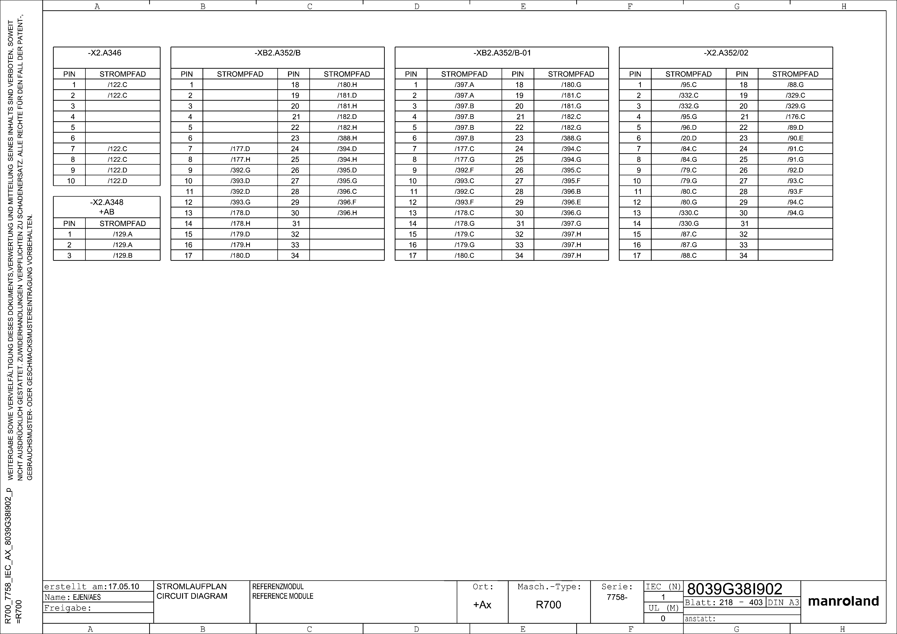

# +Ax — Sheet 218 of 403 — REFERENZMODUL

**REFERENCE MODULE**

> Part of the manroland **R700** printing press IEC/UL circuit diagrams.
> Drawing class: **Stromlaufplan / Circuit diagram** (DIN A3).
> Document `+Ax` covers the **Central control console** machine section.

## At a glance

| Field | Value |
|---|---|
| Document | `+Ax`  (8039G38I902) |
| Sheet | **218** of 403 |
| Section (DE) | REFERENZMODUL |
| Section (EN) | REFERENCE MODULE |
| Section type | REFERENCE_MODULE — Reference module |
| Machine type | `R700` |
| Series | `7758` |
| Created | 17.05.10 |
| Replaces | — |
| Columns used | A, B, C, D, E, F, G, H |
| Path numbers | — |
| Labels on sheet | 234 |
| Cross-refs out | 97 |
| Cross-refs in | 0 |

**Previous:** [+Ax sheet 217](SHEET_0217.md) · **Next:** [+Ax sheet 219](SHEET_0219.md) · **Document TOC:** [_TOC.md](_TOC.md)  (+Ax) · **Master TOC:** [all sheets](../_MASTER_TOC.md)

## Sheet image (300 DPI, exact vector render)



_Rendered directly from the PDF vector layer at 300 DPI (1-bit), no OCR and no resampling. Use it to confirm anything ambiguous in the text below._

## Cross-references on this sheet

Each entry is a wire leaving this sheet. The printed token is `/sheet.column`; the link resolves to that sheet inside the same document.

| Ref | Target sheet | Col | Path | Destination on target | Target section | From col |
|---|---|---|---|---|---|---|
| `/397.A` | [+Ax sheet 397](SHEET_0397.md) | A | — | — | OPTION: WASCHVORRICHTUNG MIT TUCH | D |
| `/88.G` | [+Ax sheet 88](SHEET_0088.md) | G | — | — | ANLEGER | H |
| `/180.G` | [+Ax sheet 180](SHEET_0180.md) | G | — | — | RESERVE | E |
| `/95.C` | [+Ax sheet 95](SHEET_0095.md) | C | — | — | ANLEGER | G |
| `/122.C` | [+Ax sheet 122](SHEET_0122.md) | C | — | — | REALTIMERECHNER FEHLBOGENKONTROLLE | A |
| `/180.H` | [+Ax sheet 180](SHEET_0180.md) | H | — | — | RESERVE | C |
| `/397.A` | [+Ax sheet 397](SHEET_0397.md) | A | — | — | OPTION: WASCHVORRICHTUNG MIT TUCH | D |
| `/122.C` | [+Ax sheet 122](SHEET_0122.md) | C | — | — | REALTIMERECHNER FEHLBOGENKONTROLLE | A |
| `/181.D` | [+Ax sheet 181](SHEET_0181.md) | D | — | — | RESERVE | C |
| `/181.C` | [+Ax sheet 181](SHEET_0181.md) | C | — | — | RESERVE | E |
| `/332.C` | [+Ax sheet 332](SHEET_0332.md) | C | — | — | OPTION: NONSTOP EINRICHTUNG MANUELL, ANLEGER | G |
| `/329.C` | [+Ax sheet 329](SHEET_0329.md) | C | — | — | OPTION: NONSTOP EINRICHTUNG MANUELL, ANLEGER | H |
| `/397.B` | [+Ax sheet 397](SHEET_0397.md) | B | — | — | OPTION: WASCHVORRICHTUNG MIT TUCH | D |
| `/181.G` | [+Ax sheet 181](SHEET_0181.md) | G | — | — | RESERVE | E |
| `/332.G` | [+Ax sheet 332](SHEET_0332.md) | G | — | — | OPTION: NONSTOP EINRICHTUNG MANUELL, ANLEGER | G |
| `/329.G` | [+Ax sheet 329](SHEET_0329.md) | G | — | — | OPTION: NONSTOP EINRICHTUNG MANUELL, ANLEGER | H |
| `/181.H` | [+Ax sheet 181](SHEET_0181.md) | H | — | — | RESERVE | C |
| `/397.B` | [+Ax sheet 397](SHEET_0397.md) | B | — | — | OPTION: WASCHVORRICHTUNG MIT TUCH | D |
| `/95.G` | [+Ax sheet 95](SHEET_0095.md) | G | — | — | ANLEGER | G |
| `/182.D` | [+Ax sheet 182](SHEET_0182.md) | D | — | — | RESERVE | C |
| `/182.C` | [+Ax sheet 182](SHEET_0182.md) | C | — | — | RESERVE | E |
| `/176.C` | [+Ax sheet 176](SHEET_0176.md) | C | — | — | RESERVE | H |
| `/397.B` | [+Ax sheet 397](SHEET_0397.md) | B | — | — | OPTION: WASCHVORRICHTUNG MIT TUCH | D |
| `/182.G` | [+Ax sheet 182](SHEET_0182.md) | G | — | — | RESERVE | E |
| `/96.D` | [+Ax sheet 96](SHEET_0096.md) | D | — | — | ANLEGER | G |
| `/89.D` | [+Ax sheet 89](SHEET_0089.md) | D | — | — | ANLEGER | H |
| `/182.H` | [+Ax sheet 182](SHEET_0182.md) | H | — | — | RESERVE | C |
| `/90.E` | [+Ax sheet 90](SHEET_0090.md) | E | — | — | ANLEGER | H |
| `/397.B` | [+Ax sheet 397](SHEET_0397.md) | B | — | — | OPTION: WASCHVORRICHTUNG MIT TUCH | D |
| `/388.G` | [+Ax sheet 388](SHEET_0388.md) | G | — | — | OPTION: WASCHVORRICHTUNG MIT TUCH | E |
| `/20.D` | [+Ax sheet 20](SHEET_0020.md) | D | — | — | SPANNUNGSVERSORGUNG, SCHALTSCHRANKBELÜFTUNG | G |
| `/388.H` | [+Ax sheet 388](SHEET_0388.md) | H | — | — | OPTION: WASCHVORRICHTUNG MIT TUCH | C |
| `/122.C` | [+Ax sheet 122](SHEET_0122.md) | C | — | — | REALTIMERECHNER FEHLBOGENKONTROLLE | A |
| `/177.D` | [+Ax sheet 177](SHEET_0177.md) | D | — | — | RESERVE | B |
| `/394.D` | [+Ax sheet 394](SHEET_0394.md) | D | — | — | OPTION: WASCHVORRICHTUNG MIT TUCH | C |
| `/177.C` | [+Ax sheet 177](SHEET_0177.md) | C | — | — | RESERVE | D |
| `/394.C` | [+Ax sheet 394](SHEET_0394.md) | C | — | — | OPTION: WASCHVORRICHTUNG MIT TUCH | E |
| `/84.C` | [+Ax sheet 84](SHEET_0084.md) | C | — | — | ANLEGER | G |
| `/91.C` | [+Ax sheet 91](SHEET_0091.md) | C | — | — | ANLEGER | H |
| `/84.G` | [+Ax sheet 84](SHEET_0084.md) | G | — | — | ANLEGER | G |
| `/91.G` | [+Ax sheet 91](SHEET_0091.md) | G | — | — | ANLEGER | H |
| `/177.G` | [+Ax sheet 177](SHEET_0177.md) | G | — | — | RESERVE | D |
| `/394.G` | [+Ax sheet 394](SHEET_0394.md) | G | — | — | OPTION: WASCHVORRICHTUNG MIT TUCH | E |
| `/122.C` | [+Ax sheet 122](SHEET_0122.md) | C | — | — | REALTIMERECHNER FEHLBOGENKONTROLLE | A |
| `/177.H` | [+Ax sheet 177](SHEET_0177.md) | H | — | — | RESERVE | B |
| `/394.H` | [+Ax sheet 394](SHEET_0394.md) | H | — | — | OPTION: WASCHVORRICHTUNG MIT TUCH | C |
| `/392.F` | [+Ax sheet 392](SHEET_0392.md) | F | — | — | OPTION: WASCHVORRICHTUNG MIT TUCH | D |
| `/392.G` | [+Ax sheet 392](SHEET_0392.md) | G | — | — | OPTION: WASCHVORRICHTUNG MIT TUCH | B |
| `/79.C` | [+Ax sheet 79](SHEET_0079.md) | C | — | — | ANLEGER | G |
| `/92.D` | [+Ax sheet 92](SHEET_0092.md) | D | — | — | ANLEGER | H |
| `/122.D` | [+Ax sheet 122](SHEET_0122.md) | D | — | — | REALTIMERECHNER FEHLBOGENKONTROLLE | A |
| `/395.D` | [+Ax sheet 395](SHEET_0395.md) | D | — | — | OPTION: WASCHVORRICHTUNG MIT TUCH | C |
| `/395.C` | [+Ax sheet 395](SHEET_0395.md) | C | — | — | OPTION: WASCHVORRICHTUNG MIT TUCH | E |
| `/79.G` | [+Ax sheet 79](SHEET_0079.md) | G | — | — | ANLEGER | G |
| `/395.G` | [+Ax sheet 395](SHEET_0395.md) | G | — | — | OPTION: WASCHVORRICHTUNG MIT TUCH | C |
| `/395.F` | [+Ax sheet 395](SHEET_0395.md) | F | — | — | OPTION: WASCHVORRICHTUNG MIT TUCH | E |
| `/122.D` | [+Ax sheet 122](SHEET_0122.md) | D | — | — | REALTIMERECHNER FEHLBOGENKONTROLLE | A |
| `/393.D` | [+Ax sheet 393](SHEET_0393.md) | D | — | — | OPTION: WASCHVORRICHTUNG MIT TUCH | B |
| `/393.C` | [+Ax sheet 393](SHEET_0393.md) | C | — | — | OPTION: WASCHVORRICHTUNG MIT TUCH | D |
| `/93.C` | [+Ax sheet 93](SHEET_0093.md) | C | — | — | ANLEGER | H |
| `/396.B` | [+Ax sheet 396](SHEET_0396.md) | B | — | — | OPTION: WASCHVORRICHTUNG MIT TUCH | E |
| `/93.F` | [+Ax sheet 93](SHEET_0093.md) | F | — | — | ANLEGER | H |
| `/80.C` | [+Ax sheet 80](SHEET_0080.md) | C | — | — | ANLEGER | G |
| `/392.D` | [+Ax sheet 392](SHEET_0392.md) | D | — | — | OPTION: WASCHVORRICHTUNG MIT TUCH | B |
| `/396.C` | [+Ax sheet 396](SHEET_0396.md) | C | — | — | OPTION: WASCHVORRICHTUNG MIT TUCH | C |
| `/392.C` | [+Ax sheet 392](SHEET_0392.md) | C | — | — | OPTION: WASCHVORRICHTUNG MIT TUCH | D |
| `/396.E` | [+Ax sheet 396](SHEET_0396.md) | E | — | — | OPTION: WASCHVORRICHTUNG MIT TUCH | E |
| `/396.F` | [+Ax sheet 396](SHEET_0396.md) | F | — | — | OPTION: WASCHVORRICHTUNG MIT TUCH | C |
| `/393.F` | [+Ax sheet 393](SHEET_0393.md) | F | — | — | OPTION: WASCHVORRICHTUNG MIT TUCH | D |
| `/80.G` | [+Ax sheet 80](SHEET_0080.md) | G | — | — | ANLEGER | G |
| `/393.G` | [+Ax sheet 393](SHEET_0393.md) | G | — | — | OPTION: WASCHVORRICHTUNG MIT TUCH | B |
| `/94.C` | [+Ax sheet 94](SHEET_0094.md) | C | — | — | ANLEGER | H |
| `/94.G` | [+Ax sheet 94](SHEET_0094.md) | G | — | — | ANLEGER | H |
| `/396.G` | [+Ax sheet 396](SHEET_0396.md) | G | — | — | OPTION: WASCHVORRICHTUNG MIT TUCH | E |
| `/178.D` | [+Ax sheet 178](SHEET_0178.md) | D | — | — | RESERVE | B |
| `/396.H` | [+Ax sheet 396](SHEET_0396.md) | H | — | — | OPTION: WASCHVORRICHTUNG MIT TUCH | C |
| `/178.C` | [+Ax sheet 178](SHEET_0178.md) | C | — | — | RESERVE | D |
| `/330.C` | [+Ax sheet 330](SHEET_0330.md) | C | — | — | OPTION: NONSTOP EINRICHTUNG MANUELL, ANLEGER | G |
| `/178.G` | [+Ax sheet 178](SHEET_0178.md) | G | — | — | RESERVE | D |
| `/397.G` | [+Ax sheet 397](SHEET_0397.md) | G | — | — | OPTION: WASCHVORRICHTUNG MIT TUCH | E |
| `/330.G` | [+Ax sheet 330](SHEET_0330.md) | G | — | — | OPTION: NONSTOP EINRICHTUNG MANUELL, ANLEGER | G |
| `/178.H` | [+Ax sheet 178](SHEET_0178.md) | H | — | — | RESERVE | B |
| `/129.A` | [+Ax sheet 129](SHEET_0129.md) | A | — | — | REALTIMERECHNER ANLAGE | A |
| `/87.C` | [+Ax sheet 87](SHEET_0087.md) | C | — | — | ANLEGER | G |
| `/179.D` | [+Ax sheet 179](SHEET_0179.md) | D | — | — | RESERVE | B |
| `/179.C` | [+Ax sheet 179](SHEET_0179.md) | C | — | — | RESERVE | D |
| `/397.H` | [+Ax sheet 397](SHEET_0397.md) | H | — | — | OPTION: WASCHVORRICHTUNG MIT TUCH | E |
| `/129.A` | [+Ax sheet 129](SHEET_0129.md) | A | — | — | REALTIMERECHNER ANLAGE | A |
| `/87.G` | [+Ax sheet 87](SHEET_0087.md) | G | — | — | ANLEGER | G |
| `/179.G` | [+Ax sheet 179](SHEET_0179.md) | G | — | — | RESERVE | D |
| `/179.H` | [+Ax sheet 179](SHEET_0179.md) | H | — | — | RESERVE | B |
| `/397.H` | [+Ax sheet 397](SHEET_0397.md) | H | — | — | OPTION: WASCHVORRICHTUNG MIT TUCH | E |
| `/129.B` | [+Ax sheet 129](SHEET_0129.md) | B | — | — | REALTIMERECHNER ANLAGE | A |
| `/88.C` | [+Ax sheet 88](SHEET_0088.md) | C | — | — | ANLEGER | G |
| `/180.D` | [+Ax sheet 180](SHEET_0180.md) | D | — | — | RESERVE | B |
| `/180.C` | [+Ax sheet 180](SHEET_0180.md) | C | — | — | RESERVE | D |
| `/397.H` | [+Ax sheet 397](SHEET_0397.md) | H | — | — | OPTION: WASCHVORRICHTUNG MIT TUCH | E |

## Devices on this sheet

| Tag | Class | Class meaning (IEC) | Col | Sub | Terminal | Sign |
|---|---|---|---|---|---|---|
| `X2.A346` | — | cross-device reference | A | — | — | — |
| `X2.A348` | — | cross-device reference | A | — | — | — |

## Potentials / nets

_No named potentials on this sheet._

## Wire-end annotations (grouped as printed)

A wire that continues elsewhere is annotated with a small cluster: the destination description, the path/line number `#NN`, and the `/sheet.column` cross reference. Each row below is one such cluster exactly as it is grouped on the drawing.

| Col | Y | Path | Cross-ref | Text on the wire |
|---|---|---|---|---|
| A | 65.5 | — | — | `X2.A346` |
| C | 65.5 | — | — | `XB2.A352/B` |
| E | 65.5 | — | — | `XB2.A352/B 01` |
| G | 65.5 | — | — | `X2.A352/02` |
| A | 94.2 | — | — | `PIN 10 2 3 4 5 6 7 8 9 1 STROMPFAD` |
| B | 94.2 | — | — | `PIN STROMPFAD` |
| C | 94.2 | — | — | `PIN 18 19 20 22 23 24 25 26 27 28 29 30 32 33 34 21 31 STROMPFAD` |
| D | 94.2 | — | — | `PIN STROMPFAD` |
| E | 94.2 | — | — | `PIN 18 19 20 22 23 24 25 26 27 28 29 30 32 33 34 21 31 STROMPFAD` |
| F | 94.2 | — | — | `PIN STROMPFAD` |
| G | 94.2 | — | — | `PIN 18 19 20 22 23 24 25 26 27 28 29 30 32 33 34 21 31 STROMPFAD` |
| B | 108.4 | — | — | `2 3 4 5 6 7 8 9 1` |
| D | 108.4 | — | — | `2 3 4 5 6 7 8 9 1` |
| F | 108.4 | — | — | `2 3 4 5 6 7 8 9 1` |
| A | 108.7 | — | `/122.C` | — |
| C | 108.7 | — | `/180.H` | — |
| D | 108.7 | — | `/397.A` | — |
| E | 108.7 | — | `/180.G` | — |
| G | 108.7 | — | `/95.C` | — |
| H | 108.7 | — | `/88.G` | — |
| A | 122.9 | — | `/122.C` | — |
| C | 122.9 | — | `/181.D` | — |
| D | 122.9 | — | `/397.A` | — |
| E | 122.9 | — | `/181.C` | — |
| G | 122.9 | — | `/332.C` | — |
| H | 122.9 | — | `/329.C` | — |
| D | 137.0 | — | `/397.B` | — |
| C | 137.1 | — | `/181.H` | — |
| E | 137.1 | — | `/181.G` | — |
| G | 137.1 | — | `/332.G` | — |
| H | 137.1 | — | `/329.G` | — |
| C | 151.2 | — | `/182.D` | — |
| D | 151.2 | — | `/397.B` | — |
| E | 151.2 | — | `/182.C` | — |
| G | 151.2 | — | `/95.G` | — |
| H | 151.2 | — | `/176.C` | — |
| C | 165.4 | — | `/182.H` | — |
| D | 165.4 | — | `/397.B` | — |
| E | 165.4 | — | `/182.G` | — |
| G | 165.4 | — | `/96.D` | — |
| H | 165.4 | — | `/89.D` | — |
| H | 179.5 | — | `/90.E` | — |
| C | 179.6 | — | `/388.H` | — |
| D | 179.6 | — | `/397.B` | — |
| E | 179.6 | — | `/388.G` | — |
| G | 179.6 | — | `/20.D` | — |
| A | 193.8 | — | `/122.C` | — |
| B | 193.8 | — | `/177.D` | — |
| C | 193.8 | — | `/394.D` | — |
| D | 193.8 | — | `/177.C` | — |
| E | 193.8 | — | `/394.C` | — |
| G | 193.8 | — | `/84.C` | — |
| H | 193.8 | — | `/91.C` | — |
| A | 207.9 | — | `/122.C` | — |
| B | 207.9 | — | `/177.H` | — |
| C | 207.9 | — | `/394.H` | — |
| D | 207.9 | — | `/177.G` | — |
| E | 207.9 | — | `/394.G` | — |
| G | 207.9 | — | `/84.G` | — |
| H | 207.9 | — | `/91.G` | — |
| A | 222.1 | — | `/122.D` | — |
| B | 222.1 | — | `/392.G` | — |
| C | 222.1 | — | `/395.D` | — |
| D | 222.1 | — | `/392.F` | — |
| E | 222.1 | — | `/395.C` | — |
| G | 222.1 | — | `/79.C` | — |
| H | 222.1 | — | `/92.D` | — |
| B | 235.9 | — | — | `10 12 13 14 15 16 17 11` |
| D | 235.9 | — | — | `10 12 13 14 15 16 17 11` |
| F | 235.9 | — | — | `10 12 13 14 15 16 17 11` |
| G | 236.2 | — | `/79.G` | — |
| A | 236.3 | — | `/122.D` | — |
| B | 236.3 | — | `/393.D` | — |
| C | 236.3 | — | `/395.G` | — |
| D | 236.3 | — | `/393.C` | — |
| E | 236.3 | — | `/395.F` | — |
| H | 236.3 | — | `/93.C` | — |
| B | 250.4 | — | `/392.D` | — |
| C | 250.4 | — | `/396.C` | — |
| D | 250.4 | — | `/392.C` | — |
| E | 250.4 | — | `/396.B` | — |
| G | 250.4 | — | `/80.C` | — |
| H | 250.4 | — | `/93.F` | — |
| A | 263.9 | — | — | `X2.A348` |
| B | 264.6 | — | `/393.G` | — |
| C | 264.6 | — | `/396.F` | — |
| D | 264.6 | — | `/393.F` | — |
| E | 264.6 | — | `/396.E` | — |
| G | 264.6 | — | `/80.G` | — |
| H | 264.6 | — | `/94.C` | — |
| A | 276.6 | — | — | `+AB` |
| B | 278.8 | — | `/178.D` | — |
| C | 278.8 | — | `/396.H` | — |
| D | 278.8 | — | `/178.C` | — |
| E | 278.8 | — | `/396.G` | — |
| G | 278.8 | — | `/330.C` | — |
| H | 278.8 | — | `/94.G` | — |
| A | 292.6 | — | — | `PIN 2 3 1 STROMPFAD` |
| B | 293.0 | — | `/178.H` | — |
| D | 293.0 | — | `/178.G` | — |
| E | 293.0 | — | `/397.G` | — |
| G | 293.0 | — | `/330.G` | — |
| A | 307.1 | — | `/129.A` | — |
| B | 307.1 | — | `/179.D` | — |
| D | 307.1 | — | `/179.C` | — |
| E | 307.1 | — | `/397.H` | — |
| G | 307.1 | — | `/87.C` | — |
| A | 321.3 | — | `/129.A` | — |
| B | 321.3 | — | `/179.H` | — |
| D | 321.3 | — | `/179.G` | — |
| E | 321.3 | — | `/397.H` | — |
| G | 321.3 | — | `/87.G` | — |
| A | 335.5 | — | `/129.B` | — |
| B | 335.5 | — | `/180.D` | — |
| D | 335.5 | — | `/180.C` | — |
| E | 335.5 | — | `/397.H` | — |
| G | 335.5 | — | `/88.C` | — |


## Reconstructed tables

This sheet carries tabular content (pin map / terminal assignment / index). The grid below was rebuilt from the drawing's own rule lines, so each row is exactly one physical row of the table.

### Table 1 — 16 data rows × 2 columns (at x=70.9, y=62.4) — **X2.A346**

| PIN | STROMPFAD |
|---|---|
| `1` | `/122.C` |
| `2` | `/122.C` |
| `3` |  |
| `4` |  |
| `5` |  |
| `6` |  |
| `7` | `/122.C` |
| `8` | `/122.C` |
| `9` | `/122.D` |
| `10` | `/122.D` |
|  | `X2.A348` |
|  | `+AB` |
| `PIN` | `STROMPFAD` |
| `1` | `/129.A` |
| `2` | `/129.A` |
| `3` | `/129.B` |


### Table 2 — 17 data rows × 4 columns (at x=226.8, y=62.4) — **XB2.A352/B**

| PIN | STROMPFAD | PIN | STROMPFAD |
|---|---|---|---|
| `1` |  | `18` | `/180.H` |
| `2` |  | `19` | `/181.D` |
| `3` |  | `20` | `/181.H` |
| `4` |  | `21` | `/182.D` |
| `5` |  | `22` | `/182.H` |
| `6` |  | `23` | `/388.H` |
| `7` | `/177.D` | `24` | `/394.D` |
| `8` | `/177.H` | `25` | `/394.H` |
| `9` | `/392.G` | `26` | `/395.D` |
| `10` | `/393.D` | `27` | `/395.G` |
| `11` | `/392.D` | `28` | `/396.C` |
| `12` | `/393.G` | `29` | `/396.F` |
| `13` | `/178.D` | `30` | `/396.H` |
| `14` | `/178.H` | `31` |  |
| `15` | `/179.D` | `32` |  |
| `16` | `/179.H` | `33` |  |
| `17` | `/180.D` | `34` |  |


### Table 3 — 17 data rows × 4 columns (at x=524.4, y=62.4) — **XB2.A352/B 01**

| PIN | STROMPFAD | PIN | STROMPFAD |
|---|---|---|---|
| `1` | `/397.A` | `18` | `/180.G` |
| `2` | `/397.A` | `19` | `/181.C` |
| `3` | `/397.B` | `20` | `/181.G` |
| `4` | `/397.B` | `21` | `/182.C` |
| `5` | `/397.B` | `22` | `/182.G` |
| `6` | `/397.B` | `23` | `/388.G` |
| `7` | `/177.C` | `24` | `/394.C` |
| `8` | `/177.G` | `25` | `/394.G` |
| `9` | `/392.F` | `26` | `/395.C` |
| `10` | `/393.C` | `27` | `/395.F` |
| `11` | `/392.C` | `28` | `/396.B` |
| `12` | `/393.F` | `29` | `/396.E` |
| `13` | `/178.C` | `30` | `/396.G` |
| `14` | `/178.G` | `31` | `/397.G` |
| `15` | `/179.C` | `32` | `/397.H` |
| `16` | `/179.G` | `33` | `/397.H` |
| `17` | `/180.C` | `34` | `/397.H` |


### Table 4 — 17 data rows × 4 columns (at x=822.0, y=62.4) — **X2.A352/02**

| PIN | STROMPFAD | PIN | STROMPFAD |
|---|---|---|---|
| `1` | `/95.C` | `18` | `/88.G` |
| `2` | `/332.C` | `19` | `/329.C` |
| `3` | `/332.G` | `20` | `/329.G` |
| `4` | `/95.G` | `21` | `/176.C` |
| `5` | `/96.D` | `22` | `/89.D` |
| `6` | `/20.D` | `23` | `/90.E` |
| `7` | `/84.C` | `24` | `/91.C` |
| `8` | `/84.G` | `25` | `/91.G` |
| `9` | `/79.C` | `26` | `/92.D` |
| `10` | `/79.G` | `27` | `/93.C` |
| `11` | `/80.C` | `28` | `/93.F` |
| `12` | `/80.G` | `29` | `/94.C` |
| `13` | `/330.C` | `30` | `/94.G` |
| `14` | `/330.G` | `31` |  |
| `15` | `/87.C` | `32` |  |
| `16` | `/87.G` | `33` |  |
| `17` | `/88.C` | `34` |  |


## Notes and free text on this sheet

| Text | Col | Y (pt) |
|---|---|---|
| `PIN` | A | 94.2 |
| `STROMPFAD` | A | 94.15 |
| `+AB` | A | 276.61 |
| `PIN` | B | 94.2 |
| `STROMPFAD` | B | 94.15 |
| `PIN` | C | 94.2 |
| `STROMPFAD` | C | 94.15 |
| `XB2.A352/B` | C | 65.51 |
| `PIN` | D | 94.2 |
| `STROMPFAD` | D | 94.15 |
| `PIN` | E | 94.2 |
| `STROMPFAD` | E | 94.15 |
| `XB2.A352/B 01` | E | 65.51 |
| `PIN` | F | 94.2 |
| `STROMPFAD` | G | 94.15 |
| `PIN` | G | 94.2 |
| `STROMPFAD` | H | 94.15 |
| `X2.A352/02` | G | 65.51 |

## Complete label inventory (exact text from the drawing)

Every text object inside the drawing area of this sheet, in DIN reading order (column A→H, then top→bottom). This is the authoritative list: if a string is not here it is not printed on this sheet.

| Col | Y | X | Dir | Type | Text |
|---|---|---|---|---|---|
| A | 65.5 | 116.9 | → | device ref | `X2.A346` |
| A | 94.2 | 84.0 | → | text | `PIN` |
| A | 94.2 | 132.2 | → | text | `STROMPFAD` |
| A | 108.4 | 95.8 | → | number | `1` |
| A | 108.7 | 143.1 | → | cross-reference | `/122.C` |
| A | 122.5 | 94.1 | → | number | `2` |
| A | 122.9 | 143.1 | → | cross-reference | `/122.C` |
| A | 136.7 | 94.1 | → | number | `3` |
| A | 150.9 | 94.1 | → | number | `4` |
| A | 165.1 | 94.1 | → | number | `5` |
| A | 179.2 | 94.1 | → | number | `6` |
| A | 193.4 | 94.1 | → | number | `7` |
| A | 193.8 | 143.1 | → | cross-reference | `/122.C` |
| A | 207.6 | 94.1 | → | number | `8` |
| A | 207.9 | 143.1 | → | cross-reference | `/122.C` |
| A | 221.8 | 94.1 | → | number | `9` |
| A | 222.1 | 143.1 | → | cross-reference | `/122.D` |
| A | 235.9 | 88.7 | → | number | `10` |
| A | 236.3 | 143.1 | → | cross-reference | `/122.D` |
| A | 263.9 | 119.8 | → | device ref | `X2.A348` |
| A | 276.6 | 131.5 | → | text | `+AB` |
| A | 292.6 | 84.0 | → | text | `PIN` |
| A | 292.6 | 132.2 | → | text | `STROMPFAD` |
| A | 306.8 | 90.0 | → | number | `1` |
| A | 307.1 | 150.2 | → | cross-reference | `/129.A` |
| A | 321.0 | 89.4 | → | number | `2` |
| A | 321.3 | 150.2 | → | cross-reference | `/129.A` |
| A | 335.1 | 89.4 | → | number | `3` |
| A | 335.5 | 150.4 | → | cross-reference | `/129.B` |
| B | 94.2 | 240.0 | → | text | `PIN` |
| B | 94.2 | 288.1 | → | text | `STROMPFAD` |
| B | 108.4 | 251.7 | → | number | `1` |
| B | 122.5 | 250.0 | → | number | `2` |
| B | 136.7 | 250.0 | → | number | `3` |
| B | 150.9 | 250.0 | → | number | `4` |
| B | 165.1 | 250.0 | → | number | `5` |
| B | 179.2 | 250.0 | → | number | `6` |
| B | 193.4 | 250.0 | → | number | `7` |
| B | 193.8 | 306.1 | → | cross-reference | `/177.D` |
| B | 207.6 | 250.0 | → | number | `8` |
| B | 207.9 | 306.4 | → | cross-reference | `/177.H` |
| B | 221.8 | 250.0 | → | number | `9` |
| B | 222.1 | 306.0 | → | cross-reference | `/392.G` |
| B | 235.9 | 244.6 | → | number | `10` |
| B | 236.3 | 306.1 | → | cross-reference | `/393.D` |
| B | 250.1 | 246.3 | → | number | `11` |
| B | 250.4 | 306.1 | → | cross-reference | `/392.D` |
| B | 264.3 | 244.6 | → | number | `12` |
| B | 264.6 | 306.0 | → | cross-reference | `/393.G` |
| B | 278.5 | 244.6 | → | number | `13` |
| B | 278.8 | 306.1 | → | cross-reference | `/178.D` |
| B | 292.6 | 244.6 | → | number | `14` |
| B | 293.0 | 306.4 | → | cross-reference | `/178.H` |
| B | 306.8 | 244.6 | → | number | `15` |
| B | 307.1 | 306.1 | → | cross-reference | `/179.D` |
| B | 321.0 | 244.6 | → | number | `16` |
| B | 321.3 | 306.4 | → | cross-reference | `/179.H` |
| B | 335.1 | 244.6 | → | number | `17` |
| B | 335.5 | 306.1 | → | cross-reference | `/180.D` |
| C | 65.5 | 338.0 | → | text | `XB2.A352/B` |
| C | 94.2 | 381.7 | → | text | `PIN` |
| C | 94.2 | 429.9 | → | text | `STROMPFAD` |
| C | 108.4 | 386.4 | → | number | `18` |
| C | 108.7 | 448.2 | → | cross-reference | `/180.H` |
| C | 122.5 | 386.4 | → | number | `19` |
| C | 122.9 | 447.9 | → | cross-reference | `/181.D` |
| C | 136.7 | 386.4 | → | number | `20` |
| C | 137.1 | 448.2 | → | cross-reference | `/181.H` |
| C | 150.9 | 388.1 | → | number | `21` |
| C | 151.2 | 447.9 | → | cross-reference | `/182.D` |
| C | 165.1 | 386.4 | → | number | `22` |
| C | 165.4 | 448.2 | → | cross-reference | `/182.H` |
| C | 179.2 | 386.4 | → | number | `23` |
| C | 179.6 | 448.2 | → | cross-reference | `/388.H` |
| C | 193.4 | 386.4 | → | number | `24` |
| C | 193.8 | 447.9 | → | cross-reference | `/394.D` |
| C | 207.6 | 386.4 | → | number | `25` |
| C | 207.9 | 448.2 | → | cross-reference | `/394.H` |
| C | 221.8 | 386.4 | → | number | `26` |
| C | 222.1 | 447.9 | → | cross-reference | `/395.D` |
| C | 235.9 | 386.4 | → | number | `27` |
| C | 236.3 | 447.7 | → | cross-reference | `/395.G` |
| C | 250.1 | 386.4 | → | number | `28` |
| C | 250.4 | 447.9 | → | cross-reference | `/396.C` |
| C | 264.3 | 386.4 | → | number | `29` |
| C | 264.6 | 448.3 | → | cross-reference | `/396.F` |
| C | 278.5 | 386.4 | → | number | `30` |
| C | 278.8 | 448.2 | → | cross-reference | `/396.H` |
| C | 292.6 | 388.1 | → | number | `31` |
| C | 306.8 | 386.4 | → | number | `32` |
| C | 321.0 | 386.4 | → | number | `33` |
| C | 335.1 | 386.4 | → | number | `34` |
| D | 94.2 | 537.6 | → | text | `PIN` |
| D | 94.2 | 585.8 | → | text | `STROMPFAD` |
| D | 108.4 | 549.4 | → | number | `1` |
| D | 108.7 | 603.8 | → | cross-reference | `/397.A` |
| D | 122.5 | 547.7 | → | number | `2` |
| D | 122.9 | 603.8 | → | cross-reference | `/397.A` |
| D | 136.7 | 547.7 | → | number | `3` |
| D | 137.0 | 603.9 | → | cross-reference | `/397.B` |
| D | 150.9 | 547.7 | → | number | `4` |
| D | 151.2 | 603.9 | → | cross-reference | `/397.B` |
| D | 165.1 | 547.7 | → | number | `5` |
| D | 165.4 | 603.9 | → | cross-reference | `/397.B` |
| D | 179.2 | 547.7 | → | number | `6` |
| D | 179.6 | 603.9 | → | cross-reference | `/397.B` |
| D | 193.4 | 547.7 | → | number | `7` |
| D | 193.8 | 603.8 | → | cross-reference | `/177.C` |
| D | 207.6 | 547.7 | → | number | `8` |
| D | 207.9 | 603.6 | → | cross-reference | `/177.G` |
| D | 221.8 | 547.7 | → | number | `9` |
| D | 222.1 | 604.2 | → | cross-reference | `/392.F` |
| D | 235.9 | 542.3 | → | number | `10` |
| D | 236.3 | 603.8 | → | cross-reference | `/393.C` |
| D | 250.1 | 544.0 | → | number | `11` |
| D | 250.4 | 603.8 | → | cross-reference | `/392.C` |
| D | 264.3 | 542.3 | → | number | `12` |
| D | 264.6 | 604.2 | → | cross-reference | `/393.F` |
| D | 278.5 | 542.3 | → | number | `13` |
| D | 278.8 | 603.8 | → | cross-reference | `/178.C` |
| D | 292.6 | 542.3 | → | number | `14` |
| D | 293.0 | 603.6 | → | cross-reference | `/178.G` |
| D | 306.8 | 542.3 | → | number | `15` |
| D | 307.1 | 603.8 | → | cross-reference | `/179.C` |
| D | 321.0 | 542.3 | → | number | `16` |
| D | 321.3 | 603.6 | → | cross-reference | `/179.G` |
| D | 335.1 | 542.3 | → | number | `17` |
| D | 335.5 | 603.8 | → | cross-reference | `/180.C` |
| E | 65.5 | 628.7 | → | text | `XB2.A352/B 01` |
| E | 94.2 | 679.3 | → | text | `PIN` |
| E | 94.2 | 727.5 | → | text | `STROMPFAD` |
| E | 108.4 | 684.0 | → | number | `18` |
| E | 108.7 | 745.4 | → | cross-reference | `/180.G` |
| E | 122.5 | 684.0 | → | number | `19` |
| E | 122.9 | 745.5 | → | cross-reference | `/181.C` |
| E | 136.7 | 684.0 | → | number | `20` |
| E | 137.1 | 745.4 | → | cross-reference | `/181.G` |
| E | 150.9 | 685.7 | → | number | `21` |
| E | 151.2 | 745.5 | → | cross-reference | `/182.C` |
| E | 165.1 | 684.0 | → | number | `22` |
| E | 165.4 | 745.4 | → | cross-reference | `/182.G` |
| E | 179.2 | 684.0 | → | number | `23` |
| E | 179.6 | 745.4 | → | cross-reference | `/388.G` |
| E | 193.4 | 684.0 | → | number | `24` |
| E | 193.8 | 745.5 | → | cross-reference | `/394.C` |
| E | 207.6 | 684.0 | → | number | `25` |
| E | 207.9 | 745.4 | → | cross-reference | `/394.G` |
| E | 221.8 | 684.0 | → | number | `26` |
| E | 222.1 | 745.5 | → | cross-reference | `/395.C` |
| E | 235.9 | 684.0 | → | number | `27` |
| E | 236.3 | 745.9 | → | cross-reference | `/395.F` |
| E | 250.1 | 684.0 | → | number | `28` |
| E | 250.4 | 745.7 | → | cross-reference | `/396.B` |
| E | 264.3 | 684.0 | → | number | `29` |
| E | 264.6 | 745.8 | → | cross-reference | `/396.E` |
| E | 278.5 | 684.0 | → | number | `30` |
| E | 278.8 | 745.4 | → | cross-reference | `/396.G` |
| E | 292.6 | 685.7 | → | number | `31` |
| E | 293.0 | 745.4 | → | cross-reference | `/397.G` |
| E | 306.8 | 684.0 | → | number | `32` |
| E | 307.1 | 745.8 | → | cross-reference | `/397.H` |
| E | 321.0 | 684.0 | → | number | `33` |
| E | 321.3 | 745.8 | → | cross-reference | `/397.H` |
| E | 335.1 | 684.0 | → | number | `34` |
| E | 335.5 | 745.8 | → | cross-reference | `/397.H` |
| F | 94.2 | 835.2 | → | text | `PIN` |
| F | 108.4 | 847.0 | → | number | `1` |
| F | 122.5 | 845.3 | → | number | `2` |
| F | 136.7 | 845.3 | → | number | `3` |
| F | 150.9 | 845.3 | → | number | `4` |
| F | 165.1 | 845.3 | → | number | `5` |
| F | 179.2 | 845.3 | → | number | `6` |
| F | 193.4 | 845.3 | → | number | `7` |
| F | 207.6 | 845.3 | → | number | `8` |
| F | 221.8 | 845.3 | → | number | `9` |
| F | 235.9 | 839.9 | → | number | `10` |
| F | 250.1 | 841.6 | → | number | `11` |
| F | 264.3 | 839.9 | → | number | `12` |
| F | 278.5 | 839.9 | → | number | `13` |
| F | 292.6 | 839.9 | → | number | `14` |
| F | 306.8 | 839.9 | → | number | `15` |
| F | 321.0 | 839.9 | → | number | `16` |
| F | 335.1 | 839.9 | → | number | `17` |
| G | 65.5 | 934.4 | → | text | `X2.A352/02` |
| G | 94.2 | 883.4 | → | text | `STROMPFAD` |
| G | 94.2 | 977.0 | → | text | `PIN` |
| G | 108.4 | 981.6 | → | number | `18` |
| G | 108.7 | 903.8 | → | cross-reference | `/95.C` |
| G | 122.5 | 981.6 | → | number | `19` |
| G | 122.9 | 901.4 | → | cross-reference | `/332.C` |
| G | 136.7 | 981.6 | → | number | `20` |
| G | 137.1 | 901.3 | → | cross-reference | `/332.G` |
| G | 150.9 | 983.3 | → | number | `21` |
| G | 151.2 | 903.7 | → | cross-reference | `/95.G` |
| G | 165.1 | 981.6 | → | number | `22` |
| G | 165.4 | 903.8 | → | cross-reference | `/96.D` |
| G | 179.2 | 981.6 | → | number | `23` |
| G | 179.6 | 903.8 | → | cross-reference | `/20.D` |
| G | 193.4 | 981.6 | → | number | `24` |
| G | 193.7 | 903.8 | → | cross-reference | `/84.C` |
| G | 207.6 | 981.6 | → | number | `25` |
| G | 207.9 | 903.7 | → | cross-reference | `/84.G` |
| G | 221.8 | 981.6 | → | number | `26` |
| G | 222.1 | 903.8 | → | cross-reference | `/79.C` |
| G | 235.9 | 981.6 | → | number | `27` |
| G | 236.3 | 903.7 | → | cross-reference | `/79.G` |
| G | 250.1 | 981.6 | → | number | `28` |
| G | 250.4 | 903.8 | → | cross-reference | `/80.C` |
| G | 264.3 | 981.6 | → | number | `29` |
| G | 264.6 | 903.7 | → | cross-reference | `/80.G` |
| G | 278.5 | 981.6 | → | number | `30` |
| G | 278.8 | 901.4 | → | cross-reference | `/330.C` |
| G | 292.6 | 983.3 | → | number | `31` |
| G | 293.0 | 901.3 | → | cross-reference | `/330.G` |
| G | 306.8 | 981.6 | → | number | `32` |
| G | 307.1 | 903.8 | → | cross-reference | `/87.C` |
| G | 321.0 | 981.6 | → | number | `33` |
| G | 321.3 | 903.7 | → | cross-reference | `/87.G` |
| G | 335.1 | 981.6 | → | number | `34` |
| G | 335.5 | 903.8 | → | cross-reference | `/88.C` |
| H | 94.2 | 1025.1 | → | text | `STROMPFAD` |
| H | 108.7 | 1045.4 | → | cross-reference | `/88.G` |
| H | 122.9 | 1043.1 | → | cross-reference | `/329.C` |
| H | 137.1 | 1043.0 | → | cross-reference | `/329.G` |
| H | 151.2 | 1043.1 | → | cross-reference | `/176.C` |
| H | 165.4 | 1045.6 | → | cross-reference | `/89.D` |
| H | 179.5 | 1045.8 | → | cross-reference | `/90.E` |
| H | 193.7 | 1045.6 | → | cross-reference | `/91.C` |
| H | 207.9 | 1045.4 | → | cross-reference | `/91.G` |
| H | 222.1 | 1045.6 | → | cross-reference | `/92.D` |
| H | 236.3 | 1045.6 | → | cross-reference | `/93.C` |
| H | 250.4 | 1046.0 | → | cross-reference | `/93.F` |
| H | 264.6 | 1045.6 | → | cross-reference | `/94.C` |
| H | 278.8 | 1045.4 | → | cross-reference | `/94.G` |

## Reading-order text block

The same content as a plain block, grouped by DIN column — convenient to paste or to match against a visual description.

```text
=== Column A ===
  65.5  116.9  devref       X2.A346
  94.2   84.0  text         PIN
  94.2  132.2  text         STROMPFAD
 108.4   95.8  numeric      1
 108.7  143.1  xref         /122.C
 122.5   94.1  numeric      2
 122.9  143.1  xref         /122.C
 136.7   94.1  numeric      3
 150.9   94.1  numeric      4
 165.1   94.1  numeric      5
 179.2   94.1  numeric      6
 193.4   94.1  numeric      7
 193.8  143.1  xref         /122.C
 207.6   94.1  numeric      8
 207.9  143.1  xref         /122.C
 221.8   94.1  numeric      9
 222.1  143.1  xref         /122.D
 235.9   88.7  numeric      10
 236.3  143.1  xref         /122.D
 263.9  119.8  devref       X2.A348
 276.6  131.5  text         +AB
 292.6   84.0  text         PIN
 292.6  132.2  text         STROMPFAD
 306.8   90.0  numeric      1
 307.1  150.2  xref         /129.A
 321.0   89.4  numeric      2
 321.3  150.2  xref         /129.A
 335.1   89.4  numeric      3
 335.5  150.4  xref         /129.B
=== Column B ===
  94.2  240.0  text         PIN
  94.2  288.1  text         STROMPFAD
 108.4  251.7  numeric      1
 122.5  250.0  numeric      2
 136.7  250.0  numeric      3
 150.9  250.0  numeric      4
 165.1  250.0  numeric      5
 179.2  250.0  numeric      6
 193.4  250.0  numeric      7
 193.8  306.1  xref         /177.D
 207.6  250.0  numeric      8
 207.9  306.4  xref         /177.H
 221.8  250.0  numeric      9
 222.1  306.0  xref         /392.G
 235.9  244.6  numeric      10
 236.3  306.1  xref         /393.D
 250.1  246.3  numeric      11
 250.4  306.1  xref         /392.D
 264.3  244.6  numeric      12
 264.6  306.0  xref         /393.G
 278.5  244.6  numeric      13
 278.8  306.1  xref         /178.D
 292.6  244.6  numeric      14
 293.0  306.4  xref         /178.H
 306.8  244.6  numeric      15
 307.1  306.1  xref         /179.D
 321.0  244.6  numeric      16
 321.3  306.4  xref         /179.H
 335.1  244.6  numeric      17
 335.5  306.1  xref         /180.D
=== Column C ===
  65.5  338.0  text         XB2.A352/B
  94.2  381.7  text         PIN
  94.2  429.9  text         STROMPFAD
 108.4  386.4  numeric      18
 108.7  448.2  xref         /180.H
 122.5  386.4  numeric      19
 122.9  447.9  xref         /181.D
 136.7  386.4  numeric      20
 137.1  448.2  xref         /181.H
 150.9  388.1  numeric      21
 151.2  447.9  xref         /182.D
 165.1  386.4  numeric      22
 165.4  448.2  xref         /182.H
 179.2  386.4  numeric      23
 179.6  448.2  xref         /388.H
 193.4  386.4  numeric      24
 193.8  447.9  xref         /394.D
 207.6  386.4  numeric      25
 207.9  448.2  xref         /394.H
 221.8  386.4  numeric      26
 222.1  447.9  xref         /395.D
 235.9  386.4  numeric      27
 236.3  447.7  xref         /395.G
 250.1  386.4  numeric      28
 250.4  447.9  xref         /396.C
 264.3  386.4  numeric      29
 264.6  448.3  xref         /396.F
 278.5  386.4  numeric      30
 278.8  448.2  xref         /396.H
 292.6  388.1  numeric      31
 306.8  386.4  numeric      32
 321.0  386.4  numeric      33
 335.1  386.4  numeric      34
=== Column D ===
  94.2  537.6  text         PIN
  94.2  585.8  text         STROMPFAD
 108.4  549.4  numeric      1
 108.7  603.8  xref         /397.A
 122.5  547.7  numeric      2
 122.9  603.8  xref         /397.A
 136.7  547.7  numeric      3
 137.0  603.9  xref         /397.B
 150.9  547.7  numeric      4
 151.2  603.9  xref         /397.B
 165.1  547.7  numeric      5
 165.4  603.9  xref         /397.B
 179.2  547.7  numeric      6
 179.6  603.9  xref         /397.B
 193.4  547.7  numeric      7
 193.8  603.8  xref         /177.C
 207.6  547.7  numeric      8
 207.9  603.6  xref         /177.G
 221.8  547.7  numeric      9
 222.1  604.2  xref         /392.F
 235.9  542.3  numeric      10
 236.3  603.8  xref         /393.C
 250.1  544.0  numeric      11
 250.4  603.8  xref         /392.C
 264.3  542.3  numeric      12
 264.6  604.2  xref         /393.F
 278.5  542.3  numeric      13
 278.8  603.8  xref         /178.C
 292.6  542.3  numeric      14
 293.0  603.6  xref         /178.G
 306.8  542.3  numeric      15
 307.1  603.8  xref         /179.C
 321.0  542.3  numeric      16
 321.3  603.6  xref         /179.G
 335.1  542.3  numeric      17
 335.5  603.8  xref         /180.C
=== Column E ===
  65.5  628.7  text         XB2.A352/B 01
  94.2  679.3  text         PIN
  94.2  727.5  text         STROMPFAD
 108.4  684.0  numeric      18
 108.7  745.4  xref         /180.G
 122.5  684.0  numeric      19
 122.9  745.5  xref         /181.C
 136.7  684.0  numeric      20
 137.1  745.4  xref         /181.G
 150.9  685.7  numeric      21
 151.2  745.5  xref         /182.C
 165.1  684.0  numeric      22
 165.4  745.4  xref         /182.G
 179.2  684.0  numeric      23
 179.6  745.4  xref         /388.G
 193.4  684.0  numeric      24
 193.8  745.5  xref         /394.C
 207.6  684.0  numeric      25
 207.9  745.4  xref         /394.G
 221.8  684.0  numeric      26
 222.1  745.5  xref         /395.C
 235.9  684.0  numeric      27
 236.3  745.9  xref         /395.F
 250.1  684.0  numeric      28
 250.4  745.7  xref         /396.B
 264.3  684.0  numeric      29
 264.6  745.8  xref         /396.E
 278.5  684.0  numeric      30
 278.8  745.4  xref         /396.G
 292.6  685.7  numeric      31
 293.0  745.4  xref         /397.G
 306.8  684.0  numeric      32
 307.1  745.8  xref         /397.H
 321.0  684.0  numeric      33
 321.3  745.8  xref         /397.H
 335.1  684.0  numeric      34
 335.5  745.8  xref         /397.H
=== Column F ===
  94.2  835.2  text         PIN
 108.4  847.0  numeric      1
 122.5  845.3  numeric      2
 136.7  845.3  numeric      3
 150.9  845.3  numeric      4
 165.1  845.3  numeric      5
 179.2  845.3  numeric      6
 193.4  845.3  numeric      7
 207.6  845.3  numeric      8
 221.8  845.3  numeric      9
 235.9  839.9  numeric      10
 250.1  841.6  numeric      11
 264.3  839.9  numeric      12
 278.5  839.9  numeric      13
 292.6  839.9  numeric      14
 306.8  839.9  numeric      15
 321.0  839.9  numeric      16
 335.1  839.9  numeric      17
=== Column G ===
  65.5  934.4  text         X2.A352/02
  94.2  883.4  text         STROMPFAD
  94.2  977.0  text         PIN
 108.4  981.6  numeric      18
 108.7  903.8  xref         /95.C
 122.5  981.6  numeric      19
 122.9  901.4  xref         /332.C
 136.7  981.6  numeric      20
 137.1  901.3  xref         /332.G
 150.9  983.3  numeric      21
 151.2  903.7  xref         /95.G
 165.1  981.6  numeric      22
 165.4  903.8  xref         /96.D
 179.2  981.6  numeric      23
 179.6  903.8  xref         /20.D
 193.4  981.6  numeric      24
 193.7  903.8  xref         /84.C
 207.6  981.6  numeric      25
 207.9  903.7  xref         /84.G
 221.8  981.6  numeric      26
 222.1  903.8  xref         /79.C
 235.9  981.6  numeric      27
 236.3  903.7  xref         /79.G
 250.1  981.6  numeric      28
 250.4  903.8  xref         /80.C
 264.3  981.6  numeric      29
 264.6  903.7  xref         /80.G
 278.5  981.6  numeric      30
 278.8  901.4  xref         /330.C
 292.6  983.3  numeric      31
 293.0  901.3  xref         /330.G
 306.8  981.6  numeric      32
 307.1  903.8  xref         /87.C
 321.0  981.6  numeric      33
 321.3  903.7  xref         /87.G
 335.1  981.6  numeric      34
 335.5  903.8  xref         /88.C
=== Column H ===
  94.2 1025.1  text         STROMPFAD
 108.7 1045.4  xref         /88.G
 122.9 1043.1  xref         /329.C
 137.1 1043.0  xref         /329.G
 151.2 1043.1  xref         /176.C
 165.4 1045.6  xref         /89.D
 179.5 1045.8  xref         /90.E
 193.7 1045.6  xref         /91.C
 207.9 1045.4  xref         /91.G
 222.1 1045.6  xref         /92.D
 236.3 1045.6  xref         /93.C
 250.4 1046.0  xref         /93.F
 264.6 1045.6  xref         /94.C
 278.8 1045.4  xref         /94.G
```

---
_Generated from the PDF vector text layer; no OCR. Source: `R700_7758_IEC_AX_8039G38I902_p`, sheet 218._
