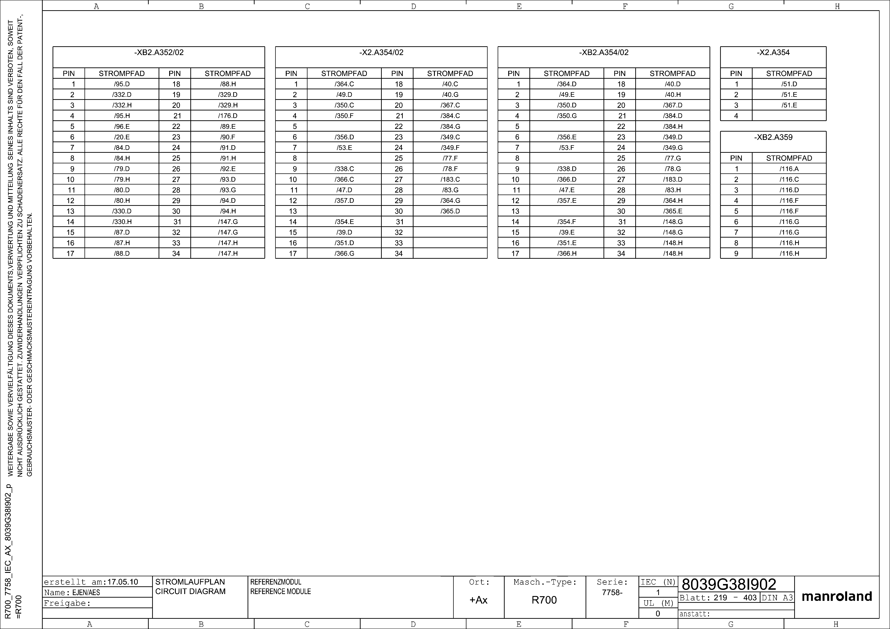

# +Ax — Sheet 219 of 403 — REFERENZMODUL

**REFERENCE MODULE**

> Part of the manroland **R700** printing press IEC/UL circuit diagrams.
> Drawing class: **Stromlaufplan / Circuit diagram** (DIN A3).
> Document `+Ax` covers the **Central control console** machine section.

## At a glance

| Field | Value |
|---|---|
| Document | `+Ax`  (8039G38I902) |
| Sheet | **219** of 403 |
| Section (DE) | REFERENZMODUL |
| Section (EN) | REFERENCE MODULE |
| Section type | REFERENCE_MODULE — Reference module |
| Machine type | `R700` |
| Series | `7758` |
| Created | 17.05.10 |
| Replaces | — |
| Columns used | A, B, C, D, E, F, G, H |
| Path numbers | — |
| Labels on sheet | 240 |
| Cross-refs out | 104 |
| Cross-refs in | 0 |

**Previous:** [+Ax sheet 218](SHEET_0218.md) · **Next:** [+Ax sheet 220](SHEET_0220.md) · **Document TOC:** [_TOC.md](_TOC.md)  (+Ax) · **Master TOC:** [all sheets](../_MASTER_TOC.md)

## Sheet image (300 DPI, exact vector render)



_Rendered directly from the PDF vector layer at 300 DPI (1-bit), no OCR and no resampling. Use it to confirm anything ambiguous in the text below._

## Cross-references on this sheet

Each entry is a wire leaving this sheet. The printed token is `/sheet.column`; the link resolves to that sheet inside the same document.

| Ref | Target sheet | Col | Path | Destination on target | Target section | From col |
|---|---|---|---|---|---|---|
| `/95.D` | [+Ax sheet 95](SHEET_0095.md) | D | — | — | ANLEGER | A |
| `/88.H` | [+Ax sheet 88](SHEET_0088.md) | H | — | — | ANLEGER | B |
| `/40.C` | [+Ax sheet 40](SHEET_0040.md) | C | — | — | HAUPTANTRIEB | D |
| `/40.D` | [+Ax sheet 40](SHEET_0040.md) | D | — | — | HAUPTANTRIEB | F |
| `/51.D` | [+Ax sheet 51](SHEET_0051.md) | D | — | — | SIGNALGEBER: AKUSTISCHE WARNSIGNALE | H |
| `/364.C` | [+Ax sheet 364](SHEET_0364.md) | C | — | — | OPTION: LOGISTIK AUSLEGER | C |
| `/364.D` | [+Ax sheet 364](SHEET_0364.md) | D | — | — | OPTION: LOGISTIK AUSLEGER | E |
| `/49.E` | [+Ax sheet 49](SHEET_0049.md) | E | — | — | NOT AUS | E |
| `/51.E` | [+Ax sheet 51](SHEET_0051.md) | E | — | — | SIGNALGEBER: AKUSTISCHE WARNSIGNALE | H |
| `/40.G` | [+Ax sheet 40](SHEET_0040.md) | G | — | — | HAUPTANTRIEB | D |
| `/49.D` | [+Ax sheet 49](SHEET_0049.md) | D | — | — | NOT AUS | C |
| `/40.H` | [+Ax sheet 40](SHEET_0040.md) | H | — | — | HAUPTANTRIEB | F |
| `/332.D` | [+Ax sheet 332](SHEET_0332.md) | D | — | — | OPTION: NONSTOP EINRICHTUNG MANUELL, ANLEGER | A |
| `/329.D` | [+Ax sheet 329](SHEET_0329.md) | D | — | — | OPTION: NONSTOP EINRICHTUNG MANUELL, ANLEGER | B |
| `/51.E` | [+Ax sheet 51](SHEET_0051.md) | E | — | — | SIGNALGEBER: AKUSTISCHE WARNSIGNALE | H |
| `/332.H` | [+Ax sheet 332](SHEET_0332.md) | H | — | — | OPTION: NONSTOP EINRICHTUNG MANUELL, ANLEGER | A |
| `/329.H` | [+Ax sheet 329](SHEET_0329.md) | H | — | — | OPTION: NONSTOP EINRICHTUNG MANUELL, ANLEGER | B |
| `/350.C` | [+Ax sheet 350](SHEET_0350.md) | C | — | — | OPTION: LOGISTIK ANLEGER | C |
| `/367.C` | [+Ax sheet 367](SHEET_0367.md) | C | — | — | OPTION: LOGISTIK AUSLEGER | D |
| `/350.D` | [+Ax sheet 350](SHEET_0350.md) | D | — | — | OPTION: LOGISTIK ANLEGER | E |
| `/367.D` | [+Ax sheet 367](SHEET_0367.md) | D | — | — | OPTION: LOGISTIK AUSLEGER | F |
| `/350.F` | [+Ax sheet 350](SHEET_0350.md) | F | — | — | OPTION: LOGISTIK ANLEGER | C |
| `/350.G` | [+Ax sheet 350](SHEET_0350.md) | G | — | — | OPTION: LOGISTIK ANLEGER | E |
| `/95.H` | [+Ax sheet 95](SHEET_0095.md) | H | — | — | ANLEGER | A |
| `/176.D` | [+Ax sheet 176](SHEET_0176.md) | D | — | — | RESERVE | B |
| `/384.C` | [+Ax sheet 384](SHEET_0384.md) | C | — | — | OPTION: INLINEFOILER PRINDOR | D |
| `/384.D` | [+Ax sheet 384](SHEET_0384.md) | D | — | — | OPTION: INLINEFOILER PRINDOR | F |
| `/96.E` | [+Ax sheet 96](SHEET_0096.md) | E | — | — | ANLEGER | A |
| `/89.E` | [+Ax sheet 89](SHEET_0089.md) | E | — | — | ANLEGER | B |
| `/384.G` | [+Ax sheet 384](SHEET_0384.md) | G | — | — | OPTION: INLINEFOILER PRINDOR | D |
| `/384.H` | [+Ax sheet 384](SHEET_0384.md) | H | — | — | OPTION: INLINEFOILER PRINDOR | F |
| `/20.E` | [+Ax sheet 20](SHEET_0020.md) | E | — | — | SPANNUNGSVERSORGUNG, SCHALTSCHRANKBELÜFTUNG | A |
| `/90.F` | [+Ax sheet 90](SHEET_0090.md) | F | — | — | ANLEGER | B |
| `/356.E` | [+Ax sheet 356](SHEET_0356.md) | E | — | — | OPTION: LOGISTIK ANLEGER | E |
| `/356.D` | [+Ax sheet 356](SHEET_0356.md) | D | — | — | OPTION: LOGISTIK ANLEGER | C |
| `/349.C` | [+Ax sheet 349](SHEET_0349.md) | C | — | — | OPTION: LOGISTIK ANLEGER | D |
| `/349.D` | [+Ax sheet 349](SHEET_0349.md) | D | — | — | OPTION: LOGISTIK ANLEGER | F |
| `/53.E` | [+Ax sheet 53](SHEET_0053.md) | E | — | — | SIGNALGEBER: AKUSTISCHE WARNSIGNALE | C |
| `/53.F` | [+Ax sheet 53](SHEET_0053.md) | F | — | — | SIGNALGEBER: AKUSTISCHE WARNSIGNALE | E |
| `/349.F` | [+Ax sheet 349](SHEET_0349.md) | F | — | — | OPTION: LOGISTIK ANLEGER | D |
| `/349.G` | [+Ax sheet 349](SHEET_0349.md) | G | — | — | OPTION: LOGISTIK ANLEGER | F |
| `/84.D` | [+Ax sheet 84](SHEET_0084.md) | D | — | — | ANLEGER | A |
| `/91.D` | [+Ax sheet 91](SHEET_0091.md) | D | — | — | ANLEGER | B |
| `/77.F` | [+Ax sheet 77](SHEET_0077.md) | F | — | — | ANLEGER | D |
| `/77.G` | [+Ax sheet 77](SHEET_0077.md) | G | — | — | ANLEGER | F |
| `/84.H` | [+Ax sheet 84](SHEET_0084.md) | H | — | — | ANLEGER | A |
| `/91.H` | [+Ax sheet 91](SHEET_0091.md) | H | — | — | ANLEGER | B |
| `/92.E` | [+Ax sheet 92](SHEET_0092.md) | E | — | — | ANLEGER | B |
| `/78.F` | [+Ax sheet 78](SHEET_0078.md) | F | — | — | ANLEGER | D |
| `/116.A` | [+Ax sheet 116](SHEET_0116.md) | A | — | — | REALTIMERECHNER 20mA SCHLEIFE | H |
| `/78.G` | [+Ax sheet 78](SHEET_0078.md) | G | — | — | ANLEGER | F |
| `/79.D` | [+Ax sheet 79](SHEET_0079.md) | D | — | — | ANLEGER | A |
| `/338.C` | [+Ax sheet 338](SHEET_0338.md) | C | — | — | OPTION: INLINESHEETER RS104 S | C |
| `/338.D` | [+Ax sheet 338](SHEET_0338.md) | D | — | — | OPTION: INLINESHEETER RS104 S | E |
| `/79.H` | [+Ax sheet 79](SHEET_0079.md) | H | — | — | ANLEGER | A |
| `/93.D` | [+Ax sheet 93](SHEET_0093.md) | D | — | — | ANLEGER | B |
| `/366.C` | [+Ax sheet 366](SHEET_0366.md) | C | — | — | OPTION: LOGISTIK AUSLEGER | C |
| `/183.C` | [+Ax sheet 183](SHEET_0183.md) | C | — | — | RESERVE | D |
| `/366.D` | [+Ax sheet 366](SHEET_0366.md) | D | — | — | OPTION: LOGISTIK AUSLEGER | E |
| `/183.D` | [+Ax sheet 183](SHEET_0183.md) | D | — | — | RESERVE | F |
| `/116.C` | [+Ax sheet 116](SHEET_0116.md) | C | — | — | REALTIMERECHNER 20mA SCHLEIFE | H |
| `/47.E` | [+Ax sheet 47](SHEET_0047.md) | E | — | — | NOT AUS | E |
| `/93.G` | [+Ax sheet 93](SHEET_0093.md) | G | — | — | ANLEGER | B |
| `/83.G` | [+Ax sheet 83](SHEET_0083.md) | G | — | — | ANLEGER | D |
| `/80.D` | [+Ax sheet 80](SHEET_0080.md) | D | — | — | ANLEGER | A |
| `/47.D` | [+Ax sheet 47](SHEET_0047.md) | D | — | — | NOT AUS | C |
| `/83.H` | [+Ax sheet 83](SHEET_0083.md) | H | — | — | ANLEGER | F |
| `/116.D` | [+Ax sheet 116](SHEET_0116.md) | D | — | — | REALTIMERECHNER 20mA SCHLEIFE | H |
| `/357.E` | [+Ax sheet 357](SHEET_0357.md) | E | — | — | OPTION: LOGISTIK ANLEGER | E |
| `/116.F` | [+Ax sheet 116](SHEET_0116.md) | F | — | — | REALTIMERECHNER 20mA SCHLEIFE | H |
| `/80.H` | [+Ax sheet 80](SHEET_0080.md) | H | — | — | ANLEGER | A |
| `/94.D` | [+Ax sheet 94](SHEET_0094.md) | D | — | — | ANLEGER | B |
| `/364.G` | [+Ax sheet 364](SHEET_0364.md) | G | — | — | OPTION: LOGISTIK AUSLEGER | D |
| `/357.D` | [+Ax sheet 357](SHEET_0357.md) | D | — | — | OPTION: LOGISTIK ANLEGER | C |
| `/364.H` | [+Ax sheet 364](SHEET_0364.md) | H | — | — | OPTION: LOGISTIK AUSLEGER | F |
| `/365.E` | [+Ax sheet 365](SHEET_0365.md) | E | — | — | OPTION: LOGISTIK AUSLEGER | F |
| `/116.F` | [+Ax sheet 116](SHEET_0116.md) | F | — | — | REALTIMERECHNER 20mA SCHLEIFE | H |
| `/330.D` | [+Ax sheet 330](SHEET_0330.md) | D | — | — | OPTION: NONSTOP EINRICHTUNG MANUELL, ANLEGER | A |
| `/94.H` | [+Ax sheet 94](SHEET_0094.md) | H | — | — | ANLEGER | B |
| `/365.D` | [+Ax sheet 365](SHEET_0365.md) | D | — | — | OPTION: LOGISTIK AUSLEGER | D |
| `/354.E` | [+Ax sheet 354](SHEET_0354.md) | E | — | — | OPTION: LOGISTIK ANLEGER | C |
| `/354.F` | [+Ax sheet 354](SHEET_0354.md) | F | — | — | OPTION: LOGISTIK ANLEGER | E |
| `/147.G` | [+Ax sheet 147](SHEET_0147.md) | G | — | — | ÜBERWACHUNGSRECHNER SICHERHEITSBUS | B |
| `/148.G` | [+Ax sheet 148](SHEET_0148.md) | G | — | — | ÜBERWACHUNGSRECHNER SICHERHEITSBUS | F |
| `/116.G` | [+Ax sheet 116](SHEET_0116.md) | G | — | — | REALTIMERECHNER 20mA SCHLEIFE | H |
| `/330.H` | [+Ax sheet 330](SHEET_0330.md) | H | — | — | OPTION: NONSTOP EINRICHTUNG MANUELL, ANLEGER | A |
| `/39.E` | [+Ax sheet 39](SHEET_0039.md) | E | — | — | HAUPTANTRIEB | E |
| `/87.D` | [+Ax sheet 87](SHEET_0087.md) | D | — | — | ANLEGER | A |
| `/147.G` | [+Ax sheet 147](SHEET_0147.md) | G | — | — | ÜBERWACHUNGSRECHNER SICHERHEITSBUS | B |
| `/39.D` | [+Ax sheet 39](SHEET_0039.md) | D | — | — | HAUPTANTRIEB | C |
| `/148.G` | [+Ax sheet 148](SHEET_0148.md) | G | — | — | ÜBERWACHUNGSRECHNER SICHERHEITSBUS | F |
| `/116.G` | [+Ax sheet 116](SHEET_0116.md) | G | — | — | REALTIMERECHNER 20mA SCHLEIFE | H |
| `/351.E` | [+Ax sheet 351](SHEET_0351.md) | E | — | — | OPTION: LOGISTIK ANLEGER | E |
| `/87.H` | [+Ax sheet 87](SHEET_0087.md) | H | — | — | ANLEGER | A |
| `/147.H` | [+Ax sheet 147](SHEET_0147.md) | H | — | — | ÜBERWACHUNGSRECHNER SICHERHEITSBUS | B |
| `/351.D` | [+Ax sheet 351](SHEET_0351.md) | D | — | — | OPTION: LOGISTIK ANLEGER | C |
| `/148.H` | [+Ax sheet 148](SHEET_0148.md) | H | — | — | ÜBERWACHUNGSRECHNER SICHERHEITSBUS | F |
| `/116.H` | [+Ax sheet 116](SHEET_0116.md) | H | — | — | REALTIMERECHNER 20mA SCHLEIFE | H |
| `/88.D` | [+Ax sheet 88](SHEET_0088.md) | D | — | — | ANLEGER | A |
| `/366.G` | [+Ax sheet 366](SHEET_0366.md) | G | — | — | OPTION: LOGISTIK AUSLEGER | C |
| `/147.H` | [+Ax sheet 147](SHEET_0147.md) | H | — | — | ÜBERWACHUNGSRECHNER SICHERHEITSBUS | B |
| `/366.H` | [+Ax sheet 366](SHEET_0366.md) | H | — | — | OPTION: LOGISTIK AUSLEGER | E |
| `/148.H` | [+Ax sheet 148](SHEET_0148.md) | H | — | — | ÜBERWACHUNGSRECHNER SICHERHEITSBUS | F |
| `/116.H` | [+Ax sheet 116](SHEET_0116.md) | H | — | — | REALTIMERECHNER 20mA SCHLEIFE | H |

## Devices on this sheet

| Tag | Class | Class meaning (IEC) | Col | Sub | Terminal | Sign |
|---|---|---|---|---|---|---|
| `XB2.A359` | — | cross-device reference | G | — | — | — |
| `X2.A354` | — | cross-device reference | G | — | — | — |

## Potentials / nets

_No named potentials on this sheet._

## Wire-end annotations (grouped as printed)

A wire that continues elsewhere is annotated with a small cluster: the destination description, the path/line number `#NN`, and the `/sheet.column` cross reference. Each row below is one such cluster exactly as it is grouped on the drawing.

| Col | Y | Path | Cross-ref | Text on the wire |
|---|---|---|---|---|
| B | 65.5 | — | — | `XB2.A352/02` |
| D | 65.5 | — | — | `X2.A354/02` |
| F | 65.5 | — | — | `XB2.A354/02` |
| G | 65.5 | — | — | `X2.A354` |
| A | 94.2 | — | — | `PIN STROMPFAD` |
| B | 94.2 | — | — | `PIN 18 19 20 22 23 24 25 26 27 28 29 30 32 33 34 21 31 STROMPFAD` |
| C | 94.2 | — | — | `PIN STROMPFAD` |
| D | 94.2 | — | — | `PIN 18 19 20 22 23 24 25 26 27 28 29 30 32 33 34 21 31 STROMPFAD` |
| E | 94.2 | — | — | `PIN STROMPFAD` |
| F | 94.2 | — | — | `PIN 18 19 20 22 23 24 25 26 27 28 29 30 32 33 34 21 31 STROMPFAD` |
| G | 94.2 | — | — | `PIN 2 3 4 1 STROMPFAD` |
| A | 108.4 | — | — | `2 3 4 5 6 7 8 9 1` |
| C | 108.4 | — | — | `2 3 4 5 6 7 8 9 1` |
| E | 108.4 | — | — | `2 3 4 5 6 7 8 9 1` |
| A | 108.7 | — | `/95.D` | — |
| B | 108.7 | — | `/88.H` | — |
| C | 108.7 | — | `/364.C` | — |
| D | 108.7 | — | `/40.C` | — |
| E | 108.7 | — | `/364.D` | — |
| F | 108.7 | — | `/40.D` | — |
| H | 108.7 | — | `/51.D` | — |
| E | 122.8 | — | `/49.E` | — |
| H | 122.8 | — | `/51.E` | — |
| A | 122.9 | — | `/332.D` | — |
| B | 122.9 | — | `/329.D` | — |
| C | 122.9 | — | `/49.D` | — |
| D | 122.9 | — | `/40.G` | — |
| F | 122.9 | — | `/40.H` | — |
| H | 137.0 | — | `/51.E` | — |
| A | 137.1 | — | `/332.H` | — |
| B | 137.1 | — | `/329.H` | — |
| C | 137.1 | — | `/350.C` | — |
| D | 137.1 | — | `/367.C` | — |
| E | 137.1 | — | `/350.D` | — |
| F | 137.1 | — | `/367.D` | — |
| A | 151.2 | — | `/95.H` | — |
| B | 151.2 | — | `/176.D` | — |
| C | 151.2 | — | `/350.F` | — |
| D | 151.2 | — | `/384.C` | — |
| E | 151.2 | — | `/350.G` | — |
| F | 151.2 | — | `/384.D` | — |
| A | 165.4 | — | `/96.E` | — |
| B | 165.4 | — | `/89.E` | — |
| D | 165.4 | — | `/384.G` | — |
| F | 165.4 | — | `/384.H` | — |
| G | 178.9 | — | — | `XB2.A359` |
| A | 179.5 | — | `/20.E` | — |
| B | 179.6 | — | `/90.F` | — |
| C | 179.6 | — | `/356.D` | — |
| D | 179.6 | — | `/349.C` | — |
| E | 179.6 | — | `/356.E` | — |
| F | 179.6 | — | `/349.D` | — |
| C | 193.7 | — | `/53.E` | — |
| D | 193.7 | — | `/349.F` | — |
| E | 193.7 | — | `/53.F` | — |
| F | 193.7 | — | `/349.G` | — |
| A | 193.8 | — | `/84.D` | — |
| B | 193.8 | — | `/91.D` | — |
| G | 207.5 | — | — | `PIN 2 3 4 5 6 7 8 9 1 STROMPFAD` |
| A | 207.9 | — | `/84.H` | — |
| B | 207.9 | — | `/91.H` | — |
| D | 207.9 | — | `/77.F` | — |
| F | 207.9 | — | `/77.G` | — |
| A | 222.1 | — | `/79.D` | — |
| B | 222.1 | — | `/92.E` | — |
| C | 222.1 | — | `/338.C` | — |
| D | 222.1 | — | `/78.F` | — |
| E | 222.1 | — | `/338.D` | — |
| F | 222.1 | — | `/78.G` | — |
| H | 222.1 | — | `/116.A` | — |
| A | 235.9 | — | — | `10 12 13 14 15 16 17 11` |
| C | 235.9 | — | — | `10 12 13 14 15 16 17 11` |
| E | 235.9 | — | — | `10 12 13 14 15 16 17 11` |
| A | 236.3 | — | `/79.H` | — |
| B | 236.3 | — | `/93.D` | — |
| C | 236.3 | — | `/366.C` | — |
| D | 236.3 | — | `/183.C` | — |
| E | 236.3 | — | `/366.D` | — |
| F | 236.3 | — | `/183.D` | — |
| H | 236.3 | — | `/116.C` | — |
| A | 250.4 | — | `/80.D` | — |
| B | 250.4 | — | `/93.G` | — |
| C | 250.4 | — | `/47.D` | — |
| D | 250.4 | — | `/83.G` | — |
| E | 250.4 | — | `/47.E` | — |
| F | 250.4 | — | `/83.H` | — |
| H | 250.4 | — | `/116.D` | — |
| A | 264.6 | — | `/80.H` | — |
| B | 264.6 | — | `/94.D` | — |
| C | 264.6 | — | `/357.D` | — |
| D | 264.6 | — | `/364.G` | — |
| E | 264.6 | — | `/357.E` | — |
| F | 264.6 | — | `/364.H` | — |
| H | 264.6 | — | `/116.F` | — |
| A | 278.8 | — | `/330.D` | — |
| B | 278.8 | — | `/94.H` | — |
| D | 278.8 | — | `/365.D` | — |
| F | 278.8 | — | `/365.E` | — |
| H | 278.8 | — | `/116.F` | — |
| C | 292.9 | — | `/354.E` | — |
| E | 292.9 | — | `/354.F` | — |
| A | 293.0 | — | `/330.H` | — |
| B | 293.0 | — | `/147.G` | — |
| F | 293.0 | — | `/148.G` | — |
| H | 293.0 | — | `/116.G` | — |
| A | 307.1 | — | `/87.D` | — |
| B | 307.1 | — | `/147.G` | — |
| C | 307.1 | — | `/39.D` | — |
| E | 307.1 | — | `/39.E` | — |
| F | 307.1 | — | `/148.G` | — |
| H | 307.1 | — | `/116.G` | — |
| A | 321.3 | — | `/87.H` | — |
| B | 321.3 | — | `/147.H` | — |
| C | 321.3 | — | `/351.D` | — |
| E | 321.3 | — | `/351.E` | — |
| F | 321.3 | — | `/148.H` | — |
| H | 321.3 | — | `/116.H` | — |
| A | 335.5 | — | `/88.D` | — |
| B | 335.5 | — | `/147.H` | — |
| C | 335.5 | — | `/366.G` | — |
| E | 335.5 | — | `/366.H` | — |
| F | 335.5 | — | `/148.H` | — |
| H | 335.5 | — | `/116.H` | — |


## Reconstructed tables

This sheet carries tabular content (pin map / terminal assignment / index). The grid below was rebuilt from the drawing's own rule lines, so each row is exactly one physical row of the table.

### Table 1 — 17 data rows × 4 columns (at x=70.9, y=62.4) — **XB2.A352/02**

| PIN | STROMPFAD | PIN | STROMPFAD |
|---|---|---|---|
| `1` | `/95.D` | `18` | `/88.H` |
| `2` | `/332.D` | `19` | `/329.D` |
| `3` | `/332.H` | `20` | `/329.H` |
| `4` | `/95.H` | `21` | `/176.D` |
| `5` | `/96.E` | `22` | `/89.E` |
| `6` | `/20.E` | `23` | `/90.F` |
| `7` | `/84.D` | `24` | `/91.D` |
| `8` | `/84.H` | `25` | `/91.H` |
| `9` | `/79.D` | `26` | `/92.E` |
| `10` | `/79.H` | `27` | `/93.D` |
| `11` | `/80.D` | `28` | `/93.G` |
| `12` | `/80.H` | `29` | `/94.D` |
| `13` | `/330.D` | `30` | `/94.H` |
| `14` | `/330.H` | `31` | `/147.G` |
| `15` | `/87.D` | `32` | `/147.G` |
| `16` | `/87.H` | `33` | `/147.H` |
| `17` | `/88.D` | `34` | `/147.H` |


### Table 2 — 17 data rows × 4 columns (at x=368.5, y=62.4) — **X2.A354/02**

| PIN | STROMPFAD | PIN | STROMPFAD |
|---|---|---|---|
| `1` | `/364.C` | `18` | `/40.C` |
| `2` | `/49.D` | `19` | `/40.G` |
| `3` | `/350.C` | `20` | `/367.C` |
| `4` | `/350.F` | `21` | `/384.C` |
| `5` |  | `22` | `/384.G` |
| `6` | `/356.D` | `23` | `/349.C` |
| `7` | `/53.E` | `24` | `/349.F` |
| `8` |  | `25` | `/77.F` |
| `9` | `/338.C` | `26` | `/78.F` |
| `10` | `/366.C` | `27` | `/183.C` |
| `11` | `/47.D` | `28` | `/83.G` |
| `12` | `/357.D` | `29` | `/364.G` |
| `13` |  | `30` | `/365.D` |
| `14` | `/354.E` | `31` |  |
| `15` | `/39.D` | `32` |  |
| `16` | `/351.D` | `33` |  |
| `17` | `/366.G` | `34` |  |


### Table 3 — 17 data rows × 4 columns (at x=666.1, y=62.4) — **XB2.A354/02**

| PIN | STROMPFAD | PIN | STROMPFAD |
|---|---|---|---|
| `1` | `/364.D` | `18` | `/40.D` |
| `2` | `/49.E` | `19` | `/40.H` |
| `3` | `/350.D` | `20` | `/367.D` |
| `4` | `/350.G` | `21` | `/384.D` |
| `5` |  | `22` | `/384.H` |
| `6` | `/356.E` | `23` | `/349.D` |
| `7` | `/53.F` | `24` | `/349.G` |
| `8` |  | `25` | `/77.G` |
| `9` | `/338.D` | `26` | `/78.G` |
| `10` | `/366.D` | `27` | `/183.D` |
| `11` | `/47.E` | `28` | `/83.H` |
| `12` | `/357.E` | `29` | `/364.H` |
| `13` |  | `30` | `/365.E` |
| `14` | `/354.F` | `31` | `/148.G` |
| `15` | `/39.E` | `32` | `/148.G` |
| `16` | `/351.E` | `33` | `/148.H` |
| `17` | `/366.H` | `34` | `/148.H` |


### Table 4 — 15 data rows × 2 columns (at x=963.8, y=62.4) — **X2.A354**

| PIN | STROMPFAD |
|---|---|
| `1` | `/51.D` |
| `2` | `/51.E` |
| `3` | `/51.E` |
| `4` |  |
|  | `XB2.A359` |
| `PIN` | `STROMPFAD` |
| `1` | `/116.A` |
| `2` | `/116.C` |
| `3` | `/116.D` |
| `4` | `/116.F` |
| `5` | `/116.F` |
| `6` | `/116.G` |
| `7` | `/116.G` |
| `8` | `/116.H` |
| `9` | `/116.H` |


## Notes and free text on this sheet

| Text | Col | Y (pt) |
|---|---|---|
| `PIN` | A | 94.2 |
| `STROMPFAD` | A | 94.15 |
| `PIN` | B | 94.2 |
| `STROMPFAD` | B | 94.15 |
| `XB2.A352/02` | B | 65.51 |
| `PIN` | C | 94.2 |
| `STROMPFAD` | C | 94.15 |
| `PIN` | D | 94.2 |
| `STROMPFAD` | D | 94.15 |
| `X2.A354/02` | D | 65.51 |
| `PIN` | E | 94.2 |
| `STROMPFAD` | E | 94.15 |
| `PIN` | F | 94.2 |
| `STROMPFAD` | F | 94.15 |
| `XB2.A354/02` | F | 65.51 |
| `PIN` | G | 207.58 |
| `STROMPFAD` | H | 207.54 |

## Complete label inventory (exact text from the drawing)

Every text object inside the drawing area of this sheet, in DIN reading order (column A→H, then top→bottom). This is the authoritative list: if a string is not here it is not printed on this sheet.

| Col | Y | X | Dir | Type | Text |
|---|---|---|---|---|---|
| A | 94.2 | 84.0 | → | text | `PIN` |
| A | 94.2 | 132.2 | → | text | `STROMPFAD` |
| A | 108.4 | 95.8 | → | number | `1` |
| A | 108.7 | 152.6 | → | cross-reference | `/95.D` |
| A | 122.5 | 94.1 | → | number | `2` |
| A | 122.9 | 150.2 | → | cross-reference | `/332.D` |
| A | 136.7 | 94.1 | → | number | `3` |
| A | 137.1 | 150.5 | → | cross-reference | `/332.H` |
| A | 150.9 | 94.1 | → | number | `4` |
| A | 151.2 | 152.9 | → | cross-reference | `/95.H` |
| A | 165.1 | 94.1 | → | number | `5` |
| A | 165.4 | 152.9 | → | cross-reference | `/96.E` |
| A | 179.2 | 94.1 | → | number | `6` |
| A | 179.5 | 152.9 | → | cross-reference | `/20.E` |
| A | 193.4 | 94.1 | → | number | `7` |
| A | 193.7 | 152.6 | → | cross-reference | `/84.D` |
| A | 207.6 | 94.1 | → | number | `8` |
| A | 207.9 | 152.9 | → | cross-reference | `/84.H` |
| A | 221.8 | 94.1 | → | number | `9` |
| A | 222.1 | 152.6 | → | cross-reference | `/79.D` |
| A | 235.9 | 88.7 | → | number | `10` |
| A | 236.3 | 152.9 | → | cross-reference | `/79.H` |
| A | 250.1 | 90.4 | → | number | `11` |
| A | 250.4 | 152.6 | → | cross-reference | `/80.D` |
| A | 264.3 | 88.7 | → | number | `12` |
| A | 264.6 | 152.9 | → | cross-reference | `/80.H` |
| A | 278.5 | 88.7 | → | number | `13` |
| A | 278.8 | 150.2 | → | cross-reference | `/330.D` |
| A | 292.6 | 88.7 | → | number | `14` |
| A | 293.0 | 150.5 | → | cross-reference | `/330.H` |
| A | 306.8 | 88.7 | → | number | `15` |
| A | 307.1 | 152.6 | → | cross-reference | `/87.D` |
| A | 321.0 | 88.7 | → | number | `16` |
| A | 321.3 | 152.9 | → | cross-reference | `/87.H` |
| A | 335.1 | 88.7 | → | number | `17` |
| A | 335.5 | 152.6 | → | cross-reference | `/88.D` |
| B | 65.5 | 179.7 | → | text | `XB2.A352/02` |
| B | 94.2 | 225.8 | → | text | `PIN` |
| B | 94.2 | 274.0 | → | text | `STROMPFAD` |
| B | 108.4 | 230.5 | → | number | `18` |
| B | 108.7 | 294.7 | → | cross-reference | `/88.H` |
| B | 122.5 | 230.5 | → | number | `19` |
| B | 122.9 | 292.0 | → | cross-reference | `/329.D` |
| B | 136.7 | 230.5 | → | number | `20` |
| B | 137.1 | 292.3 | → | cross-reference | `/329.H` |
| B | 150.9 | 232.2 | → | number | `21` |
| B | 151.2 | 292.0 | → | cross-reference | `/176.D` |
| B | 165.1 | 230.5 | → | number | `22` |
| B | 165.4 | 294.7 | → | cross-reference | `/89.E` |
| B | 179.2 | 230.5 | → | number | `23` |
| B | 179.6 | 294.8 | → | cross-reference | `/90.F` |
| B | 193.4 | 230.5 | → | number | `24` |
| B | 193.7 | 294.4 | → | cross-reference | `/91.D` |
| B | 207.6 | 230.5 | → | number | `25` |
| B | 207.9 | 294.7 | → | cross-reference | `/91.H` |
| B | 221.8 | 230.5 | → | number | `26` |
| B | 222.1 | 294.7 | → | cross-reference | `/92.E` |
| B | 235.9 | 230.5 | → | number | `27` |
| B | 236.3 | 294.4 | → | cross-reference | `/93.D` |
| B | 250.1 | 230.5 | → | number | `28` |
| B | 250.4 | 294.2 | → | cross-reference | `/93.G` |
| B | 264.3 | 230.5 | → | number | `29` |
| B | 264.6 | 294.4 | → | cross-reference | `/94.D` |
| B | 278.5 | 230.5 | → | number | `30` |
| B | 278.8 | 294.7 | → | cross-reference | `/94.H` |
| B | 292.6 | 232.2 | → | number | `31` |
| B | 293.0 | 291.8 | → | cross-reference | `/147.G` |
| B | 306.8 | 230.5 | → | number | `32` |
| B | 307.1 | 291.8 | → | cross-reference | `/147.G` |
| B | 321.0 | 230.5 | → | number | `33` |
| B | 321.3 | 292.3 | → | cross-reference | `/147.H` |
| B | 335.1 | 230.5 | → | number | `34` |
| B | 335.5 | 292.3 | → | cross-reference | `/147.H` |
| C | 94.2 | 381.7 | → | text | `PIN` |
| C | 94.2 | 429.9 | → | text | `STROMPFAD` |
| C | 108.4 | 393.4 | → | number | `1` |
| C | 108.7 | 447.9 | → | cross-reference | `/364.C` |
| C | 122.5 | 391.7 | → | number | `2` |
| C | 122.9 | 450.3 | → | cross-reference | `/49.D` |
| C | 136.7 | 391.7 | → | number | `3` |
| C | 137.1 | 447.9 | → | cross-reference | `/350.C` |
| C | 150.9 | 391.7 | → | number | `4` |
| C | 151.2 | 448.3 | → | cross-reference | `/350.F` |
| C | 165.1 | 391.7 | → | number | `5` |
| C | 179.2 | 391.7 | → | number | `6` |
| C | 179.6 | 447.9 | → | cross-reference | `/356.D` |
| C | 193.4 | 391.7 | → | number | `7` |
| C | 193.7 | 450.6 | → | cross-reference | `/53.E` |
| C | 207.6 | 391.7 | → | number | `8` |
| C | 221.8 | 391.7 | → | number | `9` |
| C | 222.1 | 447.9 | → | cross-reference | `/338.C` |
| C | 235.9 | 386.4 | → | number | `10` |
| C | 236.3 | 447.9 | → | cross-reference | `/366.C` |
| C | 250.1 | 388.1 | → | number | `11` |
| C | 250.4 | 450.3 | → | cross-reference | `/47.D` |
| C | 264.3 | 386.4 | → | number | `12` |
| C | 264.6 | 447.9 | → | cross-reference | `/357.D` |
| C | 278.5 | 386.4 | → | number | `13` |
| C | 292.6 | 386.4 | → | number | `14` |
| C | 292.9 | 448.2 | → | cross-reference | `/354.E` |
| C | 306.8 | 386.4 | → | number | `15` |
| C | 307.1 | 450.3 | → | cross-reference | `/39.D` |
| C | 321.0 | 386.4 | → | number | `16` |
| C | 321.3 | 447.9 | → | cross-reference | `/351.D` |
| C | 335.1 | 386.4 | → | number | `17` |
| C | 335.5 | 447.7 | → | cross-reference | `/366.G` |
| D | 65.5 | 480.9 | → | text | `X2.A354/02` |
| D | 94.2 | 523.4 | → | text | `PIN` |
| D | 94.2 | 571.6 | → | text | `STROMPFAD` |
| D | 108.4 | 528.1 | → | number | `18` |
| D | 108.7 | 592.0 | → | cross-reference | `/40.C` |
| D | 122.5 | 528.1 | → | number | `19` |
| D | 122.9 | 591.9 | → | cross-reference | `/40.G` |
| D | 136.7 | 528.1 | → | number | `20` |
| D | 137.1 | 589.6 | → | cross-reference | `/367.C` |
| D | 150.9 | 529.8 | → | number | `21` |
| D | 151.2 | 589.6 | → | cross-reference | `/384.C` |
| D | 165.1 | 528.1 | → | number | `22` |
| D | 165.4 | 589.5 | → | cross-reference | `/384.G` |
| D | 179.2 | 528.1 | → | number | `23` |
| D | 179.6 | 589.6 | → | cross-reference | `/349.C` |
| D | 193.4 | 528.1 | → | number | `24` |
| D | 193.7 | 590.0 | → | cross-reference | `/349.F` |
| D | 207.6 | 528.1 | → | number | `25` |
| D | 207.9 | 592.4 | → | cross-reference | `/77.F` |
| D | 221.8 | 528.1 | → | number | `26` |
| D | 222.1 | 592.4 | → | cross-reference | `/78.F` |
| D | 235.9 | 528.1 | → | number | `27` |
| D | 236.3 | 589.6 | → | cross-reference | `/183.C` |
| D | 250.1 | 528.1 | → | number | `28` |
| D | 250.4 | 591.9 | → | cross-reference | `/83.G` |
| D | 264.3 | 528.1 | → | number | `29` |
| D | 264.6 | 589.5 | → | cross-reference | `/364.G` |
| D | 278.5 | 528.1 | → | number | `30` |
| D | 278.8 | 589.6 | → | cross-reference | `/365.D` |
| D | 292.6 | 529.8 | → | number | `31` |
| D | 306.8 | 528.1 | → | number | `32` |
| D | 321.0 | 528.1 | → | number | `33` |
| D | 335.1 | 528.1 | → | number | `34` |
| E | 94.2 | 679.3 | → | text | `PIN` |
| E | 94.2 | 727.5 | → | text | `STROMPFAD` |
| E | 108.4 | 691.1 | → | number | `1` |
| E | 108.7 | 745.5 | → | cross-reference | `/364.D` |
| E | 122.5 | 689.4 | → | number | `2` |
| E | 122.8 | 748.2 | → | cross-reference | `/49.E` |
| E | 136.7 | 689.4 | → | number | `3` |
| E | 137.1 | 745.5 | → | cross-reference | `/350.D` |
| E | 150.9 | 689.4 | → | number | `4` |
| E | 151.2 | 745.4 | → | cross-reference | `/350.G` |
| E | 165.1 | 689.4 | → | number | `5` |
| E | 179.2 | 689.4 | → | number | `6` |
| E | 179.6 | 745.8 | → | cross-reference | `/356.E` |
| E | 193.4 | 689.4 | → | number | `7` |
| E | 193.7 | 748.3 | → | cross-reference | `/53.F` |
| E | 207.6 | 689.4 | → | number | `8` |
| E | 221.8 | 689.4 | → | number | `9` |
| E | 222.1 | 745.5 | → | cross-reference | `/338.D` |
| E | 235.9 | 684.0 | → | number | `10` |
| E | 236.3 | 745.5 | → | cross-reference | `/366.D` |
| E | 250.1 | 685.7 | → | number | `11` |
| E | 250.4 | 748.2 | → | cross-reference | `/47.E` |
| E | 264.3 | 684.0 | → | number | `12` |
| E | 264.6 | 745.8 | → | cross-reference | `/357.E` |
| E | 278.5 | 684.0 | → | number | `13` |
| E | 292.6 | 684.0 | → | number | `14` |
| E | 293.0 | 745.9 | → | cross-reference | `/354.F` |
| E | 306.8 | 684.0 | → | number | `15` |
| E | 307.1 | 748.2 | → | cross-reference | `/39.E` |
| E | 321.0 | 684.0 | → | number | `16` |
| E | 321.3 | 745.8 | → | cross-reference | `/351.E` |
| E | 335.1 | 684.0 | → | number | `17` |
| E | 335.5 | 745.8 | → | cross-reference | `/366.H` |
| F | 65.5 | 775.0 | → | text | `XB2.A354/02` |
| F | 94.2 | 821.1 | → | text | `PIN` |
| F | 94.2 | 869.2 | → | text | `STROMPFAD` |
| F | 108.4 | 825.7 | → | number | `18` |
| F | 108.7 | 889.7 | → | cross-reference | `/40.D` |
| F | 122.5 | 825.7 | → | number | `19` |
| F | 122.9 | 889.9 | → | cross-reference | `/40.H` |
| F | 136.7 | 825.7 | → | number | `20` |
| F | 137.1 | 887.2 | → | cross-reference | `/367.D` |
| F | 150.9 | 827.4 | → | number | `21` |
| F | 151.2 | 887.2 | → | cross-reference | `/384.D` |
| F | 165.1 | 825.7 | → | number | `22` |
| F | 165.4 | 887.5 | → | cross-reference | `/384.H` |
| F | 179.2 | 825.7 | → | number | `23` |
| F | 179.6 | 887.2 | → | cross-reference | `/349.D` |
| F | 193.4 | 825.7 | → | number | `24` |
| F | 193.7 | 887.1 | → | cross-reference | `/349.G` |
| F | 207.6 | 825.7 | → | number | `25` |
| F | 207.9 | 889.5 | → | cross-reference | `/77.G` |
| F | 221.8 | 825.7 | → | number | `26` |
| F | 222.1 | 889.5 | → | cross-reference | `/78.G` |
| F | 235.9 | 825.7 | → | number | `27` |
| F | 236.3 | 887.2 | → | cross-reference | `/183.D` |
| F | 250.1 | 825.7 | → | number | `28` |
| F | 250.4 | 889.9 | → | cross-reference | `/83.H` |
| F | 264.3 | 825.7 | → | number | `29` |
| F | 264.6 | 887.5 | → | cross-reference | `/364.H` |
| F | 278.5 | 825.7 | → | number | `30` |
| F | 278.8 | 887.5 | → | cross-reference | `/365.E` |
| F | 292.6 | 827.4 | → | number | `31` |
| F | 293.0 | 887.1 | → | cross-reference | `/148.G` |
| F | 306.8 | 825.7 | → | number | `32` |
| F | 307.1 | 887.1 | → | cross-reference | `/148.G` |
| F | 321.0 | 825.7 | → | number | `33` |
| F | 321.3 | 887.5 | → | cross-reference | `/148.H` |
| F | 335.1 | 825.7 | → | number | `34` |
| F | 335.5 | 887.5 | → | cross-reference | `/148.H` |
| G | 65.5 | 1012.7 | → | device ref | `X2.A354` |
| G | 94.2 | 977.0 | → | text | `PIN` |
| G | 108.4 | 982.9 | → | number | `1` |
| G | 122.5 | 982.3 | → | number | `2` |
| G | 136.7 | 982.3 | → | number | `3` |
| G | 150.9 | 982.3 | → | number | `4` |
| G | 178.9 | 1009.1 | → | device ref | `XB2.A359` |
| G | 207.6 | 977.0 | → | text | `PIN` |
| G | 221.8 | 982.9 | → | number | `1` |
| G | 235.9 | 982.3 | → | number | `2` |
| G | 250.1 | 982.3 | → | number | `3` |
| G | 264.3 | 982.3 | → | number | `4` |
| G | 278.5 | 982.3 | → | number | `5` |
| G | 292.6 | 982.3 | → | number | `6` |
| G | 306.8 | 982.3 | → | number | `7` |
| G | 321.0 | 982.3 | → | number | `8` |
| G | 335.1 | 982.3 | → | number | `9` |
| H | 94.2 | 1025.1 | → | text | `STROMPFAD` |
| H | 108.7 | 1045.6 | → | cross-reference | `/51.D` |
| H | 122.8 | 1045.8 | → | cross-reference | `/51.E` |
| H | 137.0 | 1045.8 | → | cross-reference | `/51.E` |
| H | 207.5 | 1025.1 | → | text | `STROMPFAD` |
| H | 222.1 | 1043.1 | → | cross-reference | `/116.A` |
| H | 236.3 | 1043.1 | → | cross-reference | `/116.C` |
| H | 250.4 | 1043.1 | → | cross-reference | `/116.D` |
| H | 264.6 | 1043.6 | → | cross-reference | `/116.F` |
| H | 278.8 | 1043.6 | → | cross-reference | `/116.F` |
| H | 293.0 | 1043.0 | → | cross-reference | `/116.G` |
| H | 307.1 | 1043.0 | → | cross-reference | `/116.G` |
| H | 321.3 | 1043.4 | → | cross-reference | `/116.H` |
| H | 335.5 | 1043.4 | → | cross-reference | `/116.H` |

## Reading-order text block

The same content as a plain block, grouped by DIN column — convenient to paste or to match against a visual description.

```text
=== Column A ===
  94.2   84.0  text         PIN
  94.2  132.2  text         STROMPFAD
 108.4   95.8  numeric      1
 108.7  152.6  xref         /95.D
 122.5   94.1  numeric      2
 122.9  150.2  xref         /332.D
 136.7   94.1  numeric      3
 137.1  150.5  xref         /332.H
 150.9   94.1  numeric      4
 151.2  152.9  xref         /95.H
 165.1   94.1  numeric      5
 165.4  152.9  xref         /96.E
 179.2   94.1  numeric      6
 179.5  152.9  xref         /20.E
 193.4   94.1  numeric      7
 193.7  152.6  xref         /84.D
 207.6   94.1  numeric      8
 207.9  152.9  xref         /84.H
 221.8   94.1  numeric      9
 222.1  152.6  xref         /79.D
 235.9   88.7  numeric      10
 236.3  152.9  xref         /79.H
 250.1   90.4  numeric      11
 250.4  152.6  xref         /80.D
 264.3   88.7  numeric      12
 264.6  152.9  xref         /80.H
 278.5   88.7  numeric      13
 278.8  150.2  xref         /330.D
 292.6   88.7  numeric      14
 293.0  150.5  xref         /330.H
 306.8   88.7  numeric      15
 307.1  152.6  xref         /87.D
 321.0   88.7  numeric      16
 321.3  152.9  xref         /87.H
 335.1   88.7  numeric      17
 335.5  152.6  xref         /88.D
=== Column B ===
  65.5  179.7  text         XB2.A352/02
  94.2  225.8  text         PIN
  94.2  274.0  text         STROMPFAD
 108.4  230.5  numeric      18
 108.7  294.7  xref         /88.H
 122.5  230.5  numeric      19
 122.9  292.0  xref         /329.D
 136.7  230.5  numeric      20
 137.1  292.3  xref         /329.H
 150.9  232.2  numeric      21
 151.2  292.0  xref         /176.D
 165.1  230.5  numeric      22
 165.4  294.7  xref         /89.E
 179.2  230.5  numeric      23
 179.6  294.8  xref         /90.F
 193.4  230.5  numeric      24
 193.7  294.4  xref         /91.D
 207.6  230.5  numeric      25
 207.9  294.7  xref         /91.H
 221.8  230.5  numeric      26
 222.1  294.7  xref         /92.E
 235.9  230.5  numeric      27
 236.3  294.4  xref         /93.D
 250.1  230.5  numeric      28
 250.4  294.2  xref         /93.G
 264.3  230.5  numeric      29
 264.6  294.4  xref         /94.D
 278.5  230.5  numeric      30
 278.8  294.7  xref         /94.H
 292.6  232.2  numeric      31
 293.0  291.8  xref         /147.G
 306.8  230.5  numeric      32
 307.1  291.8  xref         /147.G
 321.0  230.5  numeric      33
 321.3  292.3  xref         /147.H
 335.1  230.5  numeric      34
 335.5  292.3  xref         /147.H
=== Column C ===
  94.2  381.7  text         PIN
  94.2  429.9  text         STROMPFAD
 108.4  393.4  numeric      1
 108.7  447.9  xref         /364.C
 122.5  391.7  numeric      2
 122.9  450.3  xref         /49.D
 136.7  391.7  numeric      3
 137.1  447.9  xref         /350.C
 150.9  391.7  numeric      4
 151.2  448.3  xref         /350.F
 165.1  391.7  numeric      5
 179.2  391.7  numeric      6
 179.6  447.9  xref         /356.D
 193.4  391.7  numeric      7
 193.7  450.6  xref         /53.E
 207.6  391.7  numeric      8
 221.8  391.7  numeric      9
 222.1  447.9  xref         /338.C
 235.9  386.4  numeric      10
 236.3  447.9  xref         /366.C
 250.1  388.1  numeric      11
 250.4  450.3  xref         /47.D
 264.3  386.4  numeric      12
 264.6  447.9  xref         /357.D
 278.5  386.4  numeric      13
 292.6  386.4  numeric      14
 292.9  448.2  xref         /354.E
 306.8  386.4  numeric      15
 307.1  450.3  xref         /39.D
 321.0  386.4  numeric      16
 321.3  447.9  xref         /351.D
 335.1  386.4  numeric      17
 335.5  447.7  xref         /366.G
=== Column D ===
  65.5  480.9  text         X2.A354/02
  94.2  523.4  text         PIN
  94.2  571.6  text         STROMPFAD
 108.4  528.1  numeric      18
 108.7  592.0  xref         /40.C
 122.5  528.1  numeric      19
 122.9  591.9  xref         /40.G
 136.7  528.1  numeric      20
 137.1  589.6  xref         /367.C
 150.9  529.8  numeric      21
 151.2  589.6  xref         /384.C
 165.1  528.1  numeric      22
 165.4  589.5  xref         /384.G
 179.2  528.1  numeric      23
 179.6  589.6  xref         /349.C
 193.4  528.1  numeric      24
 193.7  590.0  xref         /349.F
 207.6  528.1  numeric      25
 207.9  592.4  xref         /77.F
 221.8  528.1  numeric      26
 222.1  592.4  xref         /78.F
 235.9  528.1  numeric      27
 236.3  589.6  xref         /183.C
 250.1  528.1  numeric      28
 250.4  591.9  xref         /83.G
 264.3  528.1  numeric      29
 264.6  589.5  xref         /364.G
 278.5  528.1  numeric      30
 278.8  589.6  xref         /365.D
 292.6  529.8  numeric      31
 306.8  528.1  numeric      32
 321.0  528.1  numeric      33
 335.1  528.1  numeric      34
=== Column E ===
  94.2  679.3  text         PIN
  94.2  727.5  text         STROMPFAD
 108.4  691.1  numeric      1
 108.7  745.5  xref         /364.D
 122.5  689.4  numeric      2
 122.8  748.2  xref         /49.E
 136.7  689.4  numeric      3
 137.1  745.5  xref         /350.D
 150.9  689.4  numeric      4
 151.2  745.4  xref         /350.G
 165.1  689.4  numeric      5
 179.2  689.4  numeric      6
 179.6  745.8  xref         /356.E
 193.4  689.4  numeric      7
 193.7  748.3  xref         /53.F
 207.6  689.4  numeric      8
 221.8  689.4  numeric      9
 222.1  745.5  xref         /338.D
 235.9  684.0  numeric      10
 236.3  745.5  xref         /366.D
 250.1  685.7  numeric      11
 250.4  748.2  xref         /47.E
 264.3  684.0  numeric      12
 264.6  745.8  xref         /357.E
 278.5  684.0  numeric      13
 292.6  684.0  numeric      14
 293.0  745.9  xref         /354.F
 306.8  684.0  numeric      15
 307.1  748.2  xref         /39.E
 321.0  684.0  numeric      16
 321.3  745.8  xref         /351.E
 335.1  684.0  numeric      17
 335.5  745.8  xref         /366.H
=== Column F ===
  65.5  775.0  text         XB2.A354/02
  94.2  821.1  text         PIN
  94.2  869.2  text         STROMPFAD
 108.4  825.7  numeric      18
 108.7  889.7  xref         /40.D
 122.5  825.7  numeric      19
 122.9  889.9  xref         /40.H
 136.7  825.7  numeric      20
 137.1  887.2  xref         /367.D
 150.9  827.4  numeric      21
 151.2  887.2  xref         /384.D
 165.1  825.7  numeric      22
 165.4  887.5  xref         /384.H
 179.2  825.7  numeric      23
 179.6  887.2  xref         /349.D
 193.4  825.7  numeric      24
 193.7  887.1  xref         /349.G
 207.6  825.7  numeric      25
 207.9  889.5  xref         /77.G
 221.8  825.7  numeric      26
 222.1  889.5  xref         /78.G
 235.9  825.7  numeric      27
 236.3  887.2  xref         /183.D
 250.1  825.7  numeric      28
 250.4  889.9  xref         /83.H
 264.3  825.7  numeric      29
 264.6  887.5  xref         /364.H
 278.5  825.7  numeric      30
 278.8  887.5  xref         /365.E
 292.6  827.4  numeric      31
 293.0  887.1  xref         /148.G
 306.8  825.7  numeric      32
 307.1  887.1  xref         /148.G
 321.0  825.7  numeric      33
 321.3  887.5  xref         /148.H
 335.1  825.7  numeric      34
 335.5  887.5  xref         /148.H
=== Column G ===
  65.5 1012.7  devref       X2.A354
  94.2  977.0  text         PIN
 108.4  982.9  numeric      1
 122.5  982.3  numeric      2
 136.7  982.3  numeric      3
 150.9  982.3  numeric      4
 178.9 1009.1  devref       XB2.A359
 207.6  977.0  text         PIN
 221.8  982.9  numeric      1
 235.9  982.3  numeric      2
 250.1  982.3  numeric      3
 264.3  982.3  numeric      4
 278.5  982.3  numeric      5
 292.6  982.3  numeric      6
 306.8  982.3  numeric      7
 321.0  982.3  numeric      8
 335.1  982.3  numeric      9
=== Column H ===
  94.2 1025.1  text         STROMPFAD
 108.7 1045.6  xref         /51.D
 122.8 1045.8  xref         /51.E
 137.0 1045.8  xref         /51.E
 207.5 1025.1  text         STROMPFAD
 222.1 1043.1  xref         /116.A
 236.3 1043.1  xref         /116.C
 250.4 1043.1  xref         /116.D
 264.6 1043.6  xref         /116.F
 278.8 1043.6  xref         /116.F
 293.0 1043.0  xref         /116.G
 307.1 1043.0  xref         /116.G
 321.3 1043.4  xref         /116.H
 335.5 1043.4  xref         /116.H
```

---
_Generated from the PDF vector text layer; no OCR. Source: `R700_7758_IEC_AX_8039G38I902_p`, sheet 219._
