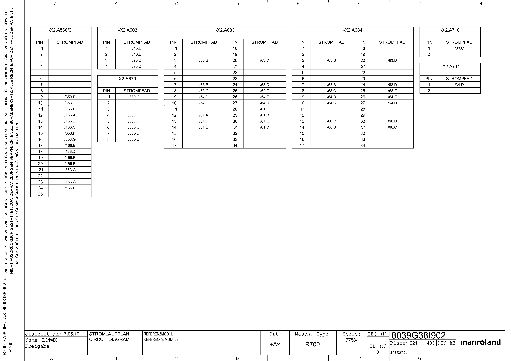

# +Ax — Sheet 221 of 403 — REFERENZMODUL

**REFERENCE MODULE**

> Part of the manroland **R700** printing press IEC/UL circuit diagrams.
> Drawing class: **Stromlaufplan / Circuit diagram** (DIN A3).
> Document `+Ax` covers the **Central control console** machine section.

## At a glance

| Field | Value |
|---|---|
| Document | `+Ax`  (8039G38I902) |
| Sheet | **221** of 403 |
| Section (DE) | REFERENZMODUL |
| Section (EN) | REFERENCE MODULE |
| Section type | REFERENCE_MODULE — Reference module |
| Machine type | `R700` |
| Series | `7758` |
| Created | 17.05.10 |
| Replaces | — |
| Columns used | A, B, C, D, E, F, G, H |
| Path numbers | — |
| Labels on sheet | 195 |
| Cross-refs out | 61 |
| Cross-refs in | 0 |

**Previous:** [+Ax sheet 220](SHEET_0220.md) · **Next:** [+Ax sheet 222](SHEET_0222.md) · **Document TOC:** [_TOC.md](_TOC.md)  (+Ax) · **Master TOC:** [all sheets](../_MASTER_TOC.md)

## Sheet image (300 DPI, exact vector render)



_Rendered directly from the PDF vector layer at 300 DPI (1-bit), no OCR and no resampling. Use it to confirm anything ambiguous in the text below._

## Cross-references on this sheet

Each entry is a wire leaving this sheet. The printed token is `/sheet.column`; the link resolves to that sheet inside the same document.

| Ref | Target sheet | Col | Path | Destination on target | Target section | From col |
|---|---|---|---|---|---|---|
| `/33.C` | [+Ax sheet 33](SHEET_0033.md) | C | — | STROMPFAD PIN 1 2 | SPANNUNGSVERSORGUNG, SCHALTSCHRANKBELÜFTUNG | G |
| `/46.B` | [+Ax sheet 46](SHEET_0046.md) | B | — | — | NOT AUS | B |
| `/46.B` | [+Ax sheet 46](SHEET_0046.md) | B | — | — | NOT AUS | B |
| `/63.B` | [+Ax sheet 63](SHEET_0063.md) | B | — | — | DRUCKLUFTANLAGE | C |
| `/63.B` | [+Ax sheet 63](SHEET_0063.md) | B | — | — | DRUCKLUFTANLAGE | F |
| `/95.D` | [+Ax sheet 95](SHEET_0095.md) | D | — | — | ANLEGER | B |
| `/63.D` | [+Ax sheet 63](SHEET_0063.md) | D | — | — | DRUCKLUFTANLAGE | D |
| `/63.D` | [+Ax sheet 63](SHEET_0063.md) | D | — | — | DRUCKLUFTANLAGE | G |
| `/95.D` | [+Ax sheet 95](SHEET_0095.md) | D | — | — | ANLEGER | B |
| `/34.D` | [+Ax sheet 34](SHEET_0034.md) | D | — | STROMPFAD PIN 1 2 | SPANNUNGSVERSORGUNG, SCHALTSCHRANKBELÜFTUNG | G |
| `/63.B` | [+Ax sheet 63](SHEET_0063.md) | B | — | — | DRUCKLUFTANLAGE | C |
| `/63.B` | [+Ax sheet 63](SHEET_0063.md) | B | — | — | DRUCKLUFTANLAGE | F |
| `/63.D` | [+Ax sheet 63](SHEET_0063.md) | D | — | — | DRUCKLUFTANLAGE | D |
| `/63.D` | [+Ax sheet 63](SHEET_0063.md) | D | — | — | DRUCKLUFTANLAGE | G |
| `/63.E` | [+Ax sheet 63](SHEET_0063.md) | E | — | — | DRUCKLUFTANLAGE | D |
| `/63.E` | [+Ax sheet 63](SHEET_0063.md) | E | — | — | DRUCKLUFTANLAGE | G |
| `/63.C` | [+Ax sheet 63](SHEET_0063.md) | C | — | — | DRUCKLUFTANLAGE | C |
| `/63.C` | [+Ax sheet 63](SHEET_0063.md) | C | — | — | DRUCKLUFTANLAGE | F |
| `/64.E` | [+Ax sheet 64](SHEET_0064.md) | E | — | — | DRUCKLUFTANLAGE | D |
| `/64.E` | [+Ax sheet 64](SHEET_0064.md) | E | — | — | DRUCKLUFTANLAGE | G |
| `/353.E` | [+Ax sheet 353](SHEET_0353.md) | E | — | — | OPTION: LOGISTIK ANLEGER | A |
| `/64.D` | [+Ax sheet 64](SHEET_0064.md) | D | — | — | DRUCKLUFTANLAGE | C |
| `/64.D` | [+Ax sheet 64](SHEET_0064.md) | D | — | — | DRUCKLUFTANLAGE | F |
| `/380.C` | [+Ax sheet 380](SHEET_0380.md) | C | — | — | OPTION: TELEPRESENCE | B |
| `/353.D` | [+Ax sheet 353](SHEET_0353.md) | D | — | — | OPTION: LOGISTIK ANLEGER | A |
| `/380.C` | [+Ax sheet 380](SHEET_0380.md) | C | — | — | OPTION: TELEPRESENCE | B |
| `/64.C` | [+Ax sheet 64](SHEET_0064.md) | C | — | — | DRUCKLUFTANLAGE | C |
| `/64.D` | [+Ax sheet 64](SHEET_0064.md) | D | — | — | DRUCKLUFTANLAGE | D |
| `/64.C` | [+Ax sheet 64](SHEET_0064.md) | C | — | — | DRUCKLUFTANLAGE | F |
| `/64.D` | [+Ax sheet 64](SHEET_0064.md) | D | — | — | DRUCKLUFTANLAGE | G |
| `/61.B` | [+Ax sheet 61](SHEET_0061.md) | B | — | — | DRUCKLUFTANLAGE | C |
| `/166.B` | [+Ax sheet 166](SHEET_0166.md) | B | — | — | ÜBERWACHUNGSRECHNER/ANSTEUERUNG NOT AUS | A |
| `/61.C` | [+Ax sheet 61](SHEET_0061.md) | C | — | — | DRUCKLUFTANLAGE | D |
| `/380.C` | [+Ax sheet 380](SHEET_0380.md) | C | — | — | OPTION: TELEPRESENCE | B |
| `/61.A` | [+Ax sheet 61](SHEET_0061.md) | A | — | — | DRUCKLUFTANLAGE | C |
| `/61.B` | [+Ax sheet 61](SHEET_0061.md) | B | — | — | DRUCKLUFTANLAGE | D |
| `/166.A` | [+Ax sheet 166](SHEET_0166.md) | A | — | — | ÜBERWACHUNGSRECHNER/ANSTEUERUNG NOT AUS | A |
| `/380.D` | [+Ax sheet 380](SHEET_0380.md) | D | — | — | OPTION: TELEPRESENCE | B |
| `/61.E` | [+Ax sheet 61](SHEET_0061.md) | E | — | — | DRUCKLUFTANLAGE | D |
| `/166.D` | [+Ax sheet 166](SHEET_0166.md) | D | — | — | ÜBERWACHUNGSRECHNER/ANSTEUERUNG NOT AUS | A |
| `/380.D` | [+Ax sheet 380](SHEET_0380.md) | D | — | — | OPTION: TELEPRESENCE | B |
| `/61.D` | [+Ax sheet 61](SHEET_0061.md) | D | — | — | DRUCKLUFTANLAGE | C |
| `/60.C` | [+Ax sheet 60](SHEET_0060.md) | C | — | — | DRUCKLUFTANLAGE | F |
| `/60.D` | [+Ax sheet 60](SHEET_0060.md) | D | — | — | DRUCKLUFTANLAGE | G |
| `/60.B` | [+Ax sheet 60](SHEET_0060.md) | B | — | — | DRUCKLUFTANLAGE | F |
| `/61.C` | [+Ax sheet 61](SHEET_0061.md) | C | — | — | DRUCKLUFTANLAGE | C |
| `/61.D` | [+Ax sheet 61](SHEET_0061.md) | D | — | — | DRUCKLUFTANLAGE | D |
| `/60.C` | [+Ax sheet 60](SHEET_0060.md) | C | — | — | DRUCKLUFTANLAGE | G |
| `/166.C` | [+Ax sheet 166](SHEET_0166.md) | C | — | — | ÜBERWACHUNGSRECHNER/ANSTEUERUNG NOT AUS | A |
| `/380.C` | [+Ax sheet 380](SHEET_0380.md) | C | — | — | OPTION: TELEPRESENCE | B |
| `/353.H` | [+Ax sheet 353](SHEET_0353.md) | H | — | — | OPTION: LOGISTIK ANLEGER | A |
| `/380.D` | [+Ax sheet 380](SHEET_0380.md) | D | — | — | OPTION: TELEPRESENCE | B |
| `/353.G` | [+Ax sheet 353](SHEET_0353.md) | G | — | — | OPTION: LOGISTIK ANLEGER | A |
| `/380.D` | [+Ax sheet 380](SHEET_0380.md) | D | — | — | OPTION: TELEPRESENCE | B |
| `/166.E` | [+Ax sheet 166](SHEET_0166.md) | E | — | — | ÜBERWACHUNGSRECHNER/ANSTEUERUNG NOT AUS | A |
| `/166.D` | [+Ax sheet 166](SHEET_0166.md) | D | — | — | ÜBERWACHUNGSRECHNER/ANSTEUERUNG NOT AUS | A |
| `/166.F` | [+Ax sheet 166](SHEET_0166.md) | F | — | — | ÜBERWACHUNGSRECHNER/ANSTEUERUNG NOT AUS | A |
| `/166.E` | [+Ax sheet 166](SHEET_0166.md) | E | — | — | ÜBERWACHUNGSRECHNER/ANSTEUERUNG NOT AUS | A |
| `/353.G` | [+Ax sheet 353](SHEET_0353.md) | G | — | — | OPTION: LOGISTIK ANLEGER | A |
| `/166.G` | [+Ax sheet 166](SHEET_0166.md) | G | — | — | ÜBERWACHUNGSRECHNER/ANSTEUERUNG NOT AUS | A |
| `/166.F` | [+Ax sheet 166](SHEET_0166.md) | F | — | — | ÜBERWACHUNGSRECHNER/ANSTEUERUNG NOT AUS | A |

## Devices on this sheet

| Tag | Class | Class meaning (IEC) | Col | Sub | Terminal | Sign |
|---|---|---|---|---|---|---|
| `X2.A683` | — | cross-device reference | D | — | — | — |
| `X2.A684` | — | cross-device reference | F | — | — | — |
| `X2.A710` | — | cross-device reference | G | — | — | — |
| `X2.A711` | — | cross-device reference | H | — | — | — |
| `X2.A603` | — | cross-device reference | B | — | — | — |
| `X2.A679` | — | cross-device reference | B | — | — | — |

## Potentials / nets

_No named potentials on this sheet._

## Wire-end annotations (grouped as printed)

A wire that continues elsewhere is annotated with a small cluster: the destination description, the path/line number `#NN`, and the `/sheet.column` cross reference. Each row below is one such cluster exactly as it is grouped on the drawing.

| Col | Y | Path | Cross-ref | Text on the wire |
|---|---|---|---|---|
| A | 65.5 | — | — | `X2.A566/01` |
| B | 65.5 | — | — | `X2.A603` |
| D | 65.5 | — | — | `X2.A683` |
| F | 65.5 | — | — | `X2.A684` |
| G | 65.5 | — | — | `X2.A710` |
| A | 94.2 | — | — | `PIN STROMPFAD` |
| B | 94.2 | — | — | `PIN 2 3 4 1 STROMPFAD` |
| C | 94.2 | — | — | `PIN STROMPFAD` |
| D | 94.2 | — | — | `PIN 18 19 20 22 23 24 25 26 27 28 29 30 32 33 34 21 31 STROMPFAD` |
| E | 94.2 | — | — | `PIN STROMPFAD` |
| F | 94.2 | — | — | `PIN 18 19 20 22 23 24 25 26 27 28 29 30 32 33 34 21 31 STROMPFAD` |
| G | 94.2 | — | `/33.C` | `PIN 2 1 STROMPFAD` |
| A | 108.4 | — | — | `2 3 4 5 6 7 8 9 1` |
| C | 108.4 | — | — | `2 3 4 5 6 7 8 9 1` |
| E | 108.4 | — | — | `2 3 4 5 6 7 8 9 1` |
| B | 108.7 | — | `/46.B` | — |
| B | 122.8 | — | `/46.B` | — |
| C | 137.0 | — | `/63.B` | — |
| F | 137.0 | — | `/63.B` | — |
| B | 137.1 | — | `/95.D` | — |
| D | 137.1 | — | `/63.D` | — |
| G | 137.1 | — | `/63.D` | — |
| H | 150.6 | — | — | `X2.A711` |
| B | 151.2 | — | `/95.D` | — |
| B | 178.9 | — | — | `X2.A679` |
| G | 179.2 | — | `/34.D` | `PIN 2 1 STROMPFAD` |
| C | 193.7 | — | `/63.B` | — |
| F | 193.7 | — | `/63.B` | — |
| D | 193.8 | — | `/63.D` | — |
| G | 193.8 | — | `/63.D` | — |
| B | 207.5 | — | — | `PIN 2 3 4 5 6 7 8 1 STROMPFAD` |
| C | 207.9 | — | `/63.C` | — |
| D | 207.9 | — | `/63.E` | — |
| F | 207.9 | — | `/63.C` | — |
| G | 207.9 | — | `/63.E` | — |
| A | 222.1 | — | `/353.E` | — |
| B | 222.1 | — | `/380.C` | — |
| C | 222.1 | — | `/64.D` | — |
| D | 222.1 | — | `/64.E` | — |
| F | 222.1 | — | `/64.D` | — |
| G | 222.1 | — | `/64.E` | — |
| A | 235.9 | — | — | `10 12 13 14 15 16 17 18 19 20 11` |
| C | 235.9 | — | — | `10 12 13 14 15 16 17 11` |
| E | 235.9 | — | — | `10 12 13 14 15 16 17 11` |
| A | 236.3 | — | `/353.D` | — |
| B | 236.3 | — | `/380.C` | — |
| C | 236.3 | — | `/64.C` | — |
| D | 236.3 | — | `/64.D` | — |
| F | 236.3 | — | `/64.C` | — |
| G | 236.3 | — | `/64.D` | — |
| A | 250.4 | — | `/166.B` | — |
| B | 250.4 | — | `/380.C` | — |
| C | 250.4 | — | `/61.B` | — |
| D | 250.4 | — | `/61.C` | — |
| A | 264.6 | — | `/166.A` | — |
| B | 264.6 | — | `/380.D` | — |
| C | 264.6 | — | `/61.A` | — |
| D | 264.6 | — | `/61.B` | — |
| A | 278.8 | — | `/166.D` | — |
| B | 278.8 | — | `/380.D` | — |
| C | 278.8 | — | `/61.D` | — |
| D | 278.8 | — | `/61.E` | — |
| F | 278.8 | — | `/60.C` | — |
| G | 278.8 | — | `/60.D` | — |
| F | 292.9 | — | `/60.B` | — |
| A | 293.0 | — | `/166.C` | — |
| B | 293.0 | — | `/380.C` | — |
| C | 293.0 | — | `/61.C` | — |
| D | 293.0 | — | `/61.D` | — |
| G | 293.0 | — | `/60.C` | — |
| A | 307.1 | — | `/353.H` | — |
| B | 307.1 | — | `/380.D` | — |
| A | 321.3 | — | `/353.G` | — |
| B | 321.3 | — | `/380.D` | — |
| A | 335.5 | — | `/166.E` | — |
| A | 349.7 | — | `/166.D` | — |
| A | 363.8 | — | `/166.F` | — |
| A | 378.0 | — | `/166.E` | — |
| A | 391.8 | — | — | `22 23 24 25 21` |
| A | 392.2 | — | `/353.G` | — |
| A | 420.5 | — | `/166.G` | — |
| A | 434.7 | — | `/166.F` | — |


## Reconstructed tables

This sheet carries tabular content (pin map / terminal assignment / index). The grid below was rebuilt from the drawing's own rule lines, so each row is exactly one physical row of the table.

### Table 1 — 25 data rows × 2 columns (at x=70.9, y=62.4) — **X2.A566/01**

| PIN | STROMPFAD |
|---|---|
| `1` |  |
| `2` |  |
| `3` |  |
| `4` |  |
| `5` |  |
| `6` |  |
| `7` |  |
| `8` |  |
| `9` | `/353.E` |
| `10` | `/353.D` |
| `11` | `/166.B` |
| `12` | `/166.A` |
| `13` | `/166.D` |
| `14` | `/166.C` |
| `15` | `/353.H` |
| `16` | `/353.G` |
| `17` | `/166.E` |
| `18` | `/166.D` |
| `19` | `/166.F` |
| `20` | `/166.E` |
| `21` | `/353.G` |
| `22` |  |
| `23` | `/166.G` |
| `24` | `/166.F` |
| `25` |  |


### Table 2 — 14 data rows × 2 columns (at x=226.8, y=62.4) — **X2.A603**

| PIN | STROMPFAD |
|---|---|
| `1` | `/46.B` |
| `2` | `/46.B` |
| `3` | `/95.D` |
| `4` | `/95.D` |
|  | `X2.A679` |
| `PIN` | `STROMPFAD` |
| `1` | `/380.C` |
| `2` | `/380.C` |
| `3` | `/380.C` |
| `4` | `/380.D` |
| `5` | `/380.D` |
| `6` | `/380.C` |
| `7` | `/380.D` |
| `8` | `/380.D` |


### Table 3 — 17 data rows × 4 columns (at x=382.7, y=62.4) — **X2.A683**

| PIN | STROMPFAD | PIN | STROMPFAD |
|---|---|---|---|
| `1` |  | `18` |  |
| `2` |  | `19` |  |
| `3` | `/63.B` | `20` | `/63.D` |
| `4` |  | `21` |  |
| `5` |  | `22` |  |
| `6` |  | `23` |  |
| `7` | `/63.B` | `24` | `/63.D` |
| `8` | `/63.C` | `25` | `/63.E` |
| `9` | `/64.D` | `26` | `/64.E` |
| `10` | `/64.C` | `27` | `/64.D` |
| `11` | `/61.B` | `28` | `/61.C` |
| `12` | `/61.A` | `29` | `/61.B` |
| `13` | `/61.D` | `30` | `/61.E` |
| `14` | `/61.C` | `31` | `/61.D` |
| `15` |  | `32` |  |
| `16` |  | `33` |  |
| `17` |  | `34` |  |


### Table 4 — 17 data rows × 4 columns (at x=680.3, y=62.4) — **X2.A684**

| PIN | STROMPFAD | PIN | STROMPFAD |
|---|---|---|---|
| `1` |  | `18` |  |
| `2` |  | `19` |  |
| `3` | `/63.B` | `20` | `/63.D` |
| `4` |  | `21` |  |
| `5` |  | `22` |  |
| `6` |  | `23` |  |
| `7` | `/63.B` | `24` | `/63.D` |
| `8` | `/63.C` | `25` | `/63.E` |
| `9` | `/64.D` | `26` | `/64.E` |
| `10` | `/64.C` | `27` | `/64.D` |
| `11` |  | `28` |  |
| `12` |  | `29` |  |
| `13` | `/60.C` | `30` | `/60.D` |
| `14` | `/60.B` | `31` | `/60.C` |
| `15` |  | `32` |  |
| `16` |  | `33` |  |
| `17` |  | `34` |  |


### Table 5 — 6 data rows × 2 columns (at x=978.0, y=62.4) — **X2.A710**

| PIN | STROMPFAD |
|---|---|
| `1` | `/33.C` |
| `2` |  |
|  | `X2.A711` |
| `PIN` | `STROMPFAD` |
| `1` | `/34.D` |
| `2` |  |


## Notes and free text on this sheet

| Text | Col | Y (pt) |
|---|---|---|
| `PIN` | A | 94.2 |
| `STROMPFAD` | A | 94.15 |
| `X2.A566/01` | A | 65.51 |
| `PIN` | C | 94.2 |
| `STROMPFAD` | C | 94.15 |
| `PIN` | D | 94.2 |
| `STROMPFAD` | D | 94.15 |
| `PIN` | E | 94.2 |
| `STROMPFAD` | F | 94.15 |
| `PIN` | F | 94.2 |
| `STROMPFAD` | G | 94.15 |
| `PIN` | G | 94.2 |
| `STROMPFAD` | H | 94.15 |
| `PIN` | B | 94.2 |
| `STROMPFAD` | B | 94.15 |

## Complete label inventory (exact text from the drawing)

Every text object inside the drawing area of this sheet, in DIN reading order (column A→H, then top→bottom). This is the authoritative list: if a string is not here it is not printed on this sheet.

| Col | Y | X | Dir | Type | Text |
|---|---|---|---|---|---|
| A | 65.5 | 113.1 | → | text | `X2.A566/01` |
| A | 94.2 | 84.0 | → | text | `PIN` |
| A | 94.2 | 132.2 | → | text | `STROMPFAD` |
| A | 108.4 | 95.8 | → | number | `1` |
| A | 122.5 | 94.1 | → | number | `2` |
| A | 136.7 | 94.1 | → | number | `3` |
| A | 150.9 | 94.1 | → | number | `4` |
| A | 165.1 | 94.1 | → | number | `5` |
| A | 179.2 | 94.1 | → | number | `6` |
| A | 193.4 | 94.1 | → | number | `7` |
| A | 207.6 | 94.1 | → | number | `8` |
| A | 221.8 | 94.1 | → | number | `9` |
| A | 222.1 | 150.5 | → | cross-reference | `/353.E` |
| A | 235.9 | 88.7 | → | number | `10` |
| A | 236.3 | 150.2 | → | cross-reference | `/353.D` |
| A | 250.1 | 90.4 | → | number | `11` |
| A | 250.4 | 150.4 | → | cross-reference | `/166.B` |
| A | 264.3 | 88.7 | → | number | `12` |
| A | 264.6 | 150.2 | → | cross-reference | `/166.A` |
| A | 278.5 | 88.7 | → | number | `13` |
| A | 278.8 | 150.2 | → | cross-reference | `/166.D` |
| A | 292.6 | 88.7 | → | number | `14` |
| A | 293.0 | 150.2 | → | cross-reference | `/166.C` |
| A | 306.8 | 88.7 | → | number | `15` |
| A | 307.1 | 150.5 | → | cross-reference | `/353.H` |
| A | 321.0 | 88.7 | → | number | `16` |
| A | 321.3 | 150.1 | → | cross-reference | `/353.G` |
| A | 335.1 | 88.7 | → | number | `17` |
| A | 335.5 | 150.5 | → | cross-reference | `/166.E` |
| A | 349.3 | 88.7 | → | number | `18` |
| A | 349.7 | 150.2 | → | cross-reference | `/166.D` |
| A | 363.5 | 88.7 | → | number | `19` |
| A | 363.8 | 150.7 | → | cross-reference | `/166.F` |
| A | 377.7 | 88.7 | → | number | `20` |
| A | 378.0 | 150.5 | → | cross-reference | `/166.E` |
| A | 391.8 | 90.4 | → | number | `21` |
| A | 392.2 | 150.1 | → | cross-reference | `/353.G` |
| A | 406.0 | 88.7 | → | number | `22` |
| A | 420.2 | 88.7 | → | number | `23` |
| A | 420.5 | 150.1 | → | cross-reference | `/166.G` |
| A | 434.4 | 88.7 | → | number | `24` |
| A | 434.7 | 150.7 | → | cross-reference | `/166.F` |
| A | 448.5 | 88.7 | → | number | `25` |
| B | 65.5 | 275.7 | → | device ref | `X2.A603` |
| B | 94.2 | 240.0 | → | text | `PIN` |
| B | 94.2 | 288.1 | → | text | `STROMPFAD` |
| B | 108.4 | 245.9 | → | number | `1` |
| B | 108.7 | 308.7 | → | cross-reference | `/46.B` |
| B | 122.5 | 245.3 | → | number | `2` |
| B | 122.8 | 308.7 | → | cross-reference | `/46.B` |
| B | 136.7 | 245.3 | → | number | `3` |
| B | 137.1 | 308.6 | → | cross-reference | `/95.D` |
| B | 150.9 | 245.3 | → | number | `4` |
| B | 151.2 | 308.6 | → | cross-reference | `/95.D` |
| B | 178.9 | 272.8 | → | device ref | `X2.A679` |
| B | 207.5 | 288.1 | → | text | `STROMPFAD` |
| B | 207.6 | 240.0 | → | text | `PIN` |
| B | 221.8 | 251.7 | → | number | `1` |
| B | 222.1 | 299.1 | → | cross-reference | `/380.C` |
| B | 235.9 | 250.0 | → | number | `2` |
| B | 236.3 | 299.1 | → | cross-reference | `/380.C` |
| B | 250.1 | 250.0 | → | number | `3` |
| B | 250.4 | 299.1 | → | cross-reference | `/380.C` |
| B | 264.3 | 250.0 | → | number | `4` |
| B | 264.6 | 299.1 | → | cross-reference | `/380.D` |
| B | 278.5 | 250.0 | → | number | `5` |
| B | 278.8 | 299.1 | → | cross-reference | `/380.D` |
| B | 292.6 | 250.0 | → | number | `6` |
| B | 293.0 | 299.1 | → | cross-reference | `/380.C` |
| B | 306.8 | 250.0 | → | number | `7` |
| B | 307.1 | 299.1 | → | cross-reference | `/380.D` |
| B | 321.0 | 250.0 | → | number | `8` |
| B | 321.3 | 299.1 | → | cross-reference | `/380.D` |
| C | 94.2 | 395.9 | → | text | `PIN` |
| C | 94.2 | 444.0 | → | text | `STROMPFAD` |
| C | 108.4 | 407.6 | → | number | `1` |
| C | 122.5 | 405.9 | → | number | `2` |
| C | 136.7 | 405.9 | → | number | `3` |
| C | 137.0 | 464.6 | → | cross-reference | `/63.B` |
| C | 150.9 | 405.9 | → | number | `4` |
| C | 165.1 | 405.9 | → | number | `5` |
| C | 179.2 | 405.9 | → | number | `6` |
| C | 193.4 | 405.9 | → | number | `7` |
| C | 193.7 | 464.6 | → | cross-reference | `/63.B` |
| C | 207.6 | 405.9 | → | number | `8` |
| C | 207.9 | 464.5 | → | cross-reference | `/63.C` |
| C | 221.8 | 405.9 | → | number | `9` |
| C | 222.1 | 464.5 | → | cross-reference | `/64.D` |
| C | 235.9 | 400.5 | → | number | `10` |
| C | 236.3 | 464.5 | → | cross-reference | `/64.C` |
| C | 250.1 | 402.2 | → | number | `11` |
| C | 250.4 | 464.6 | → | cross-reference | `/61.B` |
| C | 264.3 | 400.5 | → | number | `12` |
| C | 264.6 | 464.5 | → | cross-reference | `/61.A` |
| C | 278.5 | 400.5 | → | number | `13` |
| C | 278.8 | 464.5 | → | cross-reference | `/61.D` |
| C | 292.6 | 400.5 | → | number | `14` |
| C | 293.0 | 464.5 | → | cross-reference | `/61.C` |
| C | 306.8 | 400.5 | → | number | `15` |
| C | 321.0 | 400.5 | → | number | `16` |
| C | 335.1 | 400.5 | → | number | `17` |
| D | 65.5 | 502.4 | → | device ref | `X2.A683` |
| D | 94.2 | 537.6 | → | text | `PIN` |
| D | 94.2 | 585.8 | → | text | `STROMPFAD` |
| D | 108.4 | 542.3 | → | number | `18` |
| D | 122.5 | 542.3 | → | number | `19` |
| D | 136.7 | 542.3 | → | number | `20` |
| D | 137.1 | 606.2 | → | cross-reference | `/63.D` |
| D | 150.9 | 544.0 | → | number | `21` |
| D | 165.1 | 542.3 | → | number | `22` |
| D | 179.2 | 542.3 | → | number | `23` |
| D | 193.4 | 542.3 | → | number | `24` |
| D | 193.7 | 606.2 | → | cross-reference | `/63.D` |
| D | 207.6 | 542.3 | → | number | `25` |
| D | 207.9 | 606.5 | → | cross-reference | `/63.E` |
| D | 221.8 | 542.3 | → | number | `26` |
| D | 222.1 | 606.5 | → | cross-reference | `/64.E` |
| D | 235.9 | 542.3 | → | number | `27` |
| D | 236.3 | 606.2 | → | cross-reference | `/64.D` |
| D | 250.1 | 542.3 | → | number | `28` |
| D | 250.4 | 606.2 | → | cross-reference | `/61.C` |
| D | 264.3 | 542.3 | → | number | `29` |
| D | 264.6 | 606.3 | → | cross-reference | `/61.B` |
| D | 278.5 | 542.3 | → | number | `30` |
| D | 278.8 | 606.5 | → | cross-reference | `/61.E` |
| D | 292.6 | 544.0 | → | number | `31` |
| D | 293.0 | 606.2 | → | cross-reference | `/61.D` |
| D | 306.8 | 542.3 | → | number | `32` |
| D | 321.0 | 542.3 | → | number | `33` |
| D | 335.1 | 542.3 | → | number | `34` |
| E | 94.2 | 693.5 | → | text | `PIN` |
| E | 108.4 | 705.3 | → | number | `1` |
| E | 122.5 | 703.6 | → | number | `2` |
| E | 136.7 | 703.6 | → | number | `3` |
| E | 150.9 | 703.6 | → | number | `4` |
| E | 165.1 | 703.6 | → | number | `5` |
| E | 179.2 | 703.6 | → | number | `6` |
| E | 193.4 | 703.6 | → | number | `7` |
| E | 207.6 | 703.6 | → | number | `8` |
| E | 221.8 | 703.6 | → | number | `9` |
| E | 235.9 | 698.2 | → | number | `10` |
| E | 250.1 | 699.9 | → | number | `11` |
| E | 264.3 | 698.2 | → | number | `12` |
| E | 278.5 | 698.2 | → | number | `13` |
| E | 292.6 | 698.2 | → | number | `14` |
| E | 306.8 | 698.2 | → | number | `15` |
| E | 321.0 | 698.2 | → | number | `16` |
| E | 335.1 | 698.2 | → | number | `17` |
| F | 65.5 | 800.1 | → | device ref | `X2.A684` |
| F | 94.2 | 741.7 | → | text | `STROMPFAD` |
| F | 94.2 | 835.2 | → | text | `PIN` |
| F | 108.4 | 839.9 | → | number | `18` |
| F | 122.5 | 839.9 | → | number | `19` |
| F | 136.7 | 839.9 | → | number | `20` |
| F | 137.0 | 762.2 | → | cross-reference | `/63.B` |
| F | 150.9 | 841.6 | → | number | `21` |
| F | 165.1 | 839.9 | → | number | `22` |
| F | 179.2 | 839.9 | → | number | `23` |
| F | 193.4 | 839.9 | → | number | `24` |
| F | 193.7 | 762.2 | → | cross-reference | `/63.B` |
| F | 207.6 | 839.9 | → | number | `25` |
| F | 207.9 | 762.1 | → | cross-reference | `/63.C` |
| F | 221.8 | 839.9 | → | number | `26` |
| F | 222.1 | 762.1 | → | cross-reference | `/64.D` |
| F | 235.9 | 839.9 | → | number | `27` |
| F | 236.3 | 762.1 | → | cross-reference | `/64.C` |
| F | 250.1 | 839.9 | → | number | `28` |
| F | 264.3 | 839.9 | → | number | `29` |
| F | 278.5 | 839.9 | → | number | `30` |
| F | 278.8 | 762.1 | → | cross-reference | `/60.C` |
| F | 292.6 | 841.6 | → | number | `31` |
| F | 292.9 | 762.2 | → | cross-reference | `/60.B` |
| F | 306.8 | 839.9 | → | number | `32` |
| F | 321.0 | 839.9 | → | number | `33` |
| F | 335.1 | 839.9 | → | number | `34` |
| G | 65.5 | 1026.9 | → | device ref | `X2.A710` |
| G | 94.2 | 883.4 | → | text | `STROMPFAD` |
| G | 94.2 | 991.1 | → | text | `PIN` |
| G | 108.4 | 997.1 | → | number | `1` |
| G | 122.5 | 996.5 | → | number | `2` |
| G | 137.1 | 903.8 | → | cross-reference | `/63.D` |
| G | 179.2 | 991.1 | → | text | `PIN` |
| G | 193.4 | 997.1 | → | number | `1` |
| G | 193.7 | 903.8 | → | cross-reference | `/63.D` |
| G | 207.6 | 996.5 | → | number | `2` |
| G | 207.9 | 904.1 | → | cross-reference | `/63.E` |
| G | 222.1 | 904.1 | → | cross-reference | `/64.E` |
| G | 236.3 | 903.8 | → | cross-reference | `/64.D` |
| G | 278.8 | 903.8 | → | cross-reference | `/60.D` |
| G | 293.0 | 903.8 | → | cross-reference | `/60.C` |
| H | 94.2 | 1039.3 | → | text | `STROMPFAD` |
| H | 108.7 | 1059.7 | → | cross-reference | `/33.C` |
| H | 150.5 | 1027.6 | → | device ref | `X2.A711` |
| H | 179.2 | 1039.3 | → | text | `STROMPFAD` |
| H | 193.7 | 1059.7 | → | cross-reference | `/34.D` |

## Reading-order text block

The same content as a plain block, grouped by DIN column — convenient to paste or to match against a visual description.

```text
=== Column A ===
  65.5  113.1  text         X2.A566/01
  94.2   84.0  text         PIN
  94.2  132.2  text         STROMPFAD
 108.4   95.8  numeric      1
 122.5   94.1  numeric      2
 136.7   94.1  numeric      3
 150.9   94.1  numeric      4
 165.1   94.1  numeric      5
 179.2   94.1  numeric      6
 193.4   94.1  numeric      7
 207.6   94.1  numeric      8
 221.8   94.1  numeric      9
 222.1  150.5  xref         /353.E
 235.9   88.7  numeric      10
 236.3  150.2  xref         /353.D
 250.1   90.4  numeric      11
 250.4  150.4  xref         /166.B
 264.3   88.7  numeric      12
 264.6  150.2  xref         /166.A
 278.5   88.7  numeric      13
 278.8  150.2  xref         /166.D
 292.6   88.7  numeric      14
 293.0  150.2  xref         /166.C
 306.8   88.7  numeric      15
 307.1  150.5  xref         /353.H
 321.0   88.7  numeric      16
 321.3  150.1  xref         /353.G
 335.1   88.7  numeric      17
 335.5  150.5  xref         /166.E
 349.3   88.7  numeric      18
 349.7  150.2  xref         /166.D
 363.5   88.7  numeric      19
 363.8  150.7  xref         /166.F
 377.7   88.7  numeric      20
 378.0  150.5  xref         /166.E
 391.8   90.4  numeric      21
 392.2  150.1  xref         /353.G
 406.0   88.7  numeric      22
 420.2   88.7  numeric      23
 420.5  150.1  xref         /166.G
 434.4   88.7  numeric      24
 434.7  150.7  xref         /166.F
 448.5   88.7  numeric      25
=== Column B ===
  65.5  275.7  devref       X2.A603
  94.2  240.0  text         PIN
  94.2  288.1  text         STROMPFAD
 108.4  245.9  numeric      1
 108.7  308.7  xref         /46.B
 122.5  245.3  numeric      2
 122.8  308.7  xref         /46.B
 136.7  245.3  numeric      3
 137.1  308.6  xref         /95.D
 150.9  245.3  numeric      4
 151.2  308.6  xref         /95.D
 178.9  272.8  devref       X2.A679
 207.5  288.1  text         STROMPFAD
 207.6  240.0  text         PIN
 221.8  251.7  numeric      1
 222.1  299.1  xref         /380.C
 235.9  250.0  numeric      2
 236.3  299.1  xref         /380.C
 250.1  250.0  numeric      3
 250.4  299.1  xref         /380.C
 264.3  250.0  numeric      4
 264.6  299.1  xref         /380.D
 278.5  250.0  numeric      5
 278.8  299.1  xref         /380.D
 292.6  250.0  numeric      6
 293.0  299.1  xref         /380.C
 306.8  250.0  numeric      7
 307.1  299.1  xref         /380.D
 321.0  250.0  numeric      8
 321.3  299.1  xref         /380.D
=== Column C ===
  94.2  395.9  text         PIN
  94.2  444.0  text         STROMPFAD
 108.4  407.6  numeric      1
 122.5  405.9  numeric      2
 136.7  405.9  numeric      3
 137.0  464.6  xref         /63.B
 150.9  405.9  numeric      4
 165.1  405.9  numeric      5
 179.2  405.9  numeric      6
 193.4  405.9  numeric      7
 193.7  464.6  xref         /63.B
 207.6  405.9  numeric      8
 207.9  464.5  xref         /63.C
 221.8  405.9  numeric      9
 222.1  464.5  xref         /64.D
 235.9  400.5  numeric      10
 236.3  464.5  xref         /64.C
 250.1  402.2  numeric      11
 250.4  464.6  xref         /61.B
 264.3  400.5  numeric      12
 264.6  464.5  xref         /61.A
 278.5  400.5  numeric      13
 278.8  464.5  xref         /61.D
 292.6  400.5  numeric      14
 293.0  464.5  xref         /61.C
 306.8  400.5  numeric      15
 321.0  400.5  numeric      16
 335.1  400.5  numeric      17
=== Column D ===
  65.5  502.4  devref       X2.A683
  94.2  537.6  text         PIN
  94.2  585.8  text         STROMPFAD
 108.4  542.3  numeric      18
 122.5  542.3  numeric      19
 136.7  542.3  numeric      20
 137.1  606.2  xref         /63.D
 150.9  544.0  numeric      21
 165.1  542.3  numeric      22
 179.2  542.3  numeric      23
 193.4  542.3  numeric      24
 193.7  606.2  xref         /63.D
 207.6  542.3  numeric      25
 207.9  606.5  xref         /63.E
 221.8  542.3  numeric      26
 222.1  606.5  xref         /64.E
 235.9  542.3  numeric      27
 236.3  606.2  xref         /64.D
 250.1  542.3  numeric      28
 250.4  606.2  xref         /61.C
 264.3  542.3  numeric      29
 264.6  606.3  xref         /61.B
 278.5  542.3  numeric      30
 278.8  606.5  xref         /61.E
 292.6  544.0  numeric      31
 293.0  606.2  xref         /61.D
 306.8  542.3  numeric      32
 321.0  542.3  numeric      33
 335.1  542.3  numeric      34
=== Column E ===
  94.2  693.5  text         PIN
 108.4  705.3  numeric      1
 122.5  703.6  numeric      2
 136.7  703.6  numeric      3
 150.9  703.6  numeric      4
 165.1  703.6  numeric      5
 179.2  703.6  numeric      6
 193.4  703.6  numeric      7
 207.6  703.6  numeric      8
 221.8  703.6  numeric      9
 235.9  698.2  numeric      10
 250.1  699.9  numeric      11
 264.3  698.2  numeric      12
 278.5  698.2  numeric      13
 292.6  698.2  numeric      14
 306.8  698.2  numeric      15
 321.0  698.2  numeric      16
 335.1  698.2  numeric      17
=== Column F ===
  65.5  800.1  devref       X2.A684
  94.2  741.7  text         STROMPFAD
  94.2  835.2  text         PIN
 108.4  839.9  numeric      18
 122.5  839.9  numeric      19
 136.7  839.9  numeric      20
 137.0  762.2  xref         /63.B
 150.9  841.6  numeric      21
 165.1  839.9  numeric      22
 179.2  839.9  numeric      23
 193.4  839.9  numeric      24
 193.7  762.2  xref         /63.B
 207.6  839.9  numeric      25
 207.9  762.1  xref         /63.C
 221.8  839.9  numeric      26
 222.1  762.1  xref         /64.D
 235.9  839.9  numeric      27
 236.3  762.1  xref         /64.C
 250.1  839.9  numeric      28
 264.3  839.9  numeric      29
 278.5  839.9  numeric      30
 278.8  762.1  xref         /60.C
 292.6  841.6  numeric      31
 292.9  762.2  xref         /60.B
 306.8  839.9  numeric      32
 321.0  839.9  numeric      33
 335.1  839.9  numeric      34
=== Column G ===
  65.5 1026.9  devref       X2.A710
  94.2  883.4  text         STROMPFAD
  94.2  991.1  text         PIN
 108.4  997.1  numeric      1
 122.5  996.5  numeric      2
 137.1  903.8  xref         /63.D
 179.2  991.1  text         PIN
 193.4  997.1  numeric      1
 193.7  903.8  xref         /63.D
 207.6  996.5  numeric      2
 207.9  904.1  xref         /63.E
 222.1  904.1  xref         /64.E
 236.3  903.8  xref         /64.D
 278.8  903.8  xref         /60.D
 293.0  903.8  xref         /60.C
=== Column H ===
  94.2 1039.3  text         STROMPFAD
 108.7 1059.7  xref         /33.C
 150.5 1027.6  devref       X2.A711
 179.2 1039.3  text         STROMPFAD
 193.7 1059.7  xref         /34.D
```

---
_Generated from the PDF vector text layer; no OCR. Source: `R700_7758_IEC_AX_8039G38I902_p`, sheet 221._
